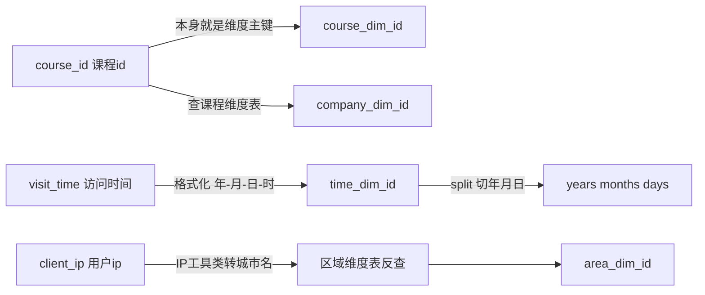
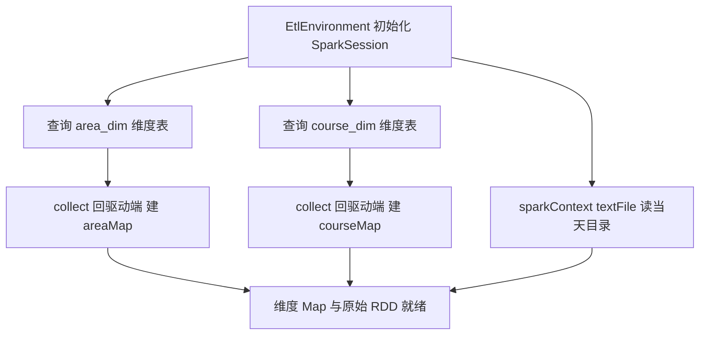
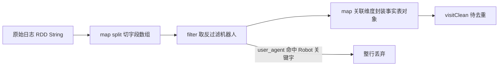
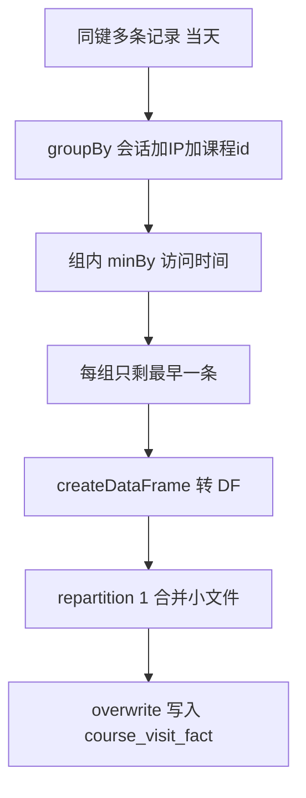
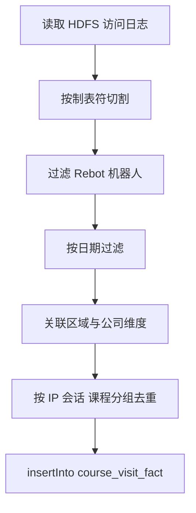
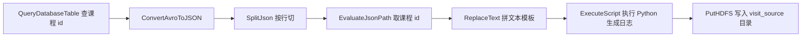

# ETL 数据清洗之课程访问量：事实表建模、Spark 清洗实现与 NiFi 量产检验

> 🔒 安全提示：文中示例的口令/密钥均为课程教学环境演示口径，生产环境的安全要求见《安全与合规须知》。

## 先给结论

- 六篇内容完成课程访问量事实表的清洗闭环：字段与清洗逻辑介绍、维度与原始数据获取、机器人过滤与维度关联、去重落库、单机测试、NiFi 量产十二万条实战检验。
- 目标表是 Hive 的 course_visit_fact，九个普通字段加年、月、日三个分区字段，Parquet 落盘；课程、时间、区域、公司四个维度 ID 在清洗阶段就补进每一行，后续统计不用回查维度表。
- 维度 ID 各有来历：课程 ID 就是课程 id，时间 ID 由访问时间格式化得到，区域 ID 靠 IP 反查区域表，公司 ID 经课程维度表中转；事实表主键清洗时用 UUID 现生成。
- 清洗规则共三条：关联维度、过滤 user_agent 含 Robot 的机器人访问、以天为单位按 session_id + client_ip + course_id 去重。
- 程序骨架：维度表小，collect 收进两张查找 Map 内存查表；原始日志按天目录 textFile 读入；Map 的 += 是重新赋值，变量必须声明成 var，数值型维度 ID 拼 Map 前要 toString。
- 去重用 groupBy 加 minBy(_.visit_time) 保留最早一条：第一次进入才算真实访问，后续刷新丢弃；拼接键顺序不影响结果，minBy 与 maxBy 的选择才决定留哪条。
- 落库四件套：createDataFrame 转 DataFrame、repartition(1) 合小文件、动态分区 nonstrict、overwrite 覆盖写让重跑幂等，收尾 sc.stop 加 spark.close。
- 测试数据为每条规则量身定制，撞出三类真实错误：Dataset 上想当然调 map、动态分区忘了 nonstrict、查不到维度 None.get 炸空指针。
- NiFi 七处理器链量产日志喂饱链路；两个真坑：脚本秒级时间戳与毫秒埋点差一千倍要乘 1000，1970 分区残留要手动删，生产口径应按 date_info 过滤。

## 第1部分：课程访问量事实表长什么样：12 个字段的来历与三条清洗规则

采集这条线已经铺完：NiFi 把在线教育平台的课程访问日志按天写进 HDFS，课程、区域等维度数据也已入库到 `data_dimen` 库。打开原始数据目录，看到的是一行行制表符分隔的文本，课程 id、时间戳、浏览器标识混在一起，其中还夹着爬虫和自动化工具刷出来的垃圾记录。这样的数据不能直接拿去做统计分析，中间必须经过数据清洗。动手写清洗代码之前，先把目标讲清楚：清洗出来的事实表有哪些字段，每个字段从哪来，清洗到底要做哪几件事。

### 原始数据为什么不能直接用

埋点采集拿到的是最原始的用户行为流水，里面混着三类不能用的数据：爬虫程序抓页面产生的访问、自动化工具模拟请求产生的访问、字段缺失内容不完整的记录。垃圾数据混进统计的后果很直接：课程访问量被算虚高，报表上某天突然冒出一个不存在的访问高峰，运营拿着这个数做决策就要出问题。

清洗要做的就是对原始流水逐行甄别，过滤掉垃圾数据，再按目标表的要求做格式转换。转换不只是改个字段名：原始数据里只有课程 id 和访问时间，而统计分析要按区域、公司、时间维度切分，这些维度的 ID 必须在清洗时就补齐。清洗完的结果保存到事实表，也就是数据仓库 DWD 层的表。

**第一，什么叫事实宽表。** 普通事实表只记录业务动作本身，维度信息靠外键回查维度表。清洗后的数据会把很多维度字段直接关联进来，一张表带着课程、时间、区域、公司四组维度 ID，字段多、行宽，所以叫事实宽表。宽表换来的是后续查询省掉反复的维度关联，统计分析程序拿到事实表就能直接分组求和。

### 事实表的 12 个字段

目标表在建数据仓库阶段已经建好，建表语句如下：

```sql
CREATE EXTERNAL TABLE IF NOT EXISTS data_course.course_visit_fact
(course_visit_fact_id String,
course_dim_id String,
time_dim_id String,
area_dim_id String,
company_dim_id String,
client_ip String,
client_sessionid String,
client_type String,
visit_time bigint)
PARTITIONED BY (years String,months String,days String)
ROW FORMAT DELIMITED FIELDS TERMINATED BY '\t'
STORED AS PARQUET
location '/user/hive/external/data_course/course_visit_fact';
```

九个普通字段加三个分区字段，逐个对照着看来源：

**主键一个。** `course_visit_fact_id` 是事实表自己的 id，原始数据里没有这一列，清洗时用 UUID 工具类生成，每行一个，保证唯一。

**维度 ID 四个。** `course_dim_id` 最省事，课程 id 本身就是课程维度的主键，直接拿来用。`time_dim_id` 是时间维度 ID，格式形如 `2019-11-04-09`，年月日加小时；前台采集时预留了这一列，传了就直接用，没传就由访问时间计算出来。`area_dim_id` 是区域维度 ID，原始数据里只有用户 IP，要靠 IP 工具类先把 IP 解析成城市名，再去区域维度表按城市名反查 ID。`company_dim_id` 是公司维度 ID，公司维度表自身不带课程信息，但课程维度表里带着 `company_id` 字段，所以拿课程 id 查一次课程维度就能中转出公司 ID。

**原样保留三个。** `client_ip` 直接取原始数据的用户 IP；`client_sessionid` 对应原始数据的 `session_id`，值不动，字段名改掉；`client_type` 对应 `user_agent`，浏览器标识，同样只改名不改值；`visit_time` 是访问时间戳，原样保留。

**分区字段三个。** `years`、`months`、`days` 由访问时间拆出年、月、日，作为 Hive 表的分区列，按天分区是后面所有分析的基础。

实体类在工程里已经按表结构定义好：

```scala
case class CourseVisitFact(
  course_visit_fact_id: String,
  course_dim_id: String,
  time_dim_id: String,
  area_dim_id: String,
  company_dim_id: String,
  client_ip: String,
  client_sessionid: String,
  // user-agent
  client_type: String,
  visit_time: Long,
  years: String,
  months: String,
  days: String
)
```

注意 `visit_time` 声明的是 `Long`：时间戳要参与大小比较，清洗阶段必须从字符串转成数值，其余字段全是 String。

### 四个维度 ID 怎么关联出来

把原始字段到事实表字段的映射画成一张图，清洗代码就是照着它写的：



图上有两条路值得留意：课程 id 一条路直接当维度主键，另一条路查课程维度表中转出公司 ID；访问时间一条路格式化成时间维度 ID，再切出三个分区字段。完整映射关系如下表：

| 清洗前字段 | 清洗说明 | 清洗后字段 |
|---|---|---|
| course_id | 课程 id，与课程维度表主键相同 | course_dim_id |
| course_id | 查课程维度表，取出公司 ID | company_dim_id |
| client_ip | IP 解析成城市名，反查区域维度表 | area_dim_id |
| visit_time | 格式化成时间维度 ID，再切分区 | time_dim_id 与 years、months、days |
| session_id | 值保留，字段改名 | client_sessionid |
| user_agent | 值保留，字段改名 | client_type |
| 无 | UUID 工具类生成 | course_visit_fact_id |

改名的原因值得说一句：原始数据字段名是埋点侧起的，进了数据仓库要统一命名风格，事实表里的字段带 `client_` 前缀，一眼能看出这是客户端上报的原始属性，与各类维度 ID 区分开。

### 三条清洗规则

字段定好了，清洗动作归纳成三条规则，写代码时按这个顺序执行：

**规则一，关联维度。** 把区域、公司、时间等维度 ID 按上面的映射逐行补进事实表，这是清洗的主体工作。

**规则二，过滤机器人访问。** 机器人标识藏在浏览器 `user_agent` 里，正常用户是 Chrome、Safari 这类浏览器 UA，爬虫和自动化工具的 UA 往往带着机器人关键字。清洗时按关键字匹配，命中的整行丢弃。

**规则三，以天为单位去重。** 同一个用户短时间内反复刷新页面，会留下多条同会话、同 IP、同课程的记录。去重条件是 `session_id`、`client_ip`、`course_id` 三者组合相同就算重复，只保留一条。因为数据按天存储，去重天然以天为单位，同一天内这三元组相同才需要合并。

三条规则对应后面三节实操：关联维度与过滤机器人在代码里是先后衔接的两步，去重放在维度关联完成之后，最后统一保存入库。

## 第2部分：清洗程序起手式：维度表收进两张 Map，原始日志按天读进来

清洗目标定好了：把课程访问量原始流水洗成 `data_course.course_visit_fact`。切到开发环境新建 Scala Object `VisitSourceToFact`，从零开始搭这个清洗程序。程序要跑起来，得先解决两件供给侧的事：关联维度需要的维度数据从哪查，清洗的对象原始日志从哪读。这一课把这两个源头接好，下一课就能对着流水线写过滤与关联逻辑。

### 清洗程序的骨架

清洗代码统一放在 `analysis` 包下，先建 Object 打骨架，把清洗步骤写成注释钉在程序头上：

```scala
package com.study.xc.analysis
import com.study.xc.common.EtlEnvironment
import com.study.xc.entity.{AreaDimen, CourseDimen, CourseVisitFact}

/**
 * 课程访问量事实表清洗程序
 * 1. 关联维度
 * 2. 过滤机器人
 * 3. 去重
 */
object VisitSourceToFact {
  // 初始化 Spark session
  val spark = EtlEnvironment.getSparkSession(this.getClass.getSimpleName)

  def main(args: Array[String]): Unit = {
  }
}
```

`EtlEnvironment` 是工程里封装好的环境工具类，内部配好了连接 Hive 元数据所需的参数，调用时只传一个任务名。任务名取 `this.getClass.getSimpleName`，也就是当前类名 `VisitSourceToFact`，这样在 Spark 的任务列表里一眼能认出是哪个程序在跑，不用手工维护一堆字符串。

后续所有清洗逻辑都写在 `main` 方法里，方法内第一步永远是 `import spark.implicits._`，这行的用途在下面立刻会用到。

### 先拿维度数据：两张小表两张 Map

清洗要关联四个维度 ID，但真正要查的维度表只有两张。区域维度从 `data_dimen.area_dim` 取，这张表带着省市县的编码与名称，其中 `city_name` 城市名列是反查的入口：IP 解析出来的是城市名，拿城市名对上 `area_dim_id`，区域维度 ID 就到手了。

公司维度要中转一次。公司维度表自身不带课程信息，课程维度表 `data_dimen.course_dim` 里却带着 `company_id` 与 `company_name` 字段，所以课程 ID 到公司 ID 的映射直接从课程维度表取，一行 `course_dim_id -> company_id` 就够了。

**为什么做成 Map 而不是 JOIN。** 维度表是典型的小表：区域几十上百行，课程维度几百行，全部收回驱动端内存毫无压力。后面的清洗是逐行处理 RDD，每碰到一行就要查一次维度，做成 Map 后这个查找就是一次哈希查表；如果走 SQL JOIN，等于给每条原始日志都接一次关联运算，链路重得多。小表进内存、大流水边流边查，这是数据清洗里最常用的搭配。

程序里的对应实现：

```scala
def main(args: Array[String]): Unit = {
  import spark.implicits._

  // 区域维度：城市名 -> 区域维度 id
  var areaMap = Map[String, String]()
  spark.sql("SELECT * FROM data_dimen.area_dim").as[AreaDimen].collect().map(x => {
    areaMap += (x.city_name -> x.area_dim_id.toString)
  })

  // 公司维度：课程维度 id -> 公司 id
  var courseMap = Map[String, String]()
  spark.sql("SELECT * FROM data_dimen.course_dim").as[CourseDimen].collect().map(x => {
    if (x.course_dim_id != null && x.company_id != null) {
      courseMap += (x.course_dim_id -> x.company_id)
    }
  })
}
```

这段代码里有三个细节，都是在 IDE 里真实报过错才留下来的。

**第一，`collect()` 不能省。** 把查询结果收回驱动端再遍历建 Map，维度数据一次性进内存。如果写成 `spark.sql(...).as[AreaDimen].map(...)` 直接在 Dataset 上做映射，那个 lambda 会被调度到各 executor 上执行，lambda 里对外部 `areaMap` 的赋值只发生在 executor 的副本上，驱动端这边什么都收不到，Map 最终是空的，而且本地测试还不容易发现。先 `collect()` 后 `map`，整个建 Map 过程都在驱动端，行为确定。

**第二，缺隐式转换直接编译不过。** `.as[AreaDimen]` 要把查询结果按 case class 编码，编译器报的错误指向「没有隐式转换」，把 `import spark.implicits._` 加在方法开头，报错消失。IDE 自动导包有时对这个 import 不敏感，手动补上即可。

**第三，`var` 与 `toString` 各有其必要。** `areaMap += (...)` 展开是 `areaMap = areaMap + (...)`，属于对变量的重新赋值，声明成 `val` 会直接报 reassignment 编译错，所以两张 Map 都是 `var`。区域维度的 `area_dim_id` 在实体里是数值类型，而 Map 的值统一按字符串存，方便后面拼接与查找，取值时补一个 `toString`；公司维度两个键值本来都是 String，就不用转。另外课程维度表里存在 `company_id` 为空的行，建 Map 前先判空，空值行跳过，避免把无效映射带进查找表。

### 原始数据：按天目录读文本

维度就绪后，把清洗对象读进来。原始日志存放在 HDFS，按天分目录，路径形如 `/user/hive/external/data_course/course_visit_source/2019-11-04`，可以先到 Hue 的文件浏览器里确认目录与内容，再回来写代码：

```scala
  // 获取原始数据：课程访问量原始数据
  val sc = spark.sparkContext
  val date_info = "2019-11-04"
  val visitSource = sc.textFile(s"/user/hive/external/data_course/course_visit_source/${date_info}")
```

`spark.sparkContext` 拿到上下文，`textFile` 按路径把当天目录下的所有文本行读成一个 `RDD[String]`，一行就是一条访问记录。文本以制表符分隔字段、以换行分隔记录，字段怎么切分留给下一课。

**日期硬编码只是权宜之计。** `date_info` 现在写死成 `2019-11-04`，本地测试方便。等清洗程序接入 NiFi 调度时，日期必须由调度侧传入：调度脚本会把目标日期作为第一个参数交给 `spark-submit`，程序里改成读 `args(0)` 动态获取。路径里写死日期的隐患在于，程序永远清洗同一天，调度跑多少次都是旧数据，这个雷现在就要记下来。

到这里，程序的输入已经齐了，整理成一张图：



图上三路输入在 `main` 方法里汇齐：两张维度 Map 提供查找能力，原始 RDD 提供待清洗数据，下一课就在这条汇合线上接过滤与关联的算子。

## 第3部分：一行日志进一条事实出：过滤机器人与维度关联的算子链

上一课把程序的输入备齐了：两张维度查找 Map 握在手里，当天的原始日志读成了 `RDD[String]`。但 RDD 里每一行还是一个完整的字符串，垃圾记录混在其中，维度 ID 更无从谈起。清洗的主体就在这一课：把行切分成字段，先丢掉机器人访问，再把课程、时间、区域、公司四个维度 ID 与原始字段一起封装成事实表对象。切分、过滤、关联三个算子串成一条链，写完这条链，`visitSource` 就变成了初步清洗的 `visitClean`。

### 切分：把一行文本拆成字段数组

原始数据的存储格式是：字段之间制表符分隔，记录之间换行分隔。`textFile` 读进来的 RDD 已经按换行断好了行，剩下的就是把行内字段切开：

```scala
val visitSource = sc.textFile(s"/user/hive/external/data_course/course_visit_source/${date_info}")

val visitClean = visitSource
  // 数据分割：切分字符串得到每个字段
  .map(_.split("\t"))
```

切分之后每个元素是 `Array[String]`，后续所有逻辑都围绕下标展开。对照 ODS 层的字段定义，七个下标的位置是固定的：

| 下标 | 字段 | 说明 |
|---|---|---|
| 0 | course_id | 课程 id |
| 1 | time_dim_id | 时间维度 ID，前台预留，测试数据里普遍为空 |
| 2 | session_id | 用户会话 id |
| 3 | client_ip | 用户 IP |
| 4 | user_id | 用户 id，未登录为空 |
| 5 | user_agent | 浏览器标识 |
| 6 | visit_time | 访问时间，秒级时间戳 |

一条真实的原始记录长这样（制表符以空格示意）：

```text
e60f96225a9046d5b7d752d168d98d14	2019-07-01-09	f8150a9f3a424053b2d9366927052a7f	169.63.52.55		Mozilla/5.0 (X11; Linux x86_64) AppleWebKit/537.36 (KHTML, like Gecko) Chrome/76.0.3809.87 Safari/537.36	1561943829
```

时间维度 ID 这一列前台采集时做了预留，但测试数据里大量行为空，所以清洗代码统一不依赖它，后面全部由第 6 位的时间戳现算，口径最稳。

### 过滤机器人：一条 filter 的取反逻辑

机器人访问的标识藏在浏览器 `user_agent` 里：正常用户是 Chrome、Safari 这类浏览器 UA，爬虫与自动化工具的 UA 里带着 Robot 一类关键字。UA 在数组的第 5 个下标，过滤写法如下：

```scala
  // 过滤机器人
  .filter(arr => {
    !arr(5).contains("Robot")
  })
```

这行代码的重点是那个取反号。`contains("Robot")` 为真表示这条记录来自机器人，是应该丢弃的垃圾数据；而 `filter` 的语义是保留返回真的元素，所以要取反：只有不包含机器人关键字的记录才向后流动。视频里敲这段代码时先写正向判断再补取反号，顺序颠倒的后果是洗出来的数据里只剩机器人访问，真用户一条不剩，统计结果完全失真。

**过滤为什么排在关联之前。** 维度关联要查 Map、转时间戳、拼对象，是整条链里最重的操作。垃圾数据先丢，这些操作就只对有效记录执行；反过来先关联再过滤，等于给每条机器人日志都白做一遍维度加工。管道上算子的顺序不是随手排的，便宜的在前、昂贵的在后，这是写 Spark 清洗链的基本功。

### 关联维度：一个 map 封装整张事实表

过滤后的数组还是零散字段，接下来用 `map` 把每行封装成 `CourseVisitFact` 对象，四个维度 ID 在这里全部补齐：

```scala
  // 关联维度，转换为事实表实体
  .map(tmp => {
    // 时间维度：秒级时间戳乘 1000 转毫秒，格式化成 年-月-日-时
    val time_dim = getDateStr(tmp(6).toLong * 1000, "yyyy-MM-dd-HH")
    // 区域维度：IP 转城市名，查 areaMap
    val area_dim = areaMap.get(getArea(tmp(3))).get
    // 公司维度：课程 id 查 courseMap
    val com_dim = courseMap.get(tmp(0)).get
    // 年月日分区
    val ymd = time_dim.split("-")
    CourseVisitFact(getUuId(), tmp(0), time_dim, area_dim, com_dim, tmp(3), tmp(2), tmp(5), tmp(6).toLong * 1000, ymd(0), ymd(1), ymd(2))
  })
```

逐字段过一遍这段映射。

**主键现生成。** 第一个参数 `getUuId()` 来自字符串工具类，每行一个 UUID，这就是事实表 `course_visit_fact_id` 的来源。IDE 的自动导包对这类工具方法时常不敏感，导入失败就手动补 import。

**课程维度 ID 直接取。** 课程 id 本身就是课程维度的主键，`tmp(0)` 拿来就用，连转换都不需要。

**时间维度 ID 由时间戳现算。** `tmp(6)` 是秒级时间戳，直接交给格式化工具会得到 1970 年附近的日期，先乘 1000 转成毫秒，再用 `getDateStr` 按 `yyyy-MM-dd-HH` 格式化，产出形如 `2019-11-04-09` 的字符串，09 就是小时。时间戳是 `Long` 类型，而数组里取出来的是 String，所以还要 `toLong` 转换，类型对不上编译期就会报错。

**区域维度 ID 两跳完成。** `getArea(tmp(3))` 是 IP 工具类的方法，把第 3 位的用户 IP 解析成城市名；`areaMap.get(城市名)` 返回 `Option`，再 `.get` 取出区域维度 ID。IP 工具类内部带着 IP 库，负责把点分十进制的 IP 归属到城市。

**公司维度 ID 一跳完成。** 课程 id 是 `courseMap` 的键，直接 `get` 出公司 ID。

**原样字段按下标搬。** IP 取 `tmp(3)`，会话取 `tmp(2)`，浏览器标识取 `tmp(5)`，访问时间取 `tmp(6).toLong * 1000` 转成毫秒存 `Long` 类型。年月日三个分区字段最省事：时间维度串按横线切开，`ymd(0)`、`ymd(1)`、`ymd(2)` 就是年、月、日。

整条算子链画出来：



链上每个算子各司其职：切分供给下标，过滤把住入口，封装补齐维度，出来的 `visitClean` 已经是结构化的事实表对象流，只差去重与落库两步。

### 讲义完整版的两个加固

实际敲码时上面这段能跑通，但有两个隐患，讲义里的完整代码都做了处理。

**隐患一，维度查不到就崩。** `areaMap.get(...).get` 在 Map 里没有对应键时抛异常，IP 解析失败、城市名不在区域维度表里、课程 id 没有对应公司，任何一种都会让整条作业挂掉。讲义的写法是先给默认值 `-1`，再用 `try`/`catch` 包住查表动作，失败就保留默认值：

```scala
    var areaId = "-1"
    try {
      areaId = areaMap.get(getArea(tmp(3))).get
    } catch {
      case e =>
    }
```

`-1` 表示未知区域或未知公司，坏一条记录不该拖垮整批数据，维度 ID 置为 `-1` 继续向前走，事后还能按这个值把问题行筛出来复查。

**隐患二，批量清洗时日期失控。** 测试数据只有一天看不出问题，批量生产时目录里可能积着多天数据，讲义在过滤机器人之后补了一条日期过滤，只保留与 `date_info` 匹配的记录：

```scala
  .filter(arr => {
    date_info == getDateStr(arr(6).toLong * 1000, "yyyy-MM-dd")
  })
```

以访问时间算出的天与目标日期比对，跨天的混入数据被拦下；本地测试期一般不过滤，把全部数据洗出来方便报表系统使用。

## 第4部分：同一次访问只留最早一条：去重、分区落库与资源收尾

过滤机器人、补齐维度之后，`visitClean` 已经是一串规整的事实表对象，但还差最后两步才叫洗完：同一用户在同一个会话里反复刷新页面，一天之内会留下多条相同组合的记录，得去重；去重后的数据要按表结构写回 Hive 的事实表，供统计分析读取。这一课补上这两步，课程访问量清洗程序就完整收尾了。

### 同一个会话为什么会有多条记录

埋点的逻辑是每次页面加载都上报一条：用户打开课程页算一次访问，刷新一下又是一条，回到页面再点一次还是一条。这些记录的会话 id 相同、来源 IP 相同、课程 id 相同，从统计口径看它们描述的是同一次访问，不处理的话当天访问量会被刷新次数撑大。

去重的粒度要卡准。课程访问量的展示口径以天为单位，原始数据本身就按天分目录存储，目标日期已经由目录隔开，所以去重范围天然是同一天：在这一天之内，会话 id、IP、课程 id 三元组相同的记录合并成一条，跨天的数据不受影响。

去重规则的表述里有一个容易忽略的细节：三条记录里留哪一条。三条记录的访问时间不同，规则的回答是取时间最小的，也就是最早的那一条，用户第一次进来的时间才算真实访问时间，后面每次刷新留下的时间戳都丢弃。

### groupBy 加 minBy 的去重写法

写出来只有两层算子：

```scala
  // 根据 session 和 ip、课程 id 去重
  .groupBy(x => {
    x.client_sessionid + x.client_ip + x.course_dim_id
  })
  // 组内保留访问时间最小的
  .map {
    x =>
      x._2.minBy {
        _.visit_time
      }
  }
```

看懂这段要先看清 `groupBy` 之后的形状。按拼接字符串分组后，RDD 变成键值对：`x._1` 是三元组拼出来的去重键，`x._2` 是这个键下所有事实表对象组成的集合。后面的 `map` 作用在每一组上，`minBy(_.visit_time)` 遍历组内元素，按访问时间比较，返回时间最小的那个对象。一组多条进来，一条出去，输出仍是 `RDD[CourseVisitFact]`，形状没有变。

两个设计点值得停一下。**第一，时间为什么不进去重键。** 时间戳精确到秒甚至毫秒，同一次访问的多次上报时间各不相同，把时间拼进键等于告诉 Spark 每条都不同，去重彻底失效。时间只在组内做裁决者，不参与身份判定。**第二，键的拼接顺序无关紧要。** 会话在前还是 IP 在前，拼出的字符串都只当分组的身份标识用，只要三个值都在，不同顺序拼出的键不会互相碰撞；真正决定结果的是 `minBy` 与 `maxBy` 之间选哪个，选 `minBy` 保最早，换成 `maxBy` 就变成保最后一次访问，口径完全不同。

去重前后的变化一张图看清：



图上从多条到一条的收敛发生在组内那一步，之后的动作都是为落库服务的。

### 转 DataFrame 并写入 Hive

清洗结果目前是 RDD，写 Hive 表前先转成带 schema 的 DataFrame：

```scala
    // 转换为 DF
    val visitDF = spark.createDataFrame(visitClean)
    // 配置允许动态分区
    spark.conf.set("hive.exec.dynamic.partition.mode", "nonstrict")
    // 保存到数据仓库
    visitDF.repartition(1)
      .write.mode("overwrite")
      .insertInto("data_course.course_visit_fact")
```

**`createDataFrame` 靠 case class 定 schema。** `visitClean` 的元素类型是 `CourseVisitFact`，十二个字段的名字与类型已经锁死在实体类里，DataFrame 的列直接按实体来，不需要手动传 StructType。

**动态分区配置是写入分区表的前提。** 目标表按 `years`、`months`、`days` 三级分区，这三个值来自数据本身而不是写死的静态分区值，属于动态分区写入。Hive 默认的严格模式要求至少一个静态分区列，把 `hive.exec.dynamic.partition.mode` 设成 `nonstrict` 后，全动态分区才放行，年月日的值由每行数据自动落位。

**`repartition(1)` 防小文件。** RDD 的分区数往往有多个，直接写盘会落成对应数量的文件，清洗后的单日数据量不大，分成几十个文件对 Hive 查询是纯负担。强制并成一个分区，落盘就是一个文件。这与区域维度入库时的处理同款：结果集小才这么做，数据量大时单分区反而拖慢写入。

**`overwrite` 是幂等的关键。** 覆盖模式写之前会清掉目标表的旧数据再写入新结果，重跑清洗时旧数据被整体替换，跑多少遍结果都一致。这个选择还有兜底价值：万一清洗逻辑出了问题写入了坏数据，修复代码后重跑一次，`overwrite` 直接把坏结果顶掉，不用手工清理残留。换成 `append` 就完全不同，每次重跑数据翻一倍，报表直接失真。

**`insertInto` 按位置对齐列。** 与 `saveAsTable` 不同，`insertInto` 不创建表，只往已存在的表里灌数据，列的匹配不认名字、只认顺序，所以实体的十二个字段顺序必须与建表 DDL 完全一致，参数写全 `库名.表名`。

### 验证与收尾

写入完成后当场查一次，确认数据真的落进了事实表：

```scala
    // 查看数据仓库中的结果
    spark.sql("select * from data_course.course_visit_fact").show()
```

查询结果里能看到每行的主键、四个维度 ID、原样字段，以及年月日三个分区列的值。程序打开过的资源也要全部还回去：`sc.stop()` 关掉 SparkContext，`spark.close()` 关掉 SparkSession，两个对象各关各的，漏一个都会留下未释放的进程资源。

到这里，分区策略也顺势成型：事实表按年、月、日三级分区，清洗程序每次按天写入对应分区，下游统计分析按天取数时，`concat_ws` 拼出目标日期做分区裁剪，只扫当天的数据目录，不碰其他分区。

## 第5部分：课程访问量清洗程序测试：四条样例数据撞出三类错

清洗代码在 IDEA 里编译通过只是及格线，过滤机器人、去重、维度关联这几条规则是否真的生效，要靠数据去撞。这一课先给 HDFS 上的样例数据人为补上重复记录和机器人记录，预期清洗后事实表只剩两条，结果程序一路跑出三类错，反而把清洗程序最容易翻车的三个位置全暴露了出来。测试的价值就在这里：错得越早，越便宜。

### 测试数据：让每条规则都有数据可撞

HDFS 上已有的访问日志只有两条，干净得什么规则都触发不了。测试前手工再补两条，各带一个任务。

一条构造重复数据：复制现有某条记录，把访问时间从 58 改成 90。去重逻辑按 `client_ip + client_sessionid + course_dim_id` 分组，组内取 `visit_time` 小的那条，所以时间大的 90 应该被丢弃，58 保留。一条构造机器人数据：在浏览器标识字段里塞进 `Rebot` 关键字。这个词是生成端与清洗端共同约定的关键字，拼法就是屏幕上的 Rebot，两边一致即可，清洗端按 `contains("Rebot")` 过滤。

改好后的文件替换 HDFS 原文件。数据量很小，结果可以心算：两条原始数据加一条重复加一条机器人，清洗后事实表应该只剩时间 51 和 58 两条。数据小但步骤一步不少，切割、过滤机器人、按日期过滤、维度关联、去重、写分区表全都要走一遍。



这张图就是清洗程序的完整链路，测试时每一类错分别卡在不同的节点上。

### 第一类错：Dataset 上没有想当然的 map

程序还没跑起来，编辑器里就有红线：把维度表查询结果 `.as[AreaDimen]` 之后直接链 `.map(...)`，编译报了一串「没有足够的参数」之类的含糊提示。写代码时这些红线被忽略了，测试阶段一并还账。

按本课的写法，把查询结果先 `collect()` 落成集合，再在集合上遍历组装映射表：

```scala
// 区域维度：城市名 -> 区域维度 id
var areaMap = Map[String, String]()
spark.sql("SELECT * FROM data_dimen.area_dim").as[AreaDimen].collect().map(x => {
  areaMap += (x.city_name -> x.area_dim_id.toString)
})
// 公司维度：课程维度 id -> 公司 id，同样先 collect
var compMap = Map[String, String]()
spark.sql("SELECT * FROM data_dimen.course_dim").as[CourseDimen].collect().map(x => {
  compMap += (x.course_dim_id.toString -> x.company_id.toString)
})
```

维度数据量小，`collect()` 到 Driver 端毫无压力，换来的好处是后续逐行清洗时查 Map 是纯内存操作，不需要反复触发表扫描。

### 第二类错：动态分区必须显式打开

编译修完，程序跑到保存那一步抛出 SparkException，报错说动态分区需要设置，当前是 required 状态。原因在于目标表 `course_visit_fact` 按 `years, months, days` 分区，分区值全部来自数据本身，属于动态分区写入，而 Hive 默认的严格模式要求至少提供一个静态分区值。在写入前打开非严格模式：

```scala
// 配置 Hive 支持动态分区
spark.conf.set("hive.exec.dynamic.partition.mode", "nonstrict")
visitDF
  // 合并成单分区，减少小文件
  .repartition(1)
  .write
  // 覆盖模式，等价全量写入
  .mode("overwrite")
  .insertInto("data_course.course_visit_fact")
```

这行配置属于分区表写入的固定动作，漏掉就是运行期异常，而且报错信息指向的是 insertInto 那一行，离真正的病因（少一个配置项）隔得很远。

### 第三类错：查不到维度时的 None.get

第三次运行走到一半，第 59 行炸出异常，位置在区域维度查询的 `.get` 上。把原始数据调出来看就明白了：这条测试数据的 IP 是 `192.168.1.56`，一个内网地址。清洗是拿 IP 换城市名、再拿城市名查区域维度表的，内网 IP 换不出城市名，Map 里自然查不到，Scala 里 `Map.get` 查不到返回 `None`，对 `None` 再调 `.get` 就是空指针。

公司维度是同样的处境，而且更普遍：采集端是一个静态页面模拟生产方式，课程 id、用户 id、session id 都是随机生成的，拿随机 id 去查课程维度表，查不到才是常态。所以维度关联统一改成异常兜底加默认值的写法：

```scala
// 区域维度：查不到给 -1
var areaId = "-1"
try {
  areaId = areaMap.get(getArea(tmp(3))).get
} catch {
  case e => e.printStackTrace()
}
// 公司维度：同样的兜底
var comId = "-1"
try {
  comId = compMap.get(tmp(0)).get
} catch {
  case e => e.printStackTrace()
}
```

两个细节值得注意。变量必须是 `var` 而不是 `val`：声明时给默认值，查到了在 `try` 里覆盖，`val` 声明的变量后面改不了。异常打印只是观测手段，日志里出现堆栈不代表程序出错，不想看把打印语句注掉即可，兜底逻辑不受影响。维度 id 落成 `-1` 的记录照样入库，业务上表示「区域未知」或「公司未知」，比直接丢行更符合统计口径。

### 结果核对：两条数据与一个 show

三处修完再跑，程序正常结束。切到 Hue 查询事实表，结果正好两条，时间分别是 51 和 58：改大的 90 被 `minBy(visit_time)` 丢掉，带 Rebot 的行被过滤拦下，与预期完全一致，清洗程序判定通过。

有两个收尾细节。运行日志里此前打印的异常堆栈是兜底逻辑故意输出的，属于正常现象。另外查询结果一度没有显示，是因为代码里 `spark.sql` 查完没有接 `show()`，查出来不展示什么也看不见，补上这一行控制台才有输出。`overwrite` 覆盖模式等价全量写入，重跑不会叠数据，这让测试可以反复执行。

## 第6部分：用 NiFi 量产十二万条访问日志：清洗链路的实战检验

埋点采来的数据只有两条，验证逻辑够用，验证规模不够。这一课换一条路子造数：NiFi 调度 Python 脚本批量生产模拟访问日志，数据落 HDFS 后再走同一条清洗链路。数据量从个位数跳到十万级，三个在两条数据上永远暴露不出来的问题立刻浮出水面：时间单位差一千倍、脏分区残留、日期不受控。数据仓库与 ETL 这条线也在这轮测试里收尾。

### NiFi 生产数据的处理器链

埋点数据格式与 NiFi 生产的数据格式完全一致，这是替换数据源的前提。整条链路如下：



课程库 MySQL 里存着课程维度数据，`QueryDatabaseTable` 把课程 id 一条条捞出，转 JSON 后切行取值，`ReplaceText` 把它垫进日志模板，交给 `ExecuteScript`。Python 脚本每收到一行课程 id，随机生成一千到三千条访问日志，字段顺序与埋点一致：课程 id、时间维度 id、session id、用户 IP、用户 id、浏览器标识、访问时间。浏览器标识从预置列表里随机取，其中就混着用于测试的机器人关键字。最后 `PutHDFS` 把文件写进 `/user/hive/external/data_course/visit_source/<日期>` 目录。

### 模板导入与三处必配

NiFi 侧先在「离线分析」处理器组下新建一个「课程访问量流程」组，课程访问量相关的流程以后都收在这个组里，然后把课程访问量的流程模板上传并拖入画布。模板只是流程骨架，导入后有三处黄色感叹号必须消掉：

```text
1. DBCPConnectionPool：MySQL 连接的用户名与密码（课程环境 root/123456）
2. DBCPConnectionPool：MySQL 驱动 jar 的绝对路径
3. PutHDFS：hdfs-site.xml 与 core-site.xml 的绝对路径
```

驱动路径一定要绝对路径，配好后把连接池服务启用，查库动作才能通。启动处理器组，界面上队列开始流动，切到 HDFS 文件浏览器，`visit_source/07` 目录下的文件持续增长。让它跑一阵停掉，单个文本文件已经十几 MB，按行存储估算十万行以上，原始数据从两条变成十万量级。

### 坑一：秒与毫秒差一千倍

直接拿这批数据跑清洗程序，跑完一看时间全不对，都落在 1970 年。原因在时间单位：埋点脚本产出的访问时间是毫秒值，清洗代码是按毫秒写的；Python 脚本的 `datestamp()` 返回的是秒级时间戳，秒被当成毫秒去格式化，时间自然退回 1970 年附近。修正方式是所有时间操作统一乘 1000 转毫秒，代码里一共两处：

```scala
// 时间维度 id：秒转毫秒后格式化
val time_dim_id = getDateStr(tmp(6).toLong * 1000, "yyyy-MM-dd-HH")
// 事实表实体：访问时间字段同样转毫秒
CourseVisitFact(getUuId(), tmp(0), time_dim_id, areaId, comId,
  tmp(3), tmp(2), tmp(5), tmp(6).toLong * 1000, ymd(0), ymd(1), ymd(2))
```

乘法本身不重，但每条数据都要做一次，十二万条记录让整轮计算明显变长，这是数据量上来之后对程序最直观的一次体感校准。

### 坑二：1970 分区残留

时间修好重跑，结果依然「不对」：1970 年的数据还在。这次不是程序错。覆盖写按分区对位生效，修正后的数据全部落在 2019 年的分区，与 1970 年的分区毫无交集，旧分区自然原样保留。处理办法是到事实表的 HDFS 目录里把 1970 年的分区目录删掉，2019 年的目录是正确数据，保留。

这个坑的根源是脏数据由上一轮错误代码写出，覆盖机制不会替你回滚历史，它只管这次的分区。凡是改过时间算法或过滤逻辑的重跑，先想一眼哪些分区是旧逻辑写出来的。

### 坑三：分区炸开与日期过滤

时间正确之后，事实表冒出 61 个分区，从 2019 年 11 月一路铺到 12 月。输入目录明明是 07 这一天，为什么日期五花八门？原因在脚本本身：`datestamp()` 用 `random.randint(1, 720)` 把访问时间在最近一段时间内随机回退，讲义里给的写法就是 1 到 720 天随机，造出来的数据天然横跨几十上百天。

清洗代码里其实预留了按日期过滤的口子，生产口径以 `date_info` 为准，只清指定日期：

```scala
// 批量生产数据清洗时，以 date_info 为准，需要过滤日期
// 测试时一般不过滤，清洗所有，方便报表系统使用
.filter(arr => {
  date_info == getDateStr(arr(6).toLong * 1000, "yyyy-MM-dd")
})
```

但测试场景恰恰相反：报表系统要大量数据才能画出像样的图，按天一天天清洗太累，所以测试时一般把这层过滤放开，全量清洗。两种口径在注释里写明白，按需切换。

### 清空重测与最终验证

验证过滤是否生效需要一张干净的表。先停掉 NiFi，删除输入目录，然后在 Hue 里执行清空语句，结果一直卡在数据锁上，因为统计用的 count 查询还在跑，表被占着。等计算结束再试，Hue 还是慢得没有响应。换路子：进 Hive 的容器，把同一条 `truncate table data_course.course_visit_fact` 直接执行，一次成功，回 Hue 一查 count 为 0，确认清空。

重跑带日期过滤的清洗程序，这轮没有悬念：事实表只剩 2019-11-07 一个分区，1975 条数据，日期过滤生效，生产数据加清洗链路的整轮测试收官。数据的生成量与日期范围都由 Python 脚本参数控制，讲义在脚本说明一节有专门的交代，需要更大或更集中的数据量改脚本即可。

## 常见误区

- **把清洗理解成纯格式转换。** 错例：只改字段名、转数据类型就入库，事实表里全是空维度。正解：清洗的核心是补维度 ID，格式转换只是顺带的事。
- **主键想从原始数据里找。** 错例：翻遍原始字段找不到事实表 id，以为漏采了。正解：`course_visit_fact_id` 是清洗时用 UUID 现生成的，原始流水没有这列。
- **visit_time 直接当分区字段。** 错例：把时间戳原样写进 years、months、days。正解：分区字段是从时间维度串 `yyyy-MM-dd-HH` 里按横线切出来的年、月、日字符串。
- **忽略字段改名。** 错例：事实表里继续叫 `session_id`、`user_agent`，与建表 DDL 对不上，写入时列错位。正解：按 DDL 的 `client_sessionid`、`client_type` 落字段，代码与表结构一致。
- **在 Dataset.map 里给外部变量赋值建 Map。** 错例：`spark.sql(...).as[AreaDimen].map(x => areaMap += ...)`，executor 上的赋值回不到驱动端，Map 常驻为空。正解：维度表先 `collect()` 收回驱动端，再遍历建 Map。
- **漏掉 `import spark.implicits._`。** 错例：`.as[AreaDimen]` 处报找不到 Encoder 的隐式转换错误，排查半天实体类。正解：方法开头补隐式导入，报错即消。
- **Map 声明成 `val`。** 错例：`val areaMap = Map(...)` 后面 `+=` 编译报 reassignment to val。正解：`+=` 是重新赋值，承载它的变量必须是 `var`。
- **维度查询不带任何过滤直接 collect。** 错例：习惯照搬 `SELECT *`，某天维度表膨胀成大表，collect 把驱动端内存打爆。正解：此写法只适用于确定的小表，查询里按需裁剪列与行，表变大时改走广播 JOIN。
- **filter 忘了取反。** 错例：`.filter(arr => arr(5).contains("Robot"))`，留下的是机器人，真用户被丢光。正解：`filter` 保留返回真的元素，要丢弃机器人必须 `!contains`。
- **下标手数错。** 错例：以为 session 在第 1 位写成 `tmp(1)`，实际它在下标 2，IP 与浏览器标识同样错位。正解：对着 ODS 字段表逐位核对，改字段前先确认下标表。
- **秒级时间戳不转毫秒。** 错例：`getDateStr(tmp(6).toLong, ...)` 直接格式化，时间维度 ID 全变成 1970 年代。正解：源数据是秒，格式化工具按毫秒处理，先乘 1000。
- **查表直接 `.get` 不兜底。** 错例：`areaMap.get(getArea(tmp(3))).get` 裸奔上线，一条脏 IP 触发异常，整批清洗作业失败。正解：默认值加 `try`/`catch`，或用 `getOrElse("-1")` 给出兜底值。
- **切分前不校验字段数。** 错例：某行字段缺失，`arr(5)` 抛数组越界。正解：对来源不定的数据先判 `arr.length` 再按下标取值，格式异常行直接丢弃。
- **把时间拼进去重键。** 错例：`x.client_sessionid + x.client_ip + x.course_dim_id + x.visit_time`，毫秒级时间戳互不相同，去重形同虚设。正解：时间只做组内裁决，不进身份键。
- **组内取值不指定规则。** 错例：`x._2` 里随手取第一条，RDD 组内顺序不保证，留哪条全凭运气。正解：明确 `minBy(_.visit_time)` 保留最早访问，口径写进代码。
- **append 模式重跑。** 错例：`mode("append")` 写事实表，调度重跑一遍当天数据翻倍。正解：按天全量重算的场景用 `overwrite`，重跑即替换，天然幂等。
- **不设动态分区模式直接写。** 错例：漏掉 `hive.exec.dynamic.partition.mode=nonstrict`，全动态分区写入报严格模式拒绝。正解：写分区表前先配置，或确认会话已开启。
- **repartition 一刀切。** 错例：所有任务都学这一课写 `repartition(1)`，大表写入被压成单分区单线程，作业时间翻几倍。正解：只在结果集小的场景合并分区，大数据量按集群并行度保留分区。
- **维度关联用 `val` 加 `.get` 直取。** 错例：`val areaId = areaMap.get(getArea(ip)).get`，IP 查不到城市直接空指针，整条数据丢掉。正解：`var` 加 `try/catch`，默认值 `-1` 落库。
- **编译红线视而不见。** 错例：`Dataset` 链 `map` 报错先跑起来再说，测试阶段集中爆雷。正解：按本课写法先 `collect()` 转集合再遍历，维度数据量小，代价可忽略。
- **以为不配置动态分区也能写分区表。** 错例：直接 `insertInto` 分区表，运行期报动态分区 required。正解：写入前 `spark.conf.set("hive.exec.dynamic.partition.mode", "nonstrict")`。
- **覆盖模式理解成增量或追加。** 错例：担心重跑后数据翻倍而不敢重跑。正解：`mode("overwrite")` 是全量覆盖，重跑幂等，测试可反复执行。
- **换数据源不改时间单位。** 错例：埋点毫秒与脚本秒混用，格式化后时间全落 1970。正解：入口处统一转毫秒，所有时间操作对齐同一单位，共两处的乘法一个都不能漏。
- **以为 overwrite 能清掉历史脏分区。** 错例：修完时间重跑，等 1970 分区自动消失。正解：覆盖只对本次写入涉及的分区生效，脏分区手动删目录。
- **在 Hue 里死磕卡住的语句。** 错例：truncate 转圈半小时，反复刷新。正解：Hue 只是执行界面，被锁或卡顿时进 Hive 容器直接执行同一条 SQL，跑完回来核对。
- **在 NiFi 脚本里写中文。** 错例：Python 脚本带中文注释，处理器不执行。正解：NiFi 调度的脚本内不能出现任何中文，注释也不行，本课程的脚本全部遵守这条规范。

## 面试可能被问到的问题

1. 面试官追问：「为什么要在清洗阶段就关联维度，而不是分析时再 JOIN？」
   答：清洗一次、分析多次。维度在 DWD 层补齐后，上层所有统计任务直接用事实表分组计算，省掉每次回查维度表的开销；同时维度 ID 是加工结果，提前算好还能在清洗阶段做校验，问题暴露得早。

2. 面试官追问：「事实宽表的代价是什么？」
   答：行变宽、存储变大，维度变化时要重刷历史数据。所以宽表只放分析必需的维度 ID，不放维度明细，原始明细仍保留在 ODS 层，需要溯源时回到原始数据。

3. 面试官追问：「时间维度 ID 为什么设计成年月日加小时，而不是直接用时间戳？」
   答：时间维度 ID 是维度表的键，粒度决定分析口径。粒度到小时既能支撑天级、月级的汇总，也能做小时级分布分析；裸时间戳是事件时间，不能当维度主键用。

4. 面试官追问：「为什么按天分区？」
   答：课程访问量的分析口径以天为单位展示，按天分区后查询能直接做分区裁剪，只扫目标日期的数据目录；同时数据写入按天隔离，重跑某天不影响其他天。

5. 面试官追问：「机器人和重复数据，哪个应该在更早的阶段处理？」
   答：两者都在清洗阶段做，但机器人过滤应该放在维度关联之前，先把无效行丢掉，再做查维度、拼字段这些较贵的操作，减少整体计算量。

6. 面试官追问：「维度数据为什么收驱动端建 Map，而不是用 broadcast JOIN？」
   答：两者都是小表进内存的思路。驱动端 Map 配合 RDD 逐行处理更直接，查找是纯哈希操作；broadcast JOIN 适合 DataFrame API 的关联场景。维度表只有几百行时，Map 方案代码简单、行为可控，还便于在映射处做判空兜底。

7. 面试官追问：「collect 有什么风险，使用前提是什么？」
   答：collect 把整个结果集拉到驱动端，数据量大时驱动端内存溢出。使用前提是结果集规模已知且小，维度表正是这个场景；生产上对不确定规模的数据要慎用，先聚合或取样确认量级。

8. 面试官追问：「为什么 Dataset.map 里的外部变量赋值不生效？」
   答：map 的 lambda 被序列化后分发到 executor 执行，lambda 捕获的变量在各 executor 上是独立的副本，副本上的修改不会同步回驱动端。需要聚合结果时用 collect、reduce 这类带回传语义的算子，而不是在 map 里做副作用。

9. 面试官追问：「程序名为什么用 getClass.getSimpleName 动态取？」
   答：任务名用于运行时识别作业，写死字符串容易出现复制粘贴后的重名，动态取类名让每个程序的 Spark 任务天然带上自己的类名，日志与监控里不会混淆。

10. 面试官追问：「清洗程序的日期参数一般在什么时候引入？」
   答：本地开发测试阶段可以硬编码方便调试；接入调度前必须参数化，由调度系统按天传入目标日期，程序按参数清洗对应目录。判断标准是：程序一旦被外部系统周期性调用，所有随日期变化的量都不允许写死。

11. 面试官追问：「清洗链上算子的顺序有什么讲究？」
   答：过滤在前、重计算在后。先把确定无效的数据丢掉，后续查维度、转类型这些操作只处理有效记录，整体计算量下降；宽依赖与昂贵的算子尽量放在链的末端，避免对垃圾数据做无用功。

12. 面试官追问：「用 UA 关键字过滤机器人有什么局限，怎么增强？」
   答：只能挡住 UA 里明示机器人身份的访问，伪装成浏览器 UA 的爬虫拦不住。增强手段是加多维度规则：按 IP 频次限流、按访问间隔的规律性识别、维护机器人 IP 与 UA 特征库，规则逐层叠加，单靠一个关键字判断只能作为第一道闸。

13. 面试官追问：「Map.get 返回 Option 有什么好处？」
   答：Option 把查无此值显式建模成 None，编译器逼着调用方处理缺失场景，避免空指针。要么 `getOrElse` 给默认值，要么模式匹配分头处理；直接 `.get` 是主动放弃这层保护，异常会推迟到运行期爆发。

14. 面试官追问：「时间维度 ID 为什么自己算而不用前台传的？」
   答：前台传值依赖客户端时钟与埋点逻辑，可靠性不可控，测试数据里这列大量为空。服务端以访问时间戳为准现算，口径统一、可复算；前台字段只作为预留，两边不一致时以服务端计算为准。

15. 面试官追问：「维度 ID 兜底为 -1，后续分析要注意什么？」
   答：统计前要把 -1 识别为未知维度，单独归组或剔除，不能让它在报表上冒充某个真实区域或公司；同时可以按 -1 的占比监控清洗质量，占比突然升高说明上游数据或 IP 库出了问题。

16. 面试官追问：「去重为什么选 groupBy 加 minBy，而不是 distinct 或 dropDuplicates？」
   答：distinct 只能整行完全相同才去重，这里重复记录的访问时间等字段不同，整行比较去不掉。dropDuplicates 按指定列去重时保留哪条不确定。groupBy 加 minBy 把「留哪条」的规则显式写进了代码，语义可控，这是清洗口径必须可复现时的标准做法。

17. 面试官追问：「overwrite 写分区表，会不会把其他日期的数据也清掉？」
   答：覆盖的作用范围与写入的分区对齐，程序按天写入对应年月日分区，其他分区不受影响。但如果上游清洗范围失控写入了多个分区的数据，覆盖范围也会跟着扩大，所以重跑前要先确认输入数据只含目标日期。

18. 面试官追问：「repartition 和 coalesce 在落库防小文件时怎么选？」
   答：repartition 走全量 shuffle，分区数可增可减；coalesce 默认只减不增，合并到 1 时开销更小。结果集小、只要合成一个文件时两者等价，coalesce 更省；需要按某列重新分布数据时才用 repartition。

19. 面试官追问：「insertInto 与 saveAsTable 怎么选？」
   答：表已存在、结构已定用 insertInto，只灌数据不建表；需要代码侧建表或覆盖表结构用 saveAsTable 配 path 与 mode。insertInto 按列位置匹配，实体字段顺序必须与建表 DDL 一致，这是它最容易踩的坑。

20. 面试官追问：「动态分区写入为什么要设 nonstrict？」
   答：Hive 严格模式要求分区列至少一个是静态值，防止误写产生海量分区。事实表按年月日三级分区，三个值全部来自数据本身，属于全动态写入，nonstrict 放开这个限制；生产上一般还会配合分区数上限检查，避免脏数据把分区表撑爆。

21. 面试官追问：「清洗程序里维度关联为什么要 try/catch 加默认值？」
   答：维度关联本质是拿原始字段查维度映射表，原始数据来自埋点，字段值不可控，IP 是内网地址、课程 id 是随机值都查不到维度。不兜底会空指针丢数据，兜底成 -1 落库后业务上表示未知维度，统计口径完整。

22. 面试官追问：「hive.exec.dynamic.partition.mode 的严格模式和非严格模式差别在哪？」
   答：严格模式要求分区值至少有一个是静态的，即 SQL 里写死分区；非严格模式允许分区值全部来自数据本身。批量清洗的场景分区值只能由数据决定，必须用非严格模式。

23. 面试官追问：「去重的键为什么选 IP 加会话加课程 id，取哪条？」
   答：同一会话对同一门课程的重复上报视为同一次访问，用这三个字段组合判定；组内取访问时间小的那条，用户真实到达的时刻更早，也排除掉时间异常的记录。

24. 面试官追问：「overwrite 模式重跑，没被新数据覆盖到的分区会被清掉吗？」
   答：实测覆盖只作用于本次写入涉及的分区，新数据里没有的分区原样保留。这既是优点也是坑：上游算错产生的脏分区不会被自动清掉，要手动清理，后面用生产数据测试时会真实遇到。

25. 面试官追问：「测试数据为什么要专门构造脏数据，用现成的真实日志不行吗？」
   答：现成数据大概率什么规则都触发不了，测的是「程序能跑完」，不是「规则生效」。每条清洗规则配一条对应数据，结果可以心算，测试才有判定力，这是小数据量测试的价值。

26. 面试官追问：「测试环境怎么快速造出大批量贴近真实的日志？」
   答：用 NiFi 调度 Python 脚本生产模拟数据：从业务库查出课程 id 等种子数据，脚本按行放大生成随机访问日志，字段格式与真实埋点保持一致后写入 HDFS。种子数据保证维度关联部分能对上，随机部分保证数据量与分布，几分钟就能造十万行。

27. 面试官追问：「秒级时间戳和毫秒级混用，故障表现是什么样的？」
   答：格式化后时间全部落在 1970 年附近，因为代码把秒当毫秒解释。这类问题特征明显但不显眼，往往要等结果核对阶段才发现，所以时间字段的处理要在数据入口处统一收敛，不要散在各处。

28. 面试官追问：「覆盖写分区表时，旧分区会被删掉吗？」
   答：不会全部删掉，覆盖只作用于本次写入涉及的分区，新数据没有的分区原样保留。好处是增量重算安全，坏处是错误代码产出的脏分区不会自愈，需要人工识别并清理。

29. 面试官追问：「清洗时按日期过滤还是全量清洗，怎么定？」
   答：生产口径以调度传入的 date_info 为准，每天只清洗当天数据，保证口径一致、计算量可控；测试或初始化报表时为了快速拿到大量历史数据，会放开过滤全量清洗。两种口径在代码里用注释明确，防止误用。

30. 面试官追问：「Hue 执行的语句一直卡着怎么办？」
   答：先判断是不是被并发查询锁住，等占用表的计算结束；Hue 本身偶发卡顿，不必反复重试，直接进 Hive 容器用命令行执行同一条 SQL，执行完回到界面核对结果即可。

## 配套资料

- 讲义：`materials/docs/04/智慧学成-第2章-ETL.md`，4.4.1 DWD 层数据结构（事实表字段说明）与 4.4.2 数据清洗分析（三条清洗规则、清洗字段映射）为本课内容出处。
- 讲义：`materials/docs/04/智慧学成-第2章-数据仓库.md`，DWD 层 `course_visit_fact` 建表语句与 `CourseVisitFact` 实体定义。
- 建表：`materials/code/08/_散落资料/` 下的 hive.sql，`data_course.course_visit_fact` 与 `data_dimen.area_dim`、`data_dimen.course_dim` 的 DDL。
- 说明：Scala 工程源码未随仓库解包，代码以讲义为准，包名与工具类按课程工程 `com.study.xc` 系改写。
- 讲义：`materials/docs/04/智慧学成-第2章-ETL.md`，4.4.3 清洗代码（获取区域维度、公司维度、访问量原始数据段）为本课代码出处。
- 建表：`materials/code/08/_散落资料/` 下的 hive.sql，`data_dimen.area_dim`（含 `city_name` 反查列）与 `data_dimen.course_dim`（含 `company_id`）的 DDL。
- 讲义：`materials/docs/08/智慧学成-第3章-课程分析.md`，1.3.2 调度脚本按日期传参调用清洗程序，印证日期参数化设计。
- 讲义：`materials/docs/04/智慧学成-第2章-ETL.md`，4.4.3 清洗代码（数据分割、过滤机器人、日期过滤、关联维度封装事实表段）为本课代码出处，4.4.2 清洗字段说明为本课映射关系出处。
- 讲义：`materials/docs/04/智慧学成-第2章-ETL.md`，2.3.1 ODS 层数据结构（采集字段表与原始数据样例）为本课下标表与样例行出处。
- 讲义：`materials/docs/04/智慧学成-第2章-数据仓库.md`，DWD 层 `CourseVisitFact` 实体定义。
- 讲义：`materials/docs/04/智慧学成-第2章-ETL.md`，4.4.3 清洗代码（去重、转 DF、动态分区配置、覆盖写入、查询验证与关闭资源段）为本课代码出处，4.4.2 数据清洗分析的去重规则为本课口径出处。
- 讲义：`materials/docs/04/智慧学成-第2章-数据仓库.md`，DWD 层 `course_visit_fact` 建表语句（年月日三级分区、Parquet 存储）。
- 讲义：`materials/docs/08/智慧学成-第3章-课程分析.md`，1.1.3 统计代码按年月日拼接过滤读取事实表，印证分区裁剪的下游用法。
- 讲义：`materials/docs/04/智慧学成-第2章-ETL.md`，4.4 数据清洗（清洗代码）与 4.4.4 测试为本课代码与流程出处。
- 说明：Scala 工程源码未随仓库解包，代码以讲义为准，包名按 `com.study.xc` 系改写；测试数据的构造过程与控制台现象按课程实操整理。
- 讲义：`materials/docs/04/智慧学成-第2章-ETL.md`，5 NiFi 生产数据（调用流程、配置、Python 脚本与注意事项）与 5.5 测试、5.6 再次测试清洗代码为本课出处。
- 讲义：`materials/docs/04/Nifi使用文档.md`，模板上传与处理器组操作。
- 资料：`materials/code/04/_散落资料/` 下有课程访问量的 NiFi 流程模板 XML 与清洗、统计程序的 spark-submit 调度脚本（文件名含推广后缀，此处略去）。
- 说明：脚本内不能出现任何中文；包名按 `com.study.xc` 系改写；MySQL 与 HDFS 配置值以课程环境为准（root/123456）。
