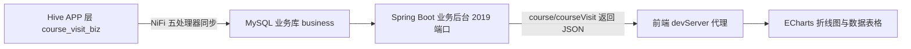

# 业务后台接管报表：把 mock 数据换成真实统计结果

Web 前端与 Yapi 平台就绪后，报表页面已经有模有样，趋势线、周月年切换一应俱全，唯一的遗憾是数字来自 mock。清洗统计链路并没有闲着，课程访问量的统计结果已经通过 NiFi 同步进了 MySQL 业务库 `business.course_visit_biz`，缺的只是一个常驻的在线服务：把业务库里的数字读出来，按前端契约吐成 JSON。把这套业务后台部署起来、让前端代理从 Yapi 切到它、再验证页面上的数字确实来自业务库，就是这一课要打通的最后一环。

## 先给结论

- 业务后台是 Spring Boot 写的独立工程，常驻 2019 端口，读 MySQL 业务库，按 Yapi 上的接口契约返回统计结果，前端切换时零代码改动。
- 打包用 `mvn clean package -DskipTests`，产物上传到 docker 服务器后一条 `nohup java -jar xc-web.jar &` 让它后台常驻，`nohup java -jar` 后面必须跟 jar 文件名，漏写会当场报错。
- 前端切到真实数据只改 `vue.config.js` 的一行 target，改完必须重启前端容器，dev server 只在启动时读这份配置。
- 请求前缀由 `pathRewrite` 剥掉，前端请求带的前缀后台路由里没有，不剥就 404。
- 验证数据真实性的硬办法：直接改业务库里某一天的访问量数值，刷新页面看它跟着变。

## 业务后台在链路里的位置

统计链路是离线批处理，清洗、统计、同步各程序按调度周期跑完即退；报表页面却要随时有人响应查询，这是两类生命周期完全不同的程序，所以业务后台独立成一个 Spring Boot 工程，常驻进程专门伺候前端的查询请求。它读的数据就是 NiFi 同步落地的业务库，向前端提供的接口与 Yapi 上维护的契约一字不差。



关键路径在后两跳：业务后台按 `course/courseVisit` 接口把业务库两列数据转成前端要的数组，前端代理转发请求并在转发前剥掉前缀，页面拿到的就已经是画图直接可用的日期加数值。

接口契约长这样：GET 请求 `/course/courseVisit`，参数 `startDate` 与 `endDate` 圈定日期范围，响应外层是统一的 `code`、`msg`，统计结果放在 `result` 数组里，每个元素一个 `day` 加一个 `visitNum`。业务后台的核心就是实现这一条契约，下面是按本课写法补全的示例（课程以打包 jar 的形式提供后台，资料包里没有这份源码）：

```java
package com.study.xc.web;

import org.springframework.web.bind.annotation.GetMapping;
import org.springframework.web.bind.annotation.RequestMapping;
import org.springframework.web.bind.annotation.RestController;
import java.util.List;
import java.util.Map;

@RestController
@RequestMapping("/course")
public class CourseVisitController {

    // 业务库统计结果：date_info 天，count 当天访问量
    @GetMapping("/courseVisit")
    public Map<String, Object> courseVisit(String startDate, String endDate) {
        List<Map<String, Object>> rows = service.queryVisit(startDate, endDate);
        // 契约：{code:200, msg:"", result:[{day:"2019-11-13", visitNum:2202}]}
        rows.forEach(r -> {
            r.put("day", r.remove("date_info"));
            r.put("visitNum", r.remove("count"));
        });
        Map<String, Object> resp = new HashMap<>();
        resp.put("code", 200);
        resp.put("msg", "");
        resp.put("result", rows);
        return resp;
    }
}
```

字段名换一层的意义就在这：业务库叫 `date_info`、`count`，前端契约叫 `day`、`visitNum`，后台把两套名字对上，前端不用关心库里长什么样。

## 从源码到常驻服务：打包与部署

后台工程的目录结构三样东西：`pom.xml` 管依赖，`sql/business.sql` 是业务库表结构，`src` 里是核心 API 代码。`business.sql` 对应的 `business` 库在导入在线教育平台业务数据时已经一并建好，不需要重复导入。打包需要 Maven 与 Java 环境：

```bash
mvn clean package -DskipTests
```

命令跑完生成 `target` 目录，里面的 jar 就是整个后台。把 jar 上传到 docker 服务器，以 `/opt` 目录为例，启动命令一行：

```bash
cd /opt
# nohup 挂后台，& 让终端释放，服务在后台常驻
nohup java -jar xc-web.jar &
```

这里有个现场翻车点值得记下来：`nohup java -jar` 后面忘了跟 jar 文件名，命令直接报错退出。`nohup` 的作用是让进程脱离当前终端，终端关了服务照跑；`&` 把进程放到后台，终端还能继续敲别的命令。两条缺一不可，jar 名更不能少。启动是否成功看日志，日志里出现 `Tomcat started on port(s): 2019` 才算就绪。

部署完成后这个进程就是常驻的，配一次启动一次，之后日常使用不用再管它。哪天页面刷新不出数据，第一反应应该是看看这个进程是不是挂了，而不是去怀疑前端。

## 前端切到真实数据源

前端工程根目录的 `vue.config.js` 里有三套环境排队：远端原型 mock、本地 Yapi mock、业务后台真实数据。现在后台就绪，把开发环境的 target 放开即可（请求前缀键名按工程实际为准，这里以 `/api` 示意）：

```js
module.exports = {
  devServer: {
    disableHostCheck: true,
    open: true,
    port: 8080,
    host: "0.0.0.0",
    proxy: {
      "/api": {
        // 本地 Yapi 的 mock 原型环境，项目 id 以设置页显示为准
        // target: "http://yapi.example.com:3000/mock/11",
        // 开发环境：业务后台，数据来自清洗统计落地的业务库
        target: "http://backend.example.com:2019",
        changeOrigin: true,
        pathRewrite: { "^/api": "" }
      }
    }
  }
};
```

两个配置项分工明确。`target` 决定请求转发给谁，`pathRewrite` 决定转发前把路径改成什么样：前端所有请求都带 `/api` 前缀用来命中代理规则，后台的路由里却没有这个前缀，所以转发前必须用正则把前缀剥掉，`/api/course/courseVisit` 到了后台就只剩 `/course/courseVisit`。少了这一步，后台收到的路径一个都对不上。

配置改完必须重启前端容器，dev server 只在启动时读这份文件：

```bash
docker-compose stop frontend-vue
docker-compose up -d frontend-vue
# 跟日志，确认编译完成再访问
docker logs -f frontend-vue
```

日志里能看到编译进度，编译没结束就刷新页面只会白屏报错，等它跑完再登录。登录依旧任意账号，用户名、密码、验证码都要填但内容不校验，进到课程访问量页面，这次的趋势线背后已经是业务库里的真实数字。

## 改一行数据验证链路

怎么证明页面读的确实是业务库，而不是又一个碰巧长得像的 mock？最硬的验证是直接改数据。业务库里 2019-11-11 那天的访问量原本是 2243，在 MySQL 里把它改成 8888：

```sql
use business;
update course_visit_biz
set count = 8888
where date_info = '2019-11-11';
```

回到页面切到按月视图，11 月 11 日那天的数值立刻从 2243 变成 8888。页面、后台、数据库三点一线，改库生效，链路闭环确认。改完记得把数据改回去，别让假数字留在报表里。

顺带观察一下数据的分布，对后面排查有帮助：按周视图里，第 46 周有多条记录，第 47 周只有一条；按年视图只有 9 月到 11 月的数据，8 月和 12 月是空的。统计结果来自采集生成的数据，生成到哪天页面就有哪天，图表上的空档不是故障，是数据本身只有这么多。

## 常见误区

- **启动命令少写东西。** 错例：`nohup java -jar` 后面不跟 jar 名，或漏掉结尾的 `&`，前者当场报错，后者占住终端。正解：`nohup java -jar xc-web.jar &` 三段齐全，用日志确认 `Tomcat started on port(s): 2019`。
- **改完代理不重启前端容器。** 错例：保存 `vue.config.js` 后直接刷新页面，数据源纹丝不动。正解：dev server 启动时才读配置，`docker-compose stop` 加 `up -d` 重启，日志里编译完成再访问。
- **页面没数据先去改前端。** 错例：图表空白就怀疑代理、依赖、编译，折腾半天。正解：后台是常驻进程，服务器重启或进程被杀后它不会自己爬起来，先确认 `java -jar` 进程活着，再逐层往外查。
- **以为业务库没导入也能出图。** 错例：只启动后台不确认 `business` 库有数，接口返回空数组。正解：`business.course_visit_biz` 里先查到数据，再联调页面，断点定位才不会两头猜。

## 面试可能被问到的问题

1. 面试官追问：「为什么业务后台要独立成一个 Spring Boot 工程，而不是把查询接口写在统计程序里？」
   答：两者生命周期不同。统计程序是离线批处理，按调度周期执行，跑完进程就退出；前端查询是在线需求，要求服务常驻、随时响应。独立工程后，批处理挂了不影响页面查询，接口发版也不用重跑统计，职责边界清晰，发布节奏互不干扰。
2. 面试官追问：「前端代理里的 pathRewrite 起什么作用，不配会怎样？」
   答：前端请求统一加一个前缀来命中代理规则，后台路由里没有这个前缀，pathRewrite 在转发前用正则把它剥掉。不配的话后台收到的是带前缀的路径，路由匹配不上，接口全部 404。
3. 面试官追问：「nohup 加 & 启动服务，两者各管什么？」
   答：nohup 让进程忽略挂断信号，终端关闭或会话退出时进程继续运行；& 把进程放进后台，终端立即可用。生产上还应该把输出重定向到日志文件，启动后用日志确认端口监听成功，而不是只在终端看一眼。
4. 面试官追问：「mock 环境切到真实环境，怎么保证前端代码不用改？」
   答：靠接口契约先行。接口定义、字段名、响应结构先在 Yapi 上定稿，前端按契约开发，mock 数据也按契约生成；后台实现同一份契约，字段映射（如库里的 date_info、count 对前端的 day、visitNum）收敛在后台一层。契约不变，切环境只动代理配置一行 target。
5. 面试官追问：「上线后报表某天数字不对，你的排查路径是什么？」
   答：从展示端往数据端倒查。先看接口返回值，判断是展示层还是数据层的问题；接口正常就查业务库对应日期的行，确认 NiFi 同步是否把统计结果搬对；业务库不对再回查 Hive 统计结果与清洗程序。每一层都有明确的期望值，逐层二分，最后总能定位到断点。

## 配套资料

- 讲义：`materials/docs/04/智慧学成Web业务后台搭建手册.md`，工程结构、business 库导入、打包与 nohup 启动命令为本课出处。
- 讲义：`materials/docs/08/智慧学成-第3章-课程分析.md`，其中「智慧学成 Web 展示」小节给出后台搭建与前端接口配置的衔接说明。
- 前端源码：`materials/code/08/` 下为报表 Web 前端的 Vue 工程源码，代理配置 `vue.config.js` 在工程根目录（内层目录名含项目原名，此处不展开）。
- 接口契约：`materials/code/08/yapi/` 下的接口 JSON 数据，课程访问量接口与响应结构以此为据。
- 说明：业务后台以打包 jar 形式随课程提供，资料包未收录后台源码，文中的 controller 示例为按本课写法补全；jar 名按资料包真实产物书写，访问域名与容器名沿用示例站点规范以中性名占位。
