# 课程分析之课程购买量：从订单采集、数仓清洗到报表出图的完整链路

> 🔒 安全提示：文中示例的口令/密钥均为课程教学环境演示口径，生产环境的安全要求见《安全与合规须知》。

## 先给结论

- 系列定位：课程购买量是智慧学成统计平台的第二个指标，与课程访问量共用同一套折线图前端契约，但数据源从行为日志换成订单业务库，采集、清洗、统计、回写每一段都要重新搭一遍。
- 全系列十六讲沿一条主线推进：需求分析定指标与契约，采集字段与存储分析定下六个字段与 Hive 事务表，NiFi 监听 MySQL binlog 实时采集 insert 与 update，再用 NiFi 造数链路喂出 1.8 万余条测试订单。
- DWD 层设计 course_buy_fact 事实表：八个业务字段加年月日三个分区字段，主键直接用订单号，区域维度走「user_id 换注册 IP、IP 换城市、城市换区域 id」的间接关联链。
- DWM 层做天加课程的轻度聚合，sum 出销售额、count 出销量，一份聚合结果同时供购买量报表与热门学科排名复用。
- APP 统计层只留报表要的 date_info 与 count 两列，按天求和，NiFi 五处理器链再把统计结果从数据仓库同步回 MySQL 业务库。
- 集成测试是收官之战：三个 spark-submit 脚本挂上 NiFi 调度组，自定义等待处理器把采集、清洗、统计、落地四段接成一条线，清空三层表后整链一键串跑。
- 高频踩坑集中在四处：Hive 事务配置与事务临时目录权限、动态分区 nonstrict 与覆盖写模式、sum 类型与实体 Int 对不上的 Cannot up cast、SQL 别名与实体字段对不齐。
- 贯穿全系列的工程习惯：Hue 里先跑通 SQL 再搬回 IDEA 封装、本地测试写死日期而生产用调度传参、每层落库后都用 Hue 的 count 对账。
- 读完本系列，你得到的不是一个指标，而是一条可复用的「业务库到报表」标准链路，换个指标只换字段与 SQL，骨架原样复用。

## 第1部分：课程购买量需求分析：和访问量同壳不同源的第二个指标

课程访问量从采集、清洗、统计到页面展示已经全线跑通，第二个指标课程购买量紧接着上场。对着原型看，它和课程访问量几乎是一个模子：同样的折线图，同样的周月年切换，同样的天粒度表格。需求分析阶段最容易犯的错，就是把它当成访问量换了个名字。两者的真正分野在数据源：访问量统计的是页面访问行为，购买量统计的是订单交易记录，同一个前端契约背后连着两条完全不同的采集链路。把指标定义、维度切分、请求响应契约这些需求侧的问题定清楚，后面采集字段怎么设计才有的放矢。

### 原型拆解：和访问量共用一个壳

原型入口在统计平台主页：先打开课程访问量页面，页面内的标签栏里有课程购买量标签，点击即切换。页面结构一模一样，顶部按周、月、年筛选，中部折线图画趋势，底部数据表格逐天列出购买量，上下对照着看。

由于两个指标的原型高度相似，看原型时要把注意力放在数字的语义上：表格里每一行的数值，访问量页面是「这一天被访问了多少次」，购买量页面是「这一天成交了多少笔购买」。模拟数据下日期与数值都是随机生成的，样式为真、数字为假，分析需求时看结构别记数字。

### 指标与维度

讲义对指标与维度的定义如下：

| 项 | 说明 |
|---|---|
| 指标 | 课程购买量是单位时间内用户购买课程的数量，以天为单位显示 |
| 维度 | 时间维度，包括周、月、年级别 |
| 按周 | 显示指定周范围内每天的课程购买量 |
| 按月 | 显示指定月范围内每天的课程购买量 |
| 按年 | 显示指定年范围内每天的课程购买量 |

两个点值得展开。第一，维度只切时间一个轴。购买行为本身还有很多可分析的侧面，比如买了什么课、哪个地区买的、哪家机构的课卖得好，这些会在数据清洗阶段作为维度关联进事实表，但报表这一层本期只回答「什么时间卖了多少」，维度切多了原型没有对应展示，统计程序也无从落地。第二，「按月」不是一个月一个数。三个级别的展示粒度全是天，周月年只是筛选范围，选中一个月，返回的是这个月里每一天的购买量，折线图才画得出趋势。

### 前端契约：请求与响应

数据模型与访问量同一套：以天为单位存储，返回日期加数值。以周查询为例，前端请求带上起止日期：

```text
周查询：以 2019 年第 37 周为例
请求参数  startDate=2019-09-09&endDate=2019-09-15
响应数据  [{"day":"2019-09-09","buyNum":123},{"day":"2019-09-10","buyNum":345},...]
```

月与年同理，只是区间放大：9 月是 `startDate=2019-09-01&endDate=2019-09-30`，2019 年是 `startDate=2019-01-01&endDate=2019-12-31`，响应格式不变。区间内每一天都要有一条记录，缺天则折线断档。

和访问量放在一起看，两个接口的区别只剩字段名与路径。前端工程里的接口路径定义把这对兄弟排在一起（请求前缀键名按工程实际为准，这里以 `/api` 示意）：

```js
const config = {
  // 课程访问量：返回 day + visitNum
  courseVisit: "/api/course/courseVisit",
  // 课程购买量：返回 day + buyNum
  courseBuy: "/api/course/courseBuy"
};
```

前端工程师拿到这份契约，周月年三套请求就能先行开发，不必等统计链路就绪，mock 数据顶上即可，这正是上一课 Yapi 方案继续发挥价值的地方。

### 与访问量：同一条展示链，不同的数据源

把两个指标的数据来源画在一张图里，需求就清晰了：

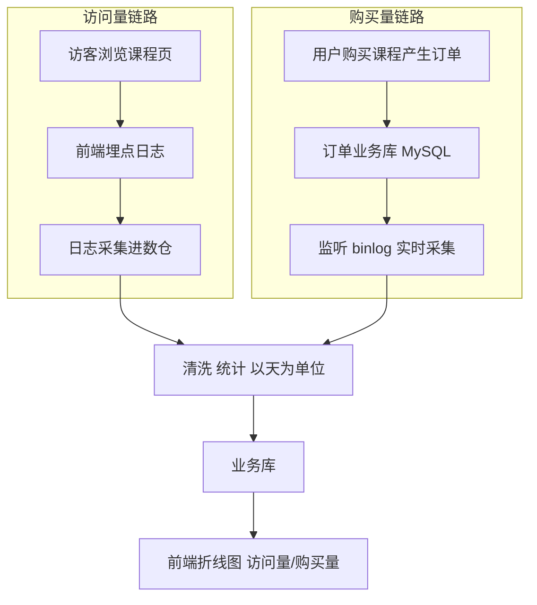

关键路径在两条链的分岔口。访问量的原料是用户访问行为，通过页面埋点获取，数据以日志形式进入数仓；购买量的原料是交易事实，落在订单业务库里，采集对象第一次从日志文件变成了数据库表。这一换，采集方式随之改变：数据库里的订单数据不仅有新增（insert），还有状态流转（update），订单从待付款到已付款再到已完成，每一步都要更新记录。埋点日志只会追加，订单表却会改写，存储端必须支持更新，这是下一课设计采集字段与存储结构时绕不开的约束。

需求分析的产出可以归纳成三句话：统计什么，单位时间内的课程成交数量，以天展示；怎么切，时间维度周月年三级，粒度始终是天；数据从哪来，订单业务库而不是访问日志。带着这三句话进采集设计，字段取舍就有了依据。

## 第2部分：课程购买量采集设计：订单表只挑六个字段，落地 Hive 事务表

需求分析把话说死了：购买量的原料是订单数据，从数据库采。接下来是采集设计的三连问：订单表十来个字段，采哪几个？订单明细是个 JSON 数组，怎么理解、怎么存？采上来的数据落在数仓哪张表、什么格式？这一课把「采什么」与「存成什么样」一次定稿。定稿的依据始终是那条统计需求：按天算购买量，订单状态会变，数据要能更新。字段是按需求反推出来的，存储是为更新预留的，两件事互相咬合。

### 采集字段：从统计需求反推

最终要的数字是「某一天成交了多少笔购买」，把这句话拆开，每一半都对应着字段。成交要认订单，订单要认单号；一天要有日期，日期来自交易时间；「成交」要有筛选，只算交易成功的状态；买的人、买的什么课，则分别是用户维度与课程维度的种子。倒推下来的清单就是六个字段：

| 采集字段 | 字段说明 | 数据格式 | 数据样例 |
|---|---|---|---|
| order_number | 订单号 | uuid | 91cbc384-e783-4158-b715-f70aac89e530 |
| price | 交易价 | float | 1020 |
| status | 交易状态 | 状态码 | 401002 |
| order_time | 交易时间 | 时间戳 | 1542421759 |
| user_id | 用户 id | uuid | 67f6ded2-d657-4594-8d49-0024c70a7fea |
| details | 订单明细 | json | 数组，内含商品记录 |

对照订单表的完整建表语句看，取舍一目了然：

```sql
CREATE TABLE `xc_orders` (
  order_number varchar(32) NOT NULL COMMENT '订单号',
  initial_price Float(6,2) DEFAULT NULL COMMENT '初始价',
  price Float(8,2) DEFAULT NULL COMMENT '交易价',
  start_time datetime NOT NULL COMMENT '开始时间',
  end_time datetime NOT NULL COMMENT '结束时间',
  status varchar(32) DEFAULT NULL COMMENT '交易状态',
  user_id varchar(32) DEFAULT NULL COMMENT '用户id',
  details varchar(1000) DEFAULT NULL COMMENT '订单明细',
  old_status varchar(32) DEFAULT NULL COMMENT '旧交易状态',
  PRIMARY KEY (order_number) USING BTREE
) ENGINE=InnoDB DEFAULT CHARSET=utf8mb4 COLLATE=utf8mb4_unicode_ci;
```

表里有的字段清单里没有的，全部是有意舍弃。`initial_price` 是商品定价，成交看的是 `price` 交易价，定价对购买量统计无用；`start_time` 与 `end_time` 记录的是订单生命周期的时间戳，报表取的是 `order_time` 交易时间；`old_status` 是状态流转时留下的旧值，服务订单系统自身，与统计无关。**采集不是搬家，是把统计需要的最小字段集搬过去**，字段越多，采集与存储的负担越大，无关字段的变更还会平白触发数据更新。

还有一个容易忽略的细节：`order_time` 的格式在两张表里不一样。MySQL 里是 datetime，采集字段表里给的是时间戳样例 `1542421759`，也就是采集环节会把 datetime 转成 BIGINT 时间戳再进数仓，清洗阶段再由时间戳换算出年月日。类型差异在采集设计时就定好，别等到清洗时才发现对不上。

### 订单明细 details：数组里只有一条

六个字段里最费思量的是 `details`。它存的是一段 JSON，样例如下：

```json
[
  {
    "itemId": "2aae465d-33a6-44fe-81f6-50cdb80f2677",
    "itemNum": 1,
    "orderNumber": "91cbc384-e783-4158-b715-f70aac89e530",
    "itemPrice": 1020
  }
]
```

数组里每个元素是一条商品记录，四个字段的含义都能和别处对上。`itemId` 是商品 id，在课程业务里它就是课程 id，将来关联课程维度靠它；`itemNum` 是商品数量，当前恒为 1；`orderNumber` 与外层订单号一致；`itemPrice` 是商品价格，因为数量是 1，它和订单的交易价 `price` 也一致。

为什么数量恒为 1？业务设计使然：同一个课程在一个订单里不允许重复购买，买一套课程没有理由一次买两份，想再买要等课程过期后重新下单，那时会生成新订单。既然一单只有一件商品，明细里的价格与数量自然退化成常量。

那为什么还要套一层数组？这是订单系统为后期扩展留的壳。今天一单只卖一门课，明天业务上要支持一个订单打包多门课程，只需要往数组里追加元素，表结构一行不用改。采集侧要按数组结构写解析：当前取第一个元素就能拿到课程 id 与价格，但解析代码必须按数组设计，将来一单多课时统计程序把数组展开计数即可，不用推倒重来。

### 存储设计：Hive 事务表

采集上来的六个字段落到数据仓库的 ODS 层，建表语句如下：

```sql
CREATE EXTERNAL TABLE
IF NOT EXISTS data_course.course_orders_source
(order_number String,
price Float,
status String,
order_time BIGINT,
user_id String,
details String)
clustered by (order_number) into 2 buckets stored as orc
TBLPROPERTIES('transactional'='true');
```

六个列与采集清单一一对应，多一个没有、少一个不行，采集了什么，仓库就按什么结构保存。`order_time` 的 BIGINT 与 `details` 的 String 在这里落定：明细整体当一个字符串存，JSON 结构留在值里，清洗时再解析。这张表在数据仓库章节就随建表脚本一并建好了，此刻只是拿出来核对字段，用 Hue 打开表结构对着采集清单过一遍，一致即可。

数据的流向如下图：

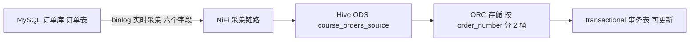

关键在存储格式这一段。为什么不是熟悉的文本表？因为订单数据有 update 场景，订单状态从待付款流转到已支付，业务库里的行被改写，采集端捕获到更新事件后，数仓里对应的行也要改写。文本表写入后不可变，改写无从谈起；ORC 桶表加事务属性是 Hive 支持行级更新的前提，三件套在下一课展开采集实现时还要再强调。此刻记住设计动机即可：**存储格式是为「订单状态会变」这个业务事实付的成本**。

## 第3部分：NiFi 采集 MySQL 开跑前：Hive 事务与缓存服务两件预备事

采集字段定了、ODS 事务表也建了，下一步就是用 NiFi 监听 MySQL 的 binlog，把订单数据实时采进 Hive。动手拖处理器之前，有两个注意事项要先交代清楚。它们都不是本次要新建的配置，而是两个「必须知道已经配好了」的前置条件：Hive 侧要开启事务支持，NiFi 侧的分布式缓存服务全局只能有一个。这两处如果心里没数，链路跑起来之后的报错会非常难猜，因为故障点根本不在本次配置的处理器里。

### 采集的是什么事件：binlog 里的 insert 与 update

这次采集属于变更数据捕获，做法特殊在数据源不是文件而是数据库：监听 MySQL 的 binlog，把库上发生的每一笔变更捕获下来。订单表上会发生两类事件。insert 是新订单进来了，数仓里对应追加一行；update 是订单状态被修改，从待付款到已支付再到完成，业务库把这一行改写，数仓里对应的行也要跟着改写。insert 只管追加，普通表就够；update 要改写已写入的数据，这正是上一课把 ODS 表设计成事务表的原因。

NiFi 侧的处理器链路把这两类事件接住并翻译成 Hive 能执行的语句：

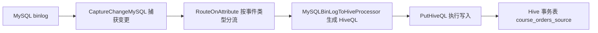

关键路径在分流与翻译两环：RouteOnAttribute 把 insert 与 update 事件分成两条路由，自定义处理器 MySQLBinLogToHiveProcessor 按事件类型拼出 `INSERT INTO` 或 `UPDATE ... WHERE 主键` 的 HiveQL，最后由 PutHiveQL 在事务表上执行。它的实现源码在课程资料的处理器工程里，核心逻辑就是这两类语句模板的拼装。

### 注意事项一：Hive 开启事务

事务支持分两层。建表层在 `TBLPROPERTIES` 里声明 `'transactional'='true'`，上一课的 ODS 建表语句已经带上了；光有表属性还不够，Hive 全局配置要允许事务与并发，配置项在 `hive-site.xml` 里：

```xml
<property>
  <name>hive.support.concurrency</name>
  <value>true</value>
</property>
<property>
  <name>hive.txn.manager</name>
  <value>org.apache.hadoop.hive.ql.lockmgr.DbTxnManager</value>
</property>
<property>
  <name>hive.compactor.initiator.on</name>
  <value>true</value>
</property>
<property>
  <name>hive.compactor.worker.threads</name>
  <value>1</value>
</property>
<property>
  <name>hive.enforce.bucketing</name>
  <value>true</value>
</property>
<property>
  <name>hive.exec.dynamic.partition.mode</name>
  <value>nonstrict</value>
</property>
```

六项配置各管一段。`hive.support.concurrency` 打开并发与锁支持，是事务的前提；`hive.txn.manager` 指定事务管理器，只有换成 `DbTxnManager`，Hive 才具备管理 ACID 事务的能力，默认的假事务管理器只做不做真事务；`hive.enforce.bucketing` 保证分桶写入正确，事务表必须分桶，桶是行级更新的定位单位；compactor 的两项开启压缩器，事务表每次更新都会产生 delta 增量文件，压缩器定期把 base 与 delta 合并，不然小文件越积越多读取越来越慢；`hive.exec.dynamic.partition.mode` 设为 nonstrict 则是给清洗程序动态分区写入留的便利，与本表建表时的分区设计配套。

这套配置课程环境在容器编排阶段就已经写进了 `/opt/cdh5.14.0/config/hive/hive-site.xml`。本课要做的是打开这个文件确认配置都在，而不是重新配一遍；但原理必须清楚，换一套环境部署时，这几项就是检查清单。还要强调一句：事务是按表生效的，只有建表时声明了 transactional 的表（这里的 `course_orders_source`）才能被 update，其他 Hive 表不受影响，也不能想当然地认为开了全局配置所有表都能改。

### 注意事项二：分布式缓存服务全局一个

CaptureChangeMySQL 处理 binlog 时，MySQL 上会有大量的变更数据涌进来，需要缓存做中转缓冲。NiFi 对此的标配是一对服务：提供服务的 `DistributedMapCacheServer` 和连接它的 `DistributedMapCacheClientService`。处理器的缓存读写都经过这对搭档，没有服务端，捕获到的变更无处缓冲。

这对服务在课程访问量做联动配置时就已经添加并启动，当时强调过全局只有一个即可，此处再次确认：**缓存服务是全局资源，不是某个流程的私有配置**。本次采集直接使用已有的那个，到 NiFi 界面右上角的 Controller Services 面板看一眼，`DistributedMapCacheServer` 状态为 Enabled 就可以直接被处理器引用，不需要任何新建动作。

为什么强调「只有一个」？服务端要监听端口，重复添加第二个实例会端口冲突，起不来；就算端口错开了，客户端配置指向谁就成了新的歧义，流程找不到可用缓存，处理器启动时直接报错。这类错误的表象在采集处理器上，根因却在服务管理上，排查起来绕远路，不如一开始就守住「全局一个」的规矩。

### 开跑前的状态确认

两个注意事项核实完，剩下的就是常规检查。采集链路依赖 MySQL、Hadoop、Hive 三个服务，启动处理器组之前确认它们都已正常运行；启动后观察每个处理器左上角的状态，红色方块变成绿色三角才算正常运转。至于处理器逐个怎么配、insert 与 update 两条路怎么验证，采集实现的配置与测试按流程走，测试时往订单表里插一条数据、再改一条数据，Hive 侧各多一行与少改一行，链路即算打通。

## 第4部分：NiFi 盯住 MySQL binlog：课程购买量原始数据的实时采集与落地验证

课程访问量的数据源是埋点日志，文件落进 HDFS 就算采集完成。课程购买量换了一个源头：订单数据躺在在线教育平台业务库的 MySQL 里，业务库是在线的交易系统，分析任务既不能直接上去扫表，更不允许往里写一行。这一课的做法是让 NiFi 充当 binlog 的订阅者：MySQL 会把每条 insert、update 追加进 binlog 日志，NiFi 像一台从库那样盯着这份日志流，命中订单表的事件被组装成 Hive 语句写入数仓。数据不离开业务库，业务库也不感知分析侧的存在，两头互不打扰。

落到操作上分两步走：把资料包里现成的调度模板导入 NiFi 并补齐配置，然后从头到尾跑一轮测试，验证 insert 与 update 都能落进数仓的 `data_course.course_orders_source` 表，顺带复现并解决一个 Hive 事务引出的 HDFS 权限坑。这一步跑通，购买量的原始数据才算真正入了仓，后面的数据清洗才有米下锅。

### 采集为什么改走 binlog

访问量指标的原始数据由前端埋点产生，NiFi 拿到日志文件写进 HDFS，任务就结束了。订单数据的处境完全不同：它一开始就落在业务库 MySQL 的 `xc_order.xc_orders` 表里，本身就是交易链路的一部分。想把它搬进数仓，路子有两条，选哪条决定了后面所有配置的样子。

**一条路是定时拉表。** 写个查询任务，周期性地把整表或者增量段捞出来搬走。这条路的问题出在订单会更新：一笔订单从待付款到已付款，状态和价格都可能变化。定时拉表要么每轮都搬全量，要么自己维护增量水位；就算搬走了，旧值也改不了，数仓里的订单状态永远停在搬运那一刻。

**另一条路是监听 binlog。** MySQL 的主从复制靠 binlog 驱动，每一条行级变更都会以事件形式记录在案。NiFi 装上 CDC 相关处理器后可以伪装成一台从库连上去订阅事件流，insert 与 update 事件实时到手。本课的采集范围就这两种操作，删除不采，购买量的分析口径也不关心删除。数仓侧为了接得住 update，承接表开成事务表，这个设计到配置表结构时再展开。

binlog 方案还有一层收益藏在后面：采集是推模式，业务库每发生一笔交易，数仓几乎同时知道，不用等调度周期。之后做实时指标复用的也是这条通道，基础设施一次搭好。

这类「从变更日志里取数据」的做法有个统称叫 CDC，Change Data Capture，把数据库当作事实源头，下游谁要数据谁去订阅变更，而不是各自跑一趟查询。binlog 只是最常见的变更日志，选中它还有个前提值得记一笔：MySQL 的 binlog 有 statement 与 row 等格式，statement 只记 SQL 语句，row 才记每一行的前后镜像，行级采集依赖 row 格式，课程环境的 MySQL 已经按此配好，拿到的事件里才有完整的字段值。

### 导入模板与两处配置

资料包里带着现成的调度模板，在第 3 章课程分析的 NiFi 目录里，名字是「课程购买量-MySQL 实时采集」。NiFi 侧的操作与此前导入其他模板完全同款：在「离线分析」处理器组下新建一个课程购买量的子组，购买量相关的调度以后都收在这个组里；双击进入组内，上传模板文件，再用 Add Template 把它添加到画布。处理器组的名字是 `1.数据采集: 课程购买量-Mysql-To-Hive`，备注一栏写着它的职责：MySQL 实时采集数据，监控 insert、update。

拖进来的流程带着两个黄色感叹号，意思是有控制器服务还没启用。打开处理器组的 Controller Services 页面，列表里是三件套：

| 服务 | 角色 | 启用前状态 | 归属 |
|---|---|---|---|
| DistributedMapCacheClientService | 缓存客户端 | 待启用 | 本处理器组 |
| DistributedMapCacheServer | 缓存服务端 | 已启用 | 全局 NiFi Flow |
| HiveConnectionPool | Hive 连接池 | 待启用 | 本处理器组 |

缓存服务端全局只需要一个，环境搭建阶段就建好了，这里连配置都不用碰，处理器会自动识别并引用它；要做的就是把本组的缓存客户端与 Hive 连接池逐个启用。这两处注意事项（Hive 事务与缓存服务）在采集准备环节已经交代过来龙去脉，这里只动手执行结论。

第二处配置落在 `CaptureChangeMySQL` 处理器上。与前几课不同，这次的 MySQL 连接参数没有放进独立的连接池服务，而是直接配在处理器属性里。右键 Configure 打开 Properties，能看到参数基本是现成的：主机与端口 `xc-online-mysql:3306`，驱动类 `com.mysql.jdbc.Driver`，驱动 jar 路径 `/opt/mysql-connector-java-8.0.16.jar`，用户名 root，唯独密码空着。填上 123456，保存生效，感叹号消失，配置阶段到此结束。

### 四个处理器的分工

整条流程的结构如下：

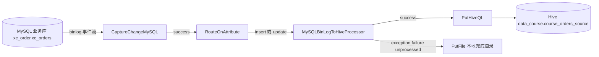

binlog 从业务库流入捕获处理器，经路由分流后由自定义处理器翻译成 Hive 写入动作，失败分支全部落到本地文件留证。逐个看关键配置。

**CaptureChangeMySQL 负责订阅。** 除了上面填过的连接参数，几处属性直接决定行为：`Server ID` 设为 1，这是伪装从库的身份号，不能与真实从库冲突；`Retrieve All Records` 设为 true，意味着首次启动会从 binlog 里能拿到的最早位置开始回放；`Include Begin/Commit Events` 与 `Include DDL Events` 都开着，事务边界与建表类事件一并交给下游；处理器还会持久化消费位点，重启后从上次的位置继续，不从头再来。中间那个 DistributedMapCacheServer 也值得说一句：捕获处理器要用它做事件中转的缓存，队列没消化完的新事件先在缓存里过渡，避免上游把下游压垮，这就是为什么流程里两个缓存相关的服务必须可用，缺一个捕获处理器连启动都过不了。

**RouteOnAttribute 负责分流。** 路由策略选 Route to Property name，再按事件类型定义两条动态属性：

```text
insert = ${cdc.event.type:equals('insert')}
update = ${cdc.event.type:equals('update')}
```

两条关系都连向下游处理器，其余类型的事件走 unmatched 被丢弃，采集范围从这里收口。

**MySQLBinLogToHiveProcessor 是资料包提供的自定义处理器**，它把 binlog 事件翻译成对 Hive 表的写入语句，四个属性读完就能明白它的工作方式：

```text
mysql_db_table    = xc_order.xc_orders
primary_key       = order_number:order_number
fields_correspond = order_number:order_number,price:price,status:status,
                    order_time:start_time,user_id:user_id,details:details
hive_table_name   = data_course.course_orders_source
```

`mysql_db_table` 圈定只处理订单表的事件；`primary_key` 声明用订单号当主键，insert 事件进新行，update 事件按主键定位旧行改写；`fields_correspond` 给出两边字段的对应关系，多数同名直连，唯一的差异在时间，业务表的 `start_time` 对到数仓的 `order_time`；`hive_table_name` 指明落地目标表。它的右边还挂着一个 `PutFile`，把 exception、failure、unprocessed 三类失败流文件写进 `/opt/tmp/mysql_bin_log/` 目录，出错时去那里翻现场，而不是让队列越堵越多。

**PutHiveQL 负责执行。** 绑定本组的 HiveConnectionPool，连接串是 `jdbc:hive2://xc-online-hive:10000`，批量大小 1000，攒一批语句一次提交，减少 Hive 侧的任务调度开销。

### 承接原始数据的 Hive 事务表

数仓侧的承接表长这样：

```sql
CREATE EXTERNAL TABLE IF NOT EXISTS data_course.course_orders_source
(order_number String,
 price Float,
 status String,
 order_time BIGINT,
 user_id String,
 details String)
clustered by (order_number) into 2 buckets
stored as orc
TBLPROPERTIES('transactional'='true');
```

三处设计都对着采集方式来的。`order_time` 用 BIGINT 存秒级时间戳，对应业务表 datetime 字段的换算；`clustered by (order_number) into 2 buckets` 加 `stored as orc`，是 Hive 事务表的硬性要求，主键分桶之后 update 才能按行定位；`transactional='true'` 开启事务，订单价格更新时，数仓里的旧行才能被覆盖成新值。普通文本表做不到改一行，这正是订单采集选 Hive 事务表承接、而不是像访问量那样直接写 HDFS 文本文件的根本原因。

字段上还有个细节提前打个招呼：`price` 是 Float 类型，后面比对更新结果时若看到 9999.9900001 这类尾差，不是数据错了，是浮点存储的固有精度，不必处理。

### 测试：insert 与 update 逐一落地

启动前确认 Hadoop、MySQL、Hive 三个服务都在运行，然后启动处理器组。启动后的第一个现象值得单独说：捕获处理器一侧的队列迅速堆起十几万条流文件，PutHiveQL 却没有动静。这不是故障，`Retrieve All Records` 为 true，首轮把 binlog 里的历史事件整段拉了回来，实测堆到 191346 条、约 200 MB。NiFi 队列连接线上会实时显示条数与字节两个数字，200 MB 就是字节那个读数，看一眼就知道堵的是数据量还是事件数。测试用不上这批历史，停掉处理器组，右键清空队列，再重新启动，队列归于平静，处理器进入待命状态等新事件。

接下来验证 insert。在业务库执行插入，订单号用一个新值，避免与历史测试数据撞车：

```sql
INSERT INTO `xc_order`.`xc_orders`
(`order_number`, `initial_price`, `price`, `start_time`, `end_time`,
 `status`, `user_id`, `details`, `old_status`)
VALUES ('29916098202216', 0.01, 0.11,
 '2018-04-05 19:32:33', '2018-04-05 21:32:33',
 '401002', '49',
 '[{"itemId":"4028e58161bcf7f40161bcf8b77c0000","itemNum":1,"itemPrice":0.01,"orderNumber":"29916098202216"}]',
 NULL);
```

执行完切回 NiFi，RouteOnAttribute 与下游之间的队列里出现一条流文件，说明事件被捕获了。落库要等：Hive 的插入要起 MapReduce 任务，几十秒到几分钟不等。队列消化完后到 Hue 里查 `data_course.course_orders_source`，这张表的列不多，order_number、price、status、order_time、user_id、details 正好是采集映射里那六对，把查到的 order_number 尾号与插入值逐位对上，一条对账完成，insert 通路成立。

update 走同样的路。把刚插的这条价格改成 9999.99：

```sql
UPDATE `xc_order`.`xc_orders`
SET `initial_price` = 0.01, `price` = 9999.99,
    `start_time` = '2018-04-05 19:32:33', `end_time` = '2018-04-05 21:32:33',
    `details` = '{"itemId":"4028e58161bcf7f40161bcf8b77c0000","itemNum":1,"itemPrice":0.01,"orderNumber":"29916098202216"}',
    `order_number` = '29916098202216'
WHERE `order_number` = '29916098202216';
```

NiFi 队列再次出现一条流文件，等它写完，Hue 里刷新这条记录，price 从 0.11 变成 9999.99。到这一步可以下结论：insert 与 update 两条事件通路都是通的，订单数据从业务库到数仓的实时采集链路成立，处理器组保持常驻运行，业务库里有新交易它就持续跟进。

### 权限坑：事务临时目录引发的写入失败

正常链路验证完，把讲义里预告的那个报错复现一遍，理解它比绕开它更有价值。降权只要一条命令：登进 Hadoop 容器，把 Hive 事务要用的 HDFS 临时目录权限压到最低：

```bash
# 进入 Hadoop 容器
docker exec -it xc-online-hadoop bash
# 把临时目录权限压到 600，只留属主读写
hadoop fs -chmod -R 600 /tmp/hadoop-yarn
```

再插一条新订单号的数据，PutHiveQL 立刻报错，关键字是 `return code 1 from org.apache.hadoop.hive.ql.exec.mr.MapRedTask`，执行 Hive 语句的 MapReduce 任务失败了。排查看日志：开一个新终端登进 Hive 容器找 hive.log（课程环境里它不在常规的 /var/log 下，而是在 /tmp 下的日志目录里，翻到为止），日志指向同一个结论，写 HDFS 的临时目录没有权限。

原因链是这样的：表开了事务之后，Hive 执行插入要先在 HDFS 的临时目录上做中间结果的读写，`/tmp/hadoop-yarn` 正是这类操作的去处；权限被压到 600 之后写入进程没有资格落盘，任务失败，语句报 return code 1。不开事务的表不受这个影响，此前访问量链路里写 Parquet 文本的保存操作，同样降权也照常工作，差别就在有没有这个临时读写动作。顺带一提，排查过程中 Hive 日志没有即时滚动出来也算个小插曲，异常没刷进日志文件时，用追加查看的方式盯着文件，再触发一次同样的错误，日志多半就到位了。

恢复同样简单，权限改回最大，重插一条数据，队列正常消化，Hue 里记录顺利出现，故障与恢复两段都闭环了：

```bash
# 恢复权限
hadoop fs -chmod -R 777 /tmp/hadoop-yarn
```

这一坑的价值在于把「事务表不是白开的」具象化了：多一层能力，就多一层对环境的前置要求。生产上遇到同类 return code 1，先想到 HDFS 目录权限与 Hive 日志，再动流程本身。

## 第5部分：NiFi 批量造订单入库 MySQL：给实时采集链路喂出万级测试数据

binlog 采集链路跑通之后，验证靠的是手动往业务库插一条订单。购买量指标后面还要清洗、统计、喂报表，两条数据撑不起任何场面，手动一条条插更是不现实。这一课换一个造数姿势：让 NiFi 调 Python 脚本批量生成订单，经 `PutSQL` 写回业务库 MySQL 的订单表；而 binlog 采集流程就像在真实生产里一样，把新产生的订单自动捕进数仓。造数与采集两条流程首尾相接，数据规模和链路完整性一次验证到位。

### 造数链路全景

造数流程在「离线分析」下的课程购买量处理器组里，处理器组名 `0. 数据生产：课程购买量-ToMySQL`，模板与上一课的采集模板一样导入添加。整条链路如下：

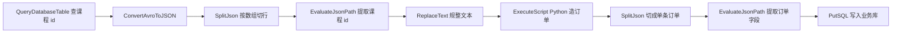

链路分两段看。前半段是取料：`QueryDatabaseTable` 连着课程库，表名 `course_base`，查询语句 `SELECT id FROM course_base`，没有配置增量列，每跑一次全量把课程 id 捞出来；结果集转成 JSON 数组后被 `SplitJson` 切成一行一个课程 id，`EvaluateJsonPath` 把 id 提到流文件内容里。后半段是造数：`ExecuteScript` 拿着课程 id 批量生成订单，输出一个 JSON 数组，再经一次 `SplitJson` 与 `EvaluateJsonPath`，每条订单的字段被提取成流文件属性，交给 `PutSQL`。

`QueryDatabaseTable` 与 `PutSQL` 用的是同一个 DBCPConnectionPool，JDBC URL 指向 `jdbc:mysql://xc-online-mysql:3306/xc_course`，驱动类 `com.mysql.cj.jdbc.Driver`。读的课程表在 `xc_course` 库，写的订单表却在 `xc_order` 库，PutSQL 的语句里写了全限定表名，一个连接池跨库读写并不冲突。

### 两处必配与导入

模板导入后两个黄色感叹号，配置动作与采集流程如出一辙：一个是流程引用的缓存服务，全局已有的服务端直接识别，把客户端启用即可；另一个是 MySQL 连接池，用户名 root 已配好，补上密码 123456 与驱动 jar 的绝对路径，启用服务。感叹号清零，流程就能跑了。

### Python 脚本造的订单长什么样

`ExecuteScript` 的 Script Engine 选 python，实际走 Jython 解释器，模块目录指向环境里的 Python 2.7 包路径，脚本里的 `xrange` 是旧语法但完全正常。核心逻辑如下（节选自资料包脚本）：

```python
def datestamp():
    now_info = datetime.datetime.now()
    delta = datetime.timedelta(random.randint(1, 60))
    time_info = now_info - delta
    for_time = time_info.strftime('%Y-%m-%d %H:%M:%S')
    times = int(time.mktime(time.strptime(for_time, '%Y-%m-%d %H:%M:%S')))
    return times

class PyStreamCallback(StreamCallback):
    def process(self, inputStream, outputStream):
        course_id = IOUtils.toString(inputStream, StandardCharsets.UTF_8)
        arr = []
        for i in xrange(1, random.randint(100, 500)):
            order_id = str(uuid.uuid4()).replace("-", "")
            user_id = str(uuid.uuid4()).replace("-", "")
            pay_status = 401002
            pay_price = random.randint(1000, 2000)
            course_price = random.randint(100, 500)
            obj = {}
            obj['itemId'] = str(course_id)
            obj['itemNum'] = 1
            obj['itemPrice'] = str(course_price)
            obj['orderNumber'] = order_id
            dist = {}
            dist['order_number'] = order_id
            dist['price'] = str(pay_price)
            dist['status'] = str(pay_status)
            dist['order_time'] = str(datestamp())
            dist['user_id'] = user_id
            dist['details'] = json.dumps([obj])
            arr.append(dist)
        outputStream.write(bytearray(json.dumps(arr), encoding='utf-8'))
```

每个课程 id 随机产出 100 到 500 条订单：订单号与用户 id 都用 uuid 去掉横杠，状态固定 401002 这个已购口径，价格在设定区间随机，订单时间用 `datestamp()` 随机回退 1 到 60 天生成秒级时间戳，课程明细塞进 `details` 的 JSON 数组。字段与真实订单表一一对应，保证后面的清洗代码无差别处理。

`PutSQL` 拿属性拼插入语句，注意时间字段的转换：

```sql
INSERT INTO `xc_order`.`xc_orders`(
    `order_number`, `price`, `start_time`, `end_time`,
    `status`, `user_id`, `details`)
VALUES (
    '${order_number}', '${price}',
    FROM_UNIXTIME('${order_time}'), FROM_UNIXTIME('${order_time}'),
    '${status}', '${user_id}', '${details}');
```

秒级时间戳用 `FROM_UNIXTIME` 转成 datetime 再入库，start_time 与 end_time 先填同一个值，测试数据不需要时间区间。批量大小 10，关掉 autocommit，攒批提交效率更高。

### 跑起来与两边对账

启动前照例确认 MySQL、Hadoop、Hive 都在运行，然后启动处理器组。队列里的流文件肉眼可见地涨，几千、上万地累积，跑过一万多条后把生产侧的处理器停掉。队列里还压着没消化的数据，不必重启整个组，单独启动末端那个 `PutSQL`，让队列存量继续被消耗完，NiFi 支持这种按处理器的粒度控制。跑完看处理器面板的统计读数，读入与输出的条数都已过万。

最后到数仓对账。Hue 里对 `data_course.course_orders_source` 执行 count，结果是 18642，与生成的订单量级对上。这个数字同时说明了两件事：造数流程把 1.8 万余条订单写进了业务库；binlog 采集链把它们的 insert 事件全部捕进了数仓。两条链路在同一个数字上汇合。

### 为什么造到 MySQL 而不直接写 Hive

图省事的写法是让脚本直接往数仓里灌数据，但那样测不到中间这段链路。真实生产里订单本来就产生在业务库，分析侧的数据永远从业务库流出来。把造数对准业务库，数据走的是「生成、入库、binlog、采集、入仓」的完整路径，与真实数据流一致；顺带把上一课的采集链路又压测了一遍。多花一步入库，换来的是整条链路的可信度。

## 第6部分：课程购买量的事实表怎么设计：course_buy_fact 字段结构与维度关联分析

订单原始数据已经在数仓的 `course_orders_source` 表里躺着了，但它是一张「裸」表：只有订单号、价格、状态、时间、用户 id 和课程明细，没有区域、没有公司、没有课程分类，直接聚合出不了任何带维度视角的报表。数据清洗的第一步 DWD 层，就是把这些维度外键补挂上去，落进课程购买量事实表 `course_buy_fact`。动代码之前先把表结构、字段来源、维度关联路径想清楚，这一课做的就是这份结构分析，写代码放在后面几课。

### 为什么清洗拆成 DWD 与 DWM 两步

购买量的清洗天然有两类消费方。第一类是购买量本身：按天统计购买了多少单，要的是订单级明细加维度外键，这是 DWD 的活。第二类在后面排队：热门学科排名要销量与销售额，口径同样来自订单表，只是聚合粒度不同。如果只清一次，第二类需求就得回原始表重新关联一遍维度，重复加工。

于是分层处理：DWD 层把原始数据关联上区域、公司、时间、课程、用户五个维度，落进事实表，把「脏活」干完；DWM 层在事实表之上做轻度聚合，生成销量、销售额这类中间表，公共指标一次算好多处复用。这一课只看 DWD 的结构，DWM 在购买量清洗的后半段展开。

### 事实表结构：8 个业务字段加 3 个分区字段

建表语句出自课程资料的建表脚本，一字未改：

```sql
CREATE EXTERNAL TABLE IF NOT EXISTS data_course.course_buy_fact
(course_buy_fact_id String,
 course_dim_id String,
 time_dim_id String,
 area_dim_id String,
 company_dim_id String,
 price float,
 status String,
 user_dim_id String)
PARTITIONED BY (years String,months String,days String)
ROW FORMAT DELIMITED FIELDS TERMINATED BY '\t'
STORED AS PARQUET
location'/user/hive/external/data_course/course_buy_fact';
```

字段与源数据的对应关系如下，这份映射是清洗代码的施工图：

| 事实表字段 | 源数据字段 | 说明 |
|---|---|---|
| course_buy_fact_id | order_number | 订单 id，直接当事实表主键 |
| course_dim_id | itemId | details 里的商品 id 就是课程 id |
| time_dim_id | order_time | 按订单时间计算，粒度到小时 |
| area_dim_id | 通过 user_id 关联 | 订单里没有 IP，绕道用户维度 |
| company_dim_id | 通过 itemId 关联 | 课程 id 找到课程维度再取公司 |
| price | price | 订单价格 |
| status | status | 订单状态，只保留符合口径的 |
| user_dim_id | user_id | 用户 id 直接沿用 |
| years / months / days | order_time | 由订单时间推导的分区年月日 |

整张表的关联关系画出来是这样的：

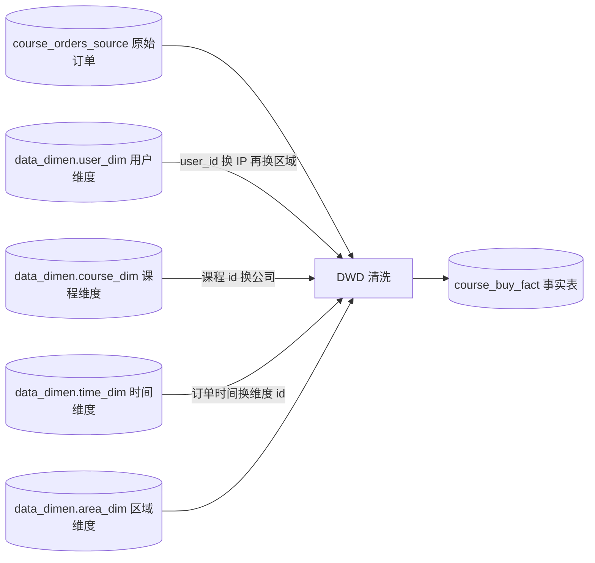

原始订单流入清洗，事实表只挂维度外键与度量，四个维度表提供换算依据。注意事实表里不存维度名称、不存分类名，只存 id，这就是星型模型的常规做法：维度细节查维度表，事实表保持苗条，聚合扫描快。

### 与课程访问量事实表的差异

对照访问量那侧的建表语句，差异一目了然：

```sql
CREATE EXTERNAL TABLE IF NOT EXISTS data_course.course_visit_fact
(course_visit_fact_id String,
 course_dim_id String,
 time_dim_id String,
 area_dim_id String,
 company_dim_id String,
 client_ip String,
 client_sessionid String,
 client_type String,
 visit_time bigint)
PARTITIONED BY (years String,months String,days String)
ROW FORMAT DELIMITED FIELDS TERMINATED BY '\t'
STORED AS PARQUET
location'/user/hive/external/data_course/course_visit_fact';
```

**第一，业务字段随指标换了内容。** 访问量事实表带着 client_ip、client_sessionid、client_type、visit_time 这几个访问行为字段；购买量换成 price、status、user_dim_id，订单的三要素：多少钱、什么状态、谁买的。维度外键部分两张表完全同构，课程、时间、区域、公司四个维度共用一套。

**第二，区域维度的计算路径不同，这是两份清洗逻辑最大的分水岭。** 访问日志里本来就有客户端 IP，拿 IP 直接换算区域维度即可；订单表里没有 IP 这个字段，区域只能间接推：订单里的 user_id 关联到用户维度表，取出用户注册时记录的 IP，再走一遍 IP 换区域的路。这条间接路径也是本课预告用户维度采集的原因，下一课先去把用户维度入仓。

**第三，主键来源不同。** 访问日志没有天然主键，清洗时自造 uuid；订单有天然的 order_number，直接沿用，既省一次生成，又天然幂等，同一条订单重复清洗会落回同一主键。

### 清洗要干的五件事

把上面的映射串成动作清单，后面写代码就是照着实现：按主键落订单号；从 `details` 的 JSON 数组取第一个对象的 itemId 当课程维度（订单明细数组在购买场景里只取首个课程对象）；订单时间换算成 `yyyy-MM-dd-H` 格式的时间维度 id，粒度到小时，需要按天看时再上卷聚合；user_id 关联用户维度换注册 IP 再换区域维度，换算不到的兜底为 -1；itemId 查课程维度表拿公司维度。状态字段要做过滤，订单状态有已购买、未付款等一串口径，只保留符合「已购」定义的记录，避免把未付款订单算进购买量。分区字段从订单时间拆出年月日，配合动态分区写入。

## 第7部分：用户维度入仓：采集用户表备好注册 IP，给购买量清洗的区域关联铺路

DWD 清洗方案已经定下来：购买量事实表的区域维度不走 IP 直查，要走「user_id 关联用户维度表拿注册 IP，再换算区域」的间接路径。前提是数仓里先有一张用户维度表。时间维度、课程维度在维度采集阶段早已入仓，用户维度是购买量清洗开工前最后一块拼图。这一课把用户维度采集的 NiFi 流程导入、配置、执行，采完在 Hue 里验证数据。

### 用户维度在整个拼图里的位置

购买量事实表要挂区域维度，订单数据里没有 IP，只能靠用户表里注册时记录的 IP 绕道推算。这条路径要求数仓里有一张带 ip 字段的用户维度表。数仓的 `data_dimen.user_dim` 承担这个角色，建表语句出自课程资料：

```sql
CREATE EXTERNAL TABLE IF NOT EXISTS data_dimen.user_dim
(user_dim_id String,
 username String,
 name String,
 userpic String,
 utype String,
 utype_name String,
 birthday String,
 sex String,
 email String,
 phone String,
 qq String,
 ip String,
 status String,
 create_time bigint,
 update_time bigint,
 last_password_reset_date bigint)
ROW FORMAT DELIMITED FIELDS TERMINATED BY '\t'
STORED AS TEXTFILE
location'/user/hive/external/data_dimen/user_dim';
```

16 个字段里，本课真正参与购买量清洗的是 `user_dim_id` 与 `ip` 这一对，其余是常规属性，供其他指标按需取用。文本格式存储也透露了它的定位：小表、低频更新、点查为主，与事实表的 PARQUET 分区结构形成两种待遇。

### 模板导入与配置

流程模板「用户维度表」在资料包里，导入动作与前面几课完全一致：上传模板，Add Template 添加到画布，落到「用户-维度」处理器组。打开 Controller Services，列表里是连接池两件套加全局缓存服务：HiveConnectionPool、DBCPConnectionPool 属于本组，逐个启用；MySQL 连接池补上密码 123456，用户名 root 模板已带好。感叹号清零，流程进入可执行状态。

### 采集链路与字段映射

整条流程的走向如下：

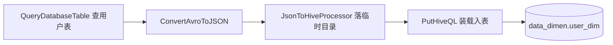

`QueryDatabaseTable` 的查询是这条链路的灵魂，把业务库三张表的信息合成一份维度数据：

```sql
SELECT u.id user_dim_id, username, u.name, userpic, utype, d.name utype_name,
       birthday, sex, email, phone, qq, ip, status,
       UNIX_TIMESTAMP(create_time) create_time,
       UNIX_TIMESTAMP(update_time) update_time,
       UNIX_TIMESTAMP(last_password_reset_date) last_password_reset_date
FROM xc_user.xc_user u
LEFT JOIN xc_course.dict d
ON u.utype = d.id
```

三处值得留意。主键别名 `user_dim_id` 直接对齐数仓字段，下游不用再改名；用户类型 utype 是字典码，`LEFT JOIN` 字典表 `xc_course.dict` 把它翻译成 `utype_name`，维度表里码值与名称都保留，报表想显示中文直接取；三个 datetime 字段用 `UNIX_TIMESTAMP` 转成秒级 BIGINT，与 `user_dim` 建表里的 bigint 类型对齐，避免装载时类型不兼容。

`ConvertAvroToJSON` 把查询结果集转成 JSON 后，交给资料包提供的自定义处理器 `JsonToHiveProcessor`，它的配置决定了落地方式：

```text
temp_file_path     = /opt/tmp/user_dim
table_name         = data_dimen.user_dim
hdfs_url           = hdfs://xc-online-hadoop:9000
is_it_full         = true
fields_correspond  = user_dim_id:user_dim_id,username:username,name:name,
                     userpic:userpic,utype:utype,utype_name:utype_name,
                     birthday:birthday,sex:sex,email:email,phone:phone,
                     qq:qq,ip:ip,status:status,create_time:create_time,
                     update_time:update_time,last_password_reset_date:last_password_reset_date
```

它先把 JSON 数据写成 HDFS 上的临时文本，再生成装载语句交由下游 `PutHiveQL` 执行，最终数据进入 `data_dimen.user_dim`。`is_it_full` 设为 true，语义是全量覆盖：每次执行都以本次快照为准替换表内数据，16 组同名映射让两边字段一一对应，没有口径差。

### 执行与验证

启动处理器组后盯着队列：有读取在流动，就说明采集在推进；数据量不大，一会儿队列消化完毕。这是维度采集与订单采集体验上的最大不同，订单链路启动后常驻不动，靠事件驱动；维度链路是跑一遍就停的一次性任务，采完手动把处理器停掉，避免反复全量覆盖。

验证去 Hue：切到 `data_dimen` 库查 `user_dim` 表，用户维度数据已经进来，user_dim_id、username、utype、ip 这些列都有值，条数与业务库用户表的量级一致。到这里用户维度入仓完成，下一课的购买量 DWD 清洗可以按计划开工：user_id 关联这张表拿 IP，再换区域维度 id。

## 第8部分：购买量 DWD 清洗三步走：备维度 Map、逐单封装事实、动态分区入仓

ODS 里的订单原始数据已经躺着了，用户维度也采完了，清洗代码正式开工。这一课把 DWD 层的完整代码一次讲透，对应 `CourseBuyHiveToFact` 这个类，拆开看是三段连续动作：把要关联的维度一次性拉进内存 Map，把 ODS 订单按天读出来逐单换算维度并封装成事实实体，再把封装结果转成 DataFrame 按动态分区写进 `course_buy_fact`。单看每一步都不难，连起来读才明白为什么这么排：维度不在前面备好，封装阶段的每一单都得现查库；实体不在中间定准，最后写入就按列错位。

### 骨架：环境工具类与隐式转换

清洗工程是提前备好的基础工程，类与方法这些固定代码都已经写好，要往 `main` 方法里填的就是清洗逻辑本身。类名 `CourseBuyHiveToFact`，名字里带 Hive，是因为它读的数据源就是 Hive 里的订单表：

```scala
package com.study.xc.analysis.buy

import com.study.xc.common.EtlEnvironment
import com.study.xc.entity.{AreaDimen, CourseBuyFact, CourseDimen, CourseOrdersSource, UserDimen}
import com.study.xc.utils.DateUtils.getDateStr
import com.study.xc.utils.IpUtils
import com.alibaba.fastjson.JSON
import org.apache.spark.sql.SparkSession

object CourseBuyHiveToFact {
  // 初始化 SparkSession，任务名就是当前类名
  val spark: SparkSession = EtlEnvironment.getSparkSession(this.getClass.getSimpleName)

  def main(args: Array[String]): Unit = {
    import spark.implicits._
    // 清洗与入仓逻辑写在这里
    spark.close()
  }
}
```

SparkSession 不在业务代码里现搭，全工程统一从 `EtlEnvironment` 领，任务名取 `this.getClass.getSimpleName`，Spark 任务列表里一眼认出是哪个程序在跑。`main` 第一行的 `import spark.implicits._` 看着不起眼，少了它后面所有 `.as[UserDimen]` 这类转换直接编译报错：把 DataFrame 转成 DataSet 靠的是隐式参数里的 Encoder，不导入隐式转换，编译器找不到这个证据。写代码时若发现 `.as[...]` 处标红，第一反应就是检查这一行有没有。

头部的 import 里藏着五个实体：`UserDimen`、`AreaDimen`、`CourseDimen` 是三张维度表的映射，`CourseOrdersSource` 是 ODS 订单表的映射，`CourseBuyFact` 是要封装的事实实体，全部放在工程的 entity 包里。实体是 case class，字段名与对应表的列名保持同名，`.as[...]` 才能按名字对上；`CourseBuyFact` 的字段则严格照事实表 DDL 的列顺序排列，8 个业务字段加 3 个分区字段，写入时按位置对齐就靠这个约定。实体不是随手声明的普通类，它同时承担「读入时的列映射」与「写出时的列模板」两个角色，动字段之前先想清楚两头。

### 维度三张 Map 一次备齐

关联维度有四个，但 Map 只需要三张，因为课程维度的 id 订单里本来就带着（`itemId`），剩下用户、区域、公司三个维度要靠查表换算：

```scala
// 用户维度：user_dim_id -> ip，订单靠 user_id 绕道拿注册 IP
var userMap = Map[String, String]()
spark.sql("SELECT * FROM data_dimen.user_dim").as[UserDimen].collect().map(x => {
  userMap += (x.user_dim_id -> x.ip)
})
// 区域维度：城市名 -> 区域维度 id，IP 换出的城市名到这里查
var areaMap = Map[String, String]()
spark.sql("SELECT * FROM data_dimen.area_dim").as[AreaDimen].collect().map(x => {
  areaMap += (x.city_name -> x.area_dim_id.toString)
})
// 课程维度：课程 id -> 公司 id，details 里的 itemId 到这里换公司维度
var courseMap = Map[String, String]()
spark.sql("SELECT * FROM data_dimen.course_dim").as[CourseDimen].collect().map(x => {
  if (x.course_dim_id != null && x.company_id != null) {
    courseMap += (x.course_dim_id.toString -> x.company_id.toString)
  }
})
```

**用 Map 承载维度，是为了把多次点查变成内存寻址。** 订单有一万八千多条，每条要查用户、查区域、查公司三个值，如果每单都发一条 SQL 去 Hive 查，光这些小查询的开销就盖过清洗本身。维度表都是几千行的小表，一次 `collect()` 拉到 Driver 端装进 Map，后面每一单的换算都是 `Map.get`，常数时间完成。

**`userMap` 的 value 是 ip 不是区域 id，这是区域间接链的中间一跳。** 订单数据里没有 IP，只能拿 `user_id` 到用户维度表换出注册 IP，再用 IP 换算区域。如果 Map 里直接存区域 id，中间「从 user_id 拿 IP」这一步就断了，后面 IP 换城市的工具类没有输入。键用 `user_dim_id`，与订单里的 `user_id` 同一个值域，直接对上。

**`areaMap` 的 key 用城市名，由 IP 工具类的输出决定。** `IpUtils.getArea(ip)` 返回的是 IP 对应的城市名称字符串，拿着城市名去区域维度表查 id，所以 key 选了 `city_name`，value 才是真正要落进事实表的 `area_dim_id`。

**`courseMap` 装载时判空，把脏数据挡在门外。** 课程维度表里存在 `company_id` 为空的课程行，不过滤的话 null 会进 Map，封装阶段对它 `.get` 取值时行为不可控。装载处一个 `if` 把两个键值都判掉，比在业务代码里到处兜底干净。

这三段里有两段是老代码：`areaMap` 与 `courseMap` 在课程访问量清洗的 `VisitSourceToFact` 里已经写过，购买量这边的逻辑一模一样，直接复制过来用。维度关联这种公共动作，第一次写扎实，后面所有指标都能复用，这也是把维度清理统一收在 DWD 层的好处。

Map 变量声明成 `var` 也是个细节：`+=` 往 Map 里添键值属于改写引用本身，Scala 的不可变 Map 支持 `+=` 的重载更新写法，但要求变量可重新赋值。装载动作全部发生在读取订单之前，三张 Map 装好后整个程序生命周期不再变化，实质上是只读的查找表。

区域维度这张表的内容也值得交代一句：`data_dimen.area_dim` 是前面维度采集阶段从区域原文件整理入仓的，含省市县三级行政区划与经纬度，`city_name` 这列就是 IP 工具类换算结果的对接口。用户维度表 `data_dimen.user_dim` 则是上一课刚采完的全量快照，16 个字段里本课只取 `user_dim_id` 与 `ip` 两个参与换算，其余字段留给其他指标按需取用。

### 读取原始订单：按天过滤 ODS 表

原始数据在 `data_course.course_orders_source`，NiFi 监听业务库 binlog 实时采集进来的那张事务表。离线分析按天批处理，默认口径是处理前一天的数据，测试阶段先写死日期：

```scala
// 测试先写死一天，生产改成 args(0) 由调度传参
val date_info = "2019-11-13"
val courseBuySource = spark.sql(
  s"select * from data_course.course_orders_source " +
    s"where from_unixtime(order_time, 'yyyy-MM-dd') = '$date_info'"
).as[CourseOrdersSource].collect()
```

日期选 `2019-11-13` 不是随手写的：先用 Hue 对这张表做过时间分布探查，`from_unixtime(order_time)` 把秒级时间戳转成可读格式后，能看到数据横跨 9 月、10 月、11 月，挑其中一天验证清洗逻辑，结果对不对账一目了然。

过滤条件里 `order_time` 是 BIGINT 秒级时间戳，不能直接与日期字符串比较，`from_unixtime(order_time, 'yyyy-MM-dd')` 把它格式化成 `2019-11-13` 这样的日期串再做等值匹配，过滤条件走完，一天的数据就筛出来了。链式尾部 `.as[CourseOrdersSource]` 按实体映射成 DataSet，`collect()` 拉回 Driver 端变成数组，后续的清洗是本地集合操作，不再依赖 Spark 引擎。

这张 ODS 表的建表形态在同类表里是个特例。建表脚本里它按 `order_number` 分了 2 个桶、ORC 存储，还带着 `transactional=true` 的事务表属性，与维度表清一色的 TEXTFILE 外表完全不同。原因在采集链路上：订单数据走 binlog 实时采集，业务库里订单会更新、会撤销，事件翻译成 Hive 语句后需要 UPDATE 与 DELETE 能力才能保持数据一致，普通表做不到，事务表就是为这个开的。清洗侧不用关心这些机制，把表当普通数据源 select 即可，但看到建表脚本里的事务属性时要知道它为什么存在。

**collect 之后的 map 已经不是 Spark 的算子了。** `courseBuySource` 是 Driver 端的本地数组，后面那个 `map` 是 Scala 集合自己的 map，单线程顺序执行，没有分区、没有 shuffle、没有闭包序列化。三张维度 Map 也在 Driver 端，直接被循环里的闭包引用，查找就是普通内存访问。一天几千条订单的量级，这种「拉到本地慢慢算」的写法最省事也最直观；如果数据量大到 Driver 内存装不下，就得换成分布式算子加广播变量的写法，思路一样，载体不同。量级判断是选型前提，别拿着大表的方案套小表，也别用小表的偷懒姿势处理大表。

### map 里逐单封装事实数据

这是整段代码的核心：数组里的每个订单对象，都要换算出五个维度值加三个分区值，最后封装成 `CourseBuyFact` 实体。一个 `map` 算子装下全部逻辑：

```scala
val cleanCourseBuy = courseBuySource.map(obj => {
  // 时间维度 id：秒级时间戳乘 1000 转毫秒，格式化到小时
  val time_dim_id = getDateStr(obj.order_time.toLong * 1000, "yyyy-MM-dd-HH")
  // 区域维度：user_id 换注册 IP，IP 换城市，城市换区域 id；任一环断了兜底 -1
  var areaId = "-1"
  try {
    areaId = areaMap.get(IpUtils.getArea(userMap.get(obj.user_id).get)).get
  } catch {
    case _ => // 缺用户、缺 IP、缺区域都算换算不到，保持默认值
  }
  // details 是 JSON 数组，当前每个订单只含一条商品记录，直接取 0 号
  val json = JSON.parseArray(obj.details).getJSONObject(0)
  // 课程 id 换公司维度 id
  val company_dim_id = courseMap.get(json.getString("itemId")).get
  // 分区年月日从时间维度 id 拆出来
  val ymd = time_dim_id.split("-")
  CourseBuyFact(obj.order_number,
    json.getString("itemId"),
    time_dim_id, areaId, company_dim_id,
    obj.price, obj.status, obj.user_id,
    ymd(0), ymd(1), ymd(2))
})
```

**时间维度 id 从订单时间现算，乘 1000 是必须的一步。** `order_time` 是秒级时间戳，而 Java 的日期格式化吃的是毫秒值，直接传秒数会得到 1970 年附近的日期，先 `toLong * 1000` 再交给 `DateUtils.getDateStr`。格式串是 `yyyy-MM-dd-HH`，粒度到小时，横杠分隔，小时两位补零，9 点钟的订单会得到形如 `2019-11-13-09` 的维度 id。粒度算到小时而不是天，是为了保留上卷能力：按天、按周、按月的统计都能从小时粒度聚合出来，反过来拆不了。

**区域维度的间接链套在 try-catch 里，兜底值 -1。** 这一行的取值链有四环：`userMap.get(obj.user_id)` 拿 Option 再 `.get` 取出注册 IP，`IpUtils.getArea(ip)` 换城市名，`areaMap.get(城市名)` 再 `.get` 取区域 id。任何一环断了，比如订单的用户在用户维度表里查不到、IP 定位不到已知城市，`.get` 就会抛异常。这些缺失是业务数据层面的常态，不是程序 bug，所以 `catch` 里什么也不做，让 `areaId` 保持初始值 `-1`，明细照常进事实表，报表侧把它显示为未知区域。兜底值兜的是「数据不在」，不是「程序出错」，这个区分要清楚。

**课程与公司维度都从 `details` 的 JSON 里起步。** `details` 存的是 JSON 数组，数组壳是为「一单多课」预留的，当前每个订单恒为一条商品记录，所以 `JSON.parseArray(obj.details).getJSONObject(0)` 直接取 0 号元素，不写循环。取出 `itemId` 就是课程 id：它一物两用，既是事实表的课程维度，又是查 `courseMap` 换公司维度的钥匙。

**价格与状态直接取 ODS 列。** 价格用 `obj.price`，即采集时落下的订单交易价；`details` 里还有个 `itemPrice`，因为当前每个订单只有一件商品、数量恒为 1，两者数值一致，取哪个都不影响口径。状态 `obj.status` 原样入表，哪些状态计入购买量的筛选口径留给统计层处理。

**分区年月日白捡。** 时间维度 id 本身就是横杠分隔的 `年-月-日-时`，`split("-")` 之后前三个元素就是 `years`、`months`、`days` 的分区值，不用再格式化一遍。

`CourseBuyFact` 的实参顺序要特别留意，它必须与建表 DDL 的列顺序一一对应，原因到写入那一步才显现：`insertInto` 对齐列只认位置不认名字，顺序错一格，整列数据就串了。

### 转 DataFrame 与动态分区入仓

封装出的实体集合 Spark 不认识，转成 DataFrame 才好写入；写入前还有两个 Hive 配置必须放开：

```scala
// 转成 DataFrame 方便保存
val buyDF = spark.createDataFrame(cleanCourseBuy)
// 放开动态分区；overwrite 只覆盖命中的分区，不伤历史数据
spark.conf.set("spark.sql.sources.partitionOverwriteMode", "dynamic")
spark.conf.set("hive.exec.dynamic.partition.mode", "nonstrict")
buyDF
  .repartition(1)        // 单日数据量小，合并成一个文件防小文件
  .write
  .mode("overwrite")     // 同分区覆盖，重跑幂等
  .insertInto("data_course.course_buy_fact")
// 打印核对清洗结果
spark.sql("select * from data_course.course_buy_fact").show()
spark.close()
```

**两个 conf 各管一件事。** `hive.exec.dynamic.partition.mode=nonstrict` 是全动态分区的开关：目标表按 `years`、`months`、`days` 三级分区，分区值全部来自数据本身，Hive 默认的严格模式要求至少一个静态分区列，不开 nonstrict 直接被拒。`spark.sql.sources.partitionOverwriteMode=dynamic` 决定 overwrite 的覆盖范围：不开它，overwrite 模式往分区表灌数会把已有数据整体覆盖掉，历史分区全没；开了它，覆盖只发生在本次数据命中的分区上，跑 11 月 13 日的数据不会碰到 11 月 12 日的分区。重跑某一天不会抹掉其他天，幂等性就是靠这条配置撑住的。

**`repartition(1)` 防小文件，代价要心里有数。** 清洗结果默认按上游分区数落盘，单日数据被切成几十个小文件，Hive 查询时每个文件都要起任务，纯负担。压成一个分区落一个文件，小数据量下是净收益；数据量大时单分区单线程反而拖慢写入，这个手法只适合结果集小的场景。

**`insertInto` 只灌数不建表，列按位置对齐。** 目标表在数仓建表阶段已经建好，代码侧只负责把数据塞进去。它对齐列的方式是位置匹配，所以 `CourseBuyFact` 实体的字段顺序必须与建表 DDL 完全一致，8 个业务字段加 3 个分区字段一个都不能错位。分区值在每行数据里带着，动态分区机制自动落位到对应分区目录。

整条链路画出来是这样的：

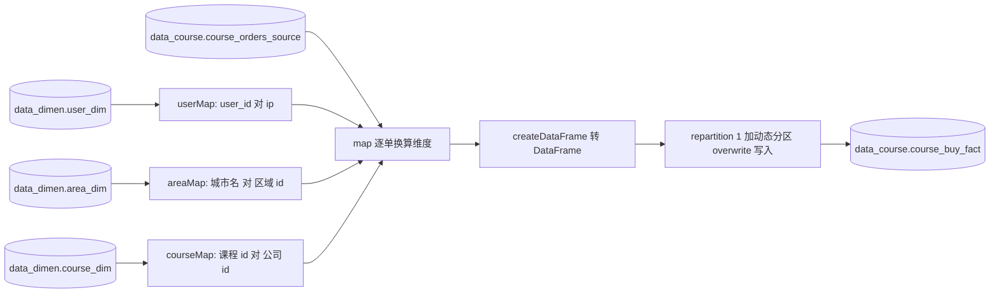

三张维度 Map 与 ODS 订单表在 `map` 算子处汇合，逐单产出事实实体，经 DataFrame 化后落入事实表。代码写到这里没有验证过一行，测试与核对放到下一课：跑起来、看报错、去 Hue 里对数，才是清洗真正收尾的标志。

## 第9部分：购买量 DWD 清洗测试：两处报错排查与 Hue 对账，318 到 18600 的两轮验证

清洗代码写完了，但一行没跑过的程序不能叫完成。测试这一课看着是「点一下运行」，实际过程里藏着两个真实的报错现场：一个是本地跑不起来，模式开关没切；一个是连不上集群，网络出问题。跑通之后还要在 Hue 里对账，先按天清洗对出 318 条，再放开日期过滤做全量清洗对出 18600 多条，两轮数字都合得上，DWD 层的清洗才算真正收尾。

### 第一次跑：master url 报错与模式开关

运行前把上一课写完的代码补齐注释，修改分区、写入模式、指定表三处各挂一句说明，方便日后翻代码。直接点运行，第一个错立刻出现：提示 master url 必须设置。

这个错在环境搭建阶段就打过照面。工程统一用 `EtlEnvironment` 领 SparkSession，它读 `application.properties` 里的 `useingCluster` 开关：true 走集群分支，只 setAppName 不设置 master，master 由 spark-submit 提交时补上；false 走本地分支，setMaster 为 local。前面上传集群的任务把这个开关改成了 true，现在要在 IDEA 里直接跑，集群分支的代码不带 master，本地没有提交环境补位，报错理所当然。把开关改回 false，local 模式重启程序，这一关就过了。

一个开关两处环境，这正是当初封装 `EtlEnvironment` 的意义：一份代码适配两种运行方式，切换只动配置不动代码。

### 连接层报错与网络修复

模式修正后再跑，程序推进到查 Hive 维度数据时抛出连接异常，主机连不上。刷新 Hue 验证一下，连页面都打不开，这就不是代码的问题了：本机到集群的网络断了。把网络处理恢复，确认 hosts 里 `xc-online-hadoop` 这些主机名都能通，重新编译运行。

这次程序完整跑了下来。编译需要时间，初始化 Hive 元数据后依次执行三段维度查询、读取 ODS、逐单清洗、写入事实表，控制台最后把 `course_buy_fact` 的查询结果打了出来。本地跑 Spark 程序虽然不占集群计算资源，但元数据访问、HDFS 读写都是真实发生，网络抖动就是这类任务的头号环境杀手，排障时先用 Hue 这类外围工具验证连通性，比盯着程序日志瞎猜快得多。

### 结果核对：控制台抽查与 Hue 对账

控制台的 `show()` 默认只打 20 条，用于确认数据形态够用：11 月 13 日的订单清洗出了维度 id，字段没有错位。要看总量得去 Hue 里查事实表：

```sql
SELECT count(1) FROM data_course.course_buy_fact
```

Hue 的表浏览视图默认只显示 100 条，看不出全貌，聚合函数统计才是对账姿势。查询结果 318 条，正好对应写死的 `2019-11-13` 一天的订单量。中间还遇到一次 Hue 提示数据锁定的插曲，是前一个查询没释放干净，清掉历史重新执行即可，不必深究。

对账的参照系要提前想好：318 条是「一天的单量」，不是全表单量。拿它与 ODS 表里 11 月 13 日的订单数对照一致，才说明过滤与清洗都没有丢数、没有重复。

### 放开日期过滤做全量验证

单日跑通只证明逻辑对，没证明数据全。真实生产是按天一批批清过去的，测试环境里 ODS 表躺着 9 月到 11 月采集来的全部订单，只清一天显然不放心。把读取 SQL 里的日期过滤注释掉，让全部采集数据进清洗：

```scala
// 生产：由调度脚本传参
// val date_info = args(0)
// 本地测试：写死日期
val date_info = "2019-11-13"
val courseBuySource = spark.sql(
  s"select * from data_course.course_orders_source"
).as[CourseOrdersSource].collect()
```

数据量从一天变成三个月，计算时间明显拉长，属正常现象。跑完再查一次，18600 多条，与采集阶段攒下的订单总量对上。两轮数字合拢，清洗链路的完整性与正确性都有了交代，DWD 层到此完工。

中间还闹了个小插曲：改代码时顺手把 `date_info` 换成了 `args(0)`，本地运行又没传参数，数组下标越界直接抛出。参数接收是给生产准备的，IDEA 里测试就得配回写死的日期，两种模式别混着用。

### 从写死日期到调度传参

测试收尾后，代码要回到生产形态。配套资料里的调度脚本写的就是这个口径：

```bash
#!/usr/bin/env bash
if [[ $1 != "" ]];then
  TD_DATE=$1
else
  echo "[===no params input,default date_info is yesterday($TD_DATE)===]"
  exit 1
fi
SPARK_SUBMIT=/opt/spark/bin/spark-submit

$SPARK_SUBMIT \
  --master spark://xc-online-spark:7077 \
  --class com.study.xc.analysis.buy.CourseBuyHiveToFact \
  /opt/run/jars/xc-service-offline-jar-with-dependencies.jar ${TD_DATE}
```

脚本不接日期参数就直接退出，连猜都不给猜；接了参数就把它透传给主类，代码里 `args(0)` 接住，哪天的数据清哪天。调度层再按天喂昨天的日期，整条离线链路就自动化了。测试写死日期、生产参数化日期，同一段代码在两种模式间只差一行注释的开关，这个习惯值得保留。

整套测试的排障路径画出来是这样的：

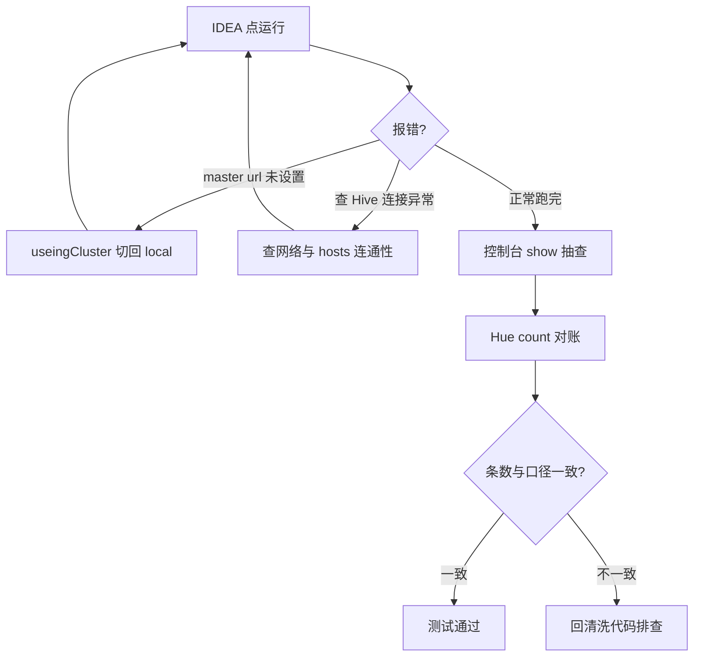

从报错到通过是一条收敛的排查链：环境问题先于代码问题排查，抽查先于全量统计，全量数字与采集口径合拢才算闭环。

## 第10部分：DWM 轻度聚合层：course_buy_dwm 的表结构与天加课程的聚合维度设计

DWD 层的事实表存的是一行一单的明细，维度外键都挂齐了，课程购买量这个指标本身已经可以直接统计。但订单数据的消费方不止一个：后面排队的热门学科排名，口径同样来自订单，只是聚合粒度不同。如果每个指标都回事实表重新算一遍，公共加工就重复了。DWM 层为此而生：在明细之上做一次轻度聚合，把销量与销售额物化成中间表，谁需要谁取。这一课把这张中间表的结构与聚合维度想清楚，代码放下一课。

### 为什么明细之上还要一层聚合

DWD 的事实表已经有课程 id、价格、状态、时间分区，统计课程购买量时 `GROUP BY` 一下就能出结果，为什么不直接统计？

**答案是消费方不止一个。** 课程购买量要的是「按天全站买了多少单」，热门学科排名要的是「按学科分类汇总销量与销售额」，两者的原料都是订单明细，但聚合路径不同。没有中间层，学科排名就得回到 `course_buy_fact` 自己再关联一遍课程维度、再做一遍聚合，购买量清洗里干过的活原样再干一次。维度关联这种重活已经收在 DWD 层了，聚合这种半成品也可以物化一层，DWM 就是这个逻辑的延伸：把公共的中间结果算好存下来，下游取用即可。

**轻度聚合这个词的关键在「度」。** 聚合到天加课程，粒度仍然很细，学科、周、月的统计都能从它继续上卷；如果一步到位把全站订单 `sum` 成一个总数，粒度就没了，想要学科分布时无料可加工。中间层存的是「可继续加工的半成品」，不是「最终成品」，这是分层设计里最容易被忽略的一点。

### course_buy_dwm 表结构

建表语句出自课程资料的建表脚本：

```sql
CREATE EXTERNAL TABLE IF NOT EXISTS data_course.course_buy_dwm
(course_dim_id String,
 company_id String,
 course_category_dim_id String,
 sales String,
 salesvolume String)
PARTITIONED BY (years String,months String,days String)
ROW FORMAT DELIMITED FIELDS TERMINATED BY '\t'
STORED AS PARQUET
location'/user/hive/external/data_course/course_buy_dwm';
```

8 个字段与 DWD 层的对应关系如下：

| DWM 字段 | 来源（DWD 字段） | 说明 |
|---|---|---|
| course_dim_id | course_dim_id | 课程 id，聚合键，明细里直接带 |
| company_id | company_dim_id | 公司 id，经课程维度表带出，注意列名与 DWD 不同 |
| course_category_dim_id | course_dim_id | 课程分类 id，用课程维度表的 mt 字段关联得到 |
| sales | price | `sum(price)`，按课程聚合的销售额 |
| salesvolume | course_dim_id | `count(course_dim_id)`，按课程聚合的销量 |
| years / months / days | years / months / days | 分区年月日，明细直接沿用 |

表看着字段不多，信息密度却不低。三个维度 id 里有两类来源：课程与公司维度是 DWD 明细里现成的，直接取；课程分类维度是明细里没有的新维度，要靠课程 id 到课程维度表里关联，因为课程维度表的 `mt` 字段存的就是所属课程分类。两个度量都是聚合产物：`sales` 是同一课程当天所有订单的价格之和，`salesvolume` 是订单条数，一行 DWM 数据代表「某课程某天卖了多少单、收了多少钱」。

还有一个容易忽视的细节：与 DWD 事实表相比，公司维度这列从 `company_dim_id` 改名叫 `company_id`。中间表不是事实表的复读，字段命名按自己的口径来，下游实体与 SQL 输出都得跟上这个名字，别名不一致的问题会在下一课的代码里真实出现。

### 聚合维度：天加课程，两个都要

聚合键的选择是这张表设计的核心。`GROUP BY course_dim_id, years, months, days`，四个键合起来表达「课程乘以天」：

**课程维度是业务需求的下限。** 购买量指标要全站总量，把课程粒度再求和即可；学科排名要分类粒度，课程到分类是维度表里一次关联的事。聚合键里没有课程，这两条路都得回明细重算，中间层就失去了意义。

**天维度是统计口径的底线。** 分区年月日参与分组，每天的课程销量与销售额各自成行，日批调度每跑一天就落一个分区，历史数据天然隔离。去掉天维度，把三个月的数据揉成一行的确「更聚合」，但从那一刻起，按天对比、按周环比这些口径就再也算不出来了。

分层聚合的粒度选择有个朴素的原则：**聚合到「当前所有已知需求的公共粒度」，而不是「某一个需求的最终粒度」。** 天加课程正好是购买量与学科排名两个需求的最细公共粒度，往上是收益、往下是损失。

### 清洗要干的三件事

把表结构翻译成加工动作，DWD 到 DWM 就三步。关联课程分类：拿明细里的课程 id 去课程维度表换出 `mt`，落到 `course_category_dim_id`，顺路把 `company_id` 也带出来；算销售额：`sum(price)` 按聚合键求和；算销量：`count(course_dim_id)` 数行数。三者共享同一组 `GROUP BY` 键，一条 SQL 就能全出。

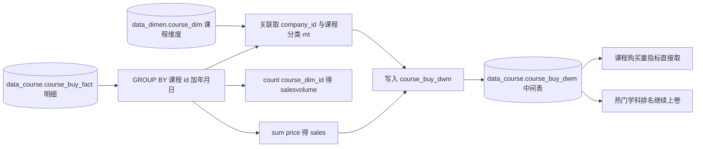

明细先按天加课程聚合成销量与销售额，课程维度表补上分类与公司两个维度 id，结果落进中间表，两类指标从这里分头取数。这张图就是下一课 SQL 代码的施工图：内层子查询负责聚合，外层 join 负责补维度，输出顺序照着中间表的列来。

## 第11部分：DWM 轻度聚合代码：Hue 先跑通 SQL，回 IDEA 封装成 Dataset

聚合逻辑在上一课已经想清楚：按天加课程分组，sum 出销售额，count 出销量，再关联课程维度补分类。落地的写法有个顺序讲究：SQL 先在 Hue 里写、在 Hive 里跑通，确认数字与形态都对了，再搬回 IDEA 包进 `spark.sql` 转成 Dataset。这一课按这个顺序把 `CourseBuyProcessToDWM` 的核心代码写完，重点是子查询与 join 的组合结构，以及一个别名引发的转换报错。

### 骨架与开发方式

类与方法还是提前备好的固定代码，聚合逻辑往 `main` 里填：

```scala
package com.study.xc.analysis.buy

import com.study.xc.common.EtlEnvironment
import com.study.xc.entity.CourseBuyDWM
import org.apache.spark.sql.SparkSession

object CourseBuyProcessToDWM {
  // 初始化 SparkSession
  val spark: SparkSession = EtlEnvironment.getSparkSession(this.getClass.getSimpleName)

  def main(args: Array[String]): Unit = {
    import spark.implicits._
    // 测试写死日期，生产由调度脚本传参
    val date_info = "2019-09-23"
    // 聚合查询写在这里
    spark.close()
  }
}
```

写 SQL 的地方有个现实问题：IDEA 里写 Spark SQL 字符串，编辑器当它是普通文本，一个提示都不给，列名拼错要到运行时才炸。Hue 的查询编辑器就是为这种场景准备的：有字段补全、有语法高亮、跑错立刻报，反复调 SQL 的成本最低。先把 SQL 在 Hue 里调通，再原样搬回 IDEA，两边的 Hive 元数据是同一套，结果天然一致。

### 聚合 SQL 逐段拆

SQL 从一个最朴素的问题开始写起：查 `data_course.course_buy_fact`，按天加课程聚合。直接写第一版，公司 id 也想顺手带上：

```sql
SELECT course_dim_id,
       company_dim_id,
       sum(price) sales,
       count(course_dim_id) salesvolume,
       years, months, days
FROM data_course.course_buy_fact
GROUP BY course_dim_id, years, months, days
```

Hive 直接拒绝：`company_dim_id` 既不在 `GROUP BY` 键里，也不是聚合函数的输入，分组之后一行里对应多个原始值，引擎不知道该输出哪个。把公司 id 加进 `GROUP BY` 能让 SQL 通过，但那样分组粒度就变了，而且公司信息本该从维度表取，不该让事实表自己扛。

正确姿势是把聚合与补维度拆成两层。内层子查询只干聚合，输出课程 id、销售额、销量与分区；外层拿这个临时结果（起别名 a）去 `LEFT JOIN` 课程维度表（别名 b），用课程 id 关联，把 `company_id` 与课程分类 `mt` 带出来：

```sql
SELECT a.course_dim_id,
       b.company_id,
       b.mt course_category_dim_id,
       a.sales,
       a.salesvolume,
       a.years,
       a.months,
       a.days
FROM (
  SELECT course_dim_id,
         sum(price) sales,
         count(course_dim_id) salesvolume,
         years, months, days
  FROM data_course.course_buy_fact
  WHERE concat_ws('-', years, months, days) = '2019-09-23'
  GROUP BY course_dim_id, years, months, days
) a
LEFT JOIN data_dimen.course_dim b
ON a.course_dim_id = b.course_dim_id
```

逐段过一遍。内层是上一课定好的聚合键：课程 id 加年月日，`sum(price)` 起别名 `sales`，`count(course_dim_id)` 起别名 `salesvolume`，聚合到课程乘以天。日期过滤写在子查询里，`concat_ws('-', years, months, days)` 把三个分区列拼回 `2019-09-23` 这样的日期串再与参数比较，先过滤再分组，扫描量小一大截；生产口径下这个位置就是参数 `date_info` 的落点。外层 join 的关联键是课程 id，输出列按中间表的列顺序排：课程 id 从 a 或 b 取都行（两边同值），公司 id 与分类在 b 表，`mt` 要起别名 `course_category_dim_id` 才能对上中间表的列名，销售额、销量与分区列都来自 a。

在 Hue 里执行，跑出来的行就是「某课程某天卖了几单、收了多少钱」，分类与公司 id 补得整整齐齐。测试阶段不过滤日期也行，生产必须带上过滤，参数从调度传进来。

### 搬回 IDEA：三引号、stripMargin 与实体转换

SQL 在 Hue 里定稿，接下来原样搬进 IDEA，包进三引号字符串：

```scala
val buyDS = spark.sql(
  s"""
     |SELECT a.course_dim_id,
     |       b.company_id,
     |       b.mt course_category_dim_id,
     |       a.sales,
     |       a.salesvolume,
     |       a.years, a.months, a.days
     |FROM (
     |  SELECT course_dim_id,
     |         sum(price) sales,
     |         count(course_dim_id) salesvolume,
     |         years, months, days
     |  FROM data_course.course_buy_fact
     |  WHERE concat_ws('-', years, months, days) = '$date_info'
     |  GROUP BY course_dim_id, years, months, days
     |) a
     |LEFT JOIN data_dimen.course_dim b
     |ON a.course_dim_id = b.course_dim_id
     |""".stripMargin).as[CourseBuyDWM]
// 打印核对聚合结果
buyDS.show()
```

三处适配要做。日期换成 `date_info` 变量，字符串前加 `s` 开启插值，`$date_info` 在运行时替换；Hue 复制来的文本没有竖线前缀，按工程的多行风格补上 `|` 边距，行尾的 `stripMargin` 把边距连同缩进去掉，拼出来的才是干净的 SQL；最后 `.as[CourseBuyDWM]` 把查询结果映射成实体 DataSet，这一步依赖 `main` 开头的 `import spark.implicits._`，漏了导入编译期就报错。`show()` 打印核对，控制台默认 20 条，能看到 9 月 23 日的聚合行，说明 SQL 与映射都正常。保存到 `course_buy_dwm` 的动作与 DWD 那侧同款套路（动态分区配置加覆盖写入），放到下一课展开。

### 一个真实踩坑：别名与实体字段对不上

第一次把 SQL 搬回 IDEA 跑，程序报了转换错误：找不到 `company_id` 这一列。回看 SQL，写外层输出时顺手给公司 id 起了别名，把 `b.company_id` 写成了 `company_dim_id`，输出列名与实体字段名对不上，`.as[CourseBuyDWM]` 按名取列时自然落空。

教训记下来就一条：**SQL 输出列名与实体字段名必须一字不差。** 输出顺序对齐建表 DDL，输出名字对齐实体字段，`mt` 这类原名不一致的列起别名向实体看齐，`company_id` 这种本来同名的列就不必再起别名，别名起多了不是严谨，是出错点。修掉多余的别名重跑，20 条聚合数据正常打印，这一步通过。

SQL 的结构画出来是这样的：

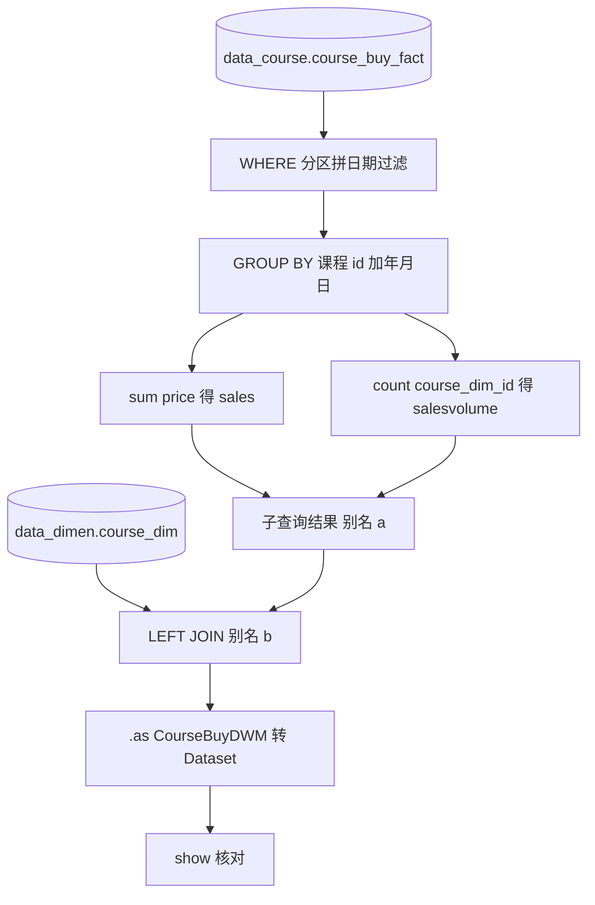

事实表先进子查询完成过滤与聚合，临时结果 a 再与课程维度 b 关联补齐分类与公司两个维度，最后映射成 Dataset。两层结构各有分工，聚合归内层、补维度归外层，顺序颠倒就撞上非分组列的报错。

## 第12部分：课程购买量 DWM 落库：动态分区放行、覆盖写入与全量重跑验证

聚合查询已经就位：按课程按天聚合出销售额与销售量，再关联课程维度补上公司 id 与分类 id，结果装在变量里。变量里的数据一断程序就没了，DWM 层的价值必须落到数仓表里才算兑现。落库代码只有几行，拦路的却是第一道坎：目标表按年月日三级分区，不先开动态分区，保存时 Hive 直接拒绝写入。这一课把 `course_buy_dwm` 的保存代码补完，跑通入库，再到 Hue 里核对轻度聚合的成色。

### 动态分区这道门

保存代码跑出第一条报错时，报错信息直指 Hive 的动态分区没有开启，不允许保存。原因要从表结构找起。`course_buy_dwm` 建表时按 `years`、`months`、`days` 三级分区，写入时这三个分区列的值不在代码里写死，而是由每一行数据自己携带，年归年、月归月、日归日自动落位，这正是动态分区写入。Hive 出于安全考虑默认开严格模式，要求分区列里至少有一个是静态值，防止一句失手的 SQL 生成海量分区；全动态写入撞上严格模式，直接被拒。

解药是会话级配置，写在保存动作之前：

```scala
// 配置动态分区模式，全动态写入需要 nonstrict 放行
spark.conf.set("hive.exec.dynamic.partition.mode", "nonstrict")
```

同场还有一条配置与覆盖写配套。`spark.sql.sources.partitionOverwriteMode` 设为 `dynamic` 后，`overwrite` 的覆盖范围收敛到本次写入实际涉及的分区：这次聚合写了哪几天的数据，就只替换哪几天的分区目录，表里其他日期的历史分区原样保留。少了这条配置，覆盖写按静态覆盖理解，行为会与预期出现偏差。

### 保存代码逐行拆解

分区模式放行之后，保存本身浓缩成一条链：

```scala
// 指定 hive 参数，保存到表
spark.conf.set("spark.sql.sources.partitionOverwriteMode", "dynamic")
spark.conf.set("hive.exec.dynamic.partition.mode", "nonstrict")
// 保存到数据库
buyDS
  // 输出一个文件，由于分区减少，效率低，数据小时不影响
  .repartition(1)
  .write
  // 相同分区覆盖
  .mode("overwrite")
  // 指定表名
  .insertInto("data_course.course_buy_dwm")
// 查看结果
spark.sql("select * from data_course.course_buy_dwm").show()
spark.close()
```

逐行看每个动作的用意。`repartition(1)` 把聚合结果强行并成一个分区：聚合后的数据按天收拢，体量不大，多分区写入会落成几十个小文件，Hive 查询与下游读取都是负担；并成一个分区，落盘就是一个文件。注释里也交代了代价，分区减少写入并行度归一，数据量大时不能这么干，数据小时这点损耗可以忽略。

`mode("overwrite")` 是重跑幂等的关键。覆盖模式写入前先清掉目标范围的旧数据再灌新结果，同样的输入跑多少遍，表里的内容都一致。清洗逻辑出了问题写入了坏数据，修复代码后重跑一次，坏结果被整体顶掉，不用手工清理残留。换成 `append`，每重跑一遍数据翻一倍，中间层立刻失真。

`insertInto` 只灌数据不建表，表由建表脚本提前建好，字段是课程维度 id、公司 id、课程分类 id、销售额、销售量加年月日分区。它按列位置对齐而不是按名字对齐，实体字段的顺序与建表 DDL 严格一致才不会错位。参数写全 `库名.表名`，不依赖会话的默认库。

保存完成后当场 `show()` 一次，控制台直接看到入库结果；`spark.close()` 收尾，打开的资源全部归还。

### 测试口径与生产口径的切换

SQL 里的日期过滤条件，测试与生产用的是两套口径。生产环境的写法以参数为基准：日期从启动参数取，SQL 用 `where` 只算目标日期那一天，代码里把这条路径注释保留着。测试环境下如果照搬这个口径，聚合结果只有一天的数据，后面业务表、报表系统跟着只能拿到一天，折线图画不出形状。所以测试时把 `where` 条件放开，事实表里已有的所有数据全部参与聚合，多天的中间结果一次算齐。

两套口径能随意切换，底气来自 `overwrite`：不管聚合范围是一天还是多天，写入都是覆盖语义，重跑不会叠加。测试跑完切回生产口径，改回参数取日期加 `where` 过滤即可，保存逻辑一字不用动。

整条落库链路如下面这张图，聚合结果从变量到数仓表要过四道关，任何一道缺配置都会停在原地：

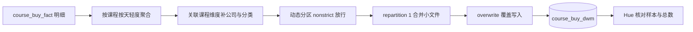

关键路径在动态分区与覆盖模式两道关：前者决定写不写得进去，后者决定重跑可不可信。关联维度在聚合查询里完成，保存代码只负责把算好的结果安全落地。

### Hue 里的两层核对

程序跑完，验证去 Hue。第一层看样本：刷新表浏览器打开 `course_buy_dwm`，样本数据已经进来，课程维度 id、公司 id、课程分类 id、销售额、销售量、年月日分区列都有值，日期不再局限于开发时过滤的那一天，多天的数据都在表里。Hue 的样本视图默认只显示 100 条，这是展示层的截断，不是数据的边界。

第二层看总量，用聚合查询把答案要出来：

```sql
SELECT count(1) FROM data_course.course_buy_dwm
```

查询结果 3000 多条。这个数字可以倒推中间层的粒度：DWM 层以课程乘以天为行单位，有多少个「有订单的课程与有订单日期的组合」，表里就有多少行。对照事实表以订单明细为行的体量，中间层的行数明显收缩，收缩的正是重复度，同一课程同一天的多次购买被压成一行，销售额与销售量聚在行内。后面统计层、热门学科排名都要从这张表取数，一次聚合多处复用的设计意图，到这里开始兑现。

## 第13部分：课程购买量统计分析：DWM 按天求和，APP 层只留报表要的两列

DWM 层躺着 3000 多行「课程乘以天」粒度的中间结果，报表曲线要的却是另一个形状：每天一行，当天全平台购买量总和。从中间层到报表口径只差一次分组求和，这一课在 DWM 之上做 APP 层统计，结果落进 `course_buy_biz`。聚合动作简单，容易翻车的反而是类型转换与口径切换这两处细节。

### APP 层的结构：只装报表要的

APP 层是面向应用结果的最终一层，表里每一行都对应报表上要展示的一个数。课程购买量以天为展示粒度，所以这一层以天为行单位，建表语句出自课程资料：

```sql
CREATE EXTERNAL TABLE
IF NOT EXISTS data_course.course_buy_biz
(date_info String,
count INT)
PARTITIONED BY (years String,months String,days String)
ROW FORMAT DELIMITED FIELDS TERMINATED BY '\t'
STORED AS PARQUET
location '/user/hive/external/data_course/course_buy_biz';
```

两个业务列各司其职：`date_info` 是拼好的 `yyyy-MM-dd` 日期字符串，报表按它取数画横轴；`count` 是当天的购买量总和，画纵轴。年月日三个分区列保留下来，是为了存取效率与按天管理的便利，与展示无关。实体类与表严格对齐：

```scala
/**
 * 每天购买量
 *
 * @param date_info 日期，格式：yyyy-MM-dd
 * @param count      购买量
 * @param years      分区年
 * @param months     分区月
 * @param days       分区日
 */
case class CourseBuyBiz(date_info: String,
                        count: Int,
                        years: String,
                        months: String,
                        days: String)
```

五个字段的名字与类型就是后面 SQL 别名的硬约束：查询结果的列名与类型对上了，才能一步转成实体集合。

### 统计 SQL：先在 Hue 里试

动手写程序之前，SQL 先在 Hue 里验证一遍，眼见为实再搬进代码：

```sql
SELECT
concat_ws('-',years,months,days) date_info,
sum(salesvolume) count,
years, months, days
FROM data_course.course_buy_dwm
GROUP BY years, months, days
```

这条 SQL 有四处值得逐段看。`concat_ws('-',years,months,days)` 用分隔符把三个分区列拼成标准日期串，别名定为 `date_info`，与实体字段同名；分组依据直接用年月日三个分区列，DWM 层的分区粒度恰好就是天，天然免了多余处理；`sum(salesvolume)` 把同一天所有课程的销量加总，得到全平台当天购买量；年月日分区列一并输出，落表时分区值有了着落。

想先验证单日效果，加一条过滤即可，日期随便挑一天：

```sql
SELECT
concat_ws('-',years,months,days) date_info,
sum(salesvolume) count,
years, months, days
FROM data_course.course_buy_dwm
WHERE concat_ws('-',years,months,days) = '2019-09-26'
GROUP BY years, months, days
```

执行结果从几千行收敛到一行，日期串、购买量、分区值整齐排开，统计口径就此敲定。分层结构如下面这张图，每往下一层行数与粒度都向报表靠近一步：

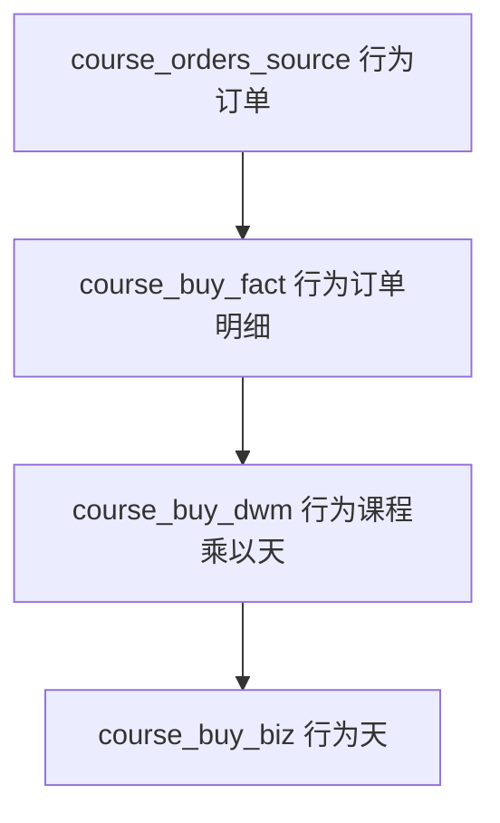

从订单到天的收敛发生在三个环节：清洗把维度挂上明细，轻度聚合把课程压到天与课程的组合，统计求和把课程维度也抹掉，只剩天。每层行数递减，口径逐层对齐报表。

### 代码逐段落地

SQL 验证无误，搬进统计程序 `CourseBuyProcessByBiz`：

```scala
package com.study.xc.analysis.buy

import com.study.xc.common.EtlEnvironment
import com.study.xc.entity.CourseBuyBiz
import org.apache.spark.sql.SparkSession

object CourseBuyProcessByBiz {

  val spark: SparkSession = EtlEnvironment.getSparkSession(this.getClass.getSimpleName)

  def main(args: Array[String]): Unit = {
    import spark.implicits._
    // 以天为单位，查询指定日期数据，生产口径从参数取日期
    // val date_info = args(0)
    val date_info = "2019-09-26"
    // 查询所有，方便测试，测试口径不过滤日期
    val buyDS = spark.sql(
      s"""
         |select
         |concat_ws('-',years,months,days) date_info ,
         |cast(sum(salesvolume) as int) count,
         |years, months, days
         |from data_course.course_buy_dwm group by years, months, days
       """.stripMargin).as[CourseBuyBiz]
    // 指定 hive 参数，保存到表
    spark.conf.set("spark.sql.sources.partitionOverwriteMode", "dynamic")
    spark.conf.set("hive.exec.dynamic.partition.mode", "nonstrict")
    // 保存到数据库
    buyDS
      // 输出一个文件，由于分区减少，效率低，数据小时不影响
      .repartition(1)
      .write
      // 相同分区覆盖
      .mode("overwrite")
      // 指定表名
      .insertInto("data_course.course_buy_biz")
    // 查看结果
    spark.sql("select * from data_course.course_buy_biz").show()
    // 关闭资源
    spark.close()
  }
}
```

结构与上一课的 DWM 程序同构：SparkSession 由公共环境类按类名创建，隐式转换导入后才能调 `.as[CourseBuyBiz]` 做类型化转换，查询、配置、保存、查看、关闭一路到底。差别只在查询对象换成 DWM 表、聚合粒度换成天、目标表换成 biz。骨架不变意味着这段代码的维护成本极低，换一个指标照着改表名与聚合列就能再出一版。

### 一次报错教会两件事

测试程序时第一次运行直接报错，错误信息是 `Cannot up cast 'count' from double to int`。原因藏在类型系统里：`sum` 聚合的返回类型是双精度，而实体 `CourseBuyBiz` 里 `count` 声明为 `Int`，DataFrame 转实体时 Spark 发现双精度无法无损抬升成整型，直接拒绝。在 Hue 里跑 SQL 看输出没问题，因为控制台展示只管打印不管类型；一旦要映射成带类型的对象，类型必须严丝合缝。

修法是把类型收敛提前到 SQL 里，`cast(sum(salesvolume) as int) count`，聚合完立刻转整型，别名保持 `count` 不变。改完重跑，控制台输出与 Hue 里验证的结果完全一致，多天的购买量按天排开。这个坑的通用教训：类型化转换把约束从「能打印」提到了「能映射」，SQL 的输出列类型要按实体声明来设计，而不是反过来改实体迁就 SQL。

第二件事是测试口径的取舍。单日统计对验证有利，对报表无用，业务报表系统需要一段时间的曲线。测试阶段把过滤条件注释掉，DWM 层所有日期全部参与求和，业务表一次装满多天数据；切生产时恢复参数取日期加过滤，两个口径在代码里注释共存。

保存完成后去 Hue 刷新 `course_buy_biz`，数据已经落进表里，与控制台输出一致。APP 层统计完成，下一课把这层数据同步进 MySQL，报表系统就能开饭。

## 第14部分：NiFi 五处理器链复用：课程购买量从数仓搬进 MySQL 业务库

统计结果已经落进数仓的 `course_buy_biz`，业务报表系统却不读 Hive，它只连 MySQL。最后一公里的搬运还是那条熟悉的五处理器链：查 Hive、转格式、切行、取值、写 MySQL。课程访问量章节配过完整的一条，这一课只是换查询对象、换落库表名，配置经验全部平移，模板导入后十分钟级的活。

### 业务表只要两列

MySQL 侧的表结构在建库时随业务数据一并导入，长这样：

```sql
CREATE TABLE `course_buy_biz` (
  `date_info` date NOT NULL,
  `count` int(11) NOT NULL
) ENGINE=InnoDB DEFAULT CHARSET=utf8
```

与 Hive 侧同名表对照，少的正是年月日三个分区列。原因在定位：MySQL 这张表只为报表展示服务，前端按日期取数画曲线，要什么列同步什么列即可；分区裁剪、存储组织这些数仓侧的活，业务库一概不承担。`date_info` 是 date 类型，Hive 里拼好的 `yyyy-MM-dd` 字符串直接可写，统计程序坚持在 SQL 里拼标准格式的回报在这里兑现。

### 五处理器各司其职

数据流如下：查询结果以 Avro 出来，转成 JSON 数组后切行，字段值搬进属性，最后按模板写进 MySQL。

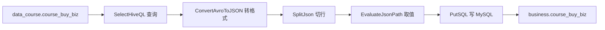

关键路径在格式转换与取值两环：Avro 是 Hive 查询结果的默认输出格式，下游处理器只认 JSON；数组切开后字段值从内容搬进属性，插入模板才有值可填。

**SelectHiveQL 负责查询。** 挂 Hive 连接池服务，查询语句一行，输出格式 Avro，此刻的流文件是整份查询结果，尚未按行拆开：

```sql
SELECT * from data_course.course_buy_biz
```

**ConvertAvroToJSON 负责转格式。** JSON container 配 array，整份结果变成一个 JSON 数组，一行数据对应数组的一个元素。**SplitJson 负责切行**，JsonPath 表达式写 `$`，数组按元素切开，一个元素一个流文件，处理粒度从整份结果降到单行记录。

**EvaluateJsonPath 负责取值。** Destination 配 `flowfile-attribute`，两条表达式各取一列：`counts = $.count`、`date_info = $.date_info`，值从流文件内容写进属性。查询带出的年月日分区列在这一环被自然丢弃，取值表达式只声明业务表要的两列，分区列不进属性，也就进不了后面的插入语句。

**PutSQL 负责落库。** 插入语句是一行模板：

```text
INSERT INTO `business`.`course_buy_biz` VALUES ('${date_info}', '${counts}');
```

`${date_info}` 与 `${counts}` 引用的正是上一步写进属性的两个值，Batch Size 配 1000，攒一批再执行，减少与 MySQL 的往返。属性名取 `counts` 模板就引用 `counts`，一字不差值才能对上。

### 导入模板与两处配置

整条流程在课程资料里有现成的模板 XML，流程组的定位标注得很清楚，落地业务库。导入动作与前面几课完全一致：上传模板，用 Add Template 拖进画布，放进离线分析下的课程购买量处理器组。打开 Controller Services，要处理的还是两个感叹号：

- Hive 连接池：之前采集时已经配好，直接启用即可；
- MySQL 连接池：用户名 root 模板已带，连接串指向业务库，补上密码 123456 再启用。

MySQL 连接池的关键配置照录如下，驱动位置按环境实际存放的驱动包为准：

```text
Database Connection URL  jdbc:mysql://xc-online-mysql:3306/business?characterEncoding=UTF-8&useSSL=false&allowPublicKeyRetrieval=true
Database Driver Class Name  com.mysql.cj.jdbc.Driver
Database Driver Location(s)  /opt/mysql-connector-java-8.0.16.jar
Database User  root
Password  123456
Max Total Connections  8
```

两个感叹号清零，处理器组进入可执行状态。与访问量那条链对比，五个处理器的类型、连接关系、表达式写法全部一致，差异收敛到查询表名与插入表名两处，这正是模板化链路的价值：会配一条，同类需求只是换个终点。

### 启动与验证

启动整个处理器组，看队列与落库。`SelectHiveQL` 查出当天的统计结果，流文件沿链路推进，到 `PutSQL` 时按单行模板逐条插入。本轮统计输出 61 天的数据，队列里就流过 61 个流文件，行数与统计输出对得上，说明一条不少。

核对在 Navicat 完成：刷新 `business` 库的 `course_buy_biz`，61 条记录全部进来，`date_info` 与 `count` 列都有值。数据进了业务库，报表系统随即有数可取。报表前端在课程访问量章节已经搭建配置好，直接访问报表站点（课程环境端口 4000），切到课程购买量页面：按周展示、按月展示、按年展示逐个点过去，购买量曲线如期出现。到这里，课程购买量从采集到展示的链路只差最后一段调度收口，数据清洗与统计程序的调度交给下一课。

## 第15部分：课程购买量集成测试：把清洗与统计的 spark-submit 挂上 NiFi 流水线

画布上课程购买量链路已经有两段在岗：数据采集组把订单实时采进数仓，落地业务库组把统计结果搬进 MySQL。夹在中间的 DWD 清洗、DWM 聚合、APP 统计三个 Spark 程序却还靠 IDEA 手动点运行，集成测试的缺口正是这一段。这一课把三个 spark-submit 交给 NiFi 调度，清空旧数据跑一轮，验证整条流水线能不能一气走完。

### 集成测试缺的是哪一段

集成测试的定义朴素：把所有任务调度放到 NiFi 上，用 NiFi 调度来执行任务。课程购买量链路四段，画布上的就绪程度并不相同，先盘点再动手：


数据采集段早在采集阶段就常驻画布，订单数据从业务库实时流进数仓的原始表，为清洗提供基础数据；落地业务库段上一课刚验证完，统计结果进 MySQL 的通道畅通。两段的调度配置都出自现成模板。缺的是中间一段：清洗与统计程序此前在开发工具里以本地方式执行测试，属于人工触发的单点验证，没有进入调度体系。讲义与资料把补齐这三样东西都备好了：清洗统计的 NiFi 调度流程模板、三个 spark-submit 调度脚本、打包好的依赖 jar。要做的只有四件事：打集群包、导模板、把脚本与 jar 放进 NiFi 容器的约定目录、启动验证。

### 调度组的结构与参数

调度模板导入后得到一个包含四个处理器的组，串行结构一目了然：

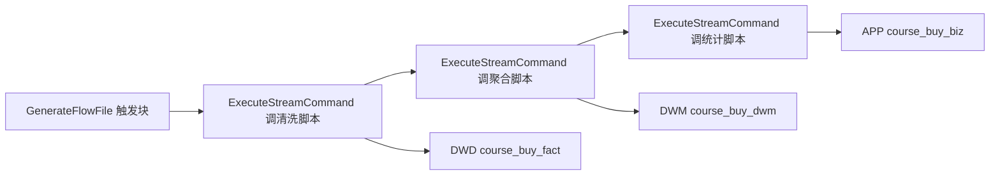

`GenerateFlowFile` 是整条流的起点，文件大小 0B、批次 1，调度周期拉成天文数字，等于手动点一次只跑一轮，生成一个 0 字节的触发块交给下游。三个 `ExecuteStreamCommand` 是干活的处理器，本职是执行外部命令并把命令输出交给下游，衔接靠 `output stream` 关系：上一个脚本执行完，输出流向下一个调度，先后顺序天然成立，统计永远在聚合之后、聚合永远在清洗之后。

三个处理器的配置除了脚本名完全一致，关键项如下：

```text
Command Path        /opt/run/script/course_buy_process_to_dwm.sh
Command Arguments   ${now():toNumber():minus(86400000):format('yyyy-MM-dd')}
Ignore STDIN        true
Working Directory   /opt/run/script
Argument Delimiter  ;
```

Command Arguments 是一段 NiFi 表达式语言：取当前时间，减去一天的毫秒数，再格式化成年月日，得到昨天的日期，与离线分析「算昨天」的口径一致。`Ignore STDIN` 置 true，不把触发块内容喂给脚本；工作目录指向脚本所在位置。另外两个处理器分别把 Command Path 换成清洗脚本与统计脚本，其余原样。

### 三个调度脚本

脚本在资料里备齐，结构相同，只差 `--class` 指向的入口类。DWM 聚合这份如下：

```bash
#!/usr/bin/env bash
if [[ $1 != "" ]];then
    TD_DATE=$1
else
    #TD_DATE=`date -d "-1 day" +%Y-%m-%d`
    echo "[===no params input,default date_info is yesterday($TD_DATE)===]"
    exit 1
fi
SPARK_SUBMIT=/opt/spark/bin/spark-submit
$SPARK_SUBMIT \
  --master spark://xc-online-spark:7077 \
  --class com.study.xc.analysis.buy.CourseBuyProcessToDWM \
  /opt/run/jars/xc-service-offline-jar-with-dependencies.jar ${TD_DATE}
if [[ $? == 0 ]];then
    echo "[===spark-submit process success===]"
else
    echo "[===spark-submit process failed===]"
    exit 0
fi
```

脚本三层逻辑：没传日期参数直接退出，防止空跑；有参数则拼 spark-submit 命令，master 指向课程集群的 Spark 地址，类名用全限定名，jar 是整个离线工程打出的依赖包；结尾用 `$?` 判断提交结果并回显，NiFi 侧能看到输出。另两个脚本只换一行：清洗脚本指向 `com.study.xc.analysis.buy.CourseBuyHiveToFact`，把原始订单数据洗进事实表；统计脚本指向 `com.study.xc.analysis.buy.CourseBuyProcessByBiz`，把中间层按天求和进业务表。三个类打在同一个 jar 里，脚本差异收敛到一行，发布只维护一个包。

### 打包与容器内部署

调度执行的是集群任务，打包前有一处必改：公共配置文件里集群模式的开关此前是注释状态，本地测试一直走本地模式，提交集群必须把注释去掉让 `usingCluster=true` 生效，然后执行 package 打出带依赖的 jar。

部署是把四样东西送进 NiFi 容器：脚本与 jar 先经 WinSCP 上传到宿主机的临时目录，再用 docker cp 复制进容器，最后在容器里归位：

```bash
# 宿主机 /opt/tmp 已有上传好的三个脚本与 jar，逐个复制进 NiFi 容器
docker cp course_buy_source_to_fact.sh nifi-container:/opt
docker cp course_buy_process_to_dwm.sh nifi-container:/opt
docker cp course_buy_process_by_biz.sh nifi-container:/opt
docker cp xc-service-offline-jar-with-dependencies.jar nifi-container:/opt
# 容器内：旧 jar 先删，新包包含全部代码，直接覆盖
rm /opt/run/jars/xc-service-offline-jar-with-dependencies.jar
mv /opt/xc-service-offline-jar-with-dependencies.jar /opt/run/jars/
# 脚本归位并补可执行权限，chmod 必须在脚本所在目录里执行
mv /opt/*.sh /opt/run/script/
cd /opt/run/script
chmod +x *.sh
```

删旧 jar 不是多余动作：这次打包把工程里全部代码收进了一个包，新 jar 已经包含旧 jar 的内容，旧包留着只会让脚本指向混淆。可执行权限也有现成的坑：刚上传的脚本在容器里是白色（无执行权限），不加 `chmod +x` 处理器调用必报权限拒绝；而且权限命令要在脚本所在目录里执行，目录不对，通配符匹配不到任何文件。加完权限文件名变绿，部署才算就绪。

### 清数据、跑一轮、补同步

测试前先清场。清洗、聚合、统计、落库此前几课用的是同一批数据，如果不清，跑完根本分不清表里的数是本轮调度产出的还是历史残留。清法直接从 HDFS 下手：把事实表、中间层、业务表三张表对应目录下的数据文件删掉，回 Hue 查询确认三张表 count 为 0。空表起步，之后查到的每一条都出自本轮流程。

启动调度组，三个位置接力观察。NiFi 画布上队列先出现计数，触发块已经交给第一个命令处理器；Spark Master 页面（8080 端口）随即出现第一个应用，清洗任务运行二十余秒完成，队列推进到第二个处理器，聚合任务接着上，再过二十余秒轮到统计任务，十几秒收尾。NiFi 队列停在某一级不动，就说明当前脚本还在跑；队列推进一格，上一段已经完成。

数据侧逐层核对：清洗完成后事实表有数，聚合完成后中间层有数，统计完成后业务表有数，三张表在 Hue 里依次刷出数据，与 Spark 页面的任务节奏一一对应。调度链验证通过，把调度组的处理器停掉。

最后一件事是补同步：清场时业务表的数据也被删了，MySQL 侧还是空的。把落地业务库组重新启动，把刚清洗统计好的数据再同步一遍，刷新业务表，61 条记录重新就位。至此采集、清洗、统计、落地四段全部收在 NiFi 的画布上，剩下的联动配置（清洗统计结束自动触发同步）留给下一课。

## 第16部分：课程购买量联动整流程测试：等待处理器把清洗统计与落地同步接成一条线

上一课把 DWD 清洗、DWM 聚合、APP 统计三个 spark-submit 挂进了 NiFi 调度组，画布上课程购买量链路的四段只差一次握手：清洗统计跑完之后，落地业务库组仍要人工点一次启动。这一课把这次人工干预也拿掉，用等待处理器把两个处理器组接起来，统计一收尾、同步自动跟上；随后清空三层表数据，整条链路从头跑一轮，跑通了，课程购买量指标就算正式收官。

### 联动要补的最后一环

课程购买量整体流程在画布上是四个处理器组：NiFi 造数、MySQL 实时采集、数据清洗统计调度、落地业务库。造数与采集常驻运行，订单数据早已躺在数仓里；本轮测试沿用既有数据，真正要接的是后两组之间的信号线。下图是接线完成后的整体结构：

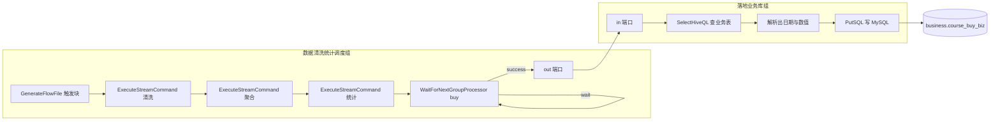

清洗统计调度组内部是上一课配好的串行三连，统计脚本的输出再交给等待处理器；落地业务库组则从 `data_course.course_buy_biz` 查出统计结果，解析出日期与数值两列后写入 MySQL 的 `business.course_buy_biz`。两个组各自能跑，缺的只是那条 out 到 in 的连线，以及连线之前的一个判断：整组任务真的结束了吗。

### 等待处理器：配置与两个感叹号

进入清洗统计调度组，在统计脚本调度处理器后面添加 `WaitForNextGroupProcessor`，把统计处理器的 `output stream` 关系连给它。刚拖出来的处理器挂着两个黄色感叹号，各对应一处缺失配置。实例取值汇总如下：

```text
Waiting Time Id            buy
Waiting Time               30
Distributed Cache Service  DistributedMapCacheClientService
                             Server Hostname  localhost
                             Server Port      4557
关系处理                    wait 连回处理器自旋，success 交给组内 out 端口
```

第一个感叹号出在唯一标识上：多组都在等待时靠 Waiting Time Id 区分信号，课程购买量这轮就填 `buy`。第二个感叹号出在缓存客户端上：等待状态登记在缓存服务里，缓存服务全局只有一个，课程环境早已配好，这里只需要新建一个 `DistributedMapCacheClientService` 客户端，Server Hostname 填 `localhost`、端口 4557，启用后处理器就能自动找到服务。两项配置一落，感叹号消失。

接着把两个端口接出来。清洗统计调度组里给等待处理器的 success 关系连到新增的 out 端口，落地业务库组里新增一个 in 端口、把组内第一个处理器连上去。此刻回到上层画布直接连线多半会失败，因为端口还没有合法的输入输出，处理器上会提示类似 `Port 'out' is invalid because Output connection for port 'out' is not defined` 的报错，把组内的进出连线补齐、刷新后再连 out 到 in，报错随之消失，两组正式握手。

### 清空三层表，整链开跑

老规矩，先清场再开跑。前几课的验证用的是同一批数据，不清掉就分不清表里的数是本轮流程产出的还是历史残留。清法直接从 HDFS 下手，把三张表下 `years=2018` 与 `years=2019` 两个分区目录删掉，与 Hue 文件浏览器里勾选目录删除等价：

```bash
# 事实表、中间层、业务表依次清理（界面删除与命令等价）
hdfs dfs -rm -r /user/hive/external/data_course/course_buy_fact/years=2018
hdfs dfs -rm -r /user/hive/external/data_course/course_buy_fact/years=2019
hdfs dfs -rm -r /user/hive/external/data_course/course_buy_dwm/years=2018
hdfs dfs -rm -r /user/hive/external/data_course/course_buy_dwm/years=2019
hdfs dfs -rm -r /user/hive/external/data_course/course_buy_biz/years=2018
hdfs dfs -rm -r /user/hive/external/data_course/course_buy_biz/years=2019
```

```sql
-- Hue 里逐表核对，count 为 0 才算清干净
select count(*) from data_course.course_buy_fact;
select count(*) from data_course.course_buy_dwm;
select count(*) from data_course.course_buy_biz;
```

空表起步后，把清洗统计调度组与落地业务库组先后启动。观察的节奏如下：Spark Master 页面上清洗任务先上，二十余秒完成；队列推进一格，聚合任务接棒，又是二十余秒；统计任务再上，十几秒收尾。这里有个容易误判的细节：统计任务写业务表是渐进的，Hue 里刷新 `course_buy_biz` 会先冒出几条、过一会儿才涨到全量，这是写分区目录的正常节奏，有数不等于统计结束，判断完成的依据是 Spark 页面上任务状态转成完成。

统计输出进入等待处理器后，队列里会短暂压着两条流文件不动，这正是 30 秒静默窗口在工作：上游处理完成后再等一段，防止把收尾输出当成完整信号。窗口一过，队列清空，数据沿 out 端口流进落地业务库组的 in 端口，同步链启动，MySQL 业务表刷新出本轮数据。整条链路的时间线如下：

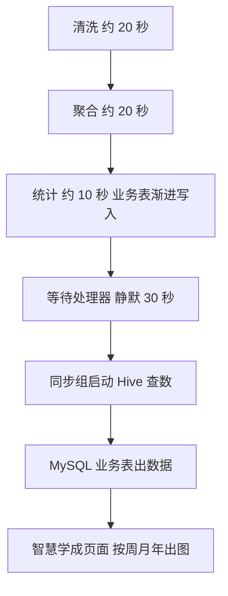

### 收尾核对与指标收官

数据落进业务库，验证只剩展示。智慧学成页面打开课程购买量报表，按周、按月、按年逐个切换，图表与明细随请求即时刷新：2019 年的日期段数据完整，2018 年只有个别天有两条记录，与数仓里的数据分布一致。报表系统读的就是业务库，库里有数、页面即有图，这一层不需要任何额外配置。

至此课程购买量指标的全流程闭环：订单数据经采集进数仓，DWD 清洗、DWM 聚合、APP 统计三段由 NiFi 调度串行执行，等待处理器把统计收尾的信号交给落地业务库组，同步写进 MySQL，报表页面即取即用。整条链一次启动、全程无人工干预，讲义里对应的整体流程模板也把这套结构完整收录，导入即得。下一个指标热门学科排名，从需求分析重新出发。

## 常见误区

- **把购买量当成访问量的别名。** 错例：以为两个页面共用一套数据，只是标题不同。正解：数据源一个是访问行为日志、一个是订单交易数据，统计口径一个是访问次数、一个是成交数量，采集链路从源头就分开了。
- **以为按月展示返回月级数据。** 错例：后端按月聚合，每月只吐一个数。正解：三个级别粒度都是天，周月年只是区间参数，返回区间内每天的记录。
- **把原型上的模拟数字当真实分布。** 错例：看到某天数值特别高就去分析原因。正解：mock 数据随机生成，原型阶段只验证结构与交互，数值无业务含义。
- **漏掉区间参数。** 错例：接口只带一个日期就想画折线。正解：折线画的是一个区间，`startDate` 与 `endDate` 必须成对出现，天粒度数据逐日返回。
- **全字段照搬进数仓。** 错例：图省事把订单表十来个字段原样采集。正解：按统计需求反推出最小字段集，无关字段徒增存储与解析负担，还会因无关变更触发不必要的数据更新。
- **把 details 当普通字符串字段忽略结构。** 错例：解析时直接整段存档不拆。正解：它是 JSON 数组，当前取首元素即可拿到课程与价格，解析代码按数组写，兼容后期一单多课。
- **把 ODS 表建成普通文本外部表。** 错例：沿用访问量事实表的 PARQUET 文本写法建订单表。正解：binlog 采集含 update，目标表必须桶表加 ORC 加事务属性，缺一样更新就落不进去。
- **忽略时间字段类型差异。** 错例：以为 MySQL 的 datetime 会原样进 Hive。正解：采集设计约定 datetime 转 BIGINT 时间戳，年月日由清洗阶段从时间戳派生。
- **把注意事项当成待办配置。** 错例：进环境就把 hive-site.xml 重写一遍、缓存服务再建一个。正解：两项都已在环境与此前配置中就绪，本课动作是打开文件与面板确认，不是新建。
- **只做表属性不做全局配置（或反之）。** 错例：建表声明了 transactional，hive-site.xml 里事务管理器还是默认值，update 直接报错。正解：建表属性与全局事务配置互为前提，两处都要核对。
- **重复添加缓存服务。** 错例：每个新流程都自带一个 DistributedMapCacheServer。正解：全局一个，Controller Services 面板确认 Enabled 后直接引用，出现端口冲突或服务找不到时先查是不是起了两个。
- **以为开了事务配置所有 Hive 表都能 update。** 错例：对普通文本外部表执行 update。正解：事务按表生效，只有建表声明 transactional 且满足分桶与 ORC 条件的表支持行级更新。
- **把首轮回灌当成采集出错。** 错例：启动后队列堆了近二十万条流文件，以为流程坏了，到处改配置。正解：`Retrieve All Records` 为 true 时首轮必然回放 binlog 历史，测试前清空队列即可；只想要增量时关掉这个属性，让处理器从当前位点开始。
- **插完数据立刻查 Hive。** 错例：业务库 insert 之后马上到 Hue 刷新，表里没有，认定采集失败。正解：Hive 插入要起 MapReduce，落地有分钟级缓冲，先看 NiFi 队列是否消化完，再查表。
- **被浮点尾差带偏方向。** 错例：看到 9999.9900001 就回头排查采集链路。正解：`price` 列是 Float，尾差是类型固有精度，比对按数值容差判断即可。
- **把权限坑归咎于 NiFi 流程。** 错例：PutHiveQL 报 return code 1 就去改连接池、重导模板。正解：事务表写入依赖 HDFS 临时目录，先看 Hive 日志确认失败原因，`/tmp/hadoop-yarn` 权限放开即恢复。
- **以为造数脚本直接写数仓。** 错例：在流程里找不到写 Hive 的处理器，怀疑模板不完整。正解：造数终点是 `PutSQL` 写业务库订单表，进数仓靠的是并行的 binlog 采集链。
- **拿 Python 3 的眼光看脚本。** 错例：看到 `xrange` 就改语法，越改越跑不通。正解：`ExecuteScript` 选 python 走 Jython，是 Python 2.7 环境，脚本按原样跑。
- **队列没消化完就停整个组。** 错例：停掉生产处理器时把 `PutSQL` 也停了，队列里的几万条订单全堵着。正解：只停前段，单独启动末端处理器继续消费，或者保留队列稍后再跑。
- **手动插一条来验证批量链路。** 错例：造完数还要手动插一条确认采集在工作。正解：count 对上量级就是最硬的验证，逐条对账在上一课已做过，批量场景看总量即可。
- **事实表里塞维度名称。** 错例：把课程名、公司名一并写进事实表，图查询方便。正解：事实表只存维度外键，名称查维度表；冗余进事实表，维度变更时要回刷全量历史。
- **区域维度沿用访问量的算法。** 错例：在订单清洗里找 IP 字段，找不到就硬编码同一个函数。正解：订单没有 IP，必须经 user_id 到用户维度取注册 IP 再换算，取不到的落 -1 兜底。
- **忘了状态过滤。** 错例：所有订单一律进事实表，购买量被未付款订单灌水。正解：清洗时按状态口径过滤，只留符合已购定义的状态。
- **分区字段用采集日期。** 错例：years、months、days 取程序运行日期。正解：分区对齐业务时间，用订单时间推导，业务口径的按天统计才有意义。
- **给维度采集也配增量列。** 错例：想着省事配了 Maximum-value Columns，结果用户资料更新后数仓里的旧行永远是旧的。正解：用户表量级小、更新散，全量快照最稳妥；真到大表再谈增量加更新合并的方案。
- **采完不停处理器。** 错例：任务跑完让流程一直挂着，每轮调度都全量覆盖一遍。正解：维度采集是一次性任务，验证完手动停止，需要刷新时再跑。
- **时间字段原样直采。** 错例：datetime 字符串直接进数仓，后续清洗里做时间比较还要临时转换。正解：查询层就用 `UNIX_TIMESTAMP` 转成 BIGINT，类型在源头对齐。
- **漏掉字典表联查。** 错例：只采 utype 码值，报表要显示用户类型时数仓里无名称可查。正解：LEFT JOIN 字典表把码与名称一起入仓，维度的自描述性才算完整。
- **每单现查维度库。** 错例：在 `map` 里对每个订单发 SQL 查用户表、区域表，一万八千单就是几万次查询，任务时间被小查询吃光。正解：维度表一次 `collect` 装进 Map，业务循环里只做内存查找。
- **`userMap` 直接存区域 id。** 错例：装载用户维度时顺手把 IP 换成区域 id 存进去，结果 Map 里查不到换算中间值。正解：链路是 user_id 到 IP 再到区域，Map 的 value 必须是 IP 这个中间产物，城市换区域在 `areaMap` 完成。
- **把 `details` 当普通字符串或者当多对象处理。** 错例：对 JSON 数组写循环遍历，或者直接整段存档不解析。正解：当前口径每个订单只有一条商品记录，`parseArray` 后取 0 号对象即可，数组壳是为一单多课预留的，真扩了再改循环。
- **漏配动态分区配置就写分区表。** 错例：直接 `write.mode("overwrite").insertInto`，严格模式拒绝全动态分区，或者覆盖范围变成整表。正解：写入前把 `nonstrict` 与 `partitionOverwriteMode=dynamic` 两条都设上，重跑才有分区级幂等。
- **本地测试不改集群开关。** 错例：`useingCluster` 保持 true 在 IDEA 里硬跑，被 master url 报错卡住还去查依赖。正解：本地跑切 false，提交集群切 true，报错先查这个开关。
- **程序报错先怀疑代码。** 错例：连接异常出现后反复检查 SQL 与依赖，忽略 Hue 都打不开这个明显信号。正解：连接类报错先用外围工具验证网络与主机可达性，环境问题排除后再看代码。
- **拿浏览视图的条数当总量。** 错例：Hue 表浏览显示 100 条就以为数据只有这么多。正解：用 `count(1)` 聚合统计，浏览视图只用来抽查字段形态。
- **测试代码和生产代码混用参数模式。** 错例：IDEA 里用 `args(0)` 又不传参，数组越界。正解：本地写死日期，生产参数化，切换处用注释标注清楚。
- **一步聚合到最终指标。** 错例：DWM 层直接按学科分类汇总，学科排名拿来就用。正解：聚合到公共粒度，学科只是课程分类维度的上层视角，一旦按学科聚合，课程粒度消失，其他需求只能回明细重算。
- **聚合键漏掉分区字段。** 错例：只 `GROUP BY course_dim_id`，三个月数据揉成一行，销量看似正确，时间维度没了。正解：分区年月日必须进 `GROUP BY`，日批口径与分区隔离都靠它。
- **照搬 DWD 的字段名。** 错例：SQL 输出时给 `company_id` 起别名 `company_dim_id`，与中间表和实体对不上。正解：中间表字段名按自己的 DDL 来，输出列名与实体字段名严格一致。
- **把度量建成数值类型之外的口径当成错误。** 错例：看到 `sales` 是 String 就以为建表写错了。正解：这是课程建表脚本的既有口径，聚合结果按文本入仓，读侧按需转换；自己设计表时数值类型更规范，但改已有仓库要遵守仓库自己的约定。
- **把公司 id 塞进内层 select。** 错例：`company_dim_id` 直接写进聚合子查询，Hive 报非分组列错误，或者往 `GROUP BY` 里加列改变了粒度。正解：子查询只出聚合键与度量，公司这类维度交给外层 join 补。
- **日期过滤放错层或漏写。** 错例：过滤写在外层 join 之后，先聚合了全量再丢弃；或者测试期一直不过滤，生产一跑全表扫描。正解：过滤在子查询里先做，参数化留到生产形态。
- **输出列名与实体字段不一致。** 错例：给 `company_id` 起别名 `company_dim_id`，DataSet 转换报找不到列。正解：输出列名严格对齐实体字段，别名只在原名不同时起。
- **忘补边距或忘开插值。** 错例：三引号里没写 `stripMargin`，SQL 里混进竖线与缩进，执行语法错误；字符串忘了 `s` 前缀，`$date_info` 原样进了 SQL。正解：多行 SQL 统一「边距加 stripMargin」，带参数的字符串检查插值前缀。
- **不配动态分区直接写分区表。** 错例：拿着聚合结果直接 `write.mode("overwrite").insertInto`，报 Hive 动态分区未开启。正解：全动态写入前先设 `hive.exec.dynamic.partition.mode` 为 `nonstrict`，配置动作在保存代码之前。
- **覆盖模式忽略覆盖粒度。** 错例：只设了 `nonstrict`，重跑时其他日期的历史分区被意外清空。正解：配套设置 `spark.sql.sources.partitionOverwriteMode` 为 `dynamic`，覆盖只作用于本次写入涉及的分区。
- **重跑沿用 append 模式。** 错例：图省事把覆盖改成追加，同一份数据跑两遍表里翻倍。正解：按天全量重算的场景固定用 `overwrite`，重跑即替换，天然幂等。
- **repartition 一刀切。** 错例：把 `repartition(1)` 当成落库标配，大表写入被压成单线程，作业时长翻几倍。正解：只在聚合后的小结果集上合并分区，大数据量按集群并行度保留分区。
- **别名与实体字段对不上。** 错例：SQL 里把求和列别名写成 `total`，实体里叫 `count`，`.as[CourseBuyBiz]` 解析失败。正解：SQL 输出列名与实体五个字段一字不差，顺序也保持一致。
- **sum 不做类型转换直接转实体。** 错例：`sum(salesvolume) count` 直接映射 `Int` 字段，运行时报 `Cannot up cast`。正解：SQL 里 `cast(sum(salesvolume) as int)`，在源头把类型收敛到位。
- **漏掉隐式转换导入。** 错例：报错提示找不到 Encoder，排查半天以为实体类有问题。正解：`import spark.implicits._` 是 `.as[...]` 的前置条件，main 方法开头先导。
- **测试阶段保留日期过滤。** 错例：程序里留着单日条件就往下走，业务表只有一天数据，报表曲线画不出来。正解：测试口径放开过滤统计所有日期，生产口径再恢复参数过滤。
- **MySQL 连接池忘配密码。** 错例：只启用服务不填密码，`PutSQL` 连不上库，失败队列越堆越多。正解：模板里密码位为空是留白，密码 123456 必须补上再启用。
- **分区列照搬进业务表。** 错例：想让 MySQL 与 Hive 结构对齐，把年月日分区列也建进业务表，插入列数对不上直接报错。正解：取值环节只提取业务表要的列，分区列留在数仓侧，同步即按需裁剪。
- **重跑同步不清旧数据。** 错例：插入模板是纯 INSERT，重复执行一遍同一批数据，业务表行数翻倍。正解：重跑前先清空业务表对应数据，或给插入模板加按日期去重的处理，测试阶段清表最省事。
- **属性名与模板引用不一致。** 错例：属性取名叫 `count`，模板里写 `${counts}`，替换值为空，date 列非空约束拒绝插入。正解：属性名与 `${}` 引用名逐字对齐。
- **打包忘开集群模式。** 错例：拿着本地模式配置的 jar 提交集群，任务资源申请异常或直接失败。正解：打包前把 `usingCluster=true` 的注释去掉，本地调试与集群部署两套口径分开。
- **脚本上传后直接调用。** 错例：docker cp 完就启动处理器，报权限拒绝。正解：容器内脚本必须在所在目录 `chmod +x *.sh`，白色变绿再启动。
- **旧 jar 不删直接盖。** 错例：新 jar 拷进目录完事，旧包残留让排障时分不清脚本调的是哪一版。正解：新包包含全部代码，覆盖前先删旧包，目录里只留一份。
- **不清旧数据就开跑。** 错例：三张表里躺着前几课的结果，跑完直接查表下结论。正解：测试前把事实表、中间层、业务表数据清空，核对的每一条都出自本轮调度。
- **只盯 NiFi 不看 Spark。** 错例：队列长时间不动就以为调度挂了，其实脚本正在集群上跑。正解：队列推进与 Spark Master 页面的应用列表对照着看，两边节奏对上才算健康。
- **端口报错就反复重连。** 错例：`Port 'out' is invalid` 一出现就连连删除重拖。正解：报错是因为组内 out 端口还没有合法来源、in 端口没有下游，先把组内连线和端口配齐再接两组之间那条线。
- **把等待队列当成卡死。** 错例：看到队列压着两条流文件十几秒不动就去重启处理器。正解：静默窗口默认 30 秒，是等待处理器确认上游收尾的缓冲，窗口结束队列自然清空。
- **业务表冒出几条就宣布完成。** 错例：Hue 里统计任务刚写入 7 条就断定统计结束、手动去点同步。正解：统计写入是渐进的，以 Spark 页面任务完成为准；联动配置好之后同步根本不需要手动点。
- **不清场就跑全链路。** 错例：三层表里躺着前几课的结果直接开跑，跑完对着混合数据下结论。正解：HDFS 删掉三张表的分区文件、Hue 核对 count 归零，本轮产出的每一条都可追溯。
- **等待标识随手起名。** 错例：Waiting Time Id 填个随意的字符串，多个指标并行时信号互相踩线。正解：一个指标一个标识，课程购买量固定用 `buy`，与整体流程模板里的取值保持一致。

## 面试可能被问到的问题

1. 面试官追问：「课程购买量和课程访问量两个指标的统计口径有什么本质区别？」
   答：口径不同、数据源不同。访问量统计用户对课程页的访问次数，数据来自前端埋点产生的行为日志；购买量统计用户成交的课程数量，数据来自订单业务库。前者衡量流量，后者衡量交易，两者可以互相印证（比如访问高购买低说明转化有问题），但绝不能混用同一份原始数据。
2. 面试官追问：「为什么购买量指标的维度只分析时间维度？」
   答：报表需求以原型为准，原型只提供了周月年三种时间筛选与天粒度展示。课程、地区、用户等分析侧面留给数仓维度建模去支撑，清洗阶段会把它们关联进事实表，报表本期只消费时间轴，避免统计程序做了原型用不上的功。
3. 面试官追问：「前端怎么做到两个指标页面几乎零成本复用？」
   答：数据模型同构。两个指标都以天为粒度，返回「日期 + 数值」的数组，周月年的请求参数格式完全一致，前端组件只需把字段名与接口路径作为参数传入。展示逻辑复用，差异收敛到字段配置。
4. 面试官追问：「购买量数据来自数据库，这会对采集环节提出什么与日志采集不同的要求？」
   答：日志是追加写，采集只需搬新增；订单表存在状态更新，采集必须捕获 update 事件，存储端要支持按主键改写。这类变更数据捕获通常监听数据库 binlog 实现，同时要求数仓目标表具备事务能力，这是购买量链路与访问量链路在工程上的最大差异。
5. 面试官追问：「采集字段是怎么确定的，为什么订单表不全采？」
   答：从统计需求倒推。购买量按天展示，需要订单号做主键、交易时间做日期、交易状态做成交筛选、交易价做金额、用户与订单明细做维度扩展的种子，六个字段够用且各有用途。初始价、订单起止时间、旧状态与统计无关，不采能减小采集面，避免无关字段变更带来的额外更新。
6. 面试官追问：「订单明细为什么用 JSON 数组存一条商品记录？」
   答：业务上一单只允许购买一门课程，所以数组当前只有一条元素；数组结构是为扩展预留的，将来一单多课只需追加元素。采集与清洗按数组结构解析，当前取首元素，未来展开计数，存储结构不用动。
7. 面试官追问：「为什么这张 ODS 表要开事务，访问量那张事实表却不用？」
   答：数据更新特性不同。访问量日志只会追加，写完不改；订单存在状态流转，业务库的行会被 update，采集端要把更新同步进数仓。Hive 的行级更新要求 ORC 格式、分桶存储并声明 transactional 属性，文本表写入后不可变，承载不了更新语义。
8. 面试官追问：「order_time 在 MySQL 和数仓里类型不一样，这个转换为什么放采集层做？」
   答：采集是业务数据进数仓的唯一入口，入口处统一格式，下游清洗与统计就面对同一套类型约定，不用各写一遍转换。datetime 转 BIGINT 时间戳后便于比较与计算，年月日、分区字段由清洗阶段从时间戳派生，职责分层清楚。
9. 面试官追问：「details 整体以字符串存进数仓，查询时会不会很麻烦？」
   答：ODS 层的目标是忠实留痕，不做查询优化；真正面向分析的明细拆解发生在清洗层，解析 JSON 后落进事实表的独立字段。分层之后每层职责单一，ODS 保原始、DWD 保可用，字符串存储不构成实际障碍。
10. 面试官追问：「为什么采集订单数据要监听 binlog，而不是定时查表？」
   答：定时查表只能发现新增，难以及时捕获改写，且全表轮询对业务库压力大。binlog 是数据库自带的变更日志，按事件流获取 insert 与 update，实时性好、对业务库影响小，还能拿到行级变更前后值。这是 CDC 变更数据捕获的标准思路。
11. 面试官追问：「Hive 支持行级更新需要满足哪些条件？」
   答：存储格式必须是 ORC，表必须分桶，建表声明 TBLPROPERTIES 里的 transactional 为 true；全局配置上要开启并发支持并指定 DbTxnManager 事务管理器，配套开启压缩器。四者缺一不可，缺任何一项 update 语句都会报错或表不具备 ACID 语义。
12. 面试官追问：「事务表为什么需要压缩器 compactor？」
   答：Hive 事务表的更新不是原地改写，而是往表目录追加 delta 增量文件，读取时合并 base 与 delta 才能得到最新视图。更新频繁时 delta 文件不断累积，小文件问题随之而来，compactor 定期把 delta 合并进 base，控制文件数量，维持读取性能。
13. 面试官追问：「DistributedMapCacheServer 在这条链路里起什么作用，为什么强调全局一个？」
   答：它是 NiFi 的分布式缓存服务端，CaptureChangeMySQL 捕获 binlog 时数据量大，需要缓存做中转缓冲，处理器通过对应的 Client 服务读写缓存。它是全局共享资源，监听固定端口，多实例会端口冲突且让客户端指向产生歧义，所以全局只配一个，新流程直接复用。
14. 面试官追问：「insert 和 update 两类事件进数仓的处理有什么不同？」
   答：insert 生成 INSERT INTO 追加新行；update 生成 UPDATE 语句并带上主键条件，按主键定位桶内行改写。分桶字段选主键 order_number 正是为了让更新能按键快速定位到桶。两条路由在处理器链里分开处理，落到同一张事务表。
15. 面试官追问：「订单数据采集为什么监听 binlog，而不是定时查表增量同步？」
   答：订单有更新语义，状态和价格都会变，定时查表要么重复搬全量、要么自己维护增量水位，而且已经同步走的旧值无法修正。binlog 是 MySQL 主从复制同款的事件流，insert 与 update 实时到手，配合数仓侧事务表可以按主键改写旧行；对业务库来说只是多了一个订阅者，无侵入，时效与正确性都更好。
16. 面试官追问：「CaptureChangeMySQL 里的 Server ID 有什么讲究？」
   答：MySQL 主从复制要求每个从库有唯一 server id，这个处理器伪装成从库订阅 binlog，Server ID 就是它的身份号。与真实从库或另一套采集任务撞号，会出现连接被顶掉或事件重复消费，多套采集并存时要各自分配不同的 id。
17. 面试官追问：「承接订单数据的 Hive 表为什么要开事务、还要分桶？」
   答：采集范围包含 update，Hive 默认只支持整文件覆盖写，改不了单行。开启 transactional 属性后才有行级更新能力，而 Hive 事务表要求 ORC 格式并按指定键分桶，主键 order_number 分桶让更新按行定位。这组配置互为前提，缺一个 update 就落不了地。
18. 面试官追问：「Hive 开事务之后，写 HDFS 的行为有什么变化？」
   答：普通外表插入直接写最终目录的数据文件；事务表插入要先在 HDFS 的临时目录里做中间结果读写，对目录有权限要求。临时目录权限不足时任务直接失败，表现为执行语句返回 return code 1，这类问题要看 Hive 日志定位，把目录权限放开即可，与流程配置无关。
19. 面试官追问：「链路里那个自定义处理器解决了什么问题，用现成处理器拼不行吗？」
   答：现成处理器能把 binlog 事件转成 JSON 或 SQL 文本，但字段对齐、insert 与 update 两套语句的生成、Hive 事务表的更新语法都要自己拼装。自定义处理器把这些固化下来，对外只暴露业务表、主键、字段映射、目标表四项配置，多张表采集时配置复用，失败流文件还有统一目录兜底，工程上省心很多。
20. 面试官追问：「为什么用 NiFi 加 Python 脚本造数据，不直接写 SQL 循环插入？」
   答：NiFi 流程把取课程 id、造数、入库串成一条可视化链路，生成逻辑集中在脚本里，改字段、改量级只动一处；而且造数与真实采集共用一套调度工具，跑批、暂停、按处理器控制都现成。SQL 循环也能插数据，但逻辑散落、不好复用，也测不到流式链路的队列与缓冲行为。
21. 面试官追问：「ExecuteScript 的 Script Engine 选 python，底层是什么？」
   答：NiFi 走的是 Jython，在 JVM 里解释执行 Python 2.7 语法，所以能直接 import Java 类，脚本里用 `StreamCallback` 操作流文件输入输出就是靠这个。代价是不支持 Python 3 特性，写脚本时按 2.7 语法来。
22. 面试官追问：「PutSQL 怎么保证写入效率与一致性？」
   答：靠批量与事务。Batch Size 控制攒多少条拼一次提交，减少建连接与单条提交的开销；autocommit 关掉后一个批次在一个事务里，失败整体回滚。本课的失败回滚关系配置为 false，失败流文件单独路由出去，不阻塞队列。
23. 面试官追问：「造数据为什么落 MySQL 再由 binlog 采集，而不直接进 Hive？」
   答：为了对准真实生产的数据路径。生产环境订单产生在业务库，分析数据都从业务库流出；造数直写 Hive 会绕过 binlog 采集这一段，链路中间断一层，测出来的「通」不完整。落 MySQL 让造数与采集两条流程接力，一次验证整条链。
24. 面试官追问：「QueryDatabaseTable 不配增量列是什么行为？」
   答：每次调度全量拉取整表。本课取课程 id 表本来就小，全量无妨；换大表就要配 Maximum-value Columns，处理器记录列最大值作为水位，下次只取增量，两者的取舍在数据量与新鲜度之间。
25. 面试官追问：「事实表为什么只放维度外键和度量，不放维度名称？」
   答：这是星型模型的基本纪律。维度属性集中在维度表维护，事实表保持窄行，聚合扫描的 IO 小；维度信息变更时只改维度表，不用回刷海量事实数据。名称冗余进事实表短期省一次 join，长期换来的是一致性与存储双重负担。
26. 面试官追问：「订单数据里没有 IP，区域维度怎么算？」
   答：走间接关联。订单持有 user_id，用户维度表里存着用户注册时的 IP，先用 user_id 换到 IP，再走与访问量相同的 IP 换区域逻辑；关联不到的落 -1 兜底，保证数据不丢、口径可追溯。代价是区域精度取决于注册 IP，与下单地点可能有偏差，属于可接受的近似。
27. 面试官追问：「DWD 与 DWM 分层图什么？」
   答：DWD 存明细级事实并完成维度关联，是所有下游口径的统一底座；DWM 在它之上做轻度聚合，把销量、销售额这类公共中间结果物化出来。热门学科排名等后续指标直接读中间表，避免每个需求都回到原始数据重算一遍维度关联，复用性与重跑成本都改善。
28. 面试官追问：「购买量事实表的主键用订单号，有什么好处与风险？」
   答：好处是天然幂等，重复清洗同一订单落回同一主键，不会翻倍；对账也方便，业务库与数仓用同一个号对。风险在于依赖源表主键纪律，若业务侧订单号会变更或回收，事实表要考虑更新语义；另外分桶或分布策略要围绕这个键设计，避免数据倾斜。
29. 面试官追问：「时间维度 id 为什么算到小时，报表只按天看是不是浪费？」
   答：算到小时是保留上卷能力，天、周、月都可以从小时粒度聚合出来，反过来则拆不了。存储上小时粒度的事实表增量有限，成本可控；需求一旦从「按天」变成「看高峰时段」，不用回原始数据重算。
30. 面试官追问：「维度数据采集为什么用查询拉取，而不用 binlog 监听？」
   答：维度表量小、更新频率低、一致性要求宽松，周期性全量快照简单可靠，出错重跑一遍就恢复；binlog 监听适合订单这类高频变更、要求时效的事实数据。两类数据用不同手段，本质是数据特征决定采集策略，而不是统一上最强方案。
31. 面试官追问：「全量覆盖与增量采集分别适合什么场景？」
   答：全量覆盖适合小表、需要快照一致性的维度，逻辑最简单，天然幂等；增量采集适合大表，靠水位列（更新时间或自增 id）只取变化。增量的代价是要处理删除与更新合并，维度数据变更少、量小时，增量的复杂度不划算。
32. 面试官追问：「维度表里为什么码值和名称都要存？」
   答：码值是关联键，事实表与程序逻辑用它；名称是给人看的，报表与探查查询直接取。只存码值，每次展示都要联一次字典；只存名称，码值丢了关联不回去。双存是维度表自描述性的基本要求，LEFT JOIN 字典表在采集时就地翻译，一次加工多处受益。
33. 面试官追问：「用户注册 IP 换算区域，有什么局限？」
   答：注册 IP 只代表注册那一刻的网络位置，用户迁移后区域会失真；移动网络与代理也会让 IP 定位偏移。作为运营级别的分布分析够用，做精准定位则要结合登录 IP、下单地址多源交叉。清洗时对换算不到的用户落 -1 兜底，保证明细不丢。
34. 面试官追问：「JsonToHiveProcessor 这类自定义处理器把数据先写临时目录再装载，为什么不直接写表？」
   答：Hive 没有行级插入接口，批量装载的标准姿势就是先落 HDFS 文件再 LOAD 或 INSERT OVERWRITE。自定义处理器把落文件、建装载语句固化成配置化动作，临时目录可复查，失败有现场；同时与 HiveConnectionPool 解耦，装载语句由 PutHiveQL 统一执行，批量大小可控。
35. 面试官追问：「维度关联为什么 collect 成 Map，而不是用 Spark SQL 直接 join？」
   答：维度表小、点查频繁，collect 到 Driver 端装 Map 后每单换算是常数时间，避免了大表与小表反复 join 的 shuffle 开销；同时 Map 装载处可以做判空、格式统一这类前置治理。代价是维度必须放得进内存，超大维度表就得回到广播 join 或普通 join 的方案。小维度表配高频点查，Map 是最直接的选择。
36. 面试官追问：「秒级时间戳直接格式化会出什么问题？」
   答：Java 的时间格式化按毫秒解释数值，秒级时间戳当毫秒用会落在 1970 年 1 月，所有数据的时间维度全错。乘 1000 转毫秒后再格式化。这属于单位制不匹配的典型 bug，编译器帮不上忙，只能靠对结果的敏感度发现，核对时间维度 id 是否落在合理年份是测试时的必查项。
37. 面试官追问：「区域维度兜底 -1 会不会污染统计结果？」
   答：兜底保证明细不丢，换算不到的用户集中落在 -1 这个已知值上，统计层可以把它单独归为未知区域，不影响正常区域的口径。反而不兜底的做法危害更大：一条订单换算失败就抛异常中断整个清洗任务，一天的数据都出不来。缺失要可控可识别，不要让它变成故障。
38. 面试官追问：「overwrite 加动态分区怎么保证重跑不丢数据？」
   答：把 `spark.sql.sources.partitionOverwriteMode` 设为 dynamic 后，overwrite 的作用域收缩到本次写入命中的分区，重跑 11 月 13 日只覆盖 13 日的分区，其他日期的历史数据不动。配合分区值由业务时间决定的设计，任何一天都可以独立重跑，这就是按天调度的幂等基础。
39. 面试官追问：「insertInto 按位置对齐列，工程上怎么防错位？」
   答：实体 case class 的字段顺序与建表 DDL 的列顺序由同一份设计约束，写实体时照着 DDL 排，写入前再用 `show()` 或 `printSchema` 核对字段名与数量。更稳的做法是在测试环境先写入一遍，Hue 里抽查几行数据的列值是否符合语义，比如价格列出现用户 id 这类错位一眼就能看出来。
40. 面试官追问：「useingCluster 开关为什么能同时服务本地测试和集群运行？」
   答：SparkConf 里 master 不设置时，local 与集群地址都不确定，程序自己不知道在哪跑。开关走两个分支：false 时 setMaster 为 local，IDEA 直接运行；true 时不设置 master，由 spark-submit 的 `--master` 参数在提交时决定。代码零改动，环境差异全部收敛到配置文件一处。
41. 面试官追问：「本地 IDEA 跑 Spark 读 Hive，程序真正访问了集群的哪些东西？」
   答：至少三样：Hive 元数据服务（读表结构与分区）、HDFS（读 ODS 表文件、写事实表目录）、ZooKeeper 或 YARN 视配置而定。所以本地模式的机器必须能直连集群主机名，hosts 映射与网络连通是前置条件，网络断了元数据查询与文件读写全挂。
42. 面试官追问：「清洗后的数据怎么验证正确性？」
   答：分两层。形态层用 `show()` 抽查字段值，看维度 id 是否合理、字段有没有错位；数量层用 `count(1)` 与上游对账，单日清洗对 ODS 同日订单数，全量清洗对采集总量。数字合拢说明没有丢数、没有翻倍，语义正确性再抽几行人工核对维度换算。
43. 面试官追问：「为什么清洗程序要按天参数化，而不是一次清完全量？」
   答：按天参数化让每天的数据独立成批，某天出错只重跑那天，配合动态分区覆盖写入天然幂等；增量处理也让每日任务的耗时稳定可控。一次性全量清洗没有幂等边界，出错只能推倒重来，调度上也没有固定的日批节奏。
44. 面试官追问：「全量清洗 18600 条花了明显更久，时间花在哪了？」
   答：读取 ODS 与逐单清洗本身是轻量操作，大头在三张维度表的查询、事实表写入时的动态分区落盘，以及 Hue 端聚合查询触发的 MapReduce。数据量放大后查询与写入的耗时线性增长，控制台输出与日志也变多。测试环境的等待时间提示了一个事实：这套清洗的耗时模型由维度查询与写入主导，优化空间也在这两处。
45. 面试官追问：「DWD 已经能统计出购买量，为什么还要 DWM？」
   答：DWD 解决的是「明细可用」，DWM 解决的是「公共口径复用」。多个指标的聚合路径共享前半程时，把共享部分物化成中间表，一次加工多处取用；没有中间层，每个需求都回明细重复关联与聚合，加工成本与口径漂移风险都上升。中间层的粒度选在所有已知需求的公共处，往上加一层聚合就能出各自的最终结果。
46. 面试官追问：「轻度聚合的粒度怎么定？」
   答：以已知需求的公共最细粒度为界。定粗了，细粒度需求无料可用，只能回明细；定细了，中间表的行数接近明细，存储与加工收益消失。课程购买量与学科排名的公共粒度是天加课程，DWM 就聚到这里；真正的重度聚合在 APP 层按各自指标完成。
47. 面试官追问：「count(course_dim_id) 为什么能当销量？」
   答：事实表一行一单，主键是订单号，对课程 id 计数等价于对订单计数，结果就是该课程当天的订单条数。用 `count(1)` 效果相同；选课程 id 计数是为了让聚合键与计数量在同一列上，语义一眼可读。前提是明细里没有重复行，这个前提由 DWD 清洗的主键幂等保证。
48. 面试官追问：「中间表字段名与事实表不一致，会带来什么问题？」
   答：最直接的是下游映射错位：SQL 输出列名必须与实体字段名一致，DataSet 转换按名取列，别名多一个「dim」就转换失败。口径沟通成本也随之上升，跨层对字段时名字对不上，交流要先对一遍字典。设计中间表时命名一次性定准，下游全程沿用，改名的代价随下游数量线性增长。
49. 面试官追问：「sales 与 salesvolume 存成 String 有什么隐患？」
   答：聚合函数算出来的数值以文本形式落仓，下游做数值比较或再聚合时都要显式转换，漏转就可能按字典序比较出错误结果，比如字符串「9」大于「10」。入库前不转换还可能掩盖类型问题。存量仓库遵守既有口径，新建仓库数值度量用数值类型，是更规范的做法。
50. 面试官追问：「Hive 为什么不允许 select 里的列不在 GROUP BY 中？」
   答：分组后每个键只剩一行，非分组非聚合列在组内对应多个原始值，输出哪个都没有确定语义，引擎直接拒绝而不是随机挑一个。解法只有三条路：加进分组键（可能改变粒度）、套聚合函数、或者像本课这样先聚合再 join 补维度。选哪条取决于业务要的粒度。
51. 面试官追问：「聚合与 join 分两层，还有别的写法吗？」
   答：可以先对事实表与课程维度 join 再聚合，把公司与分类直接放进分组键；缺点是先 join 放大了参与聚合的数据量，分组键也变多。两层写法先收敛再补维度，聚合输入最小，维度表只有课程数级别的小行数参与 join，代价更可控。小表 join 大表的场景里，先聚合后 join 通常更优。
52. 面试官追问：「concat_ws 拼分区列做过滤，为什么不直接写 years='2019' and months='09'？」
   答：拼接写法把三个分区列当一个日期参数处理，调用方只传一个 `2019-09-23`，接口干净，也避免月日的补零与边界问题。代价在执行层面：对分区列套函数的谓词在不少 Hive 版本里吃不到分区裁剪，可能退化成全表扫描，大表上更稳妥的是三个分区列各自等值的写法。课程表量级小、按天调度，拼接换来的是参数接口的简洁，量级上来就要重新权衡。
53. 面试官追问：「Hue 先测再搬 IDEA 的开发方式，有没有坑？」
   答：坑主要在搬运环节：边距字符、插值前缀、参数占位都要手工适配，漏一处就运行报错。规避办法是固定一套搬运模板，三引号加边距加 stripMargin 的写法工程内统一，SQL 原文与 IDEA 里的差异只剩参数替换。收益是 SQL 调试周期大幅缩短，两套工具用的是同一个 Hive 元数据，结果一致。
54. 面试官追问：「.as[CourseBuyDWM] 转换失败，一般从哪里查起？」
   答：按顺序查三处：隐式转换导入了吗，没有 `import spark.implicits._` 编译期就报错；输出列名与实体字段名一致吗，别名多余或缺失都会导致按名取列落空；字段类型匹配吗，String 与数值类型混排会触发类型转换报错。本课踩的就是第二处，别名把列名改成了实体里不存在的名字。
55. 面试官追问：「动态分区和静态分区写入的区别是什么，为什么这里必须用动态？」
   答：静态写入在 SQL 里写死分区值，一次只落一个分区；动态写入由每行数据自带分区值，一次可以落任意多个分区。按年月日三级分区的聚合结果跨越多天，分区值来自数据本身，写死等于每天写一次作业，动态写入一次完成，nonstrict 放开严格模式的全动态限制。
56. 面试官追问：「overwrite 写分区表，会不会把别的日期数据清掉？」
   答：开了 `spark.sql.sources.partitionOverwriteMode` 的 dynamic 模式后，覆盖只替换本次写入涉及的分区，其他分区不受影响。没开这个配置时覆盖语义按静态处理，范围容易失控，两个配置要成对出现。
57. 面试官追问：「DWM 层为什么选课程乘以天这个粒度做轻度聚合？」
   答：课程购买量统计以天为展示粒度，热门学科排名要按学科聚合销售量与销售额，两条下游路径都绕不开「课程与天」的中间结果。在这一层把销售额、销售量、课程分类关联一次算好，下游复用时不必回头扫明细，这是中间层减少重复加工的定位。
58. 面试官追问：「insertInto 与 saveAsTable 有什么区别，用错了会怎样？」
   答：insertInto 只往已存在的表灌数据，按列位置对齐，实体字段顺序与建表 DDL 不一致时数据会整列错位且不报错；saveAsTable 可以由代码建表或覆盖表结构。表结构由脚本统一管理时用 insertInto，前提是实体与 DDL 的字段顺序经过核对。
59. 面试官追问：「测试口径全量聚合、生产口径按参数过滤，这种双口径写法有什么风险？」
   答：风险在切换遗漏，测试代码带到生产会把历史数据全部重算，生产代码带到测试会让报表无数据可看。可控的做法是参数取日期的路径与过滤条件在代码里成对注释保留，切换只动同一处，再靠调度脚本的传参约束行为。
60. 面试官追问：「APP 层与 DWM 层的分工边界在哪里？」
   答：DWM 层做轻度聚合，保留中间粒度供多个指标复用，比如课程乘以天；APP 层面向具体应用的结果，粒度与展示口径完全对齐，表结构跟着报表走。判断标准是复用性，多个下游要用的中间结果进 DWM，只为一个报表服务的结果进 APP。
61. 面试官追问：「date_info 为什么在 SQL 里拼好，而不是取数后在代码里拼？」
   答：分区列拆开存是存储与分区的需要，取数后拼接是展示的需要，在 SQL 查询里用 concat_ws 一次拼好，输出直接是可用的日期串，下游写表、同步 MySQL、前端取数都不用再加工，口径统一在查询层，避免每个消费方各拼一遍格式不一。
62. 面试官追问：「聚合结果的类型转换放在 SQL 里还是 Scala 里做？」
   答：放 SQL 里更稳。cast 在查询阶段完成，输出 schema 与目标实体一致，`.as[...]` 一次通过；放 Scala 里要再走一轮 DataFrame 到 Dataset 的转换，类型不匹配时在运行期才暴露。字段类型对齐是设计出来的，不是转换出来的。
63. 面试官追问：「统计任务重跑如何保证结果正确？」
   答：写入口径是 overwrite 加动态分区覆盖，重跑时同分区数据整体替换，跑多少遍结果一致；前提是输入 DWM 数据本身可重算，上游幂等链条完整，下游覆盖写才有意义。
64. 面试官追问：「报表要按周、按月、按年展示，存储为什么还是按天？」
   答：天是不可再分的基础粒度，周月年的结果都能由天聚合出来，按天存储一份基础数据，上层按时间范围动态聚合即可；若按周月年各存一份，数据冗余三倍，口径变更时三处都要改，得不偿失。
65. 面试官追问：「如果 DWM 表数据量很大，这个按天求和的统计会有什么瓶颈？」
   答：瓶颈在全局分组聚合的 shuffle 与单分区写入。sum 按天分组要跨分区汇总数据，数据量大时 shuffle 成本上升；repartition(1) 把写入压成单线程，只适合小结果集。大表场景应保留写入并行度、控制文件大小，必要时对 DWM 的分区裁剪做预过滤。
66. 面试官追问：「报表系统为什么不直接读 Hive，要同步一份到 MySQL？」
   答：报表系统是低延迟小查询的业务应用，MySQL 的行级索引与并发点查正好匹配；Hive 擅长大批量扫描分析，单条点查延迟高，让前端直连数仓等于把分析型存储当业务库用，架构上就把负载和时效都搞混了。数仓算结果、业务库供展示，各干各的。
67. 面试官追问：「查询带了分区列，为什么最终没进 MySQL？」
   答：SplitJson 切行后 EvaluateJsonPath 只声明了业务表需要的两条取值表达式，分区列没有被提取成属性，插入模板自然引用不到。同步链路按需取列，列裁剪发生在取值环节，不需要改查询或改表。
68. 面试官追问：「这条五处理器链是全量同步还是增量同步，怎么改造成增量？」
   答：模板是全量查询全量插入，适合小结果集的指标表；改增量有两个方向，SelectHiveQL 的查询加日期分区条件按天取新分区，或换用带状态管理的查询处理器记录水位。指标表行数少，全量的简单性通常更划算。
69. 面试官追问：「PutSQL 的 Batch Size 与事务配置怎么权衡？」
   答：Batch Size 攒批减少网络往返，1000 对这种小结果集绰绰有余；autocommit 关掉后一批一个事务，失败整批回滚，数据一致性更好但单批失败的重试代价也大。指标类同步允许重放，牺牲一点实时性换一致性是合理选择。
70. 面试官追问：「同步链路失败怎么定位？」
   答：沿链路看失败关系队列在哪一环堆积，抽样流文件看属性与内容，再看处理器 bulletin；常见原因按环排查，查询连不上看 Hive 连接池，格式问题看数组与切行配置，插入失败看 MySQL 连接池、字段约束与属性引用。
71. 面试官追问：「NiFi 调度 Spark 程序的原理是什么，程序需要改造吗？」
   答：程序打成依赖 jar 原样不动，写 spark-submit 脚本封装提交命令，NiFi 用 ExecuteStreamCommand 配 Command Path 指向脚本、Command Arguments 传日期参数，脚本输出沿 output stream 流向下游。NiFi 只负责点火与衔接，计算逻辑零改动。
72. 面试官追问：「三个任务怎么保证执行顺序，失败了会怎样？」
   答：顺序靠连接关系保证，上一个命令处理器的 output stream 指向下一个，串行衔接，上游没跑完下游拿不到触发块。某段失败时该脚本的非零退出关系会留下现场，队列停止推进，下游自然不会执行，排查从失败关系与脚本回显入手。
73. 面试官追问：「为什么集成测试前要把三张表数据全清？」
   答：前几课的验证与本次调度用的是同一批数据，不清的话表里的新旧数据混在一起，无法确认结果是本轮流程产出的。清空后任何一条数据都能追溯到本轮调度，出错也容易定位到具体环节，这是测试可比性的前提。
74. 面试官追问：「新 jar 与旧 jar 共存会有什么问题？」
   答：脚本里写的是固定路径与类名，两包共存时调到的可能是旧版本，新逻辑验证了个寂寞。这次打包包含工程全部代码，正确做法是删旧包留新包，目录里同一时刻只存在一个版本，回滚靠重新上传历史包。
75. 面试官追问：「怎么判断一轮集成测试真正通过了？」
   答：定三层证据。调度层 NiFi 队列走完没有残留；集群层 Spark Master 页面三个应用依次出现、状态完成、时长合理；数据层 Hue 里三张表按清洗、聚合、统计的节奏依次出数，行数与粒度符合预期。三层对上才算通过，缺一层都要回头查。
76. 面试官追问：「调度参数取昨天的日期，什么情况下会算出不符合预期的结果？」
   答：跨时区部署时 NiFi 所在容器与数据时区不一致，减一天的毫秒数算出的「昨天」会偏移；造数测试时如果模拟的不是昨天而是任意历史日期，参数口径与数据口径就对不上。测试环境按数据实际覆盖的日期核对参数，生产环境保证调度器与数据源时区一致。
77. 面试官追问：「两个 NiFi 处理器组之间的联动是怎么实现的？」
   答：上游组把最后一个处理器的输出交给自定义等待处理器，处理器登记等待状态后静默 30 秒，确认上游收尾就沿 success 关系把数据交给组内 out 端口；下游组开一个 in 端口接住，触发同步链。组间只能通过端口传数据，等待状态登记在全局共享的分布式缓存服务里。
78. 面试官追问：「Waiting Time Id 和缓存服务各起什么作用？」
   答：Waiting Time Id 是等待信号的唯一标识，多个指标链路并行等待时靠它区分，防止信号串线；缓存服务用来跨组登记与查询等待状态，服务端全局只配一个，客户端挂在等待处理器上，以标识为键读写。
79. 面试官追问：「为什么统计完成后不直接触发同步，要等 30 秒？」
   答：NiFi 没有内建的「整组完成」事件，只有流文件的到达。统计程序收尾阶段还有零散的分区提交与输出，数据一到就放行，下游可能拿到不完整信号。静默窗口内没有新数据再进来，才认定上游真正结束，这是一个用时间换可靠性的近似判断。
80. 面试官追问：「全链路测试你怎么设计验证点？」
   答：分四层看。调度层 NiFi 队列依次推进、最终清零；集群层 Spark Master 页面三个任务按清洗、聚合、统计的顺序出现并完成；数据层 Hue 里三张表按节奏逐层出数、行数与粒度符合预期；落地层 MySQL 业务表查到本轮数据，报表页面周月年切换出图。前置条件是清场，三层表 count 归零保证结果可归因。
81. 面试官追问：「课程购买量链路各层分工是什么，为什么统计任务看起来一条条往外冒数？」
   答：ODS 存 binlog 采来的原始订单，DWD 关联维度清洗成事实表，DWM 按课程聚合做轻度汇总，APP 按天求和出业务数据，再同步 MySQL 供报表使用。统计写 Hive 分区是分批提交的，所以业务表数据是渐进出现的，观察任务状态而不是行数来判断完成。

## 配套资料

- 讲义：`materials/docs/08/智慧学成-第3章-课程分析.md`，其中需求分析（原型、指标与维度）与数据模型（数据结构分析、数据查询分析）小节为本课出处。
- 接口契约：`materials/code/08/yapi/` 下的接口 JSON 数据，课程购买量接口的请求参数与响应结构以此为据。
- 前端源码：`materials/code/08/` 下报表 Web 前端 Vue 工程的 `src/api.js`，两个指标接口的路径定义即出自这份文件（内层目录名含项目原名，此处不展开）。
- 说明：前端工程为真实源码，接口路由按源码引用，请求前缀在正文中以 `/api` 示意。
- 讲义：`materials/docs/08/智慧学成-第3章-课程分析.md`，其中数据采集一节的 ODS 层数据结构（采集字段表、订单明细字段表）与数据存储小节为本课出处。
- 讲义：`materials/docs/08/智慧学成-第2章-数据仓库.md`，`course_orders_source` 等数仓建表语句的背景与建表操作出自数据仓库章节。
- 说明：订单业务数据随课程业务数据包导入 MySQL（维度采集一课已完成），订单表建表语句与采集字段表以讲义为准；业务数据包的 SQL 源文件未单独收录在资料包源码目录中。
- 讲义：`materials/docs/08/智慧学成-第3章-课程分析.md`，数据采集实现一节的注意事项小节（Hive 开启事务、NiFi 配置 MapCacheServer）为本课出处。
- 讲义：`materials/docs/08/智慧学成-第1章-环境搭建v1.0.md`，容器编排目录与大数据环境配置布局出自环境搭建章节。
- 代码：`materials/code/04/MySQL-BinLog-To-Hive/` 下为 NiFi 自定义处理器 MySQLBinLogToHiveProcessor 的源码工程，binlog 事件翻译成 INSERT 与 UPDATE 语句的逻辑见其中处理器类。
- 说明：`hive-site.xml` 配置项以课程环境配置文件为准，文中路径按课程环境编排目录书写。
- 讲义：`materials/docs/08/智慧学成-第3章-课程分析.md`，2.3 数据采集一节（NiFi MySQL 实时采集的注意事项、调度流程、测试与权限问题处理）为本课出处。
- 讲义：`materials/docs/04/Nifi使用文档.md`，NiFi 安装启动、模板导入与常用处理器说明。
- 资料：`materials/code/08/_散落资料/`，课程购买量 MySQL 实时采集的调度模板与数仓建表脚本在这个散落资料目录中（内层文件名带站点后缀，按用途自取，具体文件名不在此列出）。
- 说明：资料里的自定义处理器包名按本课规范改写为 `com.study.xc` 系，文中以类名指代；主机名、驱动路径与账号口令均为课程环境实配，MySQL 口令 root/123456。
- 讲义：`materials/docs/08/智慧学成-第3章-课程分析.md`，2.3.3.2 NiFi 生产数据一节（调度流程、流程代码、生产数据 Python 脚本、测试步骤）为本课出处。
- 讲义：`materials/docs/04/Nifi使用文档.md`，NiFi 处理器与脚本执行器的使用说明。
- 资料：`materials/code/08/_散落资料/`，课程购买量 NiFi 造数据的调度模板在这个散落资料目录中（内层文件名带站点后缀，按用途自取，具体文件名不在此列出）。
- 说明：造数脚本与插入语句出自课程资料，原文里的站点后缀与机构包名按本课规范清除；账号口令为课程环境实配，MySQL root/123456。
- 讲义：`materials/docs/08/智慧学成-第3章-课程分析.md`，2.4 数据清洗与 2.4.1 DWD 层数据（数据结构、清洗分析、字段映射）为本课出处。
- 资料：`materials/code/08/_散落资料/`，数仓建表脚本（含 `course_buy_fact`、`course_visit_fact` 的真实建表语句）在这个散落资料目录中（内层文件名带站点后缀，按用途自取，具体文件名不在此列出）。
- 说明：建表语句与字段映射出自课程资料原文；清洗代码基于 Spark 编写，包名按本课规范属 `com.study.xc` 系，代码细节在后续课程展开。
- 讲义：`materials/docs/08/智慧学成-第3章-课程分析.md`，2.4.1.2 数据清洗分析里「需要用户维度采集」的说明与源码位置为本课出处。
- 资料：`materials/code/08/_散落资料/`，用户维度采集调度模板与数仓建表脚本在这个散落资料目录中（内层文件名带站点后缀，按用途自取，具体文件名不在此列出）。
- 讲义：`materials/docs/04/Nifi使用文档.md`，NiFi 查询取数处理器与连接池服务的配置说明。
- 说明：查询语句、建表语句与处理器属性均出自课程资料原文，机构包名与站点后缀按本课规范清除；账号口令为课程环境实配，MySQL root/123456。
- 讲义：`materials/docs/08/智慧学成-第3章-课程分析.md`，2.4.1 DWD 层数据（2.4.1.2 数据清洗分析、2.4.1.3 清洗代码）为本课代码的原始出处。
- 资料：`materials/code/08/_散落资料/`，数仓建表脚本（含 `course_buy_fact`、`course_buy_dwm` 等表的真实建表语句）与购买量清洗的调度脚本在这个散落资料目录中（内层文件名带站点后缀，按用途自取，具体文件名不在此列出）。
- 讲义：`materials/docs/04/Nifi使用文档.md`，订单 binlog 采集链路的处理器配置说明，ODS 表数据的来源。
- 说明：Scala 工程源码未随资料包归档，代码以讲义为准整理，包名与工具类按课程工程 `com.study.xc` 系改写；账号口令为课程环境实配，MySQL root/123456。
- 讲义：`materials/docs/08/智慧学成-第3章-课程分析.md`，2.4.1.4 测试小节为本课出处，2.4.1.3 清洗代码是被测对象。
- 资料：`materials/code/08/_散落资料/`，购买量 DWD 清洗的 spark-submit 调度脚本与数仓建表脚本在这个散落资料目录中（内层文件名带站点后缀，按用途自取，具体文件名不在此列出）。
- 说明：调度脚本为课程资料原文，主类包名按本课规范属 `com.study.xc` 系改写；账号口令为课程环境实配，MySQL root/123456。
- 讲义：`materials/docs/08/智慧学成-第3章-课程分析.md`，2.4.2 DWM 层数据（2.4.2.1 简介、2.4.2.2 数据结构、2.4.2.3 数据清洗分析）为本课出处。
- 资料：`materials/code/08/_散落资料/`，数仓建表脚本（含 `course_buy_dwm` 的真实建表语句）在这个散落资料目录中（内层文件名带站点后缀，按用途自取，具体文件名不在此列出）。
- 说明：建表语句与字段映射出自课程资料原文；聚合代码基于 Spark 编写，包名按本课规范属 `com.study.xc` 系，代码细节在下一课展开。
- 讲义：`materials/docs/08/智慧学成-第3章-课程分析.md`，2.4.2.4 清洗代码为本课出处（生产版完整代码含保存入库部分）。
- 资料：`materials/code/08/_散落资料/`，DWM 聚合的 spark-submit 调度脚本与数仓建表脚本在这个散落资料目录中（内层文件名带站点后缀，按用途自取，具体文件名不在此列出）。
- 讲义：`materials/docs/08/智慧学成-第3章-课程分析.md`，2.4.2 DWM 层数据（2.4.2.2 数据结构、2.4.2.4 清洗代码、2.4.2.5 测试）为本课代码与口径出处。
- 资料：`materials/code/08/_散落资料/`，数仓建表 SQL 汇总文件内含 `course_buy_dwm` 的建表语句，同目录另有 DWM 清洗的 spark-submit 调度脚本（文件名含推广后缀，按内容自取）。
- 说明：包名按 `com.study.xc` 系改写；聚合查询与课程维度关联的写法见本章前面几课的对应课程，保存段代码与讲义一致。
- 讲义：`materials/docs/08/智慧学成-第3章-课程分析.md`，2.5 统计分析（2.5.1 统计步骤、2.5.2 APP 层数据结构、2.5.3 编写代码、2.5.4 测试）为本课代码与口径出处。
- 资料：`materials/code/08/_散落资料/`，数仓建表 SQL 汇总文件内含 `course_buy_biz` 建表语句，同目录另有统计程序的 spark-submit 调度脚本（文件名含推广后缀，按内容自取）。
- 说明：包名按 `com.study.xc` 系改写；本课无独立源码包，代码以讲义原文为准，聚合逻辑与保存三件套沿用本章前面几课的写法。
- 讲义：`materials/docs/08/智慧学成-第3章-课程分析.md`，2.6 业务数据 Hive 到 MySQL（2.6.1 业务表结构、2.6.2 NiFi 调度流程、2.6.3 NiFi 调度代码）为本课出处。
- 流程模板：`materials/code/08/_散落资料/` 下有课程购买量 Hive-To-MySQL 流程模板 XML，处理器与连接池配置以模板内实际值为准（文件名含推广后缀，此处略去）。
- 讲义：`materials/docs/04/Nifi使用文档.md`，常用处理器整理与模板上传操作说明。
- 说明：MySQL 建表 SQL 以讲义为准，`business` 业务库随在线教育平台业务数据导入；MySQL 连接账号按课程环境为 root/123456；驱动包路径按环境实际为准。
- 讲义：`materials/docs/08/智慧学成-第3章-课程分析.md`，2.7 集成测试（2.7.2 数据清洗分析调度流程、2.7.2.4 NiFi 清洗分析调度代码、2.7.4 整体流程）为本课出处。
- 调度脚本：`materials/code/08/_散落资料/` 下 course_buy_source_to_fact、course_buy_process_to_dwm、course_buy_process_by_biz 三个 sh（文件名含推广后缀，此处略去）。
- 流程模板：`materials/code/08/_散落资料/` 下课程购买量数据清洗统计程序调度 xml 与整体流程 xml，处理器参数以模板内实际值为准（文件名含推广后缀，此处略去）。
- 说明：脚本类名按 `com.study.xc` 系改写，集群地址与 jar 名沿用课程环境实配；容器操作命令为按本课演示补全的示例，容器名按环境实际替换。
- 讲义：`materials/docs/08/智慧学成-第3章-课程分析.md`，2.7.4 课程购买量整体流程（2.7.4.1 联动配置、2.7.4.2 整体流程）与 2.7.5 智慧学成 Web 展示为本课出处。
- 流程模板：`materials/code/08/_散落资料/` 下课程购买量整体流程 xml 与数据清洗统计程序调度 xml（文件名含推广后缀，此处略去），等待处理器标识 `buy`、缓存端口 4557、同步 SQL 等取值以模板内实际配置为准。
- 等待处理器源码：`materials/code/04/Wait-For-Next-Group/`，属性与关系定义以源码为准，包名按 `com.study.xc` 系改写。
- 说明：HDFS 清理与 Hue 核对命令为按本课操作补全的示例；MySQL 业务库为 `business`，连接口令按课程环境 root/123456。
