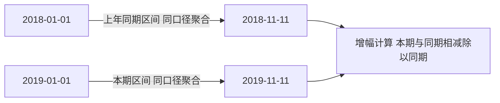
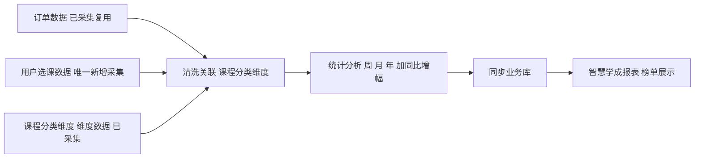

# 热门学科排名需求分析：三项指标、同比增幅与周月年时间轴

课程访问量、课程购买量两个指标已经全链路收官，第三章迎来一个形态完全不同的指标：热门学科排名。前两个指标都是一条随日期起伏的折线，行是日期；这一张却是一份榜单，行是学科，还带名次。需求分析依旧从原型出发，但这次要定清的东西多了一层：榜单上每个学科要挂三项数据（销售量、学生人数、销售额），每项数据还要算一个增幅，增幅选同比还是环比，直接影响后面统计程序的写法。把这些问题在需求侧敲定，采集与统计才有依据。

## 先给结论

- 指标定义：热门学科排名是单位时间内各学科各项数据的统计，各项数据包括销售量、学生人数、销售额，每项数据都带同比增幅。
- 数据来源三条线：销售量与销售额从课程购买量数据聚合而来，学生人数从用户选课数据统计而来，学科口径由课程分类维度提供。
- 真正要新增采集的只有用户选课数据，订单数据与维度数据都是现成的，采集工作量在需求分析阶段就能估出来。
- 增幅统一用同比：本期区间与上一个等长周期的对应区间相比；周期不完整时环比没有可比性，不采用。
- 维度只有时间维度，周、月、年三个级别，每个级别以当前级别为单位做完整聚合。

## 原型：一张按学科排位的榜单

原型入口在统计平台主页：鼠标移到顶部菜单的课程统计标签上，弹出菜单里点击学科排名，进入热门学科排名页面。页面结构分三块看：左侧是统计项切换，销售量、学生人数、销售额三个标签；右侧是时间筛选，周、月、年三个级别外加自定义时间；中部按所选统计项对各学科画图，底部是一张明细表，列为排名、热门学科、销量、销量增幅、学生人数、学生人数增幅、销售额、销售额增幅。

与前两个指标对照，最大的变化在表格的主体：课程访问量、课程购买量以日期为行、回答「哪一天多少」；这份榜单以学科为行、回答「哪个学科更热」。行主体一换，统计的分组键就从日期换成了学科，时间降级为筛选条件。看原型时照旧只看结构不记数字，原型上的数值是模拟数据，样式为真、数值为假。

## 指标拆解：三项数据与三个增幅

讲义对指标与维度的定义整理如下：

| 项 | 说明 |
|---|---|
| 指标 | 单位时间各学科各项数据的统计，含销售量、学生人数、销售额，每项带同比增幅 |
| 销售量 | 根据课程购买量聚合计算获取 |
| 学生人数 | 根据学生选课计算获取 |
| 销售额 | 根据课程购买量聚合计算获取 |
| 维度 | 时间维度，周、月、年三个级别，每级别以当前级别为单位展示 |

三项数据对应两条原料线和一个维度关联。销售量与销售额出自同一份订单数据，课程购买量指标已经采集、清洗完毕，这里换一种聚合方式复用即可；学生人数的原料是用户选课数据，数仓里还没有，是需要新采集的原始数据；学科口径不单独采数据，直接关联课程分类维度就能拿到学科名，维度数据此前已由 NiFi 采进数仓。需求分析做到这一步，采集侧的结论已经浮出水面：热门学科排名唯一的新增采集对象是用户选课表。

增幅是每项数据的标配。原始聚合值只回答「多少」，增幅回答「比上一个同期好了多少」，榜单上两者并排出现，单纯的大数值没有趋势信息，增幅才是「热门」的动态注脚。

## 同比：为什么不用环比

增幅的计算方式，讲义定义为同比，即同期相比，表示某个特定统计时间段今年与去年之间的比较。课程把它推广到周月年三个级别：比较对象是上一个等长周期的对应区间。年级别是字面意义的同比，2019 年 1 月 1 日到 11 月 11 日的聚合值，对比 2018 年 1 月 1 日到 11 月 11 日的聚合值；月级别对比上个月同日期区间，比如本月 1 号到 25 号对比上月 1 号到 25 号；周级别对比上一周的同位置区间。离线分析永远算到前一天，当天数据没过完不参与统计。



为什么不选环比？环比是连续时间段的比较，前提是周期完整：整年对整年可以，季度内第一季度对第二季度可以，但不能跨年。本项目的统计按天切区间，用户选中的周期几乎总是不完整的，今天 11 月 12 日，本月只攒了 12 天的数据，拿一个不完整周期紧挨着的上一个完整周期比，比值没有业务含义。同比对齐等长区间，天然规避了这个问题，这就是课程采用同比的原因。三个级别的区间示意如下：

```text
按周  本期      第 39 周已走过的区间（算至前一天）
      对比区间  第 38 周的同位置区间
按月  本期      2019-09-01 至 2019-09-25（算至前一天）
      对比区间  2019-08-01 至 2019-08-25
按年  本期      2019-01-01 至 2019-11-11（算至前一天）
      对比区间  2018-01-01 至 2018-11-11
```

落到统计程序里，每个指标每次计算都要聚合两次：本期区间一次，对比区间一次，再做一次相减相除。以学生人数为例，思路示意如下（按本课口径补全的示例）：

```sql
-- 同比增幅计算思路示意（按本课口径补全）
select
    t1.subject_id,
    t1.user_num                                            as cur_num,
    (t1.user_num - t2.user_num) / t2.user_num              as user_percent
from (select subject_id, count(distinct user_id) as user_num
      from 用户选课事实表
      where dt between '2019-11-01' and '2019-11-11'
      group by subject_id) t1
join (select subject_id, count(distinct user_id) as user_num
      from 用户选课事实表
      where dt between '2019-10-01' and '2019-10-11'
      group by subject_id) t2
  on t1.subject_id = t2.subject_id;
```

两次聚合、一次关联、一次算术，统计阶段的骨架在需求分析里就已经显形，后面编写代码时不过是把区间参数与分组键填进去。

## 维度与全链路：换汤不换药的骨架

维度只有时间一个轴，周月年三级，每级内部以当前级别为单位完整聚合：选周就聚合整周、选月聚合整月、选年聚合整年，再各自与对比区间算增幅。学科只是行主体与分组键，不是可筛选的维度。整条数据链路与前两个指标同构，只换了原料与粒度：



需求分析的产出归纳成三句话：统计什么，单位时间内各学科的销售量、学生人数、销售额及同比增幅；怎么比，本周对上周、本月对上月、今年对去年同期，全部对齐等长区间；数据从哪来，订单数据复用、维度数据现成、用户选课数据待采。带着这三句话进采集设计，「采什么、存成什么样」的答案已经限定在很小的范围内。

## 常见误区

- **把热门学科排名当成课程排名。** 错例：以为按课程维度统计购买量排个序就是学科排名。正解：行主体是学科，课程要先通过课程分类维度归到学科再聚合，粒度从课程升到学科。
- **增幅想当然用环比。** 错例：拿本月不完整周期对上月完整周期算增幅。正解：统一采用同比口径，本期与上一个等长周期的对应区间相比，周期不完整时环比不可比。
- **忽略离线分析的截止线。** 错例：统计区间把当天也算进去。正解：当天数据没走完，离线分析一律算到前一天，区间右端点固定为昨天。
- **以为三项数据要采三份数据。** 错例：看到销售量、销售额、学生人数三项就准备三条采集链路。正解：销售量与销售额同源订单数据，直接复用课程购买量链路，唯一新增采集的是用户选课数据。

## 面试可能被问到的问题

1. 面试官追问：「热门学科排名指标和课程购买量指标在统计口径上有什么差异？」
   答：分组主体不同，购买量按日期聚合、回答每天成交多少，学科排名按学科聚合、回答哪个学科更热；时间从展示粒度退化为筛选条件。数据来源上，购买量只用订单数据，学科排名还要用户选课数据与课程分类维度，学生人数来自选课、销售量与销售额来自订单聚合。
2. 面试官追问：「同比和环比的区别是什么，为什么本项目选同比？」
   答：同比是同期相比，比较今年某个统计时间段与去年同时间段；环比是连续时间段的比较，要求周期完整且不跨年。本项目按天切统计区间，用户选中的周期往往不完整，环比会拿不完整周期对完整周期，比值无意义；同比对齐等长区间，规避了这个问题。
3. 面试官追问：「周月年三个级别的增幅比较对象分别是什么？」
   答：周级别对比上一周的同位置区间，月级别对比上个月的同日期区间，年级别对比上一年的同日期区间，统一规则是与上一个等长周期的对应区间相比。实现上每个指标每次都要聚合两次再加一次算术，区间参数由时间维度工具统一计算。
4. 面试官追问：「需求分析阶段怎么预判采集工作量？」
   答：把指标的三项数据逐一回溯到原始数据源。销售量与销售额出自订单数据，课程购买量链路已建成，属于复用；学科口径靠课程分类维度，维度数据已采集，属于关联；学生人数出自用户选课数据，数仓里没有，才是唯一要新增的采集对象。这样需求还没进开发，采集清单已经收敛到一张表。
5. 面试官追问：「榜单上的排名字段需要在数仓里存吗？」
   答：名次是展示层的衍生结果，不是存储字段。明细数据按学科粒度落库后，前端按选定指标排序即可得到名次，接口契约里也预留了按哪一项排序、升序还是降序的参数。数仓存聚合值与增幅值，排序交给展示侧，统计程序就不必为每种排序组合各存一份。

## 配套资料

- 讲义：`materials/docs/08/智慧学成-第3章-课程分析.md`，3.1 需求分析（3.1.1 原型、3.1.2 指标与维度分析）为本课出处。
- 接口契约：`materials/code/08/yapi/yapi/智慧学成api.json`，学科分类下学科排名与学科统计接口的请求参数与响应结构可作对照。
- 说明：同比增幅 SQL 与区间示意为按本课口径补全的示例，表名以示意代称，真实表结构在清洗与统计章节给出。
