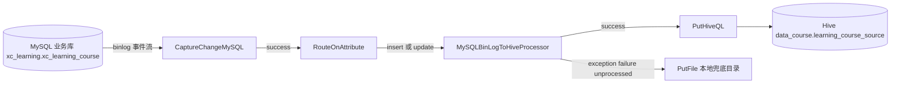

# NiFi 盯住用户选课表 binlog：热门学科排名的学生人数原始数据入仓与测试

> 🔒 安全提示：文中示例的口令/密钥均为课程教学环境演示口径，生产环境的安全要求见《安全与合规须知》。

热门学科排名要看三项数据：销售量、学生人数、销售额。销售量与销售额两路数据在课程购买量指标里已经采齐，拿来即用；学生人数对不上号，它要的是用户选课记录，躺在在线教育平台业务库的 `xc_learning.xc_learning_course` 表里。采集方式不换花样，依旧让 NiFi 订阅 MySQL binlog，把命中选课表的 insert 与 update 实时翻译成 Hive 写入语句，落进数仓的 `data_course.learning_course_source`。流程模板现成，配置三处，跑一轮测试对一条账，学生人数的原始数据就算真正有了来路。

## 先给结论

- 学生人数的源头是用户选课表，采集流程与课程购买量同款：`CaptureChangeMySQL` 监听 binlog，`RouteOnAttribute` 按 `cdc.event.type` 分流 insert 与 update，自定义处理器 `MySQLBinLogToHiveProcessor` 翻译成 Hive 语句，`PutHiveQL` 执行落地。
- 字段映射只有一处换算：数仓侧的选课时间 `choose_time` 对到业务表的 `start_time`，其余字段同名直连。
- 配置动作三步：启用本组缓存客户端与 Hive 连接池，给 `CaptureChangeMySQL` 补 MySQL 密码，root/123456。
- 首次启动会把 binlog 历史整段回放，实测 20037 条流文件约 62 MB 涌进队列，停组清队列再重启即可，这不是故障。
- 验证路径：手工往选课表 insert 一条记录，队列即时出现流文件，Hue 里对 `data_course.learning_course_source` 查出这条数据，实时采集链路闭合。

## 学生人数的数据从哪来

热门学科排名的需求分析把数据源摆得很清楚：销售量走订单数据，销售额走订单价格，这两路在课程购买量指标里采集与清洗的活都干完了；学科维度靠课程分类维度关联，维度库也齐了。唯独学生人数这一项没有现成数据，它的口径是「有多少用户选了这门课」，对应业务库里的用户选课表。

这张表能提供四个有效字段：`course_id` 是课程 id，顺着它能做课程热度等延伸分析；`user_id` 是用户 id，用户维度的钥匙；`choose_time` 是选课时间，秒级时间戳，时间维度从它算起；`status` 是选课状态，用来判断用户是否有效选课。数仓侧的承接表在建模阶段已经定好，`data_course.learning_course_source`，原始数据一比一落进去，一行代表一次选课。

数据在业务库、消费在数仓，中间的搬运方式与课程购买量采集时的决策一致：业务库是在线的交易系统，分析任务不能上去扫表，更不能往里写；binlog 是 MySQL 主从复制的底层日志，行级变更以事件形式追加记录，NiFi 装上 CDC 处理器后伪装成一台从库订阅事件流，insert 与 update 实时到手。选课记录会产生、也会随课程状态变化而更新，两种事件都得接住，这条链路在购买量采集时已经搭过一遍。

## 流程同款，参数换表

模板文件在课程资料第 3 章课程分析的 NiFi 目录里，画布上「离线分析」大目录内已经建好了热门学科排名的流程组，与热门学科排名相关的所有调度以后都收在这里。上传模板、Add Template 添加到组内，处理器组名就叫数据采集用户选课。流程结构与购买量采集完全同款：



事件从业务库流入捕获处理器，路由分流后由自定义处理器翻译成 Hive 写入动作，失败分支落本地文件留证。差别全在参数里，看 `MySQLBinLogToHiveProcessor` 的四个属性：

```text
mysql_db_table    = xc_learning.xc_learning_course
primary_key       = learning_course_id:id
fields_correspond = learning_course_id:id,course_id:course_id,
                    user_id:user_id,choose_time:start_time,status:status
hive_table_name   = data_course.learning_course_source
```

`mysql_db_table` 圈定只处理选课表的事件，binlog 里其他表的变化到这一步被挡掉；`primary_key` 声明用 `learning_course_id` 对应业务表的 `id` 列当主键，insert 事件进新行，update 事件按主键定位旧行改写；`fields_correspond` 给出两边字段的对应关系，四对同名直连，唯一要动脑子的映射是选课时间：业务表的字段叫 `start_time`，数仓侧按业务语义叫 `choose_time`，改名不改值；`hive_table_name` 指明落地目标表。

上游两个处理器的配置与购买量采集逐字相同。`CaptureChangeMySQL` 连 `xc-online-mysql:3306`，驱动 jar 指向容器内的绝对路径，`Server ID` 设 1 充当从库身份号，`Retrieve All Records` 开着；`RouteOnAttribute` 路由策略选 Route to Property name，按事件类型定义两条动态属性，`insert = ${cdc.event.type:equals('insert')}`，`update = ${cdc.event.type:equals('update')}`，其余事件走 unmatched 丢弃。下游 `PutHiveQL` 引用 Hive 连接池，批量大小 1000，攒批执行减少建连开销。

## 模板导入后的三处配置

拖进来的流程带着黄色感叹号，配置集中在控制器服务与连接参数上。处理器组的 Controller Services 页面里是熟悉的三件套：`DistributedMapCacheServer` 缓存服务端属于全局 NiFi Flow，环境搭建阶段就启用了，这里连配置都不用碰；本组要启用的是 `DistributedMapCacheClientService` 缓存客户端与 `HiveConnectionPool` 连接池，逐个点启用即可，前者是捕获处理器做事件中转缓存的客户端，后者被 `PutHiveQL` 引用执行写入。

第二处配置落在 `CaptureChangeMySQL` 上。右键 Configure 打开 Properties，主机、端口、驱动、用户名模板都已带好，唯独密码空着，填上 123456 保存生效。这一步在购买量采集时也做过，属于这类模板的固定动作：模板能带走配置值，但密码这类敏感项在导出时就被剥掉了，导入侧永远要手工补。

第三处不是配置而是前置检查：启动处理器组之前确认 Hadoop、MySQL、Hive 三个依赖都在正常运行，采集链路一头连 MySQL 一头写 Hive，哪一头不在，处理器启动就会报错。

## 首启回放：两万条历史流文件涌进队列

点下启动按钮，最先出现的不是安静的数据流，而是处理器全速运转、队列读数疯狂上涨的场面。这不是故障，是 binlog 采集第一次启动的固定行为：`CaptureChangeMySQL` 的 `Retrieve All Records` 设为 true，而且这个组是第一次启动，本地还没有消费位点，处理器会从 binlog 里能拿到的最早位置开始，把历史记录整段回放一遍。课程环境的 binlog 积攒了前面所有课程的操作，实测回灌 20037 条流文件，约 62 MB。


回放的数据里绝大多数与选课表无关，但表过滤发生在链路中段的 `MySQLBinLogToHiveProcessor`，`CaptureChangeMySQL` 与 `RouteOnAttribute` 在它上游，历史事件照样在这两段白跑一遍，于是队列在前面两级迅速堆积。处理有两种姿势：一种是放着让它自己消化完，反正是一次性成本；另一种是停掉处理器组，把队列逐级清空再重新启动，几分钟内回到干净状态，课程里选的是后一种。清空重启之后有个位点细节：捕获处理器的消费位点更新间隔配置为 0，边消费边持久化，清队列不影响位点推进，重启后从 binlog 当前位置继续监听，不会再回放第二次。

清完队列再启动，画布安静下来：处理器一直处于运行状态，队列里却没有流文件。这正是预期状态，binlog 监听是常驻的，选课表没有新的 insert 与 update，自然没有数据流动。

## 插一条数据对账

验证只需一条数据。往选课表手工执行一条 insert：

```sql
INSERT INTO `xc_learning`.`xc_learning_course`(
    `id`, `course_id`, `user_id`, `valid`,
    `start_time`, `end_time`, `status`)
VALUES (
    '1', '00039fee08a04fe2a1854b64fe08cd9',
    '00050ced7f3a43f49f9eb6ddb2893e7', '1',
    '2019-09-13 11:16:10', '2019-11-26 11:16:16', '501001');
```

语句回车后几乎同时，画布上队列出现一条流文件，捕获处理器把它逮住，路由器判定为 insert，自定义处理器翻成 Hive 写入语句，`PutHiveQL` 执行落表，整条链路秒级走完。

最后到数仓对账。Hue 里查 `data_course.learning_course_source`，能看到 id 为 1 的这条记录，课程 id、用户 id 与刚才插入的值一一对应，`choose_time` 存的是选课时间的秒级时间戳，状态是 501001。有一条细节要交代：Hive 每次插入都要走一遍 MapReduce 计算，采集是实时的，落地有缓冲，队列没消化完时去查表可能还查不到，等队列走空再刷新结果就有了。实时采集与实时可见是两件事，这条边界在后面的清洗调度里还会反复出现。

## 常见误区

- **把首启回放当成故障。** 错例：看到队列涌进两万条流文件以为流程配错，忙着改配置。正解：`Retrieve All Records` 加首次启动没有位点，回放是设计行为，清队列重启即可，第二次启动不会再回放。
- **在路由器上找表过滤。** 错例：以为 `RouteOnAttribute` 应该按表名分流，历史 binlog 里其他表的事件也进来就觉得它失效。正解：路由器只按 `cdc.event.type` 分流事件类型，按表过滤是 `MySQLBinLogToHiveProcessor` 的 `mysql_db_table` 属性，位置在链路中段。
- **漏填 MySQL 密码就启动。** 错例：模板里参数看着都齐了，直接启动，捕获处理器报连接失败。正解：模板导出时密码被剥掉，`CaptureChangeMySQL` 的密码必须手工补，root/123456。
- **采集实时就当查询实时。** 错例：insert 完立刻去 Hue 查数仓，查不到就认为采集失败。正解：Hive 写入走 MapReduce 有缓冲时间，先看 NiFi 队列是否消化完，再查数仓。

## 面试可能被问到的问题

1. 面试官追问：「复用一套 binlog 采集模板换监控对象，哪些参数必须动，哪些必须不动？」
   答：必须动的是 `MySQLBinLogToHiveProcessor` 的四个属性，监控表、主键映射、字段映射、落地表，外加目标 Hive 表的建表形态；必须不动的是捕获处理器的连接参数、`Server ID` 与路由器的 `cdc.event.type` 分流规则，这些属于链路本身的机制。判断标准就一条：随监控对象变的换掉，属于 CDC 机制的保持原样。
2. 面试官追问：「首次启动回放全部历史 binlog，生产上怎么避免？」
   答：三条路。给捕获处理器指定起始位点，从当前时刻开始消费；部署前主动轮转 binlog，把历史文件清掉；或者接受回放但用一次性任务把队列排空。关键是位点的持久化，消费位点不落地，每次重启都等于首次启动，回放会反复发生。
3. 面试官追问：「`fields_correspond` 里为什么时间字段要做映射，直接同名不行吗？」
   答：两边命名服务的对象不同。业务库的 `start_time` 记录选课生效时间，是业务表自己的语义；数仓表按分析语义命名，这张表里它就是选课时间 `choose_time`。映射层存在的意义正是让两侧各自保持自己的语义命名，中间用一行配置对齐，避免为了采集去改业务表或数仓表的名字。
4. 面试官追问：「这张承接表为什么建成分桶加事务属性的 ORC 表？」
   答：binlog 采集不只处理 insert，update 也要落地，`MySQLBinLogToHiveProcessor` 把 update 翻译成按主键改写的语句，普通 Hive 表不支持行级更新，事务表才有这个能力，ORC 是事务表的配套存储格式。代价是写入依赖 HDFS 上的事务临时目录，权限与配置要跟上，这些都是采集链路能落地 update 的前提。
5. 面试官追问：「销售量与销售额为什么不重新采集一遍？」
   答：这两项的口径与课程购买量完全一致，订单数据一路两用，采集与清洗的结果直接复用。数仓分层的一个目的就是公共数据只采一次、只洗一次，下游指标按需取用；学生人数口径不同才需要新开一条采集链路。判断要不要重采，看的是口径而不是指标名。
6. 面试官追问：「binlog 采集中途宕机，恢复后数据会丢吗？」
   答：捕获处理器会把消费位点持久化，恢复后从上次的位置继续，宕机期间 binlog 里的未消费事件不丢；上游业务库只要 binlog 保留期够长，位点之前的记录都还在。风险在位点推进与队列消化不同步：位点已经走了，下游 `PutHiveQL` 还没写成功，这类失败会路由到失败关系，靠重试与兜底文件补回。

## 配套资料

- 讲义：`materials/docs/08/智慧学成-第3章-课程分析.md`，3.3 数据采集一节（3.3.1 ODS 层数据结构、3.3.2 数据存储、3.3.3 数据采集实现）为本课出处。
- 讲义：`materials/docs/04/Nifi使用文档.md`，NiFi 处理器与控制器服务的使用说明。
- 资料：`materials/code/08/_散落资料/`，用户选课采集的 NiFi 流程模板与数仓建表脚本（含 `learning_course_source` 建表语句）在这个散落资料目录中（内层文件名带站点后缀，按用途自取，具体文件名不在此列出）。
- 说明：处理器参数出自课程模板实配，插入语句出自讲义测试环节；账号口令为课程环境实配，MySQL root/123456。
