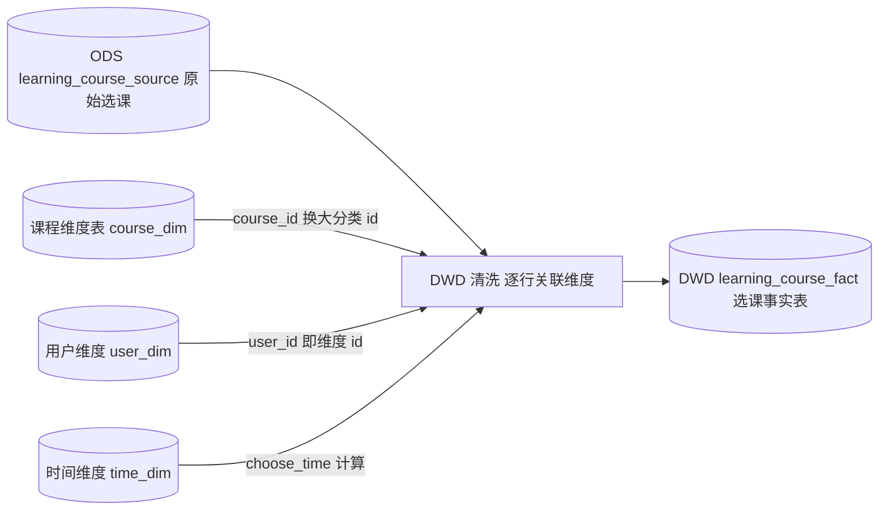
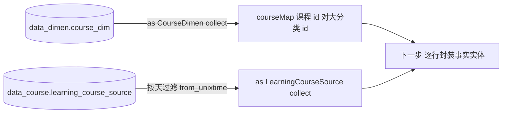
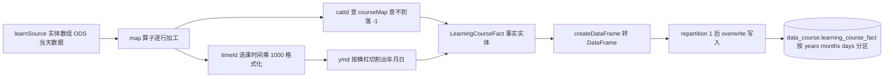
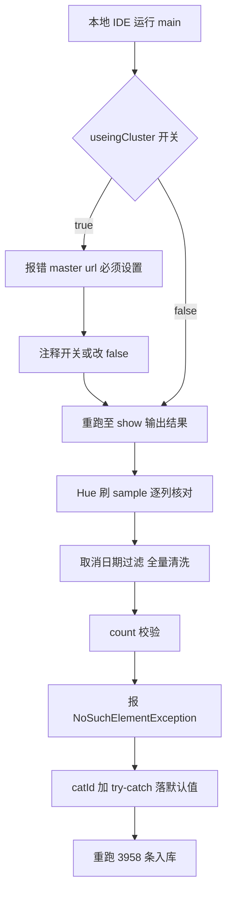

# 热门学科排名-用户选课：DWD 选课事实表的字段设计、清洗代码与测试入库

> 🔒 安全提示：文中示例的口令/密钥均为课程教学环境演示口径，生产环境的安全要求见《安全与合规须知》。

## 先给结论

- 系列定位：热门学科排名的数仓地基课，把用户选课原始数据清洗成 DWD 选课事实表，为后续学科维度的统计备料。
- 字段设计先行：事实表九个字段，六个业务字段加三个分区字段；四个维度四种来路，唯一要跨表换算的是课程分类 id，拿 course_id 去课程维度表换出大分类 id，热门学科的「学科」就在这一级。
- 清洗口径四条：分类绕道课程维度表间接关联、时间维度 id 格式化到小时（`yyyy-MM-dd-HH`）、分区年月日从时间维度 id 拆出、选课状态原样入表不翻译。
- 代码三步走：一张 courseMap 备齐维度换算、按天过滤读 ODS 原始数据、map 算子里封装事实实体并批量写进数仓。
- 两个高频坑有兜底：`courseMap.get` 返回 Option，默认值 `"-1"` 加 try-catch 让分类换算不到的记录落默认值不中断整批；秒级时间戳喂 from_unixtime、毫秒喂 Java 格式化，两个方向别混。
- 写入数仓固定四步：`createDataFrame`、开非严格动态分区、`repartition(1)` 合并输出、overwrite 加 insertInto 按分区覆盖。
- 测试实录包含三个教训：本地跑先关 `useingCluster` 开关、Hue 读 Hive 有缓冲延迟别急着改代码、count 校验撞出的脏数据催生了 try-catch 兜底。
- 测试期主动取消日期过滤做全量清洗，3958 条 ODS 数据全部进事实表，给统计分析备出跨日期样本。

## 第1部分：用户选课的 DWD 字段设计与清洗口径：四个维度、一张选课事实表

用户选课的原始数据已经在 `data_course.learning_course_source` 里躺好了，binlog 采集把业务库的每次选课实时送进数仓。但 ODS 层是业务表的原样翻版，选课记录里只有课程 id、用户 id 与时间戳，热门学科排名要按学科聚合、按周月年筛选，这些维度在原始数据里一个都没有。清洗这一层的活就是把维度关联好，产出 DWD 层的选课事实表 `data_course.learning_course_fact`。这一课先把字段设计与清洗口径想清楚，代码下一课落笔。

### 从 ODS 到 DWD 缺了什么
ODS 表 `learning_course_source` 与业务表字段一一对应，五个字段如下：

```sql
CREATE EXTERNAL TABLE IF NOT EXISTS data_course.learning_course_source
(learning_course_id String,
 course_id String,
 user_id String,
 choose_time BIGINT,
 status String)
clustered by (learning_course_id) into 2 buckets
stored as orc TBLPROPERTIES('transactional'='true');
```

一行记录的含义是「某用户在某时刻选了某门课，状态如何」。它能直接回答「谁选了什么」，回答不了热门学科排名要的问题：某个学科下有多少人选课、这一周比上一周多了多少人。学科是课程分类维度的属性，周与月是时间维度的粒度，这两个维度在 ODS 里要么缺列、要么只有原料没有成品。DWD 层的清洗就干一件事：给每条选课记录补上维度，落到事实表。



图里四条进料线就是清洗要关联的四个维度：课程分类维度、课程维度、用户维度、时间维度。原始数据在清洗处汇合，产出事实表。这张图同时透露了工作量分布：课程维度、用户维度是直接透传，课程分类与时间两个维度才需要换算。

### 事实表九个字段逐个过
目标表的建表语句出自课程数仓建表脚本：

```sql
CREATE EXTERNAL TABLE IF NOT EXISTS data_course.learning_course_fact
(learning_course_dim_id String,
 course_category_dim_id String,
 course_dim_id String,
 user_dim_id String,
 time_dim_id String,
 status String)
PARTITIONED BY (years String, months String, days String)
ROW FORMAT DELIMITED FIELDS TERMINATED BY '\t'
STORED AS PARQUET
location '/user/hive/external/data_course/learning_course_fact';
```

六个业务字段加三级分区，来源与含义整理成表：

| 事实表字段 | 来源 | 说明 |
|---|---|---|
| `learning_course_dim_id` | uuid 生成 | 用户选课 id，事实行的唯一标识 |
| `course_category_dim_id` | 通过 course_id 关联 | 课程分类维度 id |
| `course_dim_id` | course_id | 课程维度 id |
| `user_dim_id` | user_id | 用户维度 id |
| `time_dim_id` | 通过 choose_time 计算 | 时间维度 id |
| `status` | status | 选课状态 |
| `years` / `months` / `days` | choose_time 年月日 | 分区字段 |

**`learning_course_dim_id` 是自生成的主键。** 原始数据里明明有 `learning_course_id`，DWD 层还是用 uuid 重新生成一个。事实表的主键标识的是清洗后的事实行本身，走统一的自生成规则后，不管上游原始数据的主键长什么样、会不会变，事实行标识的格式永远一致，同类事实表的 id 管理也就统一了。

**`course_category_dim_id` 是唯一绕道关联的维度。** 选课表里没有课程分类这一列，而课程分类 id 藏在课程维度表里：课程维度表的每个课程行除了自身 id，还带着所属大分类的 id，热门学科排名里的「学科」正是这个大分类。所以关联链是两跳，拿 course_id 到课程维度表定位课程行，再从课程行里取出大分类 id。这一跳的代码载体是课程维度装进 Map 后按 course_id 点查，具体实现在下一课。

**课程与用户维度直接透传。** 课程维度表的主键就是课程 id，用户维度表的主键就是用户 id，两张维度表与业务表共用同一套天然键，选课记录里的 course_id 与 user_id 原样抄进事实表就完成了关联。维度关联并不都意味着计算，天然键能透传是一种幸运，也是维度建模时把维度主键设计成业务键的收益。

**时间维度与分区字段一鱼三吃。** 选课时间在 ODS 里是秒级时间戳，不能直接当维度 id 用。清洗时把它乘一千转毫秒，格式化成 `yyyy-MM-dd-HH` 的字符串，这就是时间维度 id，粒度到小时：按小时算是最细粒度，按天、按周、按月的统计都能从它向上聚合，反过来拆不了，保留小时就是保留上卷能力。分区年月日不用再算一遍，时间维度 id 按横杠切开，前三段就是 `years`、`months`、`days` 的分区值。三个分区字段看似多余，实际是 Hive 按天调度的物理基础：查询按分区裁剪，重跑按分区覆盖，都靠这三列定位。

**`status` 原样透传。** 选课状态在业务侧是一串编码，有效选课是 501001 这类值。清洗层不做状态翻译也不做筛选，把原始值留给统计层，因为「哪些状态算有效选课」是业务口径问题，口径一变清洗层不该跟着改代码。

### 清洗逻辑的四条口径
把上面的字段来源汇成清洗说明，讲义里就一张表：

| 清洗字段 | 清洗说明 | 清洗后字段名 |
|---|---|---|
| - | uuid 生成用户选课 id | `learning_course_dim_id` |
| course_id | 通过 course_id 关联到课程分类维度，获取课程分类 id | `course_category_dim_id` |
| course_id | course_id 即课程维度 id | `course_dim_id` |
| user_id | user_id 即用户维度 id | `user_dim_id` |
| choose_time | 通过日期格式化计算出时间维度 id | `time_dim_id` |

四个维度对应的动作各不相同，可以归纳成四种类型：间接关联（课程分类维度）、直接透传（课程与用户维度）、计算生成（时间维度）、自生成（事实行 id）。看懂这个分类，再去看任何一张事实表的字段设计都能对上号：每列要么来自某个维度的换算，要么来自事实自身的属性，设计阶段把每列的来路写清楚，编码阶段就是机械劳动。

与课程购买量的事实表对照着看更有意思。购买量事实表带价格、区域维度、公司维度，因为它的指标要算销售额、要按地区和机构拆；选课事实表没有价格也不挂区域，因为学生人数的口径只关心「选没选、什么时候选的」。事实表的宽窄由指标口径决定，不是列越多越专业，每多一列就多一份关联成本，清洗阶段的字段说明表就是口径与代码之间的合同。

## 第2部分：选课 DWD 清洗代码起步：一张维度 Map 备齐课程分类、按天捞出原始选课

字段口径与清洗逻辑上一课已经定案，接下来是清洗代码。用户选课的清洗类 `UserLearnSourceToFact` 在工程里已经建好，骨架、注释都备齐了，要往里填的是清洗逻辑本身。这一课填前两步：关联维度数据，获取用户选课的原始数据。这两步看着是准备工作，实际上决定了整个清洗类的形状：维度要备几张 Map、原始数据按什么粒度读、实体怎么映射，全在这里定型。封装成事实实体与写入数仓留在下一步。

### 骨架：现成的类与统一的 SparkSession
清洗工程是提前备好的基础工程，类与入口都建好了，填逻辑之前先看清骨架：

```scala
package com.study.xc.analysis.subject.learn

import com.study.xc.common.EtlEnvironment
import com.study.xc.entity.{CourseDimen, LearningCourseFact, LearningCourseSource}
import com.study.xc.utils.DateUtils.getDateStr
import org.apache.spark.sql.SparkSession

/**
  * 用户选课原始数据清洗到事实表
  */
object UserLearnSourceToFact {
  // 获取 spark session
  val spark: SparkSession = EtlEnvironment.getSparkSession(this.getClass.getSimpleName)

  def main(args: Array[String]): Unit = {
    import spark.implicits._
    // 清洗逻辑按步骤填在这里
    spark.close()
  }
}
```

`SparkSession` 不在业务代码里现搭，全工程统一从 `EtlEnvironment` 领，任务名取当前类名，集群任务列表里一眼认出是谁在跑。头部 import 里三个实体各司其职：`CourseDimen` 映射课程维度表，`LearningCourseSource` 映射 ODS 选课原始表，`LearningCourseFact` 是下一阶段封装事实行用的模板。`main` 第一行的 `import spark.implicits._` 现在看着只是惯例，等第一个 `.as[CourseDimen]` 写出来就知道它的分量：把 DataFrame 转成 DataSet 靠隐式参数里的 Encoder，不导入隐式转换，编译器直接标红。工程里所有清洗类都是这个骨架，维度读取、原始读取的写法在课程访问量与课程购买量的清洗类里已经写过，本课的代码大部分是复用。

### 一张 Map 备齐维度
上一课把四个维度的来路归了类：课程维度、用户维度直接透传，时间维度由选课时间计算生成，只有课程分类要查表换算。对应到代码，维度准备就收缩成一张 Map：

```scala
// 关联维度 - 课程分类维度（通过课程维度）
var courseMap = Map[String, String]()
spark.sql("SELECT * FROM data_dimen.course_dim")
  .as[CourseDimen].collect().map(x => {
  courseMap += (x.course_dim_id.toString -> x.mt)
})
```

整段逻辑：课程维度表一次 `collect()` 拉到 Driver 端，按实体映射成 `CourseDimen` 数组，逐行往 Map 里塞键值，key 是课程维度 id，value 是这一行的 `mt` 字段。选课记录清洗时拿 course_id 来这里点查，一次内存寻址换出大分类 id，不用在循环里反复查 Hive。

**`mt` 的语义值得单独交代。** 进实体类看注释，`mt` 是课程大分类的维度 id，也就是热门学科排名里「学科」这一级的 id；它旁边还有个 `mt_name` 存大分类名称。清洗阶段只需要 id，统计阶段拿 id 关联出学科名称做展示。课程分类的层级关系维护在课程分类维度表里，课程维度表这个字段相当于给每个课程行预置了一条到顶级分类的快捷通道，选课这类「直接数到学科」的指标不用再逐级往上爬。

**复用的痕迹在 Map 的 value 上。** 课程购买量的清洗类里有几乎相同的代码段，也是课程维度装 Map，value 存的是公司 id，服务购买量换公司维度的需求；本课把 value 换成 `mt`，服务选课换学科维度的需求。key 一致、取值不同，这正是维度读取代码可以整段复用的原因：数据源一样，差异只在下游要用哪个字段。复用不是复制粘贴了事，改 value 的时候要想清楚本指标要的是什么。

Map 变量声明成 `var` 是 Scala 的语法要求，`+=` 往不可变 Map 里添键值依赖变量可重新赋值。装载发生在读取原始数据之前，装好后整个程序生命周期不再变化，实质是只读的查找表。装载处没有判空，课程维度表里大分类为空的行会让 value 变成 null，这个口子留到封装阶段用 try-catch 兜底，换算不到的分类落在默认值上，明细不丢。

### 先在 Hue 里把 SQL 写对
读原始数据的查询先在 Hue 里验证。选课原始表 `data_course.learning_course_source` 的字段里没有直接的日期列，`choose_time` 是秒级时间戳，要按天过滤只能现格式化：

```sql
SELECT * FROM data_course.learning_course_source
WHERE from_unixtime(choose_time, 'yyyy-MM-dd') = '2019-11-11'
```

`from_unixtime` 接收秒级时间戳，格式化成指定样式的日期串再做等值匹配。执行后返回 52 条，一天 52 条选课记录，量级不大但足够验证清洗逻辑。这 52 条能对上，是因为造数阶段的时间戳本来就用秒级单位，`from_unixtime` 的入参单位与它严丝合缝，时间戳单位不一致是这类过滤最常见的翻车点。

表名前面的库名 `data_course` 不能省。省掉库名，查询落在默认库上，要么报表不存在，要么撞上默认库里的同名表读出错的数据，后一种更隐蔽，代码不报错、数据不对，排查起来费劲。多库并存的数仓里，SQL 一律写全限定表名是个便宜又保命的习惯。

### 回到代码：变量传日期读 ODS
Hue 里验证过的查询搬进清洗类，日期改成变量：

```scala
// 获取用户选课原始数据，测试期先写死一天
val date_info = "2019-11-11"
val learnSource = spark.sql(
  s"""SELECT * from data_course.learning_course_source
     |WHERE from_unixtime(choose_time, 'yyyy-MM-dd') ='${date_info}'"""
    .stripMargin).as[LearningCourseSource].collect()
```

**日期走变量插值，不走字符串拼接的硬编码。** `date_info` 声明成一个变量，SQL 里用 s 插值引用，测试期改日期只动一处；正式接入调度时把它换成读取任务参数，散落资料里的调度脚本已经按传日期参数的形态备好，spark-submit 传入哪天就洗哪天，按天调度的接口就此留好。测试代码与生产代码的差距被压缩到一个变量上，是这段写法的价值。

**`.as[LearningCourseSource]` 把查询结果映射成实体。** 实体的字段与 ODS 表的五个采集字段一一对应，采集侧有几个变量，实体就有几个字段，按名字对上。这一步的意义在下一阶段兑现：`collect()` 之后拿到的是 Driver 端的本地实体数组，后续逐行封装成事实实体时，`map` 算子操作的是带类型的对象，字段写错编译期就报错，比在 Row 上按下标取值安全得多。`as` 与 `collect` 连用是这类清洗的固定姿势，前面的隐式转换导入就是为它服务的。

到这里，维度的关联与原始数据的获取都写完了。当前的数据流如下：



课程维度表经一次 collect 装进 `courseMap`，ODS 选课表按天过滤后转成实体数组，两份料在下一步的封装阶段汇合。按天过滤保证了读进内存的量级可控，一天几十条记录配一张几百行的维度 Map，Driver 端的本地计算绰绰有余，这种「拉到本地慢慢算」的写法在小数据量下最直观；量级上去后换分布式算子加广播变量，思路不变、载体换掉。料备好了，封装与保存是下一课的内容。

## 第3部分：选课 DWD 收尾：map 算子里补齐维度，把事实实体批量写进数仓

维度 Map 与 ODS 读取上一课已经备好，清洗类 `UserLearnSourceToFact` 的前半段只完成了备料。剩下这一半是把每条选课记录加工成事实表的一行：逐行补齐维度、顺手算出分区字段，再整批写进 Hive 的 `data_course.learning_course_fact`。这一步看着只是「拼对象、写表」，实际有三处容易翻车：Map 取值的空值陷阱、时间戳的毫秒与秒之差、动态分区写入的开关，一处不慎整批任务就挂。

### 封装：一行一条事实记录
事实表的字段口径在 DWD 层字段分析时已经定死，建表语句来自数仓建表脚本：

```sql
CREATE EXTERNAL TABLE
IF NOT EXISTS data_course.learning_course_fact
(learning_course_dim_id String,
course_category_dim_id String,
course_dim_id String,
user_dim_id String,
time_dim_id String,
status String)
PARTITIONED BY (years String,months String,days String)
ROW FORMAT DELIMITED FIELDS TERMINATED BY '\t'
STORED AS PARQUET
location'/user/hive/external/data_course/learning_course_fact';
```

九列之中只有两列需要计算，其余全部透传。逐行加工用 `map` 算子，输入是上一课 `collect()` 回来的 `LearningCourseSource` 数组，输出是 `LearningCourseFact` 数组：

```scala
// 封装到事实表
val learnFact = learnSource.map(obj => {
  //- 课程分类维度
  var catId = "-1"
  try {
    catId = courseMap.get(obj.course_id).get
  } catch {
    case _ =>
  }
  //- 时间维度
  val timeId = getDateStr(obj.choose_time.toLong * 1000, "yyyy-MM-dd-HH")
  val ymd = timeId.split("-")
  LearningCourseFact(
    obj.learning_course_id, catId, obj.course_id, obj.user_id,
    timeId, obj.status, ymd(0), ymd(1), ymd(2))
})
```

实体的九个构造参数与建表的九列一一对应：`obj.learning_course_id` 原样落进 `learning_course_dim_id`，它本来就是 uuid 生成的选课 id；`obj.course_id` 与 `obj.user_id` 分别落 `course_dim_id` 与 `user_dim_id`，用户维度和课程维度直接透传；`obj.status` 是选课状态，不需要加工。真正要算的只有 `catId` 与 `timeId`，加上从 `timeId` 派生的三个分区值。IDEA 里写字段多的构造器容易串行，先对实体类做窗口拆分（Split and Move Down），一个字段占一行，写一个勾一个，漏字段编译期就报错，比挤在一行里数逗号稳妥。

### 分类换算的兜底：默认值加 try-catch
`courseMap.get(obj.course_id)` 的返回值类型是 `Option[String]`，Scala 用它显式表达「可能取不到」。链式再调一次 `.get` 就是把 Option 拆开拿真值，key 存在时拿到大分类 id，key 不存在时拿到的是 `None`，对 `None` 调 `.get` 立刻抛 `NoSuchElementException`。课程分类维度的换算源是课程维度表的 `mt` 字段，造数阶段绕过了外键约束，原始数据里完全可能出现课程维度表没有的 course_id，这个异常不是假如，是一定会来。

所以换算写成三段式：`var catId = "-1"` 先给默认值，try 里查 Map 赋值，catch 住异常什么都不做。查得到的行落真实分类 id，查不到的行留在 `"-1"` 上。默认值取负一是数仓惯例，它的语义是「未知分类」，统计层按维度聚合时负一会自己聚成一堆，明细数据一条不丢，排查时也一眼能认出哪些行没关联上。`var` 而不是 `val` 是语法要求，catch 之后还要能重新赋值。这个兜底写法在测试阶段会被真实脏数据验证一遍，下一课展开。

### 时间维度：一次格式化，三处复用
时间维度的 id 是一个格式化字符串。工具类的 `getDateStr` 接收两个参数：毫秒值与格式化表达式。`choose_time` 在 ODS 表里是秒级时间戳（BIGINT），喂给 Java 侧的格式化前要乘 1000 转毫秒，转成 `Long` 类型再进方法：

```scala
val timeId = getDateStr(obj.choose_time.toLong * 1000, "yyyy-MM-dd-HH")
```

表达式写到 `HH` 为止，时间维度精确到小时。这与时间维度表的设计一致，课程访问量的统计同样用到小时粒度，维度 id 的格式统一为 `yyyy-MM-dd-HH`，跨指标的口径就锁死了。

`ymd` 是这一段的巧处。分区的年、月、日三个字段没有再调一次格式化，而是直接 `timeId.split("-")`：时间维度 id 本身就是横杠分隔的年月日小时串，切完 `ymd(0)` 是年、`ymd(1)` 是月、`ymd(2)` 是日，第四段小时弃用。一次格式化产出四个字段，逻辑集中，也不会出现时间维度与分区字段格式对不上的二义。要留神的是这与上一课的 `from_unixtime` 方向相反：Hive 的 `from_unixtime` 吃秒，Java 的格式化吃毫秒，同一条链路上两个方向都要用，乘不乘 1000 取决于调用的是哪一侧。

### 写入数仓的固定姿势
封装完成拿到 `learnFact` 数组，接下来是整批入库。这段代码从课程访问量清洗类里原样搬来，改动只有实体变量与目标表名：

```scala
// 保存到数据仓库
// 转换为 df
val learnDF = spark.createDataFrame(learnFact)
// 配置允许动态分区
spark.conf.set("hive.exec.dynamic.partition.mode", "nonstrict")
// 保存到数据仓库
learnDF.repartition(1)
  .write.mode("overwrite")
  .insertInto("data_course.learning_course_fact")
// 查看结果
spark.sql("select * from data_course.learning_course_fact").show()
// 关闭资源
spark.close()
```

`createDataFrame(learnFact)` 依赖隐式转换里的 Encoder，`main` 开头的 `import spark.implicits._` 在这里再次兑现价值，实体数组转 DataFrame 一行完成。`hive.exec.dynamic.partition.mode` 设成 `nonstrict` 是分区写入的前提：默认的 strict 模式要求至少一个静态分区，而这里的 years、months、days 全部来自数据本身，运行期才知道值，不开非严格模式插入直接被拒。`repartition(1)` 把输出合并成一个文件，一天几十条记录配一个文件正合适，省掉一堆几 KB 的小文件；数据量大时这个参数要重新权衡，它把并行度压到了一。

`write.mode("overwrite")` 加 `insertInto` 的组合是按分区覆盖：重跑某天的清洗，只有那一天的分区被覆盖，其他日期的数据原地不动。这让清洗任务天然幂等，跑错重跑都安全。写入后当场 `show()` 打几行结果，再 `close()` 释放 SparkSession，全工程的会话都从 `EtlEnvironment` 领取，用完归还的纪律与领取一致。

**一个真实的编译插曲。** 录制过程中 `ymd` 切割那行报了编译错，原因是敲进了中文逗号，输入法残留的全角标点在 Scala 里不是合法分隔符，报错信息却不会明说「你敲了中文逗号」，只提示语法错误。全角逗号、全角分号是写 Scala 代码的高频小坑，编译报错且行号指向标点附近时先查输入法。

到这里整条清洗链闭合，数据流如下：



关键路径在 map 算子内部：透传字段零加工，分类与时间两个维度换算后连分区字段一并派生，封装与写入之间没有任何再计算。清洗层到这里的职责边界清晰，读进来的是规范但裸的原始数据，写出去的是带全维度、带分区的窄事实表，统计分析站在它上面才有得算。

## 第4部分：选课 DWD 首跑实录：从 master url 报错到全量入库

代码写完不等于功能可用。选课 DWD 清洗类 `UserLearnSourceToFact` 的封装与保存都齐了，这一课做的是让它在真实环境里跑通：本地启动、Hive 里核对、踩到报错修到能跑，再把全量数据洗进事实表给后续统计备料。首跑的价值在踩坑本身，两个报错加上一次脏数据拦截，正好把 Spark 任务测试的完整动作走了一遍。

### 跑批前的逻辑走查
运行之前把整个 `main` 从上到下过一遍：关联维度（`courseMap` 装载）、获取用户选课原始数据、map 封装事实实体、设置动态分区并保存、`show()` 查看结果、关闭资源。走查时真查出一个小毛病：保存段代码是从课程访问量清洗类整段复制来的，其中查看语句粘贴时丢了 `from`，`select * data_course.learning_course_fact` 这样的 SQL 编译都过不了。复制改表名是清洗工程里的高频操作，改动之后整句读一遍是必要动作，尤其是 SQL 里被折叠的长字符串。

走查确认无误后点 `main` 左侧的绿色三角运行。编译要等一阵，任务真正开始执行后控制台滚动 Spark 日志，接下来的两个报错都在这一段出现。

### 第一个报错：集群模式开关忘了关
任务刚起就停了，报错关键字是 master url 未设置（`master url must be set`）。这个报错在课程工程里只有一个来源：`application.properties` 里的集群模式开关没有关。工程统一从 `EtlEnvironment` 领取 SparkSession，它会读配置决定以什么模式启动：

```properties
# 是否使用集群模式：true 集群模式，false 本地 local 模式，不配置默认 false
useingCluster=true
```

`EtlEnvironment.isCluster` 读取这个键，默认 `false`。为 `true` 时走集群初始化分支，`SparkConf` 里不设置 `master`，把 master 的决定权交给 spark-submit 的 `--master` 参数；这个设计在集群上是对的，可本地 IDEA 里直接跑 `main` 时没有 spark-submit，没有 master url，SparkSession 起不来，报错就是那一句。

修复动作是二选一：注释掉这行，或者把值改成 `false`。改完立刻能跑，但这个开关是双向的，只记一半迟早出事：打包部署时如果忘了把 `useingCluster` 放回 `true`，任务在集群上以 local 模式启动，全量计算压在单个进程里，集群资源一件没用上。开发与部署两种形态靠一个配置切换，切换动作必须进部署清单，不能凭记忆。

### Hue 核对：等得起的数据可见性
重跑后控制台把 `show()` 的结果打了出来，说明计算完成、写入完成。到 Hue 上二次确认，进 `data_course` 库点开事实表看 sample。第一次刷新是空的，再刷还是空的，此时最忌讳立刻回头改代码；Hue 读 Hive 有缓冲延迟，写入完成到元数据与数据可见之间存在时间差，多刷几次后数据出来。逐列核对：`course_category_dim_id` 已经是课程大分类 id 而不是 `"-1"`，说明 `courseMap` 换算生效；`time_dim_id` 带 `HH` 小时段，格式化口径正确；分区年月日三列与选课时间一致。抽样核对通过，单日 52 条记录的清洗链路判定可用。

### 放开全量清洗：给统计备料
单日验证通过后有一处要主动改：测试期写死的日期过滤只洗 2019-11-11 一天，后续统计分析需要跨日期的数据，只有一天数据的话，每写一个统计任务都要现跑一次清洗，验证极不方便。生产环境按天过滤是对的，开发测试期把 WHERE 条件注释掉，ODS 里有多少洗多少：

```scala
// 测试期取消日期过滤，全量清洗
val learnSource = spark.sql(
  s"""SELECT * from data_course.learning_course_source"""
    .stripMargin).as[LearningCourseSource].collect()
```

采集阶段没有造特别多的数据，全量清洗的量级可控。再次运行后用 count 校验入库条数：

```sql
SELECT count(1) FROM data_course.learning_course_fact
```

这个查询在 Hue 里执行比之前慢，数据量上去后 Hive 的 MapReduce 计算耗时肉眼可见，属于正常现象。这次查询没等来结果，报错先来了。

### count 报错：脏数据撞出 NoSuchElementException
报错堆栈很短，核心两行：

```text
Exception in thread "main" java.util.NoSuchElementException: None.get
at scala.None$.get(Option.scala:347)
```

`None.get` 是上一课埋的那个雷：`courseMap.get(obj.course_id)` 在课程维度表里找不到这个 course_id，返回 `None`，再调 `.get` 直接抛异常。造数脚本绕过了外键约束，ODS 里确实存在课程维度表没有的课程 id，前几轮单日清洗恰好没撞上，全量清洗一跑就现形。这类报错的指向性极强，堆栈里 `scala.None$.get` 加业务代码行号，一眼定位到分类换算那一行。

修复就是给换算上兜底，`catId` 声明成 `var` 并给默认值，赋值动作挪进 try：

```scala
//- 课程分类维度
var catId = "-1"
try {
  catId = courseMap.get(obj.course_id).get
} catch {
  case _ =>
}
```

catch 分支故意留空：异常的含义是「这门课程没有分类」，业务上的正确处置就是保留默认值 `"-1"` 让它随批次继续走，既没有可恢复的动作也没有需要上报的错误。再次运行，全量清洗完成，count 结果 3958 条，事实表从单日 52 条扩成跨日期的 3958 条，统计分析要的时间维度样本齐了。

整轮测试的闭环如下：



关键分叉在两处：起不来看配置开关，算不对看数据核对；脏数据是全量后才暴露的，这解释了为什么单日验证通过不等于全量可用，量级一上来，长尾脏数据总会来报到。

## 常见误区

- **以为课程分类 id 能从选课数据里直接拿。** 错例：在 ODS 里找分类字段找不到，怀疑采集漏了字段。正解：分类是课程的属性不是选课的属性，DWD 层通过课程维度表间接关联，链路是 course_id 换课程行、课程行取大分类 id。
- **把分区字段当业务字段。** 错例：写清洗代码时给 years 这类字段去找原始数据来源，怎么都对不上。正解：分区字段从选课时间计算得出，与时间维度 id 同源，按横杠切分即可，它们的价值在物理布局不在业务语义。
- **以为时间维度 id 粒度到天就够。** 错例：直接格式化成 `yyyy-MM-dd`。正解：粒度到小时为上卷保留原料，天周月的聚合都从小时粒度生成，反过来不行，格式 `yyyy-MM-dd-HH`。
- **在清洗层翻译选课状态。** 错例：清洗时把状态编码转成「有效」「无效」文案或直接过滤。正解：状态原样入事实表，有效口径由统计层按业务规则筛选，口径变化不该牵动清洗代码。
- **少了隐式转换导入。** 错例：`.as[CourseDimen]` 处编译报红，到处找实体定义的问题。正解：`main` 第一行补 `import spark.implicits._`，DataFrame 转 DataSet 的 Encoder 在隐式参数里，这一行缺失是这类报错的第一嫌疑。
- **SQL 不带库名。** 错例：写 `SELECT * FROM learning_course_source`，读的是默认库，报表不存在或数据不对。正解：多库数仓一律写全限定表名 `data_course.learning_course_source`，杜绝默认库的歧义。
- **时间戳单位与函数不匹配。** 错例：把毫秒值喂给 `from_unixtime`，过滤结果全空或日期离谱。正解：`choose_time` 是秒级时间戳，`from_unixtime` 吃秒，单位一致才能按天过滤；后面代码里给 Java 日期格式化传值时要反过来乘 1000 转毫秒，两个方向别混。
- **复用维度代码不改 value。** 错例：整段复制购买量的课程维度 Map，value 还是公司 id，清洗时换算出错误维度。正解：复用的是读取结构，value 必须按本指标的口径改成 `mt`，改完在 Hue 或本地验证几条映射再往下走。
- **Option 直接 `.get` 不兜底。** 错例：`courseMap.get(obj.course_id).get` 裸奔，一条脏数据抛 `NoSuchElementException`，整批任务中断。正解：默认值加 try-catch，或者用 `getOrElse("-1")`，异常路径的默认值还要带业务语义（负一表示未知分类），方便事后排查。
- **时间戳单位搞反。** 错例：秒级时间戳不乘 1000 直接格式化，时间维度 id 全落在 1970 年 1 月。正解：Hive 的 `from_unixtime` 吃秒，Java 侧格式化吃毫秒，写代码前先确认当前调用在哪一侧。
- **忘开非严格动态分区。** 错例：只写 `insertInto` 不设 `hive.exec.dynamic.partition.mode`，strict 模式要求静态分区，运行时报错。正解：全动态分区写入前统一 `spark.conf.set("hive.exec.dynamic.partition.mode", "nonstrict")`。
- **构造参数按位置传错。** 错例：实体九个参数挤一行写，`catId` 与 `timeId` 位置写反，编译不报错但数据错位。正解：实体构造器逐字段分行、对照建表 DDL 写，传参顺序与实体定义严格一致。
- **本地跑任务报 master url 错误，去改 Spark 配置。** 错例：怀疑 IDEA 的依赖或 Spark 安装，折腾半天。正解：先查工程自己的 `application.properties`，`useingCluster=true` 就是本地启动报这个错的唯一来源，注释或改 false 即可。
- **Hue 没刷出数据就回头改代码。** 错例：写入刚结束就刷新，看到空表以为写入失败，反复重跑任务。正解：Hue 读 Hive 有缓冲延迟，控制台 `show()` 已出结果的前提下先多刷新几次，确认真为空再排查。
- **测试期改动忘记恢复。** 错例：注释掉日期过滤的全量清洗代码直接打包部署，生产任务把历史数据整批重洗。正解：测试期临时改动集中标记，上线前对照调度脚本（按日期传参的 `UserLearnSourceToFact` 入口）逐项恢复。
- **catch 一切异常不给语义。** 错例：catch 里打印日志继续跑，把真正的程序性 bug 也吞掉。正解：只 catch 已知且业务可兜底的异常（此处是分类缺失），兜底动作要带默认值语义，未知异常让它抛出来。

## 面试可能被问到的问题

1. 面试官追问：「维度关联为什么放在 DWD 层做，统计的时候现 join 不行吗？」
   答：DWD 层做一次关联，所有下游统计直接用成品，维度换算的脏活只干一遍；统计时现 join，每个指标任务都要重复处理维度映射、缺失兜底，逻辑散落还容易口径不一。维度关联是确定性的重计算前置，放清洗层符合「复杂事情只做一次」的分层数仓原则，这也是 ODS 到 DWD 的核心增值。

2. 面试官追问：「课程分类维度为什么要绕道课程维度表，不直接关联课程分类维度表？」
   答：选课数据与课程分类之间没有直接外键，能对上的只有课程 id，课程与分类的归属关系维护在课程维度表里。两跳关联是数据关系决定的，不是设计偏好。顺带的收益是关联逻辑收敛：课程维度的变化（课程改分类）在这一个点处理，事实表直接拿到最新的归属。

3. 面试官追问：「事实表主键用 uuid 重新生成，而不是沿用原始数据的主键，图什么？」
   答：DWD 事实行是清洗加工的产物，可能合并、拆分、补录，原始主键保证不了清洗后事实行的唯一性。uuid 重新生成让事实行标识只依赖清洗流程本身，格式统一且无业务含义，同类事实表的管理方式一致。原始主键如果需要追溯，可以作为附加字段保留，但不应承担事实行主键的角色。

4. 面试官追问：「时间维度 id 为什么格式化到小时而不是直接存日期？」
   答：维度粒度选最细可上卷的一级，小时粒度能聚合出天、周、月，日期粒度聚合不出小时。存最细粒度等于把所有粗粒度都存下了，统计层的聚合范围由查询条件决定。代价是维度值数量增加，但小时级维度 id 的基数在可接受范围，收益大于成本。

5. 面试官追问：「选课事实表比订单事实表字段少很多，这是设计缺陷吗？」
   答：不是，是口径匹配。这张表服务的指标是学生人数，只需要选课行为本身加上维度外键；销售额与销售量走订单事实表，价格区域等字段在那里。事实表按指标族设计，每张表保持窄而清晰，统计扫描的数据量小，口径也不会互相污染。评估事实表看的是口径覆盖度，不是字段数量。

6. 面试官追问：「四个维度为什么只备一张 Map，其余三个怎么处理？」
   答：按维度的来路决定。课程维度与用户维度的 id 原始数据里就有，直接透传不需要任何准备；时间维度由选课时间现场计算，属于逐行逻辑；只有课程分类需要跨表换算，才值得预先把课程维度表拉成 Map。维度准备的量等于「需要查表换算的维度数」，不是维度总数，照着维度总数备 Map 是浪费。

7. 面试官追问：「课程维度表里同时有分类字段和名称字段，清洗时为什么只取 id 不取名称？」
   答：清洗层只负责关联，产出的是维度外键；名称属于展示属性，统计层拿 id 关联维度表取名称。清洗时多拖名称会让事实表冗余且要跟随改名重跑，只存 id 让事实表稳定，名称解析延迟到使用点，这是事实表保持窄表的原则之一。

8. 面试官追问：「`.as[实体]` 与直接拿 Row 操作差别在哪？」
   答：`.as[实体]` 依赖 Encoder 把列按名字映射成强类型对象，字段拼错、类型不符编译期暴露；Row 是弱类型，按下标或字符串取值，错位只会在运行期甚至计算结果里显形。清洗这种逐行逻辑字段多，强类型实体的编译期检查价值最大，代价是实体要与表结构同步维护。

9. 面试官追问：「按天过滤为什么用 `from_unixtime` 在查询里做，不把时间戳读回来在代码里过滤？」
   答：过滤条件下推到存储层，Hive 按谓词裁剪扫描量，只读命中分区与行，网络与内存都省；读回来再过滤是把全量数据先搬进内存，白耗资源。日期字段派生自时间戳时用函数格式化后过滤，是数仓 SQL 的常规手法，代价是该列上的函数让普通索引失效，Hive 场景影响不大，传统库要权衡。

10. 面试官追问：「collect 拉回 Driver 的写法什么时候会出问题？」
   答：数据量超出 Driver 内存或网络传输成为瓶颈时。这里的量级被两道闸门控制：按天过滤先裁掉绝大多数数据，维度表本身是小表，拉回来的是几十行实体加几百行维度，Driver 端毫无压力。原则是本地计算的适用前提是量级可控，量级失控时改用分布式算子加广播变量，判断依据永远是先看数据量再选写法。

11. 面试官追问：「测试期写死日期、上线改读参数，这个改动容易漏在哪？」
   答：容易漏在两处。一是写死的日期散落在 SQL 之外的其他位置，比如输出路径或日志里也拼了同一天，改了变量漏了旁路；二是调度传参与日期口径不一致，脚本传昨天的日期、代码过滤今天，差一天数据就错位。改动收敛到一个变量、调度侧与代码侧的日期口径对齐核对，是上线前的固定检查项。

12. 面试官追问：「Scala 里 `Option` 是什么，为什么这里不直接判空？」
   答：`Option` 是显式表达「可能有值可能没值」的容器，`Some` 包住真值，`None` 表示缺失，把空值问题从运行期提前到类型层面。`.get` 是拆箱动作，对 `None` 调用会抛 `NoSuchElementException`。判空语法 `obj == null` 对 Option 不适用，正确姿势是模式匹配、`map` 或 `getOrElse` 给默认值。

13. 面试官追问：「清洗时关联不到维度的记录，丢弃还是打默认值？」
   答：看指标对明细完整性的要求。选课这类事实数据明细本身有价值，关联不到分类只影响按学科聚合的归属，打默认值保留明细、让坏行在统计里自成一堆，事后可追溯；如果是强依赖维度才能算的指标，也可以选择丢弃加日志。原则是坏数据的处置策略要在清洗层统一明确，不能让异常随任务挂掉来兜底。

14. 面试官追问：「overwrite 加 insertInto 到底覆盖的是什么？」
   答：覆盖的是待写入数据命中的分区，不是整张表。动态分区写入时，每行数据按自身的分区值落到对应分区，命中的分区被整分区替换，未命中的分区不受影响。这是清洗任务可重跑、可回补的基础，代价是要清楚 insertInto 是按列位置匹配的，目标表加字段时列序错位会写出脏数据。

15. 面试官追问：「repartition(1) 什么时候该用，什么时候不能用？」
   答：数据量小、输出文件数远大于数据量时用它合并成单文件，减少小文件对 NameNode 与后续读取的压力。数据量大时不能用，它把整份输出压到一个 task 上执行，单点内存与时长都会出问题；替代方案是按分区列 repartition，让每个分区一个或少量文件。

16. 面试官追问：「时间维度为什么精确到小时，分区却只到天？」
   答：维度与分区服务不同目的。时间维度 id 是关联维度表的外键，粒度取决于统计需求，课程场景有小时级统计所以到 HH；分区是存储层的裁剪手段，按天分区已经能把一天的量级切出来，再细分只会徒增小文件。两者粒度可以不同，从同一个时间戳派生就能保证口径一致。

17. 面试官追问：「中文标点导致的编译错误怎么快速定位？」
   答：报错信息只说语法错误，不给原因，经验是看行号指向的行尾与前一行结尾。全角逗号、全角引号混进代码时，IDE 的语法高亮颜色会异常，配合行号基本一击即中。根治靠输入法切换习惯与 IDE 的中文标点检查插件。

18. 面试官追问：「本地调试 Spark 任务报 A master URL must be set，你的排查思路？」
   答：这个错说明 SparkConf 里没有 master 且不是通过 spark-submit 提交的。先看工程里有没有统一构建 SparkSession 的封装类，读配置切模式的项目重点查模式开关；再查是否误用了集群初始化分支。本课工程里就是 application.properties 的 useingCluster 开关没关，改 false 后本地正常，部署时再改回去。

19. 面试官追问：「清洗任务遇到脏数据应该中断还是兜底？」
   答：默认兜底，明细数据的一条脏行不值得让整批任务失败，尤其清洗层通常是调度链的起点，挂掉会阻塞下游所有统计任务。兜底要三件套：默认值带业务语义（负一表示未知）、异常类型明确、必要时记日志计数。只有当脏数据比例异常升高时才需要告警人工介入，而不是让任务崩溃。

20. 面试官追问：「NoSuchElementException 在这段代码里是怎么产生的？」
   答：`Map.get` 返回 `Option`，key 不存在时是 `None`，对 `None` 调 `.get` 就抛这个运行时异常。堆栈里 `scala.None$.get` 指明了对空 Option 拆箱。防御方式是用 `getOrElse` 给默认值或模式匹配，比 try-catch 更能表达意图；这里用 try-catch 是为了把整段换算一起兜住。

21. 面试官追问：「为什么测试期要全量清洗，而不是继续按天过滤？」
   答：统计分析依赖时间维度，验证统计口径需要多日期样本，比如按周、按月聚合时单日数据聚不出可对比的结果。全量清洗一次到位，后续每个统计任务都能直接在事实表上验证；数据量在可控范围内时，全量是开发效率最高的选择，代价是任务执行时间略长。

22. 面试官追问：「Hue 查询 Hive 数据为什么会比预期慢？」
   答：Hue 只是 Web 客户端，查询落到 Hive 执行，HiveQL 默认翻译成 MapReduce 作业，即便 count 这种简单聚合也有作业启动与调度开销；数据可见性还受 Hive 元数据与存储同步的缓冲影响。这是离线数仓的正常表现，追求秒级响应的交互查询要另配即时查询引擎，本项目后续也确实引入了。

23. 面试官追问：「开发环境与集群部署共用一份代码，配置上怎么处理最稳？」
   答：把环境差异收敛到唯一的配置开关（本课的 useingCluster），并让部署流程机械地核对它：打包脚本里检查开关值，调度脚本以 spark-submit 传参压过本地默认。最忌讳靠人工记忆来回切换，两处遗漏（本地忘关、部署忘开）都会造成难排查的隐性故障。

## 配套资料

- 讲义：`materials/docs/08/智慧学成-第3章-课程分析.md`，3.4 数据清洗一节（3.4.1 用户选课 DWD 层数据、3.4.2 用户选课数据清洗分析）为本课出处。
- 资料：`materials/code/08/_散落资料/`，数仓建表脚本（含 `learning_course_fact`、`learning_course_source`、`course_dim` 等真实建表语句）在这个散落资料目录中（内层文件名带站点后缀，按用途自取，具体文件名不在此列出）。
- 说明：字段表与清洗口径出自讲义原文，建表语句出自课程数仓脚本；讲义原文把落表误写作课程购买量事实表，按上下文与建表脚本修正为用户选课事实表。
- 讲义：`materials/docs/08/智慧学成-第3章-课程分析.md`，3.4.3 用户选课清洗代码为本课代码的原始出处。
- 资料：`materials/code/08/_散落资料/`，用户选课清洗的 spark-submit 调度脚本（指向 `UserLearnSourceToFact` 入口类）与数仓建表脚本在这个散落资料目录中（内层文件名带站点后缀，按用途自取，具体文件名不在此列出）。
- 讲义：`materials/docs/04/Nifi使用文档.md`，ODS 选课数据的采集链路处理器说明。
- 说明：Scala 工程源码未随资料包归档，代码以讲义为准整理，包名与工具类按课程工程 `com.study.xc` 系改写；账号口令为课程环境实配，MySQL root/123456。
- 讲义：`materials/docs/08/智慧学成-第3章-课程分析.md`，3.4.3 用户选课清洗代码为本课封装与保存代码的原始出处。
- 资料：`materials/code/08/_散落资料/`，数仓建表脚本（含 `data_course.learning_course_fact` 的真实 DDL）与用户选课清洗的 spark-submit 调度脚本（入口类 `UserLearnSourceToFact`）在这个散落资料目录中（内层文件名带站点后缀，按用途自取，具体文件名不在此列出）。
- 讲义：`materials/docs/08/智慧学成-第3章-课程分析.md`，3.4.3 清洗代码与 3.4.4 测试为本课的原始出处，3.4.3 代码中已含 try-catch 的最终形态。
- 资料：`materials/code/08/_散落资料/`，用户选课清洗的 spark-submit 调度脚本（按日期传参、指向 `UserLearnSourceToFact` 入口类，即生产形态的日期过滤）与数仓建表脚本在这个散落资料目录中（内层文件名带站点后缀，按用途自取，具体文件名不在此列出）。
- 讲义：`materials/docs/08/智慧学成-第1章-环境搭建v1.0.md`，`EtlEnvironment` 与 `useingCluster` 配置项的说明在基础工程部分。
