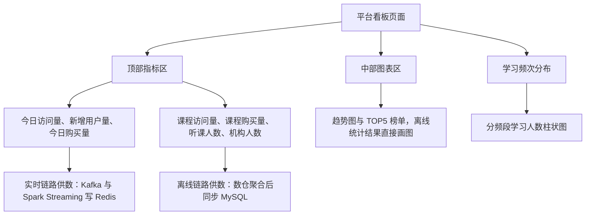

# 平台看板需求分析：看板三大块里，哪些业务配得上实时分析

打开智慧学成的业务报表系统，登录后默认落地的页面就是平台看板。这个页面信息密度很高，既有秒级跳动的今日指标，也有按月成形的趋势曲线，新人最容易产生的疑问是：这一屏数字里，哪些走实时计算，哪些走离线批处理？需求分析要回答的正是这件事，顺带把「实时分析一般用在什么场景、选什么技术」这两个前置问题一并解决。

## 先给结论

- 平台看板分为三大块：顶部指标区、中部图表区、学习频次分布区，每块的数据来源并不相同。
- 真正走实时链路的只有三个指标：今日访问量、新增用户量、今日购买量，实时采集、实时统计、实时展示。
- 课程访问量、课程购买量、听课人数、机构人数等历史指标是统计分析聚合的结果，第三章离线链路已经供数，看板直接展示。
- 实时分析适合海量数据持续到达、结果需要实时得到的场景，典型如网站访问量、搜索量、用户分布的实时统计。
- 流式技术里 Storm 与 Flink 是真流式，数据到达立即处理；Spark Streaming 把流切成秒级小批次，本项目允许一定延迟且离线已用 Spark，选 Spark Streaming 与离线保持同一技术栈。

## 平台看板上有什么

**顶部指标区，一屏之内实时与历史并列。** 左侧三项是本章重点：今日访问量、新增用户量、今日购买量，这三项对数据实时采集、实时统计分析，并在统计系统上实时展示。右侧一组是课程访问量、课程购买量、听课人数、机构人数，它们是对历史数据统计分析聚合得到的结果，其中课程访问量与课程购买量在离线分析章节已经做过完整链路，平台看板上直接展示聚合结果。

**中部图表区，趋势与榜单为主。** 在线人数、课程购买量、课程访问量以折线图形式展示，这几组数据离线分析时已经统计过，统计结果直接拿来画图；旁边是 TOP5 榜单模块，展示热门课程统计里排名前五的课程并附带涨幅，原型示意里还有热门搜索 TOP5 这类榜单，列出关键词、用户数与涨幅。

**学习频次分布区，分阶段看学习行为。** 按 1 到 5 次、10 到 20 次这样的频段统计学习人数，比如 1 到 5 次的有 5 万余人、10 到 20 次的有 4.3 万余人（原型示例数据），柱状图直接呈现分布形态。



这张图把看板拆成三块并标注了各自的供数来源：同一页面上两条链路汇合，实时链路只服务三个当天指标，其余区块全部由离线统计结果支撑。页面上数字全部归零或显示为示例值都不必惊慌，原型与测试环境里的数值本来就是填充数据，看的是区块结构与数据通路，不是具体数值。

原型页的打开方式很简单：浏览器访问报表系统主页（写作中以 example.com 占位课程环境的实际地址），登录后默认页即平台看板；停在别的页面时，点菜单栏的看板入口切回来即可。

## 哪些业务交给实时分析

判据只有一条：这个数字是否要求在当天持续变化。今日访问量是当天用户实时访问课程详情页面的数量，上午十点的看板就要反映出十点这一刻的访问热度；新增用户量要求注册一发生就被统计进去；今日购买量要求订单一落库就体现在购买数字上。这三个指标的时效要求在「秒」级，历史数据再多也帮不上忙，必须走实时链路。

反过来，课程访问量的趋势图关心的是「过去一段时间每天多少量」，统计粒度是天，今天的数明天补上毫无影响；听课人数、机构人数是慢变量，一天变不了几次。这些指标用第三章的按天批处理绰绰有余，硬搬进实时链路只会增加运维负担而没有收益。需求分析阶段就把这条判据立下来，后面每个指标实现时采集什么数据、用什么程序算，都有了依据。

## 实时分析的行业场景与三大技术

把视角从看板抬升到行业，实时计算一般是对海量数据进行实时统计分析并实时入库，数据源是不间断产生的，用户要求的响应时间也是实时的。以在线教育平台这类在线站点为例：网站访问的 PV 与 UV、用户访问了什么内容、搜索了什么内容，这些行为持续产生，实时计算可以动态刷新访问数据，展示网站实时流量的变化，分析每天各时段的流量与用户分布。常见场景可以归成三类：访问指标（访问量、PV、UV）的实时统计，搜索指标（搜索量、搜索关键词热度）的实时统计，用户分布情况的实时统计。

实现实时统计的主流技术有 Storm、Spark Streaming 与 Flink，三者的差异在处理模型上：

**Storm 与 Flink 是真流式。** 数据一到达就立即被处理，为了提高性能会缓存小部分数据再批量处理，延迟以毫秒计，适合实时性要求很高的场景，典型例子是公交位置的实时处理，车辆位置晚几秒展示乘客就等不起。

**Spark Streaming 是微批式。** 它把数据流切成一个一个小批次，逐批交给引擎处理。批次以时间为单位切分，单位一般是秒。假如批次设为 5 秒，程序就每 5 秒到数据流里取一次数据，把这 5 秒内的数据作为一个小数据集一次性算完，结果更新一次。因为有整批的时间间隔，延迟下限就是批次时长，实时性比 Storm、Flink 弱一档，适合允许有延迟的场景：访问量、搜索指数、用户分布这类指标晚 5 秒更新毫无影响。

课程访问量的统计程序正是按这个模型写的，讲义里的骨架代码如下：

```scala
// 讲义今日访问量统计分析代码节选，包名按课程工程 com.study.xc 系改写
// 手动管理 Kafka offset：从 Redis 取上次提交的进度，没有则从 0 开始
val offsets = redis.getLastCommittedOffsets(rt_cv_offset, topicName, 1)
// 每 5 秒切一个批次
val ssc = new StreamingContext(sc, Seconds(5))
// 直接流方式连接 Kafka，按已保存的 offset 消费
val message = KafkaUtils.createDirectStream[String, String](
  ssc,
  LocationStrategies.PreferConsistent,
  ConsumerStrategies.Assign[String, String](offsets.keys.toList, kafkaParam, offsets)
)
```

`Seconds(5)` 就是「以 5 秒为单位切批」的落点：数据流被切成 5 秒一帧的小批次，每帧作为一个小数据集交给 Spark 引擎处理。本项目允许一定延迟，又与离线分析共用 Spark 技术栈，工程上选 Spark Streaming 是成本与时效的最优平衡。

看板的需求最终可以落成一张指标清单，供后续设计存储与接口时对照：

```json
{
  "realtime": {
    "todayCourseVisit": 71508,
    "todayNewUser": 78508,
    "todayCourseBuy": 59025
  },
  "history": {
    "courseVisitTrend": "按天曲线，离线统计",
    "onlineListen": 99782
  }
}
```

这份 JSON 是按看板原型归纳的示例结构（数值取自原型示意页），用意是把「实时指标」与「历史指标」两组字段分开：实时组三个字段由 Redis 每 5 秒刷新，历史组由业务库接口聚合返回，前端按组对接，互不混淆。

## 常见误区

- **把看板上所有数字都当实时数据。** 错例：看到折线图也在动，就以为整个看板都走流式计算。正解：先分区块再分链路，只有顶部三个今日指标走实时，趋势图与榜单消费的是离线统计结果。
- **按「数据量大」决定用实时分析。** 错例：觉得访问日志量大就该上流处理。正解：判据是时效要求而非数据量，量大但只看天粒度的指标，批处理反而更稳更省。
- **把 Spark Streaming 说成毫秒级真流式。** 错例：面试或方案里宣称 Spark Streaming 数据到达即处理。正解：它是按时间切批的微批模型，延迟下限是批次时长，真流式指 Storm、Flink 那类逐条处理模型。
- **选型只看技术先进性。** 错例：既然 Flink 更新，就不管场景上 Flink。正解：本项目允许秒级延迟且离线已用 Spark，沿用同一技术栈的维护成本最低，选型先看场景容忍度再看团队栈。

## 面试可能被问到的问题

1. 面试官追问：「Storm、Spark Streaming、Flink 三者怎么选？」
   答：看延迟容忍度与生态。Storm、Flink 逐条或低延迟处理，适合公交定位、实时风控这类毫秒级场景；Spark Streaming 微批处理，延迟是批次时长量级，适合访问统计、用户分布这类容忍秒级延迟的场景。若团队已有 Spark 资产，微批方案的迁移与运维成本最低。
2. 面试官追问：「一个页面同时消费实时与离线数据，怎么保证口径不打架？」
   答：需求阶段就给每个指标写清口径定义与归属链路，实时指标只算当天窗口，离线指标只管历史区间，展示层把两组字段分开对接。同一个量（如课程访问量）出现在实时卡片与趋势图里时，注明统计口径与更新频率，避免用户拿 5 秒更新的当日值去对比 T+1 的历史值。
3. 面试官追问：「微批模型把流切成批次，切分依据是什么？」
   答：以时间为单位切分，单位一般是秒，批次时长在 StreamingContext 初始化时指定。每批数据在该时间窗口内到达，作为一个独立小数据集被引擎处理一次，处理节奏与窗口对齐。批次时长的选择要平衡调度开销与延迟要求。
4. 面试官追问：「平台看板这类需求，原型评审时要盯住什么？」
   答：盯三件事：每个数字的统计口径（访问量按什么去重、购买量算不算退款）、每个区块的数据来源与更新频率、无数据时的展示约定。口径与来源不落文档，后面统计程序、存储设计、前端接口三方就会各说各话。
5. 面试官追问：「为什么实时分析只做三个指标，不把课程访问量趋势也做成实时的？」
   答：趋势图的消费场景是复盘与对比，天粒度足够，实时化带来的收益撑不起常驻流作业的运维成本；今日访问量的消费场景是运营盯盘，必须秒级。指标跟着场景走，而不是跟着技术能力走。

## 配套资料

- 讲义：`materials/docs/08/智慧学成-第4章-实时分析.md`，1.1 节平台看板原型与 1.1.1 实时分析应用场景为看板口径与技术选型的出处，今日访问量统计分析代码（StreamingContext 与 Kafka 直连部分）亦在该讲义内。
- 资料：`materials/code/08/_散落资料/`，课程访问、新增用户、课程购买三类实时数据的生产脚本与采集调度模板在此目录（内层文件名带站点后缀，按用途自取，具体文件名不在此列出）。
- 资料：报表前端工程随资料包提供（位于 `materials/code/08/` 下，目录名含项目原名，此处不列内层路径），平台看板页面组件与区块结构以工程源码为准。
- 说明：看板示例数值为原型示意数据；接口与页面地址以 example.com 占位，JSON 结构为按原型归纳的示例。
