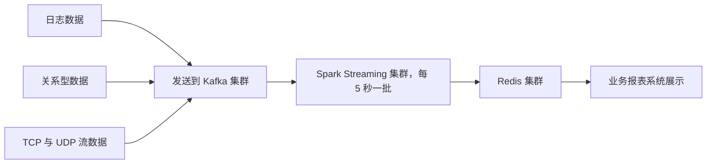

# 实时分析技术方案：采集、中转、计算、存储的四段流水线

前一篇把看板需求与场景定了：三个今日指标要秒级更新。接下来要回答工程问题，整条实时链路怎么搭？数据从哪来、在哪中转、谁来算、算完存到哪。技术方案在讲义里就是一张工作流程图，四个阶段从左到右依次是数据采集、消息处理、实时分析、数据存储，下面按这张图逐段拆开讲，把每段的选型理由和运行细节说清楚。

## 先给结论

- 链路四段：数据采集（日志数据、关系型数据、TCP 与 UDP 流数据）统一发送到 Kafka 集群，Spark Streaming 集群从 Kafka 拉数据做实时统计，结果保存到 Redis 集群供业务使用。
- Kafka 只做消息中转，数据按队列方式保存，先来的先被消费，各段之间靠它解耦。
- Spark Streaming 直接读取 Kafka 中的数据，每 5 秒拉取一批做统计分析，统计完成就更新 Redis。
- 报表系统读 Redis 展示，Redis 的值每 5 秒刷新一次，页面跟着刷新，达到准实时的效果。
- 实时分析程序常驻运行、启动一次即可，调度侧用低频触发避免重复拉起；三个指标对应三个 topic 与三个常驻程序。

## 工作流程图逐段拆解

**第一段，数据采集。** 数据来源在方案里列了三类：日志数据，可能是用户产生的访问日志，也可能是系统产生的运行日志；关系型数据，一般指 MySQL、Oracle 这类关系型数据库里的记录，本项目里新增用户量与今日购买量就来自用户表与订单表的 binlog；TCP 与 UDP 流数据，即 Socket、NetCat 这类网络流推送的数据。三类源只是列举，实际还有什么源就采什么，采集的方式不设限。本项目的采集动作全部由 NiFi 承担，与离线分析共用同一套采集设施。

**第二段，消息处理。** 采集到的数据统一发送到 Kafka，Kafka 在这条链路里只做一件事：中转。数据在 Kafka 中按队列方式保存，先进先出，先到的消息先被消费。为什么所有源都汇到 Kafka 再交给计算端，而不是采集端直连计算端，原因有三：一是解耦，任何一段的增减不影响其他段，新增一个指标只是多一个 topic；二是削峰，流量突增时消息在队列里排队，计算端按自己的节奏消费；三是留痕，消息带着 offset 落在 Kafka 里，计算端重启后能接着上次的位置继续消费。

**第三段，实时分析。** Spark Streaming 直接读取 Kafka 中的数据，采用 5 秒读取一次的节奏：每 5 秒把这段时间到达的消息取成一个批次，统计分析在这一批上完成，算完立即进入下一段。这个程序启动后不停轮转，5 秒取一次、算一次，循环往复，没有「跑完退出」的概念。

**第四段，数据存储。** 统计分析的结果保存到 Redis，之后业务报表系统就可以读取展示了。每次统计完成后 Redis 中的值都会更新，报表系统读到的永远是最新一批的计算结果，页面上的数字每 5 秒刷新一次，对看板场景来说这就达到了相对实时的效果。



这张图与讲义的工作流程图同构：三类数据源汇入 Kafka 一点，再经 Spark Streaming 到 Redis 一线到底。关键路径在 Kafka 到 Spark Streaming 这一段，计算端以固定节奏拉取，使波动被队列吸收，整条链路的延迟上限因此稳定在「批次时长加计算耗时」的量级。

## 每段选型的取舍

**计算引擎沿用 Spark 是本方案的主轴。** 讲义里明确，本项目允许一定延迟，实时分析采用 Spark Streaming，与离线分析采用相同的技术栈。离线侧团队已经积累了 Spark 的工程经验与集群环境，实时侧复用同一引擎，代码风格、依赖管理与运维手段全部延续，新增的认知成本只有流式模型本身。

**存储选 Redis 是由结果的形态决定的。** 三个指标的统计结果都是当天范围内的单一计数值，数值随每批计算不断变化，读方是报表系统的高频点查。Redis 对这种「单值高频更新、高频读取」的模式非常顺手，写入就是更新一个哈希字段，读取就是取一个键，既不需要建表也不需要分层落库。至于为什么用哈希结构存、字段怎么随日期滚动，属于存储设计，在指标与存储分析那一篇展开。

**采集与调度复用 NiFi。** 数据生产与实时采集的处理器组都跑在 NiFi 上，实时分析程序的拉起也交给 NiFi 调度。值得强调的是运行形态的差异：离线统计任务按天调度，跑完即退；实时分析程序是一直运行的，只需启动一次，调度侧用 GenerateFlowFile 处理器控制触发，把 Run Schedule 的时间设置得较大，避免调度反复拉起同一个常驻程序。

## 从方案到落地

方案落到机器上分三步：程序打依赖包、脚本提交常驻任务、调度低频触发。打包产物是带全部依赖的 jar，上传到 NiFi 容器的 jars 目录，启动脚本上传到 scripts 目录。以今日访问量为例，启动脚本内容如下：

```bash
#!/usr/bin/env bash

SPARK_SUBMIT=/opt/spark/bin/spark-submit

$SPARK_SUBMIT \
  --master spark://xc-online-spark:7077 \
  --conf spark.executor.cores=1 \
  --total-executor-cores 1 \
  --class com.study.xc.analysis.RealTimeVisit \
  /opt/run/jars/xc-service-rt-jar-with-dependencies.jar
```

脚本向 Spark 集群提交实时统计主类，程序启动后常驻轮转，不再有按天传日期参数的需求，统计窗口由程序内部按当前日期自动划定。三个指标对应三个主类与三个脚本，Kafka 侧则对应三个 topic：访问行为走 `visit_topic`，新增用户走 `new_user`，购买行为走 `course_buy`，互不串扰。

链路验证从源头开始：先确认采集侧把消息推进了 Kafka，再用模拟消费者查看 topic 是否持续有数据到达：

```bash
# 在 Kafka 容器的 bin 目录执行，模拟消费者查看指定 topic 的消息
./kafka-console-consumer.sh --bootstrap-server xc-online-kafka:9092 --topic visit_topic
```

消费者持续打出消息，说明采集段与中转段连通；再启动实时统计程序，用 Redis 客户端观察对应键的值是否每 5 秒更新，四段流水线就逐段验收完毕。集成测试阶段三个指标的处理组可以同时启动，彼此没有先后依赖，最后统一看 Redis 数据更新与页面展示。

## 常见误区

- **把 Kafka 当存储用。** 错例：指望消息长期留在 Kafka 里当数据源，数仓、报表都来消费。正解：Kafka 在本方案里只做中转缓冲，消息按保留期滚动清理，长期沉淀仍要走数仓那条线。
- **以为实时程序要按天调度。** 错例：照搬离线的调度思路，给实时程序配每日定时任务。正解：实时程序常驻运行，启动一次即可，重复拉起会造成多个消费者互抢 offset，调度侧刻意放大 Run Schedule 就是防这个。
- **把 5 秒当成固定不变的约定。** 错例：认为所有实时项目都必须 5 秒一批。正解：批次时长是 StreamingContext 初始化时指定的参数，按业务延迟容忍度设定，本项目三个计数指标 5 秒足够，换一个场景可能是 1 秒也可能是 30 秒。
- **验证链路只看最终页面。** 错例：页面数字不动就笼统地说「实时链路挂了」。正解：按段排查，先看 Kafka 消费者有没有消息，再看程序进程在不在，最后看 Redis 值有没有更新，四段各自可测。

## 面试可能被问到的问题

1. 面试官追问：「为什么所有数据源都要先进 Kafka，而不是直接喂给 Spark Streaming？」
   答：Kafka 提供解耦、削峰与可重放三点。采集端与计算端速率解耦后互不拖累；流量高峰时消息在队列排队，计算端按批次节奏消费；消费进度以 offset 记录，程序重启可以接着上次位置继续，数据不会因计算端故障而丢失。直连方式下这些能力都要采集端自己造。
2. 面试官追问：「实时结果为什么存 Redis 而不是像离线那样落 Hive 再同步 MySQL？」
   答：结果形态不同。离线统计产出的是带维度的分区表，要支撑多维查询与历史对比；实时统计产出的是三个当天计数值，单键高频更新。Redis 一写一读就完成闭环，中间少掉落库与同步两段延迟，报表系统的读取压力也远小于一个 MySQL 点查服务。
3. 面试官追问：「页面数字 5 秒刷新一次，这算实时吗？」
   答：算准实时。实时与离线的分界是「当天业务当天可见」还是「次日可见」，本方案把可见延迟压到 5 秒量级，对盯盘场景已经够用。若业务要求毫秒级，才需要换成 Storm、Flink 这类逐条处理的真流式引擎，代价是引擎与运维复杂度的上升。
4. 面试官追问：「三个指标的实时程序是三个常驻进程，资源怎么控制？」
   答：提交脚本里显式限制资源，每个程序只给一个核心与一个执行器，三个程序的总占用是可控的小常数。计数类统计的计算量极小，瓶颈在网络传输而非算力，资源按进程隔离还能避免一个程序异常拖垮其他指标。
5. 面试官追问：「如果 Kafka 短暂不可用，实时统计会怎样？」
   答：消费端拿不到新批次，Redis 里的值维持上一次的统计结果，页面数字停更但不回退；offset 进度保存在 Redis 中，Kafka 恢复后程序从上次提交的位置继续消费，中间积压的消息会被补算进来，统计值追平真实数。这也是先过 Kafka 中转的价值之一。

## 配套资料

- 讲义：`materials/docs/08/智慧学成-第4章-实时分析.md`，1.1.2 实时分析技术方案为工作流程图与四点技术要点的出处，5.2 节统计分析 NiFi 调度给出启动脚本与常驻运行、低频调度的注意事项。
- 资料：`materials/code/08/_散落资料/`，三个实时指标的 spark-submit 启动脚本（`real_time_visit.sh`、`real_time_new_user.sh`、`real_time_buy.sh`）与对应 NiFi 采集调度模板在此目录（内层文件名带站点后缀，按用途自取，此处仅列脚本名）。
- 资料：`materials/code/08/_散落资料/`，容器编排文件定义了本方案复用的 Kafka、Spark、Redis 容器及端口映射。
- 说明：脚本中的主类包名按课程工程 `com.study.xc` 系改写，原始讲义类名 RealTimeVisit 与 topic 名保持不变；示例地址以 example.com 占位。
