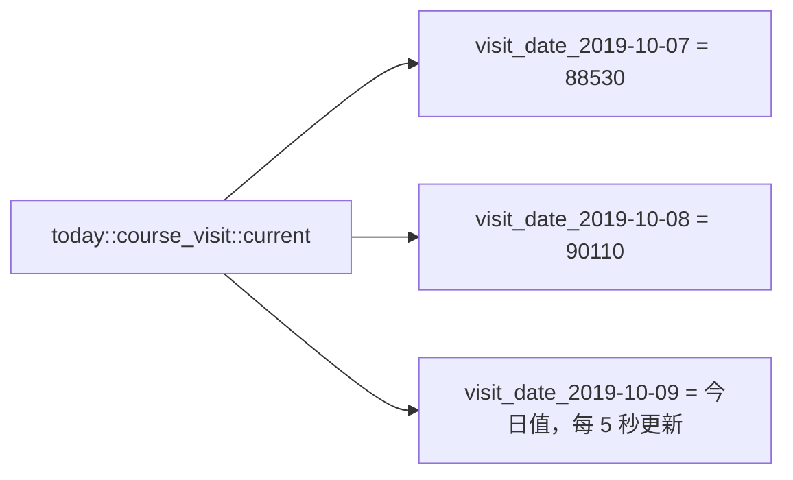

# 指标口径与 Redis 存储设计：field 随日期滚动，value 每 5 秒刷新

技术方案把链路骨架定了下来，动笔写统计程序之前还差两张设计底稿：一张是指标与维度分析，回答每个指标「算什么、在什么范围内算」；另一张是数据存储分析，回答算完的结果「存成什么样子、报表系统怎么取」。这两张底稿看着琐碎，实际决定了采集环节要抓哪些数据、程序里用什么数据结构，口径没定稳，后面的采集与统计都会返工。

## 先给结论

- 实时分析只做三个指标：今日访问量、新增用户量、今日购买量，维度统一是时间维度里的「当天」，没有其他维度。
- 存储选 Redis 哈希结构：key 固定且见名知义，field 由「固定前缀加当天日期」动态生成，value 是实时统计的计数值。
- field 按天自动滚动新增：今天写 `visit_date_2019-10-07`，明天程序自然写 `visit_date_2019-10-08`，历史值留在哈希里不覆盖。
- value 每 5 秒随批次统计更新一次，报表系统用日期拼出 field 就能取到当日最新值。
- 统计值之外，Redis 里还存了一份各指标消费 Kafka 的 offset 进度，统计键与进度键分开管理。

## 三个指标，一个维度

**今日访问量，当天用户实时访问课程详情页面的数量。** 用户每打开一次课程详情页，行为数据就实时进入统计，当天范围内去重计数，结果实时展示在业务报表系统上。**新增用户量，当天用户实时注册的数量。** 用户表每落一条新注册记录，统计值随之增长。**今日购买量，当天用户实时购买课程的数量。** 订单每落一条，购买计数随之更新。三个指标的完整定义里都带着「实时统计分析数据展示」，时效要求与上一篇技术方案里 5 秒一批的节奏对齐。

维度分析的结果出乎意料地干净：三个指标都只有时间维度，且都收敛在「当天」。对比第三章的离线指标感受更深，那里的学生人数要按课程分类拆分、按周与月两个粒度切区间、还要算同比涨幅；而看板顶部的三个实时指标是全站总量计数，页面上就是一个孤零零的数字，不分分类、不分地区、不比区间。维度一旦单一，统计动作就退化成「计数加累加」，复杂度全部转移到「怎么把数据实时送到」与「怎么把结果存得好用」上，这两件事分别在采集与存储环节解决。

跨天的边界也由「当天」这个维度顺带定了：统计窗口跟着当前日期走，日期一变，新的 field 自然出现，旧值留在原地成为历史，程序不需要任何归档动作。

## Redis 哈希结构设计

三个指标在一天内随用户行为不断产生，统计值必须持续更新才能支撑实时展示，存储要同时满足三点：写入快（5 秒一次）、读取快（报表系统高频取数）、能按天滚动（今天的值与昨天的值并存）。Redis 的哈希结构正好三点全占。

三个指标的键名与字段命名完全同构，讲义给出的今日访问量存储格式如下：

| 数据样例 | 数据结构 | 说明 |
| --- | --- | --- |
| key | `today::course_visit::current` | hash，今日访问量固定 key，不会改变，根据日期向 hash 中存值 |
| field | `visit_date_2019-10-07` | 前半部分 `visit_date_` 固定，日期部分按保存时的当天动态生成，格式 yyyy-MM-dd |
| value | 999 | int，当天实时统计的值，统计程序 5 秒统计一次，统计后更新 |

新增用户量与今日购买量照同一模板复制：键分别是 `today::new_user::current` 与 `today::course_buy::current`，字段前缀分别是 `new_user_date_` 与 `course_buy_date_`，value 同样是 5 秒一更的计数值。键名用冒号分段，见名知义，一眼能读出「今日、指标、当前值」三层含义。



这张图在讲哈希随日期滚动的形态：一个 key 聚拢一个指标的全部历史，每天的到来只是往哈希里多挂一个字段，哈希内部互不干扰。选哈希而不是每天换一个字符串键，收益在于键的数量不随时间膨胀，报表系统拿着固定 key 加当天日期就能取数，运维侧也能对整个指标的历史一眼看尽。

**存储设计里还有半张底稿容易被忽略：offset 进度。** 实时程序重启后要从上次消费的位置继续，这个位置就存在 Redis 里，键形如 `today::course_visit::offset`，字段是 topic 加分区号，值是已消费到的 offset。统计键与进度键分开命名，一个对外服务展示，一个对内服务恢复，互不污染。

## 落在代码里是什么样

存储设计的每一个约定在统计程序里都有对应的落点。讲义今日访问量代码里与存储直接相关的几行如下：

```scala
// 讲义今日访问量代码节选，包名按课程工程 com.study.xc 系改写
// rt_cv_key 即 today::course_visit::current
// 组装 hash 字段：前缀固定，日期按当天动态生成
val keyInfo = "visit_date_" + getDateStr(new Date().getTime, "yyyy-MM-dd")
// 启动时把哈希里已有的今日值累加进累加器，避免重启丢基数
val valStr = redis.getResultRedis(rt_cv_key, keyInfo)
if (null != valStr) {
  accumulator.add(valStr.toLong)
}
// 每批统计完成：计数累加并写回 Redis，5 秒一次
uv.foreachRDD(iter => {
  if (iter.count() > 0) {
    accumulator.add(iter.count())
    redis.storeResultRedis(rt_cv_key, keyInfo, accumulator.value.toString)
  }
})
```

三段代码与三张设计约定一一对应：`getDateStr` 动态生成日期对应「field 按天滚动」，启动时回读旧值累加对应「重启不丢当天基数」，`storeResultRedis` 写回对应「value 每 5 秒更新」。报表系统一侧的取数就更简单了，拿到 key 与当天日期拼出 field 直接读值。

开发期验证存储是否符合设计，用 Redis 客户端看一眼哈希内容即可（命令为按本课环境补全的示例）：

```bash
# 查看今日访问量哈希的全部字段与值
redis-cli -h xc-online-redis HGETALL today::course_visit::current
# 只取当天字段的值
redis-cli -h xc-online-redis HGET today::course_visit::current visit_date_2019-10-07
```

数据持续到达时反复执行第一条命令，能看到当天字段的值以 5 秒为节奏增长，隔一天再看会多出新的日期字段，存储设计的滚动形态肉眼可见。

## 常见误区

- **field 的日期部分写死或格式不对。** 错例：调试时把日期硬编码成测试那天的字符串，第二天统计值继续累计在同一天的 field 上，跨天数字全部失真。正解：日期必须用 `yyyy-MM-dd` 格式按当前时间动态生成，跨天自然切换新字段。
- **重启后直接从零累计。** 错例：程序重启后累加器从 0 开始，当天前几个小时的访问量凭空消失。正解：启动时先读哈希里已有的当日值累加进累加器，再继续消费新消息，基数据 Redis 保留。
- **统计值与 offset 混存一个键。** 键名随手起，统计值和消费进度挤在一起，排查时互相干扰。正解：按课程约定 `today::指标::current` 与 `today::指标::offset` 分键，展示与恢复两个用途物理隔离。
- **把哈希里的历史字段当永久明细。** 错例：以为 Redis 里按天滚动的字段可以当历史报表用。正解：这里的哈希只为实时展示服务，长期历史沉淀仍归数仓与业务库，Redis 侧要按运维策略控制内存与过期。

## 面试可能被问到的问题

1. 面试官追问：「为什么用 Redis 的哈希结构存实时指标，字符串键每天换一个不行吗？」
   答：字符串键方案会让键数量按天线性增长，报表系统要动态拼当天键名，过期清理也要逐键处理；哈希方案一个指标一个键，键数量恒定，字段按天滚动，取数与清理都收在一个键上。哈希还天然表达「指标加日期」的两级结构，语义更清晰。
2. 面试官追问：「统计程序重启，当天的累计值怎么不丢？」
   答：两道保险。统计基数方面，启动时先从哈希读出当天已有的值累加进累加器，再继续消费新消息；消费进度方面，offset 实时保存在 Redis 里，重启后从上次提交位置继续消费，两头都不会重复或遗漏。
3. 面试官追问：「5 秒一批的统计横跨午夜零点怎么办？」
   答：field 由写回那一刻的当前日期决定，批次跨越零点时，这一批无论内容归属哪一天，统计值都写进写回时刻的新字段，旧字段的值定格在零点前最后一批。天级计数指标对这条边界误差不敏感；若要求严格按消息时间归属，就要在消息里带业务时间戳并在统计端按字段分桶，代价明显上升。
4. 面试官追问：「如果看板要按课程维度拆分实时访问量，存储设计怎么改？」
   答：哈希的字段扩展出课程维度，例如 `visit_date_2019-10-07_course_1` 这类复合字段，或者改用「日期加课程」为键的字符串计数器。字段数量会从天数级涨到天数乘课程数级，哈希体积与取数模式都要重新评估，数据量再大就该引入专门的时间序列存储或预聚合层。
5. 面试官追问：「这三个指标的维度设计为什么这么薄，是偷懒吗？」
   答：是需求使然。看板顶部每个指标就是一块卡片一个数，没有下钻与切分的交互，全站当天总量就是完整口径；离线侧负责多维分析，实时侧只补时效短板。维度跟着展示形态走，多一个用不上的维度就多一份采集、存储与计算的负担。

## 配套资料

- 讲义：`materials/docs/08/智慧学成-第4章-实时分析.md`，1.2 指标与维度分析、1.3 数据存储分析为三个指标口径与 Redis 存储格式的原始出处，各指标统计代码（key、field 组装与写回部分）亦在该讲义内。
- 资料：`materials/code/08/_散落资料/`，三个实时指标的 spark-submit 启动脚本与 NiFi 采集、统计调度模板在此目录（内层文件名带站点后缀，按用途自取，具体文件名不在此列出）。
- 说明：Redis 查看命令为按本课环境补全的示例，键名以讲义程序代码里的双冒号写法为准；Scala 代码以讲义为准整理，包名按课程工程 `com.study.xc` 系改写。
