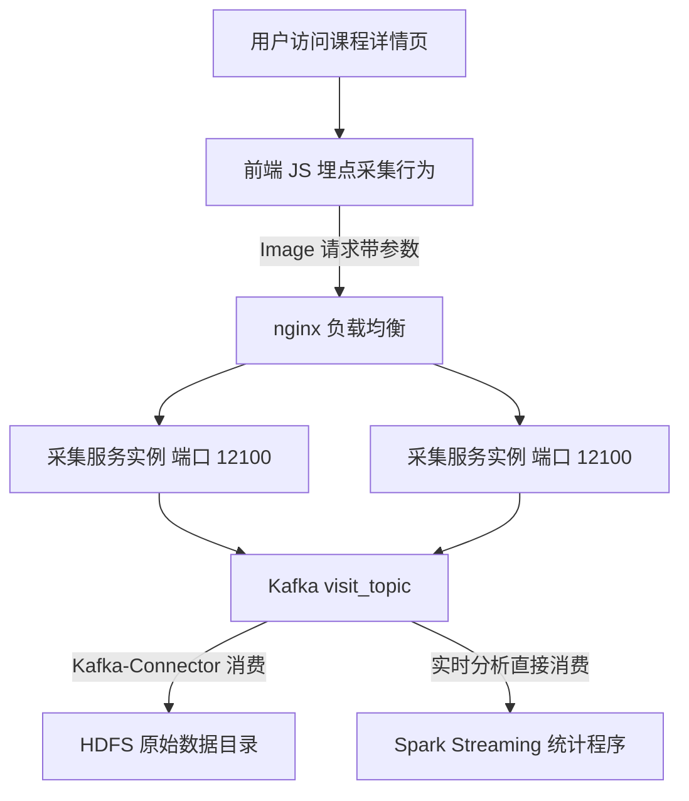
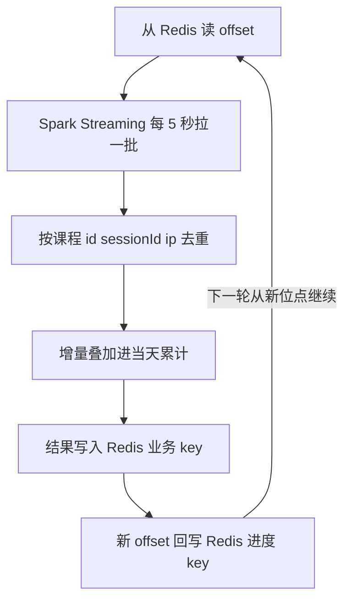
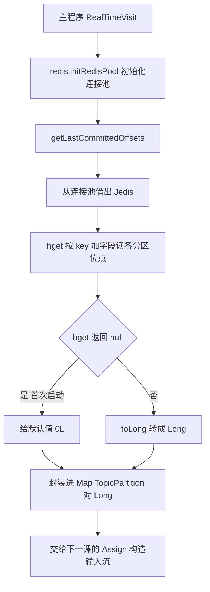
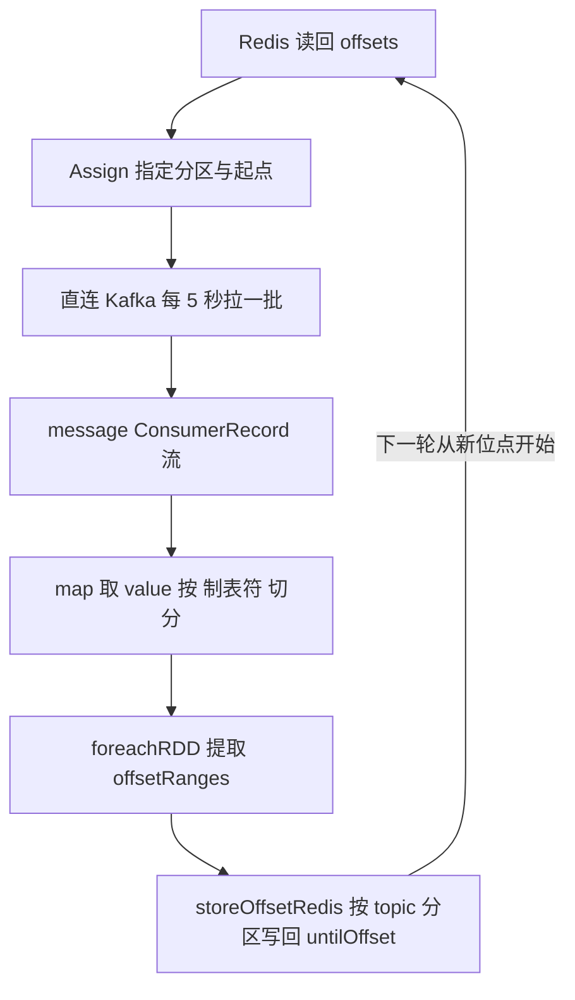
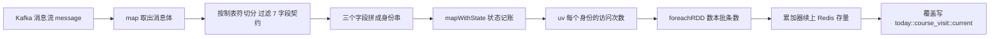
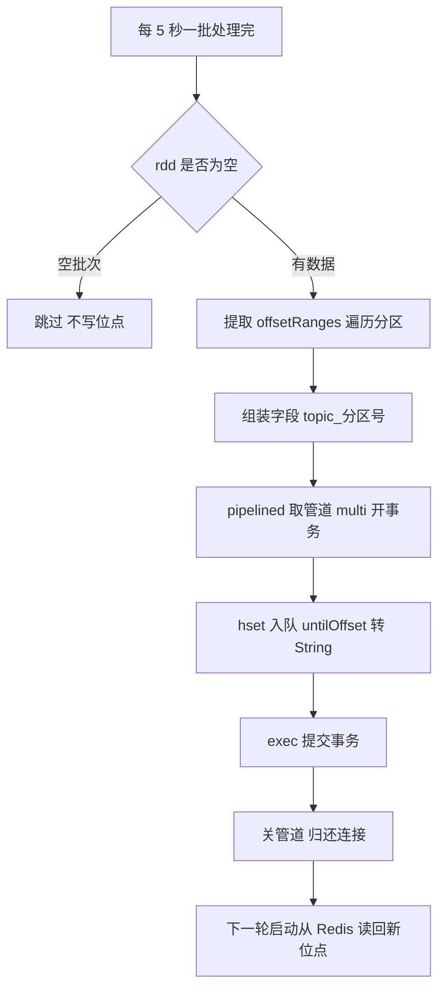
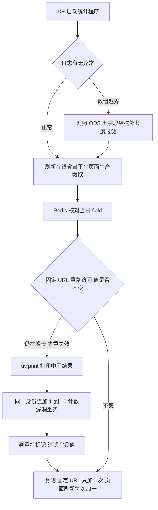

# 实时分析-今日访问量：从 Kafka 埋点到 mapWithState 去重落 Redis 的实时链路全景

> 🔒 安全提示：文中示例的口令/密钥均为课程教学环境演示口径，生产环境的安全要求见《安全与合规须知》。

## 先给结论

- 系列定位：智慧学成实时分析的开篇指标「今日访问量」，从埋点采集、统计口径、代码实现到测试与 NiFi 放量验证，一条主线跑通完整的实时链路。
- 口径先行：当天实时访问课程详情页的去重身份数，去重键为课程 id、sessionId、ip 三元组；结果写 Redis 的 `today::course_visit::current`，消费位点单独存 `today::course_visit::offset`，5 秒一批刷新。
- 采集侧不重搭：复用既有的 JS 埋点与采集服务，数据进 Kafka 的 `visit_topic`，实时链路直接消费，验证只看消息是否到达。
- 统计逻辑固定五步：从 Redis 取位点、每 5 秒拉一批 Kafka 数据、三元组去重算增量、结果覆盖写 Redis、位点回写 Redis，五步一轮循环不息。
- 代码分四段落地：`RedisUtils` 读位点、`createDirectStream` 接 Kafka、`mapWithState` 加累加器做去重计数、事务写回位点并常驻运行，checkpoint 兜住跨批次状态。
- 测试环节抓出两个真问题：垃圾数据导致的数组越界用长度过滤挡住；重复访问去不掉靠判重、打标记、再过滤修复。
- 收尾用 NiFi 从课程表量产埋点灌 Kafka，Redis 数字、Kafka 消息与数据库行数三方对账，全链路验收闭环。
- 贯穿全系列的两个工程纪律：位点与业务值分 key 存放、先写结果再推位点；位点与去重状态是两条独立的恢复线，都不能随手清。

## 第1部分：今日访问量实时分析开工：不重搭采集，让行为数据直连 Kafka

离线链路（Spark 批处理加 NiFi 调度）收官之后，智慧学成项目进入实时分析阶段，第一个指标是今日访问量。拿到需求最容易冒出的念头是：实时要的数据，是不是得另起炉灶再采一遍？答案是不用。第二章 ETL 搭建采集系统时，课程访问量的数据就一直按可复用的方式往 Kafka 里写，这一课要做的是确认这条链路能实时吐数，并把它接进实时分析的输入端。

### 指标先定口径
今日访问量，指的是今天用户实时访问课程详情页面的数量。它与第三章做过的「课程访问量」同源，差别在链路与时效：离线课程访问量按天落 HDFS、批处理跑批，看到的是昨天之前的数字；实时今日访问量盯的是此刻，当天 0 点起累计，看板每隔几秒刷新一次。

实时分析技术有 Storm、Flink、Spark Streaming 等。Storm 与 Flink 属于来一条处理一条的流式引擎，适合公交数据这类毫秒级场景；Spark Streaming 把数据流切成以秒为单位的小批次逐个处理，有一定延时。看板类指标允许秒级延时，选 Spark Streaming 既能满足时效，又与离线分析共用同一套技术栈，开发与运维都不必另起一套。

### 采集链路：三个角色各管一段
采集系统由三部分组成，各司其职。

**第一是用户前端。** 在线教育平台的课程详情页里埋了 JS 埋点脚本，用户打开页面时脚本采集访问行为，用一个 Image 对象向后端发起一次几乎无成本的请求，把行为参数拼在 URL 上传出去。

**第二是采集服务。** 一个 Spring Boot 应用（buried），对外提供接收埋点请求的接口，内部通过日志框架的 Kafka Appender 把数据写入 Kafka 指定 topic。生产形态是多个实例，前面 nginx 做负载均衡，课程环境里是三台监听 12100 端口的服务，`java -jar buried.jar` 方式启动。

**第三是 Kafka 与 Kafka-Connector。** Kafka 是数据中枢，`visit_topic` 里的消息有两个去向：Kafka-Connector 消费后落 HDFS，供离线批处理；实时分析程序直接消费 Kafka。写一份，两种消费，互不影响。



这张图是采集链路的全貌：左边一条写入路径，右边两个消费去向。离线链路当年走的就是 Kafka-Connector 到 HDFS 那条路；实时分析不碰 HDFS，直接从 Kafka 拿数据。当年选 Kafka 做数据中转，在这里兑现成了红利。

### 埋点数据：一次访问带七个字段
课程访问量埋点一次携带 7 个字段，脚本按课程采集文档整理如下：

```javascript
// 课程访问量埋点：构造参数
var params = {};
params.cid = generateUUID();        // 课程 id
params.time_dim_id = "_";           // 时间维度 id，按访问时间计算
params.sid = getSid();              // 会话 id，cookie 里取或新生成
params.uip = "_";                   // 用户 ip
params.uid = generateUUID();        // 用户 id
params.ua = navigator.userAgent;    // 浏览器标识
params.t = new Date().getTime();    // 访问时间毫秒值
// 通过 Image 对象请求采集服务，把参数拼在 URL 上
var img = new Image(1, 1);
img.src = 'http://xc-online:12100/a.gif?' + getArgs(params);
```

采集服务收到后按 `\t` 分隔写入 Kafka，一条消息从左到右依次是课程 id、时间维度 id、sessionId、用户 ip、用户 id、user_agent、访问时间戳：

```text
e60f96225a9046d5b7d752d168d98d14  2019-07-01-09  f8150a9f3a424053b2d9366927052a7f  169.63.52.55  311e3af993644504a059fb6be75c7743  Mozilla/5.0 (X11; Linux x86_64)  1561943829
```

字段顺序不是摆设，它是消费端 `split` 之后按下标取值的契约：第 1 位课程 id、第 3 位 sessionId、第 4 位 ip，正是后面去重要用的三个字段。session_id 每打开一个页面产生一个、关闭浏览器即消失，用于把同一次会话内的访问归并；user_agent 用来识别访问方式与机器人；visit_time 是时间戳，时间维度 id 由它计算得出。

### 验证：模拟消费者盯一眼 topic
链路是否真的实时，不需要写任何代码，Kafka 自带的控制台消费者就能验证。进入 Kafka 容器，切到安装目录的 bin 下，盯住 `visit_topic`：

```bash
# 进入 Kafka 容器
docker exec -it xc-online-kafka bash
# 切到 Kafka 安装目录的 bin 下（版本目录按环境实际为准）
cd /opt/kafka/kafka_2.11-2.2.0/bin
# 模拟消费者查看 topic 中的数据
./kafka-console-consumer.sh --bootstrap-server xc-online-kafka:9092 --topic visit_topic
```

命令起一个消费者常驻监听。回到浏览器刷新课程详情页，终端里立刻打印出一条消息，ip 与浏览器信息一目了然；再刷新一次，又出一条。消息跟着页面访问实时到达，说明埋点、采集服务、Kafka 三段全部畅通，今日访问量实时分析所需的数据采集就此确认可用，采集端不需要任何改造。

顺带说明，这个控制台消费者用的是它自己临时的消费组，与后续 Spark Streaming 手工管理的消费位点互不相干，纯粹是旁观者，不会把数据「消费走」。

## 第2部分：今日访问量的统计逻辑：五步闭环，去重之后才是实时访问量

采集链路确认可用后，`visit_topic` 里的访问消息已经源源不断。动手写统计代码之前，得先把统计分析的逻辑定清楚：消费从哪开始、怎么去重、结果存哪、进度怎么续。逻辑定了，代码只是把每一步翻译出来。今日访问量的统计逻辑是固定五步，这一课把它逐条讲透。

### 统计口径：今天的、实时的、去重后的
今日访问量有三个修饰词，每个都对应一条硬约束。

**「今天的」** 决定存储形态。统计范围从当天 0 点起算，所以结果按天组织：Redis 里用一个固定 key 挂一个 hash，field 是 `visit_date_` 加当天日期，value 是当天的累计访问量。日期变了 field 跟着变，昨天的数字留在昨天的 field 里。

**「实时的」** 决定节奏。每 5 秒消费一批、计算一次、更新一次展示值。看板刷新读到的永远是最近一次统计的累计结果。

**「去重后的」** 决定身份键。同一次访问被重复上报、同一用户连续刷新页面，都不该把数字吹起来。项目用课程 id、sessionId、ip 三者组合当身份键：sessionId 区分不同会话，ip 兜住同会话多来源的情况，课程 id 让访问不同课程分别计数。三者拼接成组合键，组合第一次出现才计入增量，重复出现不重复计数。

### 五步逻辑逐步走
**第一步，手动管理 Kafka 的 offset。** 消费起点不交给 Kafka 自动管理，而是放在 Redis 里：程序启动时从 Redis 读上次保存的 offset，没有就从 0 开始。为什么这么防？Kafka 或 ZooKeeper 宕机都可能造成数据层面的问题，而 offset 一旦落在 Redis，不管哪个组件挂了，重新启动后位点都不会变，按位点取数就不会造成数据丢失。

**第二步，Spark Streaming 获取 Kafka 中的数据，每 5 秒一次。** 拉数基于第一步拿到的 offset 进行：从上次消费到的位置继续往后读 5 秒的新消息。5 秒既是批间隔，也是整个统计的节拍。

**第三步，去重并计算实时访问量。** 每一批消息先按组合键去重，新出现的组合贡献增量。同一组合可能跨批次再次出现，所以去重需要跨批次状态来记住已经见过的键，工程上用带状态的算子实现，具体写法在去重计算的实现部分展开。

**第四步，统计结果存 Redis 供业务使用。** 计算结果直接写 Redis 的业务 key，业务系统实时读取展示。数据每 5 秒更新一次、覆盖写一次，这种高频小值写入正适合 Redis，写 Hive 或 MySQL 都嫌重。

**第五步，Redis 中保存当前 offset 进度。** 这一批数据处理完了，对应的 offset 就是新的消费位置，把它写回 Redis。下次获取位点时拿到的就是新值，从此每一轮都是增量获取、不间断获取，实时分析的「实时」才立得住。

### 结果写到哪：Redis 双 key
业务值与消费进度分开存放，互不污染：

```scala
// Redis 中访问量业务 key：hash 结构，key 固定，field 按天变化
val rt_cv_key = "today::course_visit::current"
// field 形如 visit_date_2019-10-07，value 是当天累计访问量

// Redis 中 Kafka offset 进度 key：hash 结构
val rt_cv_offset = "today::course_visit::offset"
// field 形如 visit_topic_0，value 是该分区已消费到的 offset
```

两个 key 的内部结构一目了然：

```text
today::course_visit::current        hash
  visit_date_2019-10-07   ->  999          当天实时累计访问量，5 秒更新一次

today::course_visit::offset         hash
  visit_topic_0           ->  12345        0 号分区已消费到 12345 的位置
```



这张图就是五步的闭环：左边进的是位点，中间是计算，右边出来两个东西，一个给业务看的累计值，一个给自己续命的消费进度。进度 key 回写之后箭头绕回起点，闭环转起来，统计程序才能 7 乘 24 小时不间断地跑。

### 增量怎么叠加成总量
展示端读到的 field 值是当天累计总量，不是这 5 秒的瞬时访问量。每一轮统计产出的是「新出现的访问」这部分增量，叠加进当天的总量后整体覆盖写回。这样设计有两个好处：业务端永远只读一个值，逻辑简单；任何一轮计算失败，下一轮仍从回写的位点继续，累计值不会被开天窗。

跨天的口径切换靠 field 完成：日期一变，新 field 天然从 0 开始累计，旧 field 保留着当天跑出的最终值，想回看昨天的数字直接读旧 field 即可，不需要额外的归档动作。

## 第3部分：从 Redis 读回消费位点：手工管理 Kafka offset 的第一步

统计逻辑定了五步，落到代码上，第一段有意义的代码不是拉数据，而是确定从哪里开始拉。Spark Streaming 消费 Kafka 时如果不自己管位点，起点就由别人决定，重启一次数字就可能对不上。这一课把位点管理的前半段写完：初始化 Redis 连接池，实现从 Redis 按分区读回上次消费的 offset，为下一步构造输入流备好起点。

### 为什么要自己管 offset
Kafka 消费者的位点默认有两条出路：`enable.auto.commit` 定时把消费进度提交到 Kafka 内部的位移主题；`auto.offset.reset` 决定没有位点时从哪里开始。前者的问题是定时，两次提交之间的进度只存在于内存里，进程一宕机这段窗口就没了，重启后要么重复消费要么错过消息。实时统计的累计值经不起这种误差。

项目的做法是位点自己管：处理完一批就把进度写进 Redis，启动时读回 Redis 接着消费。offset 放在 Redis 还有一层考虑，Kafka 或 ZooKeeper 宕机都可能造成数据层面的异常，而位点存在 Redis 里，不管哪个组件挂了，重新启动后位点都不会变，按位点取数就不会丢。Redis 同时也是统计结果的存储，位点跟着业务走，不新增运维对象。

### RedisUtils 准备：连接池先行
工具类里先有连接池的初始化。连接配置与池参数集中在一个方法里，只建一次：

```scala
// org.apache.kafka.common.TopicPartition 与 Jedis 相关 import 略
transient private var pool: JedisPool = null

// 创建 Jedis 连接池
def makePool(redisHost: String, redisPort: Int, redisTimeout: Int,
             maxTotal: Int, maxIdle: Int, minIdle: Int): Unit = {
  if (pool == null) {
    val poolConfig = new GenericObjectPoolConfig
    poolConfig.setMaxTotal(maxTotal)       // 最大连接数
    poolConfig.setMaxIdle(maxIdle)         // 最大空闲连接
    poolConfig.setMinIdle(minIdle)         // 最小空闲连接
    poolConfig.setTestOnBorrow(true)       // 借出前检测可用性
    poolConfig.setTestOnReturn(true)       // 归还时检测可用性
    pool = new JedisPool(poolConfig, redisHost, redisPort, redisTimeout)
  }
}

// 初始化 Redis：主程序里第一步就调它
def initRedisPool(): Unit = {
  makePool("redis-host", 6379, 3000, 100, 50, 20)
}
```

两个细节值得注意。`pool` 用 `transient` 修饰，工具类实例可能被带上分布式任务的序列化之路，连接池这种本地资源不该跟着走；`makePool` 里先判空再建，保证多次调用也只有一副池子。主程序里的初始化就是两行：

```scala
// 初始化 Redis 工具类与连接池
val redis = new RedisUtils
redis.initRedisPool()
```

### getLastCommittedOffsets：按分区读回位点
读取方法要回答的问题是：这个 topic 的每个分区，上次消费到了哪里。返回值选 `Map[TopicPartition, Long]`，键是 Kafka 客户端的分区坐标，值是位点，正是下一课 `ConsumerStrategies.Assign` 需要的形状。实现如下：

```scala
/**
 * 从 Redis 获取指定 topic 各分区上次消费的 offset
 *
 * @param redisKey   Redis 中存 offset 的 key
 * @param topicName  topic 名称
 * @param partitions 分区数
 * @return Map[TopicPartition, Long] 每个分区的消费起点
 */
def getLastCommittedOffsets(redisKey: String, topicName: String,
                            partitions: Int): Map[TopicPartition, Long] = {
  // 从连接池获取 Jedis 客户端
  val jedis = getPool.getResource
  // 初始化 map 保存结果
  val offsetMap = collection.mutable.HashMap.empty[TopicPartition, Long]
  // 对分区遍历：分区从 0 开始，0 to partitions - 1 包含头不包含尾
  for (partition <- 0 to partitions - 1) {
    // 组装 hash 字段：topic 名 + 下划线 + 分区号
    val topic_partition_key = topicName + "_" + partition
    // hget 按 key 加字段取值，offset 是 hash 结构
    val lastOffset = jedis.hget(redisKey, topic_partition_key)
    // 判断值是否存在：首次启动 Redis 中没有 offset，给默认值 0
    val lastOffsetVal = if (lastOffset == null) 0L else lastOffset.toLong
    // 封装到 map：分区坐标 对应 起点
    offsetMap.put(new TopicPartition(topicName, partition), lastOffsetVal)
  }
  // 归还连接
  jedis.close()
  // 转 immutable map 返回
  offsetMap.toMap
}
```

实现里藏着几个容易踩的细节。

**分区遍历是 `0 to partitions - 1`。** `to` 生成的范围包含头也包含尾，而分区号从 0 开始，0 就代表第一个分区，所以尾巴要减一。Kafka 只有一个分区时传 1，循环只跑一轮；将来 topic 扩到多个分区，改这个参数循环自然跟上，这是把分区数做成参数的原因。

**字段是 topic 名拼分区号。** hash 里一个分区一条记录，field 用 `visit_topic_0` 这样的形式，同一 key 下多个分区互不覆盖。

**取值用 `hget` 而不是 `get`。** offset 在 Redis 里是 hash 结构，按 key 加 field 定位，用 string 的 `get` 只会拿到空。

**判空是正常分支不是异常。** 程序首次启动时 Redis 里没有任何位点，`hget` 返回 null，此时给初始值 0，从头消费。类型上 Redis 取出的是字符串，位点是 Long，`toLong` 转换不能省，0 也要写成 `0L` 才类型相容。

主程序里的调用连着上一段的初始化：

```scala
// 从 Redis 获取上次消费的 offset，首次启动返回 0
val offsets = redis.getLastCommittedOffsets(rt_cv_offset, topicName, partitions = 1)
```

`rt_cv_offset` 就是统计分析逻辑里定下的进度 key `today::course_visit::offset`，`topicName` 是 `visit_topic`。三个实时指标各有各的进度 key，同一个工具方法换 key 复用。

### 位点在手，交给谁
读回来的 `offsets` 在 Redis 里长这样：

```text
today::course_visit::offset        hash
  visit_topic_0  ->  12345         0 号分区上次消费到 12345（不含）
```

下一课构造输入流时，这个 map 会以两种身份同时进场：`offsets.keys.toList` 作为要消费的分区清单，`offsets` 本体作为每个分区的起点。



这张图把一次位点读回的路径走完整：连接池借出客户端，hash 里按分区逐个取值，空值与实值两条分支最后汇进同一个 map。方法本身不短，但它把「起点在哪」这个最容易出错的问题一次性钉死。

## 第4部分：让 Spark Streaming 接上 Kafka：五秒一批，直连消费，位点闭环

起点已经备好：上一课从 Redis 读回了各分区的 offset。这一课把流真正建起来，创建 StreamingContext、配置 Kafka 消费参数、用 KafkaUtils 构造直连输入流，让 `visit_topic` 里的消息以 5 秒一批的节奏流进统计程序；消费完还要把进度写回 Redis，闭环的最后一环就此接上。

### StreamingContext：五秒一个批次
```scala
// 获取 SparkContext（sparkConf 上一课已初始化）
val sc = new SparkContext(sparkConf)
// 获取 SparkStreaming：每 5 秒获取一次数据
val ssc = new StreamingContext(sc, Seconds(5))
// 增加检查点，共享数据
ssc.checkpoint("/user/hive/external/data_course/today_visit_online/checkpoint")
```

`StreamingContext` 两个参数：已有的 SparkContext 与批间隔。批间隔用 `Seconds(5)` 表达，构造函数要求的就是时长类型，5 的含义是每 5 秒把这段时间内到达的数据收成一个批次处理一次。录写时有过一次报错，SparkContext 那一行多敲了一个右括号，IDE 提示参数对不上；点开签名能看到它需要 sparkContext 与 batchDuration 两个参数，删掉多余括号即恢复。这类报错的好处是提示里带着方法签名，对着签名数括号就行。

checkpoint 指向 HDFS 目录。带状态的算子要跨批次保存状态，检查点目录是状态的落点，缺了它运行时会直接报错，这里提前设好。

### kafkaParam：消费端四项配置
```scala
// 配置 Kafka 参数
val kafkaParam = Map[String, Object](
  // Kafka 地址
  ConsumerConfig.BOOTSTRAP_SERVERS_CONFIG -> bootstrapServers,
  // 消费组 id
  ConsumerConfig.GROUP_ID_CONFIG -> groupId,
  // key 的反序列化方式
  ConsumerConfig.KEY_DESERIALIZER_CLASS_CONFIG -> classOf[StringDeserializer],
  // value 的反序列化方式
  ConsumerConfig.VALUE_DESERIALIZER_CLASS_CONFIG -> classOf[StringDeserializer]
)
```

四项各有讲究。地址用 `xc-online-kafka:9092`，消费者找的就是它。group.id 填 `visit_topic`，Assign 模式下位点不靠消费组提交，它更多是消费端的身份标识，监控页面靠它认人。反序列化器决定字节怎么还原：消息的 key 与 value 都是字符串，两边都用 Kafka 自带的 `StringDeserializer`，类路径要用 `classOf` 指定，导入时认准 Kafka 客户端包下的那个，导错包编译不过。

map 的值类型声明成 `Object` 而不是 `String`，原因就在后两项：前两项的值是字符串，后两项的值是 Class 对象，统一按 Object 装，这正是 Kafka 官方参数的写法。

### createDirectStream：三个参数接上数据源
```scala
// 获取 Kafka 中的数据，KafkaUtils 是 Spark 提供的工具类
val message = KafkaUtils.createDirectStream[String, String](
  ssc,
  LocationStrategies.PreferConsistent,
  ConsumerStrategies.Assign[String, String](offsets.keys.toList, kafkaParam, offsets)
)
```

三个参数从左到右。第一个是流上下文 `ssc`。第二个是位置策略 `PreferConsistent`，程序最终要提交到 Spark 集群分布式运行，这个策略让 Kafka 分区在 executor 之间尽量均匀分布，保持一致性。第三个是消费策略 `Assign`，泛型 `[String, String]` 对应 key 与 value 的类型，三个入参分别是分区清单、消费参数与起点 map：`offsets.keys.toList` 列出要消费哪些分区，`kafkaParam` 是刚配好的四项，`offsets` 就是上一课从 Redis 读回的 `Map[TopicPartition, Long]`。上一课备好的位点，在这里原样进场。

这是 Direct 直连模式：Spark 不经 Receiver 中转，直接作为消费者连 Kafka 拉数据，RDD 分区与 Kafka 分区一一对应。这个对应关系在下一环就有用，每个批次的消费范围可以精确到分区。

拿到手的输入流取名 `message`。Kafka 本质是消息服务，从这里取出的就是一条条消息数据，名字与身份对齐。

### 消息进来之后先看一眼
`message` 里的元素是 `ConsumerRecord[String, String]`，统计程序真正要的是消息体。解析就是两个动作：取 value，按 `\t` 切开：

```scala
// 取出消息体，按制表符切分，得到 7 个埋点字段
val lines = message.map(_.value())
val fields = lines.map(_.split("\t")).filter(arr => arr.length == 7)
// 第 1 位课程 id、第 3 位 sessionId、第 4 位 ip，是去重的三个身份字段
```

7 个字段与采集端埋点的契约一致，`filter` 先把不合规的消息挡掉，后面的去重只依赖三个下标位。切分与去重的完整计算在去重计算的实现部分展开，这里把解析的形状立住即可。

### 消费进度写回 Redis：闭环最后一步
每批处理完，把这一批消费到的位置写回 Redis，位点才算推进：

```scala
// Redis 中保存当前 offset 进度
message.foreachRDD(rdd => {
  // 判断 rdd 是否有值，空批次不写
  if (!rdd.isEmpty()) {
    // 从 RDD 提取各分区的 offset 范围
    val offsetRanges = rdd.asInstanceOf[HasOffsetRanges].offsetRanges
    // 遍历分区
    offsetRanges.foreach(offsetRange => {
      // 组装 hash 字段：topic 名 + 下划线 + 分区号
      val topic_partition_key = offsetRange.topic + "_" + offsetRange.partition
      // 把本次消费到的终点 offset 写回 Redis
      redis.storeOffsetRedis(rt_cv_offset, topic_partition_key, offsetRange.untilOffset)
    })
  }
})
```

直连模式的红利在这里兑现：RDD 自带 `HasOffsetRanges` 接口，强转后能拿到每个分区的 `fromOffset` 与 `untilOffset`，本批消费范围精确到分区。写回用的是 `untilOffset`，也就是本批消费到的终点（不含），下一轮从它开始。字段的组装规则与上一课读位点时完全一致，`topic 名_分区号`，读写互为镜像。空批次直接跳过，不产生无意义的写。



这张图把消费闭环串完：位点决定起点，直连拉数，解析出字段，处理完再把终点写回同一个 key。读写镜像，位点永远与已处理的数据对齐。

## 第5部分：课程 id、session id 与 IP 拼成一个身份：mapWithState 去重计数写进 Redis

消息流已经接进程序，但消息不等于指标。埋点流里同一个用户刷新十次课程页就是十条记录，直接数条数，刷新也会被当成独立访问。这一课把今日访问量的统计主体写完：先把一条消息解析成三个身份字段，再用有状态算子给每个身份记一本账，最后经累加器与 Redis 里的存量衔接，让 `today::course_visit::current` 的当日值每 5 秒刷新一次。

### 从一条消息到三个身份字段
先回答一个容易含糊的问题：为什么按制表符切分？埋点数据在采集端的原始形态是文本行，ETL 需求分析里对存储方式有明确交代：一行一条记录，字段之间用 `\t` 分隔，行与行之间用 `\n` 换行。Kafka 里的每条消息就是一行这样的文本，切分符不是拍脑袋定的，跟着采集契约走。

一行七个字段，与去重相关的有三个：

| 下标 | 字段 | 说明 |
|---|---|---|
| 0 | course_id | 课程 id，去重身份之一，也支撑课程热度等扩展分析 |
| 1 | time_dim_id | 时间维度，由用户访问时间计算而来 |
| 2 | session_id | 会话 id，关闭浏览器即失效，去重身份之一 |
| 3 | client_ip | 用户 ip，去重身份之一 |
| 4 | user_id | 用户 id，有值代表已登录 |
| 5 | user_agent | 浏览器标识，可判访问方式与机器人 |
| 6 | visit_time | 访问时间戳 |

解析与拼接是三个 map 连着做：

```scala
// 取消息体，按制表符切分，过滤不符合 7 字段契约的消息
val uvTemp = message.map(_.value()).map(_.split("\t"))
  .filter(arr => arr.length == 7)
  .map(arr => {
    // 课程 id、session id、ip 拼成身份串，分隔符唯一可辨即可，计数 1
    (arr(0) + "_" + arr(2) + "+" + arr(3), 1)
  })
```

三个下标对应的正是表里的 course_id、session_id、client_ip。拼完之后，一条消息变成一个键值对：键是身份串，值固定为 1。分隔符本身没有讲究，课程 id 与 session id 都是 uuid，不会撞上 `\t`，用下划线还是加号都能保证唯一可辨，要的是稳定不歧义。`filter` 把字段数不对的消息挡在统计之外，这道闸的必要性在测试环节会看得更清楚。

### mapWithState：给每个身份记一本账
「去重并计数」拆开是两件事：同一个身份第几次出现要知道（计数），出现过的身份要拦住（去重）。两件事都要跨批次记住历史，普通 map 算子做不到，它只看眼前这一批，批次结束状态就没了。

`mapWithState` 是 Spark Streaming 的有状态转换。打个比方：每个身份发一本账本，账本由框架分布式保存，每来一条数据，函数拿着这条数据与账本算出新值，再把新值写回账本。状态函数定义在 main 方法之外，main 里直接引用：

```scala
// 去重计数函数：word 是身份串，count 是本批计数，state 是分布式历史状态
val mapWithStateMethod = (word: String, count: Option[Int], state: State[Int]) => {
  // 本批计数，Option 包裹，取不到给默认值 0
  val batchCount = count.getOrElse(0)
  // 账本里的历史值，首次出现时为 0
  val historyCount = state.getOption().getOrElse(0)
  // 合计：本批计数加历史值
  val sum = batchCount + historyCount
  // 更新分布式状态里的值
  state.update(sum)
  // 返回计数后的数据
  (word, sum)
}
// 计数，得到每个身份的访问次数
val uv = uvTemp.mapWithState(StateSpec.function(mapWithStateMethod))
```

三个参数各司其职。`word` 是刚拼好的身份串；`count` 是 `Option[Int]`，本批携带的计数，Option 包裹意味着可能取不到，`getOrElse(0)` 兜底；`state` 是 `State[Int]`，账本本体，读历史值同样走 `getOption().getOrElse(0)`。函数体三步：合计、`state.update(sum)` 回写账本、返回 `(word, sum)`。状态能跨批次存活，靠的是启动前设好的 checkpoint 目录，框架按批间隔把状态序列化落盘。

`StateSpec.function(mapWithStateMethod)` 把这个函数注册成状态规格，交给 `mapWithState` 执行。得到的 `uv` 是一条「每个身份的访问次数」流，还不是总访问量，聚合的事交给下一环。

### 累加器衔接 Redis 存量，覆盖写当日值
当日值不能每批从零算。今天已经统计到 800，第 161 批只来了 5 条新消息，写回的应该是 805 而不是 5。衔接靠三段代码：

```scala
// 共享变量，Spark 中进行共享
val accumulator = sc.longAccumulator("uv")
// 组装 Redis hash 字段：固定前缀拼接当天日期
val keyInfo = "visit_date_" + getDateStr(new Date().getTime, "yyyy-MM-dd")
// 查看原来是否有值，有就作为存量加进累加器
val valStr = redis.getResultRedis(rt_cv_key, keyInfo)
if (null != valStr) {
  accumulator.add(valStr.toLong)
}
```

`longAccumulator` 是 Spark 的长整型累加器，这里当「进程内累计账本」用：主流程启动时把 Redis 旧值读出来 `add` 进去作今日存量种子，之后每批再把本批的量累加上去。它活在 driver 端、跨批次不清零，正好承担续账的角色。存量读取只在启动时发生一次，不是每批都读，每批都读既多余也会拖慢节奏。

`keyInfo` 的组装规则与存储分析定的口径一致：前缀 `visit_date_` 固定，后面拼当天日期，格式 `yyyy-MM-dd`。同一天的值挂在同一个 field 下，跨天靠 field 自然分开。

每 5 秒一次的写回在 `uv` 的 `foreachRDD` 里完成：

```scala
// 统计结果存 Redis，供业务使用
uv.foreachRDD(iter => {
  // 本批有数据才动 Redis，空批次跳过
  if (iter.count() > 0) {
    // 共享变量累加本批条数
    accumulator.add(iter.count())
    // Redis 赋值：累加器当前值整体覆盖写回
    redis.storeResultRedis(rt_cv_key, keyInfo, accumulator.value.toString)
  }
})
```

写回是覆盖语义：每次把 `accumulator.value` 全量写成 field 的新值，而不是在 Redis 旧值上累加。加法发生在内存里的累加器，Redis 只存结果。看板轮询这个 field，读到的就是最近一次统计的合计。

### 一批数据的完整路径


这张图把一条消息从进程序到落 Redis 的全程串起来：身份串是去重的锚点，状态账本记住谁出现过，累加器把批次量与存量续成一条曲线，Redis 的当日值每 5 秒被覆盖成最新合计。

**有一个口子要如实交代。** 状态函数对重复出现的身份照样返回 `(word, sum)`，只是 sum 越滚越大；而 `iter.count()` 数的是返回流的条数，重复条目也会被数进去。这一版先把计数与状态的骨架跑通，去重是否真的严格要等真实数据进场检验，测试环节抓出这个问题后改成了标记加过滤的写法，排查与修复的全过程在测试那部分展开。

## 第6部分：每批处理完写回消费位点：storeOffsetRedis 事务实现与主程序收口

统计结果已经能持续刷新 Redis，程序本体还差两口气：位点写回的调用挂上了，被调用的 `storeOffsetRedis` 还是个空方法；流也没有真正启动，写完代码不动手 start，一切都是静态的。这一课把工具方法用事务补齐，`ssc.start()` 启动后用 `awaitTermination()` 阻塞常驻，最后从上到下把 `RealTimeVisit` 的主流程串成一张全景图，今日访问量的代码部分就此收官。

### 位点写回的调用侧
调用侧的代码在构造输入流之后已经就位，这里把它的职责再钉一遍：

```scala
// Redis 中保存当前 offset 进度
message.foreachRDD(rdd => {
  // 判断 rdd 是否有值，空批次不写
  if (!rdd.isEmpty()) {
    // 从 RDD 提取各分区的 offset 范围
    val offsetRanges = rdd.asInstanceOf[HasOffsetRanges].offsetRanges
    // 遍历分区
    offsetRanges.foreach(offsetRange => {
      // 组装 hash 字段：topic 名 + 下划线 + 分区号
      val topic_partition_key = offsetRange.topic + "_" + offsetRange.partition
      // 把本次消费到的终点 offset 写回 Redis
      redis.storeOffsetRedis(rt_cv_offset, topic_partition_key, offsetRange.untilOffset)
    })
  }
})
```

写回的时机是「每批处理完」：`message` 是输入流，`foreachRDD` 在每个批次的输出 RDD 上执行，这一批的消费范围就藏在 RDD 自带的 `HasOffsetRanges` 元信息里。判断 `!rdd.isEmpty()` 不是可有可无的优化，它决定了空批次的语义：没有数据就没有消费推进，写回只会把相同的值反复覆盖，跳过才是对的。

写回用的值是 `untilOffset`，本批消费范围的终点（不含）。起点读出来、终点写回去，字段都用 `topic 名_分区号` 的形式组装，读取端与写入端互为镜像，这套约定在位点读回那一课就定下了。

### storeOffsetRedis：把位点写进事务里
工具类里这个方法之前留了空壳，现在按事务写法补齐：

```scala
/**
 * 存储新的 offset 到 Redis
 *
 * @param key    Redis 中存 offset 的 key，即 today::course_visit::offset
 * @param keyInfo hash 字段，topic 名_分区号
 * @param value  本批消费到的终点 offset
 */
def storeOffsetRedis(key: String, keyInfo: String, value: Long): Unit = {
  // 从连接池获取 Jedis 客户端
  val jedis = getPool.getResource
  // 获取管道并开启事务
  val pip = jedis.pipelined()
  // 开启事务
  pip.multi()
  // hset 入队：value 是 Long，转成 String 再存
  pip.hset(key, keyInfo, value.toString)
  // 提交事务
  pip.exec()
  // 关闭管道
  pip.close()
  // 归还连接
  jedis.close()
}
```

五个动作按顺序走。借连接走池子，与读位点、写统计结果用的是同一副池子。`pipelined()` 从连接里拿一条管道，管道的价值是多次命令打包一次网络往返。`multi()` 开启事务，之后的命令不再立即执行，而是排队；`hset(key, keyInfo, value.toString)` 把写入动作入队，注意第三个参数是字符串，`untilOffset` 是 Long，`toString` 不能省。`exec()` 把队列里的命令一次性提交，Redis 侧保证这组命令作为一个整体执行；`close()` 收尾管道，`jedis.close()` 把连接还给池子。

为什么要事务，直接一个 `hset` 不行吗？单条命令当然也能写入，但位点写入与业务写回同属一个批次的后置动作，事务把这组操作圈成原子单元：要么整组生效，要么整组不生效，不会出现「写了一半、连接断了」的半截状态。位点这个东西的特殊性在于它被重复消费与数据丢失两条线盯着，写入语义宁可保守。



这张图把一次位点写回的完整链路走完：空批次一条短线跳出，有数据的批次进事务五步，最后汇到同一个去处，下一轮启动读回的就是这里写下的值。

### 启动与常驻：两句收尾
代码写完不 start，流计算永远不会跑。收尾只有两句：

```scala
// 启动 Spark Streaming
ssc.start()
// 等待结束，阻塞主线程
ssc.awaitTermination()
```

`start()` 把流计算提交到调度器，5 秒一批的循环从这一刻开始转。`awaitTermination()` 的作用容易被低估：流计算启动后跑在后台线程里，main 线程如果直接走完，JVM 退出，流也就停了。这一句阻塞住主线程，除非手动停掉进程或者程序异常终止，否则它一直在等，这就是流任务常驻的形态。

checkpoint 的设置在启动之前已经完成，这里补一句它的分工：`mapWithState` 的跨批次状态随批间隔序列化到 checkpoint 目录，程序重启后状态从这里恢复；而消费位点从 Redis 恢复。两条恢复线各管一摊，状态管去重的账本，位点管消息从哪接着读，配合起来才做到不重不漏。

### 主程序全景
从上到下过一遍 `RealTimeVisit`，五个步骤的骨架如下，去重计数的实现细节在上一部分已展开，这里收拢成全貌：

```scala
object RealTimeVisit {
  // 初始化 sparkConf
  val sparkConf: SparkConf = EtlEnvironment.getSparkConf(this.getClass.getSimpleName)

  def main(args: Array[String]): Unit = {
    // 获取 SparkContext
    val sc = new SparkContext(sparkConf)
    // Kafka 协议地址
    val bootstrapServers = "xc-online-kafka:9092"
    val groupId = "visit_topic"
    val topicName = "visit_topic"
    // Redis 中访问量 key
    val rt_cv_key = "today::course_visit::current"
    // Redis 中 Kafka offset key
    val rt_cv_offset = "today::course_visit::offset"

    // 1. 手动管理 offset：初始化 Redis，读回上次消费位点，没有就从 0 开始
    val redis = new RedisUtils
    redis.initRedisPool()
    val offsets = redis.getLastCommittedOffsets(rt_cv_offset, topicName, 1)

    // 2. Spark Streaming 每 5 秒获取一次数据
    val ssc = new StreamingContext(sc, Seconds(5))
    // 增加检查点，共享数据
    ssc.checkpoint("/user/hive/external/data_course/today_visit_online/checkpoint")
    // 配置 Kafka 参数
    val kafkaParam = Map[String, Object](
      ConsumerConfig.BOOTSTRAP_SERVERS_CONFIG -> bootstrapServers,
      ConsumerConfig.GROUP_ID_CONFIG -> groupId,
      ConsumerConfig.KEY_DESERIALIZER_CLASS_CONFIG -> classOf[StringDeserializer],
      ConsumerConfig.VALUE_DESERIALIZER_CLASS_CONFIG -> classOf[StringDeserializer]
    )
    // 直连获取 Kafka 中的数据
    val message = KafkaUtils.createDirectStream[String, String](
      ssc,
      LocationStrategies.PreferConsistent,
      ConsumerStrategies.Assign[String, String](offsets.keys.toList, kafkaParam, offsets)
    )

    // 3. 按课程 id、sessionId、ip 去重并计数（实现见去重计数部分）
    val uvTemp = message.map(_.value()).map(_.split("\t"))
      .filter(arr => arr.length == 7)
      .map(arr => (arr(0) + "_" + arr(2) + "+" + arr(3), 1))
    val uv = uvTemp.mapWithState(StateSpec.function(mapWithStateMethod))
    // 4. 统计结果存 Redis：累加器续存量，覆盖写当日值（实现见去重计数部分）
    //    位点写回：第五步的 foreachRDD 见位点写回部分，此处从简
    // 5. Redis 中保存当前 offset 进度
    //    message.foreachRDD 提取 offsetRanges，storeOffsetRedis 逐分区写回
    // 启动
    ssc.start()
    // 等待结束
    ssc.awaitTermination()
  }
}
```

五个步骤在 main 里按序排开：位点读回定起点，流上下文与直连定输入，状态函数定去重，累加器与覆盖写定输出，位点写回定闭环。新增用户量、今日购买量两个指标的同构程序也长这个形状，只是 topic、key 与去重口径换成了各自的字段，骨架可以直接复用。

## 第7部分：测试抓出两个真问题：垃圾数据越界与去重失效的修复全程

代码写完不等于能用。今日访问量的统计程序走一遍标准测试：开发工具里启动，刷新在线教育平台的页面生产数据，Redis 里核对结果。就是这么一条平常的流程，把两个藏在代码里的问题全抖了出来：一个来自 Kafka 里的脏数据，切分数组直接越界；一个更隐蔽，去重逻辑看上去在工作，实际把重复访问也算进了总数。这一课把测试步骤、两个问题的定位与修复完整走一遍。

### 三步测试怎么跑
启动程序时盯着控制台日志，Redis 连接成功、直连流初始化的信息都会打出来，报错也最先出现在这里。数据生产不用敲任何命令：采集系统的前台就是在线教育平台的页面，刷新一次页面就产生一次访问，埋点数据自动进 `visit_topic`。结果核对用图形化 Redis 客户端，盯两个 key：

```text
today::course_visit::offset      hash  visit_topic_0 -> 已消费到的位移
today::course_visit::current     hash  visit_date_日期 -> 当日访问量
```

有个心理预期要先立好：批间隔 5 秒，刷新页面后 Redis 的值不是立刻变，等下一批统计完才会更新，反复刷新等不到就去看日志，别急着怀疑程序。

### 第一个坑：垃圾数据引发的数组越界
程序一起动，日志里就抛了数组越界异常，位置正是切分后取字段的计数那几行。Kafka 里为什么会有畸形数据？topic 不会自动清空，之前调试采集端时写入过不完整的消息，这些垃圾数据跟着批次一起进来，`split` 出来的数组不足 7 位，按 0、2、3 取下标自然越界。

处置方式不是改切分逻辑，而是对照采集契约加闸门。翻开 ETL 需求分析里 ODS 层原型数据的结构，数一遍正好 7 个字段，于是给解析链补上长度过滤：

```scala
// 取消息体，按制表符切分，只放行符合 7 字段契约的消息
val uvTemp = message.map(_.value()).map(_.split("\t"))
  .filter(arr => arr.length == 7)
  .map(arr => (arr(0) + "_" + arr(2) + "+" + arr(3), 1))
```

`filter` 一加，垃圾数据在进入统计前就被丢弃，越界异常消失。这条防线从此固定在解析链上，后续任何批次进来都先过这一关。

排查过程中还顺带看清了一件事：第一次运行时 Redis 里位点 key 先有了值，统计 field 却没起来。对照代码就明白了，位点写回与统计写回是两个独立的 `foreachRDD`，各自触发各自的动作，计数环节抛异常只打断统计那条线，位点照样按消费范围推进。位点一推进，这段数据下次启动也不会再读。这轮丢的恰好是本不该统计的垃圾数据，等于坏事变好事，但道理要记住：位点代表「已处理到哪里」，它一走，数据就不再回来。

### 第二个坑：重复访问去不掉
页面刷新一次，当日值变成 1；再刷一次，变成了 2。这个先别当 bug：采集端的页面是静态页，为了模拟埋点效果，课程 id、session id、用户 id 都是每次刷新随机生成的 uuid，身份串全换，统计程序眼里这就是两个新访客，值变成 2 反而是正确行为。

真正的考题是怎么造出「同一身份的重复访问」。打开浏览器的开发者工具，网络面板里能看到埋点脚本的 GET 请求，参数一眼可辨：cid 是课程 id，timeid 是时间维度占位（这里是个下划线，没有生成），sid 是会话 id。把这条 URL 原样复制出来直接访问，参数完全固定，刚才已经访问过一次，再来一次就该被去重拦住，当日值应该纹丝不动。

实测结果：值还在涨。去重逻辑失效，坐实了。

### 打印 uv 定位：计数把重复也算进去了
定位手段是老办法，把中间结果打出来看。在 uv 上临时加一行打印：

```scala
// 排查时临时打开：每个批次把 uv 的内容打到控制台
uv.print()
```

重启程序，清空日志，对同一个 URL 连刷十几次，日志里同一身份串的记录依次是 1、2、3 一直到 10。数字连加说明两件事：状态账本在正常累加（历史值不断变大），但每条记录都被返回、都被 `iter.count()` 数了进去。去重失效的根因就在这：状态函数把「第几次出现」当成了要返回的结果，而统计环节数的是条数，不是人数。重复访问每来一条，当日值就多加一次，`mapWithState` 记的账全成了摆设。

### 修复：判重、打标记、再过滤
想清楚正确的语义再动手：去重要的是「只放行第一次」，返回值里的次数没有意义，有意义的是这个身份是不是第一次出现。状态函数改成两分支：

```scala
// 修复后的状态函数：只放行首次出现的身份
val mapWithStateMethod = (word: String, count: Option[Int], state: State[Int]) => {
  // 默认返回原值
  var out = (word, count.getOrElse(0))
  if (state.getOption().getOrElse(0) > 0) {
    // 账本里已有值，说明该身份出现过，属于重复访问
    // 改打固定标记，不再更新状态
    out = ("hl", 1)
  } else {
    // 首次出现，更新分布式状态
    state.update(count.getOrElse(0))
  }
  // 返回数据
  out
}
// 过滤掉重复标记，uv 里只剩每个身份的首次访问
.filter(tuple => !tuple._1.equals("hl"))
```

重复分支的关键是不更新状态：身份已经记过账，再 update 一次没有意义；返回的 `("hl", 1)` 是个哨兵值，专门给下游过滤用。首次分支必须老老实实 `state.update`，否则账本永远是 0，每个身份每批都被当成新访客，去重彻底失效。过滤放回 `uv` 的链上，标记条目全部剔除，剩下的就是本批真正的增量访客，`iter.count()` 数出来的才是干净的数。

复测分两头验证。重启程序后疯狂刷新同一个固定 URL，当日值只涨了一次：重启让上一轮的判重状态没有接上，这个身份被当成新访客放行了一回，之后的重复全部被过滤，日志里不再出现连加的数字。另一头正常刷新页面，每次都是新 uuid、新身份，每刷一次当日值加一，日志里每条都是独立的记录。两头都符合预期，测试收口。



这张图把整轮测试的岔路画清：异常与正常两条入口，重复访问的判定是分水岭，值不变说明去重成立，值还在涨就沿打印、定位、修复的路径走到底。

## 第8部分：用 NiFi 量产埋点灌进 Kafka：从课程表到 Redis 的全链路核对

页面刷新一次只有一条数据，验证逻辑够用，验证规模远远不够：想要几千上万条，靠手点不现实。这一课换 NiFi 当数据源，把课程访问量的生产流程改造成直灌 Kafka 的版本，模板导入、补一处 MySQL 配置、启动，数据就源源不断流进 `visit_topic`。挂着不动的统计程序自动消费统计，Redis 的当日值一路上涨，从业务库到看板数字的全链路一次跑通。

### 处理器组与模板导入
NiFi 的画布按业务分层组织。新建一个处理器组取名实时分析，今日访问量相关的流程都收在它下面；组内再建一个子组，把课程访问量的 ToKafka 模板上传后以添加模板的方式拖进子组。层级定了，后面新增用户量、今日购买量的流程各自有各自的子组，互不干扰。

模板只是骨架，导入后配置页里能看到它自带两个控制器服务：`DistributedMapCacheServer` 与 MySQL 连接池。前者是查询状态缓存，默认配置即可用；后者是整条链路的供电线，必须补齐。

### 补一处 MySQL 配置
链路起点是 `QueryDatabaseTable`，它要从业务库把课程 id 一条条查出来，查库动作依赖 MySQL 连接池。要配的三项：连接 URL 指向课程库 `jdbc:mysql://xc-online-mysql:3306/xc_course`，驱动 jar 用绝对路径 `/opt/mysql-connector-java-8.0.16.jar`，用户 root、密码 123456，这是课程环境的既定口令。配完把服务启用，查库的查询语句模板里已经写好，取的是课程表的主键：

```sql
select id from course_base
```

服务启用后再刷新界面，处理器上的黄色感叹号全部消失，说明配置校验通过。这个环节的要点在于：模板能导，配置补不了就跑不通，导入与配置是两件事。

### 处理器链与生产脚本
整条链路与离线采集时的课程访问量流程同构，差别只有两处：末端的落点从写 HDFS 换成了发 Kafka，脚本从按行落文件改成了给课程 id 追加字段。


脚本的核心是给每行课程 id 补齐埋点 7 字段。它跑在 NiFi 自带的 Jython 引擎里，语法按 Python 2 写：

```python
class PyStreamCallback(StreamCallback):
    def __init__(self):
        pass
    def process(self, inputStream, outputStream):
        text = IOUtils.toString(inputStream, StandardCharsets.UTF_8)
        ip_str = str('.'.join(str(random.randint(1, 255)) for i in xrange(4)))
        dt = datestamp()
        time_dim_id = time.strftime("%Y-%m-%d-%H", time.localtime(dt))
        user_agent = str(BROWSER[random.randint(0, BROWSER.__len__() - 1)])
        outputStream.write(bytearray(str(text) + '\t' + time_dim_id + '\t' + str(uuid.uuid4()) + '\t' + ip_str + '\t' + str(uuid.uuid4()) + '\t' + user_agent + '\t' + str(dt) + '\n', encoding='utf-8'))
```

输入一行课程 id，输出一行完整埋点：第 1 位课程 id 原样保留，后面按契约顺序追加时间维度 id、session id、ip、用户 id、浏览器标识、访问时间，分隔符 `\t`、行尾 `\n`，与真实埋点格式完全一致，统计程序感知不到数据是造出来的。随机部分各有讲究：session id 与用户 id 用 `uuid4`，保证每个身份数得出来；ip 随机四段；浏览器标识从预置列表随机取；访问时间由 `datestamp()` 在当前时间基础上随机回退，最多回退 720 天。

**日期这条有个测试口径要先说破。** 脚本生成的时间戳横跨历史一大段时间，而统计程序组装 field 用的是运行当天日期，数据里带的时间字段在这个指标里根本不参与落位，所以不管造出来的是哪一天的数据，统统记在今天的头上。测试接受这个口径，生产上按时间维度统计的指标要另行处理日期。

### 集群形态：spark-submit 常驻
测试时统计程序挂在开发工具里跑，集群形态下它靠脚本提交，提交一次常驻运行。课程配套的启动脚本长这样：

```bash
#!/usr/bin/env bash

SPARK_SUBMIT=/opt/spark/bin/spark-submit

$SPARK_SUBMIT \
  --master spark://xc-online-spark:7077 \
  --conf spark.executor.cores=1 \
  --total-executor-cores 1 \
  --class com.study.xc.analysis.RealTimeVisit \
  /opt/run/jars/xc-service-rt-jar-with-dependencies.jar
```

打包好的 `xc-service-rt-jar-with-dependencies.jar` 放进容器 `/opt/run/jars` 目录，脚本放 `/opt/run/script` 目录并加可执行权限，`chmod +x` 一下即可。实时分析是常驻任务，启动一次就行，不要反复提交；需要停的时候进容器用 `jps` 找到 SparkSubmit 进程再 kill，停掉后调度流程报错属于预期提示，不用理会。

### 全链路核对
处理器组启动，界面上队列开始流动，一个又一个 flowfile 往 `PutKafka` 方向跑。Kafka 那头收到了没有，不能靠猜，起个临时消费者看一眼：

```bash
# 需要 Kafka 容器，在其 bin 目录执行
./kafka-console-consumer.sh --bootstrap-server xc-online-kafka:9092 --topic visit_topic
```

终端里大量消息持续滚出，一行就是一条七字段埋点，发布成功实锤。

数字按三个位置核对。NiFi 队列里堆积的任务涨到 7000 多个，脚本给每个任务只追加一条记录，也就是一条任务对应一条埋点；攒到 9000 多条后停掉处理器组，队列里的存量停在原地，不再新增。Redis 这头，`today::course_visit::current` 的当日 field 停在 9609，页面测试攒下的十几条也在里面，加上这轮量产的 9000 多条，合计对得上账。

统计程序从头到尾没动过。它常驻消费，Kafka 有数据进来就按 5 秒一批吃掉、去重、累加、写回，位点跟着批次推进。数据源从页面刷新换成 NiFi 量产，程序一行没改，这正是前面把位点、状态、写回都收口到代码里的回报：上游怎么造数，下游照单全收。

## 常见误区

- **以为实时分析要重新搭一套采集。** 错例：另写一套埋点脚本和采集服务。正解：采集系统当年就把数据写进了 Kafka，Kafka 天然支持多消费者，实时链路直接复用，只验证不重建。
- **把字段顺序当无关紧要。** 错例：随手调整埋点字段顺序或分隔符。正解：`\t` 分隔加固定顺序是消费端解析的契约，动了顺序，按位取值的去重字段全部错位。
- **把控制台消费者当成数据搬运工。** 错例：担心开过 console consumer 后数据被消费掉，实时分析就读不到了。正解：Kafka 按消费组各自维护位点，控制台验证不影响正式消费。
- **混淆两个去向的时效。** 错例：盯着 HDFS 目录等文件出现，用来确认实时链路是否通了。正解：HDFS 落文件是 Kafka-Connector 那条离线去向，实时链路只看 Kafka 里的消息是否到达。
- **用单一字段当去重键。** 错例：只按 ip 去重，同一出口 ip 下的多个人被算成一个人；只按 sessionId 去重，跨会话的同一访客被重复计。正解：课程 id、sessionId、ip 三者组合，口径才完整。
- **把 field 值理解成 5 秒内的访问量。** 错例：看到 5 秒更新一次，就当展示的是瞬时值。正解：field 存的是当天累计总量，5 秒只是它的更新频率。
- **漏掉第五步 offset 回写。** 错例：只算数不回写位点，程序重启后从旧位点重读，累计值成倍上涨。正解：回写与计算同属一轮闭环，位点推进了统计才成立。
- **业务值与 offset 混在一个 key。** 错例：图省事把进度塞进业务 hash。正解：两个 key 生命周期不同，业务 key 按天换 field，进度 key 按分区记位点，分开存各自可独立运维。
- **分区号从 1 数起。** 错例：遍历写成 `0 to partitions`，多出一个不存在的分区。正解：分区从 0 开始，`0 to partitions - 1`，包含头不包含尾。
- **漏掉 `toLong`。** 错例：直接把 `hget` 的字符串塞进 map，与 `TopicPartition` 的 Long 类型对不上，编译期就报类型不匹配。正解：Redis 字符串显式转 Long，默认值用 `0L`。
- **把 hash 当 string 读。** 错例：用 `get` 取位点，永远拿不到值，每次都从 0 开始消费。正解：位点存的是 hash，按 key 加 field 用 `hget`。
- **把首次启动当故障。** 错例：看到 null 就抛异常或刷数据。正解：null 是正常分支，给 0 从头消费，第二次启动就有值了。
- **每次读取都新建连接。** 错例：方法里 `new Jedis` 直连 Redis。正解：统一走连接池，借用与归还由池管理，`transient` 防止池子跟着对象被序列化。
- **批间隔的单位想当然。** 错例：`new StreamingContext(sc, 5)` 直接传数字，编译不过。正解：参数要时长类型，`Seconds(5)` 明确单位。
- **kafkaParam 值类型写成 String。** 错例：`Map[String, String]` 装不下 `classOf[StringDeserializer]`。正解：按 Kafka 参数惯例声明 `Map[String, Object]`，字符串与 Class 混装。
- **反序列化器导错包。** 错例：IDE 补全时选了别的包里同名类。正解：认准 `org.apache.kafka.common.serialization.StringDeserializer`。
- **Assign 忘传 offsets。** 错例：只给分区清单与参数，起点落到默认值，重启后重复消费。正解：三个参数一个不能少，起点 map 正是手工管位点的落点。
- **在转换链深处强转取 offsetRanges。** 错例：经过多次 map 之后才 `asInstanceOf[HasOffsetRanges]`，拿不到分区范围。正解：在 `foreachRDD` 的首层 RDD 上提取，直连模式只在直转的 RDD 上携带位点元信息。
- **把去重当成普通 map 的活。** 错例：`distinct` 或普通 map 处理完就当去重完成，批次一换记忆全丢。正解：跨批次的「谁出现过」必须有状态支撑，`mapWithState` 的账本加 checkpoint 才记得住。
- **count 直接调 `.get`。** 错例：`count.get` 在取不到时抛异常。正解：参数是 `Option[Int]`，用 `getOrElse(0)` 兜底，`state` 同理。
- **只读状态忘了回写。** 错例：算完 sum 不调 `state.update`，账本永远停在 0，每个身份每批都被当成首次。正解：读完历史值、算完合计、`state.update` 回写，三步才是闭环。
- **在 Redis 里做累加。** 错例：写回时读旧值加本批增量再写回，多一次读改写，还可能与看板的读并发冲突。正解：内存累加器做加法，Redis 覆盖写结果，读写职责分开。
- **空批次判断写反。** 错例：条件写成 `rdd.isEmpty()`，只有空批次才写位点，位点几乎永远不推进，重启后大量重复消费。正解：`!rdd.isEmpty()`，有数据才有消费推进，才值得写。
- **事务只开不提。** 错例：`multi()` 之后忘了 `exec()`，命令全部排队未执行，Redis 里位点一动不动，程序看着正常，重启就出事。正解：`multi`、入队、`exec` 三步配齐，关管道收尾。
- **Long 直接塞给 hset。** 错例：`pip.hset(key, keyInfo, value)`，第三个参数要字符串，编译期就报类型不匹配。正解：`value.toString` 转换后再入队，读取端再 `toLong` 转回来。
- **管道用完不关、连接不还。** 错例：方法里只有写入没有收尾，连接泄漏，池子很快被借空。正解：`pip.close()` 加 `jedis.close()` 成对出现，借用与归还对称。
- **把同页刷新两次值变成 2 当成 bug。** 错例：看到 2 就认定去重没生效，调代码半天无从下手。正解：静态页每次刷新 uuid 全换，本来就算新访客；测去重要用固定参数的 URL 复访。
- **只盯 Redis 不看日志。** 错例：数值不对就反复刷新客户端，全靠猜。正解：日志是第一现场，异常栈、批处理输出、`print` 的中间结果都在日志里，先看日志再动手。
- **数组越界去改切分逻辑。** 错例：怀疑 `split` 写错，把切分符换来换去。正解：先看数据本身，畸形消息靠长度过滤挡，切分逻辑对着契约核对即可。
- **修去重时把首次分支的状态更新也删了。** 错例：只留重复分支的标记返回，`state.update` 一并删掉。正解：重复分支跳过更新，首次分支必须更新，两边语义不同，删错一边去重就彻底失效。
- **忘配 MySQL 密码就启动。** 错例：模板导完直接开跑，连接池没启用，`QueryDatabaseTable` 全部失败，队列里堆满报错。正解：root 配 123456 密码、驱动路径给绝对路径、服务启用，三样齐了再启动。
- **PutKafka 的 topic 配错。** 错例：手滑填成别的 topic，数据进了没人消费的队列，统计程序这边毫无动静。正解：统计程序只听 `visit_topic`，broker、topic、client 名三项对着配置核对一遍。
- **期待数据按自身日期落位。** 错例：看到统计值疯涨，以为程序把历史数据按各自日期分桶了。正解：当日 field 用运行日期组装，造数日期不参与落位，这是测试口径，要按数据日期统计得改 field 的组装逻辑。
- **为了吃新数据重启统计程序。** 错例：以为换了数据源要重启程序才能消费到。正解：程序常驻消费的是 topic 不是某个数据源，位点与状态都在，Kafka 有数它自动接上，不要动它。

## 面试可能被问到的问题

1. 面试官追问：「实时分析和离线分析用同一份采集数据，怎么做到互不影响？」
   答：数据写一份进 Kafka，消费各自独立。离线走 Kafka-Connector 落 HDFS 后批处理，实时程序直接订阅 topic，两个去向的位点、节奏、存储互不关联。Kafka 的多消费者模型天然支持这种一写多读。

2. 面试官追问：「JS 埋点为什么用 Image 对象发请求？」
   答：new Image 发起的是一次 GET 图片请求，不受跨域限制，不关心响应，页面无感知，参数拼在 URL 上后端记日志即可。这是埋点领域轻量可靠的做法，第三方统计工具也普遍采用。

3. 面试官追问：「为什么选 Spark Streaming 做实时分析而不是 Flink？」
   答：看板类指标允许秒级延时，Spark Streaming 的微批模型完全够用；项目离线分析本来就用 Spark，实时复用同一套技术栈与集群，学习和运维成本最低。若场景要求毫秒级，Flink 更合适。

4. 面试官追问：「采集服务为什么要多实例部署？」
   答：埋点请求来自所有用户的每一次页面访问，单实例既是性能瓶颈也是单点故障。多实例加 nginx 负载均衡分摊流量，某个实例宕机时其余实例继续接收，采集链路不中断。

5. 面试官追问：「埋点数据里的 sessionId 和用户 id 有什么区别？」
   答：sessionId 标识一次会话，打开页面产生、关闭浏览器消失，用于把同一次会话内的访问归并；用户 id 标识登录用户，未登录时是生成的 uuid。访问量去重看会话与 ip，用户行为分析看用户 id，两者用途不同。

6. 面试官追问：「为什么 offset 要应用自己管理，而不是用消费组自动提交？」
   答：自动提交有时间窗，进程在两次提交之间宕机，窗口内的消费进度会丢，重启后要么重复消费要么丢数据。把 offset 放进 Redis，启动时读、处理完写，位点与业务处理同步推进，不重不丢。Kafka 或 ZooKeeper 故障也不影响位点的存续。

7. 面试官追问：「去重为什么选 sessionId 加 ip 加课程 id 的组合？」
   答：sessionId 界定一次会话，是最自然的访问粒度；ip 补充区分网络环境，防止会话异常时的合并误判；课程 id 让访问不同课程分别计入各自的访问量。三者组合刻画了「谁在哪个会话里看了哪门课」，缺一个维度统计口径都会偏。

8. 面试官追问：「统计结果为什么存 Redis 而不是 Hive 或 MySQL？」
   答：结果每 5 秒覆盖更新一次，展示端秒级轮询读取，是典型的高频小值写、高并发读。Hive 面向批处理不适合频繁覆盖写，MySQL 行级更新扛这种节奏浪费且没必要，Redis 的 hash 单 field 覆盖写和读取都是亚毫秒级。

9. 面试官追问：「程序重启后怎么保证不重复统计？」
   答：靠位点闭环。上一轮处理完的消息对应的 offset 已经回写 Redis，重启后从 Redis 读到的就是最新位点，处理过的消息不再进入新一轮计算；加上结果按天 field 覆盖写的幂等形态，即使发生少量重放，影响也仅限重复消息的去重环节。

10. 面试官追问：「跨天瞬间统计会出问题吗？」
   答：不会。field 由当天日期动态生成，0 点后第一轮统计写的是新日期的 field，从 0 开始累计；旧 field 不再更新但保留最终值。需要留意的只有展示端缓存刷新周期，让前端在 0 点后读到新 field 即可。

11. 面试官追问：「手动管理 offset 和开启 auto.commit 相比，优势在哪？」
   答：auto.commit 按时间间隔提交，宕机窗口内的进度会丢，产生重复或遗漏。手动管理把位点与业务处理绑定，处理完才写回，重启后从确切位置继续，一致性由自己保证。代价是要自己维护存取逻辑，Redis 一套代码就够。

12. 面试官追问：「offset 为什么存 Redis 而不是用 Kafka 自带的位移主题？」
   答：Kafka 的位移主题配合消费组使用，Assign 模式下位点由调用方显式指定，读位移主题意义不大。Redis 读取快、与统计结果同库，位点与业务数据一起运维，程序重启后位点也不受 Kafka 与 ZooKeeper 状态影响。

13. 面试官追问：「返回值为什么设计成 Map[TopicPartition, Long]？」
   答：Kafka 对分区的消费控制都以 TopicPartition 为坐标，位点用 Long 表示。Assign 策略恰好接收这样一份 map：键集合决定消费哪些分区，键值对决定每个分区从哪里读。返回类型与下游 API 对齐，中间不需要再转换。

14. 面试官追问：「如果 topic 扩到 10 个分区，这段代码要改多少？」
   答：只改调用时的分区参数，循环按 `0 to partitions - 1` 自动覆盖全部分区；field 里的分区号跟着生成，位点存取依旧一个分区一条。这也是把分区数做成参数而不是写死的原因。

15. 面试官追问：「读位点时 Redis 连不上会怎样？」
   答：连接池借连接会超时或抛异常，程序无法确定消费起点。生产上 Redis 要做高可用，避免单点；程序侧捕获异常后选择重试或告警退出，绝不默认从 0 消费，否则重启一次就把累计统计冲垮。

16. 面试官追问：「Direct 直连模式和 Receiver 模式有什么区别？」
   答：Receiver 模式由专门的接收器持续拉数据存进内存块，消费与计算分离，故障时可能丢或重，需要 WAL 兜底；Direct 模式消费与计算合一，每个批次直接从 Kafka 拉取指定范围的分区数据，RDD 分区与 Kafka 分区一一对应，位点精确可控。手工管位点必须用 Direct。

17. 面试官追问：「LocationStrategies.PreferConsistent 是在调什么？」
   答：调 Kafka 分区与 executor 的分布关系。PreferConsistent 让分区尽量均匀散布在各 executor 上，避免集中在少数节点造成消费热点。还有 PreferFixed 可显式指定分区与主机的对应，适合分区分布不均的集群。

18. 面试官追问：「5 秒的批间隔怎么权衡，调大调小会怎样？」
   答：调小实时性更好，但任务调度开销占比上升，批间隔小于任务处理时长会造成批次堆积；调大吞吐稳，展示延迟跟着涨。5 秒对看板类指标是舒适区，调整前先确认单批处理时长明显小于批间隔。

19. 面试官追问：「Assign 模式下 group.id 还有意义吗？」
   答：有，但职责变了。位点不靠消费组提交，group.id 不再决定从哪读；它仍标识这组消费者，Kafka 的监控与限流都按消费组维度进行。工程里维持规范命名，运维排查时能认出这股消费是谁。

20. 面试官追问：「写回位点为什么用 untilOffset 而不是 fromOffset？」
   答：untilOffset 是本批消费范围的终点（不含），代表已经处理到的位置，写回它下一轮才不会重读本批；写 fromOffset 等于永远停在原地。读写用同一套 `topic_分区号` 字段，终点写回、起点读出，镜像闭环。

21. 面试官追问：「checkpoint 目录在这里承担什么？」
   答：带状态算子的状态数据按批间隔序列化落盘到检查点目录，程序重启后能恢复状态继续算。它与 Redis 里的位点各管一摊：位点保证消息不重不漏，检查点保证去重状态不丢，两者缺一不可。

22. 面试官追问：「为什么选 mapWithState 而不是 updateStateByKey？」
   答：两者都能做有状态计算。updateStateByKey 按 key 对历史做全量重算并返回全量状态；mapWithState 只对当前数据与状态做增量处理，开销更小，返回的是每条数据的处理结果。本指标只需要判断「谁出现过、出现几次」，mapWithState 更贴合。

23. 面试官追问：「累加器这里的用法和分布式累加有什么区别？」
   答：经典用法是 executor 端各加各的、driver 侧汇总。这里所有 add 都发生在 driver 侧的主流程与 foreachRDD 里，累加器实际充当跨批次不清零的进程内账本，价值在于把 Redis 存量与每批增量续成一条累计曲线。

24. 面试官追问：「去重的三个字段为什么这么选？」
   答：课程 id 定位到具体页面，session id 代表一次会话，ip 兜住跨终端的情况。三者组合既能识别「同一会话反复刷新同一课程」这类重复，又不会把不同课程页的访问误杀，口径在指标分析阶段就定死了。

25. 面试官追问：「覆盖写会不会把昨天的数据冲掉？」
   答：不会。field 按 `visit_date_日期` 组装，昨天是昨天的 field，今天覆盖的只是今天的 field。覆盖语义作用于单日内部，跨天靠 field 天然隔离。

26. 面试官追问：「mapWithState 的状态存在哪里，丢了会怎样？」
   答：状态随批间隔序列化到 checkpoint 目录。目录在，重启后状态接上；目录被清或没启用，历史账本归零，已出现过的身份会被再计一次首次访问，当日值可能虚高。checkpoint 目录与 Redis 里的位点一样，都属于不能随手删的东西。

27. 面试官追问：「位点写回为什么要用事务，单条 hset 不行吗？」
   答：单条 hset 功能上可行。事务的意义是把一个批次内的写入圈成原子单元，multi 与 exec 之间排队的命令要么整组生效要么整组不生效，避免进程在写入中途挂掉留下半截状态；管道同时把多次往返压成一次，批次节奏更快。

28. 面试官追问：「位点写回和统计结果写回的先后顺序有讲究吗？」
   答：有。先写业务结果再写位点。位点代表「已处理到哪里」，处理包括结果落库；顺序反了，进程在中间挂掉时位点已推进而结果没落，这段数据就永久丢了。

29. 面试官追问：「awaitTermination 去掉会怎样？」
   答：start 之后流计算跑在后台调度线程，main 线程若无阻塞立刻执行完退出，JVM 随之结束，流任务实际没跑起来。awaitTermination 阻塞主线程等待终止信号，是流任务常驻的标配。

30. 面试官追问：「位点写回失败，重启后会怎样？」
   答：该批统计已经生效但位点没推进，重启后从旧位点开始，这一批会被重复消费。对本指标的影响是重复消息再度进入统计，当日值可能多加；生产上要给写回加异常捕获与重试，并接受「重复可检测、丢失不可逆」的取舍，宁可重复不可丢失。

31. 面试官追问：「重启后位点与状态分别从哪里恢复？」
   答：位点从 Redis 的 hash 读回，读到哪个分区哪条位移就从哪接着消费；去重状态从 checkpoint 目录恢复。两者独立：位点管消息不重不漏，状态管账本不归零，恢复任何一条线断裂，当日值的准确性都会受影响。

32. 面试官追问：「实时统计任务上线前，测试怎么设计？」
   答：分三层。单批逻辑用可控输入验证解析与口径；链路层用真实采集打一遍，核对存储端结果；异常层专门喂脏数据与重复数据，看防线是否拦得住。三层都过，才谈得上上线。

33. 面试官追问：「去重失效这类问题，你怎么定位？」
   答：把中间流 print 出来，看同一身份是否重复出现、返回值是否连加。连加说明状态函数没有拦住重复，问题在状态函数的返回语义；如果连状态都没记上，问题在 checkpoint 或 update 缺失，从日志特征能直接分叉。

34. 面试官追问：「为什么 mapWithState 之外还要再过滤一次？」
   答：状态算子只负责记账，重复记录照样从状态函数返回，下游拿到的流里依旧有它们。记账与放行是两步，标记加 filter 才把重复真正剔除。指望状态算子自己完成过滤，是把两件事混在一处想。

35. 面试官追问：「Kafka 里的垃圾数据从哪来，怎么防？」
   答：来源多是上游调试期写入的不合规消息，topic 不会自动清理。防线统一收在消费入口：按字段契约做长度或格式校验，契约之外的记录直接丢弃并计数上报，不让脏数据进入计算，也不让异常打断主流程。

36. 面试官追问：「位点推进而统计缺失，这算数据丢失吗？」
   答：严格说算。位点与统计是两个独立动作，统计环节异常时位点照样推进，这段数据不会再被消费。设计上位点写回应放在统计写回成功之后，异常时要能回退位点或接受已知损耗；本次丢失的是本就不该统计的脏数据，属于可接受结果，但不能把「恰好无害」当成默认。

37. 面试官追问：「重启后同一身份又被计了一次，为什么？」
   答：判重状态从 checkpoint 恢复，恢复不成立时（目录被清或状态没落盘）账本归零，已出现过的身份会被当作首次访问再放行一次。位点不丢消息，但去重记忆是另一条恢复线，两者断裂的表现不同，排查时要分开看。

38. 面试官追问：「实时链路要大批量测试数据，你怎么造？」
   答：NiFi 从业务库取种子数据（课程 id），脚本按契约把每粒种子放大成完整埋点直灌 Kafka。种子保证字段契约与维度可关联，随机部分保证数量与分布，停发处理器组就能控制总量，几分钟可以造上万条。

39. 面试官追问：「PutKafka 发出去的消息怎么确认真的到了？」
   答：起一个临时消费者挂在同一 topic 上，kafka-console-consumer 有消息滚出即发布成功；再往下游核对统计程序的消费日志或 Redis 的增量，发布、消费、落库三段各自可验。

40. 面试官追问：「脚本生成的都是历史日期，为什么统计还全记到今天？」
   答：统计程序组装当日 field 时用的是程序运行当天日期，数据自带的时间字段在这个指标里不参与落位。这是测试期接受的口径；生产上凡是按时间维度统计的指标，都要在程序里按数据时间组装 field 或分区，两者不能混。

41. 面试官追问：「spark-submit 提交的常驻流任务怎么停？」
   答：进容器 jps 找到 SparkSubmit 进程，kill 掉；配套的结束流程处理器也能停。停掉后其调度流程报错属预期提示。位点与状态分别落在 Redis 与 checkpoint，重启后接着消费，数据不丢。

42. 面试官追问：「这轮量产数据暴露了什么口径问题？」
   答：每条消息的 session id 与用户 id 都是随机 uuid，身份串各不相同，全部被当成独立访客，9609 就是 9609 个身份数。这个指标反映的是去重后的访问身份数，不是自然人数；想测去重本身，要让一部分造数数据共用同一身份再看总量。

## 配套资料

- 讲义：`materials/docs/08/智慧学成-第4章-实时分析.md`，2.1 数据采集一节给出复用采集系统与 `kafka-console-consumer.sh` 验证命令的出处。
- 讲义：`materials/docs/04/采集系统部署使用说明.md`，3.3.1 课程访问量 JS 埋点代码、4.1 软件环境、4.4.1 采集服务部署为本课采集链路细节的原始出处。
- 讲义：`materials/docs/04/智慧学成-第2章-ETL.md`，3 采集系统与 2.3.1 ODS 层数据结构给出 7 字段定义与数据样例。
- 讲义：`materials/docs/04/Kafka-Connecter使用文档.md`，Kafka-Connector 配置参考。
- 资料：`materials/code/08/_散落资料/`，课程访问量相关的 NiFi 模板与实时分析调度脚本在散落资料目录中（内层文件名带站点后缀，按用途自取，后续课程使用）。
- 讲义：`materials/docs/08/智慧学成-第4章-实时分析.md`，2.2.1 统计分析逻辑给出五步规则的原文，1.2.1 与 1.3.1 给出今日访问量的指标定义与 Redis 存储结构表。
- 说明：Scala 工程源码未随资料包归档，key 常量与存储结构以讲义代码为准整理，包名与工具类按课程工程 `com.study.xc` 系改写；去重算子的具体写法在去重计算实现部分展开。
- 讲义：`materials/docs/08/智慧学成-第4章-实时分析.md`，2.2.2 统计分析代码中 `RealTimeVisit` 调用 `RedisUtils` 初始化与 `getLastCommittedOffsets` 的出处，1.3.1 给出 offset 相关存储口径。
- 说明：`RedisUtils.scala` 源码未随资料包归档，方法实现按画面线与主流写法整理补全（连接池参数、连接归还处按可运行示例补齐），包名按课程工程 `com.study.xc` 系改写；主机、端口等环境值以课程环境实际为准。
- 讲义：`materials/docs/08/智慧学成-第4章-实时分析.md`，2.2.2 统计分析代码给出 `RealTimeVisit.scala` 的完整代码（StreamingContext、kafkaParam、createDirectStream 与 offset 回写），2.2.3 测试一节给出本地运行与 Redis 查看结果的步骤。
- 资料：`materials/code/08/_散落资料/`，实时分析调度脚本（spark-submit 提交 `RealTimeVisit` 主类，jar 为 `xc-service-rt-jar-with-dependencies.jar`）在散落资料目录中（内层文件名带站点后缀，按用途自取），说明生产形态是集群提交。
- 说明：Scala 工程源码未随资料包归档，代码以讲义与画面线为准整理，包名按课程工程 `com.study.xc` 系改写；`storeOffsetRedis` 的内部实现同属 RedisUtils 工具类，按读写镜像的 hash 写法补全。
- 讲义：`materials/docs/08/智慧学成-第4章-实时分析.md`，2.2.2 统计分析代码中 `RealTimeVisit` 的第三步（按课程 id、sessionId、ip 去重计数）与第四步（统计结果存 Redis）为本课出处，1.3.1 给出 `today::course_visit::current` 的存储口径。
- 讲义：`materials/docs/08/智慧学成-第2章-数据仓库.md`，ETL 需求分析交代埋点 7 字段契约与 `\t` 分隔、`\n` 换行的存储方式；字段说明表按视频画面线整理。
- 说明：Scala 工程源码未随资料包归档，`RedisUtils`、`DateUtils` 的方法实现按画面线与讲义整理补全，包名按课程工程 `com.study.xc` 系改写。
- 讲义：`materials/docs/08/智慧学成-第4章-实时分析.md`，2.2.2 统计分析代码给出 `RealTimeVisit.scala` 完整代码（第五步位点保存、`ssc.start` 与 `awaitTermination`、checkpoint 为本课出处），1.3.1 给出 offset 存储口径。
- 说明：Scala 工程源码未随资料包归档，`storeOffsetRedis` 的管道事务实现按画面线（pipelined、multi、hset、exec 的写法）与主流补全，包名按课程工程 `com.study.xc` 系改写。
- 讲义：`materials/docs/08/智慧学成-第4章-实时分析.md`，2.2.3 测试一节给出 IDE 运行、采集系统产数、Redis 查看结果的三步与图示，2.2.2 的解析链为长度过滤的出处。
- 讲义：`materials/docs/08/智慧学成-第2章-数据仓库.md`，ETL 需求分析的 ODS 层原型数据结构（7 字段契约）是长度过滤的依据。
- 说明：去重修复的标记过滤写法按视频画面线与排查过程整理；Scala 工程源码未随资料包归档，包名按课程工程 `com.study.xc` 系改写。
- 讲义：`materials/docs/08/智慧学成-第4章-实时分析.md`，2.3 NiFi 生产数据（生产脚本、调度与 2.3.4 测试）、5.2.2 实时分析的 NiFi 调度与 spark-submit 脚本、5.4.2 结束实时分析进程的两种方式。
- 资料：`materials/code/08/_散落资料/`，课程访问量的 ToKafka 实时流程模板、实时统计分析调度模板与 real_time_visit.sh 提交脚本、课程访问实时分析 Python 脚本都在该目录（内层文件名带站点后缀，属元信息，按用途自取）。
- 说明：包名按课程工程 `com.study.xc` 系改写；MySQL 口令按课程环境如实（root/123456）；处理器链与连接池参数以模板实际配置为准。
