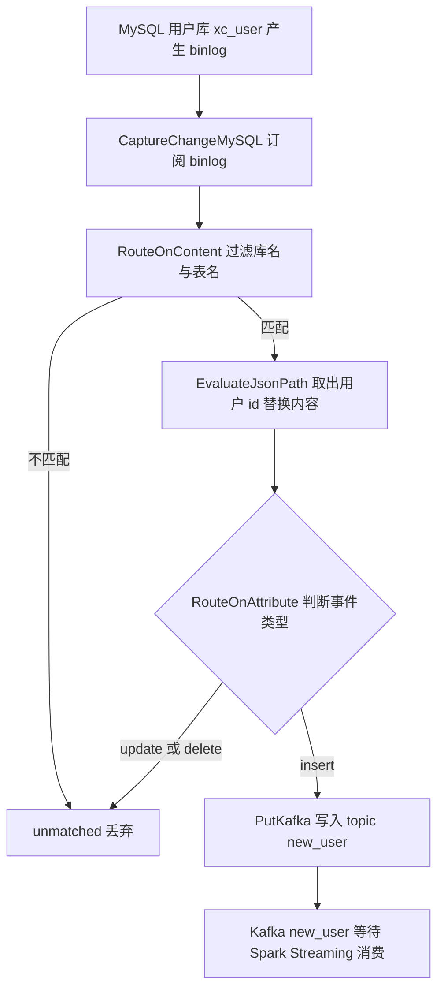
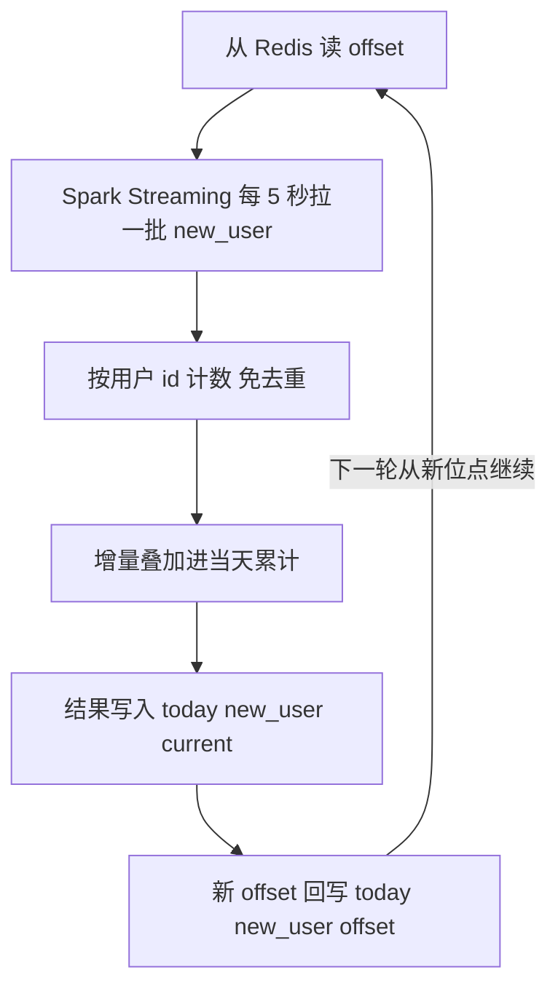
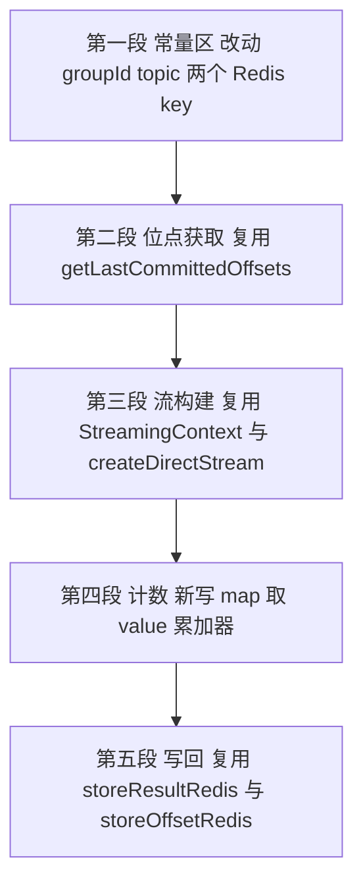
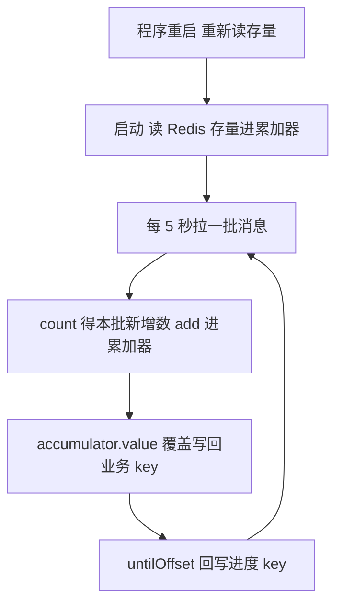
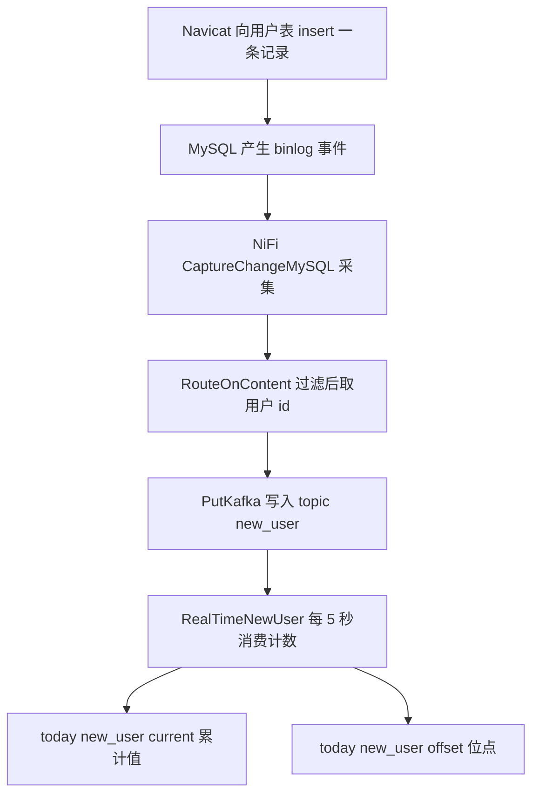
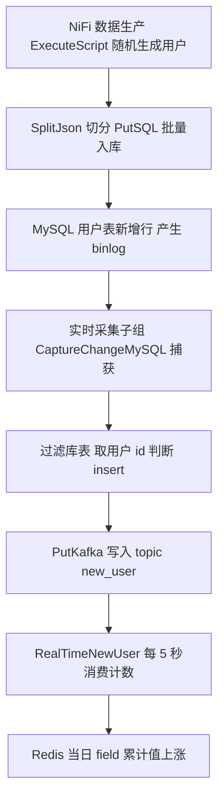

# 实时分析-新增用户量：从 binlog 采集到按条计数的复用式实现

> 🔒 安全提示：文中示例的口令/密钥均为课程教学环境演示口径，生产环境的安全要求见《安全与合规须知》。

## 先给结论

- 系列定位：智慧学成实时分析的第二个指标「新增用户量」，与今日访问量同骨架不同口径，主打把采集从页面埋点换成 binlog CDC。
- 口径：一条用户表 insert 就是一个新增用户，采集认数据库不认页面按钮；update 与 delete 不在口径内，统计的是注册动作数而非现存用户数。
- 采集链路五个处理器接力：NiFi 的 CaptureChangeMySQL 伪装从库订阅 binlog，过滤指定库表的 insert 事件，取出用户 id 推进 Kafka 的 `new_user` topic，消息体最小化。
- 统计逻辑仍是五步，唯一差异在第三步：用户 id 是数据库主键，消息天然不重复，免去重直接按条计数。
- 代码复用清单明确：位点管理、拉批、写回六段照搬，只改四个常量、checkpoint 目录与计数那几行；`map(_.value())` 后 `(x, 1)` 一行看懂计算核心。
- 测试三处对账：手动 insert 后 Redis 多出 `today::new_user::current` 与 `today::new_user::offset` 两把钥匙；首次启动计入 Kafka 存量属正常现象。
- 放量测试用 NiFi 生产子组批量造用户，ExecuteScript 生成、SplitJson 切分、PutSQL 批量插入，对账以数据库行数为准，界面计数仅供参考。
- 与今日访问量作业并行跑的注意点：业务值与位点独立 key、checkpoint 独立目录，两个作业互不污染。

## 第1部分：新增用户量开工：NiFi 盯住 MySQL binlog，注册一条就进 Kafka 一条

今日访问量走通之后，智慧学成的实时分析进入第二个指标：新增用户量。拿到需求先想清楚一件事，这个指标的数据从哪来。访问量的数据在用户浏览动作里，埋点脚本一触发就有；注册这件事却发生在业务库里，页面上点完按钮还要过后端校验，真正算数的时刻是数据库里多出一行用户记录。数据源变了，采集方案也得跟着换，这一课把新增用户量的口径与采集链路立起来。

### 指标先定口径：一条 insert 就是一个新增用户
新增用户量的讲义定义很干脆：今天用户实时注册的数量，实时统计分析数据展示。拆开看有两个关键点。

**「注册」的判定落在数据库。** 在线教育平台的用户注册，最终落成用户库 `xc_user` 库、`xc_user` 表里的一行 insert。用户名唯一性校验、密码加密这些动作都发生在后端，只有全部通过、事务提交成功，这行记录才会出现。把 insert 事件当作新增用户的信号，统计出来的就是真注册，而不是页面上的点击意图。

**「今天的」与「实时的」决定了存储形态。** 统计范围从当天 0 点起算，结果存 Redis 的固定 key `today::new_user::current`，按天切 field 累计，5 秒更新一次，形态与今日访问量如出一辙，下一课展开细节。

### 采集方案：从埋点换成 CDC
访问量采集走的是前端 JS 埋点加采集服务的链路，注册行为套不进这个模型：埋点脚本拿不到后端校验结果，也不该去模仿后端的落库动作。可靠的事实源在数据库自己手里，MySQL 的 binlog 是事务日志，凡是提交成功的写入一定记录在内，读 binlog 就是在读「数据库真正发生过什么」。

这种「捕获数据变更」的采集方式一般叫 CDC（Change Data Capture），NiFi 提供了现成的处理器 CaptureChangeMySQL，伪装成 MySQL 的从库订阅 binlog，把每一行变更解析成结构化事件吐出来。智慧学成的做法：监控用户表的 binlog，只要有 insert，也就是有新增用户数据，就把它采集过来放进 Kafka。

### 采集链路：五个处理器接力
课程资料里备好了模板「新增用户量-ToKafka-实时」，在 NiFi 里新建处理器组上传导入即可。模板里其实带两个子组，一个叫数据生产，负责往 MySQL 造测试用户，等统计代码写完再用；现在只配置另一个，实时采集子组。

采集链路里五个处理器依次接力，配置要点如下：

```text
CaptureChangeMySQL     监控 MySQL binlog，输出 CDC 事件 JSON
  |
过滤指定数据库和表      RouteOnContent：内容同时含 "database":"xc_user" 与
  |                     "table_name":"xc_user" 才放行，其余进 unmatched 丢弃
  |
获取用户id             EvaluateJsonPath：$.columns[0].value，
  |                     Destination 选 flowfile-content，内容被替换成用户 id
  |
Insert                 RouteOnAttribute：${cdc.event.type:equals('insert')}
  |                    为真走 insert 关系，update 与 delete 进 unmatched
  |
PutKafka               Known Brokers: xc-online-kafka:9092
                       Topic Name: new_user
```

每一站都在收窄数据。binlog 事件里带库表信息与整行数据，`columns` 数组的第一个元素就是用户 id，因为 id 是表的第一列；过滤站锁死库名表名，别的业务表的变更一律进不来；类型判断站只放行 insert，注册只发生在插入，update 改资料、delete 删号都不算新增；内容替换站让 Kafka 消息体正好是那个用户 id，下游统计按「一条消息一个新用户」计数就成立。



这张图把「海量 binlog 事件」收敛成「一条条用户 id」的过程画了出来：过滤站在中间挡掉了绝大多数流量，真正走到 Kafka 的只有用户表的 insert 事件。

### 起步配置：缓存服务与账号密码
CaptureChangeMySQL 有两处配置新手最容易漏。

**缓存服务必须先启用。** 处理器依赖 NiFi 的分布式缓存服务记录 binlog 消费进度，对应 DistributedMapCacheServer 与 DistributedMapCacheClientService 两个控制器服务。缓存服务端课程环境此前已经配好，采集处理器引用的是客户端服务，把客户端这一项启用即可，缺了它处理器启动就报错。

**MySQL 账号密码配在处理器上。** 读取 binlog 需要数据库账号，用户名 root、密码 123456，填在 CaptureChangeMySQL 的属性里，忘了填密码处理器起不来。环境前提是 MySQL 已开启 binlog 且格式为 ROW，课程环境均已就绪；换成自己搭的库，这两项要先确认。

### 验证：清场、插数、盯 topic
有个操作次序要注意。处理器一启动，会把 MySQL 实例上已有的全部 binlog 事件拉进队列，历史文件一多，队列里瞬间堆出几十万个与注册无关的 FlowFile。正确姿势是先启动让它读完，再停止处理器、Empty Queue 把队列清空，然后重新启动，此后进队列的才是新产生的变更。

接着用老办法验证链路。进入 Kafka 容器，起一个控制台消费者盯住 `new_user`：

```bash
# 进入 Kafka 容器
docker exec -it xc-online-kafka bash
# 切到 Kafka 安装目录的 bin 下（版本目录按环境实际为准）
cd /opt/kafka/kafka_2.11-2.2.0/bin
# 模拟消费者查看 topic 中的数据
./kafka-console-consumer.sh --bootstrap-server xc-online-kafka:9092 --topic new_user
```

消费者起来后会阻塞等待。到数据库客户端里复制用户表的一条记录改成 insert 执行，改掉主键 id 与用户名避免约束冲突，记录插入成功。回到 NiFi，队列里出现一个新的 FlowFile；切回 Kafka 终端，一条消息已经打印出来，内容正是刚插入的那条用户 id，与库里的值一致。到此，NiFi 采集 MySQL 新增用户数据写入 Kafka 的链路验证通过，新增用户量所需的数据采集就绪。

## 第2部分：新增用户量的统计逻辑：还是那五步，第三步免了去重

Kafka 的 `new_user` topic 里已经躺着一串串用户 id，接下来轮到统计程序登场。动手写代码前先把逻辑定清楚，这套逻辑与今日访问量高度同构：同样的五步骨架，唯一的分岔在第三步，访问量要按课程 id、sessionId、ip 三键去重，新增用户量直接按用户 id 计数。为什么这里敢免掉去重，是这一课最值得想透的问题，搞懂它，统计代码写起来只剩翻译工作。

### 先看结果存成什么样
统计分析的终点是业务系统随时能读的一个数，先把存储形态定下来，前面的每一步才有靶子。讲义给出的新增用户量 Redis 存储结构如下：

```scala
// Redis 中新增用户量业务 key：hash 结构，key 固定，field 按天变化
// 变量名沿用访问量工程的 rt_cv 前缀，值已切换为新增用户量
val rt_cv_key = "today::new_user::current"
// field 形如 new_user_date_2019-10-07，value 是当天累计新增用户量

// Redis 中 Kafka offset 进度 key：hash 结构
val rt_cv_offset = "today::new_user::offset"
// field 形如 new_user_0，value 是该分区已消费到的 offset
```

展开成内部结构一目了然：

```text
today::new_user::current        hash
  new_user_date_2019-10-07  ->  21      当天实时累计新增用户量，5 秒更新一次

today::new_user::offset         hash
  new_user_0               ->  1024     new_user 的 0 号分区已消费到 1024 的位置
```

业务 key 与今日访问量共用同一套设计哲学：key 永远不变，日期信息全放进 field，新的一天自然产生新的 field 从 0 累计，昨天的数字留在昨天的 field 里。进度 key 按分区记位点，与业务值分家，各自独立运维。

### 五步逻辑逐步走
**第一步，手动管理 Kafka 的 offset。** 消费起点不交给 Kafka 自动管理，启动时从 Redis 读上次保存的位点，没有就从 0 开始。防的还是那一手：Kafka 或 ZooKeeper 宕机都可能造成数据异常，位点一旦落进 Redis，不管哪个组件挂掉，重启后位点都不变，按位点取数就不会丢数据。

**第二步，Spark Streaming 获取 Kafka 中的用户行为数据，每 5 秒一次。** 拉数基于第一步拿到的位点进行，从上次消费到的位置继续往后读 5 秒内的新消息。`new_user` 的消息体就是用户 id，这一步不做任何解析切分，比访问量链路还省一层。

**第三步，根据用户 id，实时计算新增用户量。** 这是与访问量的分岔点。访问量要先按课程 id、sessionId、ip 组合键去重，因为同一次访问可能被重复上报、同一访客可能连续刷新；新增用户量的输入是用户 id，一个用户只会在注册那一刻产生一条 insert，id 又是主键，值天然唯一，直接计数就是准确答案，连 word count 里「同词归并」的活都不用干，只数条数即可。

**第四步，统计结果存 Redis，供业务使用。** 每轮算出的增量叠加进当天累计值，整体覆盖写回业务 key。展示端永远只读一个值，任何一轮失败，下一轮从回写的位点继续，累计值不会开天窗。

**第五步，Redis 中保存当前 offset 进度。** 这一批处理完，对应的 offset 就是新的消费位置，回写进度 key，下一轮从它起步。五步闭合成环，程序才有底气 7 乘 24 小时常驻。



这张图是五步的闭环：左边进位点，中间计数，右边出来业务值与消费进度两个产物，进度回写后箭头绕回起点。与访问量闭环图对比，中间那格从「三键去重」换成了「按 id 计数」，其余逐格相同，这正是骨架复用的样子。

### 免去重的底气从哪来
去重是有成本的：跨批次记状态、检查点落盘、状态恢复，每一项都是复杂度。能省掉它的前提，是数据在源头就已经保证唯一。

**数据库约束先顶了一道。** 用户表的主键是 id，同一 id 的第二次 insert 直接违反主键约束被拒；用户名还有唯一索引，撞名同样插不进去。测试时故意插入重复记录，数据库会立刻报错，根本产生第二条 binlog 事件。

**采集端只放行 insert。** 一行数据的一次插入只产生一条 binlog 事件，update 与 delete 在采集链路就被丢弃，不存在「同一个注册事件以其他形态二次出现」的通道。

**消费位点管住了重放。** 位点存 Redis、处理完才回写，正常情况下不会重读。即便程序重启导致极小范围重放，影响也只是把同一批 id 再数一遍，这类边界靠后续幂等设计兜底即可，主链路不必为它上重型的状态去重。

三道保障叠在一起，「按条计数」才从偷懒变成正确。反过来讲，如果哪天口径改成「统计当天去重后的注册设备」，输入不再唯一，去重就必须请回来，方案跟着口径走，不是跟着习惯走。

## 第3部分：RealTimeNewUser：复用今日访问量骨架，新增的有效代码只有计数那几行

统计分析逻辑定成五步之后，写代码变成了翻译题。打开工程里的 `RealTimeNewUser.scala`，第一眼几乎要怀疑拿错了文件：它和今日访问量的 `RealTimeVisit` 长得几乎一样。这不是偷懒，是刻意设计：五步里四步与访问量完全相同，工程里把重复代码原样搬过来，真正要写的只有第三步计数与几处常量。这一课把复用清单和改动点都点清楚，看完就能明白实时统计程序是怎么在一个骨架上长出一批指标的。

### 骨架复用清单
基础工程已经把相同代码抽取出来，主类结构分五段，与五步逻辑一一对应：



图里只有第四段是新的，加上第一段换常量、checkpoint 目录换路径，就是全部改动。逐段对照：

**原样照搬的部分。** `EtlEnvironment.getSparkConf` 拿 SparkConf，`RedisUtils` 初始化连接池并读回位点，`StreamingContext(sc, Seconds(5))` 建 5 秒微批，`kafkaParam` 四项配置，`KafkaUtils.createDirectStream` 直连消费，`foreachRDD` 提取 `offsetRanges` 回写位点。这些在访问量工程里逐行讲过，原理不变，搬家即可。

**换值不改形的部分。** groupId 与 topicName 都填 `new_user`；两个 Redis key 换成 `today::new_user::current` 与 `today::new_user::offset`；checkpoint 换成 `/user/hive/external/data_course/today_new_user/checkpoint`。有个细节要提醒：工程里这两个 Redis key 变量名沿用访问量的 `rt_cv` 前缀没改，值已经换成新增用户量，读代码时以值为准，别被名字带偏。

### 改动一：常量与位点起点
主类头部连同前两步的代码，注意四个常量的值：

```scala
package com.study.xc.analysis

import java.util.Date
import com.study.xc.common.EtlEnvironment
import com.study.xc.utils.DateUtils.getDateStr
import com.study.xc.utils.RedisUtils
import org.apache.kafka.clients.consumer.ConsumerConfig
import org.apache.kafka.common.serialization.StringDeserializer
import org.apache.spark.streaming._
import org.apache.spark.streaming.kafka010.{ConsumerStrategies, HasOffsetRanges,
  KafkaUtils, LocationStrategies}
import org.apache.spark.{SparkConf, SparkContext}

/**
 * 新增用户量 - 实时分析
 */
object RealTimeNewUser {
  // 初始化 sparkConf
  val sparkConf: SparkConf = EtlEnvironment.getSparkConf(this.getClass.getSimpleName)

  def main(args: Array[String]): Unit = {
    // 获取 spark context
    val sc = new SparkContext(sparkConf)
    // kafka 协议：地址、消费组、topic
    val bootstrapServers = "xc-online-kafka:9092"
    val groupId = "new_user"
    val topicName = "new_user"
    // redis 中新增用户量 key 与 offset key（变量名沿用骨架，值为新增用户量口径）
    val rt_cv_key = "today::new_user::current"
    val rt_cv_offset = "today::new_user::offset"

    // 1. 手动管理 kafka 的 offset（redis 中获取，没有从 0 开始）
    val redis = new RedisUtils
    redis.initRedisPool()
    val offsets = redis.getLastCommittedOffsets(rt_cv_offset, topicName, 1)

    // 2. Spark Streaming 获取 kafka 数据，每 5 秒一次
    val ssc = new StreamingContext(sc, Seconds(5))
    ssc.checkpoint("/user/hive/external/data_course/today_new_user/checkpoint")
```

topic 填 `new_user`，与 NiFi 采集端 PutKafka 的 Topic Name 一字不差，两边对不上程序只会空转。位点从 `today::new_user::offset` 读，分区数传 1，与采集端 topic 的单分区匹配。

### 改动二：按用户 id 计数
核心计算来了，一共三个动作：

```scala
    // kafkaParam 与 createDirectStream 与访问量相同，略
    val message = KafkaUtils.createDirectStream[String, String](
      ssc,
      LocationStrategies.PreferConsistent,
      ConsumerStrategies.Assign[String, String](offsets.keys.toList, kafkaParam, offsets)
    )

    // 3. 根据用户 id，实时计算新增用户量
    // 消息体就是用户 id，取 value 后每个 id 配 1
    val newUser = message.map(_.value()).map(x => (x, 1))
    // 共享变量：driver 端累加器
    val accumulator = sc.longAccumulator("newUser")
    // 组装 redis hash 字段：前缀固定，日期动态生成
    val keyInfo = "new_user_date_" + getDateStr(new Date().getTime, "yyyy-MM-dd")
    // 查看原来是否有值，有则作为累加器起点
    val valStr = redis.getResultRedis(rt_cv_key, keyInfo)
    if (null != valStr) {
      accumulator.add(valStr.toLong)
    }
```

三个动作各有讲究。`map(_.value())` 取出消息体，拿到的就是用户 id 字符串，没有切分、没有字段提取；`map(x => (x, 1))` 是 word count 的标志性写法，但在这里每个值只会出现一次，后一个 1 恒为 1，它真正的作用是把消息变成可数的形态；`longAccumulator` 是 driver 端的分布式累加器，先把 Redis 里当天的存量读进来作为起点，没有就保持 0，之后每批的条数往里加。

`keyInfo` 由固定前缀拼当天日期生成，对应业务 hash 里按天切换的 field。

### 写回与闭环：两段 foreachRDD
结果写回与位点推进，各占一个 `foreachRDD`：

```scala
    // 4. 统计结果存 redis，供业务使用
    newUser.foreachRDD(iter => {
      if (iter.count() > 0) {
        // 本批条数计入累加器
        accumulator.add(iter.count())
        // 累计值整体覆盖写回
        redis.storeResultRedis(rt_cv_key, keyInfo, accumulator.value.toString)
      }
    })

    // 5. redis 中保存当前 offset 进度
    message.foreachRDD(rdd => {
      if (!rdd.isEmpty()) {
        // 直连模式 RDD 自带分区范围
        val offsetRanges = rdd.asInstanceOf[HasOffsetRanges].offsetRanges
        offsetRanges.foreach(offsetRange => {
          val topic_partition_key = offsetRange.topic + "_" + offsetRange.partition
          redis.storeOffsetRedis(rt_cv_offset, topic_partition_key, offsetRange.untilOffset)
        })
      }
    })

    // 启动并等待结束
    ssc.start()
    ssc.awaitTermination()
  }
}
```

结果端用 `iter.count()` 数出本批消息条数，正是本批新增用户数，add 进累加器后把 `accumulator.value` 整体覆盖写回业务 key，空批次直接跳过。位点端与访问量的代码逐字相同：强转 `HasOffsetRanges` 拿分区范围，`topic_分区号` 组装 field，写回 `untilOffset`。

生产形态下程序不打 IDEA 直接跑，用 spark-submit 提交主类：

```bash
#!/usr/bin/env bash
SPARK_SUBMIT=/opt/spark/bin/spark-submit
$SPARK_SUBMIT \
  --master spark://xc-online-spark:7077 \
  --conf spark.executor.cores=1 \
  --total-executor-cores 1 \
  --class com.study.xc.analysis.RealTimeNewUser \
  /opt/run/jars/xc-service-rt-jar-with-dependencies.jar
```

### 原理：累加器为什么重启也不怕
统计的痛点是「每批算的是增量，展示要的是总量」，这段代码用一个简单的三段式解决：启动时读存量、每批加增量、写回总量。程序第一次启动，Redis 里当天没有值，累加器从 0 起算；运行中每 5 秒一批，累加器稳步上台阶；程序挂了重启，`getResultRedis` 读到的就是上次写回的总量，累加器从这个数继续，不会归零重算。

代价是 `keyInfo` 在启动时算了一次就固定了。程序当天启动当天跑没问题；跨天长跑时 field 不会自动切换，累计值会继续写进旧日期的 field。课程测试周期内无碍，生产化时把 `keyInfo` 的计算挪进 `foreachRDD` 按当前时间现算即可，这也是读真实代码时要留意的一类边界。



这张图是运行期的完整心跳：左边是启动与重启共用的人口，中间三步每 5 秒走一轮。重启那条虚线指回读存量，说明崩溃恢复的路径与冷启动是同一条，代码里不需要额外的恢复逻辑。

## 第4部分：新增用户量测试：手动插一条用户，Redis 里多出两把钥匙

统计代码写完不等于指标成立，得让真数据从 MySQL 一路走到 Redis 才算数。新增用户量的测试不需要 NiFi 造数器登场，注册本来就是低频真实行为，往用户表手动插几条记录，盯着 Kafka、程序日志和 Redis 三处，全链路通没通、数字准不准，一眼见分晓。这一课把测试步骤、该看什么现象、两个容易吓到人的细节讲清楚。

### 测试链路总览
测试是四段接力，任何一段断了，Redis 里的数字都不会动：



图的起点是手动插入，终点是 Redis 的两个 key。核对结果时按这条链路找断点：Kafka 有消息说明前三段通，Redis 有值说明统计程序通，数字对不对得上再看累加逻辑。

### 让上下游先跑起来
**采集端保持运行。** NiFi 里的实时采集处理器组此前已经启动，直接让它继续跑，不用动。要动的只有数据生产子组，测试阶段用不上，保持停止状态。

**统计程序在 IDEA 里启动。** 直接运行 `RealTimeNewUser` 主类，IDEA 会先编译打包，稍等片刻。日志里出现读取 checkpoint 目录的记录，就说明流上下文建好、位点读回成功，程序进入每 5 秒一轮的循环。这时它已经在监听 `new_user`，只是还没有新消息进来，静默是正常状态。

### 准备测试数据
讲义里备好了一条插入语句，直接在数据库客户端执行：

```sql
INSERT INTO `xc_user`.`xc_user`(`id`, `username`, `password`, `salt`, `name`,
  `userpic`, `utype`, `birthday`, `sex`, `email`, `phone`, `qq`, `ip`, `status`,
  `create_time`, `update_time`, `last_password_reset_date`)
VALUES ('0005ddcc3e2341ddb0d0709e68c0', 'fc35905212ff4f4bbcb06e98b99a', 'Tvqm',
  NULL, '测试', NULL, '101001', NULL, NULL, NULL, NULL, NULL, '158.222.112.75',
  '1', '2019-08-11 18:44:04', NULL, NULL);
```

字段不用全懂，关键是主键 id 与 username 两列的值要保证没出现过，后续换着花样插时改这两列即可。执行成功后，binlog 里就多了一条 insert 事件，链路开始流动。

### 三个位置核对结果
**第一处，Kafka。** 需要的话进容器起控制台消费者确认采集是否送达：

```bash
# 需要在 kafka bin 目录执行
./kafka-console-consumer.sh --bootstrap-server xc-online-kafka:9092 --topic new_user
```

插入一条数据，终端立刻打印出这条用户 id，id 与库里的值一致，说明采集链路无恙。

**第二处，Redis。** 用 Redis 客户端（课程环境用 RedisView）连接后刷新，原来的两个 key 变成了四个：

```text
today::course_visit::current     今日访问量业务值（原有）
today::course_visit::offset      今日访问量位点   （原有）
today::new_user::current         新增用户量累计值（新出现）
today::new_user::offset          新增用户量位点   （新出现）
```

`today::new_user::current` 的值随插入实时上涨，每插一条，下一个 5 秒窗口内就能看到数字加一；`today::new_user::offset` 同步推进，位点与已消费的消息对齐。

### 两个现象背后的门道
**现象一：current 与 offset 一上来就不是 0。** 测试看到累计值直接停在 21，别慌，这是采集测试阶段留下的存量。此前验证链路时已经插过若干测试用户，那些消息一直躺在 `new_user` 里；统计程序第一次启动从位点 0 开始消费，把存量一并计算进累计值，于是起点就是一个有零有整的数。offset 同理，第一次回写的就是消费完存量后的位置。想从干净的 0 开始测，先清 topic 消息与 Redis 里这两个 key，再启动程序。

**现象二：故意插重复数据，数字纹丝不动。** 换着方式验证约束：把同一条记录原样再插一次，数据库报主键重复；只改 id 不改 username，报用户名唯一索引冲突；两列都改掉，插入才成功，几秒后 current 从 21 涨到 22。这个实验反向证明了口径的可靠性：数据库的两道约束把「同一个用户被插两次」挡在门外，Kafka 里永远不会有重复的用户 id，统计端的按条计数才敢写得那么简单。

### 与今日访问量作业并行跑的注意点
真实运行时，新增用户量与今日访问量两个 Spark Streaming 作业是同时常驻的，互不踩踏靠的是四套独立命名，测试时也逐项核对：

- **topic 独立。** 访问量消费 `visit_topic`，新增用户量消费 `new_user`，各自是独立的数据源，不会抢消息。
- **Redis key 独立。** 业务值与位点都各占两个 key，写错 key 会把两个指标的数字搅在一起，排查时先核对 key 字面值。
- **checkpoint 目录独立。** `today_new_user/checkpoint` 与访问量的目录分开，共享检查点会让状态序列化互相覆盖。
- **消费组独立。** groupId 各用各的名字，监控页面上能认出每股消费是谁。

资源层面，两个作业共用一个 Spark 集群与一个 Redis 实例，本地测试量级无所谓；上集群提交时留意 executor 核数与内存的分配，别让一个作业把资源吃光。测试顺序上先起采集再起统计程序，程序启动时读不到数据只会空转等，反过来则可能漏掉启动间隙产生的消息。

## 第5部分：新增用户量放量测试：NiFi 批量造注册数据，Redis 数字跟着数据库走

手动往用户表一条条插数据，验证链路够用，验证规模不行。统计程序要面对的是一天成百上千的注册量，批量场景下位点推进、批次累加、写回频度全都会放大，小流量测不出问题。这一课把 NiFi 里的数据生产子组启用起来，让它当一台「注册机」，批量生成用户写进在线教育平台的用户库；采集与统计两头一行代码都不用改，Redis 的当日数字跟着数据库行数走，新增用户量指标就此闭环。

### 数据生产子组登场
「新增用户量-ToKafka-实时」模板导入时就带着两个子组，一个叫数据生产，一个叫实时采集。当时统计代码还没写，数据生产先按下了暂停键，只用实时采集验证了「插一条、Kafka 到一条」。现在统计程序已经常驻运行，造数子组正好接上：它负责往用户库批量塞用户，塞进去的每一行都会变成 binlog 事件，被实时采集子组原样捕获送进 Kafka。数据从「手动一条」升级成「批量一批」，统计端无感知，这正是采集与计算分层带来的好处。

### 两步配置启动造数
**第一步，补 MySQL 连接池。** 造数的终点是写库，链路末端的 PutSQL 依赖一个名为 MySQL连接 的连接池服务（类型 DBCPConnectionPool），导入模板后它处于 Disabled 状态，缺的属性只有密码：用户 root、密码 123456，这是课程环境的既定口令，补完把服务启用，状态从 Disabled 翻成 Enabled。

**第二步，启动处理器组。** 其余属性模板里都已配好，处理器上的黄色告警消失后直接启动整组。造数子组的流程不长，核心三站：

```text
ExecuteScript   执行 Python 脚本，随机生成一批用户对象拼成 JSON 数组
  |
SplitJson       把 JSON 数组按行切开，一个用户一条记录
  |
PutSQL          逐条 insert 进在线教育平台的用户表
```

中间若还有字段处理站，以模板实际连线为准，参数都是现成的。值得看一眼的是 ExecuteScript 的脚本本体，它跑在 NiFi 自带的 Jython 引擎里，语法按 Python 2 写：

```python
# 循环上限 random.randint(10, 50) 控制本轮生成条数：随机 10 到 50 条，按需修改
for i in xrange(1, random.randint(10, 50)):
    id = str(uuid.uuid4()).replace("-", "")
    username = str(uuid.uuid4()).replace("-", "")
    name = random.choice(a1) + random.choice(a2) + random.choice(a3)
    ip = str('.'.join(str(random.randint(1, 255)) for i in xrange(4)))
    create_time = datestamp()
    obj = {}
    obj['id'] = id
    obj['username'] = username
    obj['name'] = name
    obj['ip'] = ip
    obj['create_time'] = create_time
    arr.append(obj)
# 整批 JSON 一次性写回，交给下游切分入库
outputStream.write(bytearray(json.dumps(arr), encoding='utf-8'))
```

随机部分各有讲究：id 与 username 都取 uuid4 去掉连字符，保证不撞用户表的主键和用户名唯一索引；姓名从三个字符池里各取一个拼出来；ip 随机四段；注册时间由 `datestamp()` 在当前时间基础上随机回退。一轮生成多少条由 `random.randint` 的上下限决定，讲义注明可以按需修改。

### 批量启动与三本账对账
每启动一轮处理器组，用户表里就多出随机 10 到 50 条用户。有个现象要提前打预防针：NiFi 界面上处理器旁显示的计数，测试时先后跳出 33、64、91 这类数字，与脚本设定的 10 到 50 区间对不上，不必纠结，显示层的毛病不影响数据，对账以数据库为准。验证动作很朴素：造数前记下用户表行数，造数后刷新，差值就是本轮入库条数。

Redis 那头同步见涨。统计程序全程没动，它常驻消费 `new_user`，每来一批就在 5 秒窗口内累加写回。当日 `new_user_date_` 前缀的 field 从 133 一路涨到 160，再到某轮造数后刷新停在 199。199 比数据库当前行数多 1，这 1 不是误差：测试中途删过一条用户数据，它的 insert 早已被采集统计收编，而 delete 不在采集口径里，数据库行数少了、Redis 数字不回退。这个差值反过来印证了口径的准确性，统计数的是「发生过多少次注册动作」，不是「现存多少用户」。



这张图把造数、采集、统计三段串成了一个环：数据生产子组只负责往环里灌原料，环上的其余环节与手动插数据那次完全相同。三本账对上，数据库行数、Kafka 消息量、Redis 累计值一致，新增用户量在批量流量下的表现就算验收通过。

## 常见误区

- **以为前端埋点也能采注册。** 错例：在注册页面埋点，点了按钮就算新增用户。正解：点击不等于注册成功，校验失败的用户不该进统计，注册的事实只认用户表的 insert。
- **把 binlog 全量涌入当成故障。** 错例：启动后看到队列瞬间堆满 FlowFile 就到处找报错。正解：CaptureChangeMySQL 首次启动会读实例上的历史 binlog，清空队列再重启即可，之后只进增量。
- **过滤器只锁表名不锁库名。** 错例：RouteOnContent 里只匹配 `table_name`。正解：库名与表名要一起匹配，多个库里存在同名表时会采进无关数据。
- **消息体大小写写岔。** 错例：NiFi 端 topic 写成大写，消费端读小写，程序空转没有数据。正解：PutKafka 的 Topic Name 与 Spark 消费端保持一字不差，本课统一为 `new_user`。
- **以为免去重是偷工减料。** 错例：觉得访问量去了重，这个指标也照搬一套组合键。正解：唯一性已由主键与采集口径保证，重复加去重不提升准确性，只增加状态维护成本。
- **把 field 写成固定字符串。** 错例：`new_user_date_` 后面写死一个日期。正解：后缀按当天日期动态生成，格式 `yyyy-MM-dd`，跨天才会自动切 field 从零累计。
- **业务值与位点混存一个 key。** 错例：把 offset 塞进业务 hash 图省事。正解：两者生命周期不同，业务 key 按天换 field，进度 key 按分区记位点，分开存各自可独立清理与运维。
- **把展示值当成 5 秒内的瞬时注册数。** 错例：看到 5 秒更新一次，就把 field 值理解成本轮新增。正解：field 存当天累计总量，5 秒只是它的刷新频率。
- **把消息体当 JSON 解析。** 错例：照搬访问量代码先按分隔符切字段。正解：采集端已把内容替换成纯用户 id，直接 `map(_.value())` 计数即可。
- **额外加 reduceByKey 去重。** 错例：担心重复又套一层按 key 去重。正解：用户 id 由主键保证唯一，去重是无用功；真要防重复，防线在采集端位点，不在计算端。
- **checkpoint 目录沿用访问量的。** 错例：目录忘了改，两个作业共用同一检查点，状态互相污染。正解：每个作业独立目录，本课为 `today_new_user/checkpoint`。
- **keyInfo 只在启动时算一次还上线长跑。** 错例：跨天后累计值写进昨天的 field。正解：长跑程序在每轮写回前按当前时间现算 field。
- **Redis key 的值被变量名误导。** 错例：看到 `rt_cv_key` 以为写的是访问量，排查时找错 key。正解：以字面值为准，`today::new_user::current` 才是本作业的读写目标。
- **看到 current 不为 0 就以为算错。** 错例：第一次启动数字是 21，判定程序有 bug。正解：首次消费会连同 Kafka 存量一起计入，先想清楚测试数据的历史，再判断对错。
- **以为重复造数能推高数字。** 错例：反复插入同一条记录，期待 Redis 涨得更快。正解：主键与唯一索引拦下重复插入，binlog 里根本没有新事件，数字不动才是正确表现。
- **只看 Redis 不看采集端。** 错例：Redis 数字不动就直接怀疑统计代码。正解：按链路排查，控制台消费者能最快区分「采集没送到」与「程序没算对」。
- **统计程序先于采集启动就判定失败。** 错例：程序启动后没日志没数据，认定挂了。正解：无消息时程序静默等待是常态，插入一条数据验证即可。
- **拿界面计数当入库条数。** 错例：处理器显示 64 就认定入库 64 条，反复重启想凑数。正解：显示值与脚本设定区间对不上属显示层问题，刷新数据库行数拿差值才算数。
- **把 Redis 比数据库多 1 当成 bug。** 错例：199 对 198，怀疑统计重复计数。正解：中途删过的那行，insert 早已计入、delete 不在口径内，统计的是注册动作数不是现存用户数。
- **造数子组的连接池没启用就启动整组。** 错例：导入模板后直接开跑，PutSQL 全部报错，队列堆满失败记录。正解：先给 MySQL 连接池补密码并启用服务，告警清零再启动。
- **跑一轮就下结论。** 错例：看到数字涨了就收工。正解：多跑几轮、穿插手动插入，验证位点推进与累加在连续批次下不丢不重。

## 面试可能被问到的问题

1. 面试官追问：「采集注册数据，为什么选 binlog CDC 而不是业务代码发消息？」
   答：CDC 对业务零侵入，不用改注册代码，也不怕业务方漏发；binlog 是数据库提交成功后才有的日志，天然保证「进了日志的注册一定落库成功」。业务发消息则要处理发送失败、重复发送等问题，链路多一截，可靠性反而更难保证。

2. 面试官追问：「CaptureChangeMySQL 为什么需要分布式缓存服务？」
   答：处理器伪装成 MySQL 从库订阅 binlog，需要持久记录自己读到了哪个 binlog 文件的哪个位置，重启后从上次的位置继续，不重不漏。NiFi 用分布式缓存服务存这类状态，所以服务端与客户端要配好并启用。

3. 面试官追问：「binlog 有 statement、row、mixed 三种格式，CDC 采集要求哪种？」
   答：ROW 格式。statement 格式记的是 SQL 语句，解析不出具体行的数据；row 格式记录每一行变更前后的完整数据，CaptureChangeMySQL 解析出的 columns 数组正来源于此。mixed 格式会在两种模式间切换，同样不可靠。

4. 面试官追问：「update 和 delete 事件为什么直接丢弃？」
   答：新增用户量的口径只统计注册，注册在用户表上只表现为 insert。update 是改资料，delete 是删号，都不产生新用户，过滤掉口径才干净。

5. 面试官追问：「Kafka 里的消息体为什么只放用户 id，不放整行数据？」
   答：这个指标的统计只需要知道「来了一个新用户」，id 唯一且够用，把内容替换成 id 后，消息体最小，消费端按条计数即可。若后续指标需要注册来源、渠道等字段，再扩大消息体也不迟。

6. 面试官追问：「新增用户量统计为什么不需要去重，依据是什么？」
   答：输入消息体是用户 id，id 是数据库主键，一条 insert 只在提交成功时产生一条 binlog 事件，采集端又只放行 insert，所以同一 id 不会重复出现在消息流里。唯一性在源头成立，统计端按条计数即为准确值。

7. 面试官追问：「如果业务方 Bulk insert 一次插入一千个用户，统计逻辑要改吗？」
   答：不用改。批量插入会产生一千条行级 binlog 事件，CaptureChangeMySQL 按行输出，Kafka 里仍是一千条消息，计数逻辑不变。要留意的只有采集吞吐与 5 秒批的处理时长是否跟得上。

8. 面试官追问：「跨天 0 点的瞬间，统计会出问题吗？」
   答：field 由当天日期动态生成，0 点后第一轮统计写的是新日期 field，从 0 开始累计，旧 field 保留最终值可供回看。需要确认的只有一点：field 的计算时机要在每轮写入时现算，而不是程序启动时算一次，否则长跑程序跨天后会继续写旧 field。

9. 面试官追问：「统计结果为什么写 Redis 而不是写 MySQL 或 Hive？」
   答：结果 5 秒覆盖更新一次，展示端高频轮询读取，是典型的高频小值写、高并发读。Hive 面向批处理不适合频繁覆盖写，MySQL 这种节奏浪费连接与行锁，Redis 的 hash 单 field 覆盖写与读取都是亚毫秒级，正好匹配。

10. 面试官追问：「这五步逻辑里，哪一步失败对数据的影响最小？」
   答：第三步计数是纯内存计算，失败即本批作废，等下一批位点重拉即可，几乎无影响；影响最大的是第五步位点回写失败，重启后会重读上一批，配合按条计数会把存量重复累计，所以位点回写要与结果写入放在同轮处理，尽量同时成功。

11. 面试官追问：「新增用户量和今日访问量两套统计代码，怎么评估哪些能复用？」
   答：先看逻辑差异，五步里位点管理、拉批、写回、进度推进与指标无关，天然可复用；只有与口径绑定的环节（去重键、计数方式、key 命名）需要换。工程上把可复用段固化成骨架，新指标只实现差异段，新增用户量总共就改了常量、检查点与第三步计数。

12. 面试官追问：「这里为什么用累加器而不是 reduceByKey 聚合后再写？」
   答：展示要的是当天累计总量，reduceByKey 只能算出单批内的聚合，跨批状态还得另存。累加器在 driver 端持有全天累计，启动时读 Redis 存量、每批加增量，天然承担跨批状态，配合覆盖写回实现幂等。

13. 面试官追问：「累加器在什么情况下会重复累加？」
   答：foreachRDD 里的行动操作若被 Spark 因任务失败重试执行，累加器可能重复 add。本工程每批只做一次 count 行动，窗口小；严格不重的做法是把位点回写与结果写入绑成一个事务语义，或用幂等写（按天 field 覆盖）让重复执行不改变最终值。

14. 面试官追问：「消息体只放用户 id，如果后续要按注册渠道拆分指标怎么办？」
   答：把采集端消息体升级成 id 加渠道的结构化串，消费端切字段后按渠道分组计数，Redis 按渠道扩 field。骨架不动，变的仍是口径绑定的差异段。

15. 面试官追问：「为什么 StreamingContext 每 5 秒一个批，而不是来一条算一条？」
   答：看板类指标秒级延迟足够，微批模型用固定的调度节拍换吞吐与稳定，还能与 Kafka 拉取、位点提交天然对齐。毫秒级场景才需要纯流引擎，本项目统一选 Spark Streaming 也让三个指标共用一套运维。

16. 面试官追问：「统计程序重启后把 Kafka 存量重算了一遍，这种设计是对是错？」
   答：取决于位点状态。位点在 Redis 里时，重启从上次提交的位置继续，不会重算；只有首次启动或位点被清空时才会从 0 全量消费。全量消费配合按 id 唯一的输入，结果仍是正确累计，但要确认这批存量确实属于当前统计周期，否则需要在启动前清理或校准位点。

17. 面试官追问：「怎么验证一个实时指标的数据是准的？」
   答：分段核对。采集端用控制台消费者看消息内容与条数；计算端对照插入条数与 5 秒窗口内 current 的增量；再和数据库里当天新增记录数对总账。三层都对上，链路才算可信。

18. 面试官追问：「两个实时作业共用一个 Redis，会互相影响吗？」
   答：逻辑上不会，业务值与位点各自独立 key，读写互不相干。物理上共享连接数与内存，指标多了以后要关注连接池占用与单 key 热点，必要时拆实例或做读写分离。

19. 面试官追问：「测试时往用户表插数据，会不会污染在线教育平台的业务数据？」
   答：测试库要与环境隔离，课程环境是专用的测试实例。真实平台上应使用带测试前缀的账号或独立测试库，测完清理，避免脏数据流进业务报表。

20. 面试官追问：「如果 NiFi 采集停了一小时，期间的注册会丢吗？」
   答：CaptureChangeMySQL 自身持久记录 binlog 位点，重启后从上次位置继续读，一小时的 binlog 还在 MySQL 里，事件不会丢，只是延迟到达。真正的风险是 binlog 被清理或保留期太短，生产上要保证 binlog 保留时长大于故障恢复窗口。

21. 面试官追问：「批量造数为什么选 NiFi，而不是写存储过程或用压测工具？」
   答：NiFi 的脚本节点能直接生成结构化数据并落库，与采集流程在同一个画布里编排，造数与采集的启停、观察共用一套界面；存储过程要进数据库维护，压测工具偏协议层。对这类数据面任务，NiFi 的可视化与模板复用成本最低。

22. 面试官追问：「统计程序面对批量入库，为什么数字仍然逐条准确？」
   答：批量入库在 binlog 里仍是一行一个 insert 事件，采集端逐事件送 Kafka，统计端逐条计数；批量只改变了到达速率，不改变事件粒度。位点按批次推进，5 秒窗口把速率差异消化掉。

23. 面试官追问：「删除用户会不会把新增用户量减回去？」
   答：不会。采集口径只放行 insert 事件，delete 不进 Kafka，统计的是当天发生过的注册动作数，不是现存用户数。这个口径要在需求评审时与业务对齐，若业务要的是净增，就得把 delete 也采集进来做减法。

24. 面试官追问：「放量测试时怎么区分是统计慢了还是采集断了？」
   答：分段看。Kafka 控制台消费者的打印速率代表采集吞吐，Redis 当日值的上涨节奏代表统计吞吐，数据库行数做总账；哪一段的速率与数据库新增对不上，瓶颈就在哪一段。

## 配套资料

- 讲义：`materials/docs/08/智慧学成-第4章-实时分析.md`，1.2.2 给出新增用户量的指标定义，3.1 数据采集一节给出采集流程、过滤库表配置、Kafka 配置与测试步骤的原文。
- 资料：`materials/code/08/_散落资料/`，新增用户量 NiFi 采集模板（含数据生产与实时采集两个子组）在散落资料目录中，内层文件名带站点后缀，按规范不在正文引用，按用途自取。
- 讲义：`materials/docs/08/智慧学成-第4章-实时分析.md`，3.2.1 统计分析逻辑给出五步规则原文，1.2.2 与 1.3.2 给出新增用户量的指标定义与 Redis 存储结构表。
- 说明：Scala 工程源码未随资料包归档，key 常量与存储结构以讲义代码为准整理，包名与工具类按课程工程 `com.study.xc` 系改写；计算逻辑的具体写法在下一课代码部分展开。
- 讲义：`materials/docs/08/智慧学成-第4章-实时分析.md`，3.2.2 统计分析代码给出 `RealTimeNewUser.scala` 全文（常量、位点、计数、写回与 ssc.start），5.2.2.2 给出 `real_time_new_user.sh` 提交脚本原文。
- 资料：`materials/code/08/_散落资料/`，新增用户量实时分析的 spark-submit 调度脚本在散落资料目录中（内层文件名带站点后缀，按规范不在正文引用）。
- 说明：Scala 工程源码未随资料包归档，代码以讲义与画面线为准整理，包名与工具类按课程工程 `com.study.xc` 系改写；`RedisUtils` 与 `EtlEnvironment` 的接口签名与今日访问量工程一致。
- 讲义：`materials/docs/08/智慧学成-第4章-实时分析.md`，3.2.3 测试一节给出启动采集、运行代码、手动插入数据、Redis 查看结果的步骤与插入 SQL 原文，3.1.4 为采集端测试步骤。
- 资料：`materials/code/08/_散落资料/`，新增用户量实时分析的提交脚本与 NiFi 模板在散落资料目录中（内层文件名带站点后缀，按规范不在正文引用）。
- 说明：测试用的插入语句以讲义为准整理；Redis 查看工具课程环境使用 RedisView，换用其他客户端不影响核对方式。
- 讲义：`materials/docs/08/智慧学成-第4章-实时分析.md`，3.3 NiFi 生产数据（3.3.1 生产数据脚本、3.3.2 NiFi 调度、3.3.3 测试）给出造数脚本与「随机生成 10 到 50 条」的控制说明原文。
- 资料：`materials/code/08/_散落资料/`，新增用户量 ToKafka 实时流程模板（含数据生产与实时采集两个子组）与新增用户造数 Python 脚本在散落资料目录中，内层文件名带站点后缀，按规范不在正文引用，按用途自取。
- 说明：造数脚本以讲义原文为准摘录；处理器连线的中间站以模板实际配置为准；包名与工程命名按课程工程 `com.study.xc` 系。
