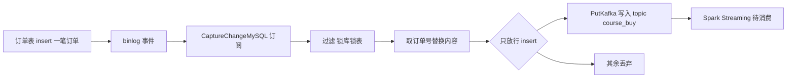
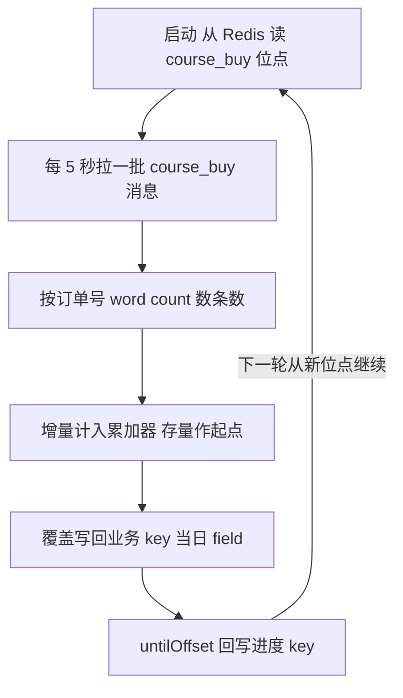
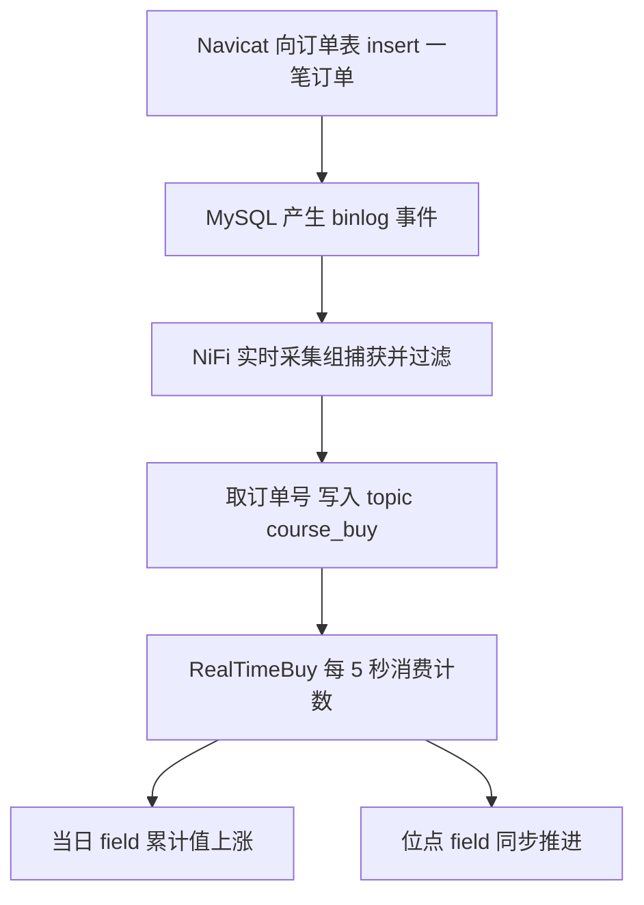

# 实时分析今日购买量全流程：订单 binlog 进 Kafka，SparkStreaming 计数进 Redis

> 🔒 安全提示：文中示例的口令/密钥均为课程教学环境演示口径，生产环境的安全要求见《安全与合规须知》。

## 先给结论

- 口径一句话：一条订单表 insert 就是一笔购买；监控对象是在线教育平台订单库 `xc_order` 里的订单表 `xc_orders`。
- 采集链路与新增用户量同构，换库换表不换骨架：topic 换成 `course_buy`，消息体是订单号 `order_number`，唯一且够用，下游按条计数。
- 统计逻辑五步与新增用户量逐字相同，唯一换词：计数对象从用户 id 换成订单号；代码整体复制改名，主类结构、位点管理、写回逻辑一字未动。
- 必改清单六项：groupId 与 topicName 换 `course_buy`、两个 Redis key 换 `today::course_buy::current` 与 `today::course_buy::offset`、checkpoint 换 `today_course_buy/checkpoint`、keyInfo 前缀、累加器名；复制漏改的重灾区是 checkpoint 与 Redis key，两个作业互踩会数字串台。
- 测试四步走：NiFi 实时采集组保持运行、IDEA 启动 `RealTimeBuy`、手动向订单表插单、Redis 核对结果；首次启动会把 Kafka 存量一并计入，属正常起点不是 bug。
- 三作业并行的隔离四件套：topic、Redis key、checkpoint、groupId 全部按指标独立，各占各的 key 组；集群形态用 real_time_buy 脚本提交并限核。
- 万级端到端验证复用离线造数链路：查课程 id、脚本把每粒 id 放大成上百条订单、`PutSQL` 写回业务库订单表；造数只对落库负责，进不进 Kafka 是采集链路的事。
- 对账口径：停止生产后指标定格 16663，等于手动测试攒下的 3 条加本轮量产的 16660 条，账目分毫不差；订单时间随机回退但统计 field 用运行当天日期组装，历史日期不参与落位。

## 第1部分：今日购买量开工：订单表的 binlog 一响，订单号就进 Kafka

今日访问量盯浏览，新增用户量盯注册，智慧学成的第三个实时指标今日购买量盯的是成交：用户买了课，看板上的数字就要动。这个指标与前两个同属「数据库里发生的事实」，采集方案照旧走 CDC，换的只是库表与 topic。这一课把订单数据的采集链路立起来，并完成首条订单从插库到进 Kafka 的端到端验证。

### 口径：一条订单 insert 就是一笔购买

今日购买量的讲义定义是：今天用户实时购买课程的数量，实时统计分析数据展示。三个实时指标的判定时刻各不相同：访问量在页面动作里，新增用户量在用户表的 insert 里，购买量在订单表的 insert 里。购买动作最终落成订单库 `xc_order` 中订单表 `xc_orders` 的一行记录，订单号、价格、用户 id、课程明细都在这行里。把 insert 当作购买的信号，统计出来的就是真实成交；页面上点了「立即购买」却没走到落库的，一律不算。

订单表上后续还有状态流转，支付、完成之类的变化都是 update，本口径一律不采：一笔购买在表上只发生一次 insert，状态怎么变都不会多出一笔。这个选择让采集端极简，也让统计端敢按条计数，代价是口径含义固定为「成交笔数」，与「支付成功笔数」这类口径的区别要在需求层面对齐。

### 采集链路：换库换表不换骨架

与新增用户量同一套打法，五站接力，换的只有过滤条件与下游 topic：

```text
CaptureChangeMySQL     订阅 MySQL binlog，输出 CDC 事件 JSON
  |
过滤库表               RouteOnContent 同时匹配订单库与订单表才放行
  |
获取订单号             EvaluateJsonPath 取 $.columns[0].value，
  |                    订单表第一列是 order_number，内容替换成订单号
Insert 判断            RouteOnAttribute 只放行 insert，update 与 delete 进 unmatched
  |
PutKafka               写入 topic course_buy
```



这张图与新增用户量的采集图几乎重合，差别只在两处标注：过滤站锁的是订单库订单表，发送站写的是 `course_buy`。消息体为什么只放订单号，理由与用户 id 那次完全一致：这个指标只需要知道「又成交一笔」，订单号唯一，按条计数即可，整行数据对下游是负重。

### 模板导入与两处配置

NiFi 的实时分析处理器组下新建子组今日购买量，上传「今日购买量-ToKafka-实时」模板添加进来。组内同样是数据生产与数据采集两个子组，本课处于采集阶段，生产子组留到放量测试再用。配置只动两处，而且都做过一遍：DistributedMapCacheClientService 缓存客户端启用，服务端此前已就绪，点启用确认即可；CaptureChangeMySQL 的属性里补 MySQL 密码，root 配 123456。过滤串与 Kafka 的 broker、topic 配置模板里都已写好，感兴趣可以点进各处理器核对，`course_buy` 三个字母与后面统计程序要消费的 topic 必须一字不差。

### 清场与首单验证

老坑要重提一遍：处理器首启会把 MySQL 实例上的历史 binlog 全部读一遍，课程库里积攒的历史事件数以万计，队列瞬间堆满与订单无关的 FlowFile。正确姿势照旧：启动后让它把存量读完，界面能看到它还在逐条读取；等全部处理器进入停止状态，停止处理器组，Empty Queue 清空队列，这次一口气移除了 7967 个 FlowFile、8.83 MB；再重新启动，此后进队列的才是新产生的变更。

验证分三步。进 Kafka 容器起控制台消费者盯住 `course_buy`：

```bash
# 在 Kafka 容器的 bin 目录执行
./kafka-console-consumer.sh --bootstrap-server xc-online-kafka:9092 --topic course_buy
```

消费者阻塞等待。到数据库客户端向订单表插一条测试订单，插入语句用讲义备好的这条：

```sql
INSERT INTO `xc_order`.`xc_orders`(`order_number`, `initial_price`, `price`,
  `start_time`, `end_time`, `status`, `user_id`, `details`, `old_status`)
VALUES ('00042b809c2e8ec1b5a9fc7403093796', NULL, 1201.00, '2019-10-08 09:22:03',
  '2019-10-08 09:22:03', '401002', '7f3561356b44405b82f757ae59c6afa1',
  '[{\"orderNumber\": \"00042b809c2e8ec1b5a9fc7403093796\", \"itemId\": \"004eb7dd620842a3b143c4e313ab5a6a\", \"itemNum\": 1, \"itemPrice\": \"217\"}]', NULL);
```

执行返回 affected rows: 1，NiFi 队列立刻多出一个 FlowFile，Kafka 终端同步打印出一条消息。核对内容：消息开头是 00042、结尾是 3796，正是插入 SQL 里订单号的首尾两截，库里的订单号与 topic 里的消息一一对应。到此，订单数据实时采集进 Kafka 的链路验证通过，今日购买量所需的原料就位，下一课写统计程序。

## 第2部分：RealTimeBuy：复制新增用户量的代码，改动收敛在一张改名清单里

Kafka 的 `course_buy` 里已经躺着一串串订单号，轮到统计程序登场。动手前先看清一个事实：今日购买量与新增用户量的采集同源（都出自 binlog）、消息同形（都是一个唯一 id）、五步逻辑同构，代码重合度接近百分之百。这一课的做法就是把 `RealTimeNewUser.scala` 复制一份改成 `RealTimeBuy.scala`，把心思全花在一张改名清单上：哪些必须改，哪些改了才叫见名知意，哪些不改反而要留神。

### 逻辑：还是五步，第三步换了对象

统计规则按讲义原文过一遍：手动管理 Kafka 的 offset，从 Redis 取保存的位点，没有就从 0 开始；Spark Streaming 获取 Kafka 中的用户行为数据，每 5 秒一次；根据订单 id 实时计算今日购买量；统计结果存 Redis 供业务使用；Redis 中保存当时 offset 进度。与新增用户量的五步一字不差，唯一分岔在第三步的计数对象：用户 id 换成订单号。订单号是业务主键，一笔订单在订单表上只发生一次 insert，采集端又只放行 insert，消息天然不重复，直接 word count 数条数就是准确答案。

结果存储同步换血，结构设计与另两个指标完全一致：

```text
today::course_buy::current        hash
  course_buy_date_2019-10-07  ->  累计值      当天实时购买量，5 秒更新一次

today::course_buy::offset         hash
  course_buy_0               ->  位点        course_buy 0 号分区的消费进度
```

key 固定、field 按天切换，新的一天产生新 field 从零累计，昨天的数字留在昨天的 field 里。



这张图就是运行期的心跳，五个节点对应五步规则，闭环一圈 5 秒。累加器起步时读 Redis 存量，崩溃重启走同一条入口，累计值不会归零。

### 改名清单与主类骨架

改动全部在命名层，对照清单逐项过：

| 位置 | 新增用户量 | 今日购买量 |
|---|---|---|
| 类名 | `RealTimeNewUser` | `RealTimeBuy` |
| groupId | `new_user` | `course_buy` |
| topicName | `new_user` | `course_buy` |
| 业务 key | `today::new_user::current` | `today::course_buy::current` |
| 位点 key | `today::new_user::offset` | `today::course_buy::offset` |
| checkpoint | `today_new_user/checkpoint` | `today_course_buy/checkpoint` |
| keyInfo 前缀 | `new_user_date_` | `course_buy_date_` |
| 累加器名 | `newUser` | `courseBuy` |

主类头部连同前两步，注意六个常量的值：

```scala
package com.study.xc.analysis

import java.util.Date
import com.study.xc.common.EtlEnvironment
import com.study.xc.utils.DateUtils.getDateStr
import com.study.xc.utils.RedisUtils
import org.apache.kafka.clients.consumer.ConsumerConfig
import org.apache.kafka.common.serialization.StringDeserializer
import org.apache.spark.streaming._
import org.apache.spark.streaming.kafka010.{ConsumerStrategies, HasOffsetRanges,
  KafkaUtils, LocationStrategies}
import org.apache.spark.{SparkConf, SparkContext}

/**
 * 今日购买量 - 实时分析
 */
object RealTimeBuy {
  // 初始化 sparkConf
  val sparkConf: SparkConf = EtlEnvironment.getSparkConf(this.getClass.getSimpleName)

  def main(args: Array[String]): Unit = {
    // 获取 spark context
    val sc = new SparkContext(sparkConf)
    // kafka 协议：地址、消费组、topic
    val bootstrapServers = "xc-online-kafka:9092"
    val groupId = "course_buy"
    val topicName = "course_buy"
    // redis 中今日购买量 key 与 offset key（变量名沿用骨架，值为购买量口径）
    val rt_cv_key = "today::course_buy::current"
    val rt_cv_offset = "today::course_buy::offset"

    // 1. 手动管理 kafka 的 offset（redis 中获取，没有从 0 开始）
    val redis = new RedisUtils
    redis.initRedisPool()
    val offsets = redis.getLastCommittedOffsets(rt_cv_offset, topicName, 1)

    // 2. Spark Streaming 获取 kafka 中的用户行为数据，每 5 秒获取一次
    val ssc = new StreamingContext(sc, Seconds(5))
    ssc.checkpoint("/user/hive/external/data_course/today_course_buy/checkpoint")
```

topicName 填 `course_buy`，与 NiFi 采集端 PutKafka 的 Topic Name 一字不差；位点分区数传 1，与采集端 topic 的单分区匹配。变量名 `rt_cv` 前缀来自今日访问量工程，三个指标都在沿用，读代码时以字面值为准。

### 计数与写回

第三步是唯一与口径绑定的计算段，kafkaParam 与 createDirectStream 两段与新增用户量相同，略去：

```scala
    // 3. 根据订单 id，实时计算今日购买量
    // 消息体就是订单号，取 value 后每个订单配 1
    val courseBuy = message.map(_.value()).map(x => (x, 1))
    // 共享变量：driver 端累加器
    val accumulator = sc.longAccumulator("courseBuy")
    // 组装 redis hash 字段：前缀固定，日期动态生成
    val keyInfo = "course_buy_date_" + getDateStr(new Date().getTime, "yyyy-MM-dd")
    // 查看原来是否有值，有则作为累加器起点
    val valStr = redis.getResultRedis(rt_cv_key, keyInfo)
    if (null != valStr) {
      accumulator.add(valStr.toLong)
    }
```

结果写回与位点推进两段 foreachRDD 也与新增用户量逐字相同，只是聚合变量换成了 `courseBuy`：

```scala
    // 4. 统计结果存 redis，供业务使用
    courseBuy.foreachRDD(iter => {
      if (iter.count() > 0) {
        accumulator.add(iter.count())
        redis.storeResultRedis(rt_cv_key, keyInfo, accumulator.value.toString)
      }
    })
    // 5. redis 中保存当前 offset 进度：强转 HasOffsetRanges 取分区范围，
    //    topic_分区号 组装 field，写回 untilOffset，与新增用户量相同
```

写回段每批把 `iter.count()` 计入累加器后整体覆盖写回，空批次跳过；位点段处理完才推进，空批次不写。到这里代码改完，累计值落进 `today::course_buy::current`，报表系统随时可读。

### 复制的边界：三件要心里有数的事

**第一，漏改的代价不对称。** 变量名不改只是不好读；checkpoint 与 Redis key 不改是事故。两个 StreamingContext 共用检查点会把流状态互相覆盖，两个作业写同一个业务 key 会让两个指标共享一个数字，症状是日志全对、结果全错，排查时极难定位。改名清单里 checkpoint 与两个 key 三项，值得在复制后先改、改完先核。

**第二，重合度该有个期限。** 三个指标写完，同样的五步已经抄了三遍，第三遍之后味道就变了。真要继续扩指标，方向是把骨架抽成公共父类或模板方法，把可变部分（groupId、topic、key 前缀、计数函数）收敛成参数，新指标只传配置。课程工程保留复制式写法，是为了让每个指标的代码完整可见、逐课可讲；工程化时怎么取舍，取决于口径变化的频率与团队规模。

**第三，见名知意是给未来的自己。** 累加器名从 `newUser` 换成 `courseBuy`、注释从「根据用户 id」改成「根据订单 id」，这些改动不影响运行，却决定了半年后翻代码的人能否三秒看懂这段在算什么。复制改名式开发的收尾动作，就是把所有与人有关的命名过一遍。

## 第3部分：今日购买量测试：三笔订单插进去，Redis 第三组 key 亮起来

统计代码是从新增用户量复制改名的，测试就必须回答一个问题：改出来的东西真的对吗？测试流程与新增用户量那次同构，但这次是三个实时作业并存的日子，多出来的看点有两个：一是首次启动消费存量后的对账口径，二是三个指标在同一个 Redis、同一个 Spark 集群里并行不踩踏的隔离清单。

### 测试链路总览



图的起点是手动插单，终点是 Redis 第三组 key。核对时沿这条链找断点：Kafka 有消息说明前三段通，Redis 有值说明统计程序通，数字对不对再对总账。

### 四步操作

**采集端保持运行。** 今日购买量的实时采集处理器组在采集验证那一步已经启动过，让它继续跑；数据生产子组保持停止状态，测试用不上。

**手动插单。** 测试 SQL 沿用采集验证那条，唯一要动的是订单号这类唯一值，不改就会撞主键约束、插入失败：

```sql
INSERT INTO `xc_order`.`xc_orders`(`order_number`, `initial_price`, `price`,
  `start_time`, `end_time`, `status`, `user_id`, `details`, `old_status`)
VALUES ('00042b89c2e8cc1b5a9f7c40393796', NULL, 1201.00, '2019-10-08 09:22:03',
  '2019-10-08 09:22:03', '401002', '7f3561356b44405b62f757ae59c6af1',
  '[{\"orderNumber\": \"00042b89c2e8cc1b5a9f7c40393796\", \"itemId\": \"004eb7dde20842a3b143c313ab5a6a\", \"itemNum\": 1, \"itemPrice\": \"217\"}]', NULL);
```

订单号换了一串新值，用户 id 也顺手换掉，执行返回 affected rows: 1 即插入成功。

**运行代码。** IDEA 里直接运行 `RealTimeBuy`，日志出现读取 checkpoint 目录的记录即就位，程序进入每 5 秒一轮的循环，没有新消息时静默等待。

**核对 Redis。** 刷新后第三组 key 出现：

```text
today::course_visit::current      今日访问量累计值（原有）
today::course_visit::offset       今日访问量位点   （原有）
today::new_user::current          新增用户量累计值（原有）
today::new_user::offset           新增用户量位点   （原有）
today::course_buy::current        今日购买量累计值（新出现）
today::course_buy::offset         今日购买量位点   （新出现）
```

`course_buy` 的 current 显示 2：采集验证时插过一笔订单，本轮又插一笔，统计程序首启从位点 0 消费，存量两笔一起计入。再插一笔，几秒内 current 涨到 3，offset 的 field 同步推进到新位置。数字、点位、节奏全部符合预期，复制改名的代码验收通过。

### 对账口径与放量延伸

首启值不为 0 的道理在新增用户量测试里讲过，换成订单的账本再演一遍：Kafka 里躺着的是采集上线以来发生过的每一笔订单 insert，统计程序第一次启动位点为 0，存量一起进累计值。想从干净的 0 开始测，先清 topic 消息与 Redis 里这两个 key 再启动；想验证累计逻辑，就把历史笔数一并算进预期值。

手动插单适合验逻辑，验规模还是造数。讲义在今日购买量一节给了批量方案：第 3 章离线分析做过的课程购买量生产处理器组可以直接拿来用，脚本每轮随机生成 100 到 500 笔订单直接写库，订单号与用户 id 用 uuid 撑开唯一性，价格在区间内随机。造数与采集两头一开，购买量指标就能在大流量下跑出曲线，累计值与数据库新增行数按轮对账即可，方法与新增用户量放量测试时完全一样。

### 三作业并行与集群提交

到此为止，今日访问量、新增用户量、今日购买量三个 Spark Streaming 作业已经可以在同一环境并行常驻。互不踩踏靠的是命名隔离，逐项盘点：

- **topic 三条。** `visit_topic`、`new_user`、`course_buy`，各听各的数据源，不会抢消息。
- **Redis key 六把。** 三个指标各有 current 与 offset，写错 key 就把两个指标的数字搅在一起，排查时先核对 key 字面值。
- **checkpoint 三目录。** `today_course_buy/checkpoint` 与另外两个作业分开，检查点是流状态的家，混用即互相覆盖。
- **消费组三名。** groupId 各用各的，监控与排障时按名定位。

本地 IDEA 三开测试无碍；生产形态下用 spark-submit 提交，提交一次常驻运行。课程配套的启动脚本：

```bash
#!/usr/bin/env bash

SPARK_SUBMIT=/opt/spark/bin/spark-submit

$SPARK_SUBMIT \
  --master spark://xc-online-spark:7077 \
  --conf spark.executor.cores=1 \
  --total-executor-cores 1 \
  --class com.study.xc.analysis.RealTimeBuy \
  /opt/run/jars/xc-service-rt-jar-with-dependencies.jar
```

`--total-executor-cores 1` 把每个作业的核数限住，三个常驻作业不至于互相饿死。jar 包放容器 `/opt/run/jars` 目录，脚本放 `/opt/run/script` 目录并 `chmod +x` 加执行权限。停的时候进容器用 `jps` 找到 SparkSubmit 进程再处理，位点与状态分别落在 Redis 与 checkpoint 里，重启接着跑。启动顺序上先起采集再起统计程序，反过来可能把启动间隙产生的消息漏在位点之外；并行运行时三个作业的日志分开看，谁的 Redis key 不动就查谁。

## 第4部分：复用离线造数链路批量产订单：今日购买量的万级端到端验证

验证今日购买量的统计逻辑时，用的是手动往业务库插订单，三条数据足够证明代码是对的，撑不起规模验证：采集链路扛不扛得住持续涌入、统计程序长跑稳不稳定、Redis 数值涨上去之后账还对不对，都要靠量说话。这一课把数据源换成 NiFi 批量生产，造数流程在第三章离线分析里已经完整拆解过，这里把处理器组复用起来，产出的订单写进业务库，订单表的 binlog 采集链路把每一条 insert 捕进 Kafka，常驻的统计程序按 5 秒一批消化，今日购买量一路涨到一万六千多，整条链路的规模化验证一次完成。

### 复用第三章的造数链路

今日购买量的生产数据不需要从零画。第三章离线分析做过「课程购买量 NiFi 生产数据」，整套处理器组本来就是给业务库批量造订单用的，落点是业务库的订单表，这个落点对实时链路同样正确：真实生产里订单就产生在业务库，分析侧的数据永远从业务库流出来，造数对准业务库，实时采集才有真实的 binlog 可捕。实操上把那套处理器组复制一份放进实时分析的分组里重新配置即可，效果一样；前面导入今日购买量采集模板时，生产与采集本来就在同一个 XML 里，一次导入两边都齐了。

整条链路从课程库出发，终点是 Redis 的今日购买量：

```mermaid
flowchart LR
    M["MySQL 课程库 course_base"] --> Q["QueryDatabaseTable 查课程 id"]
    Q --> E["ExecuteScript 造订单 JSON 数组"]
    E --> S["SplitJson 切成单条订单"]
    S --> R["ReplaceText 拼 INSERT 语句"]
    R --> P["PutSQL 写业务库订单表"]
    P --> B["binlog 采集链捕获 insert"]
    B --> K["Kafka topic course_buy"]
    K --> A["RealTimeBuy 常驻统计"]
    A --> D["Redis 今日购买量"]
```



图里前五站是造数链，与第三章离线分析用的那套同构；后四站是前面已经配置并测试过的实时链路，采集盯着订单表的 binlog，统计程序常驻消费。这一课真正要动的只有造数链的配置。

配置动作围绕一个控制器服务展开。流程里的 `QueryDatabaseTable` 负责查课程 id，`PutSQL` 负责写订单，两者引用同一个名为 Mysql连接 的连接池，启用界面里能看到这两个引用方。连接池三项：URL 指向课程库 `jdbc:mysql://xc-online-mysql:3306/xc_course`，驱动 jar 给绝对路径，用户 root、密码 123456。读的课程表在 `xc_course` 库，写的订单表在 `xc_order` 库，`PutSQL` 的语句里写了全限定表名，一个连接池跨库读写并不冲突。密码忘了配或者服务忘了启用，两个处理器直接校验失败，这条链一点数据都产不出来，这也是本课最容易踩的一个坑。

### 造数脚本：一粒课程 id 长出一批订单

`ExecuteScript` 跑在 Jython 引擎里，脚本核心是两段：`datestamp()` 造随机历史时间，`process()` 把输入的一行课程 id 放大成一批订单：

```python
def datestamp():
    # 当前时间随机回退 1 到 60 天，转成秒级时间戳
    now_info = datetime.datetime.now()
    delta = datetime.timedelta(random.randint(1, 60))
    time_info = now_info - delta
    for_time = time_info.strftime('%Y-%m-%d %H:%M:%S')
    times = int(time.mktime(time.strptime(for_time, '%Y-%m-%d %H:%M:%S')))
    return times

class PyStreamCallback(StreamCallback):
    def process(self, inputStream, outputStream):
        course_id = IOUtils.toString(inputStream, StandardCharsets.UTF_8)
        arr = []
        for i in xrange(1, random.randint(100, 500)):
            order_id = str(uuid.uuid4()).replace("-", "")
            user_id = str(uuid.uuid4()).replace("-", "")
            pay_status = 401002
            pay_price = random.randint(1000, 2000)
            course_price = random.randint(100, 500)
            obj = {}
            obj['itemId'] = str(course_id)
            obj['itemNum'] = 1
            obj['itemPrice'] = str(course_price)
            obj['orderNumber'] = order_id
            dist = {}
            dist['order_number'] = order_id
            dist['price'] = str(pay_price)
            dist['status'] = str(pay_status)
            dist['order_time'] = str(datestamp())
            dist['user_id'] = user_id
            dist['details'] = json.dumps([obj])
            arr.append(dist)
        outputStream.write(bytearray(json.dumps(arr), encoding='utf-8'))
```

每粒课程 id 随机产出百余到数百条订单：订单号与用户 id 都是去掉横杠的 uuid，订单号天然唯一，后续统计按条数累加不会出现同单多计；状态固定 401002 这个已支付口径，价格在设定区间随机；课程明细压成 JSON 塞进 `details` 字段。字段与真实订单表一一对应，采集与统计两端感知不到数据是造出来的。

订单切成单条后由 `ReplaceText` 拼插入语句，时间字段要做一次转换：

```sql
INSERT INTO `xc_order`.`xc_orders`(
    `order_number`, `price`, `start_time`, `end_time`,
    `status`, `user_id`, `details`)
VALUES (
    '${order_number}', '${price}',
    FROM_UNIXTIME('${order_time}'), FROM_UNIXTIME('${order_time}'),
    '${status}', '${user_id}', '${details}');
```

秒级时间戳经 `FROM_UNIXTIME` 转成 datetime 再入库，`start_time` 与 `end_time` 先填同一个值，测试数据不需要时间区间；`PutSQL` 攒批提交，写库效率比单条高一个量级。

### 全链路核对：三个位置对一本账

配置就位后启动造数链。采集链路与统计程序都已在运行，不需要再动：统计程序消费的是 topic，不是某个数据源，Kafka 有数它自动接上。启动后 NiFi 队列肉眼可见地流动，业务库订单表的行数往上蹿，一千多、两千多、三千多地涨；统计程序每 5 秒拉一批，Redis 的 `today::course_buy::current` 当日 field 跟着一批一批抬高，中途看一眼已经九千多，刷新一下一万二，再刷一万三、一万五。量够之后停掉造数链，队列里还有存量在消化，等 `PutSQL` 与采集把尾巴跑完，数值定格在 16663。

这个数字能对账。手动验证阶段插过 3 条订单，本轮 NiFi 量产 16660 条，3 加 16660 正好 16663：业务库每条 insert 产生一条 Kafka 消息，统计端每条消息计一，订单号全新不重复，三层各环节都是一比一的传递，末端数值自然精确到个位。比量级对账更硬的是这种能精确收口的账目，它同时证明了造数链的完整落库、采集链的零丢失捕获、统计端的如实累加。

有一个衔接细节值得留意：binlog 采集只读它启动之后的变更，如果采集晚于造数启动，要确认采集的 binlog 起点位覆盖了造数时段，否则前几分钟的订单会漏算。本轮测试里采集早已就位，16660 条一条不少。

日期口径再说破一次。脚本生成的 `order_time` 回退 1 到 60 天，而统计端组装当日 field 用的是程序运行当天日期，数据自带的时间在这个指标里不参与落位，所以一万六千多条历史日期的订单全部记在今天的头上。测规模这个口径没问题，生产上凡是按数据时间分桶的指标，必须在程序里按数据日期组装 field 或分区。

## 常见误区

- **把状态流转当购买。** 错例：订单支付成功的 update 落库后，期待采集端也送一条消息。正解：口径只认 insert，update 与 delete 不进 topic；要按支付口径统计得改采集判断与消息结构。

- **首启全量涌入当成故障。** 错例：队列瞬间堆满 FlowFile 就停掉一切找报错。正解：这是在补读历史 binlog，读完、清队列、重启即恢复增量，与新增用户量那次的处理完全一样。

- **过滤串只锁表不锁库。** 错例：RouteOnContent 只匹配 `xc_orders`。正解：库名与表名一起匹配，多个库里存在同名表时会把无关变更采进来。

- **消息体当整行 JSON 用。** 错例：下游想解析订单明细，发现内容只是个订单号。正解：EvaluateJsonPath 已把内容替换成 `$.columns[0].value`，指标只需要订单号；要明细就得改采集端的取值配置。

- **checkpoint 目录忘了改。** 错例：复制后直接跑，两个作业读同一检查点，状态互相覆盖。正解：对照清单逐项过，`today_course_buy/checkpoint` 单独成目录。

- **Redis key 漏改或双冒号写成单冒号。** 错例：key 写成单冒号分隔，与展示端约定对不上，值写进了没人读的地方。正解：三方（采集、统计、展示）约定一字不差，本课统一双冒号。

- **把消息体当订单 JSON 解析。** 错例：以为 Kafka 里是整行订单数据，写了一堆切字段逻辑。正解：消息体就是订单号字符串，`map(_.value())` 后直接计数。

- **groupId 留着 new_user。** 错例：消费组名没换，监控页面上认不出哪个作业是谁。正解：groupId 与指标同名 `course_buy`，排查时按名定位。

- **插单忘换订单号。** 错例：原样重跑上一轮 SQL，主键冲突插入失败，误判链路挂了。正解：先看执行返回的 affected rows，插入失败先修数据再查链路。

- **首值 2 当成多算。** 错例：本轮只插了 1 笔，Redis 显示 2，判定重复计数。正解：存量还有采集验证那 1 笔，首启全量消费是既定口径。

- **复制代码漏改 key 或 checkpoint。** 错例：日志正常、插单正常，`course_buy` 的值却不动。正解：按隔离清单逐项核对 topic、Redis key、检查点目录、消费组名。

- **三个作业本地同时开跑抢资源。** 错例：内存吃紧、批次调度超时，怀疑代码有死循环。正解：本地错峰测试；集群形态用脚本限核提交，资源分配交给 `--conf` 与 `--total-executor-cores` 控制。

- **连接池配一半就启动。** 错例：URL 与驱动填了，密码漏了，或者服务没启用，处理器全部带感叹号，队列堆满报错。正解：root 配 123456、驱动绝对路径、服务启用，三样齐了再启动。

- **停了造数就立刻读数。** 错例：停掉处理器组后马上看 Redis，发现数值还在涨，怀疑统计程序失控。正解：队列里有存量，`PutSQL` 与采集消化完之前数值继续上涨属正常，尾巴跑完才定格。

- **期待订单按自身日期落位。** 错例：造出来的都是历史日期，以为统计会把它们分到各自的日期去。正解：当日 field 用运行日期组装，历史日期不参与落位，这是测试口径。

- **把重复造数当成统计出错。** 错例：造数链跑了两轮，Redis 翻倍，以为是重复消费。正解：每轮脚本都生成全新 uuid 的订单号，业务库看到的就是两轮新订单，统计如实累加；真实业务里的幂等要靠订单号去重来保证。

## 面试可能被问到的问题

1. 面试官追问：「订单数据在第 3 章已经采过一次进 Hive，这次又要进 Kafka，两条链路怎么组织？」
   答：离线与实时各自独立成链：离线链路按调度批量抽取入仓，实时链路盯 binlog 进 Kafka。数据源同库，但口径与时效不同，分开维护比硬凑一条通用链路清晰；代价是同一份业务数据两套采集，规模上来后可考虑 CDC 统一出口再分道。

2. 面试官追问：「消息体为什么只放订单号？」
   答：今日购买量只数笔数，订单号唯一且长度小，消息体最小化让 Kafka 吞吐与消费端解析都最省。后续要按课程、金额维度拆分时，再把明细字段加进消息或另起 topic，骨架不变。

3. 面试官追问：「订单先生成后支付，购买量会不会把未支付的也算进去？」
   答：会。本口径以订单生成为准，insert 即计一笔，不区分支付与否。若业务要求支付成功才算，采集端在 insert 判断后追加状态字段校验，或改听支付结果事件，统计端不用动。

4. 面试官追问：「NiFi 消费 binlog 的位点存在哪，丢了会怎样？」
   答：存在 NiFi 的分布式缓存服务里，记录读到哪个 binlog 文件的哪个位置。位点不可靠时，处理器重启可能重放一段 binlog，同一笔订单的 insert 重复进 Kafka，按条计数就会多计。课程环境单机测试无碍；生产上要么保证缓存服务持久可靠，要么在消费端按订单号做带状态的去重。

5. 面试官追问：「三个实时指标代码高度相似，你会怎么治理重复？」
   答：先看量级与变化频率：两三份重复、口径稳定，复制可接受且直观；规模继续扩大就抽骨架，位点管理、流构建、写回做成模板方法，指标差异收敛成配置。课程工程保留复制式写法让每个指标完整可见，工程化时再按变化频率决定是否配置化。

6. 面试官追问：「订单号作为计数键，出现重复消息怎么办？」
   答：正常链路下订单号唯一且 CDC 每行变更只发一次，位点机制保证不重不漏。异常重放会让同一订单号出现两条消息，按条计数会多计；防线在采集端位点的可靠性，必要时消费端按订单号做带状态的去重，代价是多一份状态存储。

7. 面试官追问：「今日购买量要区分下单和支付成功，代码要动哪里？」
   答：动采集端。在 insert 判断后追加订单状态字段的校验，或者把状态带进消息，统计端按状态过滤；统计骨架不用动，变的仍是口径绑定的差异段，这正是五步骨架分层的价值。

8. 面试官追问：「为什么 checkpoint、Redis key、groupId 都要按指标隔离？」
   答：三者都是状态的落点。checkpoint 存流计算状态，Redis key 存业务值与位点，groupId 决定 Kafka 的消费分配。任何一个被两个作业共享，状态就会互相覆盖或混流，数字错得毫无规律，隔离是流式多作业的第一纪律。

9. 面试官追问：「三个实时作业并行，共享一个 Redis 和一个 Spark 集群，怎么保证互不影响？」
   答：逻辑隔离靠命名四件套，topic、Redis key、checkpoint、groupId 全按指标独立；物理隔离靠资源限额，提交时限制 executor 核数与内存。规模再往上按指标拆应用与 Redis 实例，监控上每个作业单独看批次延迟与位点滞后。

10. 面试官追问：「订单取消或退款了，购买量要不要减？」
   答：当前口径统计的是成交笔数，insert 计数不含负向动作，取消退款都不会减值。业务若要净购买量，需要把订单状态变更也采集进消息，统计端按最新状态重算，或者另立一个指标；口径先对齐，再动代码。

11. 面试官追问：「首次启动全量消费存量消息，什么时候是特性什么时候是事故？」
   答：位点位点是判据。位点从 0 开始且存量属于当前统计周期，全量计入是正确行为；位点意外丢失导致重放旧数据，就会把历史消息重复计入。生产要保证位点 key 的持久与备份，启动前的位点检查纳入运维手册。

12. 面试官追问：「这个统计程序离生产可用还差什么？」
   答：补运维面：field 的日期跨天现算、作业告警与批次延迟监控、位点滞后看板、失败恢复演练；再补口径面：与业务确认订单状态、退款的处理策略。代码骨架已经闭环，缺的是工程化外围。

13. 面试官追问：「离线分析的造数链路为什么能直接复用到实时链路？」
   答：造数的落点没有变，始终是业务库的订单表。离线与实时的分岔点在采集之后：离线走文件落盘进数仓，实时走 binlog 进 Kafka。造数只对落库负责，下游怎么分流它不关心，所以换个下游链路，造数侧一行不用改。

14. 面试官追问：「你怎么证明最终那个 16663 是正确的？」
   答：按数据流向逐段对账。业务库订单表新增行数、Kafka 里 `course_buy` 的消息量（临时消费者或消费组 lag 都能看）、Redis 指标值，三个位置应该一致。这一轮 3 条手动加 16660 条量产，末端精确收口，说明采集与统计都没有丢、也没有多。

15. 面试官追问：「造的订单时间是历史日期，为什么全算到今日？」
   答：统计程序组装当日 field 用的是运行当天日期，数据自带时间不参与落位，这是测试期接受的口径。生产上凡按时间维度统计，都要在程序里用数据自身时间组装 field 或分区，两者混用会造成口径错乱。

16. 面试官追问：「一分钟灌进上万条订单，链路会不会被打垮？」
   答：各段都有缓冲。MySQL 批量写扛入库，binlog 是顺序追加的日志，采集端读得再快也不阻塞业务库；Kafka 在采集与计算之间削峰，Spark Streaming 固定 5 秒一批消费。峰值抬高的是消费延迟而不是数据丢失，背压最终体现在 Kafka 的 lag 上，追得上就没问题。

17. 面试官追问：「如果需求改成只统计已支付的订单，链路哪里动？」
   答：采集侧只按库表过滤，不带业务语义，过滤放统计端更合适：消费到消息后按 status 字段判断，非已支付直接跳过。本课造数把状态统一写成已支付的 401002，等于在源头保证了口径，真实数据里这个过滤逻辑必须显式存在。

## 配套资料

- 讲义：`materials/docs/08/智慧学成-第4章-实时分析.md`，1.2.3 给出今日购买量的指标定义，4.1 数据采集一节（4.1.1 采集流程、4.1.4 测试）给出采集逻辑、模拟消费者命令与订单插入 SQL 原文。

- 资料：`materials/code/08/_散落资料/`，今日购买量 ToKafka 实时流程模板在散落资料目录中（含数据生产与实时采集两个子组），内层文件名带站点后缀，按规范不在正文引用，按用途自取。

- 说明：五站链路与取值路径按新增用户量模板的同构配置整理，中间站参数以模板实际配置为准；MySQL 口令按课程环境如实（root/123456）。

- 讲义：`materials/docs/08/智慧学成-第4章-实时分析.md`，4.2.1 统计分析逻辑给出五条规则原文，4.2.2 给出 `RealTimeBuy.scala` 全文，1.3.3 给出今日购买量的 Redis 存储结构。

- 资料：`materials/code/08/_散落资料/`，今日购买量实时分析的 spark-submit 调度脚本（real_time_buy）在散落资料目录中（内层文件名带站点后缀，按规范不在正文引用）。

- 说明：Scala 工程源码未随资料包归档，代码以讲义与画面线为准整理，包名按课程工程 `com.study.xc` 系改写；`RedisUtils` 与 `EtlEnvironment` 的接口签名与新增用户量工程一致。

- 讲义：`materials/docs/08/智慧学成-第4章-实时分析.md`，4.2.3 测试给出启动采集、手动插入订单、运行代码、Redis 查看结果的步骤原文，4.3 NiFi 生产数据给出复用第 3 章订单生产处理器组的批量方案。

- 资料：`materials/code/08/_散落资料/`，今日购买量的 spark-submit 提交脚本（real_time_buy）与订单造数相关 NiFi 模板在散落资料目录中，内层文件名带站点后缀，按规范不在正文引用，按用途自取。

- 说明：提交脚本以散落资料原文为准，包名按课程工程 `com.study.xc` 系改写；Redis 查看工具课程环境使用 RedisView，换用其他客户端不影响核对方式。

- 讲义：`materials/docs/08/智慧学成-第4章-实时分析.md`，4.3 NiFi 生产数据（生产数据脚本、NiFi 调度、测试）为本课出处，4.2 统计分析节含 RealTimeBuy 的 Redis key 设计与计数逻辑，5.2.2.3 节为集群形态的 spark-submit 提交脚本。

- 资料：`materials/code/08/_散落资料/`，今日购买量的 ToKafka 实时模板与实时统计分析调度模板、real_time_buy.sh 提交脚本都在该目录（内层文件名带站点后缀，属元信息，按用途自取）。

- 说明：包名按课程工程 `com.study.xc` 系改写；MySQL 口令 root/123456 为课程环境实配；生产脚本与插入语句出自课程资料，Scala 工程源码未随资料包归档，涉及实现细节以讲义文本为准。
