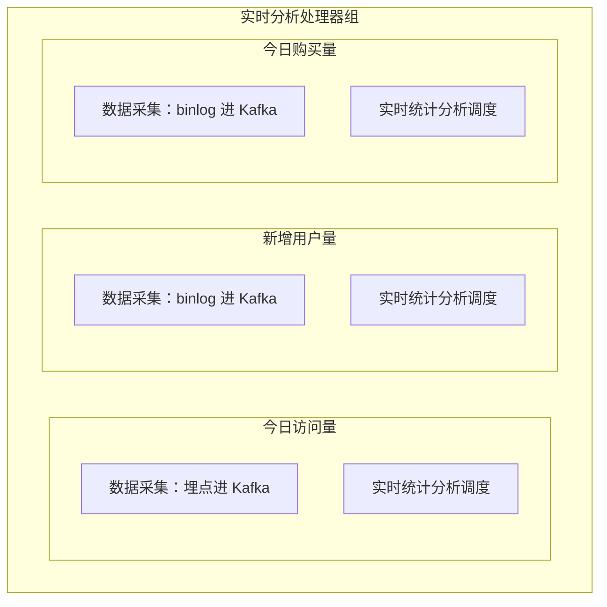
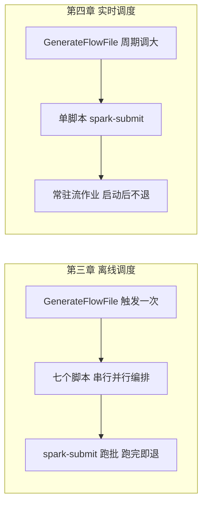

# 三个常驻作业装进 NiFi 画布：实时分析调度配置全程

三个指标的采集流程早就在 NiFi 画布上跑着，统计代码也各自测过功能，但统计分析这一段还是靠开发工具手工挂着跑。集成测试的前提是所有任务都交给 NiFi 调度，手工挂着的常驻作业必须换成画布上的正式编制：打包、传脚本、导模板、拉起作业，四件事这一课一次做完，实时分析的三条链路才算真正齐装。

## 先给结论

- 打包前确认配置文件里集群模式开关 `useingCluster=true`，模式凝固在包里，local 模式的包提交后在 Spark 集群页面上看不到任务。
- 产物是 `xc-service-rt-jar-with-dependencies.jar`，配三个 shell 脚本：`real_time_visit.sh`、`real_time_new_user.sh`、`real_time_buy.sh`，jar 进容器 `/opt/run/jars`，脚本进 `/opt/run/script`。
- 三个指标的实时统计分析调度模板逐个上传、逐个添加进画布；新增用户量与今日购买量的目录层级深，右键 `Move to parent` 上移一层，把空壳组删掉，画布更干净。
- 每个调度模板就是一对处理器：`GenerateFlowFile` 触发，`ExecuteStreamCommand` 执行脚本拉起 spark-submit；实时作业常驻，Run Schedule 故意调大，与第三章离线调度按天触发、跑完即退的形态形成对照。

## 打包：模式凝固在包里

统计分析工程读取配置文件决定运行模式，配置项一行：

```properties
# true-集群模式，false-local模式，不配置默认为false
useingCluster=true
```

确认置为 true 再执行 package。这个开关决定 Spark 任务往哪里跑：集群模式把任务真正提交到 Spark Standalone 集群，Master 页面上能看到 Running 与 Completed 的应用；local 模式在提交节点本地跑完，调度看起来成功，集群上一片空白，排查时容易南辕北辙。包一旦打出去，模式就凝固在里面，改配置要重新打包。

打包需要一段时间，正好利用这个空档做 NiFi 侧的配置，两边并行互不等待。产物是带依赖的 fat jar，脚本与 jar 分离，脚本只负责拼 spark-submit 命令。

## 三个调度模板进画布

实时分析处理器组按指标分块，每个指标下面挂着采集与调度两类流程。导完三个模板后的画布结构如下：



**今日访问量直接添加。** 访问量的采集组本来就在浅层，模板上传后用添加模板的方式把「实时统计分析」拖进对应子组即可，流程骨架即刻就位。

**后两个指标先挪后删再添加。** 新增用户量与今日购买量的处理器组藏在比较深的层级里，层层点进去很费劲。NiFi 支持把处理器组整体上移：在组上右键选 `Move to parent`，它就挪到了上一层的处理器组，原来的空壳组删掉，目录瞬间浅一层。今日购买量操作完全相同。挪完再走一遍上传模板、添加模板，三个指标的调度就全部落在浅层，后续整体测试时一眼能看全。

模板只是骨架，命令路径与参数都固化在里面，导入后不需要补配置，这点与采集模板必须补连接池很不一样。

## 调度处理器怎么拉起常驻作业

每个调度模板里是一对处理器：`GenerateFlowFile` 负责定时产出一个空的流文件当触发信号，`ExecuteStreamCommand` 收到流文件后执行外部命令。命令就是进容器的 spark-submit 脚本，三个脚本骨架相同，差异只在 `--class` 指向的主类。以今日购买量的脚本为例：

```bash
#!/usr/bin/env bash
SPARK_SUBMIT=/opt/spark/bin/spark-submit

$SPARK_SUBMIT \
  --master spark://xc-online-spark:7077 \
  --class com.study.xc.analysis.RealTimeBuy \
  /opt/run/jars/xc-service-rt-jar-with-dependencies.jar
```

另外两个脚本把主类换成 `RealTimeVisit` 与 `RealTimeNewUser`，其余一字不差。脚本没有日期参数，这是与第三章离线调度脚本的第二个差别：离线统计按天跑，脚本靠 NiFi 表达式现算日期传参；实时统计消费的是 Kafka 里的当日报表口径，程序自己管理位点与日期 field，脚本不需要任何输入。

**触发节奏是实时调度最关键的一个配置。** 实时分析程序启动后常驻不退，只需要拉起一次，所以 `GenerateFlowFile` 的 Run Schedule 故意调得很大，避免它反复触发、反复提交同一个作业。同一个消费组里挂两个相同实例，位点被两边抢着消费、结果被两边轮着写，统计口径直接乱掉。离线调度恰恰相反，GenerateFlowFile 按天触发才符合 T+1 的语义。同一种处理器组合，节奏不同就是两种完全不同的调度形态：



还有一个运行时特征要提前知道：spark-submit 提交流作业后命令本身不退出，`ExecuteStreamCommand` 会一直挂着等进程结束，命令什么时候返回取决于流作业什么时候停。判断作业健康不能盯着命令返回值，要看 Spark Master 页面的应用记录与 Kafka 的消费 lag，这段在整体测试时会体现得很明显。

## 四个文件进容器

打包完成后进入部署。先把 jar 与三个脚本送上宿主机：脚本用 WinSCP 拖到服务器，jar 从开发机直接传，落点都在宿主机的临时目录。然后逐个送进 NiFi 容器，`docker cp` 按一次一个文件来：

```bash
# 宿主机执行：四个文件逐个复制进容器（容器名按环境实际为准）
docker cp /opt/tmp/real_time_buy.sh      xc-online-nifi:/opt/run/script/
docker cp /opt/tmp/real_time_new_user.sh xc-online-nifi:/opt/run/script/
docker cp /opt/tmp/real_time_visit.sh    xc-online-nifi:/opt/run/script/
docker cp /opt/tmp/xc-service-rt-jar-with-dependencies.jar xc-online-nifi:/opt/run/jars/
```

传完进容器验收。`docker exec -it xc-online-nifi bash` 登进去，`/opt/run/jars` 里能看到新的 rt 包，`/opt/run/script` 里三个脚本齐了。新上传的脚本还没有执行权限，终端里显示白色，`chmod +x` 补上后变绿色：

```bash
# 容器内执行：给脚本加可执行权限
chmod +x /opt/run/script/*.sh
```

授权这一步不能省，`ExecuteStreamCommand` 调一个没有执行权限的脚本会直接报权限拒绝，调度永远起不来。至此 NiFi 配置、jar、脚本全部就位，实时分析的三条链路在画布上整装待发，下一课整体联跑。

## 常见误区

- **local 模式打包。** 错例：没看配置就 package，提交后 Spark Master 页面找不到应用，以为集群挂了。正解：打包前核对 `useingCluster=true`，模式凝固在包里，错了就重打。
- **脚本上传后不授权。** 错例：脚本进了 `/opt/run/script` 就启动调度，处理器报权限拒绝。正解：`chmod +x`，终端里白色变绿色再启动。
- **Run Schedule 配得太小。** 错例：习惯性按秒级周期配置触发器，常驻作业被反复提交，多个实例挤进同一消费组，统计值忽大忽小。正解：实时作业只需拉起一次，调度周期调大；作业停止后需要重启时，先确认旧进程已结束。
- **盯着命令返回判断作业健康。** 错例：调度启动后 ExecuteStreamCommand 一直「运行中」，以为卡死了。正解：spark-submit 提交流作业后命令不退出，命令存活恰恰说明作业在跑，健康状态去 Spark Master 页面与消费 lag 上看。

## 面试可能被问到的问题

1. 面试官追问：「实时调度和离线调度都用 GenerateFlowFile 加 ExecuteStreamCommand，本质区别在哪？」
   答：触发语义不同。离线作业按天触发、跑完即退，调度周期就是业务周期，脚本还要传日期参数；实时作业常驻不退，调度的职责只是拉起一次，周期故意调大防止重复提交。同一个处理器组合，节奏与参数的差异决定了它是批处理调度还是常驻作业管理。
2. 面试官追问：「为什么用脚本加 ExecuteStreamCommand，不用 NiFi 直接管理 Spark 任务？」
   答：spark-submit 是 Spark 官方提交入口，依赖解析、master 寻址、deploy mode 都是标准路径，脚本一行就能改参数；NiFi 侧只需要把命令当外部进程调，复杂度留在脚本里，画布保持干净。引入 Livy 之类的服务能拿到更好的任务管理能力，但多一个组件多一份运维，本项目三个常驻作业用不上。
3. 面试官追问：「同一消费组的两个实例同时跑会发生什么？」
   答：Kafka 会把分区在实例间分摊，消费不重复但统计程序是各自独立的进程，各自维护累加器与写回逻辑，Redis 里的值会被两个进程交替覆盖，当日统计口径直接失真。常驻作业必须保证单实例，调度周期调大、启动前确认旧进程结束，都是为这一点服务。
4. 面试官追问：「ExecuteStreamCommand 的失败怎么感知？」
   答：命令退出码非零时流文件走失败关系，处理器出公告并重试，这是调度层的信号。但流作业的失败多数发生在运行期而不是提交期，命令可能长时间挂着后突然退出，所以还要配 Spark Master 页面的应用记录与数据侧的增量核对，调度信号、集群记录、数据结果三处交叉验证。
5. 面试官追问：「fat jar 覆盖部署会不会影响正在运行的作业？」
   答：不会。spark-submit 提交时才加载 jar，进程起来后类已进内存，覆盖磁盘文件只影响下一次提交。要避免的是覆盖与提交同时发生，生产上按调度窗口错开即可。

## 配套资料

- 讲义：`materials/docs/08/智慧学成-第4章-实时分析.md`，5.2.2 统计分析 NiFi 调度（jar 与脚本的容器路径、三个启动脚本内容、GenerateFlowFile 的 Run Schedule 提示）为本课出处，调度模板清单见 5.2.2.1 至 5.2.2.3。
- 资料：`materials/code/08/_散落资料/`，三个实时统计分析调度模板与 `real_time_visit.sh`、`real_time_new_user.sh`、`real_time_buy.sh` 提交脚本都在该目录（内层文件名带站点后缀，属元信息，按用途自取）。
- 说明：Scala 工程源码未随资料包归档，主类名与脚本内容以讲义为准，包名按课程工程 `com.study.xc` 系改写；容器内路径以 `/opt/run/script`、`/opt/run/jars` 为准，容器名与 Spark Master 地址按课程环境实际填写。
