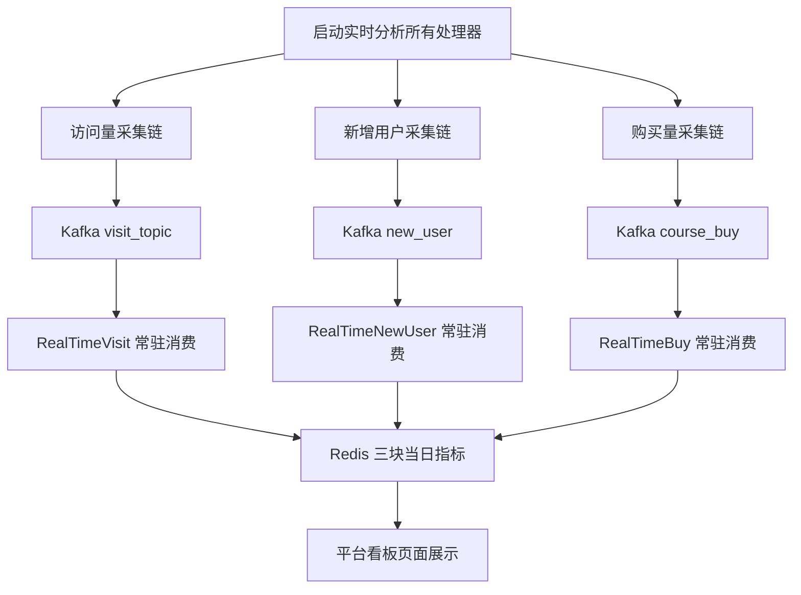

# 一键启动整条实时链路：整体测试、平台看板核对与常驻作业的退场

调度配置完毕，集成测试到了验收时刻：画布上一键启动全部处理器，去 Spark 集群页面确认三个常驻作业真的被拉起，再到业务报表系统的平台看板上看着三块指标数字持续跳动。验收之外还有一个必答题躲不掉：常驻作业启动后不自动停止，开发测试改了代码总要重启，右键停止却停不掉调度处理器，这条退场路线要在这一课走明白，不然实时分析就成了只进不出的单向门。

## 先给结论

- 实时分析的所有调度收拢在一块画布上，页面上对应的展示标签叫平台看板，整体流程因此也带上了平台看板的注脚。
- 各处理器组之间没有依赖关系，可以同时启动，不用操心先后顺序；测试三步：启动所有处理器、Spark 页面查任务、Redis 与看板查数据。
- Spark 页面上任务出现有半分钟上下的延迟：提交、启动、首批 5 秒批各占一段，刷新几次再下结论。
- 测试前清过 Redis，看板起初一片空白属正常，统计首批出数后今日访问量、新增用户量、今日购买量三块指标持续增长。
- 右键停止处理器组停不掉三个调度处理器，根因是 Spark Streaming 的 `awaitTermination` 阻塞、spark-submit 进程不退出；用专门的结束调度 kill 掉，kill 后调度报错属预期提示。

## 一块画布看全实时分析

实时分析（平台看板）NiFi 整体流程，是前面所有配置的总装视图：三个指标的采集流程与三个统计分析调度全部落在实时分析处理器组下，采集端一条链直发 Kafka，计算端三个常驻作业各自消费各自的 topic，互不交叉。名字里的括号不是多余：前台展示页面上的标签就叫平台看板，整体流程对齐的是这个页面的三块指标，所以文档与模板都按「实时分析（平台看板）」命名。

整条链路的一次完整运转画出来是这样：



图里三个采集链与三个统计作业两两配对，中间只隔一个 topic；Redis 是所有指标的汇合点，看板页面只认 Redis，不关心数据是页面刷新产生的还是 NiFi 量产的。

## 整体测试三步走

**第一步，启动所有处理器。** 各处理器组之间没有并行关系约束，直接框选实时分析组整体启动即可，不需要担心先后顺序。启动后画布上队列开始流动，数据从各采集链往 Kafka 走。

**第二步，去 Spark 页面查任务。** 三个调度处理器被触发后会依次拉起 spark-submit，Master 页面的 Running 列表里应该出现 RealTimeVisit、RealTimeNewUser、RealTimeBuy 三个应用。刚启动时页面可能一片空白，这不是失败：提交需要时间，应用注册进 Master 也需要时间，加上程序每 5 秒才读一次数据做一次计算，整体给到二三十秒的反映时间很正常。隔一会儿刷新，Running 列表里的三个应用就是三条常驻链路全部在线的凭证。

**第三步，看数据。** 讲义给的核对位置是 Redis，实际体验可以直接上看板。业务报表系统的前端与后台（课程工程里的 `xc-online-vue` 与 `xc-web`）保持运行，浏览器打开 4000 端口，登录页的用户名密码随意填，验证码照图形输入任意字符，三个框不能留空。登录后默认页就是平台看板，顶部三块指标：今日访问量、新增用户量、今日购买量。

有一个现象要提前打好预防针：测试前对数据做过清理，Redis 里没有存量，所以页面打开后起初没有数字。这不是链路断了，而是统计程序还没攒出第一批结果，等首批 5 秒批走完、统计值写进 Redis，刷新页面数字就出来了。此后数据持续变化，隔几秒刷新就能看到指标在涨：采集链一直在生产数据，统计程序一直按批累加，看板数字自然是活的。

新增用户量这一块有个专属小提示：它的造数流程触发间隔设得很长，测试时等数据会等到着急。想让新增用户量也快速积累出数字，把生产处理器的触发间隔改小即可，这是造数侧的节奏问题，与统计逻辑无关。

## 停不掉的常驻作业与两种结束方式

生产环境里实时分析启动后一般不会主动停，开发测试不行：改了代码、发现了 bug、调了参数，都要把旧进程停掉再重启。此时右键停止实时分析处理器组，会发现采集类处理器都乖乖停了，三个统计分析调度处理器却始终是运行状态。

原因在 Spark Streaming 的运行模型上。程序主线程停在 `awaitTermination()` 上等流计算终止，spark-submit 提交的进程因此永不退出；`ExecuteStreamCommand` 执行的是这个进程，进程不退，命令就一直挂着，NiFi 层面的「停止」只能停掉触发器，管不到已经跑出去的外部进程。讲义给出了两种结束方式：

```bash
# 方式一：进 NiFi 容器手动结束进程
docker exec -it xc-online-nifi bash
jps                  # 找到 SparkSubmit 进程号
kill -9 <pid>        # 强制结束
```

方式二是用专门的调度模板。资料里提供了「结束实时分析进程」的流程，上传模板、添加进画布、启动，它执行的就是对 SparkSubmit 进程的 kill。观察它的执行日志，报错是必然出现的，关键看日志里 kill 那一行：进程被强制结束，目的达成。kill 属于非正常退出，NiFi 管理任务调度时会检测命令是正常结束还是非正常结束，检测到非零退出码就报错，这个错是预期提示，不用处理；用完把结束处理器停掉，避免它按周期反复执行、把后续重启的作业也一并杀掉。

两种方式殊途同归，结束后调度面板上的报错提示都属正常，讲义里也有对应的文字说明。真正要关心的是数据侧：位点在 Redis、检查点在 HDFS，进程被杀只是运行态没了，消费进度一毫秒都没丢，重启后从上次的位点接着消费。

## 第四章收官复盘

到这里，实时分析三个指标从采集到展示全部走完。三条链路共用一副骨架：采集端，今日访问量走前端埋点直发 Kafka，新增用户量与今日购买量监听业务库 binlog 捕获 insert，分别取用户 id 与订单 id 进各自的 topic；统计端，三个常驻程序都是「Redis 取位点、5 秒拉一批、累加去重、写当日 field、保存位点」的同一套流程，差异只在指标口径；调度端，采集流程常开，统计作业由 NiFi 拉起一次常驻运行；展示端，看板读 Redis，秒级刷新。

回头看，这章的功夫下在两处：一处是统计程序把位点、状态、写回全部收口在自己的代码里，上游怎么换数据源、进程怎么重启，下游照单全收；另一处是调度全部进了 NiFi 画布，采集、计算、启停统一编排，集成测试才能做到一键启动、一键核对。数字每天归零重新累计，位点是续跑的锚，检查点是状态的锚，这套组合在流式统计里是最小但完整的正确性保障。

## 常见误区

- **Spark 页面没任务就判失败。** 错例：启动后几秒内刷新 Master 页面，Running 列表是空的，回头重查调度配置。正解：提交与注册要时间，5 秒批还要再攒，给到二三十秒再刷新，看 Running 与 Completed 两个列表。
- **看板空白就怀疑链路。** 错例：页面没数字就重启统计程序。正解：测试前清过 Redis、首批结果未出都会让页面空白，先刷新等待，再看 Redis 里对应 key 是否有值，数据侧有无是唯一的判据。
- **右键停止就当停干净了。** 错例：处理器组全部显示已停止就去改代码重启，结果旧进程还占着消费组，新旧两个实例一起写 Redis。正解：停调度后进容器 `jps` 确认 SparkSubmit 是否还在，或用结束调度模板补一刀。
- **结束模板用完不停。** 错例：kill 完作业顺手就走了，结束处理器还在按周期跑。正解：把结束处理器停掉，否则后续手动重启的作业会被它再次 kill。

## 面试可能被问到的问题

1. 面试官追问：「常驻的 Spark Streaming 作业为什么调度层停不掉？」
   答：调度层管的是触发器与命令进程，spark-submit 提交流作业后主线程阻塞在 `awaitTermination()`，进程不退出，命令就一直挂着。停止处理器组只能不再触发新的提交，对已提交的进程无能为力，必须显式 kill 进程，或者程序侧实现优雅停机钩子。
2. 面试官追问：「生产环境怎么优雅停止 Spark Streaming？」
   答：给进程发 SIGTERM 触发 JVM shutdown hook，配合 `spark.streaming.stopGracefullyOnShutdown=true`，流计算会把当前批次处理完、提交完位点再退出。配合外部的位点存储与检查点，重启后从断点继续，数据不丢不重。kill -9 是兜底手段，会跳过这些收尾动作。
3. 面试官追问：「kill -9 杀掉流作业有什么数据风险？」
   答：在途批次可能已经消费未及保存位点，重启后这一小段被重复消费，对累加型指标意味着少量重复计数。本项目的位点每批写 Redis、检查点定时落 HDFS，风险窗口只有最后一批；要么接受这个量级的小误差，要么把统计改成幂等写（按批次或按 key 覆盖），两者取一。
4. 面试官追问：「看板上的数字从哪来，怎么保证和统计结果一致？」
   答：接口直接读 Redis 里指标对应的 hash，字段就是统计程序写入的当日 field，同一个 key 同一个值，天然一致。要防的是读缓存与写回的时序差：统计每 5 秒写一次，页面轮询刷新，看到的是最近一批的结果，秒级业务完全可以接受。
5. 面试官追问：「三个指标的处理组可以同时启动，依据是什么？」
   答：组与组之间没有数据依赖：三条采集链各自独立生产，三个统计程序各自消费各自的 topic，Redis 里各写各的 key。有依赖的关系都存在于组内部（先采集后有数可算），组内靠流程编排已经解决。判断能否并行启动，看的正是依赖图的拓扑：同层节点天然可并行。

## 配套资料

- 讲义：`materials/docs/08/智慧学成-第4章-实时分析.md`，5.3 实时分析（平台看板）NiFi 整体流程、5.4 测试（5.4.1 整体测试步骤、5.4.2 结束实时分析程序的两种方式）、5.5 web 展示为本课出处。
- 资料：`materials/code/08/_散落资料/`，实时分析整体流程模板与结束实时分析进程的调度模板、三个 spark-submit 提交脚本都在该目录（内层文件名带站点后缀，属元信息，按用途自取）。
- 说明：包名按课程工程 `com.study.xc` 系改写；前端与后台服务名 `xc-online-vue`、`xc-web` 为课程工程实际命名；登录页账号与验证码按课程环境可任意填写但不能留空。
