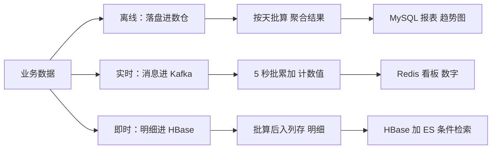

# 即时查询开篇：离线与实时之外的第三条链路，按条件秒查学习明细

离线分析回答「整体怎么样」，实时分析回答「此刻怎么样」，两章的产出都是统计值。但运营与客服的工作台还有一个躲不开的诉求落在「查」上：翻某个学员的学习记录，看他在哪门课的哪个视频上花了多少时间，条件随便组合，结果要秒级返回。这类需求既不是按天重算的批处理，也不是只产出计数值的流计算，数据量大、条件灵活、要求明细级返回，项目里把它单独列为一条链路，叫即时查询。这一章开篇先立好学习目标，再把批处理、流计算、即时查询三种形态的定位差异讲透，后面十几节的技术选型才有判断依据。

## 先给结论

- 即时查询的业务是在线学习详情：按学生、课程、视频维度查学习时间与学习时长，页面上五个字段没有一个能从埋点直接拿到，全部要靠维度关联或计算得出。
- 五条学习目标依次是：理解即时查询的需求、搭建即时查询的大数据环境、采集即时查询需要的数据、编写即时查询代码、在业务报表系统进行查询。
- 环境零成本起步：本章新增的 HBase 与 Elasticsearch 在容器编排阶段已经编排好，确认容器在跑即可直接使用。
- 技术方案一句话：Spark 把统计结果存进 HBase，Elasticsearch 只索引查询字段与 RowKey，业务查询先查 ES 拿到 RowKey，再回 HBase 取完整明细。
- 三条链路的分工：批处理回答整体怎么样，流计算回答此刻怎么样，即时查询回答具体某条什么样，三者互补而非替代。

## 业务是什么：在线学习详情页

登录进前台，默认页是平台看板，从菜单进入「在线学习详情」页，这就是即时查询要支撑的全部业务。页面字段五项：学生昵称、课程名称、视频名称、学习时间、学习时长。看着朴素，落到数据上每一项都有讲究，讲义里梳理的对应关系如下：

| 原型字段 | 数据来源 | 获取方式 |
|---|---|---|
| 学生昵称 | 学生 id | 通过用户维度表关联 |
| 课程名称 | 课程 id | 通过课程维度表关联 |
| 视频名称 | 视频 id | 通过课程视频维度表关联 |
| 学习时间 | 视频开始播放时间 | js 埋点采集 |
| 学习时长 | 按视频学习时间计算 | js 埋点采集，1 分钟一次 |

埋点原始数据里只有 id 没有名称，名称全在维度表里；学习时长更是一次都没有直接上报过，埋点按一分钟一次的节奏记录播放进度，时长靠相邻两条记录计算出来。这意味着即时查询不是「把埋点存下来就能查」，采集之后必须先有一轮统计加工，把原始数据变成可查的明细。

原始数据的结构就此定下来，一张用户学习 ODS 表七个字段：`user_id` 判断是否登录，`course_id` 与 `course_video_id` 挂维度，`user_ip` 可分析区域，`user_session_id` 用于去重，`user_agent` 判断访问方式与机器人，`learn_time` 记录学习时间。数据存 HDFS 文本文件，按天一个目录，采集侧用 NiFi 生产数据往里灌。这份原始数据是整章所有加工的起点。

## 批处理、流计算、即时查询：三层定位对照

同一份业务数据，在项目里被三种形态各处理一遍，边界必须分清，否则选型和存储设计都会拧巴。

**批处理回答整体怎么样。** 离线分析的数据成批落盘进数仓，按天调度全量或增量重算，产出聚合结果供趋势图与历史报表使用。它的优势是吞吐与准确，弱点是时效，当天发生的事要等第二天调度才可见。

**流计算回答此刻怎么样。** 实时分析的数据以消息形态持续到达，常驻程序按 5 秒一批消费增量，产出的是当天范围内的单一计数值，进 Redis 供看板秒级刷新。它的优势是快，弱点是只保留「此刻的值」，没有过程明细，也做不了任意条件的下钻。

**即时查询回答具体某条什么样。** 明细级检索的两个特征决定了它必须另起炉灶：条件灵活，可能按学生查、按课程查、按视频查，组合无预警；返回的是明细行而不是聚合值，没法靠预聚合作弊。把问题丢给已有的两条链路都走不通：Hive 面向全表扫描，一次随机条件查询要扫大量文件，秒回不可能；MySQL 能扛业务量级的点查，扛不住亿级学习记录的存储与灵活检索。

三种形态在同一张图上摆出来，定位差异一目了然：



上图最值得看的是输出端的三种介质：聚合结果进 MySQL，计数值进 Redis，明细进 HBase。数据形态决定了存储选型，这是本章后面所有设计的总纲。三种链路也复用同一批基础设施：NiFi 既做离线采集又做实时采集，Spark 是批处理与即时查询共同的计算引擎，报表系统更是同一个，学即时查询同样不是另起炉灶，而是在现有地基上补一条检索通道。

## 五条学习目标与本章路线

**第一条，理解即时查询的需求**，就是上面拆解的在线学习详情页：五个字段、三类关联、一份原始埋点。

**第二条，搭建即时查询的大数据环境。** 本章在 Spark、Hive、Kafka、Redis 之外新增两个组件：HBase 与 Elasticsearch。容器编排文件里两者都已就位，HBase 跑在 `xc-online-hbase` 容器里，随容器启动自动拉起；Elasticsearch 用 6.4.0 单节点镜像，9200 端口对外，另配了一个 es-head 界面便于观察索引：

```yaml
# 容器编排文件节选：即时查询新增的两个组件
xc-online-hbase:
    image: xc:base
    container_name: xc-online-hbase
    hostname: xc-online-hbase
    command: bash -c "service ntpd start && service sshd start && /opt/hbase-1.2.0-cdh5.14.0/bin/start-hbase.sh && tail -f /dev/null"
xc-online-es:
    image: elasticsearch:6.4.0
    environment:
      - discovery.type=single-node
    ports:
      - '9200:9200'
      - '9300:9300'
xc-online-es-ui:
    image: xc:es-head
    ports:
      - '9100:9100'
```

**第三条，采集即时查询需要的数据**，两路并行：用户学习原始数据来自 js 埋点，经 NiFi 生产与采集落进 HDFS 按天目录；课程视频维度数据由 NiFi 从业务库采集，供后面的统计关联使用。

**第四条，编写即时查询代码。** 统计分两步：步骤一读原始数据、注册函数、关联用户与课程视频维度、算出学习时长，产出中间表存 Hive；步骤二把中间表加工成最终明细，写入 HBase 并同步 ES 索引。写入与查询的组合在讲义的演示代码里先睹为快，Spark 一侧同时完成两落：

```scala
package com.study.xc.analysis.demo

import org.apache.hadoop.hbase.client.Put
import org.apache.hadoop.hbase.io.ImmutableBytesWritable
import org.apache.hadoop.hbase.util.Bytes
import org.elasticsearch.spark.sql.EsSparkSQL

object Save {
  case class Person(id: String, name: String, age: String)
  def main(args: Array[String]): Unit = {
    val spark = EtlEnvironment.getSparkSession(this.getClass.getSimpleName, esTableName)
    import spark.implicits._
    val sc = spark.sparkContext
    // es 侧：整份数据写索引
    EsSparkSQL.saveToEs(spark.createDataset(rdd), esTableName)
    // hbase 侧：按 RowKey 组装 Put 写明细
    rdd.map(p => {
      val put = new Put(Bytes.toBytes(p.id))       // id 作为 RowKey
      put.addColumn(Bytes.toBytes(hbaseColumnName), Bytes.toBytes("name"), Bytes.toBytes(p.name))
      put.addColumn(Bytes.toBytes(hbaseColumnName), Bytes.toBytes("age"), Bytes.toBytes(p.age))
      (new ImmutableBytesWritable(), put)
    })
      .saveAsHadoopDataset(jobConf)                 // 走 Hadoop 配置写 HBase
    spark.close()
  }
}
```

查询侧正好反向：先拿条件去 ES 检索，命中结果里只取 RowKey，再按 RowKey 回 HBase 批量点查明细。ES 的查询体就是一段普通 JSON：

```json
{"query": {"match": {"name": "王五"}}}
```

**第五条，在业务报表系统进行查询。** 前台页面与后台 API 在项目搭建阶段已经备好，统计结果一旦落进 HBase 与 ES，页面即可按条件检索出明细，这一步的联调放在章末的集成测试。

## 为什么是 HBase 加 ES 的组合

**HBase 负责存与点查。** 它基于 LSM 树，写入先落内存再刷成顺序文件，扛写入吞吐强；读路径按 RowKey 定位，字典序相邻的数据物理上也相邻，主键点查是毫秒级。亿级明细表放 HBase，按 RowKey 取一行又快又稳。代价是它几乎只会这一种查法：RowKey 之外的任何条件都意味着全表扫描，直接判死刑。

**Elasticsearch 负责条件检索。** 倒排索引把每个分词后的字段值映射到文档，任意字段的组合条件都能在索引里先收敛出命中的文档集合。但它的长处是检索不是存储，全量明细塞进 ES，索引体积与集群成本都会失控，而且更新频繁的明细也不是它的舒适区。

**组合的正确姿势是各干各的。** ES 只索引业务会拿来当查询条件的字段加上 RowKey，相当于一本只印目录的检索册；HBase 存完整明细，相当于正文。一次查询拆成两跳：ES 里一跳收敛出 RowKey 集合，HBase 里一跳按 RowKey 批量取行，两跳都是点查，数据量大也能压在秒级。这个「索引库加主库」的分层在搜索类需求里是通用套路，记住结构比记住参数重要。

## 常见误区

- **把即时查询当成第三种实时计算。** 错例：以为明细数据也要流式加工、秒级入 HBase。正解：明细由 NiFi 按天采集、Spark 批量算出，「即时」指的是查询响应即时，数据新鲜度是分钟到小时级，与实时分析的秒级计数值是两回事。
- **以为 ES 存了全量明细。** 错例：查询 ES 没查到的字段就断言数据缺失。正解：ES 只索引查询字段与 RowKey，完整明细在 HBase，两跳查询缺一不可。
- **以为要重新搭 HBase 与 ES 环境。** 错例：照着官网装 HBase、调 ES 内存参数折腾半天。正解：容器编排阶段两个组件都已编排好，确认容器在跑、端口能通即可，把时间花在数据链路上。
- **把明细查询塞进实时链路。** 错例：想在实时程序里顺手把明细也写一份供查询用。正解：实时链路只产出当天计数值，明细查询走 HBase 加 ES 这条独立通道，链路职责单一才好维护。

## 面试可能被问到的问题

1. 面试官追问：「即时查询和实时分析有什么区别？」
   答：实时分析是流计算，常驻消费增量消息，产出聚合后的计数值，时效秒级；即时查询是检索，数据由批处理算好存入列存与索引库，用户按任意条件查明细行，响应要求秒级。一个回答「此刻整体怎么样」，一个回答「符合条件的每一条是什么」，产出形态与存储介质都不同。
2. 面试官追问：「为什么用 HBase 和 ES 搭配，单独用一个不行吗？」
   答：单独用谁都有硬伤。HBase 只有主键点查快，任意条件检索等于全表扫描；ES 检索强但存全量明细成本高、更新重。搭配后 ES 只索引查询字段与 RowKey 承担筛选，HBase 承担明细存储与点查，两跳都是点查，兼顾成本与响应。
3. 面试官追问：「HBase 为什么快？RowKey 设计要注意什么？」
   答：快在两点：LSM 结构把随机写转成顺序写，读路径按 RowKey 在有序结构里定位；RowKey 字典序存储让范围扫描也高效。设计上要避免单调递增的 RowKey 造成写热点，常用做法是加哈希前缀打散；同时 RowKey 前缀要贴合主查询模式，让最常用的查询落在前缀扫描上。
4. 面试官追问：「查询条件要新增一个字段，架构上要动哪里？」
   答：ES 的索引结构要覆盖所有查询条件，新字段必须进索引，历史数据要重建或补索引；HBase 侧存的是全量明细，通常不用动。这也是为什么索引设计要在动手前把查询模式盘清楚，索引字段是检索能力的边界。
5. 面试官追问：「明细数据多久能查到，能做到秒级新鲜吗？」
   答：数据按天采集、由调度触发批算入 HBase 与 ES，新鲜度取决于调度周期，分钟到小时级。要秒级新鲜就得把明细写入改成流式链路，成本陡增；明细查询场景通常接受分钟级延迟，先问清业务时效要求再定链路形态，不要为用不上的新鲜度买单。

## 配套资料

- 讲义：`materials/docs/08/智慧学成-第5章-即时查询.md`，章首学习目标、1.1 原型、1.2 技术方案与 1.2.1 代码演示（HBase 加 ES 的保存与查询练习）、1.3 采集分析为本课出处。
- 资料：`materials/code/08/_散落资料/`，容器编排文件（含 `xc-online-hbase`、`xc-online-es` 容器定义）与即时查询整体流程模板在该目录（内层文件名带站点后缀，属元信息，按用途自取）。
- 说明：Scala 工程源码未随资料包归档，演示代码以讲义文本为准整理并精简，包名按课程工程 `com.study.xc` 系改写；示例站点一律 example.com 占位。
