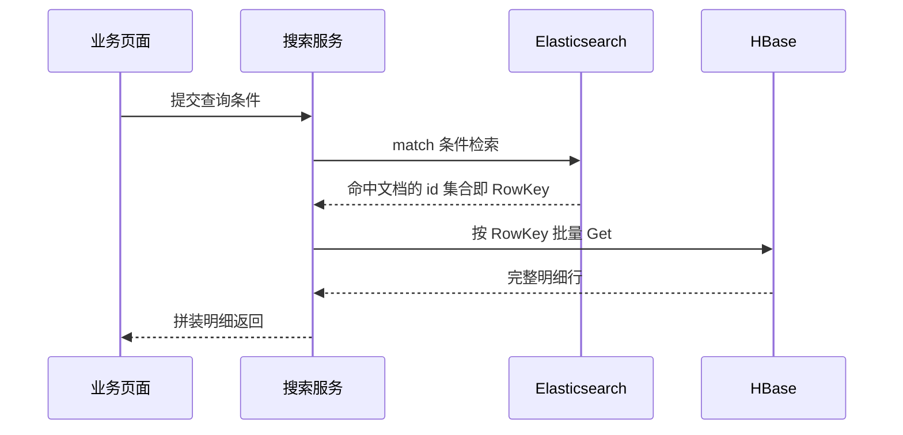

# 即时查询代码演示：三行示例数据写通 HBase 加 Elasticsearch 的读写闭环

> 🔒 安全提示：文中示例的口令/密钥均为课程教学环境演示口径，生产环境的安全要求见《安全与合规须知》。

技术方案把 HBase 与 Elasticsearch 两个新组件请进了项目，对写惯关系库的同学来说，它们既是生面孔，又各自带着一套完全不同的 API：一个要跟字节数组与列族打交道，一个要写 JSON 查询体。直接上生产统计程序容易被细节淹没，讲义先用一份最小示例把读写闭环跑通：一个三字段的 `Person` 类、三行数据，写进两个库，再按条件原样查回来。示例里出现的每个动作，建表、组装写入配置、双写、按条件收敛 RowKey、批量点查，在生产代码里都会原样重演，只是字段变多。把这份骨架吃透，后面的正式程序就只剩体力活。

## 先给结论

- 保存是「一份数据两处落」：ES 用 `EsSparkSQL.saveToEs` 整批写索引，HBase 把每条记录转成 `Put` 对象后走 `saveAsHadoopDataset` 写表。
- HBase 写入前有两个前置动作，都封装在 `HbaseUtils` 里：`createTable` 判断存在性后建表，`getJobConf` 组装带 `TableOutputFormat` 的任务配置。
- RowKey 就是 `Person` 的 id；演示把全部字段都索引进 ES 是为了省事，生产环境只索引查询字段与 RowKey。
- 查询是「先 ES 后 HBase」两跳：`sc.esRDD` 按条件查出文档取 id，封装成 `Get` 批量回 HBase 取完整行。
- hbase shell 与 `_search` 接口分别验证两个库的落地结果，两边数据对上了，读写闭环才算打通。

## 练习工程的骨架：环境、表名与三个待补动作

工程已经备好基础部分。获取 Spark 环境统一走工程封装的入口，传入 ES 表名后，环境内部会把课程编排好的 ES 地址与端口一并注入，代码里不用再写连接信息；表名、列名这些常量也提前声明。骨架代码如下（包名按课程工程 `com.study.xc` 系改写）：

```scala
package com.study.xc.analysis.demo

import com.study.xc.analysis.common.EtlEnvironment
import com.study.xc.utils.HbaseUtils

object Save {
  case class Person(id: String, name: String, age: String)
  def main(args: Array[String]): Unit = {
    // es 表名，格式为 索引/类型
    val esTableName = "demo/doc"
    // 获取 SparkSession，传入 es 表名后 ES 的连接配置由环境统一注入
    val spark = EtlEnvironment.getSparkSession(this.getClass.getSimpleName, esTableName)
    import spark.implicits._
    val sc = spark.sparkContext
    // hbase 表名与列族名
    val hbaseTableName = "demo"
    val hbaseColumnName = "demo_col1"
    // hbase 工具类：建表与取任务配置两个方法需要补齐
    val hbaseUtils = new HbaseUtils
    hbaseUtils.createTable(hbaseTableName, hbaseColumnName)
    val jobConf = hbaseUtils.getJobConf(hbaseTableName)
    // 准备基础数据：三行 Person
    val rdd = sc.parallelize(Array(
      Person("a1", "张三", "30岁"), Person("a2", "李四", "29岁"), Person("a3", "王五", "21岁")))
    // todo @HBase - es
    spark.close()
  }
}
```

几个设计意图值得读出来。`Person` 用 case class 定义，id、name、age 三个字段就是一次最简建模，id 马上要兼任 HBase 的 RowKey；case class 不只是语法糖，后面 `createDataset` 能把 RDD 转成 `Dataset`，靠的就是它带来的编码器信息，顶部的 `import spark.implicits._` 也是为这次转换准备的。`EtlEnvironment` 是工程封装的环境获取入口，esTableName 不为空时它会把 ES 的节点与端口配置进 SparkSession，这正是容器编排阶段把 ES 编排好的意义，到了代码里只剩一行调用。数据只有三行，是为了把注意力留给读写动作本身，排查问题时每一行都能肉眼对账。工具类 `HbaseUtils` 在工程里只给了壳，ZooKeeper 地址、端口等 HBase 连接配置在类内部初始化，`connection` 与 `admin` 两个对象都已就位，需要补的是 `createTable` 与 `getJobConf` 两个方法，加上主流程里的保存逻辑，一共三个待补动作，代码注释里的 `todo` 占位就标在这里。

## 写保存：建表、任务配置与两处落地

**第一步，建表，先判断存在性再动手。** HBase 的表结构由表描述与列族描述两件套构成，数据列都挂在列族下面，建表本质上就是声明「有哪些列族」。表描述要的是 HBase 自己识别的表名类型，`String` 要经 `TableName.valueOf` 转一道，直接把字符串塞给它是不认的：

```scala
def createTable(tableName: String, columnName: String): Unit = {
  // 判断表是否存在，取反后即表不存在时才创建
  if (!admin.tableExists(TableName.valueOf(tableName))) {
    // 生成表描述，表名要转换成 HBase 识别的类型
    val tableDescriptor = new HTableDescriptor(TableName.valueOf(tableName))
    // 在表描述上添加列族描述
    tableDescriptor.addFamily(new HColumnDescriptor(columnName))
    // 执行建表
    admin.createTable(tableDescriptor)
  }
}
```

判断在前，重跑程序才不会因表已存在而报错，这也是批处理程序幂等的第一小步。整段逻辑顺着「表描述、列描述、执行创建」三句注释就能读完，HBase 的建表 API 长得繁琐，但模式固定。

**第二步，任务配置，把 HBase 表接进 Hadoop 写通道。** 后面的 `saveAsHadoopDataset` 需要一个 `JobConf`，里面要声明用哪种输出格式写、写到哪张表：

```scala
def getJobConf(tableName: String): JobConf = {
  // 基于 HBase 自身的配置构造任务配置
  val jobConf = new JobConf(conf)
  // 指定输出格式为 HBase 的表输出
  jobConf.setOutputFormat(classOf[TableOutputFormat])
  // 指定输出的表名
  jobConf.set(TableOutputFormat.OUTPUT_TABLE, tableName)
  jobConf
}
```

`conf` 就是工具类初始化时配置好的 HBase 连接对象，任务配置继承它，ZooKeeper 信息随之带过去。`TableOutputFormat` 是 HBase 提供的 Hadoop 输出格式，配上 `OUTPUT_TABLE` 这一个参数，Spark 各分区就能把数据直接写进指定的表，不需要逐行去建连接。

**第三步，两处落地。** ES 侧由 es-spark 集成包代理，一行完成；HBase 侧要逐条把 `Person` 转成 `Put`：

```scala
// 保存 es：saveToEs 要求 Dataset，先 createDataset 转换
EsSparkSQL.saveToEs(spark.createDataset(rdd), esTableName)

// 保存 hbase：把 Person 逐条转成 Put
rdd.map(p => {
  // 设置 RowKey，Bytes.toBytes 把 String 转成 HBase 识别的字节数组
  val put = new Put(Bytes.toBytes(p.id))
  // 设置列族、列名与列值
  put.addColumn(Bytes.toBytes(hbaseColumnName), Bytes.toBytes("name"), Bytes.toBytes(p.name))
  put.addColumn(Bytes.toBytes(hbaseColumnName), Bytes.toBytes("age"), Bytes.toBytes(p.age))
  // 输出格式约定的键值对形态
  (new ImmutableBytesWritable(), put)
})
  // 按任务配置执行保存
  .saveAsHadoopDataset(jobConf)
```

保存 ES 这一行有三个细节。`saveToEs` 的入参是 `Dataset`，手头只有 RDD，所以要先用 `createDataset` 转一道；`demo/doc` 这个表名表达的是 demo 索引下的 doc 类型，索引会随写入自动创建；索引的配置同样来自环境注入，演示里 `Person` 的全部字段直接成为文档内容，这里偷了个懒，生产环境只会索引需要查询的字段。

保存 HBase 这段要盯住三个细节。`Put` 是 HBase 的行写入对象，构造时给 RowKey，`addColumn` 三段式给列族、列名、列值；HBase 的接口只认字节数组，翻它的源码能看到构造器与 `addColumn` 都只接收 byte 数组形态，所以 RowKey、列名、列值全部要经 `Bytes` 工具类的 `toBytes` 转换，读回来时再用 `toString` 转回，读写两端对称；输出格式要求键值对形态，键用 `ImmutableBytesWritable` 占位，值就是 `Put`，`saveAsHadoopDataset` 拿着第二步的 `JobConf` 把这批键值对写进指定的表。演示表只有一个列族 `demo_col1`，`name` 与 `age` 挂在它下面，RowKey 用 `p.id`，三行数据对应三个 RowKey。

两处落地的先后在同一批数据里没有强制顺序，但要记住它们各自独立：ES 写失败不影响 HBase 已写入的行，反过来也一样，这正是后面讲对账时两边要分开验证的原因。`demo/doc` 这种「索引/类型」写法是 ES 6.x 的惯例，一个索引下只放一种类型，类型名起到文档模板的作用。

## 验证保存：两个库各看一眼

代码在开发工具里直接运行，控制台刷完 Spark 日志即告结束。验证也要等程序跑完再动手，本地跑三行数据不过几秒，程序没结束时就去扫表，只会看到空表或半表。数据落没落地、落得对不对，要分别去两个库里看，两个库的查看方式完全不同，这本身就是它们分工的预演。

HBase 侧用自带的命令行。先登录进 HBase 容器，再启动 shell：

```bash
# 登录 HBase 容器（课程环境账号 root，密码 123456）
docker exec -it xc-online-hbase bash
# 启动 hbase 自带命令行
hbase shell
# 查看表列表，demo 应已创建
list
# 扫表查看保存的明细
scan 'demo'
```

`list` 里出现 `demo`，说明建表动作生效；`scan 'demo'` 扫出三行，每行两列，输出形态如下（时间戳列省略）：

```text
ROW                          COLUMN+CELL
 a1                          column=demo_col1:age,  value=30岁
 a1                          column=demo_col1:name, value=张三
 a2                          column=demo_col1:age,  value=29岁
 a2                          column=demo_col1:name, value=李四
 a3                          column=demo_col1:age,  value=21岁
 a3                          column=demo_col1:name, value=王五
3 row(s)
```

行头就是写入时设置的 RowKey，`a1` 到 `a3` 一行不缺；同一个 RowKey 出现两条记录，分别是 `name` 与 `age` 两列，列名都带着列族前缀。这个形态与代码里的 `Put` 结构一一对应，说明转换与写入配置都对。

ES 侧更省事，浏览器直接访问 ES 的检索接口 `http://xc-online:9200/_search`，它会返回当前实例里的全部文档：

```json
{
  "hits": {
    "total": 3,
    "hits": [
      {"_index": "demo", "_type": "doc", "_source": {"id": "a1", "name": "张三", "age": "30岁"}},
      {"_index": "demo", "_type": "doc", "_source": {"id": "a2", "name": "李四", "age": "29岁"}},
      {"_index": "demo", "_type": "doc", "_source": {"id": "a3", "name": "王五", "age": "21岁"}}
    ]
  }
}
```

`total` 为 3，三条 `_source` 与写入对象逐字段一致，两个库都齐了，保存链路验证通过。响应里还有 `took`、`timed_out`、`shards` 这些元字段，分别记录检索耗时、是否超时与分片状态，日常排查时它们比业务数据更常看：命中数不对先看 `total`，响应慢先看 `took`。顺带记一条环境坑：容器随宿主机开机自启时，HBase 进程可能因 ZooKeeper 尚未就绪而没有拉起来，表现为 HBase 的 Web 端口打不开、程序报 socket 超时，进容器手动执行 `start-hbase.sh` 即可恢复。排查写入失败前，先确认 Web 端口能打开，能少走很多弯路。

## 写查询：先拿 RowKey，再回 HBase

查询代码走反向路径。ES 侧先按条件检索出命中文档，取 id 作为 RowKey 集合，再回 HBase 点查完整行。有人会问：ES 里已经有全部字段了，为什么不直接拿数据？这正是演示里的偷懒之处，生产环境 ES 只索引查询字段，完整明细始终在 HBase，所以练习也要按生产的节奏走完两跳，把 RowKey 拿到手再去 HBase。

查询体遵循 ES 的 JSON 查询规范：最外层 `query`，第二层 `match`，第三层字段名加关键词，三层括号一层都不能少。写在多行字符串里还有个附带的好处，内部的引号不用逐个转义：

```scala
object Query {
  def main(args: Array[String]): Unit = {
    val esTableName = "demo/doc"
    val hbaseTableName = "demo"
    val spark = EtlEnvironment.getSparkSession(this.getClass.getSimpleName, esTableName)
    val sc = spark.sparkContext
    // es 查询体，多行字符串里写 JSON，引号无需转义
    val query =
      """
        |{"query":{"match":{"name":"王五"}}}
        |""".stripMargin
    // 查询 es，得到命中文档的 RDD
    val rdd = sc.esRDD(esTableName, query)
    // 收集命中文档里的 id，作为回查 HBase 的 RowKey
    val rowKeys = new ArrayBuffer[String]()
    rdd.collect().map(p => {
      // p._2 是文档内容，get("id") 取出后转成 String
      rowKeys += p._2.get("id").get.toString
    })
    val hbaseUtils = new HbaseUtils
    val result = hbaseUtils.getRowKeyList(hbaseTableName, rowKeys)
    println(result.mkString(","))
    spark.close()
  }
}
```

`esRDD` 是 ES 集成包提供的隐式转换方法，不把 `org.elasticsearch.spark._` 导进来，`sc` 上根本点不出这个方法，这是新手最常见的编译报错，导包后方法自动挂在 `SparkContext` 上。`esRDD` 返回键值对形态的 RDD，键是文档 id，值是文档内容的字典，业务字段都在值里，所以取 id 要走 `p._2.get("id")`，取出的是引用类型还要 `toString` 转成字符串。代码写到这里其实可以先停一步，把 `rdd.collect` 的结果直接输出跑一次：命中王五那条文档，id、name、age 三个字段都看得见，说明 ES 一跳工作正常。确认之后再往下写 HBase，两段各验各的，出问题时能立刻定位在哪一跳；演示里先输出全字段只是过渡，真正要带去 HBase 的只有 id 这一个字段。

回查 HBase 的逻辑做了一次封装，放在 `HbaseUtils` 里新增的 `getRowKeyList` 方法。它接收表名与 RowKey 集合，返回每行的内容拼串，转换链条长，值得逐段看（示例为按讲义演示逻辑补全的可运行版本）：

```scala
// 根据 RowKey 批量查询，封装在 HbaseUtils 中
def getRowKeyList(tableName: String, rowkeys: ArrayBuffer[String]): ArrayBuffer[String] = {
  import scala.collection.JavaConverters._
  // 获取表对象
  val table = connection.getTable(TableName.valueOf(tableName))
  // 把 String 的 RowKey 转成 HBase 的 Get 对象
  val getBuffer = rowkeys.map(rowkey => new Get(Bytes.toBytes(rowkey)))
  // table.get 只接收 Java 的 List，转换后批量点查
  val results = table.get(getBuffer.asJava)
  val resultBuffer = ArrayBuffer[String]()
  for (result <- results) {
    val tmpBuffer = ArrayBuffer[String]()
    // RowKey 从 Result 的行上取，字节数组要转成 String 才可读
    tmpBuffer += Bytes.toString(result.getRow)
    // 行内每个 Cell 对应一列，逐列取值
    for (kv <- result.rawCells()) {
      val value = Bytes.toString(CellUtil.cloneValue(kv))
      tmpBuffer += value
    }
    // 一行的内容拼成一个字符串
    resultBuffer += tmpBuffer.mkString(" ")
  }
  table.close()
  resultBuffer
}
```

这条链上有四次类型转换，逐个数：Scala 集合要先导入 `JavaConverters`，因为 HBase 的接口只认 Java 集合；每个 `String` 的 RowKey 经 `Bytes.toBytes` 包装成 `Get` 对象，`Get` 就是 HBase 里的点查请求；`table.get` 传入转换后的 Java List，批量返回 `Result` 数组；查回的 `Result` 里存的还是字节数组，RowKey 从 `Result` 的行上单独取，列值要从 `rawCells` 里逐个 `CellUtil.cloneValue` 拿出来，再统一 `Bytes.toString` 转回字符串。演示数据里 id 就是 RowKey，两种取法殊途同归，但语义上要分清：`getRow` 取的是行键，`rawCells` 里是行内各列。

写这段代码时现场踩过两个真实的坑，都值得记下。一处是括号少写，某个集合在赋值时没有被当成整体对象处理，报错信息却指向别处，排查了半天才发现是括号不配对；另一处是对已经 `toString` 过的变量再次 `toString`，直接编译报错。长链路的类型转换代码里，括号成对、转换只做一次，这两条纪律能省掉大半调试时间。

## 跑查询与结果对账

查询代码同样直接运行，控制台输出一行：

```text
a3 21岁 王五
```

对账过程就是把结果与保存的数据摆在一起核对：`match` 条件命中的是「王五」那条文档，ES 返回它的 id `a3`；第二跳按 `a3` 从 HBase 取回完整行，年龄 21 岁与保存时一致，名字也对得上，两跳链路端到端打通。输出若不对，排查也顺着两跳走：先确认 ES 命中的 id 是不是期望那条，再核对 HBase 取回行的各列值，两跳都验过仍不对，才回头查转换代码里的括号与 `toString`。查询条件怎么变都遵循同一套规范，把 JSON 里的字段与关键词换掉即可，规范之外的部分框架全部代劳。整条链路画成时序图就是技术方案里说的两跳：



上图每条箭头在练习里都有对应代码：检索对应 `sc.esRDD`，取 id 对应 `rowKeys` 的组装，批量点查对应 `getRowKeyList`，拼装对应 `mkString`。练习跑通了，生产的查询服务只是把这四个动作搬到服务端，多了一层条件校验与字段裁剪。

## 从练习到生产：变的是字段，不变的是骨架

正式的即时查询统计程序复用这份骨架，只有三处不同。数据来源从三行 `Person` 换成数据仓库里按日期取出的学习明细；HBase 表与索引换成业务命名，表 `LearningOnlineDetail`、列族 `learning_online_detail`、索引 `learning_online_detail/doc`；ES 索引瘦身，只放课程名称、视频名称、学员名称、日期与 RowKey，完整明细的八个字段全部进 HBase。对照如下：

| 练习 | 生产 | 变化点 |
| --- | --- | --- |
| `demo` / `demo_col1` | `LearningOnlineDetail` / `learning_online_detail` | 表名与列族换业务语义 |
| `demo/doc` | `learning_online_detail/doc` | 索引换业务名，字段收窄到查询字段加 RowKey |
| 索引 Person 全部字段 | 只索引四个查询字段加 id | 索引瘦身，明细只在 HBase |
| match 单条件 | bool 组合日期区间与关键词 | 查询体结构变复杂，规范不变 |

工程化时还要配一步调度：程序打成 jar 包，由调度脚本带日期参数提交到 Spark 集群跑批，保存动作因此天然幂等，同一天的数据重跑一遍覆盖一遍。日期参数化之后，哪天的数据有问题就重跑哪天，这也呼应了按天目录的存储设计。调度侧的形态在配套脚本里能看到雏形：脚本接收一个日期参数，校验非空后拼进 `spark-submit` 命令，主类指向对应的统计程序，jar 包是带依赖的 fat jar，两个步骤共用一份，上传到容器的固定目录即可被 NiFi 流程拉起。这些在采集与统计的篇幅里展开，练习里练熟的读写 API 一行都不会变。

## 常见误区

- **ES 查询体括号少一层。** 错例：写成 `{"query": {"match": "name": "王五"}}`，字段与值没有自己的花括号。正解：`query`、`match`、字段名三层各包一对花括号，漏一层就解析失败，建议先在 es-head 之类的界面里把查询体调通再搬进代码。
- **`esRDD` 方法点不出来。** 错例：直接写 `sc.esRDD` 编译报错，以为是版本问题。正解：隐式转换需要显式导入 `org.elasticsearch.spark._`，导包后方法自动挂到 `SparkContext` 上。
- **字节数组与 String 不做转换。** 错例：`new Put(p.id)` 直接传字符串，编译不过；查回的值直接输出，得到一堆乱码。正解：写入口用 `Bytes.toBytes`，读出口用 `Bytes.toString`，HBase 接口两端只认字节数组。
- **把查询结果整对象直接打印。** 错例：`println(results)` 得到的是对象地址或字节数组。正解：遍历 `rawCells` 逐列 `CellUtil.cloneValue` 取值，RowKey 用 `result.getRow`，行内拼好 `mkString` 再输出。

## 面试可能被问到的问题

1. 面试官追问：「Spark 写 HBase 为什么要构造 JobConf，直接 JDBC 式写入不行吗？」
   答：`saveAsHadoopDataset` 走的是 Hadoop 的输出格式体系，`JobConf` 里的 `TableOutputFormat` 与表名告诉框架数据往哪张表写、用什么序列化形态。分布式批量写入不需要逐行建连接，各分区直接与 RegionServer 交互，吞吐远高于逐行客户端写入。
2. 面试官追问：「esRDD 返回的结构是什么，为什么取字段要走 p._2？」
   答：返回 `RDD[(docId, Map[String, Any])]`，键是文档 id，值是文档内容字典。业务字段都在值里，所以取 id 要 `p._2.get("id")`。演示里文档 id 与业务 id 一致，生产中应以业务字段为准，避免依赖 ES 自动生成的文档 id。
3. 面试官追问：「HBase 批量点查用什么接口，为什么不用 scan？」
   答：把每个 RowKey 包装成 `Get` 对象放进 List，一次 `table.get(list)` 批量返回。scan 面向连续区间，条件查询命中后的 RowKey 集合是离散的，用 Get 精确点查既快又不扫无关数据，两者是互补关系。
4. 面试官追问：「写 ES 成功、写 HBase 失败，或者反过来，怎么办？」
   答：批处理场景直接重跑整个任务，HBase 按 RowKey 覆盖写、ES 按文档覆盖写，天然幂等；两个库的数据都来自同一份仓库数据，极端情况还能从任一侧重建另一侧的索引，不引入分布式事务也能收敛到一致。
5. 面试官追问：「演示把全字段写进 ES，生产为什么只索引查询字段与 RowKey？」
   答：ES 的长处是检索不是存储，全量明细进索引会让体积与更新成本失控；只索引查询字段加 RowKey，相当于一本轻量目录，命中的候选行回 HBase 取完整数据。索引越薄，写入越快、成本越低，检索能力一点不损失。

## 配套资料

- 讲义：`materials/docs/08/智慧学成-第5章-即时查询.md`，1.2.1 代码演示（保存到 HBase 并索引到 ES、按 RowKey 回查两段练习）为本节出处，3.2 节含 HBase 随系统启动未拉起时的处理办法与生产程序代码。
- 资料：`materials/code/08/_散落资料/`，即时查询两条 spark-submit 调度脚本与数据清洗统计、整体流程两类 NiFi 调度模板在该目录（内层文件名带站点后缀，属元信息，按用途自取）。
- 说明：Scala 工程源码未随资料包归档，代码以讲义为准整理，包名按课程工程 `com.study.xc` 系改写，`getRowKeyList` 为按讲义演示逻辑补全的可运行版本；`scan` 与 `_search` 输出为按实际运行形态整理的节选。
