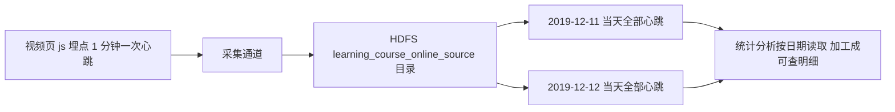

# 即时查询的采集与存储设计：五个页面字段如何落到七列埋点与按天目录

需求与技术方案把链路定了型，动笔写程序之前还差最后一张底稿：采集什么字段、这些字段存成什么形态。即时查询的麻烦在于页面字段与埋点字段完全对不上号，五个展示字段没有一个能直接采到，若不先把映射关系、原始数据结构与存储约定定死，采集侧埋漏了、统计侧就会无米下锅。这一节把三件事一次说清：原型字段的映射关系、ODS 层用户学习表的七列结构、HDFS 上的存储约定。

## 先给结论

- 原型五个字段没有一个能在采集端直接拿到：名称类靠维度表关联，学习时间靠埋点上报，学习时长靠计算得出。
- ODS 层用户学习表共七列：`user_id`、`course_id`、`course_video_id`、`user_ip`、`user_session_id`、`user_agent`、`learn_time`，每一行是一次学习心跳。
- 埋点按一分钟一次的心跳节奏上报，页面开着、视频在播就持续发送，学习时长由心跳次数算出，原始数据里没有时长终值。
- 存储是 HDFS 纯文本：每天一个 yyyy-MM-dd 目录，字段间 `\t` 分隔，行间 `\n` 换行。
- 这份按天目录就是后续统计分析的取数入口，按日期读入、加工成明细，两跳查询的两份数据都从这里来。

## 原型字段的映射：三个名称靠维度，两个时间靠行为

在线学习详情页的五个字段逐个对到数据上，讲义梳理的对应关系如下：

| 原型字段 | 采集字段 | 对应关系 |
| --- | --- | --- |
| 学生昵称 | 学生 id | 通过用户维度表关联 |
| 课程名称 | 课程 id | 通过课程维度表关联 |
| 视频名称 | 视频 id | 通过课程视频维度表关联 |
| 学习时间 | 视频开始播放时间 | js 埋点采集 |
| 学习时长 | 根据视频学习时间计算 | js 埋点采集，1 分钟采集一次 |

名称类三个字段的做法是「埋 id 不埋名称」。前端只上报 id，名称通过维度关联得出，好处有两层：埋点体积小、改动成本低，名称变更不用动埋点；口径统一，名称只有维度表一份权威来源。学习时间与学习时长属于用户学习行为，埋点采集它们的节奏值得单独说：学员在视频页学习时，页面不会频繁刷新，若只在进入页面时上报一次，后面的学习过程就全丢了，所以埋点按一分钟一次自动发送，一次心跳代表一分钟的学习。视频不放完页面不关，心跳就一直发；页面被关掉，心跳停止。学习时长就是这样由多条心跳记录算出来的，而任何一条记录里都不存在「学了多久」的终值。

## ODS 层数据结构：用户学习的七个字段

依据上面的映射关系反推采集端要什么，整理出的用户学习 ODS 表共七个字段：

| 采集字段 | 字段说明 | 数据格式 | 数据样例 |
| --- | --- | --- | --- |
| `user_id` | 用户 id，根据是否有值可判断是否登录 | uuid | e60f96225a9046d5b7d752d168d98d14 |
| `course_id` | 课程 id，可做课程热门程度等更多分析 | uuid | 29ee9d2337d980a19bcf6a733ea971ee |
| `course_video_id` | 视频 id，可通过维度关联视频名 | uuid | 0b26410f5b1e49ac813137e9d14eb254 |
| `user_ip` | 用户 ip，可分析用户所在区域 | ipv4 | 129.39.209.149 |
| `user_session_id` | 会话 id，每打开一个页面产生一个，关闭浏览器消失，用于去重 | uuid | 311e3af993644504a059fb6be75c7743 |
| `user_agent` | 浏览器标识，判断访问方式与是否机器人 | 浏览器 ua | Mozilla/5.0 (X11; Linux x86_64) AppleWebKit/537.36 (KHTML, like Gecko) Chrome/76.0.3809.87 Safari/537.36 |
| `learn_time` | 用户学习时间 | 时间戳 | 1510708629 |

七个字段各有各的用处，几个关键设计值得展开。`user_id` 顺带解决了登录判断：在线教育平台要求看视频必须登录，这一列必有值，登录行为与游客行为的区分天然成立。`course_id` 看似只为关联课程名称，实际留了热门度分析的后手，注意这里的「热门」口径是学习热度，与按销量、按选课算出来的热门不是一回事，分析维度不同，结论就会不同。`user_session_id` 是后续统计里去重与切段的钥匙：同一会话里的多条心跳属于同一段连续学习，只有按会话分组，计数才不会把一段学习切成多段。`user_agent` 除了识别浏览器，还是机器人过滤的依据，机器刷量在统计前就该剔掉。`learn_time` 是秒级时间戳，它既要被格式化成日期供分区与查询使用，也是心跳计数的原子，一条记录就是一次一分钟。

## 存到哪、怎么存：HDFS 按天目录与分隔约定

存储设计回答三个问题：什么格式、怎么组织、内容长什么样。讲义的答案都落在 1.4 节：数据以 HDFS 文本文件存放；每天的数据放在以 年-月-日 命名的目录里，目录模板为 `/user/hive/external/data_course/learning_course_online_source/${now():format('yyyy-MM-dd')}`，其中 `${now():format(...)}` 是采集落盘时求值的日期表达式，每天的数据落在当天的目录里；文件内容以 `\t` 分隔字段、`\n` 分隔行。一条样例数据长这样：

```text
c88d0387fa59432d9904498cc7f04b0c    f4a87d53f9154ae98d2ffa4cea967e11    92e66dffc3624d00aa31602d86d18305    91.77.106.137    37e6096d-cbdf-4f17-86d6-ceb91ec673c2    Chrome    1570500691
c88d0387fa59432d9904498cc7f04b0c    f4a87d53f9154ae98d2ffa4cea967e11    92e66dffc3624d00aa31602d86d18305    118.147.126.85   37e6096d-cbdf-4f17-86d6-ceb91ec673c2    Chrome    1570241491
```

七列依次对应 ODS 表的七个字段，`user_agent` 在样例里简写成浏览器名。观察样例还能看出心跳形态：同一个 `user_id` 与 `course_video_id` 连续出现多条，ip 与时间戳逐条不同，正是这种多条记录的形态给后续计算留了原料。整条数据的去向如下：



上图最关键的是目录与日期的一一对应：一天一个目录，既是数据物理上的分区，也是后续统计程序按日期取数的单位，拿哪天的数据就进哪天的目录，不用扫描全量历史。埋点接入与维度数据采集的落地配置，在采集落地的篇幅里展开；统计分析如何把这份原始数据加工成 HBase 与 Elasticsearch 里的明细，则在统计的篇幅里展开。

## 这份设计给统计侧留了什么接口

按天目录加 `\t` 文本加心跳形态，三个约定合起来几乎把统计动作都暗示出来了。文本格式让读取端用一行 `split` 就得到结构化数据，不需要任何复杂解析；按天目录让增量重算成为可能，某天数据有问题就重读那天重算一遍；心跳形态则决定了时长的算法，按用户、课程、视频、会话分组后数心跳条数即时长，组内最小的时间戳即开始学习的时间。为了让 HDFS 上的文本也能被 Hive 直接查看，可以按存储约定补一份外部表定义（示例为按本课路径补全，讲义未给出 DDL）：

```sql
-- 示例：按本课存储约定补全的外部表定义，便于 Hive/Hue 直接查看原始数据
CREATE EXTERNAL TABLE data_course.learning_course_online_source (
    user_id           string,
    course_id         string,
    course_video_id   string,
    user_ip           string,
    user_session_id   string,
    user_agent        string,
    learn_time        bigint
)
PARTITIONED BY (date_info string)
ROW FORMAT DELIMITED FIELDS TERMINATED BY '\t'
LINES TERMINATED BY '\n'
STORED AS TEXTFILE
LOCATION '/user/hive/external/data_course/learning_course_online_source';
```

分区列与目录日期一一对应，挂一天分区就是挂一天目录。课程自己的统计程序并不依赖这张表，直接按日期读 HDFS 目录即可，外部表只提供一个人工核查原始数据的便利入口。

## 常见误区

- **以为原始数据里有名称与时长。** 错例：在 ODS 七列里找课程名称、学习时长找不到，就认为采集漏了。正解：七列全是 id、环境信息与时间戳，名称在维度表里，时长靠心跳算出来，采集端的设计本来就是薄的。
- **把相邻记录的时间差当学习时长。** 错例：拿两条心跳的 `learn_time` 相减得到时长。正解：按会话分组数心跳条数才是时长，时间差只反映两条记录的间隔，页面关闭、网络抖动都会让它失真。
- **目录命名不用日期或格式不统一。** 错例：所有数据堆进一个目录，靠文件名区分。正解：严格遵守 yyyy-MM-dd 逐天建目录，这是统计按日期增量读取的前提，格式错了按日期找数据就直接失败。
- **分隔符随手定。** 错例：埋点用逗号、生产脚本用 `\t`、统计程序按空格切。正解：`\t` 与 `\n` 是三方契约，埋点、生产数据脚本与统计程序必须同一套分隔约定，样例数据就是验收标准。

## 面试可能被问到的问题

1. 面试官追问：「为什么埋点不上报课程名称、视频名称和学习时长？」
   答：名称属于维度属性，埋在日志里既增大体积又让口径分散，名称变更还要改前端；时长是衍生值，任何时刻都只能由行为推算。埋点只上报 id 与时间点，采集端最薄，加工端最灵活。
2. 面试官追问：「session id 在统计里怎么用？」
   答：会话 id 标识一段连续浏览，页面打开产生、关闭浏览器消失。统计按用户加课程加视频加会话分组，同一会话内的心跳合并计数，既完成了去重，也避免把一段连续学习误切成多条记录。
3. 面试官追问：「原始数据为什么存 HDFS 文本，不直接写库？」
   答：ODS 层的定位是原始留档，文本文件成本最低、 schema 最宽松，任何后续加工出错都能回到这份原始数据重算。直接入库会把加工固化在写入时刻，想换口径就得重新采集。
4. 面试官追问：「按天目录对回溯重算有什么帮助？」
   答：日期即分区，重算某天就只读那天的目录，写入端按日期覆盖，任务天然幂等。历史某天的统计出错或口径变更，都能按目录粒度重放，不需要动其他日期的数据。
5. 面试官追问：「user_agent 除了过滤机器人还能做什么？」
   答：可以分析访问终端与浏览器的分布，指导前端兼容策略；也能辅助识别异常流量，比如某类非常见客户端集中出现。字段采集一次，多场景复用，这正是埋点设计要先盘下游需求的原因。

## 配套资料

- 讲义：`materials/docs/08/智慧学成-第5章-即时查询.md`，1.3 采集分析（原型字段分析、ODS 层数据结构）与 1.4 ODS 数据存储分析为本节出处；采集落地与统计加工的细节见对应篇幅。
- 资料：`materials/code/08/_散落资料/`，用户学习数据生产脚本（python）与数据生产、课程视频维度采集两类 NiFi 模板在该目录（内层文件名带站点后缀，属元信息，按用途自取）。
- 说明：Hive 外部表 DDL 为按本课存储约定补全的示例，讲义未给出 DDL；数据样例取自讲义 1.4 节，分隔符与目录约定以讲义为准。
