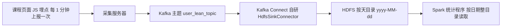

# 用户学习行为数据采集：用 Kafka Connect 把埋点流水落进 HDFS 按天目录

即时查询要查明细，前提是明细的原料先躺在仓库里。原料就是用户学习行为流水：谁、在哪门课的哪个视频上、什么时候开始看、看了多久。埋点其实早就埋好了，第 2 章数据仓库与 ETL 部署采集系统时，课程访问量与在线学习人数这两个 JS 埋点已经一起配置在页面上，当时只消费了课程访问量那条消息流，用户学习的数据发进 Kafka 之后就没有下文。而即时查询的统计程序是 Spark 批处理，它按天去 HDFS 读文本文件，Kafka 里躺着的数据它够不着。这一节补的就是中间这一段：给 `user_lean_topic` 配一条持久化通道，让消息源源不断写进 HDFS 的按天目录。

## 先给结论

- 用户学习的 JS 埋点在第 2 章部署采集系统时已配置完毕，本节不碰埋点代码，直接复用。
- 埋点数据进 Kafka 后不会自动落盘，需要通过 Kafka Connect 挂载自研的 HdfsSinkConnector，把 `user_lean_topic` 持久化到 HDFS。
- 落盘规则：基础路径 `/user/hive/external/data_course/learning_course_online_source/`，按 `yyyy-MM-dd` 一天一个子目录，攒够 100 条刷一次文件。
- connector 的增查走 Kafka Connect 的 REST 接口：POST 添加、GET 查看；重复提交同一名字会报已存在。
- 验证有两条路：`kafka-console-consumer` 看 topic 里的实时消息，HUE 的 File Browser 看 HDFS 目录里的文件；埋点一分钟上报一次，刷新页面即触发。

## 埋点早已有，缺的是落盘那一段

先把整条链路摆出来，才知道这一节补的是哪一块。页面里的 JS 埋点按固定节奏（一分钟一次）把用户学习行为打包上报，采集服务器接收后写进 Kafka，到此为止是第 2 章已有的部分；Kafka Connect 的 sink connector 订阅这个 topic，把消息攒批写进 HDFS，供下游 Spark 按日期整目录读取，这一段是本节新挂上去的。



这条链路里 Kafka 只承担缓冲，不承担归档；HDFS 上的按天目录才是数仓 ODS 层的物理形态。后面所有统计分析、维度关联都从这个目录出发，落盘规则一旦定下，下游代码的读法也就定下了。

## 采集配置：一条 REST 请求挂上 connector

Kafka Connect 是 Kafka 自带的数据进出框架，connector 是配置驱动的常驻搬运程序，写好 JSON 提交即可，不需要写一行代码。添加用 POST 请求打向 Kafka 容器的 8083 端口，请求体选 raw 格式、类型选 JSON，内容如下：

```json
{
  "name": "user_lean_topic",
  "config": {
    "connector.class": "com.study.xc.common.kafka_to_hdfs.hdfs.HdfsSinkConnector",
    "tasks.max": "1",
    "topics": "user_lean_topic",
    "hdfs.url": "hdfs://xc-online-hadoop:9000/",
    "flush.size": "100",
    "expression": "yyyy-MM-dd",
    "hdfs.path": "/user/hive/external/data_course/learning_course_online_source/",
    "name": "user_lean_topic"
  }
}
```

逐项拆开看：`connector.class` 指向课程自研的 sink connector，它继承 Kafka Connect 的 Sink 接口，负责把消息写成 HDFS 文本；`topics` 订阅用户学习这条消息流；`hdfs.url` 与 `hdfs.path` 合起来决定落盘位置，路径与数仓 ODS 层规划完全一致；`expression` 是目录表达式，connector 会按当天日期生成 `yyyy-MM-dd` 形式的子目录，这就是按天目录的由来；`flush.size` 控制攒批，攒满 100 条才真正写文件，避免每条消息开一个文件。

提交成功后接口会把 connector 详情原样返回。如果重复提交，返回的就是错误信息，提示 connector 已存在，此时不用慌，说明配置早已生效。查看当前挂了几个 connector 用 GET 请求同一个 URL、不带任何参数，返回列表里应当有两条：一条是此前课程访问量的持久化，一条就是刚加的用户学习持久化。

## 页面触发与两条验证路径

配置完成不代表数据在流动，得访问一次埋点页面。在线学习人数埋点页面的地址是 `http://xc-online:19856/learing-course-video`，打开后按 F12 切到 Network 面板再刷新页面，能看到埋点请求发往采集服务器。埋点的节奏是一分钟一次，等不及的话直接刷新页面，每次刷新都会触发一次上报。

**第一路验证看 Kafka。** 进入 Kafka 容器，用自带脚本起一个控制台消费者监听这条主题：

```bash
docker exec -it xc-online-kafka bash
cd kafka
./kafka-console-consumer.sh --bootstrap-server xc-online-kafka:9092 --topic user_lean_topic
```

消费者挂上后刷新页面，终端立刻吐出一条消息，说明埋点到 Kafka 这一段是通的。

**第二路验证看 HDFS。** 打开 HUE 的 File Browser，进入 `/user/hive/external/data_course/learning_course_online_source/`，按天生成的目录就在这里，进去能看到 connector 写出的文本文件。一行就是一次上报，七个字段以制表符分隔，依次是用户 id、课程 id、视频 id、用户 ip、会话 id、浏览器标识、学习时间：

```text
c88d0387fa59432d9904498cc7f04b0c    f4a87d53f9154ae98d2ffa4cea967e11    92e66dffc3624d00aa31602d86d18305    91.77.106.137    37e6096d-cbdf-4f17-86d6-ceb91ec673c2    Chrome    1570500691
```

测试时还有一个容易被误判成故障的现象：刷新一次页面，HDFS 目录里的数据量猛涨一大截。原因是此前测试产生的历史消息还压在 topic 里，connector 是新挂的，会把积压一次性消费完，于是文件里一次多出很多行。这是正常现象，等积压消化完，数据量就会回落到一分钟一条的节奏。

## 常见误区

- **以为埋点要重新写一遍。** 错例：翻出前端代码想往页面里再加用户学习上报。正解：第 2 章已经把在线学习人数的埋点配好了，只是当时没消费，本节只补 Kafka 到 HDFS 的持久化配置。
- **以为数据会自动从 Kafka 流进 HDFS。** 错例：消费者看到消息了，转身就去 HDFS 找文件，找不到就怀疑环境坏了。正解：Kafka 不落盘，必须有 sink connector 在搬运，先确认 connector 是否提交成功。
- **重复 POST 报已存在，以为配置写错了。** 正解：connector 名字全局唯一，已存在说明早先提交成功过，用 GET 查列表确认即可。
- **刚提交完 connector 就去 HDFS 找文件。** 错例：一分钟一条的数据离 100 条的刷盘线还很远，目录里自然空空如也。正解：先去 Kafka 看 topic 有没有消息，再等攒够一批去看文件，测试期不想等可以把页面多刷新几次。

## 面试可能被问到的问题

1. 面试官追问：「为什么用 Kafka Connect 落 HDFS，而不是自己写个消费者程序？」
   答：Kafka Connect 是配置驱动的，提交一段 JSON 就有常驻进程完成消费、攒批、写文件，自带失败重试与位点管理，不用自己写提交 offset 和异常处理的样板代码。项目里的 HdfsSinkConnector 是在 Connect 规范上扩展了按日期建目录的定制实现，兼顾了框架的稳定性与业务目录规则。
2. 面试官追问：「为什么按天建目录，而不是全写一个目录？」
   答：下游统计是按日期整目录读取的，`sc.textFile` 给一个日期目录就能读全当天数据，不用全目录扫描再过滤。按天目录同时天然支撑重跑：重算某天就把那天的目录重新生成，互不影响。
3. 面试官追问：「`flush.size` 设成 100 意味着什么，有什么副作用？」
   答：connector 攒满 100 条消息才落一次文件，减少小文件数量、降低 NameNode 压力。副作用是数据落盘有攒批延迟，量小的 topic 要等较长时间才能看到文件；实时性要求高的场景要调小，但会产生大量小文件，两者需要权衡。
4. 面试官追问：「埋点一分钟上报一次，这个节奏对后面的统计有什么意义？」
   答：它把连续的观看行为离散化成了分钟级的记录。后续统计学习时长时，同一次会话、同一视频的记录条数就是学习分钟数，不需要解析时间差，直接按分组计数即可，这是整个即时查询统计逻辑的基石。

## 配套资料

- 讲义：`materials/docs/08/智慧学成-第5章-即时查询.md`，1.3.2 ODS 层数据结构、1.4 ODS 数据存储分析与 2.1 用户学习采集（采集配置、页面访问、查看结果）为本课出处。
- 资料：`materials/code/08/_散落资料/`，用户学习数据生产的 NiFi 模板与即时查询整体流程 NiFi 模板在该目录（内层文件名带站点后缀，属元信息，按用途自取）。
- 说明：采集系统与自研 HdfsSinkConnector 的工程源码未随资料包归档，connector 配置以讲义为准，类包名按课程工程 `com.study.xc` 系改写；示例站点一律 example.com 占位。
