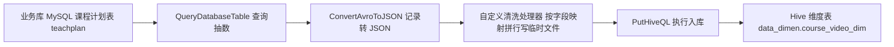

# 课程视频维度采集：用 NiFi 把业务库的课程计划同步进 Hive 维度表

> 🔒 安全提示：文中示例的口令/密钥均为课程教学环境演示口径，生产环境的安全要求见《安全与合规须知》。

即时查询页面要展示视频名称，而用户学习埋点上报的原始数据里只有 `course_video_id` 这样一个无意义的 uuid，名称类的信息从来不在埋点里，它们全躺在业务库的维度表里。用户维度、课程维度在第 2 章 ETL 已经采集进数仓，这一节只补最后一块拼图：课程视频维度。采集方式沿用项目的既定套路，NiFi 从业务库抽数、清洗、写入 Hive 维度表，配置好的流程以模板形式导入即可，真正要花心思的是两处配置和一次乱码排查。

## 先给结论

- 本节只采课程视频维度，用户维度与课程维度复用前两章成果，不重复建设。
- 模板名叫「课程视频维度采集」，导入 NiFi 的「维度」处理器组即可用，整条流程四段：查询业务库、Avro 转 JSON、自定义清洗拼装、PutHiveQL 写入 Hive。
- 启动前两处必配：把组内控制器服务启用，给 MySQL 连接池配好业务库连接（用户 root、密码 123456），感叹号消失才代表能跑。
- 落地表是 `data_dimen.course_video_dim`，四个字段：`course_video_dim_id`、`video_name`、`course_id`、`video_duration`，数据源是业务库的课程计划表 `teachplan`。
- NiFi 随系统启动可能没加载编码信息，采出的中文全是问号，重启 NiFi 后重新采集即可恢复。

## 视频名称藏在课程计划表里

业务前台展示课程内容时按章节、小节组织，这套层级信息存在业务库的 `teachplan`（课程计划）表：小节的名字就是要展示的视频名称，小节挂在哪门课下面对应课程 id，小节的时长就是视频时长。维度表要做的就是把这张业务表按数仓规范换名落地。模板里查询处理器配置的取数列与映射关系如下，整理成等价 SQL 更直观：

```sql
-- 按模板中 QueryDatabaseTable 的列配置整理的等价查询
select
    id          course_video_dim_id,   -- 课程计划 id，即视频维度 id
    pname       video_name,            -- 小节名称，即视频名称
    courseid    course_id,             -- 所属课程 id，关联课程维度
    timelength  video_duration         -- 视频时长
from teachplan
```

四个字段一一映射后写进 Hive 的维度库 `data_dimen`，后续统计程序关联视频名称时，拿埋点里的 `course_video_id` 到 `course_video_dim_id` 上一点就命中。

## 模板导入与两处必配

操作入口在 NiFi 的「维度」处理器组，页面右上角上传模板，选择课程视频维度采集的模板文件，上传成功后再以添加模板的方式把它拖进画布。组里已经有课程信息维度、课程分类维度、用户维度等处理器，课程视频维度是同级的新成员。

**第一处必配是控制器服务。** 打开处理器组的配置面板，能看到组内挂着的控制器服务列表，其中 Hive 连接池与 MySQL 的 DBCPConnectionPool 必须处于 Enabled 状态，否则依赖它们的处理器跑不起来。

**第二处必配是数据库连接。** DBCPConnectionPool 里配业务库的连接串、驱动、用户名与密码，课程环境的账号是 root、密码是 123456，密码这栏最容易漏，漏了以后处理器一启动就报认证失败。两处配置完成并启用后，处理器上挂着的黄色感叹号消失，此时点击启动，队列里很快出现数据流动，数据进入 Hive 即代表采集成功，然后把处理器组停掉，别让它空转。

## 流程内部：四个处理器各干一件事

模板展开后是一条直线流程，把业务库的表一路推进 Hive：



QueryDatabaseTable 按上面那张列映射从业务库抽数，输出 Avro 格式；ConvertAvroToJSON 把 Avro 记录转成 JSON 数组，方便人看也方便下游解析；自定义清洗处理器是课程在第 2 章 ETL 导入 NiFi 源码后自带的入库组件，配置里写明临时文件路径 `/opt/tmp/course_video_dim`、目标表名、字段对应关系与是否全量，它负责把 JSON 记录按映射拼装成入库行；PutHiveQL 挂着 Hive 连接池，批量执行入库语句把数据写进维度表。四段各司其职，换一张维度表时只是改配置，流程骨架不变。

采集完成后到 HUE 的 Table Browser 里查 `course_video_dim`，点进样本数据能看到一行行小节名称，Vue 的几节课、Java 的几门课都在里面，说明业务库的内容已经如实落进了数仓。

## 乱码：重启 NiFi 再采一遍

查看样本数据时最常见的故障是中文全变成问号。这不是数据源的问题，根因在 NiFi 的启动方式上：NiFi 容器随系统启动时，编码相关的环境信息可能没有加载完成，进程里的默认编码不是 UTF-8，写进 Hive 的中文就成了问号。

处理办法是把 NiFi 进程重启，让编码信息随新进程正常加载：

```bash
# 进入 NiFi 所在容器后执行
./nifi.sh restart    # 先 stop 再 start，编码信息随新进程加载
```

重启期间页面不可用属正常现象，等 NiFi 启动完成，把刚才乱码那批数据清掉重新采集，再查样本数据，中文恢复正常才算完。经验法则也简单：凡是服务器重启过，先看一眼 NiFi 的编码状态再开采集，采错了的数据都要重采，比检查再采一遍更费时间。

## 常见误区

- **控制器服务不启用就启动处理器。** 错例：导入模板后直接点启动，处理器报找不到连接池。正解：先把 HiveConnectionPool 与 DBCPConnectionPool 配置好并 Enabled，感叹号全部消失再启动。
- **连接串填了却忘了密码。** 正解：业务库账号 root、密码 123456，缺密码时启动报认证失败，这也是采集失败排查的第一站。
- **数据进了 Hive 就收工。** 正解：必须抽查样本数据确认中文正常，乱码数据留在维度表里，到统计关联时才会暴露，届时返工的是整条链路。
- **以为要手写采集程序。** 正解：模板与自定义处理器第 2 章都已备好，本节的动作只有导入模板、启用服务、配连接、启动、验证，五步之外没有第六步。

## 面试可能被问到的问题

1. 面试官追问：「维度数据为什么要从业务库采集，而不是像行为数据那样埋点上报？」
   答：维度数据是名称、层级、时长这类慢变化的结构化属性，权威来源就是业务库；埋点只适合上报行为流水。从业务库抽取既保证口径与业务一致，也不用改动前端代码，两条通道各管一类数据。
2. 面试官追问：「讲一下这条 NiFi 维度采集流程里各处理器的职责。」
   答：QueryDatabaseTable 负责按配置的列从业务库抽数并输出 Avro；ConvertAvroToJSON 把记录转成 JSON 便于下游处理；自定义清洗处理器按字段映射把记录拼装入库行、写临时文件；PutHiveQL 借助 Hive 连接池执行入库，把数据写进维度表。处理器链是直线，职责单一，换表只改配置。
3. 面试官追问：「采集出现中文问号，你的排查思路是什么？」
   答：先看数据源是否正常，业务库里中文完好则问题在传输与写入环节；这类 NiFi 采出的问号通常源于进程默认编码不是 UTF-8，多半发生在随系统自启、编码信息没加载成功的场景。重启 NiFi 让编码随新进程加载，清掉坏数据重采即可，预防措施是每次重启服务器后先验证编码再跑采集。
4. 面试官追问：「模板里的是全量采集还是增量采集？怎么改增量？」
   答：课程里配置的是全量方式，适合演示与小规模维度表；QueryDatabaseTable 本身支持增量，配置最大值列后处理器会记录上次查询到的最大值，下次只取新增部分。维度表数据量上来之后应该切增量，并在全量初始化与增量同步之间做好衔接。
5. 面试官追问：「为什么维度表单独放 `data_dimen` 库？」
   答：按数仓分层规范，维度表与事实数据分库存放，命名上一眼可辨用途；统计程序关联维度时 SQL 写起来清晰，权限与生命周期也能分开管理，维度变化慢、事实每天增量，两者的更新策略完全不同。

## 配套资料

- 讲义：`materials/docs/08/智慧学成-第5章-即时查询.md`，2.2 维度采集-课程视频维度为本课出处，采集配置细节参考其中指向的第 2 章 ETL 维度数据采集。
- 资料：`materials/code/08/_散落资料/`，课程视频维度采集的 NiFi 模板在该目录，用户维度采集、课程分类维度采集模板同在，可对照复用（内层文件名带站点后缀，属元信息，按用途自取）。
- 说明：NiFi 自定义清洗处理器源码随第 2 章 ETL 资料，未在本章归档；列映射 SQL 为按模板配置整理的等价写法，示例站点一律 example.com 占位。
