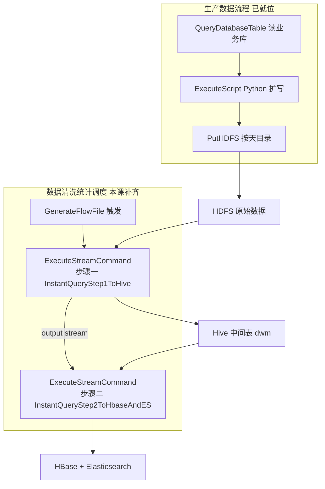

# 即时查询的调度总装：两个脚本、一个 jar、一块模板全部交给 NiFi

统计分析的两步代码一直在开发工具里手工点着跑，生产数据的流程也已经在画布上待命，但「点一下 IDE 跑一次」不是调度，只是开发动作。即时查询的集成测试把收尾的这块补上：统计分析代码打成 jar，连同两个 spark-submit 脚本一起送进 NiFi 容器，再把清洗统计的调度模板添加进画布，让 NiFi 把「触发步骤一、等它跑完、接着触发步骤二」这条链全程接管。配置做完，画布上就是完整的即时查询流程：生产数据在前，清洗统计在后，中间隔着一个 HDFS 与一份中间表。

## 先给结论

- 集成测试的分工：数据采集用 NiFi 生产数据的方式，此前已配置好；统计分析的两步代码打包成 jar 交给 NiFi 调度，开发工具正式退场。
- 两个脚本各管一步：`instant_query_step1_to_hive.sh` 拉起步骤一统计关联维度，`instant_query_step2_to_hbase_and_es.sh` 拉起步骤二保存到 HBase 与 Elasticsearch，脚本自带日期参数，由调度传入。
- 产物一份：`xc-service-search-jar-with-dependencies.jar` 两步共用，打一次包就够；打包前确认集群模式开关已打开。
- 部署路径固定：脚本进容器 `/opt/run/script`，jar 进 `/opt/run/jars`，全部经宿主机中转后 `docker cp` 进入，脚本记得 `chmod +x`。
- 调度模板「数据清洗统计: 用户学习」把两步串成一条链：GenerateFlowFile 触发，步骤一的 ExecuteStreamCommand 完成后经 output stream 关系交给步骤二，顺序天然正确。

## 集成测试要配什么：一张图看清

即时查询的 NiFi 流程分两块，一块早已就位，一块是本课补齐的：



生产数据与清洗统计两个处理器组之间没有依赖配置：生产侧不关心统计什么时候跑，统计侧自己按天读 HDFS。相互独立性反而省事，配置时各配各的，互不牵连；真正有依赖的是清洗统计内部，步骤一产出中间表，步骤二才有得算，这个先后关系由模板里的连接关系固化，不需要人工盯时序。

## 打包：模式开关与一份共用的 jar

统计分析代码读配置文件决定运行模式，打包前把集群模式的注释去掉，让 `useingCluster` 置为 true：

```properties
# true-集群模式，false-local模式，不配置默认为false
useingCluster=true
```

这一步在实时分析的集成测试里已经吃过亏：local 模式打的包提交后任务留在提交节点本地跑，Spark 集群页面上什么都看不到，调度看起来成功、数据却没有落。模式在打包那一刻凝固进 jar，错了就要重打，所以放在第一件事做。

打包需要一段时间，这段空档正好并行处理脚本上传，两边互不等待。打包产物是带依赖的 fat jar，两步统计程序在同一个工程里，打一次包两个主类都能用，这是脚本与 jar 分离设计带来的便利：脚本只负责拼 spark-submit 命令，命令指向哪个主类、传什么参数，改脚本就行，jar 不用动。

## 两个脚本：步骤一与步骤二的启动器

两个脚本骨架相同，差异只在主类。步骤一的脚本内容如下：

```bash
#!/usr/bin/env bash
if [[ $1 != "" ]];then
	TD_DATE=$1
else
	#TD_DATE=`date -d "-1 day" +%Y-%m-%d`
	echo "[===no params input,default date_info is yesterday($TD_DATE)===]"
	exit 1
fi
SPARK_SUBMIT=/opt/spark/bin/spark-submit

$SPARK_SUBMIT \
  --master spark://xc-online-spark:7077 \
  --class com.study.xc.analysis.search.InstantQueryStep1ToHive \
  /opt/run/jars/xc-service-search-jar-with-dependencies.jar ${TD_DATE}

if [[ $? == 0 ]];then
	echo "[===spark-submit process success===]"
else
	echo "[===spark-submit process failed===]"
	exit 0
fi
```

脚本开头检查第一个参数：传了日期就赋给 `TD_DATE`，没传就提示后退出，日期参数由 NiFi 调度在命令参数里传入，这正是离线批处理与实时常驻作业在脚本层面的分水岭。实时分析的脚本没有任何参数，因为流作业消费的是当下；批处理统计按天算，跑哪一天必须说清楚。主类 `InstantQueryStep1ToHive` 换成 `InstantQueryStep2ToHbaseAndES` 就是步骤二的脚本，其余一字不差。

与前面章节的提交脚本相比还有一个隐性差异：jar 名是 `xc-service-search` 系，与实时分析的 `xc-service-rt` 系、离线分析的包各归各，三个模块三份 jar，互不干扰，替换与回滚都只影响自己这条链路。

## 部署：docker cp 三件套进容器

脚本与 jar 先经宿主机中转：用 WinSCP 把两个 `.sh` 拖到宿主机的 `/opt/tmp`，打包完成后 jar 也传到这里。然后逐个送进 NiFi 容器：

```bash
# 宿主机执行：脚本进 script 目录，jar 进 jars 目录
docker cp /opt/tmp/instant_query_step1_to_hive.sh           xc-online-nifi:/opt/run/script/
docker cp /opt/tmp/instant_query_step2_to_hbase_and_es.sh   xc-online-nifi:/opt/run/script/
docker cp /opt/tmp/xc-service-search-jar-with-dependencies.jar xc-online-nifi:/opt/run/jars/
```

进容器验收并补权限。`docker exec -it xc-online-nifi bash` 登进去，确认 `/opt/run/script` 里两个脚本、`/opt/run/jars` 里 search 包都在位，然后给脚本加可执行权限：

```bash
# 容器内执行：新上传的脚本默认没有执行权限
chmod +x /opt/run/script/*.sh
```

权限这步漏不得，`ExecuteStreamCommand` 调用没有执行权限的脚本会直接报权限拒绝，调度永远起不来。这里用的是 `*.sh` 通配方式，目录里此前各章的脚本一并覆盖，也无副作用。

这套依赖打包时已经带上，jar 丢进容器就能跑，不需要额外配置，这也是它叫 jar-with-dependencies 的原因：把依赖捆在一起，部署就只剩「复制」一个动作。

## 调度模板进画布：两步串成一条链

最后一块拼图是调度模板。上传「数据清洗统计: 用户学习」的模板文件，用添加模板的方式放进即时查询处理器组。模板里是三个处理器：GenerateFlowFile 定时产出触发信号，两个 ExecuteStreamCommand 分别执行步骤一与步骤二的脚本。连接关系是关键：步骤一处理器的 output stream 关系连向步骤二处理器，流文件只有在步骤一的命令正常结束后才会流到步骤二，命令异常则流文件走 nonzero status 关系，步骤二不会启动。

这个串行关系保证了统计的两步永远按序执行：步骤一写完中间表，步骤二才去读中间表。日期参数在命令参数属性里配置，模板已配好，导入后不需要再动，知道它在哪里配置即可，这是前面所有调度模板的共同特点：模板固化参数，画布只管启停。

至此即时查询的 NiFi 流程全部就位：生产数据处理器组在浅层待命，清洗统计调度模板在旁边候着，脚本、jar、模板三样齐活。下一课启动调度走全链路，在 web 页面上看明细查询的真实效果。

## 常见误区

- **打包前不开集群模式。** 错例：接续上一课的配置直接 package，调度启动后 Spark 页面无任务，排查半天发现是 local 模式的包。正解：`useingCluster=true` 确认后再打包，模式凝固在包里。
- **脚本传完就用。** 错例：`docker cp` 进容器后直接启动调度，处理器报权限拒绝。正解：`chmod +x` 后终端里脚本名变绿，再启动调度。
- **以为两步要配两个调度模板。** 错例：找步骤二的独立模板找不到，怀疑资料缺失。正解：一个模板里两步已用 output stream 关系串好，顺序执行由画布保证，拆开反而要人工盯时序。
- **手动跑调度时不传日期。** 错例：手工触发 GenerateFlowFile 后脚本因缺参数退出，以为调度坏了。正解：脚本要求日期参数，参数由命令参数传入；看处理器的公告信息能直接看到脚本输出的提示语。

## 面试可能被问到的问题

1. 面试官追问：「为什么把两步统计串在一个调度模板里，而不是两个独立调度？」
   答：两步之间有严格的数据依赖，步骤二消费步骤一产出的中间表。用一个模板内的 output stream 连接，前一步命令正常结束流文件才流向后一步，依赖关系由画布拓扑固化，不依赖人工按时启动，也不需要外部协调组件。拆成两个调度就得解决「前者完成才触发后者」的问题，复杂度凭空增加。
2. 面试官追问：「脚本里的日期参数为什么不由脚本自己取昨天，而要外部传入？」
   答：自己取昨天把重算能力写死了：某天数据有问题要重跑历史，脚本内取日期就做不到。外部传入让同一段脚本既能按调度周期跑当天，也能手工指定任意历史日期重算，重跑成本只是传个参数。生产调度的通用原则是「执行单元无状态，状态与语义由调度层注入」。
3. 面试官追问：「ExecuteStreamCommand 怎么把参数传给脚本？」
   答：命令参数属性按分隔符拆成多个实参，按顺序拼在命令后面，脚本侧用位置参数接收。参数里同样可以写 NiFi 表达式，把流文件属性、系统时间动态算出来传进去，这正是调度层向执行单元注入语义的通道。
4. 面试官追问：「fat jar 一份两步共用，会不会互相影响？」
   答：不会。两个主类只是同一个 jar 里的不同入口，spark-submit 用 `--class` 指定谁，类加载彼此独立。共用反而带来一致性好处：两步的公共实体类、工具类出自同一份编译产物，不会出现步骤一和步骤二版本错配。代价是任何一处的代码改动都要整体重打包，模块化打包可以缓解，本项目规模下共用更划算。
5. 面试官追问：「生产数据与清洗统计之间不需要依赖配置，靠什么保证统计读到数据？」
   答：靠目录语义与触发节奏。统计按天读 HDFS 目录，目录里有数据就有得算，没有就空跑；触发节奏由 GenerateFlowFile 控制，安排在生产数据产出之后再启动统计调度即可。这是批处理链路里典型的弱协调：不追求精确的事件通知，用「分区就绪」作为就绪信号，简单且够用。

## 配套资料

- 讲义：`materials/docs/08/智慧学成-第5章-即时查询.md`，4.1 数据采集、4.2 统计分析（4.2.1 统计分析代码、4.2.2 NiFi 调度-用户学习：两个脚本内容与容器路径、4.2.2.3 调度流程）、4.3 NiFi 流程为本课出处。
- 资料：`materials/code/08/_散落资料/`，`instant_query_step1_to_hive.sh`、`instant_query_step2_to_hbase_and_es.sh` 提交脚本与用户学习数据清洗统计的 NiFi 调度模板在该目录（内层文件名带站点后缀，属元信息，按用途自取）。
- 说明：Scala 统计工程源码未随资料包归档，主类名与脚本内容以讲义为准，包名按课程工程 `com.study.xc` 系改写；容器内路径以 `/opt/run/script`、`/opt/run/jars` 为准，容器名与 Spark Master 地址按课程环境实际填写。
