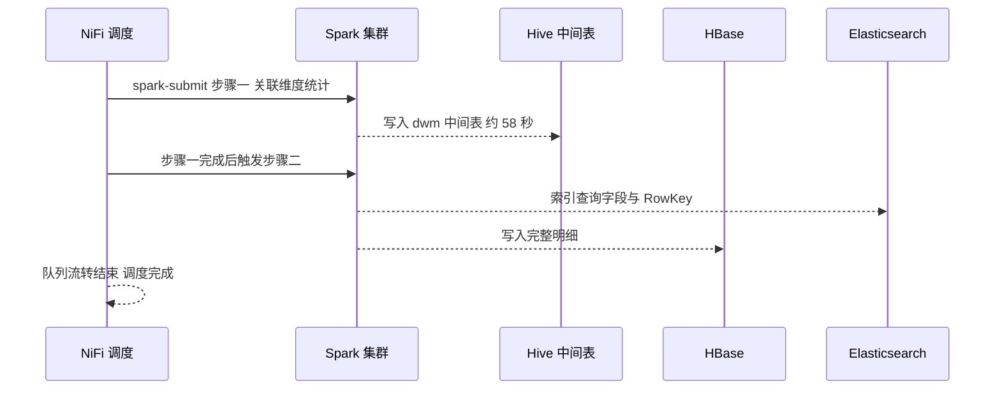
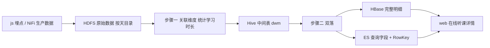

# 从调度到页面：即时查询全链路跑通与在线听课详情验收

配置阶段把脚本、jar、调度模板都送进了 NiFi，验收随之而来：清洗统计调度第一次被画布整体拉起，两步统计按序跑完，数据落进 HBase 与 ES，最后在业务报表系统的在线听课详情页上按条件查出真实明细。测试途中还挖出一个前端小瑕疵：学习时间列显示的是毫秒值，页面上要的是年月日时分秒。这一课把第五章的最后一段路走完，也顺手处理了验收中发现的收尾问题。

## 先给结论

- 测试对象是两个调度：生产数据流程此前已测过，本次主角是数据清洗统计调度，生产流程留下的数据可以直接复用。
- 测试前清场三处：ES 索引数据用 es-head 删除，HBase 表在 shell 里 disable 加 drop，Hive 中间表目录在 HUE 里删除，看不到旧数据才谈得上验证新数据。
- 调度启动后在 Spark 页面看步骤一执行，本次耗时约一分钟；步骤一完成队列自动流向步骤二，串行关系由画布保证。
- 数据核对三处：HUE 中间表有数据、es-head 有文档、HBase scan 有行有列。
- web 展示在在线听课详情页验收，条件查询、组合查询、日期区间筛选全部可用，共 109 条明细；前端分页显示有瑕疵但结果正确，学习时间的毫秒值需要格式化，留待下一章统一修复。

## 清场：让旧数据闭嘴

集成测试最容易翻车的环节不在跑，而在看：跑完一查有数据，但分不清是本轮写的还是上轮残留，测试结论失去意义。清场从下游往上游来，与数据流向相反：

**ES 先清。** 打开 es-head 管理页面，在数据浏览页签点动作、点删除，输入删除确认，索引里的旧文档清空。

**HBase 次之。** 进 NiFi 容器切到 HBase 的 bin 目录，进入 hbase shell，把明细表先禁用再删除：

```bash
hbase(main):001:0> disable 'LearningOnlineDetail'
hbase(main):002:0> drop 'LearningOnlineDetail'
hbase(main):003:0> list
TABLE
demo
1 row(s) in 0.0050 seconds
```

hbase shell 有个使用细节要提前知道：命令敲错时，已经敲错的第一个单词无法回删修改，只能整行重新输入，测试时多敲两遍是常态，不是环境故障。list 确认表已不在，清场到位。

**中间表最后清。** 生产数据流程上次留下的 HDFS 原始数据还在，直接可用；中间表是上次测试算出来的，得删。在 HUE 的文件浏览器里进到 dwm 表对应目录，把里面的数据目录干掉，再用 HUE 的表浏览器确认表里已经无数据。至此 ES、HBase、中间表三处干净，画布上的生产数据流程也有存量，随时可以启动统计。

## 跑调度：两步统计依次过场

一切就绪，启动数据清洗统计调度。GenerateFlowFile 触发后，步骤一的 ExecuteStreamCommand 执行 spark-submit，Spark 页面的 Running 列表里能看到步骤一在执行。批处理跑完即退，等待是唯一要做的动作，本次步骤一耗时约 58 秒。



步骤一结束，流文件经 output stream 关系流向步骤二，第二个调度处理器随即拉起，说明画布上的串行编排按预期工作。两步都跑完后按三处核对：HUE 里刷新中间表，数据回来了；es-head 里浏览索引，文档齐全；HBase 里 scan 明细表，行与列都在。三处齐备，链路层的测试宣告通过，剩下的交给页面。

## web 展示：在线听课详情页验收

前台与后台服务保持运行，浏览器打开业务报表系统，登录页用户名密码随意填，验证码照图形输入即可，三个框不能留空。登录后从菜单进在线听课详情页，这就是即时查询要支撑的全部业务面。页面刚进来默认没有数据，点一下查询，109 条明细列了出来，学生昵称、课程名称、视频名称、学习时间、学习时长五个字段都值，两跳查询（ES 收敛 RowKey、HBase 取明细）在用户视角下就是一次普通的表格查询。

接着逐项验证查询能力：

**按学生昵称筛选**，取昵称尾部为 CHU 的学员查询，命中 14 条，过滤准确。

**按课程名称筛选**，查询课程名含「基础」的明细。这里出现一个小插曲：页面上只显示 4 条，但下方翻页明明还有更多内容。原因是上一轮查询把页码停在了第二页，新查询继承了旧页码，展示的是第二页的内容，切回第一页就正常了。结果集本身正确，是前端分页状态没有随新查询重置，属于显示瑕疵。

**按视频名称筛选**，输入含「基础」的视频名，结果为空。排查发现输入的条件里多了一个空格，匹配不上，把空格去掉后查询正常返回。组合多个条件时同理，单条件查询、两条件组合、日期区间筛选逐一试过，返回条数与条件吻合，查询功能本身没有问题。

测试中还发现一个数据展示问题：学习时间一列显示的是毫秒值，而页面原型要求展示年月日时分秒。数据在 HBase 里存的就是毫秒时间戳，前端渲染前需要对 `learn_time` 字段做一次格式化，按 `yyyy-MM-dd HH:mm:ss` 输出。这是一个开发期的疏忽，改动很小，留到下一章系统集成测试时代码重新打包时一并修复，届时全链路还会再验一遍。

## 第五章收官复盘

到这里，即时查询整章闭环。回顾整条链路，每一环都各司其职：



技术上的看点集中在三处。数据层，原始埋点只有 id 没有名称，名称全靠维度关联补齐，学习时长更是从一分钟一次的埋点节奏里按会话计数算出来的，统计逻辑吃透了数据的原始形态。存储层，HBase 与 ES 的分工是本章的主线：ES 只索引查询字段与 RowKey，承担条件收敛；HBase 存完整明细，承担点查取行，两跳合起来才是完整的一次查询。工程层，从采集、统计到调度全部收口在 NiFi 画布，测试要做的只是启动与核对，这正是前几章持续把调度交给 NiFi 的回报。

集成测试暴露的两个小问题也值得一提：一个是前端分页状态未重置的显示瑕疵，一个是学习时间未格式化。两者都不影响链路正确性，但都会影响验收体验，记录在案、带着修，比测试通过后再返工要从容得多。下一章系统集成测试把离线分析、实时分析、即时查询三条链路放在同一个环境里，按生产的方式整体验一遍。

## 常见误区

- **不清旧数据就看结果。** 错例：ES 与 HBase 里有上一轮的残留，跑完调度看到「有数据」就下结论。正解：ES、HBase、中间表三处先清，看到的数据才有可能是本轮写入的。
- **把 hbase shell 的输错当故障。** 错例：命令首词敲错按退格删不掉，反复重试怀疑终端坏了。正解：hbase shell 对已输入的首个单词不支持回删修改，整行重敲即可。
- **分页停在第二页误判查询条数。** 错例：新查询后页面显示条数变少，以为查询条件过滤过猛或数据丢了。正解：切回第一页再看，是新查询继承了旧页码的显示问题，结果集本身正确。
- **把毫秒值当数据存错。** 错例：页面上学习时间是一串数字，回头检查 HBase 存储与统计代码。正解：存储层存毫秒时间戳是合理设计，展示层负责格式化，问题定位在前端渲染缺一步转换。

## 面试可能被问到的问题

1. 面试官追问：「集成测试为什么要先清理多个存储，顺序怎么定？」
   答：清理是为了让测试结果可辨识，混着旧数据无法断言新写入是否成功。顺序与数据流向相反：先清展示与存储端（ES、HBase），再清中间层（Hive 中间表），源头数据按需保留。这样清理期间没有程序在写，避免边删边写删不干净，下游先清也保证随后核对到的数据必然来自本轮。
2. 面试官追问：「两步统计的先后执行是谁保证的？」
   答：NiFi 画布上的连接关系。步骤一处理器的 output stream 关系指向步骤二，命令正常结束流文件才流向下一步，异常则走失败关系，步骤二不会启动。依赖固化在拓扑里，不依赖人工时序或外部协调，这是把编排交给调度工具的直接收益。
3. 面试官追问：「页面上一条查询，背后经过了哪些环节？」
   答：前端把条件发给后台接口，接口先查 Elasticsearch，用组合条件收敛出命中的文档集，取回 RowKey 列表；再按 RowKey 批量回 HBase 点查完整明细；组装后返回页面渲染。ES 出候选、HBase 出数据，两跳都是索引或主键级访问，数据量大也能维持秒级响应。
4. 面试官追问：「测试中发现的显示类问题怎么处理，修数据还是修展示？」
   答：先定性。存储层存毫秒时间戳是通用做法，精度不损失、计算方便，展示格式化是展示层的职责，所以修前端渲染而不是改存储。判定原则是哪一层的问题在哪一层修，存储迁就展示格式会造成写入时丢精度、多处消费重复格式化。
5. 面试官追问：「开发期造数加集成测试，能不能替代真实数据验证？」
   答：不能完全替代。造数验证的是链路正确性：格式、依赖、调度、查询都按真实结构走，但数据分布的真实性差得多，真实流量里的倾斜、热点、异常值造数覆盖不了。正确姿势是造数先行把功能问题清完，上线后用真实数据回归一遍分布相关问题，两者是递进关系不是替代关系。

## 配套资料

- 讲义：`materials/docs/08/智慧学成-第5章-即时查询.md`，4.4 测试（NiFi 采集生产数据、执行清洗程序自动索引到 ES 与保存到 HBase）与 5 web 展示（在线听课详情）为本课出处。
- 资料：`materials/code/08/_散落资料/`，即时查询整体流程的 NiFi 模板与用户学习数据清洗统计调度模板在该目录（内层文件名带站点后缀，属元信息，按用途自取）。
- 说明：Scala 统计工程源码未随资料包归档，测试步骤与命令以讲义为准，包名按课程工程 `com.study.xc` 系改写；登录页账号与验证码按课程环境可任意填写但不能留空，示例站点一律 example.com 占位。
