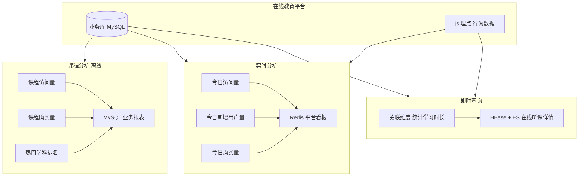

# 从单链路验收走向全局验收：系统集成测试的学习目标与全项目地图

各章的集成测试都过关了：离线分析的调度一键能跑，实时分析的看板数字会跳，即时查询的详情页查得出明细。但每一次验收都是单链路的，互相之间没有同场竞技过。系统集成测试这一章要做的就是全局验收：把课程分析、实时分析、即时查询全部功能按企业生产环境的方式部署起来、连起来、跑起来，结果统一落到业务报表系统上展示。开篇先立目标，再把整个项目的功能版图与测试路径盘一遍，后面的代码改造、重新打包、逐指标调度都从这里出发。

## 先给结论

- 系统集成测试的三条学习目标：理解系统集成测试的目的、能够完成系统集成测试、能够在业务报表系统上展示测试结果，最后一条同时是衡量测试成功的标准。
- 测试方式按企业生产环境来：数据采集与 Spark 任务执行仍然走 NiFi，代码里的日期从写死改成参数传递、动态获取，改完重新打包上传 NiFi 容器。
- 改造范围只有两块：课程分析（离线）与即时查询，它们按天算数据；实时分析不用改，数据实时进来只处理当天，没有日期参数可改。
- 单章集成验证一条链路通不通，全局系统集成验证三条链路在同一环境、共享同一批资源时还能不能各自正确运转，这是两个层级的测试，不是把各章测试重跑一遍。
- 全局调度按指标逐个推进：数据采集生成一定量即停，清洗统计逐指标执行，落地业务库与清洗联动自动触发，调度前清空业务报表系统数据库保证验证口径干净。

## 学习目标：三句话定验收线

**第一，理解系统集成测试的目的。** 一句话：按照企业生产环境的方式完成项目的部署与测试。此前每一章的测试都在各自为战，代码里的日期是写死的，测试环境里无所谓，生产环境绝不允许：新数据到了，调度还是按老日期执行，统计永远停在指定的那一天。以即时查询步骤一读原始数据为例，改造前的写法是把日期钉在变量里：

```scala
// 改造前：日期写死，调度再怎么触发都只处理这一天
val date_info = "2019-12-12"
val learnSource = sc.textFile(s"/user/hive/external/data_course/learning_course_online_source/${date_info}")
```

改造方向是参数传递、动态获取：程序从入参读日期，日期由调度层在触发时注入，调度想让它算哪天它就算哪天：

```scala
// 改造后：日期来自入参，由调度动态传入，缺省可回落到前一天
val date_info = args(0)
val learnSource = sc.textFile(s"/user/hive/external/data_course/learning_course_online_source/${date_info}")
```

这一处改动就是从「能跑」走向「能上线」的分界，离线分析与即时查询里所有按天处理的位置都要照此统一。

**第二，能够完成系统集成测试。** 完成指的是全程动手：改代码、重新打包、上传 NiFi 容器替换旧包、微调调度、逐指标跑通采集与统计，每一环都在前面章节出现过，这一章按生产的顺序串起来执行一遍。

**第三，能够在业务报表系统上展示测试结果。** 这一条是验收线也是成功率尺：结果能在业务报表系统上正常展示，测试才算通过；展示不出来，前面必有一环没通。它把「测试通过」的定义从程序退出码拉到了业务可见性上，集成测试区别于单元测试的地方就在这里，链路上任何一环的问题最终都会以「页面缺数」的形式暴露。

## 全项目功能版图：三条链路的来龙去脉

概述从项目的起点讲起，也是对整个项目的回顾。数据仓库与 ETL 是地基：分层数仓规划好了 ODS、DWD、DWS、ADS 的位置，采集系统把业务数据收进来。在此之上，三条链路依次搭建：



离线分析从课程访问量起步，一个指标的完整流程走通后，课程购买量与热门学科排名复制同样的骨架；三个指标的数据成批进数仓、批处理算完落 MySQL，回答整体怎么样。实时分析盯三个当日指标：今日访问量、今日新增用户量、今日购买量，常驻流计算按 5 秒批累加进 Redis，看板秒级刷新，回答此刻怎么样。即时查询面对海量行为日志，把明细关联维度、算出学习时长后存进 HBase 并索引 ES，支撑在线听课详情的任意条件秒查，回答具体某条什么样。三条链路共用一套基础设施：NiFi 既做采集又做调度，Spark 是共同计算引擎，业务报表系统是共同展示出口。

这张图也是全局测试的对象清单：离线三个指标、实时三个指标、即时查询一条链，七个对象逐个过。

## 单章集成与全局系统集成：差在哪一层

**单章集成测的是链路本身。** 每一章末尾的集成测试，范围是本指标的采集、统计、落地、展示，环境里只有这一条链路在跑。资源随便用，调度想什么时候跑就什么时候跑，业务库里只有自己的表在写，测的是功能正确性：这条链路通不通、数据对不对。

**全局系统集成测的是共存。** 三条链路放进同一个环境同时存在，事情立刻变多。资源上，Spark 程序占用资源较多，七个指标的清洗统计不可能同时全开，得逐指标推进，采集也是生成一定量即停；数据上，同一份业务数据被三种形态加工，离线算聚合、实时算计数、即时算明细，口径必须一致，日期尤其要统一从调度动态获取，否则离线与即时查的就不是同一天；环境上，业务报表系统一个出口接了三种数据，MySQL 的报表、Redis 的看板、HBase 与 ES 的明细，任何一处落地失败都会在页面上留白。

**全局集成最容易暴露的正是单章测试遇不到的问题。** 各章各自的 jar 上传替换，谁覆盖了谁；调度模板越加越多，触发时间打架；某章测试留下的脏数据混进全局验收的口径。这些问题在单章视角里不存在，把所有链路放回同一张画布、同一个集群、同一个业务库才会现身，按生产方式部署正是为了逼出它们：生产环境从来不是一条链路独享资源。

**两者的关系是递进而非重复。** 单章集成没过的链路，全局集成必然过不了；单章全过也不代表全局能过。顺序上是先单章后全局，全局测试前各章的调度配置、jar、脚本全部复用，要动的只有日期参数化与执行节奏编排，准备工作看起来不多，因为地基都是现成的。

## 测试路径预告：改代码、换包、调调度、看页面

接下来几节的工作量分布如下。代码重新打包：课程分析（离线）与即时查询里写死的日期全部改成参数获取，改完在开发工具的 Maven 视图里打包，把新的带依赖 jar 上传 NiFi 容器替换旧包，实时分析的代码不动。NiFi 调度微调：调度框架早已配好，只需确认参数传递正确；触发策略为方便测试仍用时间驱动，实际生产按需配置，配置时只关注处理器组的第一个处理器。

调度执行按指标逐个推进：数据采集用生产数据方式，根据指标逐个进行，生成一定量后停止；数据清洗统计执行 Spark 程序，资源占用大，同样逐指标来；落地业务库与清洗统计联动，自动触发。执行前两件事必做：清掉即时查询在 ES 与 HBase 里的存量数据，清空业务报表系统的数据库，把上一章测试留下的报表数据全部清掉，让每张报表的数字都能对应到本轮写入。业务库侧的清空是一组 truncate，按报表表清单逐张执行：

```sql
-- 业务报表系统数据库清空脚本节选（讲义全表清单为准）
truncate table course_visit_biz;          -- 课程访问量报表
truncate table course_buy_biz;            -- 课程购买量报表
truncate table course_hot_week_biz;       -- 热门学科周榜
truncate table platform_offline_biz;      -- 平台离线指标
truncate table subject_sale_month_biz;    -- 学科销售月榜
```

HBase 侧的清空沿用此前章节的做法：先 disable 明细表再 drop，ES 侧在 es-head 管理页面删除索引数据。三处清空后，页面上任何数字都有明确来源。

最后在业务报表系统逐页验收：平台看板的实时数字、课程访问量与课程购买量的离线报表、热门学科排名、在线听课详情的明细查询，一个页面一个页面过，全部有数且口径正确，系统集成测试才算收工。

## 常见误区

- **以为实时分析也要改日期参数。** 错例：把三个模块的代码都翻一遍找日期硬编码。正解：实时数据实时进来只处理当天，程序自己管理当日 field，没有日期参数可改；要动的只有按天批算的离线分析与即时查询。
- **把全局系统集成当成各章测试重跑。** 错例：把每章的集成测试步骤机械执行一遍就宣布完成。正解：全局测试验证的是共存，资源共享约束下的执行节奏、跨链路的口径一致、统一出口的展示，这些是单章测试覆盖不了的考察点。
- **以为调度要推倒重配。** 错例：准备从零重搭一遍 NiFi 流程。正解：各章的调度配置全部复用，只做微调：确认参数传递、按指标控制启动节奏，配置工作量很小，重点在执行顺序与数据清理。
- **用程序退出码当验收标准。** 错例：调度跑完、命令返回零，就认为系统集成测试通过。正解：以业务报表系统展示为准，页面有数、口径正确才是通过，中间环节成功不代表整体交付成功。

## 面试可能被问到的问题

1. 面试官追问：「为什么代码里的日期必须参数化，测试阶段写死不行吗？」
   答：写死的日期让程序失去时间语义，调度每天触发，处理的永远是同一天的数据，新数据永远进不了统计。参数化后由调度层按执行时机注入日期，程序行为随业务时钟走，同时保留指定历史日期重算的能力。测试阶段写死能跑，是因为测试目标只是功能验证；生产环境跑的是持续性任务，时间必须是活的。
2. 面试官追问：「全局系统集成和单章集成测试的投入产出怎么权衡？」
   答：单章集成定位问题快，范围小、变量少，日常开发迭代主要靠它；全局集成成本高，要清数据、控节奏、跨模块核对，但它验证的是交付形态，上线前必做。常见的节奏是功能开发配单章集成，版本发布前跑一轮全局集成，两者服务不同的风险：功能错误靠前者，集成与共存问题靠后者。
3. 面试官追问：「七个指标的统计不能并发执行，除了资源还有什么原因？」
   答：还有可观测性与回滚。逐指标推进让每个指标的产出可以单独核对，出了问题定位范围就是当前指标；全并发跑起来，日志交错、失败叠加，排查成本陡增。另外逐指标执行天然支持断点续跑，某个指标失败修完后单独重跑它即可，不影响已经成功的指标。
4. 面试官追问：「测试前清空业务报表系统数据库，会不会太粗暴？」
   答：在测试与预发环境这是标准动作，目的是让报表数字与本轮写入一一对应，验收口径干净。生产环境不会这样做，生产靠增量核对：记录上一轮的水位或快照，对比本轮增量。环境性质决定清理策略，关键是不把测试环境的手法直接搬进生产。
5. 面试官追问：「结果能在业务报表系统展示，为什么就能证明整条链路没问题？」
   答：展示是链路的最末端，页面上的一个数字背后是采集、加工、统计、落地、接口、展示的完整传递，任何一环断了末端必然缺数。它不能证明每个环节内部实现最优，但足以证明端到端可用。再配合数值口径核对，比如访问量与埋点量级相符、明细条数与造数量相符，就能确认数据不仅到了而且是对的。

## 配套资料

- 讲义：`materials/docs/08/智慧学成-第5章-即时查询.md`，第 6 节系统集成测试（学习目标、6.1 代码重新打包、6.2 NiFi 采集-清洗-统计分析的调度步骤与数据清理脚本、6.3 WEB 展示）为本课出处。
- 资料：`materials/code/08/_散落资料/`，覆盖全项目各指标的 NiFi 整体流程模板与各指标采集、生产、调度模板在该目录（内层文件名带站点后缀，属元信息，按用途自取）。
- 说明：业务报表系统数据库清空脚本以讲义所列 truncate 清单为准；代码改造细节以讲义截图描述与后续课程为准，包名按课程工程 `com.study.xc` 系改写，示例站点一律 example.com 占位。
