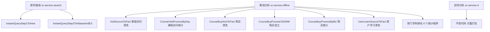

# 系统集成测试第一步：把写死的日期全部改成调度传参

单章测试时，代码里的日期是写死的，`val date_info = "2019-12-11"`，程序跑得欢，报表也有数。可一旦按企业生产环境的方式部署，问题立刻出现：调度每天都会触发 Spark 程序，而程序里钉死的日期永远不变，新采集的数据躺在新目录里没人读，报表数字永远停在写死的这一天。系统集成测试的代码改造就解决这一件事：所有按天处理的位置，日期一律改成参数传递、动态获取，让调度想让它算哪天它就算哪天。改造本身不难，难的是点位多、散、容易漏，漏一处，验收时那一张报表就没有数。

## 先给结论

- 改造范围只有两个模块：课程分析（离线）与即时查询，它们按天批算历史数据；实时分析的数据实时进来只处理当天，没有日期参数，代码一行不动。
- 修改点位归为三类：日期来源改成 `args(0)`、开发期「查询所有」的 SQL 分支切回「按日期过滤」、造数据环节按测试口径决定是否过滤。
- 数组下标从 0 开始，`args(0)` 才是 spark-submit 传进来的第一个参数，开发期随手写的 `args(1)` 是个隐患。
- NiFi 侧的调度配置在开发期已经配好，不重配，只需确认 ExecuteStreamCommand 处理器的时间表达式在正确传参。
- 全部改完在 Maven 视图执行 `clean` 加 `package`，产出带依赖的 jar，留给下一步上传 NiFi 容器替换旧包。

## 改造范围：两个模块改，一个模块不动

判断要不要改的依据只有一个：程序处理的是历史数据还是当天数据。离线分析的三个指标（课程访问量、课程购买量、热门学科排名）和即时查询的用户学习明细，都是按天读 HDFS 目录、按天过滤 Hive 分区，日期必须由调度注入。实时分析的三个指标（今日访问量、今日新增用户量、今日购买量）消费的是 Kafka 里的实时流，程序自己管理当天的 field，压根没有日期入参，改它反而会引入问题。

把两个模块里要动的主类列成一张点位图，改的时候自上而下挨个过，改完一个勾一个，防止漏：



主类名来自调度脚本里 `--class` 的真实指向：`course_visit_fact.sh` 调 `VisitSourceToFact`，`course_visit_process.sh` 调 `CourseVisitProcessByDay`，即时查询的两个步骤程序也在各自的脚本里。热门学科排名的六个统计程序按周、月两个周期分别出销量、销售额与学习人数，骨架相同，照同样模式改。

## 三类修改点位，逐一对着改

**第一类：日期来源，写死改 `args(0)`。** 以即时查询步骤一为例，开发期的代码把取参那行注释着、日期写死：

```scala
// 开发期：日期写死，取参行被注释
// val date_info = args(1)
val date_info = "2019-12-11"
val learnSource = sc.textFile(
  s"/user/hive/external/data_course/learning_course_online_source/${date_info}")
```

改造时把写死行删掉、注释放开是不够的，那个 `args(1)` 是当年为了「好理解」随手写的，而 `args` 是数组，第一个元素的下标是 0，spark-submit 也只传了一个日期参数，放开 `args(1)` 直接数组越界。正确写法：

```scala
// 联调期：日期来自调度注入的第一个参数
val date_info = args(0)
val learnSource = sc.textFile(
  s"/user/hive/external/data_course/learning_course_online_source/${date_info}")
```

这一处改动是「能跑」与「能上线」的分界，两个模块里所有按天处理的主类统一照此修改。

**第二类：SQL 分支切换，放开日期过滤、注释查询所有。** 开发期为了看到全量结果，统计程序普遍留了两条分支。课程访问量统计程序 `CourseVisitProcessByDay` 里，按日期过滤事实表分区的那行被注释着，放开的是不过滤日期的测试分支：

```scala
// 生产分支：只统计 date_info 这一天的分区
val visitDF = spark.sql(
  s"""select concat_ws('-',years,months,days) as date_info, years, months, days
     |from data_course.course_visit_fact
     |where concat_ws('-',years,months,days)='${date_info}'""".stripMargin)
// 测试分支：不过滤日期统计所有时间，联调前必须注释掉
// val visitDF = spark.sql(s"select concat_ws('-',years,months,days) as date_info, years, months, days from data_course.course_visit_fact")
```

分支写在 SQL 的 `where` 条件里，日期已经从上面的 `args(0)` 拿到，传过来即可。课程购买量、热门学科排名各程序的改法完全一致，都是先确认 `date_info` 取参正确，再把过滤分支放开。改完顺手全文搜一遍 `date_info` 与写死的日期字面量，确认没有与日期相关的残留。

**第三类：造数据环节的过滤取舍。** 用户学习原始数据的清洗程序里原本还有一个针对生成数据的日期过滤：NiFi 造数脚本的日期是随机往前取 1 到 30 天生成的，开发期为了对齐日期在清洗侧加了 filter 算子。联调时采集只有一天的数据，原始数据量还要靠造数撑起来，这层过滤就不再做了，让数据原样进仓；真正的口径控制放在统计分析程序里，前面来多少数据它只取参数指定的那一天。测试时过滤与不过滤都跑得通，选不过滤是为了让链路各环节都有数据可处理。

## NiFi 侧只确认，不重配

调度的配置在开发期就做完了，这一步只需要看懂参数在哪配、传的是什么。选中处理器组里真正执行调度脚本的 ExecuteStreamCommand 处理器，右键打开 configure，三个属性与参数传递直接相关：

- Command Path：`/opt/run/script/course_visit_process.sh`，容器内脚本路径；
- Command Arguments：`${now():toNumber():minus(86400000):format('yyyy-MM-dd')}`；
- Working Directory：`/opt/run/script`。

Command Arguments 这串 NiFi 表达式就是日期的源头：取当前时间戳，减去 86400000 毫秒（正好一天），格式化成 `yyyy-MM-dd`，得到的永远是昨天。调度在什么时候触发，这个表达式就求值成哪一天，再作为 `$1` 传进脚本，脚本转手交给 spark-submit，最后落到程序里的 `args(0)`。参数链从 NiFi 一路贯通到 Scala 变量，任何一环断掉，程序就会因为没有入参而报错。

处理器组内以第一个处理器的调度配置为准，第一个处理器配置了调度策略，后面跟着执行，无需逐个配置。

## clean 加 package，重新打包

代码与参数确认完毕，在开发工具的 Maven 视图里对 `xc-analysis` 聚合工程先 `clean` 清掉上次的构建产物，再执行 `package`。多模块工程按依赖顺序编译 `xc-common-entity`、`xc-common-utils`，再打出 `xc-service-offline`、`xc-service-rt`、`xc-service-search` 三个可执行模块的 `jar-with-dependencies` 包。实时分析虽然代码没改，但重新打包一次顺手一起上传，保证容器里三个包出自同一次构建、版本一致。打包需要一段时间，控制台出现 BUILD SUCCESS 且 target 目录里能看到带依赖的 jar，这一步才算完成，下一个动作就是把包送进 NiFi 容器。

## 常见误区

- **把注释里的 `args(1)` 直接放开当第一个参数。** 错例：看到 `// val date_info = args(1)` 就取消注释完事，运行时数组越界。正解：数组下标从 0 开始，spark-submit 传入的第一个参数是 `args(0)`，注释里的旧下标要一并修正。
- **只改日期来源，忘了切 SQL 分支。** 错例：`date_info` 已从入参获取，统计里放开的还是「查询所有」分支，报表数字是全部历史之和，页面看不出异常但口径全错。正解：日期来源与过滤分支是配套改动，改完必须成对确认。
- **给实时分析找日期参数改。** 错例：三个模块挨个翻硬编码，在实时分析里也试图参数化。正解：实时流只处理当天，程序内部自己管理日期 field，没有入参可改；要动的只有按天批算的离线分析与即时查询。
- **改完代码不重新打包就去联调。** 错例：本地改了 Scala 文件，容器里还是旧 jar，调度跑了半天行为毫无变化。正解：容器内 Spark 程序执行的是 jar 里的字节码，改动必须经过 clean、package、替换容器内 jar 三步才会生效。

## 面试可能被问到的问题

1. 面试官追问：「调度任务里日期参数化的完整链路是怎样的？」
   答：以这套工程为例，NiFi 处理器的 Command Arguments 用表达式语言求值出昨天的日期字符串，作为命令行参数传给容器内的 shell 调度脚本；脚本把 `$1` 拼到 spark-submit 后面，Spark 程序在 main 方法里用 `args(0)` 接收。整条链路的每一环都是字符串传递，改造时要保证格式统一为 `yyyy-MM-dd`，任何一环写死或格式不一致，统计口径就断了。
2. 面试官追问：「程序收不到入参会有什么表现？」
   答：Scala 里访问 `args(0)` 而数组为空会抛 `ArrayIndexOutOfBoundsException`，任务在启动阶段就失败，NiFi 处理器能看到非零退出。规范的脚本会在入口判空并给出明确提示，课程脚本里 `if [[ $1 != "" ]]` 的分支就是干这个的，缺参直接退出并打印提示，避免 Spark 任务带着空参数跑一半才崩。
3. 面试官追问：「开发期为什么要留一个不过滤日期的分支，直接删掉不行吗？」
   答：开发与单测阶段数据是手工造的、日期分散，不过滤才能一次看到全量效果，方便肉眼核对；保留分支的代价是上线时要切换。更工程化的做法是用配置开关或把日期作为必传参数从第一天就贯彻，测试时显式传一个大范围日期，避免靠注释切换这种易错操作。
4. 面试官追问：「清洗侧不过滤日期、统计侧过滤，为什么这样分层？」
   答：清洗负责把原始数据变成结构化明细，保留全量日期的数据在数仓里才有复用价值，单独重算某一天也不用重新采集；统计是口径收敛点，只取参数指定的一天。把过滤上收到统计层，清洗层保持通用，分工更清楚，也符合数仓分层各司其职的设计思想。
5. 面试官追问：「NiFi 表达式里减 86400000 是什么意思，为什么不直接用当天日期？」
   答：86400000 是一天的毫秒数，表达式取当前时间戳减去一天再格式化，得到昨天，对应 T 加 1 的离线统计口径：当天结束后第二天处理前一天完整的数据。直接用当天会踩两个坑，一是当天数据还没产生完，统计的是半截数据，二是与 HDFS 上按天落目录的路径对不上。

## 配套资料

- 讲义：`materials/docs/08/智慧学成-第3章-课程分析.md`，课程访问量统计程序的两条 SQL 分支、`course_visit_fact.sh` 与 `course_visit_process.sh` 调度脚本全文在第 1 章集成测试小节。
- 讲义：`materials/docs/08/智慧学成-第5章-即时查询.md`，`InstantQueryStep1ToHive` 的日期写死代码与取参注释、`InstantQueryStep2ToHbaseAndES` 按日期查询数仓的写法在第 3 章小节。
- 资料：`materials/code/08/_散落资料/`，各指标调度脚本、聚合工程 `pom` 与 NiFi 流程模板在该目录（内层文件名带站点后缀，属元信息，按用途自取）。
- 说明：聚合工程源码包未在本资料中展开，Scala 主类以讲义代码与调度脚本 `--class` 指向为准，包名按课程工程 `com.study.xc` 系改写。
