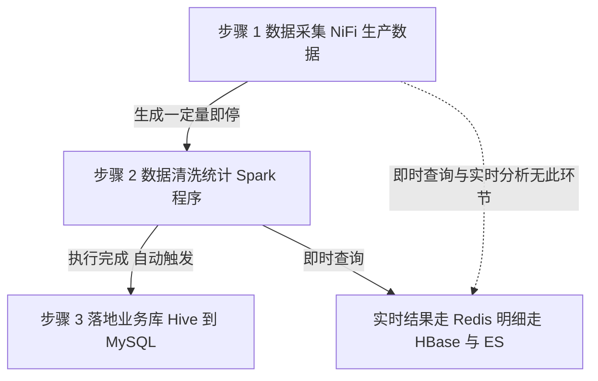
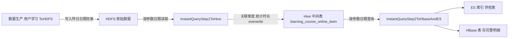
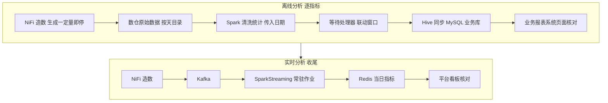
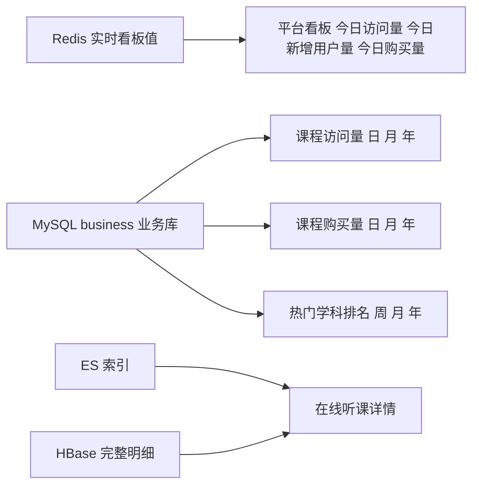

# 系统集成测试之 NiFi 采集、清洗统计分析：联测流程与报表页面验收

> 🔒 安全提示：文中示例的口令/密钥均为课程教学环境演示口径，生产环境的安全要求见《安全与合规须知》。

## 先给结论

- 四篇内容把全项目收进一次系统级验收：开跑前的节奏与清场、即时查询链路联测、逐指标离线与实时联测、业务报表系统逐页验收与全项目复盘。
- 调度三步走：NiFi 采集逐指标造数生成一定量即停，Spark 清洗统计逐指标提交，落地业务库与清洗统计联动自动触发；顺序先离线分析与即时查询，最后实时分析常驻运行。
- 清场不是洁癖而是验收口径：ES 索引、HBase 明细表、MySQL 业务表全清，Hive 按天分区与 overwrite 写入天然自净不用清；清完页面每个数字都能对应到本轮调度的写入。
- 即时查询联测用 NiFi 造数而非真实采集，根因是 T 加 1 日期错位：当天行为数据清洗程序只处理昨天，真实节奏会永远扑空；核对顺序数仓、ES、HBase 三处一致即链路通。
- 离线三指标共用一副骨架：课程访问量走埋点造数进 HDFS，课程购买量与热门学科排名走 binlog 采集进数仓，清洗统计由 Spark 按传入日期执行，结果经 Hive 同步业务库。
- 日期口径有两套：数据清洗一律传前一天，热门学科排名统计分析传当天，由日期工具类计算周月区间时自动回退抹平；队列遗留数据只看一条判据：确定可用就启末端处理器消化存量，否则清空重造。
- 页面与数据源一一对应：平台看板读 Redis，课程访问量、课程购买量、热门学科排名读 MySQL 业务库，在线听课详情查 ES 加 HBase；验收逻辑是页面数字与库表数字互证。
- 热门学科排名增幅有默认值规则：无历史数据记 100%，无销量记 -1、增幅记 0%；五个页面全部有数且口径正确，系统级集成测试收工，全项目三条链路就此闭环。

## 第1部分：联测开跑前的节奏与清场：让每张报表的数字都有明确来源

新包进了容器，理论上可以启动调度了。但直接开跑会撞上两个问题：一是七个指标的采集与统计挤在一起跑，Spark 资源吃紧、日志交错，出了问题分不清是谁的；二是业务报表系统里还躺着上一章测试留下的旧数字，新数据算完混着旧数据展示，根本没法核对口径。所以真正的联测开始前要做两件事：定好调度执行的节奏，把各处存储里遗留的数据清干净。

### 调度三步：采集、清洗统计、落地联动

用 NiFi 模拟企业生产环境的调度，各指标都要走一遍这三步：



**采集环节逐指标、定量即停。** 每个指标的数据采集用 NiFi 生产数据的方式造数，因为测试环境没有真实的用户行为持续涌入。处理器组启动后盯着 HDFS 上目录的体积涨到 1M 左右就手动停止，不追求量，只求每个指标都有自己的一份测试数据。

**清洗统计环节逐指标串行。** Spark 程序是集群资源大户，七个指标的清洗统计如果同时全开，executor 内存与 core 会被打满，任务互相拖慢甚至失败。逐指标推进还有个运维上的好处：每个指标的产出可以单独核对，当前指标有问题就定位当前链路，修完单独重跑它即可，已经成功的指标不受影响。顺序上先做离线分析与即时查询，它们是按天批算的任务，跑完即释放资源；实时分析最后做，它的流计算程序是常驻的，起来之后持续消费 Kafka，不与批任务抢同一个时间窗口。

**落地业务库是联动触发。** 这一步主要针对离线分析：清洗统计程序把结果写进 Hive 的业务表，NiFi 里紧随其后的落地流程（Hive 到 MySQL 的搬运）监听上一步的完成事件自动触发，不需要人工干预。配置时把清洗统计与落地业务库一起启动起来，上一步完成、下一步自动接棒。即时查询没有这个环节，它的结果直接持久化到 HBase 并索引到 ES；实时分析的结果直接写 Redis，两者都绕过业务库。

### 为什么必须清场：验收口径问题

测试环境里的存量数据有三个来源：此前各章集成测试写进业务库的报表数据、即时查询遗留在 ES 与 HBase 里的明细、以及 Hive 里历史日期的分区。业务库与 ES、HBase 里的旧数据是验收的最大干扰：报表页面按年、月、周多个维度展示，旧数据会填满这些维度，让人分不清哪些数字是本轮产生的。清掉之后，任何页面上出现的数字都必然来自本轮调度，页面缺数即链路有断点，页面有数即本轮写入成功，验收逻辑变得非常干净。

### 四处存储的清场清单

**ES：删即时查询索引数据。** es-head 容器若未启动需要先拉起，页面地址 `http://xc-online:9100/`，连接的 ES 协议地址是 `http://xc-online:9200/`。在数据浏览里选中即时查询的索引，把遗留的明细文档删除。ES 里存的是在线听课详情的索引数据，供前端任意条件检索，不清会导致新查询混出旧明细。

**HBase：整表重建。** 明细完整数据在 HBase 表 `LearningOnlineDetail` 里，清法不是删数据而是删表，让程序下次执行时自动重建：

```bash
# 进入 hbase 容器
docker exec -it xc-online-hbase bash
# 切到 hbase bin 目录并进入 shell
cd $HBASE_HOME/bin
./hbase shell
# shell 内执行
list
disable "LearningOnlineDetail"
drop "LearningOnlineDetail"
list
```

`list` 前后各执行一次是标准自查：清理前列出所有表确认目标，清理后再列一次，看到目标表消失、只剩无关的测试表，才算删干净。HBase 不允许直接 drop 启用中的表，先 disable 再 drop 是固定次序。

**MySQL：truncate 业务报表库。** 业务报表系统的库（连接 `xc-online-mysql`，账号 `root`，密码 `123456`）里是各指标的落地表，离线三指标、热门学科排名的周月榜、机构维度的报表全在其中，清空脚本一次执行：

```sql
-- 业务报表系统数据库清空脚本（讲义全表清单）
truncate table agency_amount_month_biz;
truncate table agency_amount_week_biz;
truncate table agency_sale_month_biz;
truncate table agency_sale_week_biz;
truncate table agency_user_month_biz;
truncate table agency_user_week_biz;
truncate table course_buy_biz;
truncate table course_hot_month_biz;
truncate table course_hot_week_biz;
truncate table course_visit_biz;
truncate table platform_offline_biz;
truncate table subject_amount_month_biz;
truncate table subject_amount_week_biz;
truncate table subject_sale_month_biz;
truncate table subject_sale_week_biz;
truncate table subject_user_month_biz;
truncate table subject_user_week_biz;
```

在 Navicat 里对 business 库执行这一组语句，刷新后各表行数归零。用 truncate 而不是 delete，是因为它不走逐行事务日志、直接重置表，对测试环境的整表清空最合适。

**Hive 与 Redis：不必主动清。** Hive 侧，各指标统计结果写业务表用 overwrite 模式，原始数据与中间表按日期分区或按天落目录，本轮数据写自己那天的位置，历史分区不参与本轮统计，天然不会串口径。Redis 侧，实时看板的三个 key 是固定名加当天日期的 hash field，跨天各存各的，测试若想从零看板开始，按需删掉当日的 field 即可，课程流程没有把它列为必清项。

## 第2部分：即时查询联测：造数、清洗统计到 HBase 与 ES 的端到端核对

清场完成、新包就位，联测从即时查询开跑。这条链路最特殊：它没有落地业务库的环节，统计出的用户学习明细直接持久化到 HBase 并索引到 ES，供在线听课详情页秒查。核对手段也因此与众不同，要在 Hive 中间表、ES 索引、HBase 表三处分别对数，三处数字一致才算通。

### 链路全景与日期对齐

生产环境的正常逻辑是：用户在在线教育平台听课产生行为数据，NiFi 调度随后触发清洗与统计。直接照搬到测试会遇到时间差：平台当天产生的数据落在当天的目录里，而清洗程序按参数只读昨天。昨天没有数据，调度跑得再勤也没有意义。

课程的解法是让造数环节「替昨天生产」：数据生产处理器的输出目录由 NiFi 时间表达式算成昨天，数据落进去的位置恰好是清洗程序要读的位置：



整条链路上日期只出现两个身份：HDFS 目录名与 Hive 表的 `date_info` 字段，两者都来自调度注入的同一个参数，源头一致就不会错位。步骤一到步骤二之间靠数仓中间表衔接，中间表还兼任核对点，这是数仓分层设计在联测时的直接红利。

### 造数与清洗统计调度

启动即时查询的处理器组，先跑的是造数支线「数据生产-用户学习(在线学习)ToHDFS」。盯着 HDFS 目标目录的体积上涨，300 多 K、超过 1M、到 1.25M 时手动停止处理器组。造数的量不为逼真，只为够用，够清洗统计跑出一个可核对的结果集。

造数脚本（NiFi 里的 Python 脚本）按用户、课程、视频三元组随机展开行为记录，时间戳随机回退 1 到 30 天，浏览器字段从固定池随机取值。这意味着 1.25M 的原始数据摊在近一个月的日期里，具体某一天只有零星几条。

接着启动清洗统计调度。第一步程序把原始数据读进来、关联课程、视频、用户三张维度表、按用户会话聚合学习时长后写入中间表；第二步程序从中间表按日期取出明细，同时写 ES 与 HBase。执行期间把 Spark Master 的 8080 页面开着，能看到对应主类的任务在跑、跑完进入 completed，两步都完成就可以去核对结果，不用盯 NiFi 界面刷队列。

### 三处核对：数仓、ES、HBase

**第一处，Hue 查中间表。** 中间表是即时查询的落地源头，先在这里确认统计结果的条数：

```sql
select count(1) from data_course.learning_course_online_dwm
where date_info = '2019-12-16';
-- 查询结果：6
```

只有 6 条。这 6 条就是经过日期过滤后的当日明细，是后面所有核对的基准数。

**第二处，es-head 看索引。** 打开 `http://xc-online:9100/`，数据浏览里选中即时查询索引，文档数与 `date_info` 字段值与中间表对得上，索引写入这一环就通了。ES 里存的是检索需要的精简字段（学习记录 id、课程名、视频名、用户名、日期），供详情页做条件检索，完整字段以 HBase 为准。

**第三处，HBase 扫表。** 明细的完整数据在 HBase 表里，之前清场时整表 drop 掉了，步骤二程序启动时会检测表不存在并自动重建，这本身就是一次程序健壮性的验证：

```bash
docker exec -it xc-online-hbase bash
cd $HBASE_HOME/bin
./hbase shell
```

```ruby
# hbase shell 内执行
list
scan "LearningOnlineDetail", {LIMIT => 6}
```

`list` 确认表已被程序自动重建，`scan` 出 6 条记录，rowkey 是每条明细的 uuid，中文列值以转义序列显示，条数与内容同 ES 一致。三处数字互相印证，即时查询链路端到端贯通，日期参数也真实生效了。核对完把 NiFi 调度停下来，这条链路的联测收工。

### 数字对不上时怎么想

初见 1.25M 原始数据对 6 条明细，直觉是数据丢了。拆开看就清楚了：造数脚本把数据摊到近 30 天，统计分析只取昨天一天，量级差是口径造成的，不是故障。联测时这条经验通用，先对口径再查问题，判断依据可以列成三问：上游量级是多少、过滤条件是什么、过滤后理论应剩多少。三问都能答上来，数字差异就是预期内的；答不上来，才需要沿着链路逐环排查。反过来的情况更危险，如果造数全是昨天一天的数据，过滤后仍只有 6 条，那就该查清洗逻辑了。

## 第3部分：逐指标联测：离线三指标与实时分析在 NiFi 调度下的全局验收

代码改造与重新打包完成，调度参数确认无误，三处存量数据也清空了，系统集成测试进入执行段。真正开跑时新问题马上浮现：单章测试时每条链路独享环境，队列里不会有上一场测试留下的数据；全局环境里各章的造数流程、调度模板同时在线，队列遗留、任务排队、日期口径这些平时不显眼的细节全成了要当场拍板的事。这一课把离线分析三个指标按顺序联测一遍，再用实时分析收尾，一个指标一个脚印，把整条采集、清洗、统计分析、落地的流水线在生产化的节奏下走直。

离线分析与实时分析的测试顺序也有讲究。离线分析的三步骤最完整，数据采集、清洗统计分析、落地业务库一环扣一环，落地业务库与清洗统计的联动机制本来就是为它设计的，所以放在前面逐指标推进；实时分析没有日期概念，数据进来就处理当天，放到最后一次性启动。

### 联测总纲：三个动作按指标轮转

把每个离线指标的联测动作抽象出来，都是同样的三步。数据采集用 NiFi 生产数据的方式，按指标逐个进行，生成一定量后停止；数据清洗统计分析执行 Spark 程序，资源占用大，同样逐指标来；落地业务库与清洗统计联动，前一步跑完自动触发，不需要人工干预。三个动作画在一张图上，实时分析的收尾位置也就一目了然：



图里离线分支的每一步都是批处理，跑完即退，所以能按指标串行推进；实时分支一旦启动就是常驻作业，没有「跑完」一说，只能放在全部离线指标验收完之后再开。轮转执行除了省资源，更重要的是让每个指标的产出可以单独核对，出了问题定位范围就是当前指标。

清洗统计的执行入口是一个 spark-submit 脚本，日期参数由调度层注入，脚本本身不做任何假设：

```bash
#!/usr/bin/env bash
# 清洗统计调度脚本：日期由调度层注入，缺参直接退出
if [[ $1 != "" ]];then
    TD_DATE=$1
else
    echo "[===no params input===]"
    exit 1
fi
SPARK_SUBMIT=/opt/spark/bin/spark-submit

$SPARK_SUBMIT \
  --master spark://xc-online-spark:7077 \
  --class com.study.xc.analysis.buy.CourseBuyProcessByBiz \
  /opt/run/jars/xc-service-offline-jar-with-dependencies.jar ${TD_DATE}

if [[ $? == 0 ]];then
    echo "[===spark-submit process success===]"
else
    echo "[===spark-submit process failed===]"
    exit 0
fi
```

这个骨架在三个离线指标间是复用的，换一个指标只是换主类名；实时分析没有日期参数，脚本里连参数判断都省了。NiFi 调度处理器通过 `ExecuteStreamCommand` 执行这类脚本，命令正常结束流文件才流向下一个处理器，联动顺序就固化在画布的连接关系里。

### 课程访问量：第一遍把链路走直

课程访问量是离线联测的第一棒。它的数据源是用户访问行为，正常生产里由前端埋点经采集系统进入 HDFS，测试环境不可能靠人一条条刷新页面，所以用 NiFi 生产数据的方式造数。造数脚本默认生成 1 到 60 天的数据，为了让报表的历史曲线足够丰满，量级给到 20 张流文件左右，超过 20 张就把生产停掉。

启动清洗统计调度，脚本把昨天的日期传给 Spark 程序；接着把落地业务库的同步也启动，同步与清洗统计联动，上层执行完成后下层自动把数仓业务表的数据搬进 MySQL。执行期间在 Spark Master 页面看两个任务的进度，双双结束说明批处理跑完。同步完成后刷新业务库核对：

```sql
-- 业务报表系统数据库侧核对
SELECT * FROM course_visit ORDER BY date_info DESC;   -- 61 行，最新一天是 2019-12-16
SELECT * FROM course_buy_biz;                         -- 课程购买量：2019-12-16 当天购买量 52
SELECT * FROM subject_sale_week_biz;                  -- 热门学科周榜：51 周与 12 月均有数据
```

course_visit 返回 61 行、最新一行是 2019-12-16，这个数字背后有两个设计要拆开看。一是数仓里已经躺着此前 60 天的存量，本轮造数把当天数据补进来，同步时用查询所有的方式把数仓业务表全量搬过来，61 行正好是 60 天存量加当天的合计；保留存量而不是每次只同步一行，是为了报表页的图表能画出一条随时间延伸的曲线，只有孤零零一个点，图表展示就失去了意义。二是当天新数据的源头可以顺着目录验证：Hue 里进到采集目录 `/user/hive/external/data_course/course_visit_source/`，按天分区的日期目录一字排开，最新的是 2019-12-16，目录下单个文件约 22 MB，正是刚才那轮造数写进去的原始数据。

同步链本身是 NiFi 画布上最简洁的一段：`SelectHiveQL` 从 Hive 数仓查数，`EvaluateJsonPath` 从查询结果里解析字段，`PutSQL` 写入 MySQL。跑批前要确认两个 Hive 连接池都处于启用状态，这是单章测试里踩过的坑，全局联测时依旧适用。核对完毕，把这一指标的处理器组整体停掉，第一棒交棒。

### 课程购买量：队列存量与慢一拍的 Hive

课程购买量的数据形态与访问量不同，源头是 MySQL 里的订单数据，采集靠监控 binlog 完成。正常生产是用户下单产生订单，binlog 采集链捕获变更写入数仓；测试环境只有一个静态页面，模拟不出下单动作，照例用 NiFi 造订单数据。

画布启动后先遇到一个全局联测特有的问题：队列里压着 9000 多条此前测试遗留的数据。这些数据是上一场测试造的，里面的日期是不是目标日期无从确认。处理方式有两条路：如果确定队列里的数据可用，可以只启动末端处理器把存量消化掉，不必重跑整个流程；不确定就清空队列重新造。这次的遗留数据日期不可信，选择清空队列、重启造数流程，看着队列计数涨过 2000 条；觉得量级还偏少，就单独启动末端处理器继续消耗队列，处理计数爬到 4000 多条后整体停下。

这里还有一个速度差要提前心里有数：造数与写 MySQL 是快的一端，采集链把数据写进 Hive 是慢的一端，因为 Hive 的存储要经过 MapReduce 计算。停掉生产侧之后，要等采集链把队列消化干净、`PutHive` 确认保存成功，采集环节才算真正收口。

清洗统计分析按层接力：订单原始数据先清洗进事实表，再轻度聚合进中间表，最后统计分析落到业务表，Spark Master 页面上能看到任务一个接一个出现。落地业务库依旧联动自动触发，数仓不清、业务库清、查询所有同步的口径与访问量一致。刷新业务库，2019-12-16 那一行的购买量是 52，这一指标验收通过。三个动作、一个速度差、一条队列治理经验，就是这一棒的全部增量。

### 热门学科排名：周月榜与两个日期口径

热门学科排名是离线分析的最后一棒，数据源是用户选课记录，采集方式与课程购买量一样监控 MySQL。造数给到 2000 多条（本轮 2497 条）停掉，监控采集链把这批选课数据写进数仓，同样要容忍 Hive 落库比 MySQL 慢的缓冲时间，等队列消化完再停采集处理器组。

清洗统计调度的启动与之前一致，但这次的 Spark 任务清单明显更长：销售额、销售量、学生人数三个统计项各分周、月两个粒度，任务在集群上排队执行，队列里压着的流文件逐个消化。所有任务处理完，等待处理器进入默认 30 秒的联动窗口，窗口一过数据流向落地业务库的处理器组，Hive 读 MySQL 写，速度很快，每个处理器组都有数据流动、逐个收尾。业务库侧核对周榜与月榜两张表，12 月的数据、51 周的数据都齐了，页面上的学科排名从此有据可依。

这一棒还留了一个日期口径的细节要讲透。离线分析里，数据清洗环节传的都是前一天的日期，课程访问量与课程购买量的清洗都如此，因为清洗处理的是按天落盘的原始数据；热门学科排名的统计分析传的却是当天的日期。两个口径不冲突，秘密在日期工具类里：计算周区间、月区间时先把传入日期回退一天，再做区间推算：

```scala
// 日期工具类节选：入参当作当天日期，取月、周区间前自动回退 1 天
// （示例为按画面内容整理补全，源码未随资料包归档）
def getMonthInterval(dateInfo: String): (Int, Int) = {
  val sdf = new SimpleDateFormat("yyyy-MM-dd")
  val calendar = Calendar.getInstance()
  calendar.setTime(sdf.parse(dateInfo))
  // 回退 1 天，与清洗层「前一天」的口径对齐
  calendar.setTimeInMillis(calendar.getTimeInMillis - 86400000L)
  val newMonth = calendar.get(Calendar.MONTH) + 1
  val newYear = calendar.get(Calendar.YEAR)
  (newYear, newMonth)
}

// 统计程序传入当天日期，区间计算交给工具类
val dateInfo = "2019-12-16"
println(getMonthInterval(dateInfo))
```

热门学科排名复用了课程购买量中间表的数据，统计分析按当天传参、工具类内部回退，两边算出来的是同一段时间。这个设计把口径一致性收进了代码，调度层不用为不同指标配不同的日期规则，配错的可能性被结构性地消掉了。至此离线分析三个指标全部联测通过，处理器组逐个停止。

### 实时分析：三个指标一起上

实时分析放在最后收尾，测试方式与离线完全不同。三个指标是今日访问量、新增用户量、今日购买量，结果保存在 Redis，测试前 Redis 已清空，页面上不会有一点旧数据的影子。

启动方式也干脆：各任务组之间没有关联关系，直接整体启动。唯一要避开的是「结束实时分析进程」这个流程，它执行的是对 SparkSubmit 进程的强制 kill，只有确实要结束实时分析时才该动它，测试启动阶段把它误启了，等会儿常驻作业拉起来也会被它按周期杀掉。

启动后两个位置确认状态。Spark Master 页面上，RealTimeVisit、RealTimeNewUser、RealTimeBuy 三个常驻应用出现在 Running 列表；NiFi 画布上，访问量采集链发往 Kafka 的队列计数持续增长，统计作业每 5 秒拉一批消化。随后切到 Redis 查看：offset 的存储在，访问量、新增用户量、购买量三个值也在涨。实时分析没有页面之外的中间表可查，Redis 有结果就是成功的标志，因为看板读的就是 Redis，Redis 有数页面必然有数。

到这里，NiFi 采集、清洗、统计分析对即时查询、离线分析、实时分析的联测全部完成。回头看这场全局验收，与单章测试的分野在三处：执行节奏从各链路随意变成按指标轮转，数据口径从各章自带变成统一清场加统一日期规则，验收标准从程序跑完变成业务库与页面逐项对数。三条链路在同一张画布、同一个集群、同一个业务库里各就各位，系统集成测试的执行段就此收官。

## 第4部分：联测的终点在页面：业务报表系统逐页验收与全项目复盘

后台四处落地的数字都核对过了：Redis 的看板值、MySQL 的报表表、ES 的索引、HBase 的明细，各处各写各的。但系统集成测试的验收线定在业务报表系统上，后台再正确，页面上看不见数就不算交付。这一节把报表系统的五个页面逐一过一遍，讲清楚每页的数字从哪个存储来、只有一天测试数据时怎么读页面、哪些展示现象是预期内的，最后对整个项目做一次收官复盘。

### 页面与数据源：一张映射图看懂出口

业务报表系统访问地址是 `http://xc-online:4000/`，打开默认落在平台看板。五个页面背后是三条链路各自的落地存储：



这张图也是验收的路径图：平台看板验证实时链路，三张报表页验证离线链路，详情页验证即时查询链路。页面只是皮，皮下的每个数字都能追溯到 NiFi 调度、Spark 统计、落地写入的完整传递。

### 逐页验收记录

**平台看板：实时链路的门面。** 首页三个数字，今日访问量、今日新增用户量、今日购买量，来自实时分析常驻程序写进 Redis 的结果，页面上是实时刷新的。这三个指标测试时造的是当天的实时数据，数字能跳、能刷新，实时链路就算展示成功。

**课程访问量与课程购买量：离线报表的两种时间粒度。** 两页结构相同，折线图配明细表，支持日、月、年切换。测试只造了一天数据，切到日维度，12 月 16 日一个孤立的点清晰可见；切到月维度，11 月有历史测试数据，曲线有了起伏；年维度汇总全年，历史数据多的月份都能展示。有一处页面级的小坑：按周维度第一次切换时页面刷不出来，先点一下按月再切回按周就正常了，这是前端在周数据极少时的边界表现，属于已知现象，不影响数据正确性。课程购买量页面同理，年视图能看到所有月份，12 月只有一天的量，51 周对应 12 月 16 日所在周，也只有一个点。

**热门学科排名：默认值规则要读懂。** 这一页按销售额、销量等维度出柱状图与排名表，同样基于一天的数据。读这页要先懂增幅的计算规则：学科当期有销量而历史同期没有数据，增幅按 100% 展示；历史与当期都有数据，按正常公式计算；某学科完全没有数据，销量记 -1、增幅记 0%，这两个默认值是程序对空数据的约定，不是统计错误。月维度下数据较多，列表分页展示，一页 10 条共 14 页，翻页能看到 11 月历史月份的销售额数据，与业务库月榜表逐条对应。

**在线听课详情：即时查询的出口。** 详情页查询条件给出日期，查 12 月 16 日，返回 6 条记录，字段为学生昵称、课程名称、视频名称、学习时间。这 6 条与联测时数仓中间表、ES 索引、HBase 表三处核对的数字完全一致，明细链路从行为日志到页面展示全通。

### 页面对数：用 SQL 把数字钉死

页面看到数还不算验收完成，还要证明数是对的。对数的方法是绕过页面直接查存储，把库里的数字与页面展示互相印证。以课程访问量为例，业务库表结构只有两个字段，`date_info` 与 `count`：

```sql
-- MySQL business 库，与课程访问量页面对数
select date_info, count
from course_visit_biz
order by date_info desc
limit 10;
-- 预期只有 2019-12-16 一行，count 等于页面日维度展示值
```

命令行方式同样可以快速抽查：

```bash
mysql -h xc-online -uroot -p123456 business \
  -e "select date_info, count from course_visit_biz order by date_info desc limit 10;"
```

热门学科排名对数时按同样的思路查月榜、周榜表，在线听课详情对数回联测时的三处核对结果。所有页面数字都能在存储里找到唯一来源，且量级与造数规模相符，验收才算闭环。

### 收官复盘：三条链路的全局视图

从数据仓库与 ETL 打地基，到三条链路依次搭建，再到按生产方式完成全局联调，整个项目的功能版图在验收时最后盘一次。课程统计方向的课程访问量、课程购买量、热门学科排名构成离线分析，成批进仓、批处理计算、落 MySQL 出报表，回答一段时间内整体怎么样；平台看板的今日访问量、今日新增用户量、今日购买量构成实时分析，常驻流计算秒级刷新 Redis 看板，回答此刻怎么样；即时查询把海量学习明细关联维度、算出学习时长，存 HBase 索引 ES，支撑在线听课详情的任意条件秒查，回答具体某条什么样。

系统集成测试把这些功能按企业生产环境的方式部署、连起来、跑起来，最终在业务报表系统统一展示。回头看这一章的路径：改代码参数化日期、重新打包换进容器、定节奏清存量、逐指标调度、逐页验收，每一步都在为「页面有数且口径正确」服务。五个页面全部通过，意味着三条链路不仅各自正确，还能在同一环境、共享同一批资源的情况下共存运转，这正是全局系统集成测试区别于单章验收的价值所在。

## 常见误区

- **把七个指标的采集统计一次性全启动。** 错例：处理器组全开， Spark 任务互相抢资源，批量任务集体变慢。正解：采集与清洗统计都逐指标推进，定量即停，跑通一个核一个。
- **只清业务库，忘了 ES 与 HBase。** 错例：truncate 完 MySQL 就开跑，在线听课详情页翻出上一章的旧明细。正解：即时查询的落地不在业务库，在 HBase 与 ES，这两处的存量要单独清。
- **对 Hive 大动干戈逐表删数据。** 错例：担心历史数据干扰，把数仓表挨个清空。正解：统计写入是 overwrite、读取按日期过滤，历史分区不进本轮口径，Hive 不需要清理。
- **HBase 里直接 drop 表。** 错例：跳过 disable 直接 drop，命令报表处于启用状态。正解：先 disable 让表下线，再 drop，最后 list 验证。
- **测试时按生产节奏用真实采集。** 错例：等平台自然产生行为数据再调度清洗，永远等不到昨天的数据。正解：测试用造数方式补上数据，且造数目录日期必须配成昨天，与清洗的读取日期对齐。
- **把 6 条结果当成统计丢失。** 错例：看到原始 1.25M、结果 6 条就怀疑程序丢数据。正解：造数日期随机散布近 30 天，统计只取参数指定的一天，先核对口径再谈丢失。
- **HBase 表被删后手动重建。** 错例：清场 drop 掉表后，测试前自己手工 create 一遍。正解：步骤二程序自带建表逻辑，表不存在时自动创建，让程序重建顺带验证了这条分支。
- **只看 Spark 任务成功就宣布通过。** 错例：8080 页面两个任务都 completed 就收工。正解：任务成功只代表程序没抛异常，数据是否正确落地要用 Hue、ES、HBase 三处的数字核对来证明。
- **把数仓也一并清空。** 错例：清场时顺手把 Hive 数仓里的事实表、业务表全清了，结果同步到业务库只剩当天一行，报表曲线画不出来。正解：数仓数据保留，只清业务报表系统数据库；同步用查询所有把存量搬下去，历史曲线才完整。
- **队列遗留数据一刀切。** 错例：要么无视遗留数据直接开跑，导致旧日期数据混进本轮口径；要么每次都清空重造，浪费已验证的存量。正解：先确认遗留数据的日期与量级是否可用，可用就只启末端处理器消化，不可用才清空重造。
- **统计分析的日期一律传前一天。** 错例：给热门学科排名的统计程序也传前一天日期，周、月区间整体错位一天。正解：清洗传前一天、热门学科排名统计传当天，差异由工具类回退逻辑吸收，参数规则按指标对号入座。
- **实时分析组里的结束进程流程当普通处理器启动。** 错例：整体框选启动时把「结束实时分析进程」也选上，常驻作业刚拉起就被周期性 kill。正解：启动前单独排查这个流程，保持停止状态，只在确实要结束实时分析时启用。
- **把页面有数当成验收的全部。** 错例：五个页面都亮出数字就宣布测试通过。正解：页面数字必须与存储数字互相印证，量级要与造数规模相符，有数且口径正确才是通过。
- **看到销量 -1、增幅 0% 就报缺陷。** 错例：把默认值当成统计异常上报。正解：无数据学科的销量 -1 与增幅 0% 是程序约定的空值语义，无历史数据时增幅 100% 也是预期规则，读报表先读规则。
- **周维度刷不出来就断定前端故障。** 错例：一次切换失败就提 bug。正解：周数据极少时前端首次渲染有边界问题，切月再切回即可恢复，验收时区分数据问题与展示边界。
- **只验收日维度忽略月年维度。** 错例：只看当天数字正确就收工。正解：月与年维度覆盖了历史数据与聚合逻辑，本次恰有历史测试数据可对照，多粒度都核过才算完整。

## 面试可能被问到的问题

1. 面试官追问：「测试环境清数据与生产环境的数据治理怎么区分？」
   答：测试环境追求口径干净，整库整表 truncate 是标准动作，成本低、验证清晰；生产环境的数据是资产，只能做增量核对与水位管理，比如记录上一轮的快照或分区水位，对比本轮增量。两套环境的目的不同，绝不能把测试手法带进生产，也不能让生产的保守拖垮测试效率。

2. 面试官追问：「为什么 Spark 任务要逐指标串行执行？」
   答：Spark 程序启动 executor 需要占用集群的 core 与内存，多个指标并发提交会互相挤压，轻则变慢重则调度失败。串行执行让每个指标的日志独立、结果可单独核对，失败后断点重跑也简单。代价是总时长变长，但联调阶段正确性与可观测性远比吞吐重要。

3. 面试官追问：「落地业务库为什么设计成联动触发，而不是单独调度？」
   答：落地业务库依赖清洗统计的产出，事件联动保证它永远在数据就绪后执行，不引入时间上的竞态。若用独立的定时调度，就得预估上游耗时再错峰，上游慢了会拉空数据，上游快了会白等。用 NiFi 的处理器连接传递 success 关系，把依赖关系表达在流程里，是最直接的编排方式。

4. 面试官追问：「HBase 清数据为什么用 disable 加 drop，而不是逐行删？」
   答：HBase 的删除是标记墓碑，真正的清理发生在合并时，逐行删大表又慢又留存储尾巴；测试场景要的是整表归零，drop 后由程序按建表逻辑自动重建，表结构与列族都可控。disable 是 HBase 的保护机制，避免正在服务的表被意外移除。

5. 面试官追问：「truncate 与 delete 的区别在什么场景下真正重要？」
   答：truncate 是 DDL 语义，重建表结构、不逐行记日志、速度快且重置自增；delete 是 DML 语义，逐行记录、可带条件、可回滚。测试环境整表清空用 truncate 效率最高；生产上要保留部分数据或需要事务保障时只能 delete。理解差异的关键是事务日志与回滚能力，而不只是速度。

6. 面试官追问：「即时查询链路为什么要拆成两步，一步写完不行吗？」
   答：两步的职责不同。步骤一做重计算，读原始日志、关联三张维度表、聚合学习时长，写进数仓中间表，产出可复用的明细资产；步骤二做轻搬运，从中间表按日期取数分发到 ES 与 HBase。拆开后中间表既是解耦点也是核对点，重算或补数都从中间表出发，不必重跑原始数据的加工。

7. 面试官追问：「ES 和 HBase 存两份数据，会不会冗余？」
   答：是刻意的设计。ES 存检索字段，倒排索引支撑任意条件组合的秒查，但不适合存全量大字段；HBase 存完整明细，按 rowkey 点查高效，容量成本低。详情页先用 ES 查出符合条件的 rowkey 列表，需要完整内容时再回 HBase 取，典型的搜索加存储分工，冗余换来的是两种访问模式都最优。

8. 面试官追问：「测试造数为什么日期要随机散布而不是全造昨天的？」
   答：随机散布更贴近真实行为数据的形态，也让日期过滤逻辑得到真实检验：如果全造昨天，过滤分支形同虚设，万一程序取错日期参数照样全量通过，问题会被掩盖。散布数据下，过滤后只剩目标日期的少量记录，参数一旦错位结果立刻为空或异常，缺陷更容易暴露。

9. 面试官追问：「HBase 的 rowkey 为什么用 uuid，有什么隐患？」
   答：uuid 保证全局唯一，避免两个用户同课程的记录互相覆盖，写入也均匀打散，没有热点问题。隐患是 rowkey 无业务语义，没法按用户或课程范围扫描，查询只能靠 ES 先检索出 id 再回表点查，这套设计的前提就是 ES 与 HBase 配合使用。若业务需要范围查询，就得设计复合 rowkey 并接受一定程度的倾斜。

10. 面试官追问：「联测中如何证明日期参数真的生效了？」
   答：让日期成为唯一变量去验证。造数散布了 30 天的日期，如果参数没生效，程序会按写死的旧日期或全量读取，中间表与 ES 里出现的日期就不是目标日。三处核对都限定在 `date_info` 等于目标日且条数吻合，等于同时验证了参数传递与过滤逻辑，这是把验证条件设计成能区分对错形态的思路。

11. 面试官追问：「全局联测为什么要逐指标轮转，而不是一次性全部启动？」
   答：Spark 清洗统计资源占用大，多个指标的批处理同时提交会互相挤占资源，还让日志交错、失败叠加，定位成本陡增。逐指标推进让每个指标的产出可以单独核对，失败时断点续跑，修复后单独重跑该指标即可，不影响已成功的部分。实时分析常驻占用资源最久，放在最后启动，把批处理的资源高峰错开。

12. 面试官追问：「数仓保留、业务库清空，同步时全量查询，这种设计的代价是什么？」
   答：好处是验证口径干净，报表数字与本轮写入一一对应，历史曲线也完整。代价是同步量随存量增长，数仓业务表越大同步越慢，且业务库只是镜像，真正的主数据在数仓。生产环境一般不这样全量搬，会改成增量同步按水位推进；测试环境用全量换直观，是拿性能换验证效率的取舍。

13. 面试官追问：「清洗传前一天、统计传当天，怎么保证两段数据算的是同一天？」
   答：把回退逻辑收敛在日期工具类内部，统计程序拿到入参先回退一天再做周、月区间推算，两个环节在代码层面对齐，而不是靠调度参数配平。这样调度层只需要一套传参直觉，口径错配的风险被代码结构消除，也方便单元测试直接验证区间边界。

14. 面试官追问：「造数脚本生成的数据时间回退 1 到 60 天，为什么不影响按天统计的正确性？」
   答：离线统计按日期分区取数，程序从入参拿日期、到对应分区读数据，造数数据自带的时间散布在 60 天里，各自落进各自日期的统计范围，历史部分正好补足了报表曲线。实时分析是例外，统计 field 用运行当天组装，历史时间不参与落位，全部记在当天头上，这是两种链路口径的差别，测试时心里要有数。

15. 面试官追问：「实时分析为什么没有日期参数化的问题？」
   答：实时数据实时进来，程序只处理当天，当日 field 由程序在运行时自己组装，调度层无从干预也不需要干预。日期参数化针对的是按天批算的离线分析与即时查询，批处理的时间语义来自外部注入，流计算的时间语义是当下，两种形态决定了改造范围只覆盖前者。

16. 面试官追问：「为什么把业务报表系统展示定为集成测试的验收标准？」
   答：报表展示是数据链路的最末端，页面数字背后是采集、清洗、统计、落地、接口、渲染的完整传递，任何一环断了末端必然缺数。以业务可见性为标尺，把「测试通过」从程序退出码提升为用户视角的交付标准，避免各环节自证成功而整体缺数的假阳性。

17. 面试官追问：「空数据在报表里应该如何表达？」
   答：直接留空、记 0、记 -1 各有适用场景，关键是约定清晰且前端同步解释。本项目的销量记 -1 区分了「没有数据」与「数据为零」，增幅对无历史基数的场景记 100% 或 0% 也是业务约定。设计要点是让读报表的人能一眼区分缺数、零值与异常，必要时在页面上给出提示文案而不是让用户猜。

18. 面试官追问：「测试只造一天数据，会不会掩盖多日期场景的问题？」
   答：会掩盖一部分，但本次验收用历史测试数据补足了多日期维度，月与年视图实际对照了多天聚合。更完整的做法是造数覆盖跨月、跨周的边界日期，专门考验周榜月榜的分区聚合。单日数据的真正价值是把口径差异放大到肉眼可见，两者结合使用效果最好。

19. 面试官追问：「五个页面接了三种存储，前端如何统一？」
   答：页面统一走后端接口，接口层各取所需：看板接口读 Redis，报表接口查 MySQL，详情接口先查 ES 再按需回查 HBase。对前端而言都是一致的接口契约，存储差异被接口层吸收。这是典型的读写分离加多存储服务单一应用的架构，前提是各存储的数据口径在统计层就已对齐。

20. 面试官追问：「全局集成测试通过后，距离真正上线还差什么？」
   答：还差生产化的几件事：调度策略从测试的长间隔 Timer 换成业务需要的 CRON，数据采集从造数换成真实埋点与 binlog，监控告警、日志聚合、失败重跑预案补齐，以及容量与性能压测。全局集成验证的是功能与共存正确性，上线准备验证的是持续稳定运行的能力，两者是接力关系。

## 配套资料

- 讲义：`materials/docs/08/智慧学成-第5章-即时查询.md`，第 6 节系统集成测试的调度三步骤、ES 与 HBase 清理命令、业务报表库 truncate 全表清单为直接出处。
- 讲义：`materials/docs/08/智慧学成-第4章-实时分析.md`，实时指标 Redis key 的命名与按日期存值的格式在存储设计小节，是 Redis 无需清理结论的依据。
- 资料：`materials/code/08/_散落资料/`，各指标采集与调度模板、docker-compose 编排在所用目录（内层文件名带站点后缀，属元信息，按用途自取）。
- 说明：HBase 表名、ES 索引名与业务表清单以讲义为准；Navicat 连接与 es-head 地址为课程环境参数（密码 root/123456），示例命令为按本课写法补全。
- 讲义：`materials/docs/08/智慧学成-第5章-即时查询.md`，`InstantQueryStep1ToHive` 与 `InstantQueryStep2ToHbaseAndES` 的完整代码、造数脚本、es-head 与 HBase 的使用注意事项为本课直接出处。
- 资料：`materials/code/08/_散落资料/`，即时查询两个步骤的调度脚本与 NiFi 流程模板（数据生产-用户学习、数据清洗统计-用户学习）在所用目录（内层文件名带站点后缀，属元信息，按用途自取）。
- 说明：聚合工程源码包未在本资料中展开，Scala 代码节选自讲义并按课程工程 `com.study.xc` 系改写包名；验证 SQL 与 shell 命令为按本课写法补全的可执行示例。
- 讲义：`materials/docs/08/智慧学成-第5章-即时查询.md`，第 6 节系统集成测试（6.2 NiFi 采集-清洗-统计分析的调度步骤、PS1/PS2 清理脚本、6.3 WEB 展示）为本课出处。
- 资料：`materials/code/08/_散落资料/`，课程访问量、课程购买量、热门学科排名的 NiFi 流程模板与数据清洗统计调度模板，以及 course_buy_source_to_fact、course_buy_process_by_biz、subject_sales_by_month_biz 等 spark-submit 提交脚本都在该目录（内层文件名带站点后缀，属元信息，按用途自取）。
- 说明：调度脚本包名按课程工程 `com.study.xc` 系改写；Scala 日期工具类示例为按画面内容整理补全，源码未随资料包归档；示例站点一律 example.com 占位。
- 讲义：`materials/docs/08/智慧学成-第5章-即时查询.md`，第 6 节 WEB 展示小节与报表访问地址、在线听课详情页字段为直接出处。
- 讲义：`materials/docs/08/智慧学成-第3章-课程分析.md`，`course_visit_biz` 业务表结构（`date_info` 加 `count`）与 Hive 到 MySQL 的落地流程在业务数据同步小节。
- 资料：`materials/code/08/_散落资料/`，落地业务库相关的 NiFi 流程模板与 docker-compose 编排在所用目录（内层文件名带站点后缀，属元信息，按用途自取）。
- 说明：页面截图内容按课程视频画面转述；报表系统前端无独立源码包，对数 SQL 与命令为按本课写法补全的可执行示例，账号密码沿用课程环境 root/123456。
