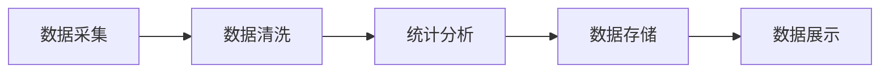
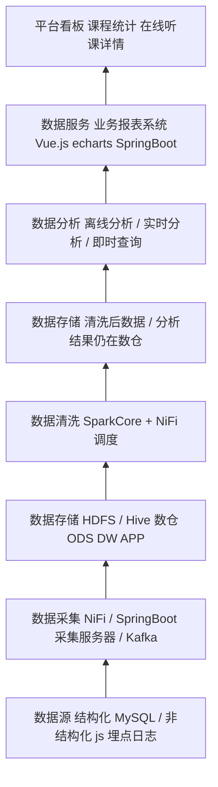
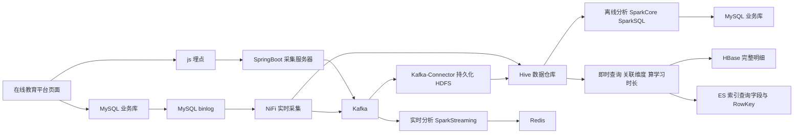

# 就业指导开篇：用功能模块、技术架构与技术栈把智慧学成讲成一张地图

项目做完了，面试官一句「介绍一下你这个大数据项目」，很多人还是卡壳：模块一大串、组件十几个，讲着讲着就变成了名词罗列，听的人抓不到主线。就业指导这一章用 11 个问题把智慧学成重新盘一遍，功能模块怎么划分、数据仓库怎么设计、ETL 怎么做、离线实时即时三类分析怎么实现、调度怎么落地，每个问题都是面试官真实会问的角度。开篇这三讲合起来就是全项目的第一张地图：功能模块回答「做了什么」，技术架构回答「数据怎么流」，技术栈回答「每层用什么」。

11 个问题依次是：项目功能模块、项目技术架构、项目技术栈、数据仓库是如何设计的、数据采集是如何实现的、项目 ETL 是如何做的、离线分析是如何实现的、同比分析在项目中的应用、实时分析是如何做的、如何从海量数据中查询想要的数据、Spark 任务是如何调度的。每个问题背后都有原理与项目中的设计逻辑两层，后面几讲逐一展开，这一讲先把地图立起来。

## 先给结论

- 功能模块六大块：平台看板、课程统计、机构统计、用户统计、日志查询、系统管理；平台看板混装离线与实时两类指标，实时看板对应今日访问量、今日购买量、今日新增用户量。
- 业务流程五步：数据采集、数据清洗、统计分析、数据存储、数据展示，图很简单，每一步的真实工作量都藏在此前各章里。
- 技术架构六层自下而上：数据源、数据采集、数据清洗、数据存储、数据分析、数据服务，按「数据流经这一层发生了什么」记忆，组件就不会背串。
- 技术栈速记：采集 SpringBoot + NiFi + Kafka，存储 HDFS、Hive、Elasticsearch、HBase、Redis、MySQL，清洗 SparkCore + NiFi，分析 SparkCore、SparkSQL、SparkStreaming，服务 Vue.js + echarts + SpringBoot + MySQL + Redis。
- 即时查询在形态上属于离线：数据靠批处理预先算好存进 HBase 与 ES，查询那一刻只是两跳读取，不存在实时计算。

## 功能模块：做了什么，展示在哪

平台看板是业务报表系统的首页，一屏摆开课程访问量、课程购买量、在线听课人数、本周学习频次分布、热门课程 TOP5 与实时看板。前四项与热门课程 TOP5 是离线分析算出来的结果，实时看板单独一块，展示今日访问量、今日购买量、今日新增用户量三个当日指标，由 SparkStreaming 实时计算。一块看板同时容纳两类数据形态，这正好对应项目的两条计算链路。

**课程统计是看板背后的统计口径所在。** 课程访问量、课程购买量、在线听课人数、热门课程、学科的销量与销售额、学科人数都在这个模块下统计分析，统计完的结果在平台看板上展示。两处是「对等」关系：统计逻辑在课程统计，展示入口在平台看板，数据同源。热门学科排名挂在学科维度下，统计用户选课人数、销售量、销售额三项，每项还带增幅。

**机构统计与用户统计补全另外两个分析视角。** 机构统计做机构销售量、机构售课人数、机构销售额的统计，业务报表系统上可见；用户统计做新增用户、活跃用户与学习频次，其中学习频次又与平台看板上的学习频次划等号，同一个指标两个入口。

**日志查询与系统管理一个是主线一个是留白。** 日志查询包含课程查询、在线学习日志、课程访问日志，项目主要做的是在线学习日志：对海量日志做查询，结果关联相关维度并计算学习时长，这条链路就是即时查询那一章的全部内容。系统管理包含用户管理、权限管理、订阅管理，课程代码没有编写，但设计是有的，页面上有对应入口，属于留给学习者补全的部分。

功能之上是业务流程，五个步骤一张图：



流程图看着简单，真正的分量在每一步的展开里：数据采集有两种来源、数据清洗有一整套规则、统计分析分三条链路、数据存储按分层分格式、数据展示对接一个业务报表系统。就业指导章剩下的 10 个问题，就是对这五步的逐段拆解，对应关系可以直接当复习索引用：

| 五步流程 | 对应的问题 | 拆什么 |
|---|---|---|
| 数据采集 | 数据采集是如何实现的 | js 埋点采集与 MySQL 维度、业务数据采集两条通道 |
| 数据清洗 | 项目 ETL 是如何做的 | 抽取、转换、加载三段，脏数据的三种形态与两类转换 |
| 统计分析 | 离线分析是如何实现的 / 实时分析是如何做的 / 如何从海量数据中查询想要的数据 | 三条链路逐指标的实现逻辑 |
| 数据存储 | 数据仓库是如何设计的 | 分层、分区、存储格式 |
| 数据展示 | 就业指导开篇的功能模块 | 业务报表系统的模块与页面 |

这张索引里还有一个容易被略过的问题，同比分析在项目中的应用：热门学科排名里销售额、销售量、学生人数的增幅都按同比口径计算，同比是今年与去年同一统计段相比，环比才是连续两个统计周期相比，两个词在面试里经常被故意混着问。Spark 任务如何调度是唯一不属于五步流程的问题，它讲的是把前面所有环节串起来的执行层，NiFi 既是采集工具也是调度工具，这一层在系统集成测试时已经实际跑过。

## 技术架构：六层如何各就各位

技术架构图要自下向上看，整个系统包括数据源、数据采集、数据清洗、数据存储、数据分析、数据服务六层，架构中用到的技术就组成了技术栈：



**数据源分两类，采集通道就分两条。** 结构化数据是 MySQL 里的业务数据，用 NiFi 采集，直接进数据仓库；非结构化数据是 js 埋点抓到的用户行为日志，用 SpringBoot 搭建的采集服务器接收，转发到 Kafka，再由自定义 Kafka-Connector 把数据持久化到 HDFS。两条通道的终点都是数据存储层，但路径与工具完全不同。

**数据清洗与分析共用数据仓库这个中转站。** 采集进来的数据存数仓，清洗后的数据存数仓，统计分析之后的结果也存数仓，数仓里因此有了原始、清洗、聚合三个形态的数据，分层设计正是为了区分它们。三形态在实际工程里看表名就能对上号：订单原始数据叫 course_orders_source，购买事实表叫 course_buy_fact，统计结果叫 course_visit_biz、course_buy_biz，source、fact、biz 三段后缀把同一份数据的三次形态变化标得清清楚楚，也是排查数据问题时最常用的定位线索。清洗用 SparkCore，调度交给 NiFi，清洗后的数据为分析提供基础。数据分析是整个项目的重心，分三类：离线分析做课程访问量、课程购买量、热门学科排名，其中热门学科排名含用户人数、销售量、销售额三个统计项且各项带增幅；实时分析做今日购买量、今日访问量、新增用户量；即时查询针对海量用户学习行为日志，用 SparkCore 过滤、关联维度、计算学习时长，HBase 存完整数据，Elasticsearch 索引查询字段与 RowKey。

**分析结果再落一次才能服务。** 数仓里的分析结果不能直接对外服务，数据服务层读取的是 MySQL：离线分析的结果同步到 MySQL 业务库，实时分析的结果直接写 Redis，业务报表系统（前端 Vue.js 与 echarts，后台 SpringBoot 提供 API）从这两处取数渲染。架构图右侧还有一块系统监管，权限管理、作业管理、集群管理、状态监控、业务模型管理属于平台化运营的配套设施，项目里以设计呈现为主。

把两类数据源到三类分析的完整流向再画细一层，架构的动态视角就全了：



图里有两条进 Kafka 的线要区分开：埋点日志经采集服务器进 Kafka 是为了持久化到 HDFS 供离线使用；NiFi 监控 binlog 后把订单、注册、选课这类数据发进 Kafka 是为了给实时分析供数。同一个 Kafka 在两个场景里都当缓冲与解耦的中转。

## 技术栈：一张表把组件落位

架构与技术栈是一体的，架构中每一层用到的技术列出来就是技术栈。讲义给的对照表如下：

| 技术栈 | 使用技术 |
|---|---|
| 源数据 | 日志、MySQL |
| 数据采集 | SpringBoot、NiFi、Kafka |
| 数据存储 | HDFS、Hive、Elasticsearch、HBase、Redis、MySQL |
| 数据清洗 | SparkCore、NiFi |
| 数据分析 | SparkCore、SparkSQL、SparkStreaming |
| 数据服务 | Vue.js、echarts、SpringBoot、MySQL、Redis |

每个组件出现在哪一层都有理由，逐个过一遍理由，表就背下来了。MySQL 一人分饰两角，源数据里它是业务库，数据服务里它是分析结果的落点，采集层从它取、服务层往它写；Kafka 在采集层只做一件事，中转采集服务器的数据并削峰解耦；HDFS 是所有数据的底座，Hive 数仓建在它之上；Elasticsearch 存即时查询的字段索引与 RowKey，HBase 存即时查询的完整数据，一个管收敛一个管点查；Redis 存实时分析的结果，秒级读写压得住 5 秒一批的刷新节奏；MySQL 同时也是业务报表系统的取数源。清洗层 SparkCore 干活、NiFi 调度；分析层三个引擎各管一段，SparkCore 与 SparkSQL 支撑离线分析与即时查询，SparkStreaming 支撑实时分析；服务层 Vue.js 与 echarts 画报表，SpringBoot 搭业务报表系统的后台 API，从 MySQL 与 Redis 取数。

架构图与这张表还有一处小小的出入值得说破：通用架构图的数据采集层画了 SpringBoot、Kettle、NiFi、Flume 一排候选，数据清洗层画了 Spark、shell、Kettle 与 NiFi，那是一套大数据平台的通用选型清单，给架构评审用的；项目实际落位后，采集走 SpringBoot、Kafka、NiFi，清洗走 SparkCore 加 NiFi 调度，Flume 与 Kettle 没有用上。面试时如果被问到「为什么不用 Flume 采集日志」，答案就藏在落位结果里：埋点数据的接收端本来就要写采集服务器做统一入口，SpringBoot 服务发 Kafka 比 Flume 的 source 配置更可控，也没有多养一个组件的必要。选型题的答题姿势由此可以总结出来：先讲数据的形态与流向，再讲工具恰好匹配在哪一环，而不是比较工具名字孰优孰劣。

架构落到代码形态，两条采集通道的样子可以用示例感受一下（本课无配套源码包，示例为按本课写法补全）。埋点通道的接收端，SpringBoot 采集服务器把上报数据原样转发进 Kafka：

```java
// js 埋点上报入口：采集服务器只做转发，不做业务加工
@RestController
public class TrackController {

    private final KafkaTemplate<String, String> kafkaTemplate;

    public TrackController(KafkaTemplate<String, String> kafkaTemplate) {
        this.kafkaTemplate = kafkaTemplate;
    }

    @PostMapping("/track/report")
    public String report(@RequestBody String logJson) {
        // 原始日志直接进 Kafka，由 Kafka-Connector 异步持久化到 HDFS
        kafkaTemplate.send("visit_topic", logJson);
        return "ok";
    }
}
```

计算端的实时分析，SparkStreaming 每 5 秒拉一批、手动管理 offset、结果写 Redis：

```scala
// 实时统计骨架：Redis 取位点、5 秒拉一批、写当日指标、存回位点
// （示例为按本课写法补全，源码未随资料包归档）
val offsets = OffsetManager.readFromRedis(topic)   // Redis 里手动管理 Kafka offset
val stream = KafkaUtils.createDirectStream[String, String](
  ssc, LocationStrategies.PreferConsistent,
  ConsumerStrategies.Subscribe[String, String](Set(topic), kafkaParams, offsets))

stream.foreachRDD { rdd =>
  val lines = rdd.map(_.value())
  val count = lines.distinct().count()            // 去重后计数
  RedisClient.incrTodayField(metricKey, count)    // 写入当日 field
  OffsetManager.saveToRedis(topic, rdd)           // 保存最新 offset
}
```

两段示例合起来正好覆盖架构图的右半边：一条链路从埋点到 HDFS 喂给离线，一条链路从 Kafka 直达 Redis 喂给看板。面试时能顺着数据流向把组件一个个讲到位，比背组件清单有说服力得多。

## 常见误区

- **把即时查询归进实时分析。** 错例：看到「查询秒级返回」就把它算成实时计算。正解：即时查询的数据由批处理预先算好存进 HBase 与 ES，查询那一刻只是先查 ES 拿 RowKey、再回 HBase 取明细的两跳读取，形态上属于离线。
- **以为实时三指标都来自埋点。** 错例：把今日购买量、新增用户量的数据源也说成 js 埋点。正解：只有今日访问量来自埋点，新增用户量与今日购买量由 NiFi 监控 MySQL binlog 采集后发进 Kafka，实时程序从 Kafka 消费。
- **把业务报表系统的取数位置记成 Hive。** 错例：认为前端图表直接查数仓。正解：数仓里的分析结果先同步到 MySQL，实时结果写 Redis，业务报表系统只读 MySQL 与 Redis，Hive 不对外提供查询服务。
- **系统管理这类模块只字不提。** 错例：介绍功能时只讲做过的统计，被问到权限、订阅就语塞。正解：如实讲设计已有、代码留作扩展，并顺势说明自己熟悉这类功能的实现思路，比回避更稳。

## 面试可能被问到的问题

1. 面试官追问：「用一分钟介绍一下这个项目的整体架构，你会怎么讲？」
   答：按数据流向讲六层：在线教育平台的业务数据在 MySQL、用户行为以 js 埋点产生；NiFi 采集 MySQL 数据进数仓，埋点经 SpringBoot 采集服务器与 Kafka 持久化到 HDFS；SparkCore 按 NiFi 调度做清洗，分层存进 Hive 数仓；在此之上 SparkCore、SparkSQL 做离线分析与即时查询，SparkStreaming 做实时分析；结果落到 MySQL 与 Redis，业务报表系统用 Vue.js、echarts、SpringBoot 展示。一分钟讲完主线，细节等追问再展开。
2. 面试官追问：「为什么实时分析单独用 SparkStreaming，离线和即时查询却共用 SparkCore 与 SparkSQL？」
   答：计算形态决定的。离线分析与即时查询都是批处理，按天读取、算完落库，SparkCore 做过滤关联、SparkSQL 做聚合存储正好够用；实时分析是常驻的流计算，要求小批次持续消费 Kafka 并秒级出结果，SparkStreaming 的微批模型按 5 秒一批消费、累加、写 Redis，三者的触发方式、数据源、输出目的地都不同，引擎选择跟着形态走。
3. 面试官追问：「分析结果为什么不直接从 Hive 查给前端，要多落一次 MySQL？」
   答：Hive 是面向扫描的分析引擎，查询延迟在秒到分钟级，并发能力也弱，撑不住报表页面的频繁点查；MySQL 的主键与索引查询是毫秒级，天然适配仪表盘这种小结果集、高频读的场景。离线结果落 MySQL、实时结果落 Redis，各存储按读写特征分工，数仓保持纯粹的加工职责。
4. 面试官追问：「这个项目的数据服务层具体提供了哪些能力？」
   答：对外是业务报表系统的三类页面：平台看板读 Redis 展示实时指标，课程统计、机构统计、学科排名等报表读 MySQL 展示离线结果，在线听课详情走 ES 与 HBase 的两跳查询。对内是 SpringBoot 提供的后台 API，把 MySQL 与 Redis 里的数据包装成接口给前端。数据订阅、开放接口在架构里也有设计，属于平台化方向的能力。
5. 面试官追问：「功能模块里哪些是你亲手做的，怎么证明？」
   答：按模块图如实划线：课程访问量、课程购买量、热门学科排名的采集、清洗、统计与同步，实时三指标的流计算，在线学习日志的明细查询与维度关联都是亲手实现过的链路，能讲到算子与 SQL 级别；系统管理是只有设计没有代码的模块，直接说明。讲细节的深度就是证明，避免把没做过的模块也说成做过。

## 配套资料

- 讲义：`materials/docs/08/智慧学成-项目就业指导.md`，第 1 节项目功能模块（1.1 模块划分、1.2 业务流程）、第 2 节项目技术架构、第 3 节项目技术栈为本课出处；第 4 节起的其余问题由后续课程展开。
- 说明：本课为架构概述课，无代码环节，架构图与技术栈表以讲义为准；两段 Java 与 Scala 代码为按本课写法补全的示意示例，源码未随资料包归档；示例站点一律 example.com 占位。
