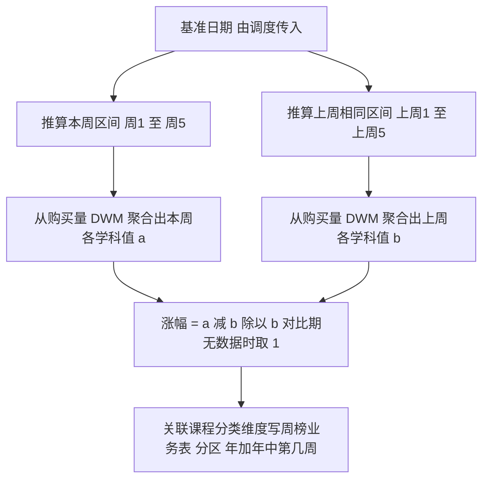

# 面试高频题：同比分析在智慧学成中的应用

报表上一排涨幅数字，面试官指着问：「这个增幅是怎么算出来的？同比还是环比？对比区间怎么取？」数据类岗位面试里，涨幅口径是高频考点，因为它最能暴露候选人有没有真正写过统计逻辑。同比是同期相比，表示某个特定统计段今年与去年之间的比较；环比是连续两个统计周期内的量的变化比。概念一句话能背出来，落到项目里，对比区间怎么推、没有历史数据怎么兜底、结果怎么分区，才是这道题的得分点。智慧学成在热门学科排名里对销售额、销售量、学生人数三项计算了同比增幅，这套实现可以作为答题的完整素材。

## 先给结论

- 同比的公式是「当前时间段减去对比时间段，再除以对比时间段」，课程在热门学科排名的三个统计项上分别落地了年、月、周三种同比。
- 周同比的对比区间取上周的相同星期区间：本周取周 1 至周 5，对比段就取上周 1 至上周 5，保证两边都是同样的业务日。
- 实现三件套：日期工具推区间、`IFNULL` 兜底的涨幅 SQL、按年与年中第几周的双分区。
- 涨幅必须先按学科聚合再相除，不是逐单相比；对比期无数据时用 `IFNULL` 给定兜底值。
- 课程访问量周榜的周区间日期与涨幅计算在统计篇已经完整实现，与学科榜是同一套口径，答题时可合并表述。

## 口径：同比、环比与一个 GDP 例子

同比的官方例子讲义里给得很直白：2009 年第一季度 GDP 为 G9 亿元，2010 年第一季度的 GDP 同比增长就是 (G10 − G9) / G9。同一段位、相邻年份相除，分子是变化量，分母是对比期的基数。环比则不跨年，只看连续两个统计周期：这周对上周、这月对上月。两者常常被混着说，答题时先把定义分开，再讲项目用哪种。

项目里热门学科排名的三个统计项（销售额、销售量、学生人数）各算了一份增幅，增幅的计算方式采用同比，并且分别做了年同比、月同比、周同比三个粒度。口径落到表结构上看得最清楚，业务表直接把「本期值」与「涨幅」并排存：

```sql
-- 学科销售额周榜业务表（建表脚本节选）
CREATE EXTERNAL TABLE IF NOT EXISTS data_subject.subject_sale_week_biz
(course_category_dim_id String,
 course_category_name String,
 sale_num INT,
 sale_percent FLOAT)
PARTITIONED BY (years String, week_of_year String)
STORED AS PARQUET
location'/user/hive/external/data_subject/subject_sale_week_biz';
```

`sale_num` 是本期值，`sale_percent` 是同比涨幅，分区键是年份加年中第几周。销售量、学生人数两张周榜以及四张月榜的表结构完全同构，只是度量字段换名字。课程访问量周榜也是同样的路数，表里的 `week_compare` 与 `week_percent` 分别落差值与涨幅，区间推算与涨幅公式和学科榜共用同一套。

## 周同比的完整实现

讲义把周同比拆成七步：取当前周时间区间、取上周相同区间、取本周数据、取上周数据、计算涨幅、按维度 id 关联维度信息、保存结果。区间推算是唯一的难点，画出来一目了然：



基准日期由调度传入，程序据此推出本周与上周两个区间，再算出本周是年中的第几周，作为分区键。统计程序的主干如下（节选自讲义代码，包名按本课规范书写）：

```scala
package com.study.xc.analysis.subject.salesvolume

import com.study.xc.common.EtlEnvironment
import com.study.xc.entity.SubjectSaleWeekBiz
import com.study.xc.utils.DateUtils.{getWeekNum, getWeekRelativelyInterval}
import com.study.xc.utils.SubjectUtils.subjectBuyCountSql
import org.apache.spark.sql.SparkSession

object SubjectSalesVolumeByWeekBiz {
  val spark: SparkSession = EtlEnvironment.getSparkSession(this.getClass.getSimpleName)

  def main(args: Array[String]): Unit = {
    import spark.implicits._
    val dateInfo = args(0)
    // 一次拿到本周区间与上周相同区间，格式为 起始:结束
    val weekInterval = getWeekRelativelyInterval(dateInfo).split(",")
    val current = weekInterval(0).split(":")      // 本周区间，如周1至周5
    val last = weekInterval(1).split(":")         // 上周相同区间
    val weekOfYear = getWeekNum(current(0)).split("-") // 本周是年中第几周
    // 涨幅计算放工具类，先聚合再相除
    subjectBuyCountSql(spark, current, last)
      .createOrReplaceTempView("salesvolume_biz_tmp")
    val buyDF = spark.sql(
      s"""
         |select a.course_category_dim_id,
         |       b.name course_category_name,
         |       cast(a.sale_num as int) sale_num,
         |       cast(a.sale_percent as float) sale_percent,
         |       ${weekOfYear(0)} years,
         |       ${weekOfYear(1)} week_of_year
         |from salesvolume_biz_tmp a
         |left join data_dimen.course_category_dim b
         |  on a.course_category_dim_id = b.course_category_dim_id
       """.stripMargin).as[SubjectSaleWeekBiz]
    // 动态分区覆盖写周榜业务表
    spark.conf.set("hive.exec.dynamic.partition.mode", "nonstrict")
    buyDF.repartition(1).write.mode("overwrite")
      .insertInto("data_subject.subject_sale_week_biz")
    spark.close()
  }
}
```

涨幅的 SQL 收在工具类里，两个子查询分别按本周、上周区间从 `course_buy_dwm` 聚合，再一连接相除（节选自讲义代码）：

```sql
select a.course_category_dim_id,
       a.sale_num,
       IFNULL((a.sale_num - b.sale_num) / b.sale_num, 1.0) sale_percent
from
(select course_category_dim_id, sum(salesvolume) sale_num
 from data_course.course_buy_dwm
 where concat_ws('-', years, months, days) between '${current(0)}' and '${current(1)}'
 group by course_category_dim_id) a
left join
(select course_category_dim_id, sum(salesvolume) sale_num
 from data_course.course_buy_dwm
 where concat_ws('-', years, months, days) between '${last(0)}' and '${last(1)}'
 group by course_category_dim_id) b
on a.course_category_dim_id = b.course_category_dim_id
```

这条 SQL 把三个口径细节都固化了。**第一，先聚合再比。** 涨幅比的是学科级的汇总值，两侧各自 `group by` 学科 id 后再连接，逐单相比毫无意义。**第二，对比区间完全对称。** 分区列年月日用 `concat_ws` 拼成日期后做 `between`，上周区间取的是与本周相同数量的业务日，周日没有订单这类周期性波动被对称区间天然抵消。**第三，`IFNULL` 兜底。** 左连接后上周没数据的学科 b 侧为 NULL，相除结果为空，`IFNULL` 给它赋 1.0，即按增长 100% 处理。

## 调度与分区的配合

周榜任务的基准日期由 NiFi 调度传入，调度模板里传的是当天的格式化日期，程序据此推周区间；清洗类任务传的是前一天，榜单类任务传的是统计基准日，参数语义由任务自己定义，调度只负责按时把日期递进去。分区用 `years + week_of_year` 双键而不是一个日期，好处是按周回看榜单时直接定位到某年第几周，跨年的那一周也不会散落在两个日期分区里。月榜同理用 `month_of_year`，年同比的对比区间则跨到上一年同段，三种粒度共用同一套「推区间、取数、相除、落分区」的骨架。

## 常见误区

- **把同比与环比的口径混着说。** 错例：一律答「和上期比」。正解：同比指特定统计段与上一年同期比，环比指相邻两个统计周期比；课程按年、月、周三个粒度做同比，年同比对去年同段，月同比与周同比取上一个相同结构的周期，答题时先说清对比区间，避免被抠定义。
- **对比期没有数据时直接算出 NULL。** 错例：相除结果空着上线，报表一片空白。正解：左连接配 `IFNULL` 给兜底值，课程取 1.0 即翻倍口径，这个值是业务决定，能接受才这么定，更稳妥的做法是同时给出对比期数据供报表标注。
- **分母为零不设防。** 错例：上周汇总值是 0 时除法直接报错或得无穷。正解：SQL 里对分母做非零判断，或聚合阶段就把 0 值学科单独处理，不能指望数据库自己兜底。
- **先逐条比再汇总。** 错例：在明细行上算涨幅再求和。正解：涨幅定义在聚合层，先按维度汇总出两侧总量再相除，聚合粒度必须与展示粒度一致。

## 面试可能被问到的问题

1. 面试官追问：「同比和环比的区别，你们项目里用的哪个？」
   答：同比是特定统计段与上一年同期比较，环比是连续两个统计周期的变化比。项目主用同比，在热门学科排名的销售额、销售量、学生人数三项上分别计算年、月、周同比；环比了解概念即可，项目里没有采用。
2. 面试官追问：「周同比的对比区间怎么取？跨年怎么办？」
   答：取上周的相同星期区间，本周取周 1 至周 5，对比段取上周 1 至上周 5，两侧业务日对齐。区间由日期工具从基准日期推算，分区键用年份加年中第几周，跨年的周有独立的年与周号，不会与上年数据混在一起。
3. 面试官追问：「上周没有数据的学科，涨幅怎么算？」
   答：左连接后对比侧为 NULL，用 `IFNULL` 兜成 1.0，按增长 100% 处理，这是课程里的业务约定。更谨慎的做法是把兜底口径与对比期数据一起给报表，让空数据与翻倍可区分，避免误读。
4. 面试官追问：「涨幅为什么先聚合再相除，而不是在明细上算？」
   答：涨幅是学科级指标的属性，两侧先按学科汇总出总量再相除，分子分母同粒度才有意义；明细行上相除再汇总在数学上不等价，还会被单笔异常放大。
5. 面试官追问：「这个涨幅统计的日期参数从哪来？」
   答：NiFi 调度把基准日期格式化后传给 spark-submit 脚本，程序据此推算本周与上周区间。日期外部传参让统计程序无状态，指定任意基准日都能重算，回刷历史周榜就是换个参数重跑。
6. 面试官追问：「课程访问量的周涨幅和这个是一套逻辑吗？」
   答：是。访问量周榜在统计篇已经实现过同样的区间推算与涨幅公式，业务表里 week_compare、week_percent 分别存差值与涨幅，粒度从学科换到课程，骨架完全复用。

## 配套资料

- 讲义：`materials/docs/08/智慧学成-项目就业指导.md`，第 8 节同比分析在项目中的应用（同比与环比定义、热门学科排名三项目的增幅口径）为本课出处。
- 讲义：`materials/docs/08/智慧学成-第3章-课程分析.md`，3.5 节热门学科排名统计分析（销售量、学生人数、销售额的周榜月榜统计与涨幅计算）及周区间工具类说明在该讲义，正文 Scala 与 SQL 为其节选改写。
- 资料：`materials/code/08/_散落资料/`，建表脚本中 subject_sale_week_biz 等周榜月榜业务表 DDL、subject_sales_by_week_biz 等 6 个榜单调度脚本、热门学科排名-数据清洗统计分析调度 NiFi 模板在该目录（内层文件名带站点后缀，属元信息，按用途自取）。
- 说明：示例站点一律 example.com 占位；Scala 包名与调度脚本类名已按本课规范统一书写。
