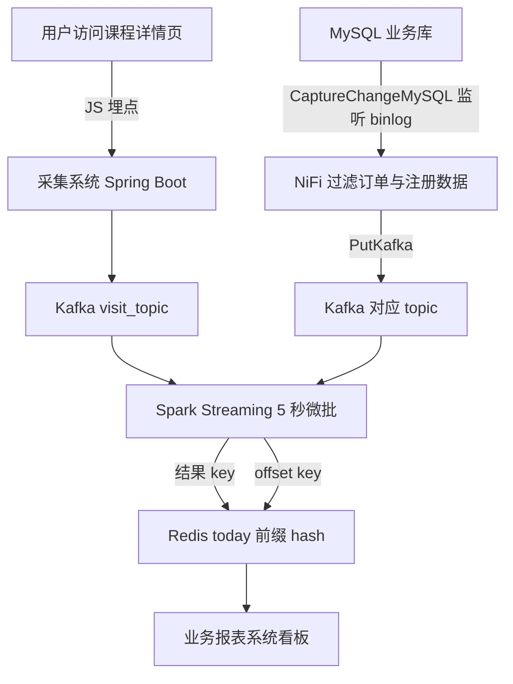

# 面试高频题：智慧学成的实时分析是如何做的

简历上写了实时统计，面试官一句「今日访问量这种实时指标你们是怎么算出来的」就能把很多人问住：既要讲清数据从哪来，又要讲清程序挂了为什么不怕丢。智慧学成的实时分析围绕今日访问量、新增用户量、今日购买量三个指标展开，链路分数据采集、统计分析、结果存储三段。这套答案的特殊之处在于它经得起逐行对质：采集链路是 NiFi 模板实物，统计逻辑有完整 Scala 代码，结果存储有明确的 Redis key 设计，背概念与看实物是同一件事。

## 先给结论

- 采集分两条链路：今日访问量走 JS 埋点，由自建采集系统转发进 Kafka；新增用户量与今日购买量走 NiFi 监控 MySQL binlog（`CaptureChangeMySQL` 处理器），过滤出订单与注册数据后写 Kafka。
- 统计用 Spark Streaming，5 秒一个微批；Kafka 的 offset 由程序手动管理、存到 Redis，处理完一批才更新一次进度。
- 访问量按课程 id、sessionId、ip 三个字段去重后累计；注册与订单号天然唯一，直接计数即可。
- 结果存 Redis 固定 key 的 hash 结构，field 携带当天日期，一天一个 field，业务报表系统直接读 Redis 展示。

## 采集：埋点与 binlog 各管一条链路

两条链路的分界线是数据源在哪。今日访问量的数据源是用户行为：用户访问在线教育平台的课程详情页产生访问行为，JS 埋点把数据发到采集系统，采集系统发往 Kafka，实时分析程序从 Kafka 读取。新增用户量与今日购买量的数据源是业务库：注册数据、订单数据本来就在 MySQL 里，要实时拿到它们，最可靠的方式是监听 binlog。课程用 NiFi 的 `CaptureChangeMySQL` 处理器订阅 MySQL 变更，经过滤只放行订单表与用户注册表的插入事件，随后由 `PutKafka` 写入各自 topic。整个实时分析的数据流如下：



图里 Kafka 是两条链路的汇合点：埋点数据天然是流，进 Kafka 顺理成章；binlog 数据靠 NiFi 变成了流。统计端只认 topic 与 offset，不关心数据从哪条路来，采集方式的变化不会波及统计程序。想核对 Kafka 里到底进了什么数据，一条命令就够：

```bash
# 模拟消费者查看 topic 中的数据
./kafka-console-consumer.sh --bootstrap-server xc-online-kafka:9092 --topic visit_topic
```

## 统计：手动 offset 加 5 秒微批

统计程序 `RealTimeVisit` 的骨架可以从讲义代码里完整还原，去掉次要配置后关键步骤只剩五处：

```scala
package com.study.xc.analysis

import com.study.xc.common.EtlEnvironment
import com.study.xc.utils.{DateUtils, RedisUtils}
import org.apache.kafka.common.serialization.StringDeserializer
import org.apache.spark.streaming._
import org.apache.spark.streaming.kafka010.{ConsumerStrategies, HasOffsetRanges,
  KafkaUtils, LocationStrategies}
import org.apache.spark.streaming.{Seconds, StreamingContext}
import org.apache.spark.{SparkConf, SparkContext}

object RealTimeVisit {
  def main(args: Array[String]): Unit = {
    val sc = new SparkContext(new SparkConf())
    val topicName = "visit_topic"
    // Redis 中访问量结果 key 与 offset key，双 key 分开
    val rt_cv_key = "today::course_visit::current"
    val rt_cv_offset = "today::course_visit::offset"

    // 1. 从 Redis 读上次提交的 offset，没有则从 0 开始
    val redis = new RedisUtils
    redis.initRedisPool()
    val offsets = redis.getLastCommittedOffsets(rt_cv_offset, topicName, 1)

    // 2. 5 秒一个微批，设置检查点供状态恢复
    val ssc = new StreamingContext(sc, Seconds(5))
    ssc.checkpoint("/user/hive/external/data_course/today_visit_online/checkpoint")
    val kafkaParam = Map[String, Object](
      "bootstrap.servers" -> "xc-online-kafka:9092",
      "key.deserializer" -> classOf[StringDeserializer],
      "value.deserializer" -> classOf[StringDeserializer]
    )
    // 3. 指定 offset 消费：ConsumerStrategies.Assign
    val message = KafkaUtils.createDirectStream[String, String](
      ssc, LocationStrategies.PreferConsistent,
      ConsumerStrategies.Assign[String, String](offsets.keys.toList, kafkaParam, offsets)
    )

    // 4. 按课程 id、sessionId、ip 组键，mapWithState 状态化去重累计
    val uvTemp = message.map(_.value()).map(_.split("\t"))
      .filter(arr => arr.length == 7)
      .map(arr => (arr(0) + "_" + arr(2) + "+" + arr(3), 1))
    val update = (word: String, count: Option[Int], state: State[Int]) => {
      val sum = count.getOrElse(0) + state.getOption().getOrElse(0)
      state.update(sum)
      (word, sum)
    }
    val uv = uvTemp.mapWithState(StateSpec.function(update))

    // 5. 结果写 Redis；处理完一批才把 offset 写回 Redis
    val keyInfo = "visit_date_" + DateUtils.getDateStr(new java.util.Date().getTime, "yyyy-MM-dd")
    val accumulator = sc.longAccumulator("uv")
    uv.foreachRDD { iter =>
      if (iter.count() > 0) {
        accumulator.add(iter.count())
        redis.storeResultRedis(rt_cv_key, keyInfo, accumulator.value.toString)
      }
    }
    message.foreachRDD { rdd =>
      if (!rdd.isEmpty()) {
        rdd.asInstanceOf[HasOffsetRanges].offsetRanges.foreach { o =>
          redis.storeOffsetRedis(rt_cv_offset, o.topic + "_" + o.partition, o.untilOffset)
        }
      }
    }
    ssc.start()
    ssc.awaitTermination()
  }
}
```

这段代码里最容易在面试讲漏的是消费策略的选择：`Assign` 而不是 `Subscribe`。`Subscribe` 走 Kafka 消费组的自动管理，进度在 Kafka 侧；`Assign` 把 offset 作为参数显式传入，进度完全由 Redis 说了算，重启时从 Redis 读回、从头开始时从 0 起步，两种语义都能精确控制。访问量的去重用的是 `mapWithState`，把「课程 id_sessionId+ip」作为状态键，每个键的累计值跨批次保留，重复访问只会让已有状态键命中，不再新增计数。

## 存储：Redis 双 key，结果与进度分家

今日访问量在 Redis 里用两个 key，职责互不相干：

| key | 结构 | field 示例 | value |
|---|---|---|---|
| `today::course_visit::current` | hash | `visit_date_2024-05-01` | 当天实时访问量，统计程序 5 秒更新一次 |
| `today::course_visit::offset` | hash | `visit_topic_0` | 该分区已处理的 offset |

结果 key 固定不变，field 前缀 `visit_date_` 固定、日期段按天动态生成，昨天的值和今天的值天然分属两个 field，隔天零成本切换。新增用户量与今日购买量同构，key 分别是 `today::new_user::current` 与 `today::course_buy::current`，field 前缀换成 `new_user_date_` 与 `course_buy_date_`。业务报表系统读看板时只碰结果 key，完全不感知 offset 的存在。

写入顺序也有讲究：先写结果、后写 offset。只有确认处理过的数据才允许推进进度，这样 Kafka 或 ZooKeeper 挂掉重启后，程序拿着 Redis 里的 offset 从断点继续读，已算过的不会重头算，没算过的一条不丢。这套设计也留有一个诚实的边界：结果写入与 offset 写回不是原子操作，若一批统计完成而 offset 尚未写回时程序崩溃，重启后会重放这一批，状态累计会多加一次。看板类指标对秒级误差不敏感，这个取舍是划算的；换成资金类场景，就要把结果改成按去重键幂等写入的形式。

## 常见误区

- **依赖 Kafka 自动提交 offset。** 错例：`enable.auto.commit=true`，结果存 Redis、进度交 Kafka，两边进度各走各的，重启后要么丢数据要么重复一大段。正解：关闭自动提交，处理完一批再把 `untilOffset` 写入 Redis，恢复时只认 Redis。
- **结果与 offset 混在一个 key 里。** 错例：为省事把计数和进度塞进同一个 hash。正解：双 key 分开，业务读结果 key、程序管 offset key，读写互不干扰，权限与过期策略也能各自独立。
- **去重维度拍脑袋定。** 错例：只按 ip 去重，同一出口 IP 后面的多名用户被算成一人；只按 sessionId 去重，同一会话里反复刷新被反复计数。正解：课程 id、sessionId、ip 三字段组键，会话内重复访问、校园网 NAT 出口都能正确处理。
- **把微批当成「假实时」一票否决。** 错例：一听 5 秒批处理就断定不如流式。正解：Storm、Flink 逐条处理适合公交到站这类强实时场景，看板类指标 5 秒延迟完全可接受；实时分析与离线分析共用 Spark 技术栈，还省了一套引擎的运维成本。

## 面试可能被问到的问题

1. 面试官追问：「为什么要把 Kafka 的 offset 存到 Redis，而不是交给 Kafka 自己管理？」
   答：统计结果的存储在 Redis，恢复语义就要以结果为准。offset 存 Redis 后，进度与结果在同一个存储里，程序重启时从 Redis 读回断点，保证「算过的才算过，没算过的一定重算」。Kafka 消费组的自动提交有自己的节奏，与统计进度对不齐，两边不一致时要么丢数据要么长时间重复消费。
2. 面试官追问：「统计程序挂了重启，怎么保证数据不丢？」
   答：恢复时用 `ConsumerStrategies.Assign` 从 Redis 保存的 offset 起步消费，offset 由每个批次处理完后用 `HasOffsetRanges` 拿到的 `offsetRanges` 逐分区写回，只记录已处理数据的边界。配合 checkpoint 恢复 `mapWithState` 的状态，断点续算即可接上。
3. 面试官追问：「三个指标的统计逻辑差别在哪？」
   答：访问量最复杂，要按课程 id、sessionId、ip 去重，用 `mapWithState` 状态累计；新增用户量与今日购买量的数据来自 binlog，用户注册与订单号天然唯一，不需要去重，直接计数。三条链路的采集、offset 管理、Redis 存储完全同构，差别只在统计规则这一层。
4. 面试官追问：「Redis 里的结果 key 为什么固定不变，field 却带日期？」
   答：固定 key 让业务报表系统的读取配置一次写死、无需感知日期；日期放进 field，一天一个 field，既把历史值按天留档，也避免了每天改 key 带来的读方联动修改。看板要展示今日值，取当天日期的 field 即可。
5. 面试官追问：「采集侧为什么注册和订单走 binlog，访问量走埋点，能不能反过来？」
   答：数据源决定方式。注册与订单的权威数据在 MySQL，binlog 里有完整变更记录，`CaptureChangeMySQL` 监听即可，业务代码零改动；访问行为只发生在页面上，业务库里根本没有这张表，只能靠 JS 埋点主动上报。反过来做，要么业务库多出不必要的埋点表，要么页面要伪造注册数据，两条路都不成立。

## 配套资料

- 讲义：`materials/docs/08/智慧学成-项目就业指导.md`，第 9 节「实时分析是如何做的」为本课大纲出处。
- 讲义：`materials/docs/08/智慧学成-第4章-实时分析.md`，1.1.2 技术方案、1.3 数据存储分析（三个指标的 Redis key 表）、2.2 统计分析代码（`RealTimeVisit` 全文）为本课代码出处。
- 资料：`materials/code/08/_散落资料/`，实时分析整体流程 NiFi 模板，课程访问量、新增用户量、今日购买量三组 ToKafka 与实时统计分析模板，`real_time_visit.sh` 等 spark-submit 启动脚本，新增用户实时分析数据生产脚本，都在该目录（内层文件名带站点后缀，属元信息，按用途自取）。
- 说明：Scala 代码节选自讲义并做了精简，包名按本系列口径改为 `com.study.xc` 系；示例站点一律 example.com 占位。
