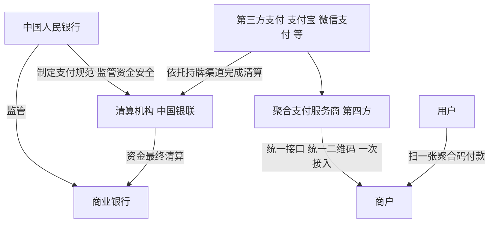

# 支付渠道碎片化催生的生意：聚合支付项目背景

> 🔒 安全提示：文中示例的口令/密钥均为课程教学环境演示口径，生产环境的安全要求见《安全与合规须知》。

门店收银台上立着两张码，有的店铺墙上还贴着第三张：支付宝一张、微信一张、银联一张。用户付款时挑一张顺手的，商户却要为每一张码分别签约、分别对接、分别对账。闪聚支付这个项目要做的，就是把这一堆码收拢成一张，支撑这张码的，是一整套聚合支付平台。进入代码之前得先回答一个更根本的问题：这门生意为什么存在，价值点在哪里，为什么它不持有支付牌照也能合法运转。

## 先给结论

- 移动支付盛行之后，支付渠道呈碎片化状态，而且碎片化程度还在加深；渠道每多一个，商户的接入、维护与对账成本就多一份。
- 聚合支付把主流支付渠道整合成统一的接入通道，所以行业里叫它「第四方支付」；用户只面对一个入口，就能完成多家渠道的支付。
- 资金清算发生在银行与持牌渠道侧，聚合支付只完成支付环节的信息流转和商户运营的承载，因此不需要支付牌照。
- 聚合支付的三个特点是中立性、灵活性、便捷性，落到商户身上的价值就是降低接入成本、提高运营效率。
- 本项目闪聚支付就是一个聚合支付平台，与市面上常见的聚合收银产品属于同一形态。

## 渠道碎片化：商户门口的三张码

移动支付的盛行不只是支付宝和微信两家的事。商业银行、第三方支付公司、清算机构、消费金融公司等众多类型的机构，都在为商户提供网络（移动）支付解决方案；另一边，用户的支付习惯五花八门，有人只用微信，有人离不开支付宝，还有人习惯银联。所谓支付渠道，就是用户完成支付所走的途径，微信是一种渠道，支付宝是一种渠道，银联和各类第三方支付也是渠道。

渠道多的直接后果，是商户门口的二维码越来越多。商户在门前同时摆支付宝和微信两张码，动机很朴素：不想因为用户只装了一个 App 就丢掉这单生意；如果还想接银联，那就再贴一张。更要命的是这不是一次性工作，三天两头冒出一个新的支付方式，商户就得跟着重新贴码、重新对账。把这件事拆开看，商户为一个渠道付出的成本有三块：签一次约、对接一套接口、每天多对一套账。支付渠道呈碎片化状态，而且碎片化程度还在逐渐加深，这就是聚合支付要解决的市场问题。

## 聚合支付的产业结构：第四方从哪里长出来

聚合支付顾名思义，就是把这些支付渠道聚合起来：用户只扫一个二维码，平台在背后把请求交给对应的渠道，微信扫进来走微信，支付宝扫进来走支付宝，银联同理。要理解它的位置，得把支付产业的上下游排一遍。支付这件事安全要求极高，毕竟流转的是钱，规则制定者和监管者是中国人民银行，支付规范由它制定，资金清算也在它的控制之下；清算机构负责把各处的收付对平，中国银联就是典型代表；银行自身的支付满足不了互联网时代的用户需求，才长出了支付宝、微信支付这些第三方支付；第三方支付多了之后，把它们打包整合的聚合支付服务商就出现了。产业结构随历史变迁越来越丰富，聚合支付站在最靠近商户的位置：



这张图在讲聚合支付的产业结构。看图的关键是聚合支付服务商那一层：用户与商户两端都只面对它，资金链路却始终走在清算机构与银行的持牌通道里。第四方的「第四」就是这个意思，排在前面的三方分别是中国人民银行与清算体系、商业银行、第三方支付。

## 不碰资金，所以不需要支付牌照

支付牌照是国家发放的认证授权，持牌才能给用户提供支付途径，支付宝、微信这类第三方支付机构都需要它。聚合支付不需要，原因就在它的职责边界：它不进行资金的保存，也不进行资金清算，资金最终流转到微信、支付宝、银联这些渠道侧，再由清算体系完成清分。聚合支付自始至终只做两件事：支付环节的信息流转，以及商户运营的承载。用一句话概括，它是支付渠道的中介，帮用户方便地完成支付，但钱不过它的手。

落到体验上就是这个过程：平台给用户一个二维码，用户用微信扫，就走微信支付；用支付宝扫，就走支付宝支付。平台只负责把这条支付信息送对地方。讲义里对它的定位写得很收敛：聚合支付在集合银联、支付宝、微信等主流支付方式的基础上，帮助商户降低接入成本，提高运营效率，具有中立性、灵活性、便捷性等特点。中立说的是它不偏袒任何一家渠道；灵活说的是渠道可插拔，新渠道接入不动商户侧；便捷说的是商户一次接入、用户一个入口。正因为牌照门槛不存在而技术门槛存在，大量创业公司选择进入这个领域，闪聚支付就是按这个形态设计出来的项目。

## 从背景落到工程：聚合的核心是统一抽象

行业背景说完，回到工程视角。聚合二字要成立，平台内部必须把渠道差异关进统一的模型里，对外只暴露一套接口、一套参数。这层抽象在课程工程里能看到两处直接证据。其一是工程本身的微服务底座，父工程用依赖管理把版本关系钉死：

```xml
<!-- 聚合支付平台父工程真实文件节选，groupId 与模块名按本系列口径改写为 com.study.pay 系 -->
<dependencyManagement>
    <dependencies>
        <dependency>
            <groupId>org.springframework.cloud</groupId>
            <artifactId>spring-cloud-dependencies</artifactId>
            <version>Greenwich.RELEASE</version>
            <type>pom</type>
            <scope>import</scope>
        </dependency>
        <dependency>
            <groupId>com.alibaba.cloud</groupId>
            <artifactId>spring-cloud-alibaba-dependencies</artifactId>
            <version>2.1.0.RELEASE</version>
            <type>pom</type>
            <scope>import</scope>
        </dependency>
    </dependencies>
</dependencyManagement>
```

Spring Cloud Greenwich 与 Spring Cloud Alibaba 2.1.0 是配套版本，加上 Spring Boot 2.1.3.RELEASE 的父依赖，三者构成整个平台的版本基线。其二是统一下单的数据模型，工程里的订单 DTO 用同一组字段承载所有渠道的下单请求：

```json
{
  "appId": "example-appid",
  "outTradeNo": "example-out-trade-no-0001",
  "subject": "示例商品",
  "body": "门店收款示例订单",
  "currency": "CNY",
  "totalAmount": 12800,
  "expireTime": "2026-11-08 18:00:00"
}
```

这几个字段就是统一抽象的样子：商户侧只填商户订单号 `outTradeNo`、应用标识、标题、金额，不需要关心订单最终会被派给哪家渠道。金额单位是分，`12800` 表示 128 元，全程用整数规避浮点误差。工程里还有两个容易混淆的字段：`channel` 存聚合支付自己的渠道编码，`payChannel` 存路由结果落到的原始渠道编码，一笔订单先以聚合身份生成，再由平台决定派给哪个渠道。渠道路由的依据是商户在平台上配置的渠道参数，这层内容属于商户接入的范畴，在项目概述部分（讲义 1.2）展开。

## 常见误区

- **把聚合支付当成第三方支付的一种。** 错例：认为聚合平台也持有支付牌照、也参与资金清算。正解：聚合支付是第四方，只做信息流转与商户运营承载，资金清算发生在持牌渠道与清算机构侧，这正是它不需要牌照的原因。
- **把聚合支付理解成「把多张二维码拼在一起」。** 错例：以为是前端展示层的合并动作。正解：码只是入口，背后是平台完成了渠道路由、订单与对账的统一承载，展示上的合并只是最终呈现。
- **认为不需要牌照等于没有任何门槛。** 错例：以为搭一个转发接口就能做聚合支付。正解：业务仍在人民银行制定的支付规范之下运行，多渠道路由、资金对账、系统稳定性才是这个行业的真正门槛。
- **金额字段随手用浮点数。** 错例：用 `double` 存 128.00 元再传给渠道。正解：以分为单位的整数（`12800`）流转，展示层再做格式化，避免精度丢失造成对账差异。

## 面试可能被问到的问题

1. 面试官追问：「什么是聚合支付？它和第三方支付的区别是什么？」
   答：聚合支付把支付宝、微信支付、银联等主流渠道整合成统一通道，所以被称为第四方支付。区别在职责：第三方支付持牌、负责资金清算；聚合支付不碰资金、无需牌照，只完成支付信息流转与商户运营承载，让商户一次接入多家渠道。
2. 面试官追问：「聚合支付为什么不需要支付牌照？」
   答：牌照对应的是资金清算资质。聚合平台不保存资金、不进行清算，资金从用户付款账户经持牌渠道最终清算到商户结算账户，平台全程只传递支付指令与对账信息，属于渠道中介，因此不需要牌照。
3. 面试官追问：「聚合支付给商户解决了什么问题？」
   答：渠道碎片化下的重复接入。每多一个渠道，商户就要多签一次约、多对接一套接口、多对一套账；聚合平台把它们收拢成一次接入、一个入口，商户降低接入成本、提高运营效率，平台侧体现为中立性、灵活性、便捷性。
4. 面试官追问：「描述一下聚合支付产业链上各方的角色。」
   答：中国人民银行制定支付规范并监管资金安全；银联这类清算机构负责资金清算；商业银行提供底层账户体系；支付宝、微信支付等第三方支付持有牌照，面向用户提供支付途径；聚合支付服务商整合第三方渠道直接服务商户，用户在商户侧完成付款。
5. 面试官追问：「一笔聚合支付里，资金流和信息流分别怎么走？」
   答：信息流是用户扫码发起支付，请求经聚合平台路由到对应渠道，渠道返回支付凭证，支付结果再经平台异步通知商户；资金流是用户付款账户扣款，经持牌渠道与清算机构最终清算入商户结算账户。两条链路分离，平台只走信息流，这是理解第四方定位的关键。

## 配套资料

- 讲义：`materials/docs/10/闪聚支付-第1章-讲义-项目介绍v1.0.md`，1.1 项目背景为本课出处，含聚合支付产业结构图与特点说明。
- 代码：`materials/code/10/`，聚合支付平台父工程与统一下单 DTO 在该目录的工程内（内层目录沿用项目原始命名，与正文 `com.study.pay` 系口径不一致，不展开列路径）；正文 XML 为该父工程真实文件节选，JSON 字段取自工程真实的统一下单 DTO，示例值全部用占位符。
- 说明：阶段九讲义与源码实际归档在编号 10 的资料目录下，`materials/docs/09` 与 `materials/code/09` 不存在；支付渠道密钥一律以 `example-appid`、`example-secret`、`example-key` 占位，示例站点一律 `example.com`。
