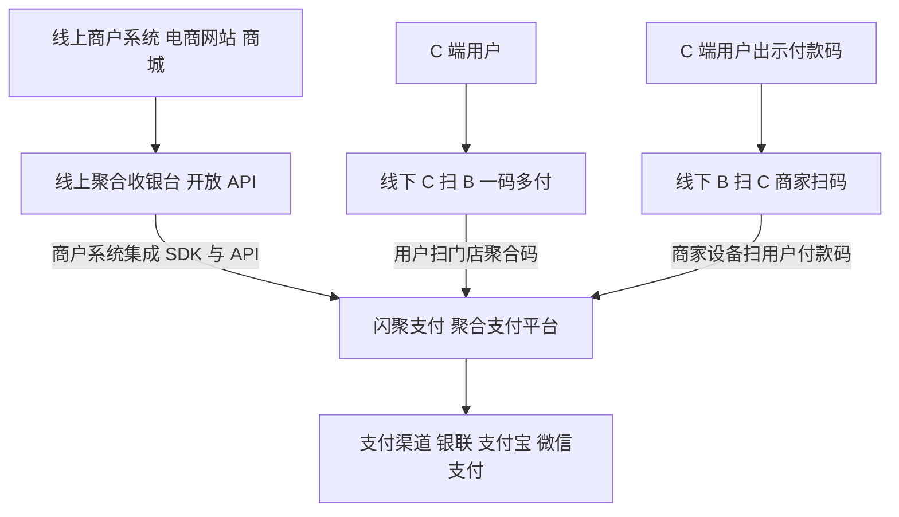

# 线上 API 加线下扫码：闪聚支付的项目概述与三种接入方式

> 🔒 安全提示：文中示例的口令/密钥均为课程教学环境演示口径，生产环境的安全要求见《安全与合规须知》。

面试里最常见的开场题不是算法，是「介绍一下你做的项目」。很多人卡在这里：报了一串技术栈，听的人还是不知道项目是干什么的。项目概述训练的就是用一段简短的话说清项目大概功能的能力。闪聚支付的概述段不长，信息密度却很高，可以拆成定位、接入形式、服务模式、生态四层来理解。拆完之后，「我的项目是什么」这个问题就有了标准答案的骨架。

## 先给结论

- 一段标准的项目概述：闪聚支付是一个提供聚合支付的平台，主要做法是线上聚合收银台（开放 API）、线下 C 扫 B 一码多付、线下 B 扫 C 商家扫码；平台以 SaaS 服务形式向商户提供订单管理、门店管理、财务数据统计等基础服务；并以支付为入口，通过广告、营销、金融等服务构建移动支付的全生态系统。
- C 扫 B 是用户扫商户的码，一张码按用户打开的 App 自动路由到对应渠道；B 扫 C 是商家用扫码设备扫用户出示的付款码。
- 开放 API 面向线上系统：商户系统用平台提供的 API 文档与多语言 SDK 接入，就像电商网站对接微信支付，只是接入对象换成了聚合平台。
- SaaS 是软件功能租用模式：商户租平台的功能用，平台前期免费聚用户，高级功能再收费。
- 商户与渠道的绑定最终落在渠道参数上：应用 ID、商户私钥、异步通知地址等，工程里对应一个渠道参数配置类。

## 一段概述里的四层信息

讲义给的项目概述只有一句话的篇幅，却把项目要说清的东西全部装下了。拆开看是四层。第一层是定位：闪聚支付是提供聚合支付的平台，这一句把行业角色钉死，聚合支付的含义在项目背景里已经交代过。第二层是接入形式：线上聚合收银台（开放 API）、线下 C 扫 B 一码多付、线下 B 扫 C 商家扫码，三种形式覆盖了线上系统与线下门店两类场景。第三层是服务模式：以 SaaS 形式向商户提供订单管理、门店管理、财务数据统计等基础服务。第四层是生态：以支付为入口，通过广告、营销、金融等服务构建移动支付的全生态系统。死记硬背这段话没有意义，理解四层之后用自己的话讲出来，面试时的项目介绍就有了骨架。

## 三种接入形式：一图看清



这张图在讲三种接入形式怎样汇到同一个平台。三条左侧分支对应三种业务形态，右侧出口只有一个聚合支付平台，再由平台对接到具体渠道，商户无论哪种接法都不必直接面对渠道。

**线上聚合收银台（开放 API）。** 电商网站一定要支付，早年它的做法是分别对接微信支付、支付宝，用渠道提供的 API 把支付能力嵌进自己的系统。聚合平台出现后，把这一步整体接管：平台对外提供统一的 API 文档与 SDK，覆盖 Java、PHP、Python 等多语言版本，线上系统按文档接入即可。接入之前有一套准备工作：上传商户 RSA 公钥到平台的证书管理，完成交易密钥配置，拿到 API Key；真实平台的密钥通常分生产与 Mock 两种模式，入驻审核没走完之前可以先用 Mock 密钥联调。这类开发者中心在真实聚合支付平台都能找到。统一下单的调用方式用命令行示意：

```bash
# 聚合收银台统一下单接口调用示意（示例为按本课写法补全，站点与密钥均为占位）
curl -X POST https://api.pay.example.com/v1/trade/create \
  -H "Authorization: Bearer example-key" \
  -d "appId=example-appid" \
  -d "outTradeNo=202611080001" \
  -d "totalAmount=12800"
```

**线下 C 扫 B 一码多付。** C 指 C 端用户，B 指商户。商户在平台上生成一张门店二维码，用户用微信扫就走微信支付，用支付宝扫就走支付宝支付。一码多付的实质是码只指向平台的统一入口，不绑定具体渠道，平台识别用户所用的 App 再路由。商户门前从此只需要一张码，项目背景里那三张码的窘境就此消失。

**线下 B 扫 C。** 大型超市结账时收银员说「出示你的付款码，我来扫」，商户用扫码设备扫用户出示的付款码完成收款。方向反过来，B 端主动，用户省去打开多个 App 的动作，收银效率也更高。

## SaaS：把软件当服务租给商户

SaaS 这三个字母可以用阿里云来理解。早期做网站要自己买服务器、装系统、配硬件；阿里云把服务器空间和域名做成网站上的服务，用户按需购买，相当于租用它的资源。SaaS 的本质就是软件功能服务的租用模式。聚合支付平台面对的不是一家商户，而是一大批商户：商户想用平台的收款功能，按年付租金，之后订单管理、门店管理这些功能随便用。平台的商业策略也灵活：有的创业期平台基础功能全免费，先把用户聚集起来；等用户量上来了，财务数据统计这类高级功能再收费。免费与收费分层铺开，是这类平台常见的打法。

## 以支付为入口的移动支付生态

用户量上来之后，支付页面本身就是流量入口。很多人遇到过付款时弹出广告框，这就是聚合支付平台的另一种业务形态：支付的人多了，平台就有了广告位，可以打广告、做营销。再往外延伸是金融服务。所以这条路径是：把支付服务做好，以此把商户与用户聚集起来；然后以支付为入口，开辟广告、营销、金融等附加服务，最终构成一个移动支付的全生态系统。概述里「以支付为入口」六个字的分量就在这里，支付是根，生态是长出来的枝。

## 渠道参数：商户与渠道的绑定落点

概述里反复出现的「接入」，落到工程上核心就是渠道参数。商户在商户平台创建应用、填写支付渠道参数（支付宝、微信、银联等），平台把它们存起来，交易时按参数去渠道侧发起请求。课程工程里的支付宝渠道参数配置类把字段列得很全：

```java
/** 支付宝渠道参数配置类（课程工程真实字段，示例值一律占位） */
public class AliConfigParam implements Serializable {
    public String appId;            // 应用 id，如 example-appid
    public String rsaPrivateKey;    // 商户私钥，如 example-secret
    public String alipayPublicKey;  // 支付宝公钥，如 example-key
    public String notifyUrl;        // 异步回调通知地址
    public String returnUrl;        // 同步回调通知地址
    public String url;              // 支付宝网关
    public String charest;          // 编码方式 UTF-8
    public String format;           // 格式 JSON
    public String signtype;         // 签名类型，支持 RSA2 与 RSA，推荐 RSA2
}
```

字段名按屏幕原样保留（`charest` 是工程里的历史拼写，实为 charset 之意）。这几个字段解释了商户接入的全部要素：`appId` 标识商户在渠道侧的身份，私钥用于签名，公钥用于验签，异步与同步回调地址决定支付结果怎么回到商户系统。渠道参数属于敏感信息，示例与文档里一律以 `example-appid`、`example-secret`、`example-key` 这样的占位符出现，真实值由商户在平台配置入库并加密存储。

## 常见误区

- **把 C 扫 B 说成 B 扫 C。** 错例：把超市收银员扫用户付款码说成 C 扫 B。正解：谁主动扫谁，用户扫商户的码是 C 扫 B，商家设备扫用户的付款码是 B 扫 C，一句话记「码在谁手上」。
- **把 SaaS 理解成一次性卖软件。** 错例：认为平台把系统卖给商户，卖完不管。正解：SaaS 是租用模式，功能长在平台上，商户按租期付费，平台负责持续维护升级。
- **认为开放 API 是电商专属。** 错例：只有电商网站才接开放 API。正解：任何有线上支付需求的系统，商城、票务、订阅服务，都能通过 API 文档与 SDK 接入聚合平台。
- **渠道参数明文进代码或文档。** 错例：把 appid、商户私钥直接提交进代码仓库。正解：参数在平台侧配置入库并加密存储，示例与文档一律用 example-appid、example-secret 这类占位符。

## 面试可能被问到的问题

1. 面试官追问：「用一段话介绍你做的支付项目。」
   答：闪聚支付是一个提供聚合支付的平台，主要做法是线上聚合收银台（开放 API）、线下 C 扫 B 一码多付、线下 B 扫 C 商家扫码；平台以 SaaS 形式向商户提供订单管理、门店管理、财务数据统计等基础服务，并以支付为入口，通过广告、营销、金融等服务构建移动支付的全生态系统。
2. 面试官追问：「C 扫 B 和 B 扫 C 有什么区别？」
   答：区别在谁主动扫。C 扫 B 是用户扫商户门店的聚合二维码，一码多付，平台按用户所用 App 路由到微信、支付宝等渠道；B 扫 C 是商家用扫码设备扫用户出示的付款码，多见于商超收银台场景。
3. 面试官追问：「开放 API 接入是怎么回事？比商户自己对接微信支付好在哪？」
   答：平台对外提供统一的 API 文档与多语言 SDK，商户系统完成公钥上传、交易密钥配置后即可发起交易。好处是只对接一次就获得全部渠道能力，新增渠道不需要商户改造系统，接口与对账也是统一的一套。
4. 面试官追问：「SaaS 模式在项目里怎么体现？平台怎么盈利？」
   答：平台以 SaaS 形式向商户出租订单管理、门店管理、财务统计等功能，商户按租期付费。盈利路径包括套餐租金、高级功能收费，以及用户量上来之后以支付为入口的广告、营销、金融服务。
5. 面试官追问：「一码多付是怎么实现的？」
   答：二维码只指向平台统一入口，不绑定具体渠道。用户扫码后平台根据所用 App 识别渠道，再结合商户配置的渠道参数把订单路由到对应渠道，微信扫走微信、支付宝扫走支付宝。
6. 面试官追问：「商户配置的渠道参数一般有哪些？要注意什么？」
   答：通常包括应用 ID、商户私钥与渠道公钥、异步通知与同步回调地址、网关地址、签名类型等，工程里对应渠道参数配置类。要注意这些是敏感信息，必须加密存储，示例与文档里用占位符，不能明文入库或提交代码。

## 配套资料

- 讲义：`materials/docs/10/闪聚支付-第1章-讲义-项目介绍v1.0.md`，1.2 项目概述为本课三种接入形式、SaaS 模式与生态描述的出处。
- 代码：`materials/code/10/`，支付代理模块的支付宝渠道参数配置类（正文 Java 字段出处）在该目录的工程内（内层目录沿用项目原始命名，与正文 `com.study.pay` 系口径不一致，不展开列路径）。
- 说明：阶段九讲义与源码实际归档在编号 10 的资料目录下，`materials/docs/09` 与 `materials/code/09` 不存在；curl 示例为按本课写法补全的演示，站点 `example.com` 与密钥 `example-key` 均为占位。
