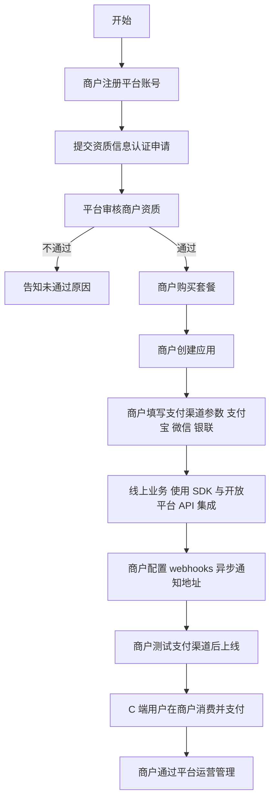
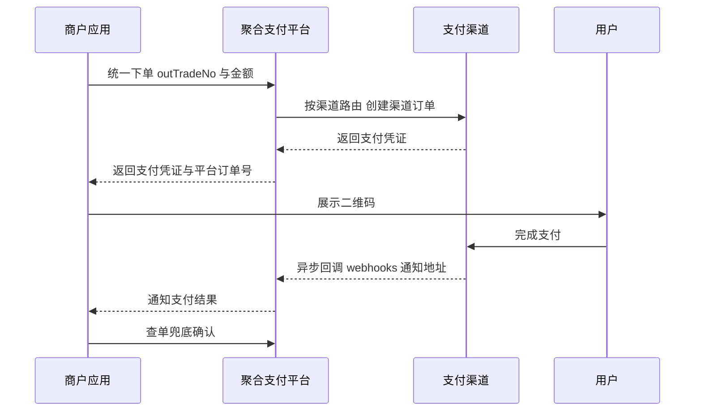

# 门户、商户平台、运营平台：功能模块与商户收款全链路

> 🔒 安全提示：文中示例的口令/密钥均为课程教学环境演示口径，生产环境的安全要求见《安全与合规须知》。

背景与概述之后，项目还剩两个必须回答的问题：系统分几块，一笔业务从头到尾怎么走。面试里对应两道高频题，「你们项目有哪些模块」和「讲一下核心业务流程」。闪聚支付的答案是三大功能模块，加一条以商户为主线的业务链；商户入驻走完九步，C 端用户才能扫码付款，而一笔支付从下单到回调还有一条更细的执行链路。

## 先给结论

- 平台功能分三大模块：官网&开放平台是门户，商户平台是商户的工作台，运营平台是平台方自己的管理系统。
- 业务主线九步：注册账号、提交资质认证、平台审核、购买套餐、创建应用、填写支付渠道参数、线上业务集成 SDK 与 API 并配置 webhooks、测试上线、C 端用户扫码支付，之后进入日常运营管理。
- 审核不通过则流程中断并告知原因；商户审核状态在工程实体里是一个明确的状态机：0 未申请、1 已申请待审核、2 审核通过、3 审核拒绝。
- 商户平台应用与商户服务是两个工程，应用层通过 Dubbo 引用服务接口，功能模块的边界在代码里就是模块边界。
- 一笔支付的执行骨架是统一下单、渠道路由、返回支付凭证、用户支付、渠道异步回调，按课程工程 DTO 与主流收单写法梳理，代码细节在交易章节展开。

## 三大功能模块：门户、工作台与管理端

**官网&开放平台。** 任何一个聚合支付平台都有一个对外的门户，用菜单导航把产品展示、功能介绍、帮助中心和开发者中心组织起来。开发者中心是线上接入的入口，API 文档与 SDK 下载都放在这里，服务的就是概述里说的开放 API 接入。

**商户平台。** 这是 SaaS 服务的落点，商户购买套餐之后在这里工作。商户登录进来有自己的首页和数据看板，能直接看到最近的经营数据；账户管理负责企业资质认证、企业信息与套餐购买；支付管理覆盖应用创建、渠道参数配置、交易总览和开启支付（生成二维码）；再往旁是门店管理、员工管理、优惠管理。讲义里的功能表值得留一份做对照：

| 功能模块名称 | 功能说明 |
|---|---|
| 官网&开放平台 | 产品展示、功能介绍、帮助中心和开发者中心 |
| 商户平台-首页 | 提供商户注册、登录、基本信息查看、数据看板 |
| 商户平台-账户管理 | 提供商户企业资质认证、企业信息查看和套餐购买 |
| 商户平台-支付管理 | 为商户提供应用创建、渠道参数配置、交易总览和开启支付（生成二维码）等 |
| 商户平台-门店管理 | 为商户提供新增门店、店长分配、门店导入等 |
| 商户平台-员工管理 | 为商户提供新增员工、定义角色、分配角色等 |
| 商户平台-优惠管理 | 为商户提供优惠券管理、活动统计等 |
| 运营平台-商户管理 | 对商户进行检索、审核和订单统计 |
| 运营平台-优惠管理 | 为商户设置优惠策略和优惠券发送 |
| 运营平台-管理员管理 | 为平台提供新增管理员、定义角色和分配角色等 |

**运营平台。** 聚合支付平台本身也是一家公司，要有自己人用的系统：商户检索与审核、优惠策略设置、管理员与角色管理都在运营平台完成。一句话区分两个平台，商户平台给客户用，运营平台给自己人用。

## 商户从注册到收款：一条九步主线



这张图在讲商户从进来到能收款的完整链路。关键分叉在审核节点：资质审核不通过就终止并告知原因，通过之后才谈得上购买套餐。九步里有几个节点值得单独说。

**资质认证与审核。** 商户提交营业执照等资质材料，平台员工审核。这是平台控制风险的第一道闸，审核不过的商户不能使用聚合支付服务。审核状态不是随手一个布尔值，工程实体里有完整的状态机：

```java
/** 商户信息 DTO（课程工程真实字段节选），审核状态是入驻流程的状态机 */
@ApiModel(value = "MerchantDTO", description = "商户信息")
@Data
public class MerchantDTO implements Serializable {
    private Long id;
    private String merchantName;        // 企业名称
    private String merchantNo;          // 企业编号
    private String businessLicensesImg; // 营业执照
    private String idCardFrontImg;      // 法人身份证正面
    private String idCardAfterImg;      // 法人身份证反面
    private String mobile;              // 手机号，关联统一账号
    // 审核状态：0-未申请，1-已申请待审核，2-审核通过，3-审核拒绝
    private String auditStatus;
    private Long tenantId;              // 租户 ID
}
```

**创建应用与渠道参数。** 应用是商户接入的单位，渠道参数（支付宝、微信、银联等）绑定在应用上。这一步是商户与渠道建立关系的落点，参数本身在项目概述一篇已经拆过。

**集成、webhooks 与上线。** 线上支付业务要用 SDK 和开放平台 API 集成开发；webhooks 是商户在应用里配置的异步通知地址，支付结果靠它主动推回商户系统。渠道测试通过后应用上线，C 扫 B 场景下商户在平台上生成门店二维码，用户扫码消费，支付链路才算打通。之后就是日常运营管理，平台侧的员工在运营平台做商户管理与审核。

## 模块边界：商户平台应用与商户服务分离

功能模块的划分在工程结构上有直接映射。商户平台的应用工程只做接入与展示层的事，业务查商户的动作落在商户服务工程里，中间用 Dubbo 引用：

```java
/** 商户平台应用层通过 Dubbo 引用商户服务（课程工程真实代码节选，包名按口径改写） */
@RestController
@Api(value = "商户平台应用接口", tags = "商户平台应用接口")
public class MerchantController {

    @org.apache.dubbo.config.annotation.Reference
    MerchantService merchantService;   // 商户服务 api 模块定义的接口

    @ApiOperation(value = "根据 id 查询商户信息")
    @GetMapping("/merchants/{id}")
    public MerchantDTO queryMerchantById(@PathVariable("id") Long id) {
        return merchantService.queryMerchantById(id);
    }
}
```

控制器里没有一行 SQL，商户查询走 `@Reference` 引用进来的 `MerchantService` 接口，实现在商户服务工程。这样分的好处是商户服务可以被商户平台、运营平台等多个应用复用，接口的提供方与消费方各自独立部署、独立伸缩，正是微服务拆分的用意。

## 一笔支付从下单到回调：先立起骨架

商户上线之后，一笔真实支付在系统间是这样走的：



这条骨架按课程工程的订单 DTO 与支付响应 DTO 字段和主流收单写法梳理，代码细节在交易章节展开。工程里订单状态字段的设计（0 订单生成、1 支付中、2 支付成功、3 业务处理完成）与支付响应对象里的平台订单号 `tradeNo`、商户订单号 `outTradeNo`、交易状态 `tradeState`，就是为这条链路准备的。要理解的一个核心设计是同步与异步的分工：下单时同步返回的只是支付凭证，不是支付结果；真正的支付发生在渠道侧，时间不定，所以结果靠渠道异步回调 webhooks 送达，商户侧再用查单接口兜底。把这条链路和九步主线叠在一起看：九步主线解决「商户能不能收」，这条骨架解决「钱怎么收成」，两层流程缺一不可。

## 常见误区

- **把官网开放平台当成商户工作台。** 错例：以为商户登录的就是官网。正解：官网与开放平台是门户，面向展示与开发者；商户做认证、买套餐、配参数、生成二维码，都在商户平台完成。
- **认为填完渠道参数就能立即收款。** 错例：跳过审核、测试与上线直接扫码。正解：资质审核通过、渠道测试通过、应用上线之后支付链路才可用，webhooks 没配置连支付结果都收不到。
- **审核状态用布尔字段。** 错例：一个 `auditPass` 布尔值标记通过与否。正解：用状态机字段区分未申请、待审核、通过、拒绝，工程实体里的 `auditStatus` 就是这个设计，前端与流程都靠它驱动。
- **把商户入驻流程与支付执行流程混为一谈。** 错例：面试里把注册、认证讲半天，讲不出一笔支付怎么走。正解：入驻流程回答商户怎么进来，支付流程回答钱怎么收成，两条链路分开讲。

## 面试可能被问到的问题

1. 面试官追问：「你们项目有哪些功能模块？」
   答：三大块。官网与开放平台是门户，含产品展示、帮助中心和开发者中心；商户平台是商户的工作台，含首页数据看板、账户管理、支付管理、门店管理、员工管理、优惠管理；运营平台给平台方员工用，含商户管理、优惠管理、管理员管理。
2. 面试官追问：「商户入驻的流程讲一下。」
   答：注册平台账号，提交资质信息认证，平台审核资质，不通过则告知原因终止流程；通过后购买套餐，创建应用，填写支付宝、微信、银联等渠道参数，线上业务用 SDK 和开放平台 API 集成并配置 webhooks，测试渠道后上线，之后 C 端用户扫码消费，商户用平台做运营管理。
3. 面试官追问：「商户审核状态你们是怎么设计的？」
   答：用状态机字段而不是布尔值，0 未申请、1 已申请待审核、2 审核通过、3 审核拒绝。资质材料与状态一起存在商户实体里，前端展示与后续流程按状态驱动，审核拒绝还能保留原因回溯。
4. 面试官追问：「webhooks 是什么？支付结果为什么靠异步通知？」
   答：webhooks 是商户在应用里配置的异步通知地址。支付实际发生在渠道侧，完成时间不可控，同步等结果不可靠；渠道完成支付后按该地址回调平台，平台再通知商户，配合查单接口兜底，保证结果最终一致。
5. 面试官追问：「一笔 C 扫 B 支付从下单到商户收到通知，链路上发生了什么？」
   答：商户应用带商户订单号请求平台统一下单，平台校验商户与渠道参数后按用户所用渠道路由，在渠道侧创建订单并拿回支付凭证；凭证经商户展示为二维码，用户扫码付款；渠道异步回调平台，平台更新订单状态并通知商户系统，商户可再查单确认。
6. 面试官追问：「商户平台和运营平台为什么要拆开？」
   答：使用者与权限完全不同，商户平台面向客户做经营，运营平台面向平台员工做审核与管理。拆开后各自独立部署与迭代，商户侧的权限体系与平台侧的管理员体系互不干扰，商户服务这类公共能力还能同时被两侧复用。

## 配套资料

- 讲义：`materials/docs/10/闪聚支付-第1章-讲义-项目介绍v1.0.md`，1.3 功能模块（含功能表）与 1.4 业务流程为本课出处。
- 代码：`materials/code/10/`，商户信息 DTO 与商户平台应用控制器（正文 Java 节选出处）、订单与支付响应 DTO 在该目录的工程内（内层目录沿用项目原始命名，与正文 `com.study.pay` 系口径不一致，不展开列路径）。
- 说明：阶段九讲义与源码实际归档在编号 10 的资料目录下，`materials/docs/09` 与 `materials/code/09` 不存在；一笔支付的执行骨架按课程工程 DTO 与主流收单写法梳理，渠道密钥一律 `example-appid`、`example-secret`、`example-key` 占位。
