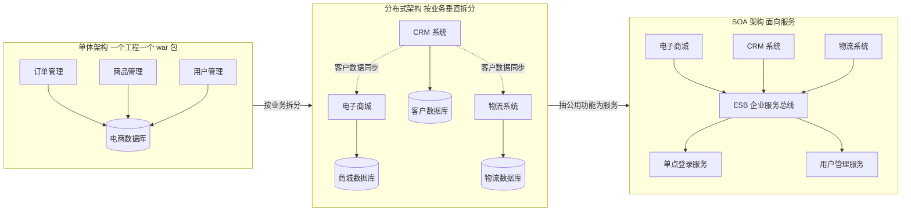

# 从单体到 SOA：架构演进不是升级，是被痛点逼出来的搬家

被问「你们项目为什么用微服务」时答不上来，根子往往不在微服务本身，而在不知道微服务出现之前大家是怎么受苦的。闪聚支付基于微服务架构开发，讲它的技术架构之前先把软件架构的演进路补一遍：单体架构、分布式（垂直）架构、SOA 架构。每一代架构的特点、优点、缺点都看一遍，就会发现演进从来不是追新，而是被上一代的痛点逼出来的搬家。

## 先给结论

- 单体架构把所有功能集成在一个工程、打成一个 war 包部署；小项目成本低、周期短，大项目改一处动全身、只能整体集群伸缩。
- 分布式架构按业务垂直拆分成一个个单体系统，子系统可按需伸缩、可用不同技术；代价是数据冗余与高耦合，伸缩粒度仍停留在子系统级。
- SOA 把重复公用的功能抽取为服务，用 ESB 企业服务总线做系统与服务的通信桥梁；复用与按服务伸缩的能力上来了，但系统与服务的界限模糊、接口协议繁杂。
- 演进的规律：每一代架构都在解决上一代最大的痛点，同时引入新的治理成本。
- 微服务在 SOA 思想的基础上把服务层按业务细粒度拆分，用 RESTful、RPC 等轻量级协议通信，本项目就落在这一站。

## 单体架构：一个工程打天下

Web 应用早期，大部分工程师把所有功能模块打包到一起，放在一个 web 容器中运行。以电商系统为例，商品管理、用户管理、订单管理全部写在一个工程里，共用同一个数据库，最终打成一个 war 包部署到服务器，用户就能访问。性能不够怎么办？把同一个工程部署三份组成应用集群，数据库性能不够就再上数据库集群，靠堆节点提高整体吞吐。

模块之间的交互是纯本地的：订单管理要查用户信息，直接调用户模块的 Service 接口，一次方法调用就完事，没有网络开销。这是单体最大的甜头，项目不大时开发效率极高：架构简单，前期成本低、周期短；部署简单，一个包拷进容器目录就能跑；测试也容易，本地就能启动完整的系统。

痛点随着业务量一起长大。全部功能集成在一个工程里，大项目难以开发、扩展与维护；只要改一个功能，整个项目就得重新编译、打包、部署，版本迭代速度越来越慢；最致命的是无法按需伸缩。双十一下单量暴涨，急需扩容的是订单管理，可用户管理跟它在同一个工程里，扩容只能整体集群化，不需要扩的模块陪着一起扩，资源浪费在结构上就注定了。

## 分布式架构：按业务垂直切开

为了适应大型项目的开发需求，办法是把一个单体系统按业务垂直拆分成若干系统：电子商城一个系统，CRM（客户关系管理）一个系统，物流一个系统，系统之间通过网络交互完成业务处理，每个系统可分布式部署。

拆完之后每个子系统体量变小，开发维护都简单了；伸缩以子系统为单位，物流系统要扩就扩物流，CRM 要扩就扩 CRM；每个子系统还可以采用不同的技术栈，给团队尝试新技术留了空间。

问题也跟着来了。三个系统都需要客户信息，客户数据在 CRM 里有，电子商城和物流也要用，于是要么各自存一份造成数据冗余，要么做数据同步把 CRM 的客户数据同步到物流的数据库。系统之间的接口多半就是为了数据同步而存在，物流系统离不开 CRM，电子商城也离不开 CRM，耦合性很大。伸缩的粒度也不够细：双十一要扩订单管理，而订单管理和用户管理都在电子商城这个子系统里，还是得把整个电子商城集群部署，用户管理照旧陪跑。垂直拆分只是把一个大单体切成了几个小单体。

## SOA：把公用功能抽成服务

SOA 是面向服务的架构，思路在分布式架构的基础上再进一步：把重复公用的功能抽取为组件，以服务的方式向各系统提供。每个系统都要登录，就抽一个单点登录服务出来，各系统要登录就请求这个服务；用户管理被多个系统共用，也抽成服务。系统与服务之间采用 web service、RPC 等方式通信，中间架一台 ESB 企业服务总线，作为系统与服务之间消息通信的桥梁。ESB 常被类比成消息队列，只能说它承担了「中间转发通道」的角色，定位并不等同，它面向的是服务间通信与协议适配。

这样换来的能力有三样：重复功能只做一次，开发效率与可重用性、可维护性都提高了；伸缩可以落到服务级，登录压力大就把单点登录服务集群部署，双十一下单压力大就集群化订单服务；ESB 屏蔽了系统与服务之间的直接依赖，接口耦合减少。

代价也确实存在。系统与服务的界限模糊：三个系统都用的功能抽成服务没有争议，两个系统共用的抽不抽？子系统的某些功能该不该再往上抽？抽取的度很难拿捏，抽得过度，系统与服务之间的耦合反而升高。协议也是老大难：有的服务走 HTTP，有的走 RPC，ESB 要支持各种协议，接口协议不固定、种类繁多，不利于后期维护。

## 演进主线一张图



这张图把三代架构的形态并排放着。看图的线索是虚线与总线的位置：单体没有网络交互；分布式开始出现跨系统的数据同步虚线，冗余由此而来；SOA 把这些交互收拢到 ESB 一条总线上，服务浮出来成了独立层。四代架构的差异汇总成一张表：

| 架构 | 拆分方式 | 通信方式 | 伸缩粒度 | 主要痛点 |
|---|---|---|---|---|
| 单体 | 不拆分，一个工程 | 本地方法调用 | 整体集群 | 难维护、迭代慢、无法按需伸缩 |
| 分布式（垂直） | 按业务拆成子系统 | 网络接口，多为数据同步 | 子系统 | 数据冗余、耦合高、粒度不够 |
| SOA | 抽公用功能为服务 | web service、RPC，经 ESB | 服务 | 界限模糊、协议繁杂 |
| 微服务 | 服务层按业务细粒度拆分 | RESTful、RPC 轻量协议 | 微服务 | 开发复杂、治理成本高 |

微服务架构正是从 SOA 的两个缺点出发：服务层按业务细粒度拆分、职责单一，通信统一到 RESTful 与 RPC 这类轻量级协议，服务治理交给专门的组件。它的具体特征与本项目的技术选型，在技术架构的后续小节展开。

## 远程调用的三种形态：示例工程里的代码

演进到分布式之后，调用跨进程就得走网络。day01 的服务发现示例工程把三种调用形态放在同一个消费方控制器里，正好当演进的实物教材：

```java
/** 服务发现示例工程的消费方（课程示例代码节选，包名按本系列口径改写为 com.study.pay 系） */
@RestController
public class RestConsumerController {

    // 形态一：写死提供方地址，提供方换机就得改代码重新发版
    @Value("${provider.address}")
    private String provider;

    // 形态二：按服务名从注册中心取实例列表，负载均衡挑一个地址
    @Autowired
    LoadBalancerClient loadBalancerClient;
    String serviceId = "nacos-restful-provider";

    // 形态三：Dubbo 引用接口，像调本地方法一样发起 RPC
    @org.apache.dubbo.config.annotation.Reference
    Service2Api service2Api;

    @GetMapping("/service")
    public String service() {
        RestTemplate restTemplate = new RestTemplate();
        return restTemplate.getForObject("http://" + provider + "/service", String.class);
    }

    @GetMapping("/service1")
    public String service1() {
        ServiceInstance instance = loadBalancerClient.choose(serviceId);
        return new RestTemplate().getForObject(instance.getUri() + "/service", String.class);
    }

    @GetMapping("/service2")
    public String service2() {
        return "consumer dubbo invoke |" + service2Api.dubboService2();
    }
}
```

三种形态正好对应三个时代。写死地址是单体思维直接搬到网络上，地址簿在配置与代码里；按服务名发现把地址簿交给注册中心，调用方只认服务名；Dubbo 的 `@Reference` 更进一步，把远程调用伪装成本地方法调用，呼应了单体时代「调 Service 接口就行」的体验。SOA 与微服务都在追求这种调用的透明性，差别在治理方式与粒度。地址簿交给谁，课程工程给出了答案，商户服务的配置里注册中心直接指向 Nacos：

```yaml
# 商户服务 bootstrap.yml 节选（课程工程真实文件，包名与组名按口径改写）
dubbo:
  scan:
    base-packages: com.study.pay      # Dubbo 服务扫描基准包
  protocol:
    name: dubbo
    port: 20890
  registry:
    address: nacos://127.0.0.1:8848   # 服务注册到 Nacos
  consumer:
    check: false
    timeout: 90000
    retries: -1
```

`registry.address` 的 `nacos://` 前缀说明服务的注册与发现由 Nacos 承担，服务上线即注册、下线即摘除，调用方手里的地址永远是对的。有了这一层，形态一的写死地址才能被彻底淘汰，服务实例的增减不再需要动任何调用方的代码。

## 常见误区

- **把分布式架构和微服务画等号。** 错例：拆了几个子系统就自称微服务。正解：垂直拆分的子系统各自仍是单体，微服务是在服务层按业务细粒度拆分、职责单一、轻量协议通信，两码事。
- **把 ESB 等同于消息队列。** 错例：认为用过 RocketMQ 就懂 ESB。正解：ESB 是系统与服务之间的通信桥梁，承担协议适配与消息路由；消息队列只做异步消息的存取，定位不同。
- **认为架构越新越好，一上来就拆最细。** 错例：小工具项目也上微服务全家桶。正解：单体在小项目仍是首选，成本低周期短；架构演进要按业务体量与团队状况走。
- **认为拆分粒度可以随意决定。** 错例：抽取服务全凭感觉，抽到一半推翻重来。正解：SOA 的教训就是界限模糊时抽取过度、耦合升高；粒度要以业务边界为准，微服务时代这一点同样成立。

## 面试可能被问到的问题

1. 面试官追问：「软件架构的演进过程说一下。」
   答：从单体架构到分布式（垂直）架构，再到 SOA 架构，最后到微服务架构。单体把全部功能打进一个工程一个 war 包；垂直按业务拆成子系统；SOA 把公用功能抽成服务、用 ESB 通信；微服务把服务层按业务细粒度拆分，用 RESTful 与 RPC 轻量协议通信。
2. 面试官追问：「单体架构的优缺点？什么场景仍然合适？」
   答：优点是架构简单、开发效率高、模块间本地方法调用、部署运维与测试成本低；缺点是大项目难维护、改一处要全量编译部署、无法按需伸缩。小项目和初创期业务用它仍然合适，成本低、周期短、出问题好排查。
3. 面试官追问：「分布式架构里的数据冗余怎么理解？会带来什么问题？」
   答：按业务垂直拆分后，客户信息这类公共数据被多个子系统各自需要，各存一份就是冗余，靠系统间的数据同步接口维持一致。带来的问题是耦合高，物流系统离不开 CRM，接口多数只做数据同步，同步不及时还有一致性问题。
4. 面试官追问：「SOA 和微服务的区别是什么？」
   答：思想上微服务延续了 SOA 面向服务的拆分，区别在粒度与治理：SOA 把公用功能抽成服务，粒度大且界限模糊；微服务按业务细粒度拆分、职责单一。通信上 SOA 依赖 ESB 与 web service 等重协议；微服务用 RESTful、RPC 轻量协议，服务注册发现、限流、配置等治理由专门组件承担。
5. 面试官追问：「ESB 是什么？为什么后来被取代了？」
   答：ESB 是 SOA 里的企业服务总线，作为系统与服务之间消息通信的桥梁，负责转发与协议适配。它的问题在于服务接口协议不固定、种类繁多，总线要适配各种协议，维护成本高，成为瓶颈；微服务改用统一的轻量级协议直连，服务发现交给注册中心，ESB 就没有存在的必要了。
6. 面试官追问：「按需伸缩在单体、分布式、SOA 里分别怎么做？」
   答：单体只能整体集群化，所有模块一起扩；分布式以子系统为单位伸缩，想扩物流就扩物流，但子系统内部无法再细分；SOA 伸缩落到服务级，登录压力大就集群化单点登录服务。粒度逐代变细，到微服务时每个业务服务都能独立伸缩。

## 配套资料

- 讲义：`materials/docs/10/闪聚支付-第1章-讲义-项目介绍v1.0.md`，2.1 软件架构的演进为本课出处，四代架构的特点、优缺点均以讲义原文为准。
- 代码：`materials/code/10/nacos-discovery-RESTful服务发现与Dubbo服务发现/` 与 `materials/code/10/nacos-discovery-服务发现流程测试/`，day01 的服务发现示例工程，正文 Java 代码出自其中的消费方控制器，示例工程原始包名已按本系列口径改写为 `com.study.pay` 系。
- 代码：`materials/code/10/`，聚合支付工程商户服务的 `bootstrap.yml`（正文 YAML 节选出处）在该目录的工程内（内层目录沿用项目原始命名，与正文口径不一致，不展开列路径）。
- 说明：阶段九讲义与源码实际归档在编号 10 的资料目录下，`materials/docs/09` 与 `materials/code/09` 不存在。
