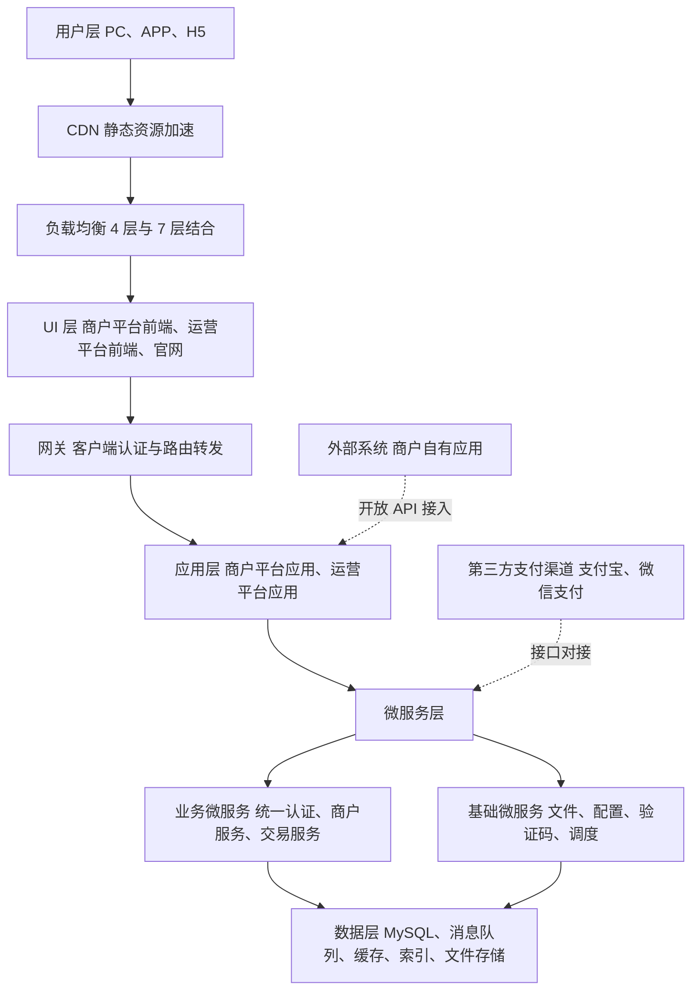

# 分层看懂聚合支付平台的技术架构与技术栈

面试里被问「你们项目的技术架构是什么样的」，最常见的失败答案是报一堆组件名，却讲不清每一层解决什么问题。把闪聚支付的技术架构图按层走一遍，再把技术栈按视图、接入、组件、基础设施、DevOps 对齐，之后无论画图还是口头描述，都能按「请求从哪进、业务在哪算、数据在哪存」这条主线讲出来。

## 先给结论

- 整个系统基于微服务架构思想构建，采用前后端分离：前端即 UI 层，服务端即微服务层，两者完全分开开发与部署。
- 请求链路从上到下是用户层、CDN、负载均衡、UI 层、网关、应用层、微服务层、数据层，每层都有负载均衡，右侧还有第三方支付与商户自有应用两类外部对接。
- 技术栈五层：视图层 H5 与 Vue.js；接入层 Zuul、Spring Cloud Security、OAuth2、JWT、Sentinel；组件层 Spring Boot、Dubbo、Mybatis Plus、Druid、Sharding-jdbc、Swagger、XXL-job、Freemarker 等；基础设施层 MySQL、RocketMQ、Redis、云文件存储；DevOps 层 Maven、Jenkins、Nacos、Git、Docker、ELK、Zipkin。
- 版本组合在父工程里锁死：Spring Boot 2.1.3、Spring Cloud Greenwich、Spring Cloud Alibaba 2.1.0；Nacos 一个组件同时承担服务发现与配置管理。
- Java 工程师的学习重点在微服务层组件，前端与接入层了解职责即可，不必深陷。

## 一张图看清请求怎么走



请求从用户层进来，静态资源直接被 CDN 拦下加速，动态请求经负载均衡分摊后进入 UI 层渲染界面；UI 层通过网关请求应用，应用再调用微服务层完成业务，业务数据最终落进数据层。第三方支付渠道与聚合支付平台之间是接口对接关系，商户自有应用则走开放 API 接入平台，这两条线构成了架构图右侧的外部世界。

## 各层在解决什么问题

**用户层与 CDN。** 用户层描述系统支持的客户端类型：PC 用户经浏览器访问，APP 用户经 Android 与 iOS 客户端访问，还有 H5 页面用户。CDN 全称 Content Delivery Network，内容分发网络，可以把它理解成一层缓存：html、js、css、图片、文档、视频这些静态资源从 CDN 调度访问，缩短响应时间，减轻源站压力。CDN 上的资源最终来源于系统的文件存储服务，所以它是加速层而不是存储层。

**负载均衡。** 系统的 CDN 层、UI 层、服务层与数据层都设置了负载均衡，不只是 UI 层前面那一台。类型上支持 4 层与 7 层结合：4 层负载均衡在网络传输层按 IP 与端口转发流量，7 层负载均衡完成 HTTP 协议的负载均衡与反向代理，按 URL 转发请求。用什么类型取决于各层的需求。

**UI 层与网关。** UI 层是用户界面的集合，按功能模块分成面向商户的商户平台与面向平台运营人员的运营平台，另有官网等展示界面。前端要发起业务请求，先过网关：网关做客户端认证与路由转发，是系统的统一入口。

**应用层与微服务层。** 应用面向前端提供服务，例如商户注册请求会到达商户平台应用；真正支撑应用的是微服务层。以注册一个商户为例：前端请求到网关，网关转给商户平台应用，应用调用微服务层的商户服务完成注册业务，商户服务把数据写进自己的库。微服务层分两类，业务微服务面向商户与运营人员提供业务服务，包括统一认证、商户服务、交易服务；基础微服务是系统级公共服务，不涉及具体业务，包括文件服务、配置服务、验证码服务、调度服务，各业务微服务都会用到它们。

**数据层。** 持久化的业务数据用 MySQL；消息队列承接服务间通信的消息；缓存存放商户信息、验证码信息、用户信息等热点数据；索引与文件存储归入同一层，文件存储同时充当 CDN 的数据源。

## 技术栈：五层对齐组件职责

| 层 | 组件 | 要点 |
|---|---|---|
| 视图层 | H5、Vue.js | 前端用 Vue.js 构建，面向 PC 与移动端 |
| 接入层 | Spring Cloud Zuul、Spring Cloud Security、Spring Cloud OAuth2、JWT、Sentinel | 网关认证与路由、令牌管理、限流 |
| 组件层 | Spring Boot、Dubbo Spring Cloud、Druid、Mybatis Plus、Sharding-jdbc、Swagger、XXL-job、Freemarker、Log4j2、Guava、Lombok | 微服务开发的主战场，基于 Dubbo 协议构造服务 |
| 基础设施层 | MySQL、RocketMQ、Redis、七牛云、腾讯云 | 持久化、消息、缓存、文件存储与云服务 |
| DevOps 层 | Maven、Jenkins、Nacos Config、Nacos Discovery、Git/Gogs、Docker、ELK、Zipkin | 构建、持续集成、注册与配置、版本控制、容器化、日志与链路追踪 |

组件层的组合方式在讲义里有明确分工：微服务基于 Spring Boot 开发，数据库连接池用 Druid，POJO 构建用 Lombok，日志系统用 Log4j2，工具类库用 Guava，持久层接口实现用 Mybatis Plus，分库分表用 Sharding-jdbc，接口规范用 Swagger，分布式任务调度用 XXL-job，限流用 Sentinel。服务间远程调用有两条路：RESTful 与 Dubbo RPC，Dubbo 协议速度更快，项目微服务层基于 Dubbo 协议构造服务。

## 版本从父工程里读出来

整套技术栈的版本关系写在聚合工程父 pom 的依赖管理里，这是 Spring Cloud 与 Spring Cloud Alibaba 搭配最容易踩坑的地方，三者版本必须匹配：

```xml
<!-- 聚合支付平台父工程依赖管理（节选，groupId 已按本系列口径改写） -->
<parent>
    <groupId>org.springframework.boot</groupId>
    <artifactId>spring-boot-starter-parent</artifactId>
    <version>2.1.3.RELEASE</version>
</parent>

<dependencyManagement>
    <dependencies>
        <dependency>
            <groupId>com.alibaba.cloud</groupId>
            <artifactId>spring-cloud-alibaba-dependencies</artifactId>
            <version>2.1.0.RELEASE</version>
            <type>pom</type>
            <scope>import</scope>
        </dependency>
        <dependency>
            <groupId>org.springframework.cloud</groupId>
            <artifactId>spring-cloud-dependencies</artifactId>
            <version>Greenwich.RELEASE</version>
            <type>pom</type>
            <scope>import</scope>
        </dependency>
    </dependencies>
</dependencyManagement>
```

业务微服务工程接入这套体系的方式，看课程工程里商户服务模块的依赖清单：

```xml
<!-- 商户服务工程接入 Nacos 与 Dubbo（节选自课程工程依赖清单） -->
<dependency>
    <groupId>com.alibaba.cloud</groupId>
    <artifactId>spring-cloud-starter-alibaba-nacos-config</artifactId>
</dependency>
<dependency>
    <groupId>com.alibaba.cloud</groupId>
    <artifactId>spring-cloud-starter-alibaba-nacos-discovery</artifactId>
</dependency>
<dependency>
    <groupId>org.springframework.cloud</groupId>
    <artifactId>spring-cloud-starter-dubbo</artifactId>
</dependency>
<dependency>
    <groupId>com.alibaba</groupId>
    <artifactId>druid-spring-boot-starter</artifactId>
</dependency>
<dependency>
    <groupId>com.baomidou</groupId>
    <artifactId>mybatis-plus-boot-starter</artifactId>
</dependency>
```

nacos-config 与 nacos-discovery 两个 starter 成对出现，对应 Nacos 的两大职能：配置管理与服务发现。这也是技术架构图与技术栈图之间最直接的对应关系：架构图里微服务层的运行，依赖技术栈里 Nacos 提供的注册中心与配置中心。

## 学习重心的取舍

技术栈图上所有组件都认识当然好，但学习投入要按角色分。前端不是 Java 工程师的开发重点，前后端已经分离，企业里前端由前端岗位负责；接入层的网关、认证与令牌更多是架构师关心的内容。Java 开发工程师需要下功夫的是微服务层及其配套：Spring Boot 与 Spring Cloud Alibaba 的开发方式、Dubbo 服务调用、Mybatis Plus 持久化、Redis 缓存、RocketMQ 消息，再加上 Nacos 的服务发现与配置管理，这些组件撑起了日常业务开发的主干，也是后续各章代码的实际落点。

## 常见误区

- **把 CDN 当成存储系统。** 错例：以为图片、视频直接存在 CDN 上。正解：CDN 是内容分发加速层，源数据保存在文件存储服务里，CDN 上保存多份副本用于就近访问。
- **认为负载均衡只在 UI 层前有一台。** 错例：画架构图只给入口配一个负载均衡。正解：CDN、UI、服务、数据各层按需求都可能设置负载均衡，类型按层选择 4 层或 7 层。
- **把 Spring Boot、Spring Cloud、Spring Cloud Alibaba 的版本随意组合。** 错例：Spring Boot 升到 2.3 还沿用 Greenwich。正解：三者有版本对应关系，本项目锁定 Spring Boot 2.1.3、Spring Cloud Greenwich、Spring Cloud Alibaba 2.1.0，升级要成套评估。
- **只引入 nacos-discovery 就开始搭环境。** 错例：以为注册中心有了配置就不用管。正解：微服务的配置也要集中管理，nacos-config 与 nacos-discovery 成对引入，缺一个都会在后续章节卡住。

## 面试可能被问到的问题

1. 面试官追问：「用一分钟描述你们支付项目的技术架构。」
   答：前后端分离的微服务架构。请求从用户层进来，静态资源走 CDN 加速，动态请求经 4 层与 7 层结合的负载均衡进入 UI 层；UI 层经网关认证与路由后请求商户平台或运营平台应用，应用调用微服务层，微服务分业务微服务与基础微服务两类，数据落在 MySQL、缓存、消息队列与文件存储构成的数据层。外部对接支付宝、微信支付渠道与商户自有应用。
2. 面试官追问：「4 层负载均衡和 7 层负载均衡有什么区别？」
   答：4 层在网络传输层工作，根据 IP 与端口转发流量，不解析应用协议；7 层在应用层工作，完成 HTTP 协议的负载均衡与反向代理，可以按 URL 转发请求。项目按各层需求组合使用两者。
3. 面试官追问：「业务微服务和基础微服务怎么划分？」
   答：业务微服务面向商户与运营人员提供业务能力，如统一认证、商户服务、交易服务；基础微服务是系统级公共服务，不涉及具体业务，如文件服务、配置服务、验证码服务、调度服务。划分依据是是否承载具体业务语义，基础微服务被所有业务微服务复用。
4. 面试官追问：「为什么选 Spring Cloud Alibaba 这套技术栈？」
   答：项目微服务基于 Spring Boot 开发，Spring Cloud Alibaba 与 Spring Cloud Greenwich 配套，提供 Nacos 注册与配置、Dubbo 服务调用、Sentinel 限流等一整套组件，与国内主流的 Dubbo 生态兼容，组件开箱即用，版本由父工程依赖管理统一锁定，避免组件间版本冲突。
5. 面试官追问：「前端为什么要完全分离，Java 岗需要会前端吗？」
   答：分离是为了支撑多客户端：前端只负责界面与交互，服务层提供与客户端无关的业务接口，PC、APP、H5 共用同一套服务端。Java 开发岗位不需要写前端，但要理解请求经网关到应用再到微服务的完整链路，并能用 Swagger 与 Postman 联调接口。

## 配套资料

- 讲义：`materials/docs/10/闪聚支付-第1章-讲义-项目介绍v1.0.md`，2.2 技术架构（业务流程举例与各层说明）与 2.3 技术栈为本课出处。
- 代码：`materials/code/10/`，父工程 pom 与商户服务模块的依赖清单为该目录下聚合支付工程真实文件节选，groupId 已按本系列口径改写为 `com.study.pay` 系；内层目录名含项目原始命名，与正文包名口径不一致，不在此展开，按用途自取。
- 说明：技术栈分层表与架构图按课程画面与讲义原文整理；该阶段课程资料归档在 `materials/docs/10/` 与 `materials/code/10/`（目录编号与相邻阶段共用）。
