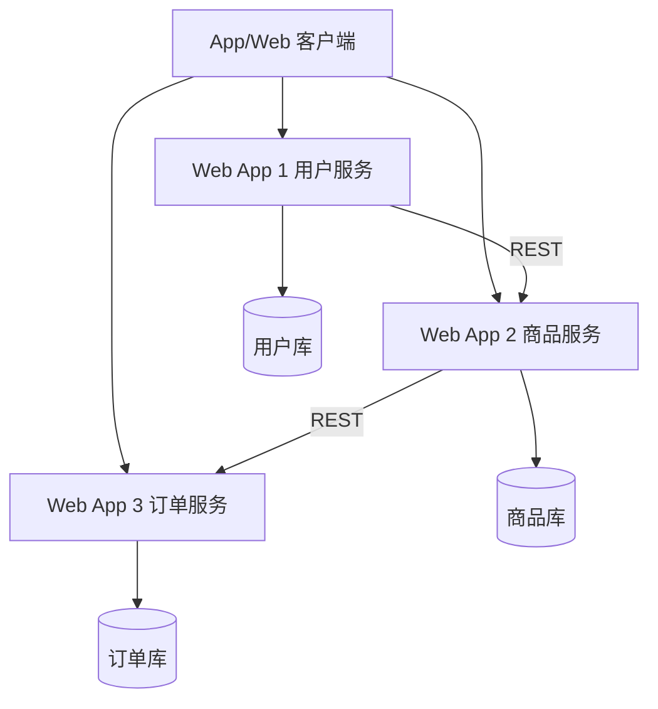
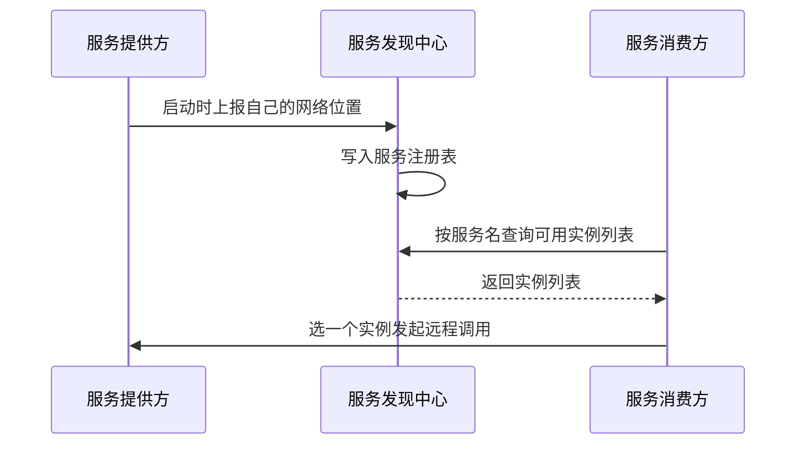
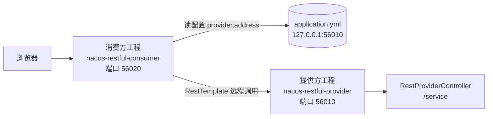
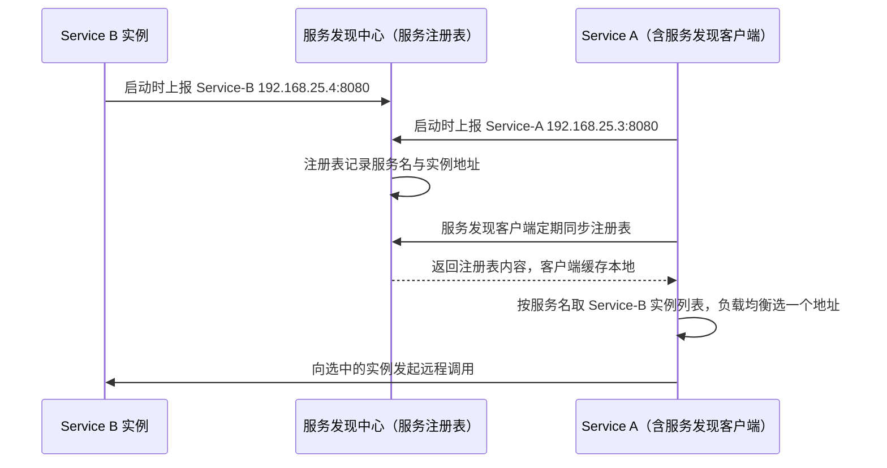

# Nacos 前置课之理解服务发现：从微服务架构到注册、同步与负载均衡调用

## 先给结论

- 服务发现解决的事很朴素：调用方怎么知道被调方在哪；它本来就是微服务架构身上长出来的功能，脱离架构谈发现等于无根之木，所以先用电商缩略架构图回顾微服务再谈发现。
- 微服务架构的要点：服务层按业务拆成职责单一的微服务，各自独立进程，服务与数据库一一对应，服务间用 RESTful、RPC 等轻量协议传输。
- 消费方调用提供方必须知道其 IP 与端口，最朴素的方案是配置文件写地址；云环境地址动态分配、多实例地址随宕机升级变化、临时扩容节点增减，三个场景让朴素方案失效。
- 课程刻意不直接上 Nacos：先用两个不带注册中心的 Spring Boot 工程跑通 Service A 调 Service B，提供方暴露 RESTful 接口，消费方用 RestTemplate 从配置文件拿地址发起调用。
- 这套测试环境是留病的：地址写死在配置文件，多实例部署、动态地址、负载均衡全都应付不了，毛病先记账再推导解法。
- 服务发现的交互模型：每个服务启动时向服务发现中心上报网络位置，形成服务注册表；消费方从中心查询地址发起调用。
- 完整流程三步：启动时上报地址、客户端定期同步注册表缓存到本地、调用时按服务名取实例列表用负载均衡算法选地址。
- 注册表里是两级概念：服务泛指整个集群不管挂几个节点，实例是具体的 IP 加端口；这套流程与具体产品无关，Nacos 只是课程选定的实现。

## 第1部分：Nacos-理解服务发现-回复微服务架构

服务发现这个词听起来有点玄，它解决的事却很朴素：调用方怎么知道被调方在哪。直接背定义容易背成空话，因为服务发现本来就是微服务架构身上长出来的一种功能，脱离架构谈发现等于无根之木。所以先用一张电商系统的缩略架构图把微服务架构回顾一遍，再看最朴素的调用方案怎么失效，服务发现的定义与交互模型就会自己浮现出来。

### 回顾微服务架构：服务发现的土壤

微服务架构的出发点是工程效率：为适应企业的业务发展，提高软件研发的生产力，降低研发成本，把一个独立的系统拆分成若干小的服务。每个小服务运行在不同的进程中，服务与服务之间采用 RESTful、RPC 等协议传输数据，每个服务的功能独立性强，单个服务做到高内聚，服务与服务之间保持低耦合，这样的小服务就是微服务，基于这种方法设计的系统架构就是微服务架构。

拿一个电商系统做缩略图，四个特点一目了然：



**特点一，服务层按业务拆分。** 用户服务只负责用户相关的功能，商品服务只负责商品，订单服务只负责订单，拆分的原则就是职责单一，每个服务的粒度非常小。

**特点二，独立进程与独立伸缩。** 用户服务运行在一个 JVM 进程里，商品服务运行在另一个进程里；可以按需伸缩，用户服务部署一个集群，商品服务按负载部署节点数更多的集群，伸缩的单位是单个服务而不是整个系统。

**特点三，变更被隔离。** 商品需求变更时只需要改商品服务的代码，用户服务不用动，高内聚低耦合在维护上直接兑现。

**特点四，轻量协议通信与前后端分离。** 一次业务请求往往要多个服务协作，比如下单时订单服务会调用商品服务查商品、调用用户服务查用户，服务间通信采用 RESTful、RPC 等轻量级协议；服务层完善之后可以支撑不同客户端的业务需求，前端怎么变服务层不动，天然适合前后端分离。

这套架构带来一个绕不开的副产品：服务之间要做网络通信，调用之前必须知道对方的网络位置。服务发现就从这里登场。

### 最朴素的方案：配置文件写地址

课程专门准备了一个测试环境，用两个裸工程把问题演出来。Service B 是服务生产方，暴露一个 RESTful 接口：

```java
// 服务提供方 RestProviderController：暴露 /service 接口
@RestController
public class RestProviderController {

    @GetMapping(value = "/service")
    public String service(){
        System.out.println("provider invoke");
        return "provider invoke";
    }
}
```

Service A 是服务消费方，远程调用前需要知道提供方的 IP 与端口，从配置文件里读：

```java
// 服务消费方 RestConsumerController：从配置读取提供方地址并发起远程调用
@RestController
public class RestConsumerController {

    //要进行远程调用，需要知道提供方的 ip 和端口
    @Value("${provider.address}")
    private String provider;

    @GetMapping(value = "/service")
    public String service(){
        RestTemplate restTemplate = new RestTemplate();
        String result = restTemplate.getForObject("http://" + provider + "/service", String.class);
        return "consumer invoke |" + result;
    }
}
```

地址写在消费方的配置文件里：

```yaml
server:
  port: 56020

#配置服务提供方的地址（ip和端口）
provider:
  address: 127.0.0.1:56010
```

启动两个工程，访问消费方接口，返回 `consumer invoke | provider invoke`，链路是通的。这个例子看上去很完美，但把它放到真实的微服务环境里一推敲就站不住。

### 三个让朴素方案失效的场景

**场景一，地址是动态分配的。** 微服务可能部署在云环境，服务实例的网络位置由平台动态分配，不是运维预先登记好的常量，配置文件里写死的值从第一天起就可能过期。

**场景二，多实例加动态变化。** 每个服务一般会部署多个实例做负载均衡，由于宕机或升级，实例的网络地址经常动态改变；写一个地址等于放弃了整个集群，挂了那台服务就中断。

**场景三，临时扩容。** 应对临时访问压力时随时增加新的服务节点，新增实例对调用方不可见，扩容的算力根本接不到流量。

把场景换成支付平台更直观：交易服务为扛住促销高峰从三个实例扩到十个，若靠改配置同步地址，每个调用方都要发一次版，扩容的窗口期流量照常打在旧实例上。服务之间如何相互发现、服务如何管理，这就是服务发现要解决的问题。

### 服务发现的交互模型

服务发现的定义是：服务消费方通过服务发现中心智能发现服务提供方，从而进行远程调用的过程。落到结构上，服务实例本身不再记录服务生产方的网络地址，所有服务实例内部都会包含一个服务发现客户端，交互按固定的节奏走：



这张图的关键路径有两段：提供方启动时向服务发现中心上报自己的网络位置，在服务发现中心内部形成服务注册表，注册表是服务发现的核心部分，它是一个包含所有服务实例网络地址的数据库；消费方在调用前从注册表按服务名取地址，再完成远程调用。这里要区分两个概念：服务名称是每个服务在服务注册中心的标识，相当于 Java 中的类名；服务实例是网络中提供服务的进程，具有 IP 与端口，相当于 Java 中的对象，一个实例就是一个运行中的进程。消费方拿到的是实例列表，具体选哪一个由负载均衡策略决定，这正是注册中心优于配置文件的地方：地址的维护从「改配置」变成了「进程自报家门」。

整个服务注册与发现的流程可以收成三步：服务提供方将自己注册到服务注册中心，服务消费方从注册中心获取服务地址，通过客户端负载均衡器进行远程调用。后续章节就按这三步，用 Nacos 把 RESTful 与 Dubbo 两种方式跑起来。

## 第2部分：Nacos-理解服务发现-测试环境

服务发现的定义与交互模型都清楚了，接下来要回答一个更实际的问题：这套东西在工程里长什么样。课程的做法不是直接上 Nacos，而是先用两个不带任何注册中心的 Spring Boot 工程把 Service A 调用 Service B 跑通，让「写死地址」这个方案先成功一次，它的毛病才有机会在后面暴露出来。

### 两个工程的角色与远程调用选型

微服务架构里一次业务请求往往由多个服务协作完成，服务与服务之间的网络交互就构成了服务发现的土壤。把这种交互缩到最小，就是两个服务之间的远程调用：Service B 是服务的提供方，对外暴露一个网络接口，接口至少要有 IP 和端口号才能被找到；Service A 是服务的消费方，拿到地址后发起调用。

远程调用在 Java 世界里有好几种技术形态。老一点的 RMI 是 Java 自带的远程方法调用，Web Service 走的是另一套协议体系，而现在互联网项目里用得最多的是 HTTP 协议上的 RESTful 接口，学 Spring MVC 时写的那些 `@GetMapping` 接口就属于这一类。Service B 完全可以暴露一个 RESTful 接口，Service A 通过 HTTP 去调它，这个过程同样是远程调用，而且最贴近后续支付项目的真实形态，所以测试环境就按这个选型来搭。

### 父工程：只管版本，不放代码

两个服务都用 Maven 来建，按多模块工程的习惯先建父工程。父工程名叫 `nacos-discovery`，`packaging` 设成 `pom`，它自己不写业务代码，职责是统一管理依赖版本：

```xml
<groupId>com.study.pay.nacos</groupId>
<artifactId>nacos-discovery</artifactId>
<version>1.0-SNAPSHOT</version>
<packaging>pom</packaging>

<dependencyManagement>
    <dependencies>
        <dependency>
            <groupId>org.springframework.boot</groupId>
            <artifactId>spring-boot-dependencies</artifactId>
            <version>2.1.3.RELEASE</version>
            <type>pom</type>
            <scope>import</scope>
        </dependency>
    </dependencies>
</dependencyManagement>
```

`dependencyManagement` 里通过 import 方式引入 `spring-boot-dependencies`，两个子工程继承父工程后，引依赖就不用再写版本号，全部微服务锁在同一套 Spring Boot 版本上，这是多模块工程管版本的标准手法。

### 提供方：暴露一个 RESTful 接口

子工程 `nacos-restful-provider` 继承父工程，依赖只需要一个 `spring-boot-starter-web`。因为底层是 Spring Boot，这个启动包会把 Spring MVC 一并带进来，写 RESTful 接口所需的注解全都齐了。

提供方的 Controller 极简，目的就是把一个接口挂到 56010 端口上等人来调：

```java
package com.study.pay.nacos.provider.controller;

import org.springframework.web.bind.annotation.GetMapping;
import org.springframework.web.bind.annotation.RestController;

@RestController
public class RestProviderController {

    //对外暴露 RESTful 接口，等消费方来调
    @GetMapping(value = "/service")
    public String service(){
        System.out.println("provider invoke");
        return "provider invoke";
    }
}
```

再加上 Spring Boot 启动类与端口配置，提供方就齐了：

```java
@SpringBootApplication
public class SpringRestProviderBootstrap {
    public static void main(String[] args) {
        SpringApplication.run(SpringRestProviderBootstrap.class, args);
    }
}
```

```yaml
server:
  port: 56010
```

直接运行 main 方法启动，浏览器访问 `http://localhost:56010/service`，页面打出 `provider invoke`，控制台同步打印同一行字，说明接口活着。到这一步提供方开发完成，整个流程和写一个普通 Spring Boot Web 应用没有任何区别。

### 消费方：从配置文件拿地址发起调用

消费方工程 `nacos-restful-consumer` 的结构与提供方对称：同样的 starter-web 依赖、同样的启动类写法，端口换成 56020，避免和 56010 冲突。

差别在调用逻辑上。要远程调用就得知道提供方的 IP 和端口，这个值不能写死在代码里，放进配置文件是当时能想到的最好办法：

```yaml
server:
  port: 56020

#配置服务提供方的地址（ip和端口）
provider:
  address: 127.0.0.1:56010
```

代码里用 `@Value` 把这个值注入进来，再用 `RestTemplate` 拼出完整 URL 发起调用：

```java
package com.study.pay.nacos.consumer.controller;

import org.springframework.beans.factory.annotation.Value;
import org.springframework.web.bind.annotation.GetMapping;
import org.springframework.web.bind.annotation.RestController;
import org.springframework.web.client.RestTemplate;

@RestController
public class RestConsumerController {

    //要进行远程调用，需要知道提供方的 ip 和端口
    @Value("${provider.address}")
    private String provider;

    @GetMapping(value = "/service")
    public String service(){
        //远程调用
        RestTemplate restTemplate = new RestTemplate();
        String result = restTemplate.getForObject("http://" + provider + "/service", String.class);
        return "consumer invoke |" + result;
    }
}
```

`RestTemplate` 是 Spring MVC 提供的基于 REST 的模板类，只要给它一个 URL 和返回类型，它就能把 HTTP 请求发出去并把响应体转成对象，`getForObject` 就是「发 GET 请求、拿对象」的意思。URL 由三段拼成：协议头 `http://`、从配置读来的 `provider.address`、提供方的接口路径 `/service`，少任何一段都调不通。

整条链路的结构如下，这张图讲的是一次请求从浏览器到提供方的完整路径：



图的右半段是真正的远程调用，左半段「读配置」就是这套环境刻意留下的病根：地址来自一个静态文件，而不是任何动态的、可感知集群变化的机制。

### 验证：调用真的跨了进程

启动两个工程后访问 `http://127.0.0.1:56020/service`，页面返回 `consumer invoke | provider invoke`，前半段是消费方拼的字符串，后半段是提供方接口的返回值，说明消费方确实拿到了提供方的响应。

还可以再较真一点：在提供方的 `service` 方法里打个断点，然后请求消费方的接口。请求一发出去，提供方的断点就被命中了，调用栈明明白白停在提供方的代码里。页面访问的是 56020，断点却断在 56010 的进程里，远程调用这件事就这样被实锤了。

### 病根先记账，下一课来算

链路通了，问题也该摆上桌面了。这个方案成立的全部前提，是提供方只有一个实例、地址永远不变、消费方永远只有一个调用目标。把场景换成真实的微服务部署：提供方按负载部署成集群，实例数量随压力动态增减；实例放在云环境里，地址由平台动态分配；消费方调用时还得在多个实例间做负载均衡，不能盯着某一台往死里调。配置文件里的那一行 `provider.address` 在这三个事实面前同时失效。

测试环境的价值就在这里：它先证明「写死地址」能跑，再让人亲眼看到它在集群面前处处碰壁。服务消费方通过服务发现中心智能地发现服务提供方并完成调用，这个流程具体怎么走、为什么必须这样走，就是下一课的主题。

## 第3部分：Nacos-理解服务发现-服务发现流程

测试环境里 Service A 调用 Service B 已经跑通，但那是在「一个提供方实例、一个写死地址」的前提下成立的。真实的微服务部署一上来就要面对多实例、动态地址和流量分摊，配置文件方案在这三件事面前同时失守。这一课把失效的原因摆清楚，再推导出服务发现的完整流程。

### 写死地址在真实部署下的三处不适

**第一，实例数量是动态变化的。** 微服务的好处之一就是按需伸缩，Service B 今天部署两个实例，明天扛压加到三个，后天回落到两个，都是常态。消费方配置文件里只写了一个地址，这个「集群」在它眼里只剩一台机器，扩容加进来的实例一个请求都接不到，缩容掉线的那台却还在被调用。

**第二，地址是动态分配的。** 微服务很可能部署在云环境上，实例的网络位置由平台动态分配，不是运维预先登记好的常量。配置文件里写死的那个 IP，从写下那一刻起就注定会过期，靠人改配置去追动态地址，追不上。

**第三，调用必须负载均衡。** Service A 调 Service B，背后可能有三个实例，不能盯着其中一台往死里调，否则单实例被打满甚至打挂，其他实例却闲着。调用方必须基于负载均衡机制，从多个地址里按算法挑选，这才是调用多实例集群的正确姿势。

三个问题归纳成一句话：服务运行实例的网络地址与数量都在动态变化，靠固定的配置文件记录提供方地址行不通，必须有一套动态的服务发现机制，让微服务之间相互感知。

把这三个失效点对应回测试工程的文件，毛病看得更具体。消费方的配置文件里，提供方地址只有一行：

```yaml
server:
  port: 56020

#配置服务提供方的地址（ip和端口）
provider:
  address: 127.0.0.1:56010
```

消费方的代码靠一个注解把这行地址读进来，拼在远程调用的 URL 里：

```java
//要进行远程调用，需要知道提供方的 ip 和端口
@Value("${provider.address}")
private String provider;
```

一个服务名理应对应一串实例地址，这里却只有一个 `127.0.0.1:56010`；地址换了、实例加了、实例挂了，这行配置与这个注解都不知道。后面引入 Nacos 之后，同样还是「服务名找地址」，只是这一行写死的值被注册表里动态维护的实例列表取代，代码里的拼 URL 被按服务名的负载均衡选择取代，对照着改正是下一阶段的实操内容。

### 服务发现中心：统一管理地址的那张表

问题指向同一个需求：能不能有一个地方，统一管理所有服务的地址？服务方有变化就更新，调用方需要就来查。这个地方就是服务发现中心，也叫服务注册中心。它的内部核心是一张服务注册表，记录的是服务名与实例地址的对应关系，比如 `Service-A 192.168.25.3:8080`、`Service-B 192.168.25.4:8080` 这样的行。

有了这张表，「智能发现」就有了落点：提供方把地址报上来，注册表替它记住；消费方按服务名来查，注册表把当前可用的实例地址列表交出去。地址的维护从「改配置文件」变成了「进程自己上报、注册表动态更新」，前两条失效原因就此化解。

### 完整流程：上报、同步、负载均衡调用

把上面的思路连成一次完整的交互，就是服务发现的流程图。这张时序图讲的是 Service A 调用 Service B 时，服务发现中心在中间承担的两个动作：



关键路径分三段读。第一段是上报：每个微服务启动时向服务发现中心上报自己的网络位置，Service B 和 Service A 都要报，上报进来的数据汇成服务注册表。第二段是同步：Service A 内部有一个服务发现客户端，它定期从服务发现中心同步注册表并缓存在本地，这一步保证调用方手里的地址簿是相对新鲜的，而不必每次调用都先远程查一次中心。第三段是调用：Service A 想调 Service B 时，按服务名从注册表取出该服务下的全部实例地址，比如三个实例就对应三个地址，负载均衡算法从中选出一个，然后发起远程调用。

三步收束成一句话：各微服务上报自己的地址到服务发现中心；服务发现客户端定期从中心拉取服务地址；调用方通过负载均衡算法从中选一个地址进行请求调用。注册、拉取、调用，缺一环流程就断。

### 注册表里的两级概念：服务与实例

读注册表要分清两个词。服务是泛指，指整个 Service A，不管它的集群里有一个节点还是十个节点，注册中心里都只有这一个名字；实例是具体的一个节点，三台服务器各部署一个 Service A 进程，每台服务器上的进程就是 Service A 的一个实例，IP 加端口标识的就是这个具体进程。同一个服务名在注册表里可以有多行地址，一行就是一个实例。

这个区分直接决定了调用方式：消费方拿着服务名查回来的是实例列表，选哪个实例执行是负载均衡的事。如果脑子里没有实例的概念，就很容易把「调 Service B」理解成「调某台固定的机器」，后面接入 Nacos 时看服务列表页、实例详情页都会对不上号。

### 流程是通用的，Nacos 是实现

值得强调的是，以上三步描述的是服务发现的通用机制，没有绑定任何产品。市面上的注册中心都在实现同一套流程，差别在一致性协议、健康检查方式、负载均衡策略这些细节上。课程为本项目选定的服务发现中心是 Nacos，它是什么、凭什么在几个候选产品里胜出、怎么安装启动，接下来两课展开。

## 常见误区

- **把服务发现当成某个组件的私有概念。** 错例：认为只有用 Nacos 才有服务发现。正解：服务发现是微服务架构层面的通用问题，Nacos、Eureka、Consul、Zookeeper 都是实现它的产品。
- **把服务和服务实例混为一谈。** 错例：说「注册了订单服务，所以我只调一个地址」。正解：服务是注册中心里的逻辑标识，实例是带着 IP 与端口的进程，一个服务下有多个实例，调用选实例而不是选服务名对应的某台固定机器。
- **把注册表当成静态名单。** 错例：以为实例下线后注册表还保留它。正解：注册表随实例的注册、心跳、下线动态更新，配合健康检查剔除不可用实例，消费方每次拿到的都是当前可用集合。
- **认为服务发现只解决「拿到地址」。** 错例：以为拿到 IP 端口就万事大吉。正解：实例列表拿到后还要经过客户端负载均衡挑一个实例，流量分摊与容错都发生在这一步。
- **两个工程都用默认端口 8080。** 错例：只建工程不配端口，第二个工程启动时端口冲突直接报错。正解：每个服务都要在自己的 `application.yml` 里显式指定端口，提供方 56010、消费方 56020，互不冲突。
- **`getForObject` 的 URL 忘了协议头。** 错例：直接写 `restTemplate.getForObject(provider + "/service", String.class)`，拼出来的是 `127.0.0.1:56010/service`，不是合法的绝对地址，调用直接失败。正解：URL 必须以 `http://` 开头，协议、地址、路径三段拼完整。
- **把 `@Value` 当成万能取值。** 错例：配置文件里写的是 `provider.address`，代码里却注入 `${providerAddress}`，启动时占位符解析失败。正解：`@Value` 的键必须与配置文件的键完全一致，它读的是配置文件，不是代码里的常量。
- **把提供方和消费方的角色记反。** 错例：以为谁先启动谁就是提供方。正解：被调用、暴露接口的一方是提供方，主动发起调用的一方是消费方，与启动顺序无关。
- **认为每次调用都要远程查询注册中心。** 错例：以为消费方每次发请求前都去服务发现中心拿地址。正解：注册表会被服务发现客户端定期同步并缓存在本地，调用时用的是本地缓存里的实例列表，查中心与发调用是两条独立节奏的链路。
- **把负载均衡当成服务发现之外的可选功能。** 错例：以为服务发现只负责「找到地址」，负载均衡是另一件事。正解：多实例场景下发现的结果是一个地址列表，从中选出一个执行调用的动作就是客户端负载均衡，没有这一步，发现回来的列表没法用。
- **把服务当成一台固定的机器。** 错例：说「Service B 的地址是某某 IP」。正解：Service B 是服务名，它下面挂着若干实例地址，说地址必须落到实例层面，实例有上线和下线，服务名不变。
- **认为上报一次地址就一劳永逸。** 错例：以为注册表是启动时写一次的静态名单。正解：注册表随实例的注册与下线动态更新，实例宕机或扩容都会改变表内容，调用方靠定期同步感知这些变化。

## 面试可能被问到的问题

1. 面试官追问：「什么是服务发现？」
   答：在微服务架构中，服务消费方通过服务发现中心发现服务提供方并进行远程调用的过程。每个服务启动时向服务发现中心上报网络位置，形成服务注册表；消费方按服务名查询可用实例列表，再做负载均衡调用。它解决的是动态环境下服务间如何相互发现的问题。
2. 面试官追问：「为什么不能在配置文件里写死提供方地址？」
   答：三个原因：云环境里实例网络位置是动态分配的；每个服务多实例部署且宕机、升级会让地址经常变化；应对临时压力会动态加节点。写死地址会过期、无法感知集群变化，也没法在多个实例间分摊流量。
3. 面试官追问：「服务注册表是什么？由谁维护？」
   答：服务注册表是服务发现中心内部记录所有服务实例网络地址的数据库，是服务发现的核心部分。数据由各服务实例通过内置的服务发现客户端上报维护，配合健康检查动态更新，实例上线注册、下线剔除。
4. 面试官追问：「服务和实例有什么区别？」
   答：服务是注册中心里的逻辑标识，类似 Java 里的类名；实例是提供服务的网络进程，有 IP 与端口，类似对象，启动一个服务进程就产生一个实例。一个服务名下挂多个实例，负载均衡在实例层面选择目标。
5. 面试官追问：「你们微服务之间的调用方式是怎么定的，为什么？」
   答：服务间通信支持 RESTful 与 RPC 两种轻量级协议，项目内部微服务用 Dubbo RPC，调用像本地方法一样且性能更好，对外或演示场景用 RESTful 接口；无论哪种协议，调用前的实例发现都走同一个注册中心，与协议解耦。
6. 面试官追问：「Java 里的远程调用有哪些常见方式？」
   答：常见的有 RMI、Web Service 和基于 HTTP 的 RESTful 接口调用。RMI 是 Java 自带的远程方法调用技术，Web Service 是早期的跨语言方案，RESTful 是当前互联网项目的主流选择，轻量且通用。课程测试环境选的就是 RESTful。
7. 面试官追问：「RestTemplate 是什么，怎么用？」
   答：Spring MVC 提供的基于 REST 的模板类，封装了 HTTP 调用细节。调用方只要传入完整 URL 和期望的响应类型，比如 `getForObject(url, String.class)`，就能完成一次 GET 请求并把响应体转成对应类型，服务间 RESTful 远程调用一行代码就能完成。
8. 面试官追问：「消费方是怎么拿到提供方地址的？」
   答：课程测试环境的做法是把地址写进消费方配置文件的 `provider.address`，代码里用 `@Value` 注入，再拼上协议头和接口路径发起调用。这是最朴素的方案，能跑通但应付不了多实例和地址变化，正是为了引出服务发现才先这么做。
9. 面试官追问：「怎么证明一次调用是远程调用而不是本地方法？」
   答：在提供方的接口方法里打断点或打印日志，然后只请求消费方的接口。如果提供方进程里的断点被命中、控制台打印出日志，就说明请求从消费方进程跨网络到达了提供方进程，两个端口不同的独立工程本身就是跨进程的。
10. 面试官追问：「父工程 packaging 为什么是 pom？」
   答：父工程只做依赖版本管理不写代码，`packaging` 为 `pom` 后可以在 `dependencyManagement` 里统一引入如 `spring-boot-dependencies` 这样的版本管理依赖，子工程继承父工程后引依赖不需要写版本号，保证所有模块版本一致。
11. 面试官追问：「这套测试环境的问题是什么？」
   答：提供方地址写死在消费方的配置文件里，一是云环境下实例地址动态分配，写死就过期；二是服务多实例部署且数量动态变化，一个地址覆盖不了集群；三是无法做负载均衡，实例挂了调用就中断。这三点正是引入服务发现中心的原因。
12. 面试官追问：「描述一下服务发现的完整流程。」
   答：分三步。微服务启动时把自己的网络地址上报到服务发现中心，形成服务注册表；各微服务内置的服务发现客户端定期从中心同步注册表并缓存在本地；消费方调用时按服务名取出提供方的实例列表，通过负载均衡算法选出一个地址发起远程调用。
13. 面试官追问：「服务发现客户端是什么？承担哪些职责？」
   答：集成在每个微服务内部的客户端程序。它负责三件事：启动时把本服务实例的地址上报到注册中心；定期从中心同步注册表缓存到本地；调用前从缓存的实例列表里配合负载均衡选出目标地址。注册和发现两端都要有这个客户端。
14. 面试官追问：「为什么不能把提供方地址写在配置文件里？」
   答：三个原因。实例按需伸缩，数量动态变化，一个固定地址覆盖不了集群；云环境里实例地址由平台动态分配，写死的值会过期；多实例调用需要负载均衡，配置文件只提供一个地址，既分摊不了流量也没有容错能力。
15. 面试官追问：「服务和实例有什么区别？注册表里存的是什么？」
   答：服务是注册中心里的逻辑标识，泛指整个集群；实例是集群中一个具体的进程，有 IP 与端口。注册表保存服务名与实例地址的对应关系，一个服务名下可以有多行实例地址，一行对应一个进程，负载均衡在实例层面选择。
16. 面试官追问：「客户端缓存注册表有什么好处？有什么风险？」
   答：好处是调用前不必每次都远程查询中心，取地址就是一次本地内存操作，延迟低，也降低注册中心的查询压力。风险是缓存可能短暂滞后于注册表的真实状态，靠客户端定期同步来收敛，新上线或刚下线的实例会在下一个同步周期体现。
17. 面试官追问：「服务发现和负载均衡是什么关系？」
   答：服务发现解决「有哪些可用地址」，输出实例列表；负载均衡解决「这次请求打给谁」，从列表里按算法选一个。发现是负载均衡的输入，负载均衡是发现结果的落地动作，两者配合才完成一次完整的多实例调用。

## 配套资料

- 讲义：`materials/docs/10/Nacos-服务发现与配置管理v1.0.md`，1.1 微服务架构、1.2 理解服务发现（测试环境、服务发现流程）与服务注册与发现小结为本课出处。
- 代码：`materials/code/10/nacos-discovery-服务发现流程测试/`，服务提供方与消费方两个工程的真实代码即正文三个代码示例的出处，工程内层包名与正文改写口径不一致，不在此展开。
- 说明：该阶段课程资料归档在 `materials/docs/10/` 与 `materials/code/10/`（目录编号与相邻阶段共用）；正文中的包名已按本系列口径改写为 `com.study.pay` 系，输出文案中的拼写已按正确写法修正。
- 讲义：`materials/docs/10/Nacos-服务发现与配置管理v1.0.md`，1.2.1 测试环境小节为本课出处。
- 代码：`materials/code/10/nacos-discovery-服务发现流程测试/`，父工程 `nacos-discovery` 与 `nacos-restful-provider`、`nacos-restful-consumer` 两个子工程的完整真实代码，正文 Java 与 YAML 示例均为该工程的文件节选。
- 说明：该阶段课程资料归档在 `materials/docs/10/` 与 `materials/code/10/`（目录编号与相邻阶段共用）；正文包名与 groupId 已按本系列口径改写为 `com.study.pay` 系，代码注释中的笔误已按正确写法修正。
- 讲义：`materials/docs/10/Nacos-服务发现与配置管理v1.0.md`，1.2.2 服务发现流程小节为本课出处，其中服务注册表的定义与服务发现客户端的同步机制均出自该节。
- 代码：`materials/code/10/nacos-discovery-服务发现流程测试/`，即上一课搭建的写死地址测试工程，本课以它为问题起点推导流程，本课本身无新增代码。
- 说明：该阶段课程资料归档在 `materials/docs/10/` 与 `materials/code/10/`（目录编号与相邻阶段共用）；正文包名已按本系列口径改写为 `com.study.pay` 系。
