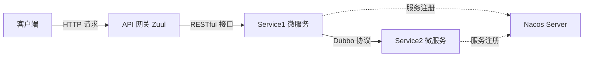

# Nacos 收官自查：服务发现与配置管理两条主线串起来讲

> 🔒 安全提示：文中示例的口令/密钥均为课程教学环境演示口径，生产环境的安全要求见《安全与合规须知》。

day01 的 Nacos 部分到这里收尾。这一课不写新代码，任务是把散在十几节内容里的知识点收拢成一张自查清单。学一大块技术最常见的困境是：每个名词都眼熟，真被问到「Nacos 用来干什么、服务发现怎么走」却连不成完整的话。检验学会的标准只有一条，就是能把这些问题用自己的话表达出来。

## 先给结论

- Nacos 是阿里巴巴公司开源的项目，在本项目里承担两个角色：服务注册中心（服务发现）与配置中心（配置管理），两条主线贯穿整个微服务体系。
- 服务发现的流程两步：服务发现的客户端从服务注册中心获取服务列表；服务消费方通过客户端负载均衡获取服务实例地址，进行远程调用。
- 配置管理的流程两步：将配置信息发布到配置中心；配置中心客户端得到配置变更通知，从配置中心获取配置。
- Spring Cloud 是一套微服务开发框架集合，也是一套微服务开发的标准；Spring Cloud Alibaba 是阿里巴巴基于 Spring Cloud 标准实现的一套框架集合，与 Netflix 系方案并列。
- 本项目采用 Dubbo 服务架构：应用层对外暴露 RESTful 接口供客户端调用，微服务层暴露 Dubbo 协议接口供应用层调用；开发一个 Dubbo 服务的固定套路是 API 工程加实现工程，消费方用 @Reference 注入代理对象。

## 两条主线各自怎么走

服务发现解决的是「地址从哪来」。微服务架构里一个业务流程要靠多个微服务通过网络接口远程调用来完成，消费方必须先拿到提供方的地址才能发起调用。接入 Nacos 之后，地址不再由任何人写死：每个微服务的 pom 里都有服务发现客户端的依赖，工程启动即把地址登记进 Nacos；调用方从注册中心拉取目标服务的实例列表，再由客户端负载均衡从列表里选出一个地址发起远程调用。在 RESTful 服务发现的改造练习里走通的就是这条链路，Dubbo 服务发现只是把「负载均衡选址」这一步换成了 Dubbo 框架内部的机制。

配置管理解决的是「配置放哪里」。微服务一多，每个工程各存一份配置文件，改一个参数要挨个发版。配置中心的做法是把配置信息统一发布到 Nacos，控制台的配置列表里能看到所有已发布的配置文件；各微服务通过配置中心的客户端拉取自己的配置，配置在控制台被修改后，客户端得到通知并自动获取最新值。下面这份工程配置正好把两条主线放在一个文件里：

```yaml
spring:
  application:
    name: nacos-restful-consumer # 服务名
  cloud:
    nacos:
      discovery:
        server-addr: 127.0.0.1:8848 # 服务发现中心地址
      config:
        server-addr: 127.0.0.1:8848 # 配置中心地址
        file-extension: yaml # 配置文件名 = 应用名 + 后缀名
        namespace: a1f8e863-3117-48c4-9dd3-e9ddc2af90a8 # 命名空间 id
        ext-config[0]:
          data-id: ext-config-common01.yaml
          group: COMMON_GROUP
          refresh: true # 配置变更时动态刷新
```

`discovery` 段落属于服务发现，`config` 段落属于配置管理。配置文件名按「应用名 + 文件后缀」规则自动拼出；`ext-config` 支持挂多个公共配置，`group` 决定它们落在哪个组，`refresh` 打开后该配置在变更时能被工程动态感知，不必重启。两个客户端在 pom 里各占一个 starter：

```xml
<!-- 微服务接入 Nacos 的基础依赖（pom 节选） -->
<dependency>
    <groupId>com.alibaba.cloud</groupId>
    <artifactId>spring-cloud-starter-alibaba-nacos-discovery</artifactId>
</dependency>
<dependency>
    <groupId>com.alibaba.cloud</groupId>
    <artifactId>spring-cloud-starter-alibaba-nacos-config</artifactId>
</dependency>
```

`nacos-discovery` 是服务发现的客户端，`nacos-config` 是配置中心的客户端，两个依赖加上服务名与中心地址，工程就同时挂上了两条主线。

## 标准与实现：Spring Cloud 与 Spring Cloud Alibaba

本项目基于 Spring Cloud Alibaba 开发，这两个名字的关系要一次说清。Spring Cloud 是一套微服务开发框架集合，覆盖微服务开发的方方面面，它本质上是一套微服务开发的标准，标准之下集成了众多优秀的开源框架，其中最有名的是 Netflix 公司的众多项目。Spring Cloud Alibaba 与 Netflix 系处在同一个位置：都是基于 Spring Cloud 标准实现的微服务开发方案，区别只在实现方。选定 Spring Cloud Alibaba 的现实理由是生态贴合：注册中心与配置中心统一交给 Nacos，服务间调用与 Dubbo 无缝衔接，这套组合正是后续支付平台微服务的底座。

## Dubbo 服务架构与开发套路

对外的接口协议与对内的调用协议在项目里是分开的，这张架构图讲的就是这个分工：



客户端的请求以 HTTP 进入网关，应用层对外暴露 RESTful 接口；微服务层之间用 Dubbo 协议互相调用，Service1 可以继续调用 Service2；每个微服务都把地址注册进 Nacos，调用方的选址由框架完成。这套「对外 RESTful、对内 Dubbo」的分工是本项目微服务层的基本形态。

落到开发动作上，一个 Dubbo 服务的完整流程是三步。**第一，定义 API 工程。** 工程里只放服务接口，打成 jar 包，方便其他服务引用接口、远程调用这个 Dubbo 服务。**第二，定义 API 实现工程。** 接口的实现类用 Dubbo 的 @Service 注解标记，这个注解会被 Dubbo 框架扫描到，接口实现的方法随之暴露成网络接口供远程调用。**第三，消费方开发。** 引入 API 工程的依赖，在用到接口的位置用 @Reference 注解注入，框架据此生成代理对象，调用方法就发起了远程调用。资料包里的 service2 工程把这套流程原样走了一遍：

```java
package com.study.pay.microservice.service2.api;

// 对外暴露的 Dubbo 服务接口，独立成 api 工程供消费方引用
public interface Service2Api {
    public String dubboService2();
}
```

```java
package com.study.pay.microservice.service2.service;

import com.study.pay.microservice.service2.api.Service2Api;

// Dubbo 的 @Service：标记该实现类为 Dubbo 服务，与 Spring 的同名注解不是一回事
@org.apache.dubbo.config.annotation.Service
public class Service2ApiImpl implements Service2Api {
    public String dubboService2() {
        return "dubboService2";
    }
}
```

消费方一侧的注入与调用形如：

```java
// 引入 service2-api 依赖后，@Reference 生成接口代理对象，调用方法即发起远程调用
@org.apache.dubbo.config.annotation.Reference
private Service2Api service2Api;

@GetMapping(value = "/service2")
public String service2() {
    String providerResult = service2Api.dubboService2();
    return "consumer dubbo invoke | " + providerResult;
}
```

API 工程与实现工程分离的意义在于：消费方只依赖接口定义，不依赖实现，实现工程随时可以重写或扩容，调用方代码一行不改。

## Nacos 在闪聚支付后续开发中的位置

支付平台是典型的多服务工程：商户平台应用工程、商户服务、统一认证、交易服务，外加文件、配置、验证码、调度等基础服务，各自独立部署。这些服务上线都要回答两个问题：地址登记在哪，配置托管在哪。Nacos 给出的正是这两个答案，所以它被排在环境搭建的第一步。

对地址这条线，每个业务微服务引入服务发现客户端后启动即注册，网关与调用方按服务名发现实例；哪天商户服务扛不住压力多起两个进程，调用方代码与配置都不用动，负载均衡会自动把流量摊到新实例上。

对配置这条线，各服务的配置集中发布在 Nacos 的配置列表，按命名空间隔离开发与生产环境，多个服务共用的参数放进公共组通过 ext-config 共享，改一处即全网生效。数据源、第三方渠道参数这类会变的配置都走这条路，商户对接支付渠道时填写的 appid 与 secret 也属于这类由配置托管的参数，在课程示例里一律以 `example-appid`、`example-secret` 这样的占位符出现。

工程上的落点也很直观：闪聚支付聚合工程（资料包 `materials/code/10/shanjupay/`）里每个业务工程的依赖清单都同时带有 nacos-config 与 nacos-discovery 两个 starter。环境搭建的验收标准同样围绕它展开：服务能注册进 Nacos、能被发现、能拉到远程配置，这三条通了才谈得上业务开发。

## 自查清单

按讲义总结章的口径，把下面几个问题用自己的话回答一遍，答不完整就回到对应内容再过一遍：

1. Nacos 用来干什么？
2. 什么是服务发现？服务发现的流程是什么？
3. 什么是配置中心？配置中心的应用流程是什么？
4. Spring Cloud 是什么？Spring Cloud Alibaba 是什么？两者什么关系？
5. Dubbo 服务的开发流程是什么？@Service 与 @Reference 分别在两端做了什么？

## 常见误区

- **把 Nacos 只当注册中心。** 错例：工程只引入 nacos-discovery，配置仍然散落在各个工程本地。正解：Nacos 同时承担服务发现与配置管理，两个 starter 成对引入，配置集中托管与动态刷新是微服务能正常运维的前提。
- **混淆 Spring Cloud 与 Spring Cloud Alibaba 的关系。** 错例：把两者当成互相竞争的方案二选一。正解：Spring Cloud 定标准，Spring Cloud Alibaba 是基于这套标准的一种实现，与 Netflix 系方案并列。
- **把 Dubbo 的 @Service 与 Spring 的 @Service 混为一谈。** 错例：实现类上只写了 Spring 的 @Service 就以为服务已经暴露。正解：暴露 Dubbo 服务必须用 `org.apache.dubbo.config.annotation.Service`，两个注解同名不同类，Dubbo 框架只扫描自己的。
- **只记得拉配置，忘了动态刷新有开关。** 错例：在控制台改了配置，工程里读到的还是旧值，就断定配置中心没生效。正解：发布、获取、通知三个环节逐个核对，ext-config 还要看 `refresh` 是否为 true。

## 面试可能被问到的问题

1. 面试官追问：「Nacos 用来干什么？」
   答：它是阿里巴巴公司开源的项目，用来实现配置中心和服务注册中心。微服务启动时把地址注册上来，调用方按服务名发现实例；各服务的配置集中发布在 Nacos，客户端能感知变更自动刷新。一个组件覆盖注册发现与配置管理两件事。
2. 面试官追问：「服务发现的流程是什么？」
   答：两步。服务发现的客户端从服务注册中心获取服务列表；服务消费方通过客户端负载均衡从列表中选出一个服务实例地址，进行远程调用。注册中心本身不参与调用过程，只负责登记与应答。
3. 面试官追问：「配置中心的应用流程是什么？配置改了微服务怎么感知？」
   答：先把配置信息发布到配置中心，控制台配置列表可见；配置中心客户端在工程启动时拉取配置。配置变更时客户端得到通知，自动从配置中心获取最新配置，工程不需要重启，这是配置中心相对本地配置文件的核心增量。
4. 面试官追问：「Spring Cloud 和 Spring Cloud Alibaba 是什么关系？」
   答：Spring Cloud 是一套微服务开发框架集合，也是一套微服务开发的标准，集成了 Netflix 等公司的众多优秀开源项目；Spring Cloud Alibaba 是基于 Spring Cloud 标准实现的一套微服务开发框架集合，两者是标准与实现的关系。
5. 面试官追问：「Dubbo 服务的开发流程是怎样的？」
   答：三步。定义 API 工程，存放服务接口，方便其他服务引用 jar 包远程调用；定义 API 实现工程，实现类用 org.apache.dubbo.config.annotation.Service 注解标记，框架扫描后把方法暴露成网络接口；消费方引入 API 工程依赖，用 @Reference 注解注入接口生成代理对象，调用方法即完成远程调用。
6. 面试官追问：「项目里应用层的接口和微服务层的接口有什么区别？」
   答：应用层对外暴露 RESTful 接口，走 HTTP，供客户端经网关调用；微服务层之间暴露 Dubbo 协议接口，走 RPC，服务间高性能互调。两类接口各管一段，网关之后的微服务既能被 RESTful 调用，也能作为 Dubbo 提供方被其他微服务调用。

## 配套资料

- 讲义：`materials/docs/10/Nacos-服务发现与配置管理v1.0.md`，第 4 章总结（Nacos 用来干什么、服务发现与配置中心的流程、Dubbo 服务开发流程）与本课逐条对应；3.3 节 ext-config 扩展配置即配置管理主线 yaml 示例的出处。
- 代码：`materials/code/10/nacos-discovery-RESTful服务发现与Dubbo服务发现/` 与 `materials/code/10/nacos-discovery全部代码/`，Dubbo 服务的 api 工程与实现工程、消费方 @Reference 注入的真实写法即正文代码的出处。
- 代码：`materials/code/10/shanjupay/`，闪聚支付平台聚合工程，后续各章的业务微服务都在这个工程体系里展开。
- 安装包：`materials/code/10/nacos-server-1.1.3/`，Nacos 服务端发行包。
- 说明：资料路径均截至工程目录层级（内层目录沿用原始命名，与正文包名口径不一致，不在此展开）；正文包名与 groupId 已按本系列口径改写为 `com.study.pay` 系。
