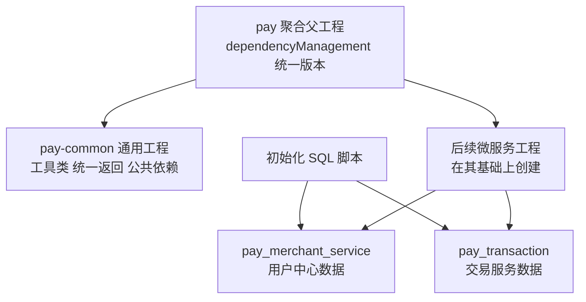

# 导入聚合支付基础工程与初始数据库：写业务代码前的两件打底事

> 🔒 安全提示：文中示例的口令/密钥均为课程教学环境演示口径，生产环境的安全要求见《安全与合规须知》。

加入一个微服务项目，拿到的往往不是空白的 IDEA，而是一份父工程加若干通用模块的基础工程，外加一批初始化数据库脚本。本课把闪聚支付项目的这两块底座落进本机：工程导入 IDEA，SQL 脚本执行进 MySQL。这一步没有业务代码，却决定后面每个微服务能不能顺利创建、能不能连上像样的数据。

## 先给结论

- 基础工程是两件套：聚合父工程（本系列口径记作 `pay`）负责依赖版本管理，`pay-common` 通用工程沉淀工具类、统一返回与公共依赖。
- 父工程的 `dependencyManagement` 统一了 Spring Cloud（Greenwich）、Spring Cloud Alibaba（2.1.0.RELEASE）、Swagger、lombok、Mybatis-Plus、数据库驱动等版本，子模块引依赖不写版本号。
- 导入方式就是 File → Open 选中解压后的工程目录，前提是 JDK 1.8 与 Maven 3.3.9 已配好，勾上自动导入依赖。
- 项目初始化 SQL 脚本一次建出商户服务库 `pay_merchant_service` 与交易服务库 `pay_transaction`，微服务一对一建库，本阶段先把这两个马上要用的库导进去。
- 脚本执行完刷新客户端即可看到库、表与少量初始数据，多数表暂时为空，数据随业务开发逐步填充。

## 基础工程里有什么

解压课程资料里的基础工程压缩包，目录里是一个聚合父工程：根下放着父 pom，还有一个 `pay-common` 通用工程。父 pom 声明自身为 `pom` 打包，挂在 Spring Boot 2.1.3 之下，核心是 `dependencyManagement` 段：

```xml
<groupId>com.study.pay</groupId>
<artifactId>pay</artifactId>
<packaging>pom</packaging>
<version>1.0-SNAPSHOT</version>

<parent>
    <groupId>org.springframework.boot</groupId>
    <artifactId>spring-boot-starter-parent</artifactId>
    <version>2.1.3.RELEASE</version>
</parent>

<dependencyManagement>
    <dependencies>
        <dependency>
            <groupId>com.alibaba.cloud</groupId>
            <artifactId>spring-cloud-alibaba-dependencies</artifactId>
            <version>2.1.0.RELEASE</version>
            <type>pom</type>
            <scope>import</scope>
        </dependency>
        <dependency>
            <groupId>org.springframework.cloud</groupId>
            <artifactId>spring-cloud-dependencies</artifactId>
            <version>Greenwich.RELEASE</version>
            <type>pom</type>
            <scope>import</scope>
        </dependency>
        <dependency>
            <groupId>io.springfox</groupId>
            <artifactId>springfox-swagger2</artifactId>
            <version>2.9.2</version>
        </dependency>
        <dependency>
            <groupId>org.projectlombok</groupId>
            <artifactId>lombok</artifactId>
            <version>1.18.0</version>
        </dependency>
        <!-- 数据库驱动、Mybatis-Plus 等版本同样在此统一声明 -->
    </dependencies>
</dependencyManagement>
```

子模块引依赖时只写 groupId 与 artifactId，版本号全部由这里裁决，这正是聚合工程的价值：几十个微服务的依赖版本有一处收口，升级与排查都有据可查。`pay-common` 则是项目通用工程，里面是日后每个微服务都要用的东西：JSON 转换、日志门面、通用工具类、统一返回封装，还包括异常基类等 domain 对象。它的依赖清单也能看出定位，Swagger 的两个依赖（`springfox-swagger2` 与 `springfox-swagger-ui`）就声明在这里，后续所有直接或间接依赖 `pay-common` 的微服务都不必重复引入。目前不用逐个类去读，用到哪个讲哪个。

## 把工程导入 IDEA

导入动作本身很简单：File → Open 选中解压出来的工程目录，IDEA 识别出 Maven 结构后自动构建。前提是开发工具配置已经就绪，JDK 1.8 与 Maven 3.3.9 要在 IDEA 里指定到位，本地仓库路径不要含中文，然后勾选自动导入，依赖变更时 IDEA 会自行刷新。这套动作对应企业里的真实场景：入职拿到 Git 账号，把工程从仓库拉到本地再打开，路径不同，流程一致。

工程里还有一段 build 配置值得停下来看一眼：

```xml
<build>
    <resources>
        <resource>
            <directory>src/main/java</directory>
            <includes>
                <include>**/*.xml</include>
            </includes>
        </resource>
    </resources>
    <plugins>
        <plugin>
            <groupId>org.springframework.boot</groupId>
            <artifactId>spring-boot-maven-plugin</artifactId>
        </plugin>
        <plugin>
            <groupId>org.apache.maven.plugins</groupId>
            <artifactId>maven-compiler-plugin</artifactId>
            <configuration>
                <source>1.8</source>
                <target>1.8</target>
            </configuration>
        </plugin>
    </plugins>
</build>
```

`src/main/java` 目录里的 XML 文件默认不会被打进 jar，这里的 resource 声明把它们补了进去。后面 Mybatis-Plus 的 Mapper XML 会和接口放在同一套包路径下，没有这行配置，打包后 XML 全部丢失，工程本地能跑、上线就报找不到 statement，属于典型的隐性配置。

## 导入项目初始 SQL：一个服务一个库

微服务架构下每个微服务独享一个数据库。资料里提供的项目初始化 SQL 脚本，内容就是批量建库建表并插入初始数据，本阶段先把马上要用的两个库建起来：商户服务库 `pay_merchant_service`（用户中心数据）与交易服务库 `pay_transaction`（交易服务数据）。连上 MySQL（课程环境账号 root/123456），选中脚本整体执行，再刷新客户端即可看到两个新库。脚本里的建表语句带着完整的列定义，以商户表为例：

```sql
CREATE DATABASE IF NOT EXISTS pay_merchant_service DEFAULT CHARACTER SET = utf8mb4;
USE pay_merchant_service;

CREATE TABLE `merchant` (
  `ID` bigint(20) NOT NULL COMMENT '主键',
  `MERCHANT_NAME` varchar(50) DEFAULT NULL COMMENT '商户名称',
  `MERCHANT_NO` varchar(32) DEFAULT NULL COMMENT '企业编号',
  `MERCHANT_ADDRESS` varchar(255) DEFAULT NULL COMMENT '企业地址',
  `AUDIT_STATUS` varchar(32) DEFAULT NULL COMMENT '审核状态',
  `TENANT_ID` bigint(20) DEFAULT NULL COMMENT '租户ID',
  PRIMARY KEY (`ID`) USING BTREE
) ENGINE=InnoDB DEFAULT CHARSET=utf8 ROW_FORMAT=DYNAMIC;
```

两处细节值得留意：库名与表结构按微服务的业务边界划分，商户与交易分属两个库，后续每个微服务只连自己的库；字符集统一 utf8mb4，中文与特殊字符都不会踩坑。导完刷新会发现多数表没有数据，这是正常的，初始化脚本只保证结构与必要的种子数据，业务数据随功能开发逐步产生。其他库（如统一账号、SaaS 相关）在本课脚本之外，用到时再按需导入，不必一次全建。

导入完成后的全景是这样一张图：



基础工程是「骨架」，初始库是「血源」：骨架决定了每个微服务怎么建（继承父工程、复用 common），数据决定了服务起来后能查到什么。到此环境的三块基石里已经落了两块，下一课就在这套工程之上创建商户平台应用与商户服务。

## 常见误区

- **跳过基础工程直接新建工程写代码。** 错例：自己建一个 Spring Boot 工程就开写，依赖版本与项目约定脱节。正解：微服务一律在聚合父工程下建模块，依赖版本由父 pom 的 `dependencyManagement` 统一裁决。
- **只导工程不导库，或一次把所有库全建。** 错例：启动服务后一查询就报表不存在；或者把脚本里所有库一股脑执行，分不清哪些马上用。正解：按需导入当前要用的库（商户服务库与交易服务库），其余库在对应章节再导。
- **忽略 build 里的 resource 声明。** 错例：把与 Java 代码同目录的 Mapper XML 当作普通资源，打包后发现丢失。正解：确认父工程已声明把 `src/main/java` 下的 `**/*.xml` 打进产物，或把 XML 统一放到 `resources` 目录。
- **Maven 本地仓库路径含中文。** 错例：解压仓库到带中文的目录后配置 settings.xml，依赖下载出现诡异失败。正解：仓库路径保持纯英文，IDEA 中指定 settings.xml 后核对本地仓库目录生效。

## 面试可能被问到的问题

1. 面试官追问：「微服务项目为什么要有一个聚合父工程？」
   答：父工程统一管理依赖版本，通过 dependencyManagement 声明 Spring Cloud、Spring Cloud Alibaba、数据库驱动等组件的版本，子模块引用时不写版本号。这样几十个微服务的依赖版本有一处收口，避免版本漂移与冲突，升级时也只改一处。
2. 面试官追问：「通用工程里放什么？为什么依赖要声明在这里？」
   答：放所有微服务共用的能力：工具类、统一返回结构、异常体系、公共依赖。像 Swagger 的依赖声明在通用工程里，其他服务直接或间接依赖它即可获得接口文档能力，避免每个工程重复引入、版本也天然一致。
3. 面试官追问：「为什么每个微服务要独享一个数据库？」
   答：数据边界是服务边界的一部分。每个服务独享库后，表结构演进不会牵连其他服务，服务可以独立部署与伸缩，也避免了跨服务直连数据库造成的强耦合。本项目按业务域划分，商户数据与交易数据分属两个库，服务间需要数据时通过接口调用。
4. 面试官追问：「项目初始化 SQL 脚本一般包含什么？」
   答：建库语句、建表语句与种子数据。建库带字符集声明（utf8mb4），建表带列定义与索引，种子数据提供必要的初始记录。它同时承担开发环境初始化与发布时数据库安装两个职责，是企业项目交付物的一部分。
5. 面试官追问：「为什么要在 build 配置里把 src/main/java 下的 XML 打进包？」
   答：Maven 默认只把 resources 目录当作资源目录，Java 源码目录里的 XML 不会进产物。MyBatis 的 Mapper XML 常与接口同包存放，不声明这条 resource 规则，本地源码运行正常，打包部署后却报 invalid bound statement，这类问题排查成本很高。

## 配套资料

- 讲义：`materials/docs/10/闪聚支付-第1章-讲义-开发环境搭建v1.0.md`，1.4 导入基础工程与 1.5 导入项目初始 SQL（含数据库清单：商户服务库、交易服务库）为本课出处。
- 代码：`materials/code/10/`，聚合支付基础工程（父 pom 与通用工程，内层目录名含项目原始命名，与正文模块名口径不一致，不在此展开）与项目初始化 SQL 脚本在该目录下按用途自取；正文父 pom 依赖管理片段、build 片段与商户表建表语句为真实资料节选，groupId、模块名、库名已按本系列口径改写为 `com.study.pay` 系。
- 说明：该阶段课程资料归档在 `materials/docs/10/` 与 `materials/code/10/`（不存在 09 编号目录，引用路径截至该层级）；数据库账号按课程环境口径 root/123456。
