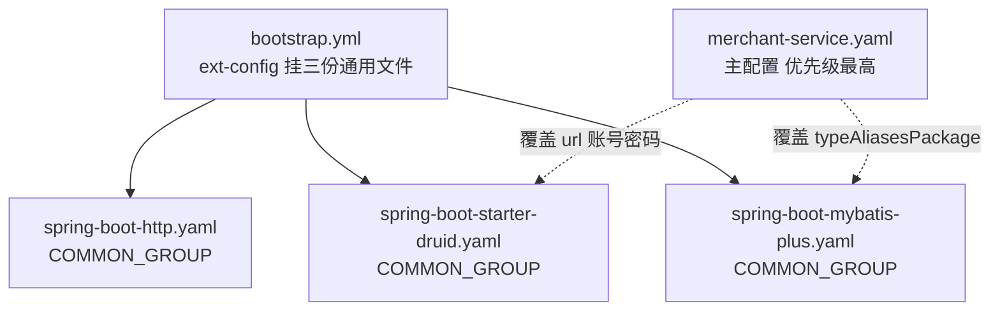

# 工程测试第一步：生成商户库表代码，配好数据源与 Mybatis-Plus

> 🔒 安全提示：文中示例的口令/密钥均为课程教学环境演示口径，生产环境的安全要求见《安全与合规须知》。

工程骨架立起来之后，用一个足够小的案例把开发流程跑通：「根据 ID 查询商户」。应用层收到请求，经 Dubbo 调到商户服务，服务里用 Mapper 查库返回。这一课做的是跑通流程前的两件准备工作：用代码生成器把商户库五张表对应的实体与 Mapper 批量产出，再把 Druid 数据源与 Mybatis-Plus 的各项配置挂到 Nacos 上。做完这两步，服务才真正具备「连库干活」的能力。

## 先给结论

- 开发流程的固定顺序：API 工程写接口，service 工程写接口实现，application 工程写 Controller 并通过 Dubbo 调用服务；本课先把三处都要用的通用代码备齐。
- 代码生成器三处改动即可复用：数据源 URL 换成 `pay_merchant_service` 库、包路径保持 `com.study.pay`、运行时输入模块名 `merchant`；五张表生成五个实体与五个 Mapper，拷进 `pay-merchant-service` 即可。
- 数据源配置分两层：Nacos 通用组放 `spring-boot-starter-druid.yaml`（连接池参数），商户服务主配置 `merchant-service.yaml` 覆盖 URL 与账号密码（root/123456），bootstrap.yml 的 ext-config 把通用文件挂进来。
- Mybatis-Plus 配置同样分两层：通用组放 `spring-boot-mybatis-plus.yaml`（驼峰映射、全局策略），服务主配置覆盖 `typeAliasesPackage` 与 `mapper-locations`。
- 服务工程补一个 `MybatisPlusConfig`：`@MapperScan("com.study.pay.**.mapper")` 扫 Mapper 接口，注册分页插件与性能分析插件。

## 用生成器产出实体与 Mapper

生成器工程此前已经导入过 IDEA，现在把它对准商户库。要动的只有数据源与包路径两处，其他配置原封不动：

```java
// 商户服务库
dataSourceConfig
        .setUrl("jdbc:mysql://127.0.0.1:3306/pay_merchant_service?serverTimezone=Asia/Shanghai");
dataSourceConfig.setDriverName("com.mysql.cj.jdbc.Driver");
dataSourceConfig.setUsername("root");
dataSourceConfig.setPassword("123456");

// 生成包配置
PackageConfig packageConfig = new PackageConfig();
packageConfig.setParent("com.study.pay");
```

运行 main，控制台提示输入模块名，输入 `merchant`，与后续服务工程里的子包名保持一致。生成器连库后能读到五张表：`app`、`merchant`、`staff`、`store`、`store_staff`，对应产出五个实体类与五个 Mapper 接口，Service 与 Controller 骨架也在，但本项目的分层里用不上它们，生成完删除即可，只保留 entity 与 mapper 两类文件。生成产物长这样（商户实体节选）：

```java
@Data
@TableName("merchant")
public class Merchant implements Serializable {

    private static final long serialVersionUID = 1L;

    // 主键
    @TableId(value = "ID", type = IdType.ID_WORKER)
    private Long id;

    // 商户名称
    @TableField("MERCHANT_NAME")
    private String merchantName;

    // 企业编号
    @TableField("MERCHANT_NO")
    private Long merchantNo;

    // 审核状态 0-未申请,1-已申请待审核,2-审核通过,3-审核拒绝
    @TableField("AUDIT_STATUS")
    private String auditStatus;
    // 其余字段按表结构逐一罗列
}
```

与手写实体逐行对照，注解风格、字段罗列方式完全一致，这正是代码生成器的价值：规律性代码零耗时产出。Mapper 接口则是清一色的空接口继承 `BaseMapper<T>`，单表增删改查由框架在启动时注入，不用写一行 SQL。把 entity 与 mapper 两个包整体拷进 `pay-merchant-service` 工程，落在 `com.study.pay.merchant.entity` 与 `com.study.pay.merchant.mapper` 包下，通用代码准备完毕。

## 配置 Druid 连接池

商户服务要连 `pay_merchant_service` 库，连接池选 Druid。与之前一致的思路：公共参数进 Nacos 通用组，个性化参数在服务主配置里覆盖。在 Nacos 的 dev 命名空间新建 `spring-boot-starter-druid.yaml`，Group 为 `COMMON_GROUP`：

```yaml
spring:
  datasource:
    type: com.alibaba.druid.pool.DruidDataSource
    driver-class-name: com.mysql.cj.jdbc.Driver
    url: jdbc:mysql://localhost:3306/oauth?useUnicode=true # 通用占位，由各服务覆盖
    username: root
    password: yourpassword
    druid:
      initial-size: 5    # 初始化连接数
      min-idle: 5        # 最小空闲连接
      max-active: 20     # 最大连接数
      max-wait: 60000    # 获取连接超时时间（毫秒）
      time-between-eviction-runs-millis: 60000
      min-evictable-idle-time-millis: 300000
      validation-query: SELECT 1 FROM DUAL   # 检测连接是否有效的 SQL
      test-while-idle: true
      test-on-borrow: true
      test-on-return: false
      pool-prepared-statements: true
      max-pool-prepared-statement-per-connection-size: 20
      filter:
        stat:
          slow-sql-millis: 1
          log-slow-sql: true
        filters: config,stat,wall,log4j2
      web-stat-filter:
        enabled: true
      stat-view-servlet:
        enabled: true
        url-pattern: /druid/*
        login-username: admin
        login-password: admin
```

连接池的核心是三组参数：池子大小（初始化、最小空闲、最大连接）、连接存活检测（`validation-query` 加上 test 系列开关，保证拿到的连接是活的）、监控统计（stat 过滤器收集 SQL 执行情况，`stat-view-servlet` 开出内置监控页）。通用文件里的 URL 与密码是占位性质，真实连接参数必须按微服务个性化，在商户服务主配置 `merchant-service.yaml` 里覆盖：

```yaml
#覆盖 spring-boot-starter-druid.yaml 的数据源
spring:
  datasource:
    druid:
      url: jdbc:mysql://127.0.0.1:3306/pay_merchant_service?useUnicode=true&characterEncoding=UTF-8&serverTimezone=Asia/Shanghai&useSSL=false
      username: root
      password: 123456
```

覆盖动作依赖主配置优先级最高的规则，Nacos 配置管理一课讲过的结论在这里兑现。最后把通用文件挂进 bootstrap.yml 的 ext-config，与已有的 http 配置并列：

```yaml
        ext-config:
        -
          refresh: true
          data-id: spring-boot-http.yaml # spring boot http 配置
          group: COMMON_GROUP # 通用配置组
        -
          refresh: true
          data-id: spring-boot-starter-druid.yaml # spring boot starter druid 配置
          group: COMMON_GROUP # 通用配置组
```

重启商户服务，上一课的 `Failed to configure a DataSource` 报错到此消失，说明数据源真正配通。Data ID 有一个隐蔽的坑值得记一笔：服务主配置的 Data ID 必须与服务名加扩展名完全一致，少写了 `.yaml` 扩展名，框架按 `file-extension` 拼装出来的文件名对不上，配置拉不到，报错信息却与「没配」无异，排查时要先核对 Data ID。

## 配置 Mybatis-Plus 与插件

数据源之上是 Mybatis-Plus 自身的配置。Nacos 通用组新建 `spring-boot-mybatis-plus.yaml`（Group 为 `COMMON_GROUP`）：

```yaml
mybatis-plus:
  configuration:
    cache-enabled: false          # 二级缓存关闭
    map-underscore-to-camel-case: true  # 驼峰映射，MP 默认开启，显式声明便于统一
  global-config:
    id-type: 0                    # 主键策略
    field-strategy: 0             # 字段判空策略
    db-column-underline: true     # 数据库列下划线风格
    refresh-mapper: true          # mapper 文件热刷新
  typeAliasesPackage: com.study.pay.user.entity # 通用占位，由各服务覆盖
  mapper-locations: classpath:com/study/pay/*/mapper/*.xml
```

缓存、驼峰映射这类框架行为所有服务一致，收进通用配置；而别名扫描包与 Mapper 文件位置是每个服务自己的包结构，必须在服务主配置覆盖。在 `merchant-service.yaml` 里追加：

```yaml
#覆盖 spring-boot-mybatis-plus.yaml 的项目
mybatis-plus:
  typeAliasesPackage: com.study.pay.merchant.entity
  mapper-locations: classpath:com/study/pay/*/mapper/*.xml
```

`mapper-locations` 的通配符写法值得停下来看：`com/study/pay/*/mapper/*.xml` 中单个星匹配任意一层模块目录，后续任何服务只要把 XML 放在自己包路径的 mapper 目录下就会被自动装载；当前只生成了 Mapper 接口没有 XML，这条配置先占位，将来手写自定义 SQL 时按这个路径放文件即可。bootstrap.yml 的 ext-config 同样把 `spring-boot-mybatis-plus.yaml` 追加进来，至此服务的启动配置一共挂了 http、druid、mybatis-plus 三份通用文件。三层关系如下：



配置类的部分在服务工程的 `config` 包下补一个 `MybatisPlusConfig`。`@MapperScan` 负责把 Mapper 接口扫成可注入的代理对象，通配写法用双星跨包匹配；分页插件让 selectPage 之类的分页查询自动拼 limit；性能分析插件在开发期打印每条 SQL 的执行耗时，定位慢 SQL 用，生产环境建议关掉：

```java
package com.study.pay.merchant.config;

import com.baomidou.mybatisplus.extension.plugins.PaginationInterceptor;
import com.baomidou.mybatisplus.extension.plugins.PerformanceInterceptor;
import org.mybatis.spring.annotation.MapperScan;
import org.springframework.context.annotation.Bean;
import org.springframework.context.annotation.Configuration;

@Configuration
@MapperScan("com.study.pay.**.mapper")
public class MybatisPlusConfig {

    //分页插件，自动识别数据库类型
    @Bean
    public PaginationInterceptor paginationInterceptor() {
        return new PaginationInterceptor();
    }

    //启用性能分析插件
    @Bean
    public PerformanceInterceptor performanceInterceptor() {
        return new PerformanceInterceptor();
    }
}
```

到这一步做一次收束：本课产出了 entity 与 mapper 两类通用代码，配通了 Druid 数据源，挂好了 Mybatis-Plus 的驼峰映射、别名扫描、Mapper 位置与两个插件。从下一课开始，Service 接口可以直接调 Mapper 操作数据库，真正的接口开发再无环境阻碍。

## 常见误区

- **生成的代码不核对包路径直接拷贝。** 错例：生成器里包路径或模块名与工程不一致，拷进来的实体编译报包声明错误。正解：生成前把 `packageConfig.setParent` 与模块名对准工程包结构，拷贝后核对 package 行。
- **通用 Druid 配置的 URL 照抄不覆盖。** 错例：服务直接用了通用配置里的占位库，启动成功却连到错误的库，查询时表不存在。正解：通用配置只管池子参数，每个服务必须在主配置覆盖 url、账号与密码。
- **Data ID 少写扩展名。** 错例：主配置发布成 `merchant-service` 而非 `merchant-service.yaml`，框架按 `file-extension: yaml` 拼名拉取失败，配置全部不生效。正解：Data ID 保持服务名加扩展名，与 `file-extension` 一致。
- **`mapper-locations` 写成单个具体文件。** 错例：配成 `classpath:com/study/pay/merchant/mapper/MerchantMapper.xml`，新增 Mapper 就要改配置。正解：用通配符 `classpath:com/study/pay/*/mapper/*.xml` 一次覆盖全部模块。
- **`@MapperScan` 用单星跨多层包。** 错例：写成 `com.study.pay.*.mapper` 扫不到嵌套更深的接口。正解：双星 `com.study.pay.**.mapper` 才能跨任意层级匹配。

## 面试可能被问到的问题

1. 面试官追问：「Druid 连接池有哪些关键参数，分别起什么作用？」
   答：池子容量类，initial-size 初始化连接数、min-idle 最小空闲、max-active 最大连接、max-wait 获取连接的超时；可用性类，validation-query 是检测 SQL，配合 test-while-idle、test-on-borrow 保证拿到的连接有效；监控类，stat 过滤器统计 SQL 执行，stat-view-servlet 提供内置监控页，slow-sql-millis 阈值外输出慢 SQL 日志。
2. 面试官追问：「数据源配置为什么要放 Nacos，而不是写在工程里？」
   答：配置与代码分离后，换环境只改配置中心，不用重新打包；密码这类敏感信息集中在配置中心管理；连接池参数可以借助 refresh 动态调整。项目里把通用池参数放 COMMON_GROUP，每个服务只覆盖 URL 与账号，一处规范处处生效。
3. 面试官追问：「Mybatis-Plus 的分页插件做了什么？」
   答：PaginationInterceptor 拦截分页查询，先按数据库方言把 limit 或类似语句拼进 SQL 完成物理分页，再自动发一条 count 语句计算总数回填分页对象。配置上只需注册为 Bean，框架自动识别数据库类型，不配插件时分页参数形同虚设，会查出全表再内存截断。
4. 面试官追问：「PerformanceInterceptor 是干什么的，能上生产吗？」
   答：它是 SQL 执行性能分析拦截器，记录每条 SQL 的执行耗时与结果，开发期用来定位慢查询很直观。不建议上生产：它会记录完整 SQL 与参数，带来额外开销，也有数据暴露风险，生产环境对慢 SQL 的观测交给 Druid 的 stat 统计与数据库侧工具。
5. 面试官追问：「typeAliasesPackage 和 mapper-locations 分别解决什么问题？」
   答：前者把实体包扫描注册成类型别名，映射文件里 resultType 写首字母小写的类名即可，不必写全限定名；后者声明 Mapper XML 的位置，支持通配符批量装载。两者都按服务在主配置覆盖，通用配置只给占位默认值。
6. 面试官追问：「@MapperScan 和 Mapper 接口上单个加 @Mapper 注解，两种方式怎么选？」
   答：@MapperScan 在配置类上按包批量扫描，一次声明覆盖所有 Mapper，工程统一规范时更简洁；@Mapper 逐接口标注，控制粒度细但容易漏。项目采用 @MapperScan 加双星通配，新加 Mapper 接口无需任何额外标注即可被扫成代理对象。

## 配套资料

- 讲义：`materials/docs/10/闪聚支付-第1章-讲义-开发环境搭建v1.0.md`，1.7 工程测试中的 1.7.1 生成代码与 1.7.2 Mybatis-Plus 配置（1.7.2.1 配置连接池 Druid、1.7.2.2 配置 Mybatis-Plus，含 Druid 参数、Mybatis-Plus 全局配置与 MybatisPlusConfig 插件）为本课出处。
- 代码：`materials/code/10/`，商户服务模块中的实体、Mapper 与 `MybatisPlusConfig`（内层目录名含项目原始命名，与正文包名口径不一致，不在此展开），正文实体节选与配置类为该工程真实文件按 `com.study.pay` 口径改写；生成器主类的改动片段出自 `materials/code/10/generator/`。
- 说明：该阶段课程资料归档在 `materials/docs/10/` 与 `materials/code/10/`（不存在 09 编号目录，引用路径截至该层级）；库名按本系列口径改写为 `pay_merchant_service`，配置分组改写为 `PAY_GROUP`，数据库账号按课程环境口径 root/123456。
