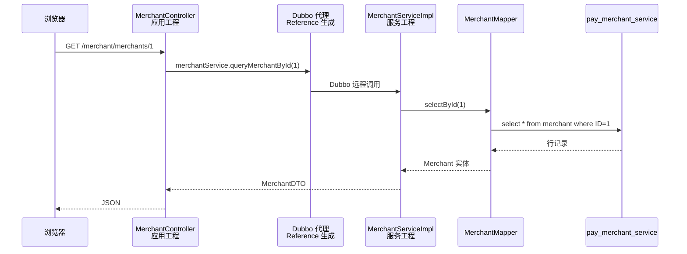

# 工程测试第二步：写通第一个接口，从 Controller 到数据库全链路

> 🔒 安全提示：文中示例的口令/密钥均为课程教学环境演示口径，生产环境的安全要求见《安全与合规须知》。

实体与 Mapper 就位、数据源配通，本课把「根据 ID 查询商户」这个最小接口写出来并测通。它的价值不在功能本身，而在把项目的标准开发流程完整走一遍：API 工程定义接口，服务工程写实现，应用工程写 Controller 远程调用，最终浏览器拿到数据库里的数据。这条链路通了一次，后面所有微服务接口的开发都是同一条路的复制。

## 先给结论

- 开发顺序固定：先写 Dubbo 服务侧（API 接口加实现），再写应用层 Controller；接口签名以库表字段类型为准，商户表主键是 `bigint`，接口参数就声明为 `Long`。
- Service 层统一用 DTO 做传输对象，Entity 严格与数据库表一一对应，两者分开建模；本案例先手动逐字段拷贝，后续会用对象映射工具替代。
- 服务实现类标注 Dubbo 的 `@Service` 注解对外暴露服务；应用层 Controller 用 Dubbo 的 `@Reference` 注入接口，拿到的是框架生成的远程代理对象。
- 应用工程需要补 `pay-merchant-api` 依赖才能编译通过；Controller 暴露 `GET /merchants/{id}`，用 `@PathVariable` 接收路径参数。
- 测试前先在商户表手动插一条数据；访问地址要带上 Nacos 主配置里覆盖的 `context-path`，完整 URL 是 `http://localhost:57010/merchant/merchants/1`，404 多半是少了这段前缀。

## API 工程：接口与 DTO

写接口前先想清楚要写哪一层的接口。项目里的接口分两类：应用工程暴露给前端的 RESTful 接口，与微服务之间调用的 Dubbo 接口。按既定流程，Dubbo 接口先写。在 `pay-merchant-api` 的 `com.study.pay.merchant.api` 包下新建接口，参数类型看库表定：商户表主键是 `bigint`，对应 Java 的 `Long`；返回值不是实体，而是一个新建的 DTO：

```java
package com.study.pay.merchant.api;

import com.study.pay.merchant.api.dto.MerchantDTO;

public interface MerchantService {

    //根据 id 查询商户
    public MerchantDTO queryMerchantById(Long id);
}
```

DTO 建在 `com.study.pay.merchant.api.dto` 包下，字段对应商户信息，配合 Swagger 注解描述每个字段（注解的用法下一课展开，此处先照写）：

```java
@ApiModel(value = "MerchantDTO", description = "商户信息")
@Data
public class MerchantDTO implements Serializable {

    @ApiModelProperty("商户id")
    private Long id;

    @ApiModelProperty("企业名称")
    private String merchantName;

    @ApiModelProperty("企业编号")
    private Long merchantNo;

    @ApiModelProperty("企业地址")
    private String merchantAddress;

    @ApiModelProperty("审核状态,0-未申请,1-已申请待审核,2-审核通过,3-审核拒绝")
    private String auditStatus;

    // 其余字段：行业类型、营业执照、法人证件、联系人、手机号、租户ID 等
}
```

为什么 Service 层不直接返回 Entity？这个约定背后有一条边界。Entity 与数据库表字段严格一一对应，是持久层的事；Service 暴露的对象面向调用方，字段往往要按业务需要增减组合，比如对外不能带密码、状态字段要翻译成描述。如果图省事直接用 Entity，业务一扩展就得往实体里塞表里没有的字段，等于破坏了「模型与表一一对应」的底线。DTO 单独建包单独维护，Service 与持久层就此解耦，这条纪律贯穿整个项目。

## 服务工程：接口实现

实现类写在 `pay-merchant-service` 的 `com.study.pay.merchant.service` 包下，实现刚定义的接口。这里有一个 import 的经典陷阱：要标的是 Dubbo 的 `@Service`（`org.apache.dubbo.config.annotation.Service`），IDEA 自动导入时极易错选成 Spring 的同名注解，选错了服务根本不会暴露成 Dubbo 服务，而且编译期毫无征兆：

```java
package com.study.pay.merchant.service;

import com.study.pay.merchant.api.MerchantService;
import com.study.pay.merchant.api.dto.MerchantDTO;
import com.study.pay.merchant.entity.Merchant;
import com.study.pay.merchant.mapper.MerchantMapper;
import org.springframework.beans.factory.annotation.Autowired;

@org.apache.dubbo.config.annotation.Service
public class MerchantServiceImpl implements MerchantService {

    @Autowired
    MerchantMapper merchantMapper;

    @Override
    public MerchantDTO queryMerchantById(Long id) {
        Merchant merchant = merchantMapper.selectById(id);
        MerchantDTO merchantDTO = new MerchantDTO();
        merchantDTO.setId(merchant.getId());
        merchantDTO.setMerchantName(merchant.getMerchantName());
        merchantDTO.setMerchantNo(merchant.getMerchantNo());
        merchantDTO.setMerchantAddress(merchant.getMerchantAddress());
        merchantDTO.setMerchantType(merchant.getMerchantType());
        // 其余字段逐一设置
        return merchantDTO;
    }
}
```

`selectById` 是 BaseMapper 提供的通用方法，一行 SQL 不写就完成了按主键查询。查出来的是 Entity，返回的要是 DTO，于是有了中间这段逐字段拷贝，属性多的时候相当繁琐，后续会引入对象映射工具来消除这份体力活，工程测试阶段先手工把它跑通，看的是流程。Dubbo 的 `@Service` 让这个类在服务启动时被扫描并注册到 Nacos，等待消费方调用。

## 应用工程：Controller

阵地转到 `pay-merchant-application`。它要调 Dubbo 服务，得先在 pom 里依赖 API 工程（父工程版本裁决生效，无需写版本）：

```xml
<!--商户服务 API-->
<dependency>
    <groupId>com.study.pay</groupId>
    <artifactId>pay-merchant-api</artifactId>
    <version>1.0-SNAPSHOT</version>
</dependency>
```

然后写 Controller。注入服务接口用的是 Dubbo 的 `@Reference`，它把远程服务生成本地代理对象，调用方法时框架自动完成服务发现、负载均衡与网络传输，写起来与调本地 bean 无异：

```java
package com.study.pay.merchant.controller;

import com.study.pay.merchant.api.MerchantService;
import com.study.pay.merchant.api.dto.MerchantDTO;
import org.springframework.web.bind.annotation.GetMapping;
import org.springframework.web.bind.annotation.PathVariable;
import org.springframework.web.bind.annotation.RestController;

@RestController
public class MerchantController {

    @org.apache.dubbo.config.annotation.Reference
    private MerchantService merchantService;

    @GetMapping("/merchants/{id}")
    public MerchantDTO queryMerchantById(@PathVariable("id") Long id) {
        MerchantDTO merchantDTO = merchantService.queryMerchantById(id);
        return merchantDTO;
    }
}
```

`@RestController` 等价于 Controller 加 ResponseBody，返回的 DTO 由框架序列化成 JSON；`/merchants/{id}` 的路径变量写法是 Spring MVC 的基本功，`@PathVariable` 把 URL 里的 id 取出来转成 `Long` 传给服务。应用层到此只做转发，业务与数据访问都留在服务工程里，分层界限在这一刻看得最清楚。整条链路画出来是这样：



## 启动与验证

两个服务都重启：先起商户服务（提供方），再起商户平台应用（消费方），启动后在 Nacos 服务列表确认 `merchant-service` 与 `merchant-application` 都已注册。测试前还差一步，商户表还没有数据，先手动插一条：

```sql
INSERT INTO merchant (ID, MERCHANT_NAME, MERCHANT_NO, MERCHANT_ADDRESS, MERCHANT_TYPE, AUDIT_STATUS)
VALUES (1, '测试商户', 9527, '测试地址一号线', '餐饮', '0');
```

浏览器请求 `http://localhost:57010/merchant/merchants/1`。第一次请求很可能撞上一个 404，页面找不到，这时别急着怀疑代码，回到配置找路径：`/merchant` 这个 context-path 是在 Nacos 的 `merchant-application.yaml` 主配置里覆盖的，如果主配置没发布或拉取失败，服务实际挂在根路径上，URL 自然对不上。确认配置无误后再请求，返回一段 JSON，字段值正是刚插进去的那条测试商户数据，整条链路宣告跑通。用命令行工具验证等价写法是 `curl http://localhost:57010/merchant/merchants/1`。

这次工程测试的意义要把镜头拉远看：流程与当初研究 Dubbo 服务架构时的测试一脉相承，只是跑在了真实项目的工程与配置之上。流程通了，就等于给所有微服务画好了模板，此后无论商户、交易还是别的什么服务，都是往这条链路的对应位置填代码而已。

## 常见误区

- **`@Service` 与 `@Reference` import 错包。** 错例：把 Spring 的 `org.springframework.stereotype.Service` 标在实现类上，服务没有注册为 Dubbo 提供者，消费方一直报找不到提供者。正解：提供方用 `org.apache.dubbo.config.annotation.Service`，消费方用同包的 `@Reference`，自动导入时看清包名。
- **Service 层直接返回 Entity。** 错例：接口签名写成 `Merchant queryMerchantById`，调用方拿到与表一一对应的模型，后续字段扩展全部受阻。正解：Service 层统一用 DTO，Entity 只在持久层内部流转。
- **应用工程漏加 API 依赖。** 错例：Controller 里引用 `MerchantService` 编译报找不到符号，却反复检查注解。正解：跨工程调用接口的前提是依赖 API 包，pom 里补 `pay-merchant-api`。
- **测试请求少了 context-path 前缀。** 错例：请求 `http://localhost:57010/merchants/1` 得到 404，以为接口没写对。正解：Nacos 主配置里覆盖了 `/merchant` 访问路径，完整地址是 `/merchant/merchants/1`，404 先核对主配置是否发布与生效。
- **库表无数据就断定代码有错。** 错例：接口返回空字段或查询为 null，回头逐行排查链路。正解：先确认 `merchant` 表有没有测试数据，没有就插一条再验证。

## 面试可能被问到的问题

1. 面试官追问：「Dubbo 的 @Service 和 Spring 的 @Service 有什么区别？」
   答：Spring 的 @Service 把类注册为 Spring 容器的本地 bean；Dubbo 的 @Service 在此之上把该 bean 的方法暴露成 Dubbo 服务，注册到注册中心供远程消费。两者同名但职责不同，实现类上必须用 Dubbo 的注解才会成为提供方，混用是最常见的隐性错误。
2. 面试官追问：「@Reference 注入的对象是什么？调用时发生了什么？」
   答：注入的是框架生成的接口代理对象。调用方法时，代理按服务名从注册中心拿到提供者列表，经负载均衡选出一个实例，把方法名与参数序列化后走网络发出，提供方反序列化后执行真实实现并返回结果。对调用方而言与本地方法调用体验一致，网络细节全部被代理吸收。
3. 面试官追问：「为什么 Service 层用 DTO 而不是直接返回实体？」
   答：实体与表字段一一对应，是持久层的模型；Service 的输出面向调用方，需要按业务裁剪与组合，比如隐藏密码、状态码翻译。若直接返回实体，字段扩展只能改表模型，持久层与业务层被强行绑死。DTO 独立建模后，两个层次各自演进，接口契约也更稳定。
4. 面试官追问：「把这条查询链路完整描述一遍？」
   答：浏览器请求应用工程的 RESTful 接口，Controller 通过 Dubbo 代理发起远程调用，注册中心提供地址、负载均衡选择实例；服务工程的实现类执行 BaseMapper 的 selectById，由 Mybatis-Plus 生成 SQL 查询商户库，行记录映射成实体；服务层把实体逐字段转成 DTO 返回，Controller 直接输出，框架序列化为 JSON。
5. 面试官追问：「手动逐字段拷贝 Entity 到 DTO 有什么问题，怎么改进？」
   答：字段一多就是纯粹的重复劳动，新增字段两边都要改，漏拷不报错只丢数据。改进方向是对象映射工具，如 mapstruct 在编译期按同名字段生成映射代码，零反射开销且编译期就能发现类型不匹配；本工程已引入其依赖，工程测试阶段先手工实现，后续章节接入。
6. 面试官追问：「接口返回 JSON 是谁完成的？」
   答：@RestController 组合了 @ResponseBody，方法返回值不走视图解析，而是交给 HTTP 消息转换器，Spring Boot 默认用 Jackson 把 DTO 序列化成 JSON 写回响应体。字段名、日期格式等细节可由注解与全局配置控制，这也是 RESTful 接口能直接被前端消费的原因。

## 配套资料

- 讲义：`materials/docs/10/闪聚支付-第1章-讲义-开发环境搭建v1.0.md`，1.7 工程测试中的 1.7.3 创建接口、1.7.4 创建接口实现、1.7.5 应用层（含 MerchantService、MerchantDTO、MerchantServiceImpl 与 MerchantController 全部代码及测试方式）为本课出处。
- 代码：`materials/code/10/`，商户服务 API、商户服务与商户平台应用三个模块（内层目录名含项目原始命名，与正文包名口径不一致，不在此展开），正文接口、DTO、实现类与 Controller 为该工程真实文件按 `com.study.pay` 口径改写后的节选。
- 说明：该阶段课程资料归档在 `materials/docs/10/` 与 `materials/code/10/`（不存在 09 编号目录，引用路径截至该层级）；测试 SQL 与示例数据为按课程操作补全的演示数据，数据库账号按课程环境口径 root/123456。
