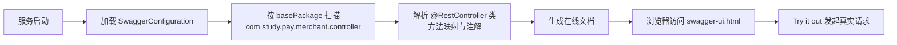
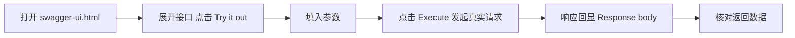

# Swagger 配置与接口测试：让文档自己长出来，还能当场联调

> 🔒 安全提示：文中示例的口令/密钥均为课程教学环境演示口径，生产环境的安全要求见《安全与合规须知》。

第一个接口写通之后，马上会遇到协作问题：前端要调这个接口，凭什么知道 URL 怎么拼、参数放哪、返回什么结构？靠口头转述或手写文档都撑不住迭代，文档刚写完接口就改了。Swagger 解决的正是这件事：接口文档随代码自动生成、在线可看、还能直接在页面上发起测试请求。这一课把 Swagger 装进商户平台应用，配好扫描规则与资源映射，再把三个接口从头测到尾。

把场景还原得更具体一点：后端说「传个商户 ID，按 `/merchants/1` 这样拼 URL，我返回商户信息」，前端反问「参数放路径里还是查询串里？返回的字段哪些可能为空？」，几轮问答下来，双方都觉得该有一份书面约定。这份约定不能是口头协议，也不能是三周前的 Word 文档，它必须是随接口演进实时更新的东西。接口文档是前后端分离开发的规范与约束，谁以文档为准，谁就不必猜。

## 先给结论

- - Swagger 是 RESTful 接口文档工具，Spring 生态的落地实现是 Springfox：`springfox-swagger2` 加 `springfox-swagger-ui` 两个依赖，版本 2.9.2 由父工程统一裁决，依赖声明在 `pay-common`，所有微服务间接获得。两个依赖各管一段，前者负责生成接口的描述数据，后者提供渲染文档页面的界面资源。
- 配置两件套：`SwaggerConfiguration` 用 `@EnableSwagger2` 加 `Docket` 声明扫描包与文档标题；`WebMvcConfig` 把 `swagger-ui.html` 与 `webjars` 静态资源映射放开。
- 配置类上有开关：`@ConditionalOnProperty(prefix = "swagger", value = "enable", havingValue = "true")`，主配置里 `swagger.enable: true` 才生效，生产环境关掉即可下线文档。
- 页面地址是 `http://localhost:57010/merchant/swagger-ui.html`，中间的 `/merchant` 是 Nacos 主配置覆盖的 context-path，漏掉就是 404。
- 文档能测：每个接口点 `Try it out` 填参数、`Execute` 发请求，响应直接回显在页面；GET 与 POST 都能发，比在地址栏手敲 URL 强得多，地址栏只能发 GET。

## 接口文档为什么重要，Swagger 怎么工作

项目里反复说的接口有两类：应用工程暴露给前端的 RESTful 接口，与微服务之间的 Dubbo 接口。文档工具服务的是前者。前后端分离开发里，接口文档就是双方的协作契约：前端依据文档编写页面与请求，后端依据文档对外承诺行为，文档写清每个接口的地址、方法、参数与返回结构。麻烦在于谁来写、何时同步：后端写完 Controller 再手写一份文档，双重劳动还极易过期。

Swagger 的思路是让文档跟着代码走。它扫描 Controller 类上的注解与方法映射，自动解析出 URL、参数与返回类型，生成一份在线文档页面；开发者只管写 Controller，文档随代码更新永不过期。Spring 官方吸纳这套规范后形成的项目叫 Springfox，引入依赖即可使用。换个角度看它的定位：接口文档领域此前的问题是「文档与代码两张皮」，Swagger 把文档变成代码的派生物，源变了派生物自动跟着变，同步问题从根上消掉。它的工作原理画出来很直白：



关键路径在扫描规则：配置类声明了扫哪个包，框架就到那个包下找标注 `@RestController` 的类，把类与方法上的注解翻成文档里的描述文字。所以配置里最重要的两处是扫描包路径与文档标题，路径写错文档就是空的。

## 依赖与两个配置类

依赖加在 `pay-common` 的 pom 里。为什么放这里？其他微服务工程都直接或间接依赖 `pay-common`，声明一处全项目可用，版本由父工程的 `dependencyManagement` 统一：

```xml
<!--Swagger 依赖-->
<dependency>
    <groupId>io.springfox</groupId>
    <artifactId>springfox-swagger2</artifactId>
</dependency>
<dependency>
    <groupId>io.springfox</groupId>
    <artifactId>springfox-swagger-ui</artifactId>
</dependency>
```

接着在商户平台应用的 `config` 包下建 `SwaggerConfiguration`。这个类属于配置模板，不需要逐行手写，理解每个部件的作用即可：

```java
package com.study.pay.merchant.config;

import org.springframework.boot.autoconfigure.condition.ConditionalOnProperty;
import org.springframework.context.annotation.Bean;
import org.springframework.context.annotation.Configuration;
import springfox.documentation.builders.ApiInfoBuilder;
import springfox.documentation.builders.PathSelectors;
import springfox.documentation.builders.RequestHandlerSelectors;
import springfox.documentation.service.ApiInfo;
import springfox.documentation.service.Contact;
import springfox.documentation.spi.DocumentationType;
import springfox.documentation.spring.web.plugins.Docket;
import springfox.documentation.swagger2.annotations.EnableSwagger2;

@Configuration
@ConditionalOnProperty(prefix = "swagger", value = {"enable"}, havingValue = "true")
@EnableSwagger2
public class SwaggerConfiguration {

    @Bean
    public Docket buildDocket() {
        return new Docket(DocumentationType.SWAGGER_2)
                .apiInfo(buildApiInfo())
                .select()
                //要扫描的 API（Controller）基础包
                .apis(RequestHandlerSelectors.basePackage("com.study.pay.merchant.controller"))
                .paths(PathSelectors.any())
                .build();
    }

    //构建 API 基本信息
    private ApiInfo buildApiInfo() {
        Contact contact = new Contact("开发者", "", "");
        return new ApiInfoBuilder()
                .title("闪聚支付-商户应用API文档")
                .description("")
                .contact(contact)
                .version("1.0.0").build();
    }
}
```

拆开看三个部件：`@EnableSwagger2` 打开 Swagger 能力；`Docket` 是文档的配置载体，`apis` 指定扫描 `com.study.pay.merchant.controller` 包下所有 Controller，`paths` 不设限制；`buildApiInfo` 组装页面顶部展示的文档标题、联系人与版本。这套配置将来每个微服务都要用，拷贝时必须改两处：扫描包路径换成自己工程的 controller 包，标题换成自己服务的名称。

类上的 `@ConditionalOnProperty` 是开关闸门：只有配置项 `swagger.enable` 为 true 时整个配置类才注册生效。这个开关把文档能力做成了环境相关项：开发与测试环境置 true，联调窗口常开；生产环境置 false，整套文档连同扫描逻辑一起下线，不必改一行代码。于是商户服务的主配置 `merchant-application.yaml` 里加一行：

```yaml
#覆盖访问路径 并启用 Swagger
server:
  servlet:
    context-path: /merchant

#启用 Swagger
swagger:
  enable: true
```

第二个配置类解决「文档页面本身怎么被访问到」。Swagger UI 的页面与脚本打在依赖 jar 包内的 `META-INF/resources` 下，Spring MVC 默认不会把这个内部路径当静态资源放行，`WebMvcConfig` 手动补上映射：

```java
package com.study.pay.merchant.config;

import org.springframework.stereotype.Component;
import org.springframework.web.servlet.config.annotation.ResourceHandlerRegistry;
import org.springframework.web.servlet.config.annotation.WebMvcConfigurer;

@Component
public class WebMvcConfig implements WebMvcConfigurer {

    //添加静态资源文件，外部可以直接访问地址
    @Override
    public void addResourceHandlers(ResourceHandlerRegistry registry) {
        registry.addResourceHandler("/**").addResourceLocations("classpath:/static/");
        registry.addResourceHandler("swagger-ui.html")
                .addResourceLocations("classpath:/META-INF/resources/");
        registry.addResourceHandler("/webjars/**")
                .addResourceLocations("classpath:/META-INF/resources/webjars/");
    }
}
```

三行映射各管一段：工程自己的静态资源走 `static` 目录，文档页面 `swagger-ui.html` 与它依赖的 `/webjars/**` 脚本库都指向 jar 内的 `META-INF`。这段配置的价值在将来才完全显现：等项目加上认证授权的拦截器后，若没有这里的显式映射，文档页面会被拦在门外，联调窗口直接消失。那时需要做的也不是删除拦截器，而是把文档相关的这几个路径加进白名单，让「服务受保护」与「文档可访问」并存。

这段配置还有一条工程化提示：`WebMvcConfig` 基本可以原样复制到每个微服务，与 `SwaggerConfiguration` 的待遇不同，它没有按服务定制的包路径，属于纯通用件；真正需要逐服务修改的只有扫描包与标题两处。

## 用注解把接口描述写清楚

此时访问文档页面，接口条目已经出现，但除了方法名几乎没有中文描述。中文不中文不是重点，重点是描述是否清晰：前端要知道这个接口做什么、参数是什么含义。Swagger 的注解体系就是干这个的，常用的有：`@Api` 修饰整个 Controller 描述模块用途；`@ApiOperation` 描述一个接口方法；`@ApiModel` 与 `@ApiModelProperty` 描述传输对象及其字段；`@ApiImplicitParam` 描述方法参数，属性包括 `paramType`（取值 path、query、body、header、form，对应参数提交的位置）、`dataType`、`required`、`defaultValue`；还有 `@ApiResponses` 整体描述响应、`@ApiIgnore` 让某个接口不进文档。给 `MerchantController` 补上注解，顺手加两个测试方法：

```java
@RestController
@Api(value = "商户平台应用接口", tags = "商户平台应用接口", description = "商户平台应用接口")
public class MerchantController {

    @org.apache.dubbo.config.annotation.Reference
    MerchantService merchantService;

    @ApiOperation(value = "根据id查询商户信息")
    @GetMapping("/merchants/{id}")
    public MerchantDTO queryMerchantById(@PathVariable("id") Long id) {
        MerchantDTO merchantDTO = merchantService.queryMerchantById(id);
        return merchantDTO;
    }

    @ApiOperation("测试")
    @GetMapping(path = "/hello")
    public String hello() {
        return "hello";
    }

    @ApiOperation("测试")
    @ApiImplicitParam(name = "name", value = "姓名", required = true, dataType = "string")
    @PostMapping(value = "/hi")
    public String hi(String name) {
        return "hi," + name;
    }
}
```

重启服务刷新页面，文档标题下的接口分组、每个接口的中文描述全部就位。DTO 上的 `@ApiModel` 与 `@ApiModelProperty` 在接口详情的参数模型区把每个字段的含义列出来，前端不用再来问「这个字段是干嘛的」。注解不必一次背全，用到哪个查一下、写上重启验证效果，几个来回就熟了，讲义里的注解属性表正是备查用的。常用的那一组先集中认个脸：

| 注解 | 位置 | 用途 |
| --- | --- | --- |
| @Api | Controller 类 | 描述整个类，说明这组接口属于哪个模块 |
| @ApiOperation | 方法 | 描述一个接口的用途 |
| @ApiParam | 方法参数 | 单个参数的描述 |
| @ApiModel | 传输对象类 | 描述对象整体含义 |
| @ApiModelProperty | 对象字段 | 对象接收参数时描述每个字段 |
| @ApiImplicitParam / @ApiImplicitParams | 方法 | 显式描述请求参数及提交方式 |
| @ApiResponses / @ApiResponse | 方法 | 描述 HTTP 响应状态 |
| @ApiIgnore | 类或方法 | 让该接口不出现在文档里 |

类级与方法级注解分工明确：`@Api` 回答「这组接口是干什么的」，`@ApiOperation` 回答「这个接口是干什么的」，字段级注解回答「这个数据是什么意思」。三层描述补齐后，前端拿到文档基本不需要再开口问。

拿 `@Api` 的三个属性单独说一句。`value` 与 `tags` 都参与分组，页面的接口列表按 `tags` 归组显示，两者填同一句「商户平台应用接口」即可保持一致；`description` 是补充说明，写在文档的分组描述区。改完注解重启服务刷新页面，原来只有方法名的条目下方多出了中文描述，效果当场可验。这种「写上注解、重启、看页面」的验证循环正是学这类注解体系最省力的方式：不必背属性表，改一次看一次，两三轮下来常用的组合就刻在手里了。

## 页面访问与联调测试

启动商户服务与商户平台应用，浏览器访问 `http://localhost:57010/merchant/swagger-ui.html`。页面顶部是配置类里声明的文档标题，往下是按 Controller 分组的接口列表，每个接口一行，右侧标注请求方式与路径，点开任意一条即进入接口详情：上半部分是参数表单与 Try it out 按钮，下半部分是响应模型，DTO 的每个字段连同 `@ApiModelProperty` 写的中文说明一起列出。这份页面结构对前端的意义在于，它把「接口长什么样」这件事变成了可以点开看的东西，联调沟通成本降到最低。三个接口依次测：



`GET /merchants/{id}` 点开 Try it out，填入 id 为 1，Execute 之后 Response body 里返回的就是商户表那条测试数据，商户名称、审核状态等字段一目了然，上一课手插的测试记录在页面上得到了验证。`GET /hello` 没有参数，Execute 直接返回「hello」，等价于在地址栏访问，用命令行表达是 `curl -X GET "http://localhost:57010/merchant/hello"`。`POST /hi` 才是 Swagger 的价值所在：在浏览器地址栏里手敲 URL 只能发 GET 请求，POST 接口用这种方式根本测不了；在文档页面里点开它，`name` 参数框填入「张三」，Execute 发出真实 POST 请求，响应区回显「hi,张三」，命令行等价写法是 `curl -X POST "http://localhost:57010/merchant/hi?name=张三"`。

把这套联调节奏固化下来，团队协作就有了可复制的流程：后端完成接口并补好注解，重启服务后把文档链接发给前端；前端按页面描述开发调用逻辑，发现问题在页面上先复现一轮，把请求参数与响应截图带进沟通；接口一旦变更，后端改完注解重启，文档即刷新，前端刷新页面即可核对，不存在「改了没说」的灰色地带。文档页面在这里扮演的不只是说明书，更是双方共同的验证台。它同时悄悄降低了新成员的上手成本：接手一个陌生服务，先开文档页把接口扫一遍，服务的对外能力心里就有数了，这比读代码找映射注解快得多。

对服务端开发者，这个页面就是自测工具：接口写完当场验证，不必等前端联调，也不必另开测试软件；对前端开发者，文档描述即开发依据，照着参数模型与示例响应写页面即可。页面发请求时还会自动带上 `accept` 等请求头，响应的响应头与响应体分区展示，一次调用能看到完整往返，排查问题比在地址栏裸敲方便得多。执行记录里的请求头、参数与响应码都保留在页面上，接口行为有据可查。

除了 Swagger 页面，接口调试还有一把常用的刀是 Postman：按微服务建请求集合（例如为商户平台应用单建一个集合），在集合里新建请求，录入接口地址与请求类型后点 Send 发送；每个测试用 Ctrl+S 保存，下次回归不必重填参数。两者的分工可以这么记：Swagger 页面看文档加随手快测，Postman 管集合化的系统性测试，服务端开发完成后用 Postman 把接口过一遍是行业惯例。

## 常见误区

- **访问文档地址漏掉 context-path。** 错例：访问 `http://localhost:57010/swagger-ui.html` 得到 404。正解：主配置把访问路径覆盖成了 `/merchant`，完整地址是 `http://localhost:57010/merchant/swagger-ui.html`。
- **拷贝配置类没改扫描包。** 错例：把商户应用的 SwaggerConfiguration 原样搬进其他微服务，`basePackage` 还指着 `com.study.pay.merchant.controller`，新服务的文档页面空空如也。正解：每个服务把 `apis` 的包路径改成自己的 controller 包，标题同步修改。
- **忘配 `swagger.enable: true`。** 错例：配置类与依赖都在，页面却 404。正解：`@ConditionalOnProperty` 是开关，主配置里把 `swagger.enable` 置为 true 才会装配，生产环境置为 false 即可整体下线文档。
- **以为 Swagger 能替代全部接口测试。** 错例：只靠文档页面点一圈就认为接口没问题。正解：Swagger 适合单接口快测，涉及登录态、文件上传、接口编排的场景要用 Postman 集合或单元测试覆盖。
- **认为 WebMvcConfig 可有可无。** 错例：删掉静态资源映射，文档页面直接 404 或样式全失。正解：`swagger-ui.html` 与 `/webjars/**` 都在依赖 jar 内部，必须显式映射才能被外部访问。
- **把 hello、hi 这类测试接口带进生产。** 错例：联调期加的验证接口一直留在 Controller 里，生产环境的文档与路由里赫然出现两个无鉴权的调试口。正解：测试接口联调结束即删除，或标 `@ApiIgnore` 并在生产环境关闭 swagger 开关。

## 面试可能被问到的问题

1. 面试官追问：「Swagger 和 Springfox 是什么关系？」
   答：Swagger 是描述、生成与可视化 RESTful 接口文档的规范与工具体系；Springfox 是它在 Spring MVC 生态的落地实现，提供 springfox-swagger2 与 springfox-swagger-ui 依赖。Spring 项目引入 Springfox 并写一个 Docket 配置类，即可让文档随 Controller 自动生成。
2. 面试官追问：「Docket 配置里最关键的几项是什么？」
   答：apis 指定扫描的 Controller 基础包，决定哪些接口进文档；paths 按路径过滤接口；apiInfo 提供标题、联系人与版本等页面元信息。多服务复用配置模板时，扫描包与标题是必须逐服务修改的两处。
3. 面试官追问：「Swagger 生成文档的原理是什么？」
   答：应用启动时装配 Swagger 配置类，框架按 Docket 声明的规则扫描目标包下的 @RestController 类，解析方法的映射注解与参数注解，提取 URL、请求方式、参数与返回模型，生成结构化的接口描述数据；swagger-ui 页面消费这份数据渲染成在线文档。文档与代码同源，接口改动文档自动更新。
4. 面试官追问：「生产环境该不该开 Swagger？」
   答：默认关闭。接口文档暴露了全部路由、参数结构与数据模型，等于把系统内部结构公开，生产环境有信息泄露风险。项目用 @ConditionalOnProperty 把整个配置类挂在 swagger.enable 开关上，开发与测试环境开启，生产关闭，个别确需保留的场景还要叠加访问认证。
5. 面试官追问：「@ApiImplicitParam 的 paramType 有哪些取值，分别什么含义？」
   答：path 表示参数在路径里（配合 @PathVariable），query 表示随 URL 查询串提交，body 表示以请求体流提交（仅 POST），header 表示放在请求头，form 表示表单提交。配合 dataType 声明参数类型、required 声明必填、defaultValue 给默认值，文档页据此渲染出参数输入框。
6. 面试官追问：「Swagger 页面和 Postman 怎么分工？」
   答：Swagger 的强项是文档与快速试调，接口描述、参数模型、示例响应一站可见，Try it out 适合单接口即时验证；Postman 的强项是集合化管理，请求按微服务分组建档保存，支持环境变量与批量执行，适合系统性回归。日常开发两者并用：看文档用页面，跑用例用集合。

## 配套资料

- 讲义：`materials/docs/10/闪聚支付-第1章-讲义-开发环境搭建v1.0.md`，2.1 API 接口文档利器 Swagger（2.1.1 介绍、2.1.2 Spring Boot 集成含依赖、SwaggerConfiguration、WebMvcConfig，2.1.3 常用注解及 @ApiImplicitParam 属性表，2.1.4 Swagger 测试）与 2.2 接口调试利器 Postman 为本课出处。
- 代码：`materials/code/10/`，商户平台应用模块的 `SwaggerConfiguration`、`WebMvcConfig`、`MerchantController` 与通用工程的 Swagger 依赖声明（内层目录名含项目原始命名，与正文包名口径不一致，不在此展开），正文配置类与 Controller 为真实文件按 `com.study.pay` 口径改写后的节选。
- 说明：该阶段课程资料归档在 `materials/docs/10/` 与 `materials/code/10/`（不存在 09 编号目录，引用路径截至该层级）；curl 示例命令与测试响应为按课程操作补全的演示说明，数据库账号按课程环境口径 root/123456。
