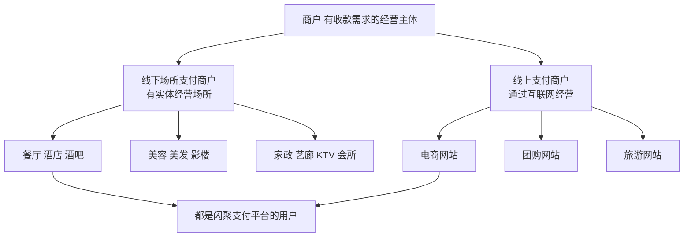
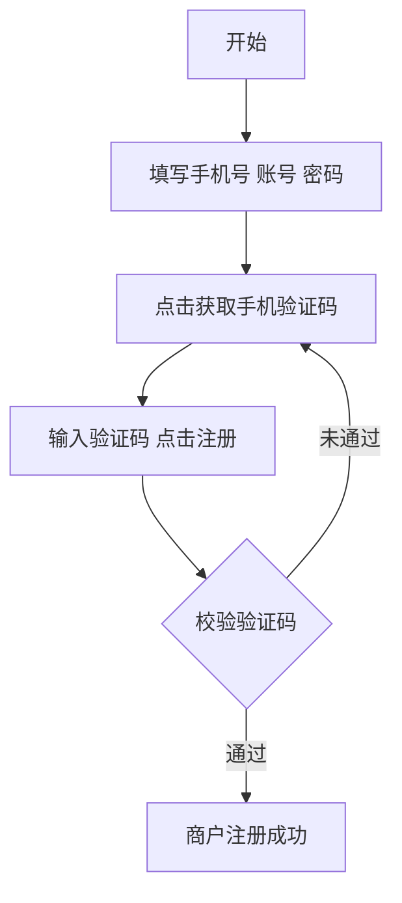

# 商户注册与资质申请：聚合支付平台第一个业务模块的需求全景

环境搭建收尾之后，闪聚支付进入第 2 章，也是第一个真正的业务模块：商户注册与资质申请。很多开发者接到模块任务的反应是直接想代码：用什么框架、什么表、什么接口。顺序其实是反的，需求不清楚就动手，写出来的东西大概率要返工。所谓需求，就是这个系统给用户提供什么功能，反过来讲就是用户能用它完成哪些业务操作。这一课把模块的两块功能、服务的对象、各自的流程讲透，为后面逐个接口的开发立好坐标。

## 先给结论

- 模块要完成两块功能：商户注册与资质申请。注册让商户成为闪聚支付平台的用户，资质审核通过之后，商户才能真正使用平台的支付通道。
- 商户分两类：线下商户有实体经营场所，餐厅、酒店、美容美发都算；线上商户通过互联网经营，电商网站、团购网站、旅游网站都算。凡是有支付需求的地方，都是平台的业务领域。
- 商户注册是四步流程：填写手机号、账号、密码，点击获取手机验证码，输入验证码点击注册，注册成功。短信验证码用于确认「是本人在注册」。
- 资质申请是五步流程：填写资质信息，上传营业执照与法人身份证扫描件，提交，平台运营人员审核，审核通过后完成申请。注册成功不等于能收款，审核通过才是分界线。
- 注册对平台的意义：确定自己的用户是谁，才能提供服务并收取费用，这是平台盈利模式的入口，也是后续 SaaS 多租户体系的起点。

## 需求先于代码

把「先需求后编码」展开说透。企业里经理分配一个模块，常见的错误路径是马上想技术选型：用不用 Redis、要不要分表。这些问题的答案都取决于功能形态，而功能形态取决于需求。需求不清就去设计表结构，等流程理清后表十有八九要改；需求清楚再动手，技术选择往往自然浮现，比如注册要发短信验证码，验证码要有有效期，存储天然指向带过期机制的缓存，这正是后面部署验证码服务与 Redis 的原因。

需求的表述也不玄，落到纸面就是三样东西：功能清单（这个模块有哪几块功能）、业务流程（每块功能分几步、每步谁来做）、参与角色（流程里有几个系统或人员参与）。本章讲义用需求概述与需求分析两节把这三样依次交代，这一课对应前者，功能与流程的层面。

## 商户是谁：线下与线上两类

「商户注册」拆开是两个词，注册好理解，商户需要先定义清楚。直觉里的商户是「卖东西的」，这个理解太窄。以支付业务为线索分析，商户就是有收款需求的经营主体，按经营场所分两类：

线下商户的典型动作是顾客吃完饭扫码付款，C 扫 B 的一码多付服务的就是这批人；线上商户的典型动作是用户在网站下单后完成支付，走的支付途径与线下不同。分类的意义在于后续功能设计的针对性：两类商户都要注册、都要传资质，但支付参数配置与收款形式会分叉。需求阶段把「服务谁」定准，后面的接口设计才不会摇摆。

## 商户注册：四步流程与验证码的位置

注册的体验与用户注册微信没有区别，平台要做的就是把这套熟悉的流程搬进商户平台前端，并在后端接住每一步。完整流程如下：

四个步骤各有明确的责任方：表单填写与按钮点击在前端；获取验证码的请求发给商户平台应用，由后端的验证码服务完成下发；提交注册时后端校验验证码，确认操作者持有这个手机号。验证码在这里回答的是一个安全问题：「怎么证明注册的人真的拥有填写的手机号」，没有这一步，任何人都能拿别人的号码注册，后面的账号体系就失去了根基。校验未通过则回到获取验证码这一步重新来过，页面右侧的操作说明也正是按这四步写的。

站在平台的角度再看一眼「为什么要注册」：注册就是平台确定自己的用户是谁。商户注册成为平台用户之后，平台才谈得上提供服务、收取费用、沉淀经营数据。所以注册不只是一个表单页，它是整个 SaaS 商业模式的第一道门，进门的人会成为后续租户管理、账号管理、权限管理的数据源头。

## 资质申请：注册成功不等于能收款

注册完成后商户还不能使用支付通道。原因很直白：平台要确认接入的是正当经营主体。商户都是具有经营资格的个体或企业单位，这个资格需要用证照证明，于是有了资质申请这一环。讲义里写得很明确：商户在平台注册成功后，需要完善商户信息，将营业执照、申请人身份证以扫描件的形式上传到平台，由平台运营人员对商户资质进行审核，审核通过方可使用平台提供的服务。

资质申请页面的字段结构在课程原型里已经给出，分四个区块：

| 区块 | 字段或操作 | 说明 |
| --- | --- | --- |
| 基本信息 | 企业名称、企业编号、注册地址 | 商户的主体信息 |
| 行业类型 | 下拉选择，如教育 / 职业教育 / IT 教育 | 决定商户所属行业分类 |
| 证件上传 | 企业证件、法人身份证正反面 | 扫描件或照片，审核的核心依据 |
| 联系人信息 | 联系人 | 平台与商户沟通的渠道 |

对应的业务流程是五步：商户填写资质信息，上传营业执照和法人身份证图片，提交资质信息，平台运营人员对资质信息进行审核，审核通过后完成资质申请。前端要开发的是这个表单页与文件上传交互，后端要开发的是资质信息的保存、证件图片的存储与审核状态流转，这些在后续课程里逐个落地，其中证件图片的存储会引出文件服务的接入。

把两块功能连起来看，整个模块的边界就完整了：注册解决「你是谁」，资质申请解决「你是不是正经经营的主体」，两关都过，商户才算真正进入平台的支付体系，才有资格进入后面的应用创建与渠道参数配置。

## 常见误区

- **把商户注册理解为 C 端用户注册。** 错例：按普通 App 注册的思路设计，只留手机号和密码。正解：注册的对象是经营主体，注册只是第一步，紧跟着必须过资质审核，账号体系、租户体系都要按商户维度设计。
- **认为注册成功就能收款。** 错例：注册接口调通后直接去测支付。正解：审核通过之前支付通道是关闭的，注册、资质审核通过、配置渠道参数是依次的前置条件。
- **漏掉线下商户的多样性。** 错例：只按电商网站的形态想象商户。正解：线下场所商户是聚合支付最主要的客群之一，餐厅、美容美发等的收款形式是一码多付，与线上网站的收银台接入是两套场景。
- **跳过需求直接写代码。** 错例：拿到模块就建表写接口，流程理清后发现表结构对不上交互流程。正解：先把功能清单、业务流程、参与角色三样落到纸面，再进入设计与编码。

## 面试可能被问到的问题

1. 面试官追问：「你负责的商户注册模块包含哪些功能？」
   答：两块，商户注册与资质申请。注册让商户填写手机号、账号、密码并通过短信验证码校验后成为平台用户；资质申请让商户上传营业执照与法人身份证扫描件，由平台运营人员审核，审核通过后商户才能使用平台的支付通道。
2. 面试官追问：「平台上的商户怎么分类，为什么要分类？」
   答：按经营场所分线下与线上两类。线下商户有实体经营场所，如餐厅、酒店、美容美发；线上商户通过互联网经营，如电商、团购、旅游网站。分类是因为两类商户的支付场景不同，线下对应一码多付，线上对应收银台接入，后续的支付参数配置与收款形式都要按类型区分。
3. 面试官追问：「注册流程里短信验证码解决什么问题？」
   答：证明注册操作者确实持有填写的手机号，防止冒用他人号码注册。平台下发验证码到手机，商户回填后由后端校验，未通过则重新获取。它同时是后续很多环节的基础手段，比如支付时的验证码确认。
4. 面试官追问：「资质申请审核的是什么，不审核行不行？」
   答：审核商户的经营资格，依据是营业执照与申请人身份证扫描件。不审核的话，任何个人都能注册成商户并接入支付通道，会带来洗钱、二清等合规风险，所以审核通过是使用支付通道的强制前置条件。
5. 面试官追问：「商户注册对聚合支付平台自身的意义是什么？」
   答：注册是平台确定用户的入口。闪聚支付是 SaaS 平台，商户租用平台的支付能力并付费，注册建立的用户关系是租户管理、账号管理、收费与权限分配的数据源头，也是后续统一登录的前提。

## 配套资料

- 讲义：`materials/docs/10/闪聚支付-第2章-讲义-商户注册&资质申请v1.0.md`，1 需求概述（1.1 商户注册含线下与线上商户定义及注册业务流程、1.2 资质申请含五步流程）为本课出处。
- 讲义：`materials/docs/10/闪聚支付-第1章-讲义-项目介绍v1.0.md`，功能模块三块划分与商户侧业务主线，用于说明本模块在整个聚合支付平台中的位置。
- 说明：该阶段课程资料归档在 `materials/docs/10/` 与 `materials/code/10/`（不存在 09 编号目录，引用路径截至该层级）；本课为需求概述，无对应源码包，页面字段表按课程原型画面整理，行业类型等示例值取自课程资料。
