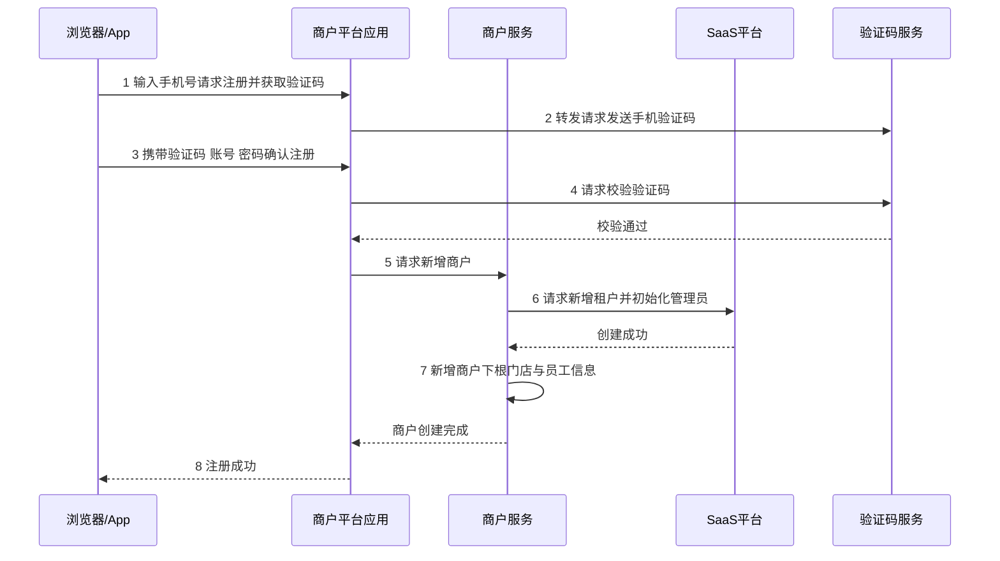

# 商户注册需求分析：五个参与方、八步交互与迭代开发的切法

业务流程理清之后就该进入系统设计了，但很多团队在这里卡住：流程图看得懂，一转成代码就不知道从哪下手。功能设计要回答的其实是一组具体问题：完成整个业务流程，各个服务之间怎么交互、数据结构怎么设计、接口怎么定义。这一课聚焦其中第一样，把商户注册牵涉的每个微服务的职责与交互序列掰开，顺带讲清开发顺序的切法。交互序列定了，每个服务要开发哪些接口也就随之确定。

## 先给结论

- 商户注册的交互流程由五个参与方协作完成：浏览器/App、商户平台应用、商户服务、SaaS 平台、验证码服务。读这类序列图的正确顺序是先弄清每方职责，再逐步看交互。
- 工程命名里藏着一个通用规律：尾缀 application 的应用工程面向前端暴露 RESTful 接口，服务工程对外暴露 Dubbo 接口给应用工程调用，一层面向浏览器，一层面向服务端内部。
- SaaS 平台即多租户系统，商户就是一个租户；它统一管理租户、账号、权限、资源、套餐并承担系统认证授权，商户注册的账号最终要写入 SaaS 平台。
- 注册主线八步：前端请求注册，商户平台应用获取验证码，前端携带验证码确认注册，校验通过后请求商户服务新增商户，商户服务请求 SaaS 平台新增租户并初始化管理员，SaaS 平台返回创建成功后商户服务新增根门店与员工信息，注册成功。
- 开发采用迭代方式：第一步只实现商户信息落商户服务数据库，暂时不与 SaaS 平台交互；等第 2 章全部模块开发完毕再对接 SaaS，届时注册成功即可登录系统。

## 功能设计在设计什么

拿到「商户注册」四个字，直接开写 Controller 是最省事的做法，也是最常返工的做法。商户注册横跨前端、两个应用层服务、一个基础服务与一个平台级系统，不先把交互定下来，任何一方的接口都可能写偏。功能设计就是把业务流程翻译成系统视角的三样东西：交互流程图（谁调用谁、按什么顺序）、数据结构（商户、租户、门店、员工各自怎么建模）、接口定义（每个服务暴露什么方法、入参出参是什么）。本课处理第一样，后两样在具体开发各功能时逐个落地。

序列图的读法值得单独说。图上从上到下的每一步按顺序执行，但这不是重点，重点是每一列代表的一方「在整个流程里承担什么职责」。职责清楚了，即使图上某个箭头没画，也能推断出该谁调谁；职责不清楚，背下步骤也没用，换个场景就不会了。

## 五个参与方各管什么

把五方的职责列成表，序列图就变成了一份可以随时查的分工契约：

| 参与方 | 面向对象 | 协议 | 核心职责 |
| --- | --- | --- | --- |
| 浏览器/App | 最终用户 | HTTP 页面交互 | 展示注册界面，收集手机号、账号、密码与验证码 |
| 商户平台应用 | 前端 | RESTful | 注册入口，校验手机号、转发验证码请求；承载资质申请、员工管理、门店管理等商户侧功能 |
| 商户服务 | 商户平台应用 | Dubbo | 商户管理业务接口的统一收口与持久化，含商户基本信息、资质申请、应用管理、渠道参数配置、员工与门店管理 |
| SaaS 平台 | 商户服务 | 平台接口 | 租户管理、账号管理、权限管理、资源管理、套餐管理、系统认证授权 |
| 验证码服务 | 商户平台应用 | HTTP | 发送短信验证码、校验验证码 |

两个应用层工程的分工用真实代码看更直观。商户平台应用里是面向前端的 RESTful Controller：

```java
package com.study.pay.merchant.controller;

@RestController
public class MerchantController {

    //商户服务通过 Dubbo 注入，应用工程持其引用
    @org.apache.dubbo.config.annotation.Reference
    MerchantService merchantService;

    @GetMapping("/merchants/{id}")
    public MerchantDTO queryMerchantById(@PathVariable("id") Long id) {
        return merchantService.queryMerchantById(id);
    }
}
```

商户服务这边则是在 api 模块定义 Dubbo 接口，service 模块给出实现并注册为 Dubbo 服务：

```java
package com.study.pay.merchant.service;

//Dubbo 注解：把实现注册为 RPC 服务，供应用工程以 @Reference 调用
@org.apache.dubbo.config.annotation.Service
public class MerchantServiceImpl implements MerchantService {

    @Autowired
    MerchantMapper merchantMapper;

    @Override
    public MerchantDTO queryMerchantById(Long id) {
        Merchant merchant = merchantMapper.selectById(id);
        MerchantDTO merchantDTO = new MerchantDTO();
        merchantDTO.setId(merchant.getId());
        merchantDTO.setMerchantName(merchant.getMerchantName());
        return merchantDTO;
    }
}
```

这两个工程在环境搭建阶段已经建好，Controller 与 Dubbo 实现各司其职的样子就是全体微服务结构的缩影。接下来把注册主线走一遍，五方如何接力一目了然：



关键路径在第 5、6 步的先后：先向 SaaS 平台建立租户与账号，拿到创建成功后再补商户自己的门店与员工初始化，因为门店、员工都挂在租户之下，这个顺序不能颠倒。图上 SaaS 侧还涉及账号权限分配等细节，属于对接 SaaS 时才展开的内容，本阶段先整体认识。

## SaaS 平台与多租户

SaaS 对没接触过的同学是个新词，拆开讲很简单。闪聚支付给商户提供支付能力，商户为什么用它？因为商户不想自己开发一套收银与对账系统，租用现成的比自己买服务器、养开发团队省钱得多。多个商户租用同一套平台的业务功能，每个商户就是一个租户，这样的系统就叫多租户系统。随着云计算普及，除了对数据安全与定制性要求极高的企业，一般企业越来越倾向租用云上的 SaaS 模块来支撑业务。

落到系统职责上，SaaS 平台统一管理租户信息、租户账号、权限与整个系统的资源，负责给商户分配套餐并承担系统级认证授权。对本模块最直接的影响是：商户注册成功的账号要写入 SaaS 平台，由它统一管理，商户之后统一通过 SaaS 平台登录闪聚支付。理解了这一点就理解了为什么注册流程会伸到平台层，账号体系不能各服务各建一套，否则登录、权限、套餐就没法统一管。

## 迭代开发：先商户库，后 SaaS 平台

五方协作的注册流程完整写下来工程量不小，一步到位地全部实现并不是好选择。项目采用迭代开发：开发一部分、测试一部分，甚至上线一部分再继续开发，让问题尽早暴露，整体效率反而更高。按这个思路，商户注册被切成两步走：

1. 先实现商户信息在商户服务注册成功，信息只写入商户服务的数据库，暂时不与 SaaS 平台交互。前端、商户平台应用、商户服务、验证码服务四方先跑通。
2. 待商户信息注册成功、资质申请通过、支付参数配置完成，再与 SaaS 平台对接。对接前需要部署 SaaS 平台、学习它暴露的接口与认证接口，接通后用户注册成功即可直接登录系统，这部分放在第 2 章的最后实现。

这样切的收益很实际：每一步的可测范围小，Postman 就能验证；SaaS 平台的复杂度被隔离到最后一关，前面所有功能不需要等它就绪。做需求分析时把开发步骤与交互流程一起定下来，后面的编码就有了明确的里程碑。

## 常见误区

- **把商户服务当成面向前端的服务。** 错例：前端直接请求商户服务的接口。正解：前端只对接商户平台应用的 RESTful 接口，商户服务暴露的是 Dubbo 接口，只给应用层工程调用。
- **以为注册功能要一次实现完五个参与方。** 错例：从 SaaS 对接开始动工，迟迟跑不起来。正解：按迭代切法先落地商户信息入库的链路，SaaS 对接放到第 2 章最后。
- **把 SaaS 平台当成需要自己从零开发的服务。** 错例：在商户服务里另起炉灶写账号权限表。正解：SaaS 平台是独立就绪的平台级系统，提供租户、账号、权限、套餐与认证授权，对接时学习其接口即可。
- **看序列图只背步骤不看职责。** 错例：能复述八步却说不清商户服务和商户平台应用的分工。正解：先把每方职责记牢，步骤是职责之间协作的自然结果，接口定义从职责推导。

## 面试可能被问到的问题

1. 面试官追问：「商户注册流程里有哪些服务参与，各自什么职责？」
   答：五个参与方。浏览器/App 负责页面与交互；商户平台应用面向前端暴露 RESTful 接口，承接注册入口与商户侧业务；商户服务通过 Dubbo 接口提供商户管理的业务支撑与持久化；SaaS 平台统一管理租户、账号、权限、套餐并负责认证授权；验证码服务负责短信验证码的发送与校验。
2. 面试官追问：「商户平台应用和商户服务为什么拆成两个工程？」
   答：职责与协议不同。应用工程面向前端，暴露 RESTful 接口，负责参数校验与业务编排；服务工程面向服务端内部，暴露 Dubbo 接口，负责业务逻辑与数据落库。拆开后前端协议与内部 RPC 互不干扰，服务还可以被多个应用工程复用。
3. 面试官追问：「什么是 SaaS 多租户系统？这个项目里商户和租户什么关系？」
   答：SaaS 指多个用户租用平台业务功能，每个用户就是一个租户，因此称多租户系统，用户省去自建软件的成本。本项目里每个商户就是一个租户，注册账号写入 SaaS 平台统一管理，由平台分配权限与套餐，商户统一通过 SaaS 平台登录。
4. 面试官追问：「注册流程为什么先写 SaaS 平台再初始化门店和员工？」
   答：门店、员工、权限都挂在租户之下，租户与账号先在 SaaS 平台建立成功，商户服务才能基于它初始化根门店与员工信息，顺序颠倒会产生悬空的归属关系，后续登录与权限也无法生效。
5. 面试官追问：「为什么采用迭代开发，第一步做什么？」
   答：迭代开发把大流程切成可独立验证的小段，开发一部分测试一部分，问题尽早暴露。第一步只实现商户信息在商户服务注册成功并落商户数据库，暂不与 SaaS 平台交互；待资质申请、支付参数配置完成后，第 2 章最后再对接 SaaS，实现注册即可登录。

## 配套资料

- 讲义：`materials/docs/10/闪聚支付-第2章-讲义-商户注册&资质申请v1.0.md`，2.1 需求分析（2.1.1 系统交互流程含五方职责与八步交互、2.1.2 开发步骤含迭代切法与 SaaS 对接时机）为本课出处。
- 代码：`materials/code/10/`，聚合支付工程的商户平台应用与商户服务两个模块（内层目录名含项目原始命名，与正文包名口径不一致，不在此展开），正文 Controller、Dubbo 接口与实现类为真实文件按 `com.study.pay` 口径改写后的节选。
- 说明：该阶段课程资料归档在 `materials/docs/10/` 与 `materials/code/10/`（不存在 09 编号目录，引用路径截至该层级）；序列图按讲义八步交互绘制，SaaS 平台为课程既有平台，本阶段不展开其内部实现。
