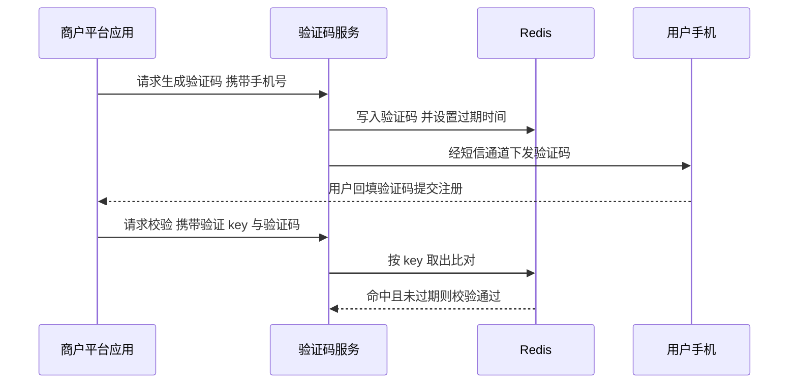
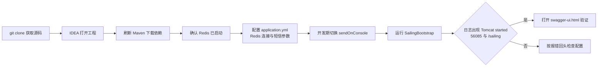
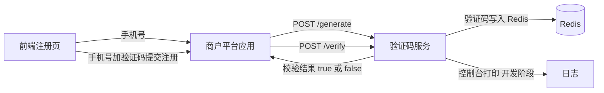

# 商户注册-部署验证码服务三部曲：安装 Redis、部署 sailing 服务、接口黑盒验证

> 🔒 安全提示：文中示例的口令/密钥均为课程教学环境演示口径，生产环境的安全要求见《安全与合规须知》。

## 先给结论

商户注册的验证码服务是三步部署课：先给验证码服务装好依赖的 Redis 并注册成随系统自启的服务，再部署 sailing 验证码服务本身、配好 Redis 与短信参数，最后把它当黑盒测通 generate 与 verify 两个接口。
部署成功的判据贯穿三讲：Redis 装完能用客户端验证，sailing 启动有明确的成功输出，接口测完验证码真实落进 Redis，每一步都有可查的证据。开发期的变通也写明了：控制台输出验证码，跳过短信，先跑通链路。
Redis 认证不一致是部署期最典型的翻车点，第三讲专门还原了一次。按三讲顺序操作即可复现整套环境，每步都给出验证命令与预期输出。
三讲依次是：
- 安装 Redis：安装与前台启动、客户端验证、注册为 Windows 服务。
- 部署和启动：认识 sailing、获取源码导入工程、关键配置与启动判据。
- 接口测试：generate 与 verify 两个接口、验证码在 Redis 里的样子与一次认证翻车。

## 第1部分：验证码服务前置：安装 Redis 并把它注册成随系统自启的服务

需求分析里定下的注册主线，第一步动作是发短信验证码，这个动作由验证码服务完成。部署验证码服务之前有一块绕不开的基石：它依赖 Redis 存取验证码，Redis 不就位，验证码服务起来也是空转。这一课把 Redis 装起来、验证可用、注册成 Windows 服务随系统自启，给下一课部署验证码服务铺好路。

### 验证码服务为什么依赖 Redis

先看验证码服务的定位。发验证码这个能力不是商户注册独有的：商户登录、支付确认、后续很多环节都要发码验码。所以平台不打算在每个业务里重复实现，而是统一由一个验证码服务承担，它接入了腾讯云、阿里云等短信通道，各业务方与它做接口对接即可。这种通用工具型服务在企业里是标准做法，要么选开源方案，要么企业自研一个通用模块，摆在那里谁用谁接，避免每个项目各造一遍轮子。

再看它为什么选 Redis 做存储。验证码的访问模式有三个特征：写入频繁（每次获取验证码都写一条）、校验频繁（每次提交注册都要读一次比对）、生命周期短（过期作废，通常几分钟）。KV 键值结构的 Redis 恰好逐条对上：数据在内存里，读写速度快；键自带过期时间（TTL），到点自动删除，不需要业务代码去清理。一次完整的验证码往返画出来是这样的：



关键路径在校验那一跳：Redis 里按 key 取值，取不到或已过期就判校验失败，过期机制天然承担了「验证码只在短时间内有效」的安全约束。理解了这个存储模型，Redis 在本项目里的角色就清楚了，它是验证码服务的「短期记忆」。

### 安装与前台启动

Redis 官方原生不支持 Windows，课程使用微软维护的 Windows 版本，安装包为 `Redis-x64-3.2.100.zip`，可从发布页下载，课程资料中也已备好一份，解压到某个目录即可使用，无需安装向导。解压出来的就是程序目录，里面有 `redis-server.exe` 服务端、`redis-cli.exe` 客户端与 `redis.windows.conf` 配置文件。

启动需要一个命令行窗口，切换到解压目录后执行：

```bash
# 在 Redis 解压目录下执行：以指定配置文件启动服务端
redis-server.exe redis.windows.conf
```

启动成功的标志是窗口里打印出 Redis 的字符 Logo 与端口信息，能看到它监听在 6379 端口。这个窗口现在扮演的就是 Redis 服务端本体，别关它，关了服务就停了。Linux 版本的安装与启动不在本课范围，思路一致，需要时按发行版自行查阅即可。

### 命令行与图形客户端验证

服务起了，还要证明它能存能取。再开一个命令行窗口，用自带的客户端工具连上去做一次读写：

```bash
# 连接本机 Redis，-h 指定主机，-p 指定端口
redis-cli.exe -h 127.0.0.1 -p 6379

# 写入键值对：key 为 aa，value 为 bb
set aa bb

# 按 key 取出，应返回 "bb"
get aa
```

`set` 成功返回 OK，`get` 返回 `bb`，说明服务可正常使用。如果配置文件里启用了认证（在 `redis.windows.conf` 中把 `requirepass` 的值设置为密码，例如 123456），重启后直接 `get` 会报未认证错误，先用 `auth 123456` 认证再操作即可。密码属于安全项，内网开发环境可按需开启。

黑窗口看数据终归不便，课程还配了一个图形界面客户端 Redis Desktop Manager（资料中的 `redis-desktop-manager-0.9.2.806.exe`，双击安装）。打开后新建连接，主机填本机、端口 6379，连接名随意（如 redis-01），连上后能直接看到键列表与刚才写入的 aa，双击值可以修改并保存，改动立即生效。后文排查验证码相关问题时，用这个客户端看键的存续状态会方便很多，命令行客户端可以功成身退了。

### 注册为 Windows 服务

前台启动最大的问题是那个命令行窗口必须一直开着，不小心关掉，服务就没了，重启机器后还得手动再起。解决办法是把 Redis 注册成 Windows 服务，随操作系统启动而自动启动。注册命令在 Redis 安装目录下执行，格式如下：

```bash
# 注册为 Windows 服务：指定配置文件、服务名与端口
redis-server.exe --service-install redis.windows.conf --service-name redis --port 6379

# 停止与卸载服务（按服务名操作）
redis-server.exe --service-stop --service-name redis
redis-server.exe --service-uninstall --service-name redis
```

三个参数各管一段：`--service-install` 是安装动作，后面紧跟配置文件；`--service-name` 指定服务名，本机已有同名服务时可换一个名字（如 redis01）；`--port` 指定端口，这个数字必须与配置文件里的 `port` 一致，打开 `redis.windows.conf` 能看到 `port 6379`，两处对不上服务起不来。

注册过程最容易翻车的是 `Failed to open the conf file` 这个报错，含义是打开配置文件失败。配置文件路径本身没问题，问题多出在安装目录：路径里含中文时，服务进程按路径找文件会失败。处理办法简单粗暴，把整个 Redis 目录拷到一个纯英文路径下，在新的目录里重新执行注册命令即可。顺带提醒一句，这类长命令尽量整体复制粘贴，手敲时短横线的个数与位置极易出错，粘贴后注意从文档带出来的字符是否有方向不对的横线。

注册成功后打开 Windows 服务列表（右键计算机进入管理，或直接运行 services.msc），能看到名为 redis 的服务，右键启动，启动类型默认为自动，操作系统一开机它就在。最后回到图形客户端连一下、写一个键值对保存成功，服务可用的闭环就完成了。如果一台机器上确需多个 Redis 实例，复制一份配置文件改名并改端口（如 16379），注册时指定对应配置文件、另一个服务名与新端口即可；本项目用一个 6379 的实例足够。
## 第2部分：部署验证码服务 sailing：配好 Redis 与短信参数，一次跑通启动判据

Redis 就位之后，验证码服务本身可以进场了。它是开源项目 sailing，基于 Java 与 Spring Boot 开发，源码拿来即用，平台各微服务今后凡是需要发码验码的地方都和它做接口对接。这一课走完部署全流程：获取源码导入 IDEA，弄清两处关键配置（Redis 连接与短信参数），掌握开发期不发真短信的变通手段，最后按明确的判据确认服务启动成功。

### 认识 sailing：为什么它能直接拿来用

验证码是一个高度同质化的能力：生成随机码、按手机号下发、限时有效、回填比对。sailing 把这套流程做成了通用服务，对外提供两个核心接口，`/generate` 生成验证信息（业务名称、携带参数如手机号、有效期），`/verify` 校验（业务名称、验证 key、验证码）。内部按业务名称路由到不同的处理器，短信数字验证码对应的处理器是 `SmsNumberVerificationHandler`，生成、存取、发送各环节各有组件：验证码与验证 key 的生成器、基于 Redis 的存储组件（`RedisVerificationStore`）、短信发送组件（`sms/qcloud` 下的腾讯云实现）。存储落在 Redis 上，这正是上一课先装 Redis 的原因，验证码连同验证 key 以键值对形式写入并携带过期时间。

服务本身用 Spring Boot 开发，一个引导类加一份配置文件就是它的全部启动要素：

```java
package com.study.pay.sailing;

@SpringBootApplication
public class SailingBootstrap {

    public static void main(String[] args) {
        SpringApplication.run(SailingBootstrap.class, args);
    }
}
```

拿来即用不等于不需要理解。把工程导入 IDEA 后值得把包结构扫一遍，common 下的缓存封装、store 下的存储实现、handler 下的业务处理器、sms 下的短信实现，这条链路弄明白了，后面联调接口时出任何问题都能定位到层。

### 获取源码与导入工程

源码通过 Git 从远程仓库克隆，课程资料包中也备了源码压缩包，解压效果相同：

```bash
# 从远程仓库克隆验证码服务源码
git clone https://github.com/fightingape/sailing.git
```

把源码目录复制到自己的代码目录，用 IDEA 打开。工程是标准 Maven 结构，打开后 IDEA 会按 pom 解析依赖，此时要等 Maven 把依赖下载到本地仓库，右下角进度条走完、项目不报红线再进行下一步。基础环境在指南里写得很明确：Java 1.8 以上、Maven 3.3.9 以上，加上一个已启动的 Redis。

### 关键配置：Redis 连接与短信参数

sailing 的所有可变项都收在 `application.yml` 里，部署时要过一遍的核心内容如下（密钥类字段按课程口径以占位符书写，实际使用时填自己的值）：

```yaml
server:
  port: 56085
  servlet:
    context-path: /sailing

spring:
  application:
    name: sailing
  redis:
    host: localhost
    port: 6379
    timeout: 10000
    lettuce:
      pool:
        max-idle: 8
        min-idle: 0
        max-active: 8
        max-wait: 10000
    # Redis 密码，与 redis.windows.conf 中 requirepass 一致，课程环境为 123456
    password: 123456

sms:
  qcloud:
    # 以下四项生产环境由短信服务提供：SDKAppID、AppKey、模板 ID、签名
    appId: example-appid
    appKey: example-key
    templateId: 0
    sign: 签名

swagger:
  enable: true

logging:
  config: classpath:log4j2.xml
```

两处是重点。Redis 一处，host 与 port 指向上一步装好的服务，本机环境就是 localhost 加 6379；若 Redis 开了认证，这里的 password 必须与之匹配，否则启动后第一次读写验证码就会报认证失败。短信一处，`sms.qcloud` 下的四个参数决定验证码怎么发出去，它们的来源是腾讯云短信服务：注册账号开通短信服务后获取 SDKAppID 与 AppKey，再申请签名与正文模板并通过审核。签名申请通常要求拥有已备案的域名，而域名备案主体是企业，学生与个人开发者一般不具备条件，所以这四项在开发阶段可以完全不理会，走下面的变通方案即可；企业里这一步由运维完成，参数拿到后填进这份 yml，真实短信通道即接通。

### 开发期的变通：控制台输出验证码

开发时没有短信服务，验证码怎么「发」？答案藏在短信处理器里。`SmsNumberVerificationHandler` 的 `confusion` 方法是验证码下发的出口，真实代码里保留了两条路：

```java
package com.study.pay.sailing.handler;

@Override
String confusion(Map<String, Object> payload, String key, String code) {
    String mobile = String.valueOf(payload.get("mobile"));

    // 生产路径：使用腾讯云短信通道发送（开发期保持注释）
    // smsService.send(mobile, code, getEffectiveTime());

    // 开发路径：不真正发短信，把验证码打印到控制台
    smsService.sendOnConsole(mobile, code, getEffectiveTime());
    return null;
}
```

两条路二选一：注释掉腾讯云的 `send`、放开 `sendOnConsole`，服务运行时验证码会直接输出在 IDEA 控制台，开发者看得见值，注册联调就能往下走。课程资料包里的源码已经按这个状态改好；从仓库克隆的原版则是 `send` 生效，需要手动对调这两行的注释状态。这个变通的本质是把「短信通道」抽象成可替换的实现：控制台输出与云通道发出对上层完全透明，等生产参数就位，把注释对调回去即可，业务代码一行不动。有效期方面处理器默认 300 秒，验证码五分钟内有效，过期由 Redis 的过期机制兜底。

### 启动与成功判据

配置齐了就可以启动：在 IDEA 里打开 `SailingBootstrap`，运行其 main 方法。Spring Boot 应用启动是否成功有非常明确的判据，日志末尾出现这两行即通过：

```bash
# 启动成功的关键日志
Tomcat started on port(s): 56085 (http) with context path '/sailing'
Started SailingBootstrap in 3.224 seconds (JVM running for 4.01)
```

第一行说明内嵌 Tomcat 起来了，监听 56085 端口且上下文路径是 `/sailing`；第二行的 Started 加引导类名是 Spring Boot 应用装配完成的标志。日志之后可以再用浏览器访问 `http://localhost:56085/sailing/swagger-ui.html`，配置里 `swagger.enable: true` 已打开文档能力，页面能出接口列表就是服务可用的实证。整条部署主线串起来是：



服务起来之后，它就是一个监听 56085 端口、随时可被调用的 HTTP 服务。下一步就是拿 Postman 或页面去调 `/generate` 与 `/verify`，请求体携带手机号（示例值用占位形式，如 `"138xxxxxxxx"`），控制台拿到验证码后回填校验，商户注册的验证码链路即全部打通，接口的具体调用方式在后面的课程里展开。
## 第3部分：验证码服务当黑盒用：generate 与 verify 两个接口测通，验证码落进 Redis

商户注册的第一步是短信验证码：用户填手机号、点「获取验证码」，手机收到验证码后提交注册。这条链路里真正发验证码的不是商户服务，而是一个独立的验证码服务。课程没有自己实现它，而是引入了一个开源项目（服务名 sailing）直接部署使用。对调用方来说，问题随之而来：这个服务的内部代码要不要读？验证码怎么生成、存哪里、怎么校验？如果连它暴露什么接口都没测通，后续用 Java 程序去调用就是空中楼阁。这一课把定位讲清：把它当黑盒，注意力放在接口上，测通两个接口，再顺手打开 Redis 看看验证码到底长什么样。

### 验证码服务在注册链路里的位置

为什么是两个接口？把注册流程走一遍就清楚了。前端填手机号点「发送验证码」，请求最终落到验证码服务的生成接口，验证码发往手机（开发阶段打到控制台）；用户把验证码填进注册页面点提交，商户平台应用在处理注册时又要调验证码服务的校验接口，确认用户输入无误，才继续新增商户。两个接口正好对应「发」与「验」两个动作：



图的左半圈是发送：验证码服务生成验证码、写入 Redis、给出 key；右半圈是校验：商户平台应用拿着用户提交的验证码和当初的 key 回来对答案。整条链路的每一跳都是 HTTP 接口，所以接口参数的含义必须一次搞清楚，后面写调用程序时用的就是同一套参数。

### 生成验证信息：/generate 接口

接口定义在验证码服务的 Controller 里，方法映射与参数一目了然：

```java
@ApiOperation(value = "生成验证信息", notes = "生成验证信息")
@ApiImplicitParams({
        @ApiImplicitParam(name = "name", value = "业务名称", required = true, dataType = "String", paramType = "query"),
        @ApiImplicitParam(name = "payload", value = "业务携带参数，如手机号，邮箱", required = true, paramType = "body"),
        @ApiImplicitParam(name = "effectiveTime", value = "验证信息有效期(秒)", required = false, dataType = "String", paramType = "query")
})
@PostMapping(value = "/generate")
public RestResponse<VerificationInfo> generateVerificationInfo(@RequestParam("name") String name,
                                                               @RequestBody Map<String, Object> payload,
                                                               @RequestParam("effectiveTime") int effectiveTime) {
    VerificationInfo verificationInfo = verificationService.generateVerificationInfo(name, payload, effectiveTime);
    return RestResponse.success(verificationInfo);
}
```

三个参数各有含义：`name` 是业务名称，决定用哪种验证码方式，发短信固定写 `sms`，图片验证码是 `img`，邮件是 `mail`，本课只关心 `sms`；`payload` 放在请求体里，是 JSON 格式的业务参数，发短信时写手机号，形如 `{"mobile": "13xxxxxxxxx"}`；`effectiveTime` 是有效期，单位是秒，测试时填 `600` 即十分钟。

在 Swagger 文档页 `http://localhost:56085/sailing/swagger-ui.html` 点开 `/generate` 接口，Try it out 填入参数执行，等价于这样一条命令：

```bash
curl -X POST "http://localhost:56085/sailing/generate?effectiveTime=600&name=sms" \
  -H "Content-Type: application/json" \
  -d "{\"mobile\": \"13xxxxxxxxx\"}"
```

执行成功后响应体是这样的结构：

```json
{
  "code": 0,
  "msg": "正常",
  "result": {
    "key": "sms:1c7f2c9d4a344d559e0fa1b2c3d4e5f6",
    "content": null
  }
}
```

`code` 为 0、`msg` 为「正常」说明发送流程没问题；`result.key` 是这一步最重要的产出，校验时必须带上它；`content` 是「混淆内容」，图片验证码场景下放图片的 base64 编码，短信场景为 null。响应回来并不意味着手机收到了短信，开发阶段的验证码输出在验证码服务的控制台，日志形如「给手机号 13xxxxxxxxx 发送验证码：xxxxxx」，这串六位数字就等价于发到你手机上的验证码。之所以这样处理，是因为课程环境没有申请到云短信服务，等上线联调时再把真实发送的代码放开即可，源码里两行代码切换发送方式：

```java
String mobile = String.valueOf(payload.get("mobile"));
// 使用云短信服务发送（需开通短信服务并配置签名、模板）
// smsService.send(mobile, code, getEffectiveTime());
// 测试使用，在控制台输出验证码
smsService.sendOnConsole(mobile, code, getEffectiveTime());
return null;
```

### 校验验证码：/verify 接口与 key 的来历

校验接口同样是 POST，三个参数全部走 query 方式：`name` 固定 `sms`，`verificationCode` 是用户输入的验证码，`verificationKey` 是发送时服务端响应的那个 key。这里要回答一个关键问题：验证码服务凭什么判断「610060」这种六位数字对不对？依据就是 key。发送验证码时，服务端生成了 key 与验证码的对应关系存进 Redis，并且把 key 返回给了调用方；校验时调用方把 key 和验证码一起交回来，服务端按 key 取出当初的验证码比对，答案对得上才算通过。

在 Swagger 页面把三个参数填进去测试：key 用刚才响应里的那串，验证码从验证码服务控制台抄过来，执行后响应的 `result` 为 `true`，校验通过。换成错误答案再测一遍：验证码末位改一个数字，响应仍是 `code` 0 与「正常」，但 `result` 变成 `false`，表示校验失败。注意区分两层含义：HTTP 请求成功与业务校验通过是两回事，接口层永远「正常」，对错只看 `result`。故意把 key 填成别的值也一样是 `false`，因为 Redis 里根本取不到对应的验证码。

### 验证码落在 Redis 里长什么样

验证码服务的存储策略可以直接打开 Redis 验证。用 Redis 客户端连上本机 6379，发送一次验证码后刷新键列表，会看到一条新记录：key 就是 `/generate` 响应里的那串 `sms:` 加 UUID 的字符串，value 是六位数字验证码，键带有 600 秒的过期时间。对应的写入口径在源码里能对上，存储组件最终走的是 `StringRedisTemplate` 的键值操作：

```java
// key 为 sms: 前缀加无横线 UUID，value 为验证码，expire 为有效期（秒）
redisTemplate.opsForValue().set(key, value, expire, TimeUnit.SECONDS);
```

看到这里，「不知道内部实现」的黑盒其实已经透明了一半：校验接口做的事，无非是拿 `verificationKey` 执行一次 `get`，再与提交的验证码比对，过期取不到值就判失败。掌握这个事实还有工程上的用处：排查「用户说没收到验证码」之类的问题时，不必猜，直接查 Redis 里有没有那条键值、还剩多少 TTL，证据链立刻清楚。

### Redis 认证不一致：一次典型的部署翻车

测试过程里出现了一次真实的报错：接口一执行，验证码还没落库，服务日志先炸出连接池异常，核心信息是 `io.lettuce.core.RedisConnectionException: Unable to connect to localhost:6379`，Redis 服务端一侧则报「客户端发送了 AUTH，但服务端未设置密码」。翻译过来就是：验证码服务的配置里给 Redis 连接带了密码，而 Redis 服务端那边没有开启认证，两端对不上，连接池拿不到连接。

处理方式是让两端一致。验证码服务的 `application.yml` 里 Redis 的主机、端口、密码按课程环境写好，密码沿用环境约定 `123456`：

```yaml
spring:
  redis:
    host: localhost
    port: 6379
    password: 123456
```

Redis 服务端在配置文件里找到 `requirepass` 参数，去掉行首注释符与空格，设置同样的密码后重启 Redis 生效。这一步属于部署层面的基本功，细节以课程提供的 Redis 安装部署文档为准，动手时重点记两条：生产环境 Redis 必须开启认证；客户端、图形化管理工具、应用配置三处的密码必须与服务端一致，任何一处不匹配，表现都是连接池异常。重启验证码服务再测 `/generate`，响应正常，Redis 里出现验证码键值，才算真正测通。
## 常见误区

- **以为 Redis 要走安装向导。** 错例：找不到 setup.exe 不知从何下手。正解：Windows 版是绿色包，解压即用，`redis-server.exe` 加配置文件就是启动。
- **前台窗口一关就当服务还在。** 错例：验证完 `set`、`get` 就关闭窗口，回头连接报无法连接。正解：前台进程随窗口退出而终止，长期使用必须注册为 Windows 服务。
- **`--port` 与配置文件端口不一致。** 错例：命令写 `--port 6380`，配置文件里仍是 6379，注册后启动失败。正解：两处端口保持一致，多实例场景则先复制配置文件改出独立端口再注册。
- **安装目录含中文导致注册报错。** 错例：目录放在中文路径下，执行 `--service-install` 报 `Failed to open the conf file`。正解：把 Redis 目录移到纯英文路径重新注册。
- **跳过验证直接进入下一步。** 错例：服务起没起、能不能存取都没确认，就接着部署验证码服务，出问题时两头排查。正解：`set`、`get` 读写通过后再往下走，每层环境单独验收。
- **不确认 Redis 就启动服务。** 错例：Redis 没起或密码不匹配，服务能启动，一调接口就报连接或认证异常。正解：先 `redis-cli` 验证 Redis 可读写，再对齐 yml 里的 host、port 与 password。
- **依赖没下载完就运行。** 错例：IDEA 刚打开工程就点 main 方法，满屏红线编译不过。正解：等 Maven 依赖解析完成、无编译错误再启动。
- **开发期忘了切换 sendOnConsole。** 错例：保留腾讯云 `send` 生效，本地没配短信参数，调试时验证码石沉大海。正解：注释 `send`、放开 `sendOnConsole`，从控制台读验证码。
- **漏看 context-path 导致判据误判。** 错例：日志显示启动成功，访问 `http://localhost:56085/swagger-ui.html` 却是 404。正解：context-path 为 `/sailing`，完整地址是 `http://localhost:56085/sailing/swagger-ui.html`。
- **把短信四参数当成开发前置条件。** 错例：卡在申请签名与模板上，迟迟不动手。正解：签名需要备案域名，属生产项，开发期用控制台输出方案即可，参数由运维在生产接入时提供。
- **把 key 当成验证码本身。** 错例：看到响应里的 `key` 就以为这是要填给用户的验证码。正解：`key` 是校验凭证，随响应返回、由调用方保管；验证码是发给用户的六位数字，开发阶段在验证码服务控制台查看，两者缺一不可。
- **忽略 HTTP 成功与业务校验成功的区别。** 错例：`/verify` 响应 `code` 为 0 就认为验证码校验通过。正解：接口调用成功只代表流程走通，对错看 `result` 布尔值，注册逻辑必须以 `result` 为准。
- **认为开发阶段会真发短信。** 错例：等手机短信等到怀疑人生。正解：未开通云短信服务时验证码走控制台输出，源码中注释切换即可，联调上线再放开真实发送。
- **Redis 认证两端不一致仍反复重启应用。** 错例：看到连接池异常就重启验证码服务，问题原样复现。正解：核对 Redis 服务端 `requirepass` 与应用配置、管理工具三处密码是否一致，改齐再重启。
- **给 `effectiveTime` 随手填分钟数。** 错例：想设十分钟有效期就填 10。正解：该参数单位是秒，十分钟要填 600。

## 面试可能被问到的问题

1. 面试官追问：「验证码服务为什么用 Redis 存验证码，而不是 MySQL？」
   答：验证码的访问模式是高频写、高频读、短生命周期。Redis 基于内存读写远快于磁盘数据库，KV 结构与验证码的 key、value 天然对应，键过期机制（TTL）自动实现验证码限时有效，MySQL 则需要额外的定时清理，整体成本高且性能不匹配。

2. 面试官追问：「Redis 的 set 和 get 命令分别做什么？」
   答：`set key value` 向 Redis 写入一个键值对，成功返回 OK；`get key` 按 key 读取对应 value，不存在则返回 nil。写入时还可以用 `set key value ex 秒数` 直接携带过期时间，验证码存储正是这种用法。

3. 面试官追问：「Windows 下怎么把 Redis 做成开机自启的服务？」
   答：进入 Redis 安装目录执行 `redis-server.exe --service-install redis.windows.conf --service-name 服务名 --port 端口` 注册为 Windows 服务，端口参数必须与配置文件里的 port 一致；注册后在服务列表右键启动，启动类型设为自动即随系统自启；卸载用 `--service-uninstall` 加服务名。

4. 面试官追问：「注册 Redis 服务时报 Failed to open the conf file，可能是什么原因？」
   答：最常见的是安装路径包含中文，服务进程按路径打开配置文件失败；把 Redis 目录整体移到纯英文路径后重新注册即可。其次检查配置文件名是否拼写正确、命令里端口参数是否与配置文件一致。

5. 面试官追问：「一台机器上能跑多个 Redis 实例吗？」
   答：可以。复制一份配置文件改名，修改其中的 port（如 16379），再用 `--service-install` 指定新配置文件、新服务名与新端口注册另一个服务即可。核心约束是各实例端口不能重复，多实例常用于隔离不同业务的缓存。

6. 面试官追问：「验证码服务为什么可以直接引入开源项目？」
   答：验证码是通用工具型能力，生成、存储、下发、校验的流程高度同质化，开源方案已把短信通道接入、有效期管理、key 生成等细节封装完整。企业对这类非核心差异化的能力通常直接复用开源或自研通用模块，业务方按接口对接，避免重复造轮子。

7. 面试官追问：「接入腾讯云短信需要准备哪些参数？」
   答：四样：开通短信服务后获取的 SDKAppID 与 AppKey，审核通过的短信签名，审核通过的正文模板 ID。签名申请一般要求有已备案域名，通常由企业主体完成。四项配置到服务的 application.yml 中，即可从控制台输出切换为真实发码。

8. 面试官追问：「开发阶段没有短信服务，怎么验证码流程联调？」
   答：把短信处理器的发送方法切换为控制台输出实现，验证码不经过短信通道直接打印在应用日志里，开发者从控制台取码完成回填校验。由于短信发送被抽象成独立组件，这种替换不影响上层业务逻辑，生产换回真实通道时业务代码零改动。

9. 面试官追问：「怎么判断一个 Spring Boot 应用启动成功了？」
   答：看日志两处，内嵌 Tomcat 的启动信息（端口与 context-path）和应用引导类的 Started 完成标志；再按实际地址访问一个已知端点做功能验证，如本服务的 Swagger 文档页。只看进程没退出是不够的，装配失败、端口占用都会以异常形式呈现在日志里。

10. 面试官追问：「sailing 里 Redis 承担什么角色？」
   答：验证码的短期存储。生成验证码时写入验证 key 与验证码的键值对并携带过期时间，校验时按 key 取值比对，命中且未过期即通过。验证码生命周期只有几分钟，Redis 的内存读写速度与键过期机制恰好匹配，省去了业务侧的清理逻辑。

11. 面试官追问：「短信验证码为什么不存数据库或 Session，而存 Redis？」
   答：验证码是短生命周期的小数据，Redis 的键值模型加过期时间（TTL）天然匹配这个场景：写入即设有效期，到期自动删除，无须清理任务。存数据库要建表、写索引、定时清理过期数据；存 Session 又绑定了单台应用的会话，微服务多实例下不通用。Redis 独立部署，任何服务都能按 key 读取，最适合验证码这类跨服务的临时凭证。

12. 面试官追问：「发送接口返回的那个 key 有什么作用？」
   答：它是校验阶段的凭证。服务端生成验证码时同时生成一个唯一 key，把 key 到验证码的映射写入 Redis 并返回给调用方；用户提交注册时，调用方把用户输入的验证码连同这个 key 一起交给校验接口，服务端按 key 取出当初的验证码比对。用 key 而不用手机号做依据，可以避免同手机号多次发送时的状态混淆，也避免把手机号这类敏感信息当作检索键暴露在校验请求里。

13. 面试官追问：「验证码服务的接口为什么要设计 name 参数？」
   答：name 是业务名称，用来选择验证码的处理方式，短信是 sms、图片是 img、邮件是 mail。服务内部按 name 路由到不同的处理器，处理器各自决定验证码的生成规则、存储与发送方式。这样一个服务用一套接口覆盖多种验证码场景，调用方换验证码类型时只换参数，接口形态不变。

14. 面试官追问：「接入一个开源服务，你的上手路径是什么？」
   答：先跑起来再谈原理。部署依赖环境、起服务、找它暴露的接口文档（Swagger 页面或接口说明），把核心接口用工具手动调通一遍，弄清每个参数与响应结构；确认行为符合预期后，再按需阅读关键源码。这个项目里验证码生成、Redis 存储、校验比对的核心逻辑都集中在抽象处理器模板与存储实现两个类里，黑盒测通后想看实现，目标也非常集中。

15. 面试官追问：「生产环境验证码接口要做哪些安全加固？」
   答：课程环境控制台打验证码、无频控，属于开发态；生产上至少要做几层：发送侧加频率限制与图形验证码前置，防止短信被恶意刷量；验证码本身要有有效期并尽量做到一次有效，校验失败次数超限作废；云短信的密钥通过配置中心管理并妥善保密；Redis 必须开启密码认证。这些属于行业通行做法，落地时结合具体框架扩展。

## 配套资料

- 讲义：`materials/docs/10/Redis安装指南.md`，1 安装 Redis（下载解压、`redis-server.exe redis.windows.conf` 启动、`redis-cli` 测试、requirepass 认证）、2 Redis 客户端（Redis Desktop Manager）、3 注册为本地服务（安装、启动、停止、卸载命令）、4 多 Redis 服务注册为本课出处。
- 讲义：`materials/docs/10/验证码服务使用指南.md`，1.1 基础环境（Java 1.8+、Maven 3.3.9+）与 1.2 安装 Redis 的依赖关系说明为本课出处。
- 代码：`materials/code/10/Redis-x64-3.2.100/`，Windows 版 Redis 程序目录（含 `redis.windows.conf`、`redis.windows-service.conf`）为课程资料包中的真实安装包内容。
- 说明：该阶段课程资料归档在 `materials/docs/10/` 与 `materials/code/10/`（不存在 09 编号目录，引用路径截至该层级）；图形客户端安装包与 Redis 安装包以课程资料为准，Redis 密码按课程环境口径 123456，验证码存储的 key 设计在下一课部署验证码服务时展开。
- 讲义：`materials/docs/10/验证码服务使用指南.md`，1.3 部署验证码服务（下载源码、IDEA 打开项目、开通腾讯云短信服务、控制台获取验证码、启动服务）为本课出处，2 使用验证码服务供后续接口课程使用。
- 讲义：`materials/docs/10/闪聚支付-第2章-讲义-商户注册&资质申请v1.0.md`，2.2 部署验证码服务的定位说明（开源项目、接入腾讯阿里短信接口）为本课出处。
- 代码：`materials/code/10/sailing/sailing/`，验证码服务工程（内层目录与包名含项目原始命名，与正文 `com.study.pay.sailing` 口径不一致，不在此展开），正文引导类、`application.yml` 与短信处理器为真实文件按课程口径改写后的节选。
- 说明：该阶段课程资料归档在 `materials/docs/10/` 与 `materials/code/10/`（不存在 09 编号目录，引用路径截至该层级）；短信 appId、appKey 按 example-appid、example-key 占位，示例手机号以 138xxxxxxxx 占位，启动日志时间数值取自课程指南示例。
- 讲义：`materials/docs/10/验证码服务使用指南.md`，1 部署验证码服务（基础环境、部署步骤、控制台获取验证码、启动服务）与 2 使用验证码服务（2.1 发送验证码、2.2 校验验证码的参数表与返回说明）为本课出处。
- 讲义：`materials/docs/10/Redis安装指南.md`，Redis 安装与认证配置的部署文档，本课 Redis 密码问题的处理依据。
- 代码：`materials/code/10/sailing/`，验证码服务开源工程，含 `VerificationController`、`AbstractVerificationHandler`、`SmsNumberVerificationHandler`、`RedisVerificationStore` 与 `application.yml`（内层目录名与正文包名口径不一致，按用途自取），正文代码为真实文件按 `com.study.pay` 口径改写后的节选。
- 说明：验证码示例以 `xxxxxx` 占位、手机号以 `13xxxxxxxxx` 占位，课程演示中每次发送均为随机六位数字；Redis 密码按课程环境约定 123456；短信服务密钥一律以 example-appid、example-key 占位。
