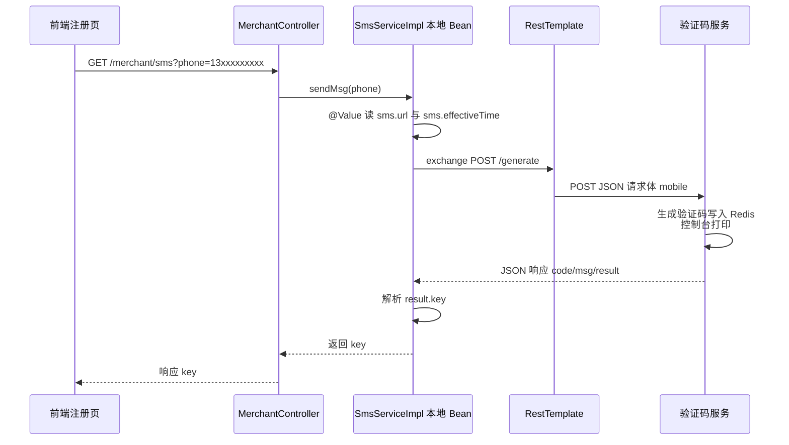

# 获取短信验证码接口全流程：Controller 定接口、Service 写实现、Postman 验闭环

> 🔒 安全提示：文中示例的口令/密钥均为课程教学环境演示口径，生产环境的安全要求见《安全与合规须知》。

RestTemplate 已经能在测试代码里调通验证码服务，但测试代码不等于功能。用户在注册页点「获取验证码」时，请求要打到商户平台应用自己暴露的 HTTP 接口上，由这个接口在服务端内部转发给验证码服务。把测试代码转正成业务功能，要连答三个问题：接口定义成什么形状，前端才知道怎么调；业务逻辑放在哪一层，代码才立得住；测试怎么验，才能确认整条链路真的通了。这一课把这三问一次答完，走完从接口定义、Service 实现、配置外置到 Postman 联调的全流程。

## 先给结论

- 接口形态：`GET /sms?phone=手机号`，写在商户平台应用的 `MerchantController` 里，用 Swagger 注解把用途与参数写进文档，响应内容是验证码对应的 key。
- 业务逻辑下沉到本地 Service：`SmsService` 接口定义 `sendMsg(phone)`，实现类用 `@Service` 注册为本地 Bean，Controller 以 `@Autowired` 注入；它与 `@Reference` 注入的 Dubbo 远程接口是两种完全不同的调用通道。
- 验证码服务地址与有效期不写死在代码里：`sms.url`、`sms.effectiveTime` 配在 Nacos 的 `merchant-application.yaml`，代码里 `@Value` 注入，换环境只改配置。
- 实现套路承袭测试代码：拼 URL、装 JSON 请求体与 `application/json` 请求头、`exchange` 发 POST、从响应里解析 `result` 下的 `key`；请求与解析两段都补了异常兜底。
- 测试认四样证据：Postman 响应里的 key、验证码服务控制台打印的验证码、Redis 里新增的验证码键值、key 与 Redis 键名相互对应。

## 接口定义：给前端一个什么形状的接口

交互流程在需求分析时就定过型：前端获取用户输入的手机号，向商户平台应用请求发送验证码；商户平台应用向验证码服务发起请求并拿到响应；随后向前端响应发送结果。三步里第一步与第三步就是本接口的边界。接口形状由此推出来：入参是手机号，出参是什么？

直觉答案是「已发送」三个字，但项目选了更有信息量的设计：把这个接口拿到的 key 响应给前端。回顾验证码服务的规则，校验验证码必须凭「key 加验证码」这对组合，而 key 是发送时服务端返回给调用方的。调用方现在就是商户平台应用，把 key 转手交给前端暂存，用户提交注册时连同输入的验证码一起回传，注册逻辑才有校验的依据。所以接口响应值是 String 类型的 key，不是一句状态文案。

定义落在 `MerchantController` 里。先看最终形态：

```java
@Autowired //注入本地的 bean
SmsService smsService;

@ApiOperation("获取手机验证码")
@GetMapping("/sms")
@ApiImplicitParam(value = "手机号", name = "phone", required = true, dataType = "string", paramType = "query")
public String getSMSCode(@RequestParam("phone") String phone) {
    //向验证码服务请求发送验证码
    return smsService.sendMsg(phone);
}
```

拆开看每个决策。方法用 GET：语义上这是「获取验证码」的读取动作，参数只有一个手机号，用查询串携带最自然，`paramType = "query"` 在文档里就把参数表达为问号带参的形式；`@RequestParam("phone")` 保证参数名精确对上，`required` 与类型信息交给 `@ApiImplicitParam` 描述，前端打开文档一目了然。路径定为 `/sms`，配合商户平台应用既有的 context-path，完整地址是 `http://localhost:57010/merchant/sms`。写到这里方法体可以先返回 null，把工程起起来访问文档页，新接口立刻出现在「商户平台应用接口」分组下，说明对外契约已就位。定义与实现分离着推进，每一步都可验证，而不是憋一个大招一次调通。

## Service 分层：业务逻辑为什么不写在 Controller

Controller 里现在只有一个转发调用，真正的活儿在后面：拼请求、发请求、解析响应，这是成块的业务逻辑。把它们直接写进 Controller 方法体不是不行，而是不好：Controller 的职责是接收请求、校验入参、组织响应，塞进远程调用与解析细节后，它既臃肿又难以复用，将来其他地方也要发验证码（比如换绑手机），逻辑无处安放。标准做法是下沉到 Service 层，Controller 只认 Service 接口。在商户平台应用工程里新建 `service` 包，先立接口：

```java
public interface SmsService {

    /**
     * 发送手机验证码
     * @param phone 手机号
     * @return 验证码对应的 key
     */
    String sendMsg(String phone);
}
```

再写实现类。注意这里的 `@Service` 注解是 Spring 的本地 Bean 注册，与工程里那个 Dubbo 服务提供者的 `@Service` 不是一回事：

```java
@org.springframework.stereotype.Service //实例为一个 bean
@Slf4j
public class SmsServiceImpl implements SmsService {

    //实现见下一节
}
```

此刻 Controller 里出现了两种注入，值得放在一起对照清楚。`@org.apache.dubbo.config.annotation.Reference` 标在 `MerchantService` 上，注入的是注册中心里远程商户服务的代理，调用它是一次跨进程的 RPC；`@Autowired` 标在 `SmsService` 上，注入的是本工程内部的 Bean，调用它是普通的方法调用，不涉及网络。一个在找远方的服务，一个在找身边的组件，注解不同、通道不同、排障思路也不同。分清这两者，是读懂这个 Controller 的钥匙。RestTemplate 也一样，启动类里定义好的那个 Bean 在这里直接注入使用，测试课的基建成果全部无缝转入业务。

分层之后还有一层隐形收益：替换成本。验证码的发送方式从「控制台打印」切到「云短信」，动的是验证码服务那一侧；商户平台应用里改动的只会是 Service 实现的细节，接口定义、Controller、前端调用全都不用跟着动。层与层之间靠接口隔离，改动能被圈在最小的范围里，这正是分层架构买的东西。



图里纵向每一跳都是可以打断点的位置，也是测试时要逐一核对的位置。还有一个容易被忽略的细节藏在第二跳：`SmsServiceImpl` 里的 `@Value` 注入发生在 Bean 装配阶段，`sendMsg` 执行时 `url` 与 `effectiveTime` 已是配置里的现成值，所以配置改完必须重启应用才生效（此课程版本未开动态刷新）。分层的意义在这张时序图里看得最直观：Controller 只负责两端，中间的远程调用细节全部收进 Service，将来复用或替换验证码发送方式，动的只是 Service 实现。

## 接口实现：配置外置、请求拼装、响应解析、异常兜底

实现 `sendMsg` 的第一件事不是写代码，而是回答「URL 和有效期从哪来」。测试代码里它们是硬编码的字符串，业务代码里这样写等于埋雷：验证码服务换了主机端口、产品决定调整有效期，都要改代码重新编译发版。解决方式是配置外置，配到 Nacos 配置中心的 `merchant-application.yaml`（商户平台应用的应用名对应这份配置）：

```yaml
#验证码服务地址与验证码有效期（秒）
sms:
  url: "http://localhost:56085/sailing"
  effectiveTime: 600
```

粘贴这段配置时留意 YAML 的缩进规则：`sms` 顶格，`url` 与 `effectiveTime` 缩进两格，错一格配置就变成另一个键。代码里用 `@Value` 把两个值注入进来，实现类的完整逻辑如下：

```java
@Value("${sms.url}")
String url;

@Value("${sms.effectiveTime}")
String effectiveTime;

@Autowired
RestTemplate restTemplate;

@Override
public String sendMsg(String phone) {

    //向验证码服务发送请求的地址
    String sms_url = url + "/generate?name=sms&effectiveTime=" + effectiveTime;

    //请求体：JSON 格式的手机号
    Map<String, Object> body = new HashMap<>();
    body.put("mobile", phone);
    //请求头：指定 Content-Type: application/json
    HttpHeaders httpHeaders = new HttpHeaders();
    httpHeaders.setContentType(MediaType.APPLICATION_JSON);
    //请求信息：传入 body 与 header
    HttpEntity httpEntity = new HttpEntity(body, httpHeaders);
    //发起请求
    ResponseEntity<Map> exchange;

    Map bodyMap;
    try {
        exchange = restTemplate.exchange(sms_url, HttpMethod.POST, httpEntity, Map.class);
        log.info("请求验证码服务，得到响应:{}", JSON.toJSONString(exchange));
        bodyMap = exchange.getBody();
    } catch (RestClientException e) {
        e.printStackTrace();
        throw new RuntimeException("发送验证码失败");
    }
    if (bodyMap == null || bodyMap.get("result") == null) {
        throw new RuntimeException("发送验证码失败");
    }

    Map result = (Map) bodyMap.get("result");
    String key = (String) result.get("key");
    log.info("得到发送验证码对应的key:{}", key);
    return key;
}
```

与测试版相比有四处进化。其一，URL 由注入的配置拼接而成，`name=sms` 是验证码服务的业务名称约定，有效期也从配置来，代码里不再出现任何环境相关的字面量。其二，请求体的手机号来自方法入参，真正用上了前端的输入。其三，补了两段异常兜底：请求阶段包住 `restTemplate.exchange`，验证码服务没起、网络不通这类 `RestClientException` 在此拦截；解析阶段对 `bodyMap` 与 `result` 做判空，响应结构不符预期（比如验证码服务返回了错误页）也不会让空指针一路炸穿。这里的处理刻意保持简单，直接抛 `RuntimeException` 附上「发送验证码失败」的信息，工程级的统一异常处理体系是后续课程的专项，此刻先把「异常要有人接」的意识立起来。其四，两处日志各司其职，请求响应的完整 JSON 便于核对交互，key 的日志为排错留痕。

解析链路再强调一遍套路：响应 Map 取 `result`，强转 Map 后再取 `key`。这两层结构与验证码服务的 `RestResponse` 包装完全对应，上一课用 Swagger 页面看过原始 JSON，这里不过是把它翻译成代码。取出来的 key 一路 return，经 Controller 交给前端。

key 交出去之后，链路并没有结束，只是换场。前端把它暂存起来，用户填入收到的验证码点注册时，这对组合会随注册请求回到商户平台应用，由 `SmsService` 的另一个校验方法带去验证码服务的 `/verify` 接口核对，通过才真正落库新增商户。换言之，本课实现的发送接口是注册链路的上半场，key 就是把上下半场串起来的接力棒，理解了这一点，「接口为什么返回 String 的 key」就不再是设计上的疑问。

## 接口测试：Postman 集合与四处对证据

工程重启后，测试工具有两个可选：Swagger 文档页能看到「获取手机验证码」直接试，但更推荐 Postman，它能把本项目所有接口按集合组织起来长期沉淀。操作路径是：新建一个 Collection（例如命名为「闪聚支付开发-M2」），集合下建目录「商户注册」，在目录里创建请求并选择归属集合，这样接口条目随项目成长不断累积，回归测试不必重填参数。

两个工具的分工值得说透。Swagger 的价值在「即写即测」：接口刚定义完，重启服务文档立刻可见，参数含义就在页面上，随手验证一次定义有没有生效，成本最低；Postman 的价值在「沉淀与复现」：请求按集合归档、参数保存、可反复回放，改一行代码重发一次，前后行为差异立现。开发期用文档页，回归期用集合，两把刀各切各的菜。

请求本身很轻：GET 方法，地址 `http://localhost:57010/merchant/sms?phone=13xxxxxxxxx`，手机号按占位格式随手填一个即可，开发阶段它不会真发短信。点 Send 之后，验证要在四个地方对证据，缺一环都说明链路有断点：

- **响应区。** Body 里返回一串以 `sms:` 开头的长字符串，这就是本次验证码对应的 key。
- **验证码服务控制台。** 打印「给手机号 13xxxxxxxxx 发送验证码：xxxxxx」，六位数字即本次验证码内容，说明商户平台应用真的把请求转发到了验证码服务。
- **Redis。** 客户端刷新后多出一个键，键名与响应的 key 一致，值为六位数字验证码，TTL 为 600 秒，与配置的有效期吻合。
- **相互印证。** 响应 key 的尾部与 Redis 键名的尾部对得上，key、验证码、过期时间三者对齐，整条链路才算闭环。

四处证据对齐后，再走一遍断点调试的路径：在 Controller 方法入口断点，确认前端传来的 `phone` 已经接住；放行后在 Service 断点，单步观察 URL 拼接、请求发出、响应解析、key 返回的每一步。这套「先看证据、再走断点」的排障顺序，会把问题定位从「猜」变成「看」，后续接口测试都会反复用到。

## 常见误区

- **把远程调用与解析逻辑堆进 Controller。** 错例：Controller 方法体里直接拼请求、发 exchange、解析响应，方法几十行。正解：Controller 只做入参与响应的组织，业务逻辑下沉 Service，本课的分层就是为了让验证码发送可复用、可单测、可替换。
- **URL 与有效期硬编码在业务代码。** 错例：把测试代码里的 `http://localhost:56085/...` 原样搬进 Service。正解：配到 Nacos 的 `merchant-application.yaml`，`@Value` 注入，环境切换与参数调整只动配置。
- **两种注入用混。** 错例：给本地 `SmsService` 标 Dubbo 的 `@Reference`，或以为 `@Autowired` 也能注入远程服务。正解：`@Reference` 找注册中心里的远程接口，`@Autowired` 找容器内本地 Bean，对象不同通道不同。
- **YAML 配置缩进错位。** 错例：粘贴配置后 `sms` 下面的键没对齐，启动时报占位符 `sms.url` 无法解析。正解：`sms` 顶格、子键统一缩进，保存后确认 Nacos 页面上结构正确。
- **解析响应不判空。** 错例：直接 `bodyMap.get("result")` 往下强转，验证码服务一旦异常返回非预期结构就抛 NPE。正解：对 `bodyMap` 与 `result` 逐层判空并抛出业务异常，把失败表达成可理解的错误而不是堆栈。
- **请求参数名对不上。** 错例：Postman 里参数写成 `mobile`，接口声明的是 `phone`，返回的 key 恒为空或报 400。正解：`@RequestParam("phone")` 的名字、文档页描述、请求参数三者保持一致。

## 面试可能被问到的问题

1. 面试官追问：「为什么要定义 SmsService 接口再加实现类，Controller 直接写逻辑不行吗？」
   答：接口加实现是分层与复用的需要。Controller 只面向接口编程，不关心验证码怎么发；实现可以独立变化，比如从控制台输出切到云短信、或加上发送频控，都不影响调用方。业务逻辑收进 Service 后也更便于单元测试与事务管理，Controller 保持瘦身材，职责单一。
2. 面试官追问：「@Reference 和 @Autowired 注入的东西有什么本质区别？」
   答：@Reference 是 Dubbo 的注解，注入的是远程服务的代理对象，方法调用走 RPC、经注册中心寻址，是跨进程通信；@Autowired 是 Spring 的注解，注入的是当前容器里的本地 Bean，调用就是普通的栈内方法调用。同一个 Controller 里两者并存时，看注解就知道这一行调用会不会出网。
3. 面试官追问：「验证码服务地址为什么配在 Nacos，不写在本地 application.yml？」
   答：Nacos 是项目的配置中心，各服务配置集中托管、按环境隔离、支持动态刷新。外部依赖的地址属于环境相关项，开发、测试、生产各不相同，集中在 Nacos 后换环境只改配置不改代码；若后续配合动态刷新，调整有效期这类参数还能不重启生效。本地文件里只保留引导性的少量配置。
4. 面试官追问：「sendMsg 里为什么先简单抛 RuntimeException，不设计一套错误码体系？」
   答：这是实现节奏的选择。当时的目标是先打通链路，异常处理保证任何失败都能表达成「发送验证码失败」而不是裸堆栈；工程化的统一异常处理涉及错误码枚举、全局拦截、按层分流，是独立的一课。先有兜底意识、再演进到体系，比一开始就铺开设计更稳。
5. 面试官追问：「这个接口把 key 返回给前端，有什么安全隐患？生产上你会怎么处理？」
   答：key 等于校验凭证交到了前端手里，若前端存储或传输不当可能被他人冒用组合校验。课程这样设计是为了把流程讲清；生产上更稳妥的做法是 key 留在服务端、以手机号或会话为关联，注册时只提交手机号加验证码，服务端自行取出对应 key 去验证码服务校验，凭证不暴露给前端。
6. 面试官追问：「验证码发送接口上线后怎么防刷？」
   答：至少三层：接口入口加发送频率限制，同一手机号与同一 IP 的单位时间次数设上限；前置图形验证码或行为校验，挡掉脚本批量请求；发送记录与告警监控，异常放量及时切断。云短信按条计费，防刷同时就是省钱，这些属于上线前的必做项。

## 配套资料

- 讲义：`materials/docs/10/闪聚支付-第2章-讲义-商户注册&资质申请v1.0.md`，2.3 获取短信验证码之 2.3.2.1 接口定义（交互流程、Controller 与 Service 定义）、2.3.2.2 接口实现（Nacos 配置验证码接口地址、@Value 注入、异常处理）与 2.3.2.3 接口测试（Postman 测试获取验证码接口）为本课出处。
- 代码：`materials/code/10/shanjupay/`，聚合支付工程，涉及商户平台应用模块的 `MerchantController`（/sms 接口）、`service/SmsService` 与 `service/SmsServiceImpl`（sendMsg 实现）、启动类与 `RestTemplateTest`；该目录下另有按开发阶段归档的完整工程副本，内层目录名含项目原始命名，与正文包名口径不一致，不在此展开，按用途自取。
- 讲义：`materials/docs/10/验证码服务使用指南.md`，验证码服务两个接口的参数说明，是本接口联调时的对端依据。
- 说明：正文代码为真实文件按 `com.study.pay` 口径改写后的节选；手机号以 `13xxxxxxxxx` 占位、验证码以 `xxxxxx` 占位（课程演示为每次随机的六位数字）；Redis 密码按课程环境约定 123456。
