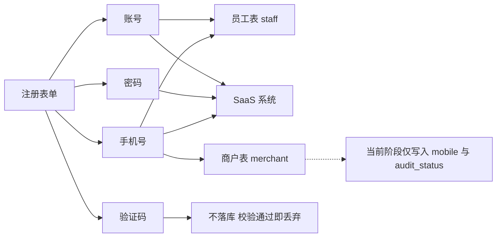

# 商户注册的系统设计：注册数据流向、落库范围与商户表设计

获取验证码的接口已经调通，注册表单就差一次提交。表单上只有账号、密码、手机号、验证码四项数据，看起来随手插一条记录就完事，动手之前却要先回答一个绕不开的问题：这四项数据最终各自存到哪里？答案比直觉复杂，它们不是进同一张表，而是分头流向三个存储位置。数据流向不先定清楚，编码时就会在「这个字段要不要写、写到哪个工程」上反复摇摆。系统设计这一课就把这笔账算清楚，顺便圈定当前阶段的落库范围。

## 先给结论

- 注册数据流向三个位置：商户表、员工表、SaaS 系统；账号进员工表与 SaaS 系统，密码进 SaaS 系统，手机号三处都进，验证码不落任何库，只在提交时凭 key 比对。
- 迭代开发决定当前落库范围：接入 SaaS 系统之前，注册只向商户表写数据，员工表与 SaaS 系统的写入等对接 SaaS 时一并实现。
- 当前真正写入商户表的内容只有两项：MOBILE 手机号，以及 AUDIT_STATUS 审核状态置 0（未申请），其余字段全部留给资质申请阶段补齐。
- 商户库 `pay_merchant_service` 共五张表：app 应用表、merchant 商户表、staff 员工表、store 门店表、store_staff 员工门店关系表。
- 设计落成两个编码任务：商户服务的注册接口（Dubbo）与商户平台应用的注册接口（HTTP），按依赖顺序先做前者。

## 数据流向：四个字段各自的去处

注册表单的四项数据里，验证码最特殊，它不存储。验证码服务在发送时已经把验证码写进了自己的 Redis，并给调用方返回一个 key；用户提交注册时，系统拿「key 加验证码」去验证码服务比对，通过即丢弃，全程不需要业务库建表来保存它。要存数据的是剩下三项，它们分头流向三个地方：



图的走向解释了每一项的归宿，背后是两类账号体系的叠加。SaaS 系统是整个平台的租户与账号权限中心，用户将来登录闪聚支付走的就是它，所以账号与密码必须写进 SaaS，登录才有依据。商户下面还有员工，员工虽然不是租户，但同样要登录商户平台工作，员工的账号密码也由 SaaS 统一管理，注册时填的账号密码本质上正是这位员工（通常就是法人或管理员）的登录凭证，因此账号要同时写员工表与 SaaS，密码写 SaaS，手机号作为关联统一账号的标识三处都留一份。账号、密码、手机号都写，验证码校验完即弃，四个字段三种待遇，这就是流向图想说的全部。

## 迭代开发：当前阶段只写商户表

三个写入位置是完整版蓝图，当前阶段却只能兑现其中一处。员工表的结构与 SaaS 系统的接口都还没展开讲，这时候向它们写数据既无处落笔也无法验证，需求分析时定下的迭代开发路线在这里兑现：先把商户信息在商户服务注册成功，信息只写入商户服务的数据库，员工表与 SaaS 系统的写入推迟到对接 SaaS 的那一节。

落库范围缩了水，提交上来的数据却一项不少。表单的账号、密码、验证码仍然要照常传到服务端，因为后续接入 SaaS 时这些数据全部要派上用场，接口不能先按「只收手机号」设计再返工。当前真正参与业务的只有两项：手机号要写进商户表，它是商户在业务库里的身份标识，字段注释里写明「关联统一账号」，将来就是靠它把商户表与 SaaS 的账号体系连起来；验证码要校验，确认注册者持有这部手机，防止替别人注册。设计结论可以压缩成一句话：注册成功等于商户表成功写入一条记录，mobile 有值，audit_status 为 0。

## 商户库与商户表设计

商户平台应用与商户服务两个工程连的是同一个库 `pay_merchant_service`，环境搭建阶段随基础工程一起导入。库里五张表各司其职：app 应用表给商户创建应用、配置支付渠道参数时使用；merchant 商户表是本次的主角；staff 员工表、store 门店表与 store_staff 员工门店关系表服务于商户内部的组织结构，对应当前阶段可以先不管，结构到用时再看。merchant 表的完整结构如下：

```sql
CREATE TABLE `merchant` (
  `ID` bigint(20) NOT NULL COMMENT '主键',
  `MERCHANT_NAME` varchar(50) DEFAULT NULL COMMENT '商户名称',
  `MERCHANT_NO` varchar(50) DEFAULT NULL COMMENT '企业编号',
  `MERCHANT_ADDRESS` varchar(255) DEFAULT NULL COMMENT '企业地址',
  `MERCHANT_TYPE` varchar(50) DEFAULT NULL COMMENT '商户类型',
  `BUSINESS_LICENSES_IMG` varchar(100) DEFAULT NULL COMMENT '营业执照（企业证明）',
  `ID_CARD_FRONT_IMG` varchar(100) DEFAULT NULL COMMENT '法人身份证正面照片',
  `ID_CARD_AFTER_IMG` varchar(100) DEFAULT NULL COMMENT '法人身份证反面照片',
  `USERNAME` varchar(50) DEFAULT NULL COMMENT '联系人姓名',
  `MOBILE` varchar(50) DEFAULT NULL COMMENT '联系人手机号（关联统一账号）',
  `CONTACTS_ADDRESS` varchar(255) DEFAULT NULL COMMENT '联系人地址',
  `AUDIT_STATUS` varchar(20) DEFAULT NULL COMMENT '审核状态 0-未申请,1-已申请待审核,2-审核通过,3-审核拒绝',
  `TENANT_ID` bigint(20) DEFAULT NULL COMMENT '租户ID，关联统一用户',
  PRIMARY KEY (`ID`) USING BTREE,
  UNIQUE KEY `MOBILE` (`MOBILE`) USING BTREE
) ENGINE=InnoDB DEFAULT CHARSET=utf8;
```

十三个字段按写入时机分成两组。注册时只碰 MOBILE 与 AUDIT_STATUS：手机号来自表单，审核状态写死 0，表示「未申请」这一业务状态，商户注册成功还不算正式商户，要等提交营业执照、法人身份证等资质材料并审核通过才算数，这些材料对应的正是 MERCHANT_NAME、BUSINESS_LICENSES_IMG、ID_CARD_FRONT_IMG 等其余字段，全部标注定格在资质申请阶段补填；TENANT_ID 则等对接 SaaS 时写入。字段与实体的映射由 Mybatis Plus 的注解完成：

```java
@Data
@TableName("merchant")
public class Merchant implements Serializable {

    //主键，ID_WORKER 即雪花算法，insert 后自动回填分布式 id
    @TableId(value = "ID", type = IdType.ID_WORKER)
    private Long id;

    //联系人手机号（关联统一账号），注册时写入
    @TableField("MOBILE")
    private String mobile;

    //审核状态 0-未申请，1-已申请待审核，2-审核通过，3-审核拒绝
    @TableField("AUDIT_STATUS")
    private String auditStatus;

    //其余字段与表列一一对应，此处省略
}
```

两个细节值得圈出来。其一，MOBILE 上建了唯一索引，同一手机号只能注册一个商户，这条约束在数据库层兜底，业务层的重复校验是它的前置防线，两层配合而不是二选一。其二，AUDIT_STATUS 用 varchar 存状态码而不是数字，状态值本身是一份数据字典约定，0 到 3 各代表一个资质阶段，代码里写 0 并把它注释清楚，属于按约定出牌，不算埋雷。

## 从设计到编码任务

设计收尾，任务清单随之成形。注册链路涉及两个待开发接口：商户服务暴露 Dubbo 服务接口，接收商户注册信息并落商户表，供内部调用；商户平台应用暴露 HTTP 接口，接收前端表单，先校验验证码再转调商户服务。两者存在依赖，接口③的实现要调接口②，编码顺序先②后③，这两个接口的完整实现与联调在接下来的课程中依次展开。设计的价值到这一步才兑现：每张表、每个字段、每个接口的职责都有了事先约定的答案，编码只是把答案翻译成代码。

## 常见误区

- **给验证码建表存储。** 错例：在商户库里建一张 sms_code 表保存验证码与手机号的对应关系。正解：验证码的存储与过期管理是验证码服务的职责，它已经写入自己的 Redis 并按有效期淘汰，业务侧只拿 key 加验证码去校验，校验完即弃。
- **注册功能一上来就写三处存储。** 错例：为了「一次做全」，在 SaaS 平台还没对接时就模拟写员工表与租户数据。正解：按迭代切分，当前只落商户表，员工表与 SaaS 系统的写入随对接 SaaS 的迭代实现，避免依赖未就绪的组件。
- **把审核状态留成 NULL 等资质申请再填。** 错例：注册只插 mobile，AUDIT_STATUS 不赋值，查询时无法区分「没填」与「未申请」。正解：注册即写 0，未申请是明确的业务状态，0/1/2/3 的字典含义在表注释与代码注释里保持一致。
- **只靠业务代码保证手机号唯一。** 错例：插入前查一遍手机号是否存在，没建唯一索引。正解：业务校验给用户友好提示，MOBILE 唯一索引兜底并发写入，两层缺一不可。

## 面试可能被问到的问题

1. 面试官追问：「商户注册的数据会写到哪些地方，为什么不都写进一张表？」
   答：三个位置。账号与密码由 SaaS 系统统一管理，因为登录认证走 SaaS；员工虽不是租户但也要登录系统，账号同时落员工表；手机号是关联统一账号的标识，商户表、员工表、SaaS 系统三处都存。分散存储是职责拆分的结果，SaaS 管认证与权限，商户服务管业务数据，各存各的核心字段，靠手机号与租户 id 关联。
2. 面试官追问：「验证码为什么不需要业务系统存储？」
   答：验证码服务在发送时已把验证码写入自己的 Redis 并设置有效期，同时返回一个 key 给调用方。校验时业务系统只需提交 key 与用户输入的验证码，由验证码服务比对并返回结果。存储、过期、防重放这些细节都收在验证码服务里，业务侧不自建表，职责更清晰。
3. 面试官追问：「为什么商户注册阶段只写商户表的两个字段，其他字段什么时候填？」
   答：这是迭代开发的切法。注册只需确立商户身份，写入手机号并置审核状态为未申请即可；营业执照、法人身份证、企业地址等资料属于资质申请环节，审核状态推进到已申请待审核时补填。注册与资质分开，每一步的表单和校验都更简单。
4. 面试官追问：「审核状态字段设计成 varchar 的 0/1/2/3，注册时写 0 算不算硬编码？」
   答：算写死但不属于坏味道。0 到 3 的含义是数据字典层面的系统约定，写 0 等于使用系统约定值，只要表注释、代码注释与字典保持一致即可维护。如果状态取值频繁变化或业务逻辑围绕状态大量分支，再考虑抽成枚举或常量类。
5. 面试官追问：「手机号唯一性怎么保证？」
   答：两层。业务层在写入前按手机号查询，存在则抛出友好错误；数据库层在 MOBILE 上建唯一索引，并发场景下即使两个请求同时通过业务校验，第二个插入也会被唯一约束拒绝。业务校验负责体验，唯一索引负责正确性。

## 配套资料

- 讲义：`materials/docs/10/闪聚支付-第2章-讲义-商户注册&资质申请v1.0.md`，2.4.1 系统设计（注册数据写入三处的流向图、商户注册表的数据模型、注册时只写手机号与审核状态的约定）为本课出处。
- 代码：`materials/code/10/shanjupay/`，聚合支付工程，商户服务模块的 `entity/Merchant`（@TableName、@TableId、@TableField 注解与字段定义）与 `mapper/MerchantMapper`，以及商户平台应用、商户服务两个工程的工程结构；该目录下另有按开发阶段归档的完整工程副本，内层目录名含项目原始命名，与正文包名口径不一致，不在此展开，按用途自取。
- 说明：商户库建表脚本随课程资料归档在 `materials/code/10/` 的散件目录中（内层目录名含原始命名，不在此展开），正文 DDL 为该脚本中 merchant 表的节选；库名按本系列口径写作 `pay_merchant_service`，包名按 `com.study.pay` 系改写。
