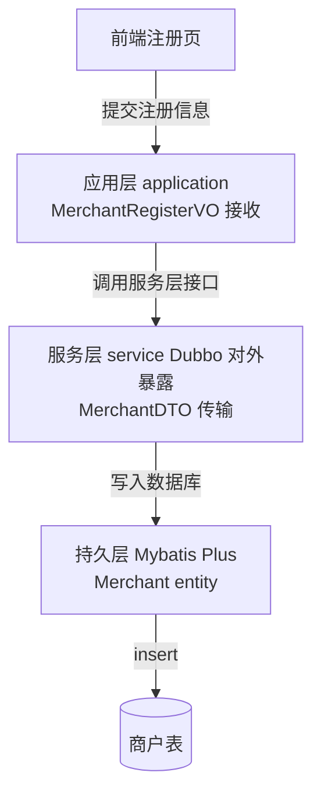

# 分层各管一摊：数据传输对象 VO、DTO 与 entity 为什么不能混用

商户注册的 Controller 写完之后，里面多出一段很扎眼的代码：把 `MerchantRegisterVO` 的字段一个一个 get 出来，再一个一个 set 进 `MerchantDTO`。看着这段重复劳动，很容易冒出两个念头：能不能直接把持久层的 entity 对象一路传上去，省掉这些转换；或者干脆往 entity 里加几个字段，让它把各层的活都干了。这两个念头都碰到了同一个概念：数据传输对象。这一课先把对象分层的规矩讲清楚，下一课再解决转换代码太繁琐的问题。

## 先给结论

- 每一层都有自己的数据传输对象：应用层面向前端用 VO 接收，服务层对外暴露接口用 DTO 传输，持久层与数据库表一一对应用 entity，一个请求自上而下完成一次对象接力。
- entity 与数据库字段严格一一对应，验证码 key、验证码这类不入库的字段它不该有，所以注册请求不能用 entity 承接，也不允许往 entity 里加临时字段。
- 应用层没有特殊参数要求时可以直接复用服务层的 DTO，字段完全对得上就不必再造一个 VO；字段有出入时（比如注册信息多了验证码）必须单独定义 VO。
- 分层对象不是形式主义，它让每一层的字段集合刚好等于这一层的职责，前端可传的字段、服务间传输的字段、落库的字段互不污染。

## 一个请求路过三层，每层都要一个接收员

数据传输对象指的就是在层与层之间接收数据、传输数据的那一批对象类型。商户注册这个请求的旅程可以说明它们各自的位置：



前端请求先打到应用层，应用层调用服务层的接口完成业务处理，服务层最后把数据保存进数据库。三段路上各有一个专属对象：VO 接前端的输入，DTO 在业务层之间搬运数据，entity 负责与数据库表对应。这三类对象在之前的开发里都已经用过：注册页提交的信息由 `MerchantRegisterVO` 接住，注册逻辑的参数是 `MerchantDTO`，落库用的是 Mybatis Plus 生成的 `Merchant` 实体类。

## entity 为什么不能直接出接口

回到开头那个念头：既然服务层最终就是往 entity 里塞数据，为什么不直接让 entity 上，一层对象打通到底。看一眼注册信息的 VO 就知道答案：

```java
//应用层对象：接收前端提交的注册信息
@ApiModel(value = "MerchantRegisterVO", description = "商户注册信息")
@Data
public class MerchantRegisterVO implements Serializable {

    @ApiModelProperty("商户手机号")
    private String mobile;

    @ApiModelProperty("商户用户名")
    private String username;

    @ApiModelProperty("商户密码")
    private String password;

    @ApiModelProperty("验证码key")
    private String verifyKey;

    @ApiModelProperty("验证码")
    private String verifyCode;
}
```

里面有 `verifyKey` 与 `verifyCode` 两个字段。这两个字段来自获取验证码接口，是校验用的临时凭证，校验完就丢弃，根本不会保存到数据库。而持久层的 entity 是什么样子：

```java
//持久层实体：与商户表字段一一对应
@TableName("merchant")
@Data
public class Merchant implements Serializable {

    @TableId(value = "ID", type = IdType.ID_WORKER)
    private Long id;

    @TableField("MERCHANT_NAME")
    private String merchantName;

    @TableField("MERCHANT_NO")
    private Long merchantNo;

    @TableField("USERNAME")
    private String username;

    @TableField("MOBILE")
    private String mobile;

    @TableField("ID_CARD_FRONT_IMG")
    private String idCardFrontImg;
}
```

每个字段都挂着 `@TableField`，和商户表的列一一对应。表里没有验证码列，entity 里就不可能有 `verifyKey`；拿 entity 去接注册请求，验证码数据无家可归。

那把缺的字段补进 entity 行不行。不行。entity 对象要严格对应数据库字段，Mybatis Plus 生成什么就用什么，随手往里加不入库的字段，等于破坏这层契约，将来做查询、更新时这些脏字段都是隐患。正路就是每一层用自己的对象：验证码字段属于应用层和服务层之间的传输内容，就定义在 VO 与 DTO 里，entity 只管表里有的列。

## 应用的规范：什么时候要单独定义 VO

本项目对数据传输对象有一条成文规范，对应三层各说一句：

```text
应用层：如没有接口参数的特殊要求，使用 DTO 结尾的对象传输，否则单独定义 VO 结尾的对象传输
服务层：统一使用 DTO 结尾的对象传输
持久层：统一使用 Entity 对象传输
```

应用层这条读起来有点绕，用注册的场景一对就明白了。添加用户的场景里，服务层定义了添加用户的 DTO，而前端提交的字段与这个 DTO 的属性完全一一对应，此时再建一个字段一模一样的 VO 就是纯重复，直接拿 DTO 接前端即可。商户注册不一样，注册请求比服务层入参多了验证码 key 与验证码两个字段，属于「有特殊要求」的情况，所以单独定义了 `MerchantRegisterVO`。VO 与 DTO 说到底就是两个字段集合有交集的类型，交集够大时可以合用，有出入时分立，判断标准是字段是否对得上，而不是教条。

Service 接口里那段手工搬运的代码，正是在 VO 与 DTO 字段不完全一致的情况下产生的转换成本。字段一多，get、set 就成片出现，10 个属性要写 10 行，漏一行就丢一个字段。这个繁琐有专门的工具来解，就是下一课的主角 MapStruct。

## 常见误区

- **拿 entity 直接接前端请求或返回给前端。** 错例：Controller 的入参与返回值都写成 `Merchant`，验证码字段接不住，敏感字段还可能被恶意提交。正解：应用层用 VO 或 DTO 承接，entity 只出现在持久层。
- **往 entity 里加不入库的字段。** 错例：为了图省事把 `verifyKey` 加进 `Merchant`，标注数据库里并不存在的列。正解：entity 与表字段严格对应，临时数据交给 VO 或 DTO 承载。
- **认为 VO、DTO、entity 字段必须完全不同。** 错例：刻意给三类对象起不同的字段名以示区分。正解：同名字段大量重合才是常态，属性同名正是后续 MapStruct 自动映射的前提。
- **服务层接口直接传 entity。** 错例：Dubbo 服务的方法签名上出现实体类，把表结构暴露给所有调用方。正解：服务层出接口统一用 DTO，表结构变化不会波及调用方。

## 面试可能被问到的问题

1. 面试官追问：「VO、DTO、entity 各自用在哪一层，为什么要分这么多对象？」
   答：VO 接收前端提交的数据，DTO 在服务层之间传输数据，entity 与数据库表一一对应。分开的意义是让每层的字段集合等于该层的职责：前端不该看到的字段不出现在 VO 里，不入库的字段不进 entity，表结构变化被隔离在持久层。代价是多几次对象转换，可以用 MapStruct 这类工具消化。
2. 面试官追问：「DTO 和 VO 什么时候可以共用一个类？」
   答：看字段是否对得上。前端提交的字段与服务层入参完全一致时，直接用 DTO 接收前端数据，不必再造 VO；一旦字段有出入，比如注册请求比服务层入参多出验证码字段，就必须单独定义 VO，避免把临时字段混进业务传输对象。
3. 面试官追问：「为什么 entity 不能加几个临时字段来兼容接口？」
   答：entity 是与数据库表严格一一对应的映射对象，Mybatis Plus 按它的字段生成 SQL，往里加入库之外的字段会破坏这层对应关系，查询与更新时容易出错，也掩盖了表的真实结构。临时数据应该由 VO 或 DTO 承载。
4. 面试官追问：「微服务之间远程调用传输的是什么对象，有什么要求？」
   答：传输 DTO。DTO 要实现 Serializable 以便跨网络序列化，字段只包含调用方关心的业务数据，不暴露表结构；本项目里服务层接口统一以 DTO 结尾命名，配合 Dubbo 的 RPC 通道使用。
5. 面试官追问：「每层都转换对象，转换代码很啰嗦，你们怎么处理？」
   答：手工 get、set 在字段多时既繁琐又容易漏，项目里用 MapStruct 做编译期生成：定义转换接口，属性同名的字段自动映射，List 也能批量转换，运行期就是普通的 getter、setter 调用，没有反射开销。

## 配套资料

- 讲义：`materials/docs/10/闪聚支付-第2章-讲义-商户注册&资质申请v1.0.md`，2.4.4 MapStruct 对象转换之 2.4.4.1 数据传输对象（三层对象的划分与本项目规范）为本课出处。
- 代码：`materials/code/10/基准代码/`，聚合支付工程副本，本课涉及的 `MerchantRegisterVO` 位于商户平台应用工程、`MerchantDTO` 位于商户服务 API 模块、`Merchant` 实体与 mapper 位于商户服务工程；该目录内层名含项目原始命名，与正文包名口径不一致，不在此展开，按用途自取。
- 说明：正文代码为真实文件按 `com.study.pay` 口径改写后的节选，entity 仅节选与讲解相关的字段；数据库字段名与课程工程一致。
