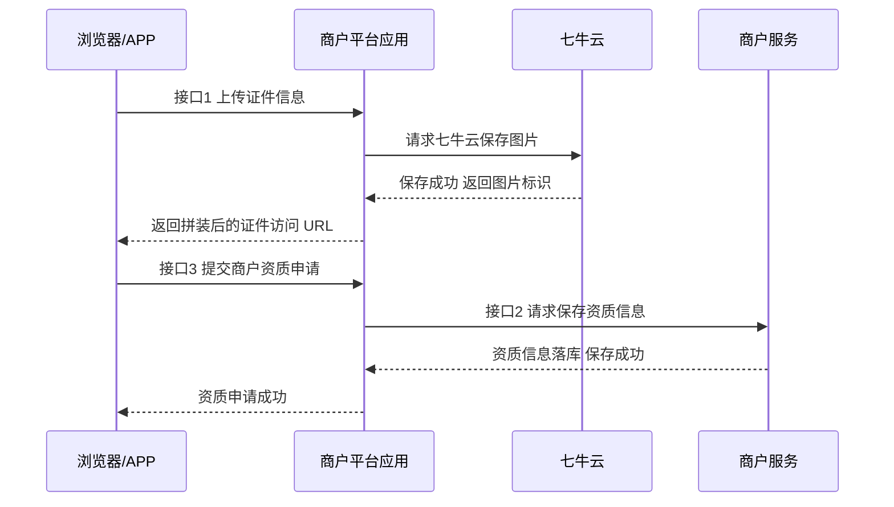

# 商户资质申请的系统交互流程：先传证照再交申请，审核状态说了算

商户注册完成时，商户表里只有手机号和置为 0 的审核状态，商户名称、企业编号、企业地址、营业执照、法人身份证正反面这些字段全部空着。想让这家商户成为闪聚支付真正意义上的商户、开通支付功能，就必须走一遍资质申请。动手写代码之前先把序列图看懂：这一单业务横跨四个角色、三个接口，还牵出一个容易答错的问题，提交成功到底算不算审核通过。

## 先给结论

- 资质申请分两个阶段：先上传证照拿到访问 URL，再提交申请落库，对应三个接口，上传证件信息是接口①，提交商户资质申请是接口③，商户服务保存资质信息是接口②。
- 证照文件不进业务库：商户平台应用把图片交给七牛云保存，拼出访问 URL 回传前端；提交申请时，URL 连同企业信息一起写入商户表。
- 真正往商户表写资质信息的是商户服务：商户平台应用负责对接前端，拿到请求后转调商户服务，数据落库的职责在服务层。
- 提交成功不等于审核通过：提交只是把审核状态从 0 未申请推进到 1 已申请待审核，2 审核通过与 3 审核拒绝由后续审核环节决定。
- 证照选云存储而不是自己建服务器：分布式部署下按需付费省成本，上传下载还能借云平台的节点加速。

## 看序列图的两步法：先认职责，再看流程

注册商户时也画过序列图，当时参与者有浏览器、商户平台应用、商户服务、SaaS 平台和验证码服务五个角色；资质申请的序列图反而清爽，只剩四个：浏览器/APP、商户平台应用、商户服务、七牛云。看图还是那两步：第一步认清每个参与者负责什么，第二步顺着箭头读交互顺序。

职责一句话概括：浏览器/APP 是资质信息的入口，用户在页面上填企业名称、企业编号、上传证照；商户平台应用是对前端的服务门面，暴露 HTTP 接口承接页面请求；商户服务是商户数据的管家，商户表的读写都归它；七牛云是云存储平台，专管文件的保存与下载。角色认清楚了，箭头就有了主人，流程不会再乱。

## 两阶段交互：先传证照，再交申请

资质申请的页面原型里，用户要填企业名称（营业执照上的名称）、企业编号（营业执照上的编号）、企业地址、联系人姓名与手机号，还要上传三张图：企业证明即营业执照、法人身份证正面、法人身份证反面。页面交互拆成两个阶段，时序如下：



第一阶段只管图片。用户选好证件照，浏览器请求商户平台应用的接口①；商户平台应用不落库也不落盘，直接请求七牛云把图片存下来；七牛云保存成功后返回一个图片标识，商户平台应用把它拼装成能访问这张证件照的完整 URL 交给前端。传三张图，前端就记录三个绝对路径的 URL，页面上每个证件块都显示出已经传成功的图。

第二阶段才是真正的申请。其余信息填完，用户点提交，浏览器带着全部表单数据与三个证照 URL 请求接口③；商户平台应用转调商户服务的接口②，由商户服务把资质信息写进商户库；保存成功后一路应答回去，页面提示资质申请成功。两个阶段的分界线就是那一下点击提交，之前的所有动作都只是备料。

## 证照的存放：前端持 URL，库里存标识

商户表里给证照留了专门的字段，建表脚本的资质相关字段如下：

```sql
-- merchant 表资质申请相关字段（节选）
`MERCHANT_NAME` varchar(50) DEFAULT NULL COMMENT '商户名称',
`MERCHANT_NO` varchar(50) DEFAULT NULL COMMENT '企业编号',
`MERCHANT_ADDRESS` varchar(255) DEFAULT NULL COMMENT '企业地址',
`BUSINESS_LICENSES_IMG` varchar(100) DEFAULT NULL COMMENT '营业执照（企业证明）',
`ID_CARD_FRONT_IMG` varchar(100) DEFAULT NULL COMMENT '法人身份证正面照片',
`ID_CARD_AFTER_IMG` varchar(100) DEFAULT NULL COMMENT '法人身份证反面照片',
`AUDIT_STATUS` varchar(20) DEFAULT NULL COMMENT '审核状态 0-未申请,1-已申请待审核,2-审核通过,3-审核拒绝',
```

三个 IMG 字段都是 varchar(100)，存的是 URL 标识而不是图片本身。也就是说，图片的真身住在七牛云的存储空间里，商户表只记一个地址，审核人员凭这个地址打开证件照查看。文件与元数据分离，是这类业务的通用做法：数据库不背大对象，表结构轻，备份与迁移都不受影响。

## 审核状态推进：提交是 1，通过才是 2

资质申请成功那一刻，商户表里实际发生的是两件事：证件字段从空变成有值，审核状态从 0 变成 1。这里有一个刻意设问的问题：提交成功，资质申请通过了吗？答案是没有。0 到 3 的状态字典各有归属：注册成功时置 0，表示未申请；提交申请时置 1，表示已申请待审核，此时商户还不算正式商户；审核环节如果通过，置 2，商户从此可以使用平台的支付功能；审核不通过则置 3，用户按拒绝原因修改材料后重新申请。提交与审核是两道工序，状态字段就是工序之间的交接凭证。

## 证照为什么交给云存储

把身份证照片存到自己系统里不行吗？行，但账要算清楚。这套系统是分布式系统，将来可能在多地部署服务器；自己存文件，就得为上传与下载的速度投入一批文件服务器，存储、带宽、运维都是真金白银。用云存储平台，按需使用、按需付费，文件保存与下载加速都是现成能力，成本结构从一次性投入变成用多少付多少。所以交互流程里，商户平台应用把证照交给七牛云，而不是写本地磁盘。上传与申请两个接口的具体实现，在后续课程里依次展开，这里先把流程的骨架立住。

## 常见误区

- **把上传证照和提交申请捏成一个接口。** 错例：表单一次性提交 multipart 数据，图片与文本混在一起传。正解：两阶段交互，先传图拿 URL，再提交申请；图片传失败可以单独重传，提交接口只带轻量的文本与 URL。
- **证照文件存进数据库或写本地磁盘。** 错例：把图片转成 BLOB 塞进商户表，或者存在应用服务器的某个目录下。正解：文件交给对象存储，数据库只存 URL；文件与数据分离，容量、备份、访问速度都有专业平台兜底。
- **认为资质申请成功就是审核通过。** 错例：提交接口跑通就宣布商户认证完成。正解：提交只是 audit_status 从 0 到 1，变成 2 才算审核通过，中间隔着人工或系统的审核环节。
- **商户平台应用直接操作商户表写资质数据。** 错例：在应用层写 SQL 更新 merchant 表。正解：数据落库职责在商户服务，应用层经服务接口转调，保持前后端对接与数据管理的边界。

## 面试可能被问到的问题

1. 面试官追问：「商户资质申请涉及哪些服务，各自负责什么？」
   答：四个角色。浏览器/APP 是资质信息入口；商户平台应用对前端暴露 HTTP 接口，承接上传与提交请求；七牛云是云存储平台，负责证照文件的保存与下载；商户服务负责商户业务数据，把资质信息落进商户表。应用层管交互，服务层管数据，存储交给云平台。
2. 面试官追问：「为什么证照要先上传再提交，而不是随表单一次提交？」
   答：上传与提交分离后，每个证件块独立上传、独立显示成功状态，哪张失败重传哪张，不影响已填写的表单数据；提交时接口只收文本字段与 URL，请求轻、校验简单。这是大文件与表单数据分离的通用设计。
3. 面试官追问：「提交资质申请后，商户表里发生了什么变化？」
   答：三类字段被写入：企业名称、企业编号、企业地址等文本信息；营业执照、法人身份证正反面的 URL 写进三个 IMG 字段；审核状态从 0 未申请推进到 1 已申请待审核。此时商户还未通过审核，状态到 2 才能使用支付功能。
4. 面试官追问：「证照图片为什么不直接存在自己的服务器上？」
   答：自建存储要投入文件服务器、带宽与运维成本，且分布式部署下多地访问速度难保证；云存储按需付费，保存与下载加速能力现成，成本结构与可靠性都更优。业务库只存 URL，文件与数据分离，数据库不背大对象。
5. 面试官追问：「审核状态的四个取值分别在什么环节写入？」
   答：0 未申请在商户注册成功时写入；1 已申请待审核在用户提交资质申请时写入；2 审核通过、3 审核拒绝由审核环节写入。状态推进是一条完整的业务流水线，每一跳都对应一个明确的操作入口。

## 配套资料

- 讲义：`materials/docs/10/闪聚支付-第2章-讲义-商户注册&资质申请v1.0.md`，3.1.1 系统交互流程（四个参与者、接口①②③的编号与箭头走向）与 3.1.2 资质信息存储（商户表资质字段）为本课出处。
- 代码：`materials/code/10/_散落资料/`，商户服务建库脚本 `shanjupay_merchant_service`（merchant 表完整 DDL，正文 SQL 为其节选）；`materials/code/10/shanjupay/`，聚合支付工程中商户平台应用、商户服务两个工程的模块结构。该目录下另有按开发阶段归档的工程副本，内层目录名含项目原始命名，与正文包名口径不一致，不在此展开，按用途自取。
- 说明：库名按本系列口径写作 `pay_merchant_service`，包名按 `com.study.pay` 系改写；上传证件信息接口与资质申请接口的编码实现在后续课程展开，此处只讲流程与存储结构。
