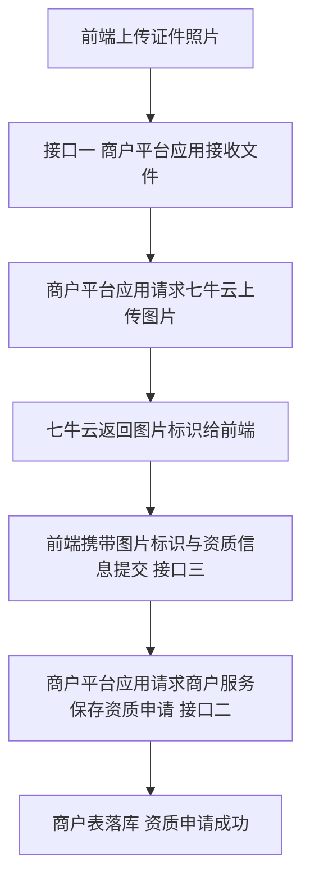
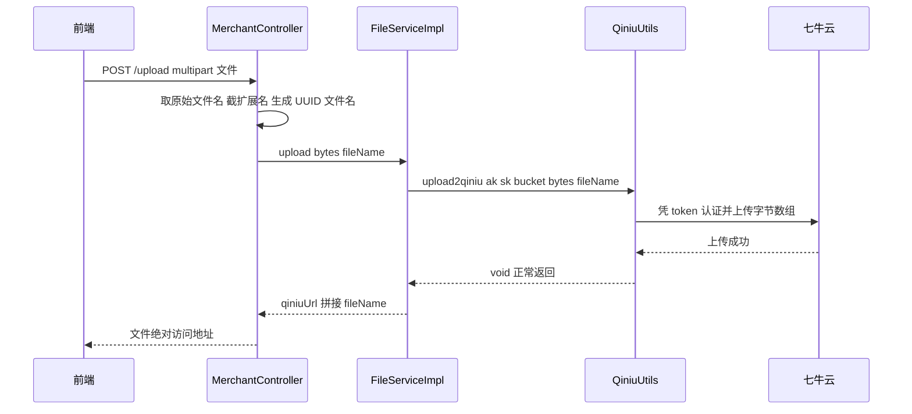
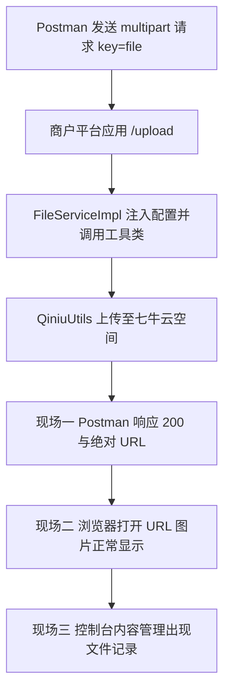

# 商户资质申请-上传证件-接口：契约定义、七牛云实现与 Postman 联调

> 🔒 安全提示：文中示例的口令/密钥均为课程教学环境演示口径，生产环境的安全要求见《安全与合规须知》。

## 先给结论

- 系列定位：闪聚支付商户注册流程里证件上传接口的三连，先定接口契约，再实现上传链路，最后用 Postman 联调验收。
- 接口契约：HTTP 接口落在商户平台应用的 MerchantController，文件字节流不走 Dubbo RPC；Controller 之下垫本地 FileService，`MultipartFile` 接文件、`@RequestParam("file")` 固定参数名，返回值为文件绝对访问地址。
- 实现自底向上三层：common 工程的 `QiniuUtils` 打底（五个参数全外部传入）、FileServiceImpl 居中做 Nacos 配置注入与异常翻译、Controller 收口用 UUID 生成唯一文件名。
- 配置纪律：云账号与访问域名放 Nacos 的 `merchant-application.yaml`，键前缀 `oss.qiniu`，不进代码；存储区域必须与七牛云空间区域一致。
- 文件名是对象存储的 key：UUID 加保留点号的扩展名，杜绝同 key 覆盖；返回地址由配置域名拼文件名两段构成。
- 测试三要素对齐：POST、form-data、key 写 file 且类型切 File；验收走「响应、浏览器、控制台」三个现场，只看 200 不算闭环。
- 异常设计分层：工具类只抛 RuntimeException，业务错误码的翻译收敛在 Service 一处，替换云服务时改动面最小。
- 全系列正文代码为按 `com.study.pay` 口径改写后的工程节选，出处为闪聚支付商户注册讲义与聚合支付工程归档。

## 第1部分：上传证件接口定义：商户平台应用的分层骨架与 MultipartFile 入参约定

对象存储的空间已经建好，用一段本地测试代码直连云服务上传下载也跑通了。但测试代码是在 main 方法里自己造文件自己传，真实场景是用户在浏览器里点「上传」，文件经 HTTP 请求进来。这就带来三个要事先想清楚的问题：接口挂在哪个工程、请求进来后经过哪几层、参数与返回值怎么约定。这一课把上传证件接口的骨架搭出来，方法体留到实现阶段再填。

### 先看交互流程：上传为什么只走商户平台应用
资质申请的完整交互在需求分析阶段画过流程图，上传证件是其中的第一段：



图里三个接口各有归属：接口① 是本课要定义的上传证件，覆盖前三步，产出一张可访问的图片地址；接口③ 与接口② 负责后半段，把图片地址连同资质信息一路存进商户表，分别落在商户平台应用与商户服务两个工程。上传这一步只涉及前端与商户平台应用，加上作为存储端的七牛云，商户服务从头到尾不出现。原因不难想：文件内容是几兆的字节流，走 HTTP 上传顺理成章，绕道 Dubbo 服务去转发既慢又占带宽，微服务拆分的目的从来不是让数据多跑冤枉路。

### 分层：Controller 之下为什么要垫一个 FileService
接口定义的第一个决策是位置。有 Controller 的工程只有商户平台应用，接口自然写在这儿的 `MerchantController` 里。第二个决策是层数：能不能在 Controller 方法体里直接调七牛云 SDK？语法上可行，工程上不行。上传文件从来不只是「把字节扔给云」一个动作，后面还有文件名校验、扩展名处理、异常翻译、访问地址拼装这一串逻辑，全堆在 Controller 里会让这个类迅速膨胀。通用的做法是给有业务逻辑的地方立一个 Service：

```java
package com.study.pay.merchant.service;

import com.study.pay.common.domain.BusinessException;

/**
 * 文件服务
 */
public interface FileService {

    /**
     * 上传文件
     * @param bytes    文件字节数组
     * @param fileName 文件名
     * @return 文件访问路径（绝对的 url）
     * @throws BusinessException
     */
    public String upload(byte[] bytes, String fileName) throws BusinessException;
}
```

这个 Service 有一个必须分清的细节：它的实现类将来标注的是 Spring 的 `@Service`（`org.springframework.stereotype.Service`），注册成本地 Bean，Controller 用 `@Autowired` 注入后直接本地调用，请求不出进程。对比商户服务里的写法：那边的 Service 实现类标的是 Dubbo 的 `@Service`（`org.apache.dubbo.config.annotation.Service`），把接口暴露成 RPC 服务供其他微调用。两个注解名字一样、职责完全不同，商户平台应用里的 `SmsService`、`FileService` 都属于前者，只供本应用自己使用。同一工程里还有现成的对照：注入 `MerchantService` 用的是 Dubbo 的 `@Reference`，那才是远程引用。

### 参数怎么抽：把可变的留给调用方
接口只有两个参数，这个形状来自对测试代码的解剖。此前验证上传时，测试方法里 AccessKey、SecretKey、存储空间、文件名全是写死的常量，正式改造的方向是把「每次调用都可能不同」的部分抽成参数，把「整个应用期间不变」的部分下沉到配置。逐项过一遍：文件字节数组 `bytes` 必然来自前端上传，是参数；文件名 `fileName` 决定文件在对象存储上的标识，应当由调用方生成并保证唯一，也是参数；AccessKey 与 SecretKey 是应用级密钥，存储空间名同理，这些由实现类从配置中心读取，不进接口签名。于是方法收窄成 `upload(byte[] bytes, String fileName)`，返回值是拼装好的文件访问地址。

返回类型用 `String` 直白明了，异常声明用系统自定义的 `BusinessException`，与全局异常处理器衔接。顺带一提，讲义初稿这个方法签名上抛的是 `BatchUpdateException`，那是 IDE 自动补全带出来的笔误，与文件上传毫无关系，工程最终代码已统一为 `BusinessException`，以工程代码为准。

### Controller 接口定义：MultipartFile 与参数名约定
Controller 这边的方法定义如下：

```java
//上传证件照
@ApiOperation("上传证件照")
@PostMapping("/upload")
public String upload(@ApiParam(value = "证件照", required = true) @RequestParam("file") MultipartFile multipartFile) {
    //调用 fileService 上传文件
    return null;
}
```

五个要点逐一拆开。方法用 `@PostMapping` 声明，文件上传必须走 POST，GET 的 URL 承载不了请求体里的文件内容。参数类型 `MultipartFile` 是 Spring MVC 对 multipart 请求中「文件部分」的抽象，前端传来的原始文件名、字节内容都能从它取出。`@RequestParam("file")` 把参数名固定为 `file`，这是双方契约：将来 Postman 或前端表单里的 key 必须叫 `file`，名字对不上，Spring 找不到对应的文件部分，接口直接报参数缺失。`@ApiParam` 给 Swagger 文档补上「证件照」的参数说明，接口文档页面上每个参数都有出处。方法体当前只有一行占位注释，调用 `fileService` 的逻辑在接口实现阶段补齐，先把结构立稳。

把三层结构画在一起，数据的流向就一目了然：


关键路径在中间一列：Controller 只做接参与文件名处理，真正的上传动作由 `FileService` 委托给通用工程的工具类完成，云账号配置从 Nacos 注入，结果以完整 URL 回传。本课把这条链路的三个节点都定了名分，下一步就是把 `return null` 逐层填成真实现。

## 第2部分：上传证件接口实现：封装七牛云上传工具类并打通 Controller 到云端的调用链

接口定义课上把骨架立好了：`MerchantController` 的 `upload` 方法体只有一行 `return null`，`FileService` 只有一个待实现的方法。现在从最底层开始把它填实，路径是自底向上的三步：先把七牛云 SDK 的验证代码提炼成通用工程里的上传工具类，再让 `FileServiceImpl` 注入云账号配置并调用工具类，回到 `MerchantController` 生成唯一文件名并完成最终调用。三层各管一段，任何一层写错位置，后面联调时都要返工。

### 调用链总览
先看全貌再动手，上传请求从头到尾经过五站：



时序里有个容易忽略的细节：`QiniuUtils` 返回 `void`，七牛云的响应在工具类内部就被消化掉了，Service 层返回的地址不依赖云端回传，靠的是「配置域名加调用方文件名」的本地拼装。这个设计成立的前提是文件名由调用方控制且唯一，后面两节会反复回到这条主线。

### 把验证代码改造成参数化工具类
七牛云 SDK 的用法已经在空间上传下载的验证阶段跑通过：构造配置、生成凭证、执行上传、解析响应。当时所有信息写死在测试方法里，改造工作就是把写死的部分全部抽成方法参数，落到 common 工程的 `QiniuUtils`：

```java
package com.study.pay.common.util;

import com.google.gson.Gson;
import com.qiniu.common.QiniuException;
import com.qiniu.http.Response;
import com.qiniu.storage.Configuration;
import com.qiniu.storage.Region;
import com.qiniu.storage.UploadManager;
import com.qiniu.storage.model.DefaultPutRet;
import com.qiniu.util.Auth;
import org.slf4j.Logger;
import org.slf4j.LoggerFactory;

/**七牛云上传工具类*/
public class QiniuUtils {

    private static final Logger LOGGER = LoggerFactory.getLogger(QiniuUtils.class);

    /**
     * 上传文件的工具方法
     * @param accessKey 密钥对中的 AK
     * @param secretKey 密钥对中的 SK
     * @param bucket    存储空间名
     * @param bytes     文件字节数组
     * @param fileName  文件名，由外部传入，七牛云上的文件名与此保持一致
     */
    public static void upload2qiniu(String accessKey, String secretKey, String bucket,
                                    byte[] bytes, String fileName) throws RuntimeException {

        //构造一个带指定 Region 对象的配置类，存储区域要和创建空间时选择的区域一致
        Configuration cfg = new Configuration(Region.huanan());
        //...其他参数参考类注释
        UploadManager uploadManager = new UploadManager(cfg);

        //key 即文件在七牛云上的标识，不指定时以内容 hash 命名，这里由调用方控制
        String key = fileName;
        try {
            //认证
            Auth auth = Auth.create(accessKey, secretKey);
            //认证通过后得到上传凭证 token
            String upToken = auth.uploadToken(bucket);
            try {
                //上传文件，参数：字节数组，key，token 令牌
                Response response = uploadManager.put(bytes, key, upToken);
                //解析上传成功的结果
                DefaultPutRet putRet = new Gson().fromJson(response.bodyString(), DefaultPutRet.class);
                LOGGER.info("上传完成 key：{}，hash：{}", putRet.key, putRet.hash);
            } catch (QiniuException ex) {
                Response r = ex.response;
                LOGGER.error("上传文件到七牛：{}", r.toString());
                try {
                    LOGGER.error(r.bodyString());
                } catch (QiniuException e2) {
                    //ignore
                }
                throw new RuntimeException(r.toString());
            }
        } catch (Exception ex) {
            LOGGER.error("上传文件到七牛：{}", ex.getMessage());
            throw new RuntimeException(ex.getMessage());
        }
    }
}
```

对照测试代码，改动集中在四处。**第一，参数全部外提。** AccessKey、SecretKey、存储空间、文件名、字节数组五个值都来自方法入参，工具类里不再有任何写死的常量，也正因为文件名是调用方传进来的，调用方手里本来就持有它，方法声明为 `void` 不再回传，与讲义口径一致。**第二，key 换成语义化的文件名。** SDK 在不指定 key 时用文件内容的 hash 值当文件名，能存但不可读；这里 `String key = fileName`，七牛云上看到的文件名与调用方传入的完全一致。**第三，日志替换掉标准输出。** 原来的 `System.err` 换成 SLF4J 的 `LOGGER`，上传失败的响应状态与响应体都进日志文件，排查线上问题时这是第一现场。**第四，异常改为向上抛。** 测试代码里 `QiniuException` 被就地吞掉，上传失败外界毫无感知；现在两层 catch 都以 `RuntimeException` 收尾，把失败强制抛给调用方。工具类住在 common 通用工程，不该耦合业务错误码体系，抛最通用的运行时异常、把「翻译成业务异常」的活留给上层 Service，是这里的分层意图。

方法体内四步是七牛云上传的标准流程：`Configuration` 指定存储区域，`Region.huanan()` 对应华南机房，必须与创建存储空间时选的区域一致，区域对不上传了也找不到；`Auth.create` 用密钥对认证，`auth.uploadToken(bucket)` 换取上传凭证；`uploadManager.put` 执行上传；`Gson` 把响应体解析成 `DefaultPutRet`，里面的 `key` 与 `hash` 可用于核对。SDK 本身通过 Maven 引入，工程父 pom 统一管理版本：

响应对象的解析看着是收尾动作，其实自带一层核验价值。`Response` 携带 HTTP 状态与响应体，`DefaultPutRet` 里的 `key` 正常情况下与传入的文件名一致，`hash` 是七牛云按文件内容算出的摘要，把它们打进日志，等于给每次上传留了一张回执：返回的 URL 打不开时，先看日志里这两个值是否正常，能立刻分辨「没传上去」与「传上去了但地址拼错」两类问题。SDK 的引入由工程父 pom 的 `dependencyManagement` 统一管版本：

```xml
<!-- 七牛云 SDK -->
<dependency>
    <groupId>com.qiniu</groupId>
    <artifactId>qiniu-java-sdk</artifactId>
    <version>7.2.25</version>
</dependency>
```

### 云账号与访问域名放进 Nacos
工具类把五个参数的来源问题留给了调用方，其中三个与文件无关：密钥对、存储空间、访问域名。这些值的特点是整个应用期间不变、换了环境才需要调整，归宿自然是配置中心。登录 Nacos 控制台，在配置列表里找到商户平台应用对应的配置文件 `merchant-application.yaml`，编辑后追加一段配置并发布：

```yaml
oss:
  qiniu:
    url: "http://example.com/"
    accessKey: "example-ak"
    secretKey: "example-sk"
    bucket: "pay-qualification"
```

四个键各司其职。`oss.qiniu.url` 是空间的访问域名，在对象存储控制台该空间概览页的融合 CDN 测试域名处可以查到，配置值以 `/` 结尾，这个结尾斜杠是有意为之，Service 层拼 URL 时直接追加文件名即可；测试域名仅供学习阶段使用，随时可能回收，生产环境需要绑定自有域名。`accessKey` 与 `secretKey` 是密钥对，在控制台的密钥管理页面创建，正文以 `example-ak`、`example-sk` 占位，实际使用时替换为自己的值，注册账号与创建空间的完整过程此前已演示过，不再展开。`bucket` 是存储空间名，即上传目标，正文按中性命名写作 `pay-qualification`。

配置放 Nacos 而不是写在工程的 `application.yml`，收益与此前验证码服务地址的配置化一致：环境切换只改配置不改代码，密钥不进代码仓库，修改后发布即可生效。键名用 `oss.qiniu` 这样的二级前缀也有讲究：`oss` 把「对象存储」这一类配置归拢到一起，将来若引入其他存储供应商，平行加一个前缀即可互不干扰；`qiniu` 再细分到具体供应商，后面挂的四颗叶子各自语义固定。前缀层级写清楚，`@Value` 表达式读起来也不用猜。编辑完成后必须点发布，配置才会从控制台推送到客户端；另一处必须盯紧的是 Data ID：这套配置的消费方是商户平台应用工程里的 `FileServiceImpl`，编辑的一定是商户平台应用对应的 `merchant-application.yaml`，如果手滑配到了商户服务或其他工程的配置文件里，发布再多次应用也读不到，这是配置中心使用中最常见的乌龙。

### FileServiceImpl：注入配置与异常翻译
配置就位，Service 层的实现一次性写完：

```java
package com.study.pay.merchant.service;

import com.study.pay.common.domain.BusinessException;
import com.study.pay.common.domain.CommonErrorCode;
import com.study.pay.common.util.QiniuUtils;
import org.springframework.beans.factory.annotation.Value;
import org.springframework.stereotype.Service;

/**
 * 文件服务实现
 */
@Service
public class FileServiceImpl implements FileService {

    @Value("${oss.qiniu.url}")
    private String qiniuUrl;

    @Value("${oss.qiniu.accessKey}")
    private String accessKey;

    @Value("${oss.qiniu.secretKey}")
    private String secretKey;

    @Value("${oss.qiniu.bucket}")
    private String bucket;

    /**
     * 上传文件
     * @param bytes    文件字节数组
     * @param fileName 文件名
     * @return 文件访问路径（绝对的 url）
     * @throws BusinessException
     */
    @Override
    public String upload(byte[] bytes, String fileName) throws BusinessException {
        //调用 common 下的工具类
        try {
            QiniuUtils.upload2qiniu(accessKey, secretKey, bucket, bytes, fileName);
        } catch (RuntimeException e) {
            e.printStackTrace();
            throw new BusinessException(CommonErrorCode.E_100106);
        }
        //上传成功返回文件的访问地址（绝对路径）
        return qiniuUrl + fileName;
    }
}
```

类上的 `@Service` 来自 Spring，是本地 Bean 注册，与上一节强调的口径一致。四个 `@Value` 表达式与 Nacos 里的键一一对应，`${oss.qiniu.url}` 这样的写法就是按 key 取值，应用启动拉取配置时完成注入，若键名拼错或配置没发布，启动阶段就会抛 `Could not resolve placeholder` 这类解析失败异常，算是一道上得很快的保险。方法体的两段逻辑各十行不到。前一段调用工具类，五个参数按序传入，捕获 `RuntimeException` 后转抛 `BusinessException(CommonErrorCode.E_100106)`，错误码枚举里 `E_100106` 的描述是「上传错误」，这是异常课建立的全局错误码清单中的一员；调用方无须理解 SDK 的任何异常类型，见到统一的 `BusinessException` 就够，全局异常处理器会把它翻译成 `errCode` 加 `errMessage` 的规范错误体返回前端。后一段拼装访问地址，`qiniuUrl` 以 `/` 结尾，`fileName` 是调用方传来的文件名，两段相加就是一个完整的绝对 URL，无须任何额外格式处理。

回头看这层的价值：它把「云服务的细节」与「业务要的结果」隔开了。Controller 关心的是「给我一个能访问的地址」，SDK 的认证、区域、异常类型全被挡在这层之外；将来存储方案从七牛云换成其他对象存储，改的也只是这一层与工具类，Controller 一行不动。

### Controller：生成唯一文件名并完成调用
最后回到入口层。文件上传的 Controller 实现里，最值得琢磨的不是上传本身，而是文件名怎么生成：

```java
//上传证件照
@ApiOperation("上传证件照")
@PostMapping("/upload")
public String upload(@ApiParam(value = "证件照", required = true) @RequestParam("file") MultipartFile multipartFile) throws IOException {

    //原始文件名称
    String originalFilename = multipartFile.getOriginalFilename();
    //扩展名：从最后一个「.」开始截取，自带点号
    String suffix = originalFilename.substring(originalFilename.lastIndexOf("."));
    //文件名：UUID 保证唯一，拼上扩展名
    String fileName = UUID.randomUUID().toString() + suffix;
    //上传文件，返回文件下载 url
    return fileService.upload(multipartFile.getBytes(), fileName);
}
```

三行核心代码对应三个动作。取原始文件名：用户上传的文件叫什么、扩展名是什么，都封装在 `MultipartFile` 里，`getOriginalFilename` 拿到形如 `basic-architecture.png` 的原始名称。截取扩展名：`lastIndexOf(".")` 定位最后一个点，`substring` 从点的位置截到末尾，得到带点号的 `.png`；用「最后一个点」而不是「第一个点」，是因为文件名本身可能含点，比如 `my.photo.png` 的扩展名仍要从末尾数。生成唯一文件名：`UUID.randomUUID()` 产生全球唯一的随机串，拼上扩展名即为最终文件名。唯一性在这里是硬要求，七牛云同一个空间里 key 相同的文件会被覆盖，两人同时上传 `1.png`，后传的会把先传的顶掉，资质材料丢了比上传失败严重得多；用 UUID 做文件名，重名概率可以忽略。扩展名必须保留，浏览器靠它识别文件类型，营业执照照片丢了 `.jpg` 后缀，预览都可能出问题。

收尾的 `fileService.upload(multipartFile.getBytes(), fileName)` 把字节数组与文件名交给 Service，返回值即完整 URL，Controller 原样返回给前端。`getBytes()` 把文件内容一次性读进内存，对证件照这类几百 KB 到几兆的图片正合适；如果是超大文件，就该改用 `getInputStream()` 流式处理，避免内存被吃满，这也是文件上传场景里按体量选 API 的分界线。方法签名上的 `throws IOException` 来自 `getBytes()`，它是受检异常，直接声明抛出即可，真发生读取失败时会被全局异常处理器接住，返回统一的系统未知错误，这条链路在异常处理课已经铺好。

### 全链路串讲
三层拼起来再走一遍完整链路：前端把证件照片以 `multipart/form-data` 发到 `POST /upload`，参数名 `file`；Controller 解析原始文件名、截出扩展名、生成 UUID 文件名；Service 从启动时注入的配置里取密钥对、空间名与访问域名，委托工具类认证上传；上传成功后按「域名加文件名」拼出绝对地址逐层返回。前端拿到 URL 后有两处用途：立即把它塞进页面的图片标签做预览，让用户确认传上来的是不是这张证件照；随后提交资质申请时把它连同其他资质信息一起带上，最终由商户服务写进商户表的对应字段。文件名由调用方控制这条约定是全链路的粘合剂：Controller 生成它，Service 用它拼地址，七牛云用它做存储标识，三处对得严丝合缝，返回的 URL 才能真的访问到刚上传的图。

## 第3部分：上传证件接口测试：Postman 传文件与七牛云空间的二次核验

实现课上三层代码已经就位，但「代码写完了」和「接口能用」之间还隔着一次真实的请求。文件上传接口的测试与普通 JSON 接口不同：请求体是二进制文件，参数名错一个字母、Body 类型选错一项，请求都到不了 Controller。这一课用 Postman 把上传证件接口完整测一遍，顺带建立两个核验现场的习惯：接口返回值之外，还要去存储端亲眼确认文件真的在了。

### 测试前的准备：起一个工程就够了
接口实现课上梳理过调用链：`MerchantController` 到 `FileServiceImpl` 是本地调用，`FileServiceImpl` 到 `QiniuUtils` 是进程内方法调用，出进程的只有工具类到七牛云的 SDK 请求，全程没有 Dubbo 参与的身影。所以这次测试的启动清单很短：Nacos、七牛云的密钥配置保持可用，然后只起商户平台应用这一个工程，商户服务可以不开。这个细节反过来看也是一次依赖检验，如果不起商户服务就报了找不到服务提供者的错，说明代码里混进了不该有的远程调用，测试顺便替架构做了体检。

改过代码或配置的，重启应用再测。`@Value` 的注入发生在启动时，Nacos 侧的 `oss.qiniu` 配置是后补的，应用必须重启才能拉到新值，带着旧进程测试会把「配置没生效」误判成「代码写错了」。

### Postman 请求配置：参数名与 Body 类型两处对齐
新建一个 Postman 请求，按三条线索配置。请求方式选 POST，上传接口的 `@PostMapping("/upload")` 只认 POST；URL 填 `http://localhost:57010/merchant/upload`，端口与路径对齐商户平台应用的配置；Body 页签选 `form-data`，然后是整个测试里最容易错的一步：

- key 一栏输入 `file`，这个名字必须与 Controller 方法上 `@RequestParam("file")` 声明的参数名一致，接口定义时说过这是双方契约，服务端写什么名字，客户端就得传什么名字；服务端若是声明成别的，这里就跟着改。
- 把 key 右侧的类型下拉从默认的 Text 切换成 File，切换后该行的 value 变成「选择文件」按钮，从本地选一张图片，比如桌面上的 `1.png`。
- 不需要填 Headers 里的 `Content-Type`，Postman 发 `form-data` 时会自动带上 `multipart/form-data` 并附边界信息，手动写死反而会丢边界。

点 Send 发出请求。等价于这样一条 HTTP 交互：请求体是 multipart 编码，`name="file"` 与服务端参数名对齐；响应是 200 加一个完整 URL：

```http
POST /merchant/upload HTTP/1.1
Content-Type: multipart/form-data; boundary=----boundary

------boundary
Content-Disposition: form-data; name="file"; filename="1.png"
Content-Type: image/png

（二进制文件内容）
------boundary--
```

```http
HTTP/1.1 200 OK

http://example.com/3f2a5f8e-9c1d-4b6e-a2f0-9e990f001.png
```

想看清内部执行路径，可以在 Controller 的文件名生成行打断点：请求进来会先停在取原始文件名处，放行后依次经过文件名生成、Service 调用、工具类上传，每一步的变量值都能当场核对，比如 `originalFilename` 应该是 `1.png`，`fileName` 应该是一串 UUID 加 `.png`。

### 验收：响应、浏览器、控制台三个现场
请求成功的标志分三个层次。第一层是 Postman 的响应区：状态 200，响应体为一个完整 URL，形如 `http://example.com/3f2a5f8e-...-9e990f001.png`，对照配置可以逐段核对，域名段与 Nacos 里 `oss.qiniu.url` 一致，文件名段是一串 UUID 加图片扩展名，说明服务端三层的产出都符合预期。第二层在浏览器：把响应体里的 URL 原样粘进地址栏访问，图片能直接显示，证明「域名加文件名」的拼装是对的、七牛云上的文件是完整的。第三层去控制台：登录七牛云管理控制台，进入存储空间的内容管理页，文件列表里应能看到刚上传的记录，文件名的末尾几个字符与返回 URL 的末段对得上。三层现场各证一件事：接口层证约定成立，浏览器证地址可用，控制台证数据落位。



这张图把测试的取证链画成了一条线：从请求发出到三处验收现场，任何一环断裂都能按图定位。响应异常先查参数名与 Body 类型，URL 打不开先查配置里的域名与空间区域，控制台没文件先看服务端日志里工具类的报错，排查方向不会跑偏。

## 常见误区

- **把上传接口设计进商户服务。** 错例：在商户服务的 Dubbo 接口里加一个 `upload` 方法，前端传文件到商户平台应用再转发。正解：文件字节流走 HTTP 直达商户平台应用，云服务细节封装在工具类里，商户服务只保存最终的图片地址字符串。
- **@Service 注解 import 错。** 错例：给 `FileServiceImpl` 标注 Dubbo 的 `@Service`，一个本地文件服务被当成 RPC 服务暴露到注册中心。正解：本地业务 Bean 用 `org.springframework.stereotype.Service`，Dubbo 服务实现才用 `org.apache.dubbo.config.annotation.Service`，导入时看清包名。
- **MultipartFile 参数缺 @RequestParam 或名字对不上。** 错例：方法签名只写 `MultipartFile file` 不指定参数名，或前端 key 写成 `uploadFile`。正解：`@RequestParam("file")` 与调用方的 key 两端对齐，参数名是接口契约的一部分，改哪边都要同步。
- **把云账号信息塞进接口参数。** 错例：`upload(bytes, fileName, accessKey, secretKey, bucket)`，让每个调用方自己找密钥。正解：密钥与存储空间属于应用配置，实现类里 `@Value` 注入即可，接口签名只留每次调用真正变化的部分。
- **配置写错 Data ID 或忘记发布。** 错例：把 `oss.qiniu` 配进了商户服务的配置文件，或者编辑完没点发布，应用启动即抛 `Could not resolve placeholder: oss.qiniu.url`。正解：确认配置的消费方是哪个工程，Data ID 选 `merchant-application.yaml`，发布后重启应用再验证。
- **文件名直接用原始文件名。** 错例：`String fileName = multipartFile.getOriginalFilename()`，两个用户都传 `1.png`，对象存储同 key 覆盖，先上传的资质照片无声丢失。正解：UUID 生成唯一主体，拼上保留的扩展名，唯一性与可识别性两全。
- **扩展名截取的偏移量写错。** 错例一：`substring(lastIndexOf(".") + 1)` 得到 `png`，拼接后文件名变成 `uuidpng`，点号丢失；错例二：`substring(lastIndexOf(".") - 1)`，遇到单字符文件名 `1.png` 时会把整个原名截进来。正解：从点本身开始截取，`substring(lastIndexOf("."))`，得到的扩展名自带点号，直接拼接。工程归档代码在不同版本里这两种错例都出现过，以正文口径为准。
- **在工具类里抛业务异常。** 错例：`QiniuUtils` 直接 `throw new BusinessException(...)`，让通用工程反向依赖某个业务模块的错误码。正解：工具类抛 `RuntimeException`，由调用它的 Service 捕获后翻译成 `BusinessException(CommonErrorCode.E_100106)`，翻译层只此一处。
- **存储区域与空间区域不一致。** 错例：空间创建时选了华北，代码里写 `Region.huanan()`（华南），上传报区域相关错误。正解：`Configuration` 里的 `Region` 必须与创建存储空间时选择的区域一致，空间换区域这类参数改动要同步改代码或配置。
- **key 名不叫 file 或没切 File 类型。** 错例：key 写成 `uploadFile`，或留在 Text 类型里填了文件路径字符串，服务端收不到文件，报参数缺失或空指针。正解：key 名与服务端 `@RequestParam` 对齐，类型切成 File 并真实选择本地文件。
- **Body 类型选成 x-www-form-urlencoded 或 raw/JSON。** 错例：沿用测 JSON 接口时的 Body 设置，文件内容根本不在请求里。正解：文件上传必须用 `form-data`，这是 multipart 编码的唯一入口。
- **改了配置不重启就测。** 错例：Nacos 补配了 `oss.qiniu` 四项，应用没重启，`@Value` 注入的还是旧值或缺失值。正解：配置变更后重启应用，或确认项目开启了配置动态刷新机制再测。
- **只看响应 200 就认为成功。** 错例：响应里有个 URL 就收工，其实域名拼错或文件传错空间，URL 打不开。正解：按「响应、浏览器、控制台」三个现场逐层核验，URL 可访问且控制台有记录才算闭环。
- **拿返回的文件名去别的域名下试。** 错例：把文件名段拼到自己随手写的域名后访问，报 404 后误判上传失败。正解：URL 各段来自同一个配置体系，域名只认 Nacos 里配置的那个，测试域名仅供学习期使用且可能回收。

## 面试可能被问到的问题

1. 面试官追问：「Spring MVC 处理文件上传靠什么类型，前端请求有什么要求？」
   答：Controller 参数用 `MultipartFile` 接收，它封装了 multipart 请求中的文件部分，能取原始文件名、字节内容与大小。前端必须用 POST 加 `multipart/form-data` 编码提交，表单项的 name 与服务端 `@RequestParam` 指定的名字一致。Spring Boot 内置的 `MultipartAutoConfiguration` 负责解析，无需额外配置即可工作。

2. 面试官追问：「上传接口为什么放在商户平台应用，还要在 Controller 下面再加一层 Service？」
   答：商户平台应用是直面 HTTP 前端的应用层，文件上传是典型的 HTTP 场景，字节流不应绕道 Dubbo RPC。加一层本地 Service 是因为上传包含文件名生成、异常翻译、地址拼装等业务逻辑，Controller 只负责接参与返回，逻辑沉到 Service 才能复用也便于测试。这一层是 Spring 本地 Bean，与商户服务里 Dubbo 暴露的服务是两类东西。

3. 面试官追问：「Spring 的 @Service 和 Dubbo 的 @Service 有什么区别？」
   答：Spring 的 `@Service` 把类注册为 Spring 容器的本地 Bean，仅进程内可见；Dubbo 的 `@Service` 把实现类作为 RPC 服务暴露到注册中心，供远程消费方订阅调用。名字相同但包不同，用错会导致服务该暴露的没暴露、不该暴露的暴露了。本项目里商户服务的实现用 Dubbo 注解，商户平台应用内部的 `SmsService`、`FileService` 用 Spring 注解。

4. 面试官追问：「这个接口的参数和返回值是怎么定的，有什么设计考量？」
   答：参数只有文件字节数组与文件名两项，因为密钥、存储空间等是应用级常量，由实现类从配置中心读，接口只暴露每次调用会变化的数据。返回值定为文件的绝对访问地址，前端拿到后可直接展示预览，并在提交资质申请时原样回传，避免前端再拼 URL。

5. 面试官追问：「@RequestBody 能用来接收文件吗，和 @RequestParam 区别在哪？」
   答：不能。`@RequestBody` 读取的是请求体的整体内容并按 `HttpMessageConverter` 反序列化成对象，适合 JSON；文件上传的请求体是 multipart 编码，由 `MultipartResolver` 解析成多个部分，文件部分要用 `MultipartFile` 配合 `@RequestParam` 接收。两者处理的是不同编码形态的请求体，混用会直接报 `HttpMediaTypeNotSupportedException`。

6. 面试官追问：「用七牛云 SDK 上传一个文件，核心步骤有哪几步？」
   答：四步。构造 `Configuration` 指定存储区域并创建 `UploadManager`；用 AccessKey 与 SecretKey 通过 `Auth.create` 认证并调用 `uploadToken(bucket)` 换取上传凭证；调用 `uploadManager.put` 传入字节数组、key 与凭证执行上传；用 Gson 把响应解析成 `DefaultPutRet` 拿到最终 key 与 hash。区域必须与空间创建时的选择一致。

7. 面试官追问：「上传相关的配置为什么放 Nacos 而不是工程里的 application.yml？」
   答：密钥、空间名、访问域名属于环境相关的敏感配置，放配置中心可以做到换环境只改配置不改代码、不重新打包，密钥也不进代码仓库；Nacos 发布即推送，修改成本最低。工程内的 `application.yml` 更适合放与环境无关的默认值。读取用 `@Value` 按 key 注入，键名拼错或未发布会启动即报错，问题暴露得早。

8. 面试官追问：「上传的文件名为什么要用 UUID 生成，扩展名怎么处理？」
   答：对象存储以 key 唯一标识文件，同 key 上传会覆盖旧文件，用原始文件名会出现用户之间互相顶掉数据的事故，UUID 保证唯一。扩展名从原始文件名的最后一个点开始截取并保留在最终文件名里，浏览器与对象存储都靠它判断内容类型，丢了后缀会影响预览与下载行为。

9. 面试官追问：「工具类抛 RuntimeException、Service 转成 BusinessException，为什么不直接一步到位？」
   答：工具类在 common 通用工程，只应依赖最通用的异常类型，耦合具体业务错误码会限制它的复用面；Service 属于业务层，知道用什么错误码表达「上传失败」最合适。异常翻译发生在业务边界上，调用方拿到的是统一的 `BusinessException` 体系，后续接入全局异常处理器返回规范错误体，层次清楚且替换云服务时改动面最小。

10. 面试官追问：「返回的文件 URL 是七牛云响应里带的吗，怎么拼出来的？」
   答：不是。上传接口的响应体里只有 key 与 hash，完整访问地址需要自行拼装：Nacos 配置的访问域名（以 `/` 结尾）加文件名，即 `qiniuUrl + fileName`。文件名本就是调用方生成的，域名在配置里，Service 拼好直接返回绝对 URL，前端拿到即可访问，无须再拼任何前缀。

11. 面试官追问：「Spring Boot 对上传大小有默认限制吗，超了会怎样？」
   答：有，默认单文件约 1MB、单请求约 10MB，超出抛 `MaxUploadSizeExceededException`。证件照场景一般要在配置里调大 `spring.servlet.multipart.max-file-size` 与 `max-request-size`，并在前端做类型与大小预校验，两层配合把不合规文件挡在入口。

12. 面试官追问：「multipart/form-data 和 x-www-form-urlencoded 有什么区别，分别用在什么场景？」
   答：两者都是 POST 的表单编码。`x-www-form-urlencoded` 把字段序列化成键值对，适合普通文本表单；`multipart/form-data` 用边界串把请求体切成多个部分，每部分可携带独立的内容类型，能传二进制，文件上传只能用它。服务端对应两种解析通道，Spring MVC 里前者绑定到普通参数，后者解析成 `MultipartFile`。

13. 面试官追问：「上传接口测试除了响应 200，还应该验证什么？」
   答：至少三处：响应体里的 URL 结构正确，域名与配置一致、文件名带扩展名；URL 在浏览器可直接访问且内容正确；存储端控制台能看到文件记录。只断言状态码会把「地址拼错」「传错空间」这类问题漏掉，存储类接口的验收必须延伸到存储端。

14. 面试官追问：「上传接口的异常场景你会怎么设计测试用例？」
   答：不传文件或参数名写错，预期参数缺失类错误；传超大文件，预期触发大小限制并返回友好错误；传非图片或无扩展名文件，观察扩展名截取逻辑是否出错；密钥配置错误或网络不通，预期走 `E_100106` 上传错误并经全局异常处理器返回规范错误体。异常用例验证的是错误分支的翻译与兜底，正常用例验证主链路。

15. 面试官追问：「服务端如何确认一个文件真的上传成功，除了 HTTP 状态码？」
   答：解析上传响应的 `DefaultPutRet`，核对返回的 key 与传入文件名一致、hash 是服务端按内容计算的摘要；再配合日志记录与存储端查询。本项目的做法是把 key 与 hash 打进日志，返回 URL 前拼装自配置域名，测试时三处对账，任何一处不一致都能定位到具体环节。

## 配套资料

- 讲义：`materials/docs/10/闪聚支付-第2章-讲义-商户注册&资质申请v1.0.md`，3.3.1 商户平台应用证件上传（接口①）之 3.3.1.1 接口定义（交互描述、FileService 方法签名、Controller 的 upload 方法）为本课出处。
- 代码：`materials/code/10/shanjupay/`，聚合支付工程，商户平台应用工程的 `service/FileService` 与 `controller/MerchantController` 为真实文件，正文代码为按 `com.study.pay` 口径改写后的节选；该目录下另有按开发阶段归档的工程副本，内层目录名含项目原始命名，与正文包名口径不一致，不在此展开，按用途自取。
- 说明：讲义初稿 FileService 签名上的 `BatchUpdateException` 为笔误，正文按工程最终代码写作 `BusinessException`；交互流程图取自讲义 3.3.1 的流程描述，接口①②③ 的编号沿用讲义口径。
- 讲义：`materials/docs/10/闪聚支付-第2章-讲义-商户注册&资质申请v1.0.md`，3.3.1.2 接口实现（common 工程引入七牛云 SDK、QiniuUtils 工具类、nacos 的 `oss.qiniu` 配置、FileServiceImpl 与 MerchantController 实现）为本课出处。
- 代码：`materials/code/10/shanjupay/`，聚合支付工程，通用工程的 `util/QiniuUtils`、商户平台应用工程的 `service/FileService`、`service/FileServiceImpl`、`controller/MerchantController` 以及父 pom 中的 `qiniu-java-sdk` 依赖为真实文件与配置，正文代码为按 `com.study.pay` 口径改写后的节选；该目录下另有按开发阶段归档的工程副本，内层目录名含项目原始命名，与正文包名口径不一致，不在此展开，按用途自取。
- 说明：`merchant-application.yaml` 的 `oss.qiniu` 配置取自讲义与工程归档，域名以 `example.com` 占位、密钥以 `example-ak` 与 `example-sk` 占位，存储空间名按中性口径写作 `pay-qualification`；`upload2qiniu` 方法声明为 `void` 与讲义口径一致，扩展名截取的偏移量在工程归档的不同版本间存在差异，正文按可运行的正确口径书写并在常见误区中说明。
- 讲义：`materials/docs/10/闪聚支付-第2章-讲义-商户注册&资质申请v1.0.md`，3.3.1.3 接口测试（Postman 传文件配置、上传成功后登录七牛云查询图片是否上传成功）为本课出处。
- 代码：`materials/code/10/shanjupay/`，聚合支付工程，商户平台应用工程的 `controller/MerchantController`（upload 方法）、`service/FileServiceImpl` 与通用工程的 `util/QiniuUtils` 为真实文件，正文按 `com.study.pay` 口径引用；该目录下另有按开发阶段归档的工程副本，内层目录名含项目原始命名，与正文包名口径不一致，不在此展开，按用途自取。
- 说明：示例 URL 中的域名以 `example.com` 占位，实际测试时以 Nacos 配置的访问域名响应为准；文件名示例取自演示场景的 UUID 形态；Postman 的操作步骤为按本课演示过程整理的通用写法。
