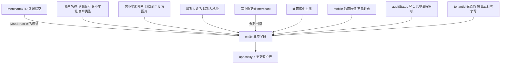

# 商户服务资质申请接口：一次带约束的商户表更新

证件照片上传链路调通后，前端手里已经有了可访问的图片地址。资质申请的最后一步，是把营业执照图片、身份证正反面照片连同商户名称、企业地址等资料一起提交，落进商户表里注册时留下的那片空字段。链路上有两个待开发接口：商户平台应用的 HTTP 接口（接口③）与商户服务的 Dubbo 接口（接口②），前者转调后者。按依赖顺序，被调用的接口②要先就位，这一课先在商户服务侧把它定义并实现出来。

## 先给结论

- 接口② 定义在 `pay-merchant-api` 工程的 `MerchantService` 里：`void applyMerchant(Long merchantId, MerchantDTO merchantDTO) throws BusinessException`，成功无返回值，失败抛自定义异常。
- 商户 id 作为独立参数显式出现在方法签名中：它是本次更新的定位键，显式声明让接口契约一目了然，不藏在 DTO 的一堆属性里。
- 实现本质是一次受限更新：先校验参数与商户存在性，再把 DTO 转成 entity，回填四个关键字段后 `updateById`。
- 四个回填字段的约束各不相同：`id` 取参数定位的库中记录，`mobile` 强制沿用库中原值（资质申请不允许改手机号），`auditStatus` 置为 `1` 已申请待审核，`tenantId` 保持原值（对接 SaaS 时才写）。
- 方法标注 `@Transactional`，参数为空抛 `E_300009`，商户不存在抛 `E_200002`，与全局错误码清单对齐。

## 为什么先做接口②：依赖顺序与阵地转移

接口③ 由商户平台应用暴露给前端，收到请求后要转调商户服务保存资质信息。如果先把接口③写出来，写到最后一步调商户服务时会发现接口②压根不存在，功能链断在半空。依赖方与被依赖方不能同时开工时，先做被依赖的一方，这是一条通用的排期常识。把工作阵地转到商户服务工程，接口定义在 `pay-merchant-api` 模块（Dubbo 接口与 DTO 的所在地，提供方与消费方共享这份契约），实现在 `pay-merchant-service` 模块，与注册商户接口（`createMerchant`）的布局完全一致。

接口要接的数据从需求倒推：资质申请最终是「更新某个商户的资质字段」，更新需要两样东西，定位到哪个商户（商户 id），以及写进去什么内容（资质申请信息）。商户信息在系统内以 `MerchantDTO` 流转，注册课里已经定义过，营业执照图片、身份证正反面、联系人姓名地址、审核状态等字段一应俱全，直接复用，无须新建 DTO。

## 接口定义：商户 id 为什么要显式进签名

在 `MerchantService` 接口里追加资质申请方法：

```java
/**
 * 资质申请
 * @param merchantId  商户id
 * @param merchantDTO 资质申请的信息
 * @throws BusinessException
 */
void applyMerchant(Long merchantId, MerchantDTO merchantDTO) throws BusinessException;
```

一个绕不开的设计疑问：`MerchantDTO` 里本来就有 `id` 属性，把商户 id 塞进 DTO 一样能传，为什么还要单独立一个参数？两种写法都能工作，差别在接口的可读性与安全性。服务接口是给同事看的契约，签名里亮出 `merchantId`，读接口描述的人立刻知道这个接口必须有商户 id 才能工作；藏进 DTO，这个关键前提就只能靠翻字段注释或读实现才能发现，漏传了要到运行时才暴露。同样重要的是防错：实现里以参数 `merchantId` 查库校验、再以校验过的记录定位更新，前端 DTO 里即便传了来路不明的 `id` 也不会被当作更新依据。返回值定为 `void`，资质申请要么成功要么抛异常，没有「部分成功」的中间态需要回传，异常声明沿用系统的 `BusinessException`，把错误码体系一路贯到底。

## 接口实现：校验、转换、回填、更新

实现在 `pay-merchant-service` 的 `MerchantServiceImpl` 中，方法整体如下：

```java
@Override
@Transactional
public void applyMerchant(Long merchantId, MerchantDTO merchantDTO) throws BusinessException {
    //参数合法性校验
    if(merchantId == null || merchantDTO == null){
        throw new BusinessException(CommonErrorCode.E_300009);
    }
    //校验 merchantId 合法性，查询商户表，如果查询不到记录，认为非法
    Merchant merchant = merchantMapper.selectById(merchantId);
    if(merchant == null){
        throw new BusinessException(CommonErrorCode.E_200002);
    }
    //将 dto 转成 entity
    Merchant entity = MerchantConvert.INSTANCE.dto2entity(merchantDTO);
    //将必要的参数强制设置到 entity
    entity.setId(merchant.getId());
    //更新定位键以校验过的库中记录为准
    entity.setMobile(merchant.getMobile());
    //资质申请时手机号不让改，继续使用数据库中原来的手机号
    entity.setAuditStatus("1");
    //审核状态 1-已申请待审核
    entity.setTenantId(merchant.getTenantId());
    //租户 id 由对接 SaaS 时写入，保持库中原值
    //调用 mapper 更新商户表
    merchantMapper.updateById(entity);
}
```

方法体四段。**第一段是参数校验。** 商户 id 或 DTO 任一为空都无法继续，抛 `E_300009`「传入对象为空或者缺少必要的参数」，这是进入业务前的门禁。**第二段校验商户存在性。** 参数非空不代表合法，拿 `merchantId` 查商户表，查不到记录说明这个 id 是编造的或已失效，抛 `E_200002`「商户不存在」。跳过这一步直接更新，`updateById` 定位不到行会静默失败，调用方还以为成功了，校验把这种假成功挡在前面。**第三段是对象转换与关键字段回填。** `MerchantConvert.INSTANCE.dto2entity` 是 MapStruct 生成的转换器，DTO 的同名属性自动拷进 entity；转换之后必须做「约束回填」，这是整个方法最要紧的部分，下一节展开。**第四段执行更新。** `updateById` 按主键更新，`@Transactional` 保证方法内多次数据库操作的原子性，虽然当前只有一次 update，事务注解为将来扩展留了余地。

## 落库字段盘点：哪些来自前端，哪些强制回填

把商户表字段按来源分成两组，更新行为的边界就清楚了：



左列是前端提交的资质内容，正是注册时留空的那些字段，如实写库；右列是四个强制回填的约束字段，各有明确理由。`id` 是更新定位键，DTO 里的 id 可能为空（接口参数已经单独收了商户 id，前端 DTO 不保证带 id），必须用校验过的库中主键覆盖，否则 `updateById` 的 where 条件都不成立。`mobile` 是最需要盯住的一个：手机号是关联统一账号的标识，注册时已在商户表与账号体系间绑定，资质申请界面压根不提供改手机号的入口，但 DTO 里有这个字段，MapStruct 会把前端传来的任何值原样拷进 entity，若不回填库中原值，前端篡改手机号就能顺手改掉商户的身份绑定，所以必须用 `merchant.getMobile()` 强制覆盖回去。`auditStatus` 从注册时的 `0` 未申请推进到 `1` 已申请待审核，状态机走到待审核后，下一站是运营端审核置 `2` 通过或 `3` 拒绝。`tenantId` 属于 SaaS 对接阶段的字段，当前还没对接，保持库中原值，既不能写空也不能接受前端值。

## 常见误区

- **转换完直接 updateById，不做约束回填。** 错例：`dto2entity` 之后立刻更新，DTO 的 id 为空时更新定位失败，前端传了手机号时商户身份绑定被改掉。正解：转换与更新之间固定插入回填步骤，`id`、`mobile`、`tenantId` 以库中记录为准，`auditStatus` 按状态机写死。
- **跳过商户存在性校验。** 错例：参数判空后直接更新，不存在的商户 id 让 `updateById` 更新 0 行，调用方拿到「成功」假象。正解：先 `selectById` 校验，查不到抛 `E_200002` 商户不存在，把合法性检查做在写操作之前。
- **审核状态忘记推进。** 错例：只更新资质图片等业务字段，`auditStatus` 仍是 `0` 未申请，运营端永远看不到这条待审核记录。正解：资质申请的语义包含状态推进，写库时同步置 `1` 已申请待审核。
- **把资质申请实现成插入。** 错例：看到「申请」就写 `insert`，与注册时已有的商户记录冲突。正解：注册已经建立了商户记录，资质申请只是把注册时留空的字段补上，是对既有记录的 `update`，定位依据就是商户 id。
- **在 Dubbo 实现里期待跨服务事务。** 错例：以为 `@Transactional` 能把商户平台应用的本地操作与商户服务的更新捆在一个事务里。正解：`@Transactional` 只管当前服务内的数据库操作，跨服务的最终一致要靠后续的调用设计与补偿，本课的注解只覆盖本方法内的数据库写入。

## 面试可能被问到的问题

1. 面试官追问：「资质申请为什么是对商户表的更新而不是新增一条资质记录？」
   答：商户注册时已经在商户表建立了记录，当时只写了手机号与审核状态 0，其余资质字段留空；资质申请的语义就是补全这张表的既有记录，把营业执照、身份证照片等字段填上并把审核状态推进到 1。资质信息与商户主体是一对一关系，单独建资质表反而引入关联与一致性问题。
2. 面试官追问：「为什么商户 id 要作为独立参数，而不是用 DTO 里的 id？」
   答：显式参数让接口契约更清楚，读签名就知道商户 id 是必需的定位键；同时实现以参数查库校验、以校验过的记录回填 entity 的主键，前端 DTO 里带的 id 不参与定位，杜绝前端伪造 id 更新别人记录的可能。关键参数亮在签名上，是服务接口设计的基本功。
3. 面试官追问：「entity 回填了哪些字段，为什么手机号必须用库中原值覆盖？」
   答：四项。id 取库中主键保证更新定位正确；mobile 沿用原值，因为手机号关联统一账号体系，资质申请不允许改，而 MapStruct 转换会把前端提交的 mobile 原样拷进 entity，不覆盖就存在被篡改改绑的风险；auditStatus 写 1 已申请待审核；tenantId 保持原值，等对接 SaaS 时才写入。
4. 面试官追问：「MyBatis-Plus 的 updateById 对 null 字段怎么处理，回填动作还有必要吗？」
   答：默认更新策略下 entity 中为 null 的字段不会拼进 update 语句，null 的 mobile 不会把库里手机号冲掉。但回填仍然必要：一是 DTO 里前端传了非空手机号时，不覆盖就会真把库里的改掉；二是主键 id 是 updateById 的 where 条件，必须保证正确；三是显式回填不依赖字段策略配置，团队改了全局策略代码也不会出错。
5. 面试官追问：「审核状态 0 到 3 的状态机是怎么走的，在哪里推进？」
   答：0 未申请，注册时写入；1 已申请待审核，商户提交资质申请时由本接口写入；2 审核通过、3 审核拒绝，由运营端审核操作推进，属于后续运营服务的范围。状态机的每一步迁移对应一次明确的业务动作，写库时同步置状态，避免出现资质已提交但状态停在原地的错位。

## 配套资料

- 讲义：`materials/docs/10/闪聚支付-第2章-讲义-商户注册&资质申请v1.0.md`，3.4 资质申请之 3.4.1 商户服务资质申请（接口②）的 3.4.1.1 接口定义与 3.4.1.2 接口实现（applyMerchant 方法签名、校验与更新流程、审核状态说明）为本课出处。
- 代码：`materials/code/10/shanjupay/`，聚合支付工程，`pay-merchant-api` 的 `MerchantService`（applyMerchant 声明）与 `dto/MerchantDTO`、`pay-merchant-service` 的 `service/MerchantServiceImpl`（applyMerchant 实现）、`convert/MerchantConvert`、`entity/Merchant` 为真实文件，正文代码为按 `com.study.pay` 口径改写后的节选；该目录下另有按开发阶段归档的工程副本，内层目录名含项目原始命名，与正文包名口径不一致，不在此展开，按用途自取。
- 说明：错误码 `E_300009`、`E_200002` 与审核状态 0 到 3 的语义均以通用工程错误码枚举与商户表注释为准；接口③（商户平台应用侧）的定义与实现在后续课程展开，正文仅交代依赖顺序。
