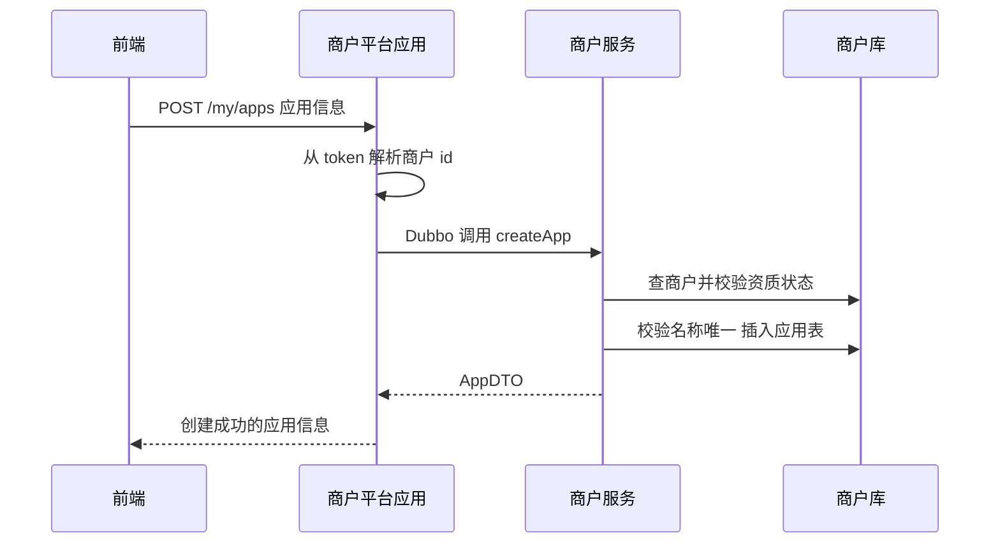

# 创建应用接口：商户服务 Dubbo 接口与商户平台应用 REST 接口的两层实现

业务流程的第一步「创建应用」要落到代码上。页面上填一个应用名称、点保存，背后却隔着两层服务：商户平台应用接收前端的 HTTP 请求，商户服务负责真正的业务校验与落库，两层之间用 Dubbo 通信。这一课把两个接口一次做完，先做被依赖的商户服务接口，再做转调它的商户平台应用接口，最后连一遍完整的联调与排错。

## 先给结论

- 两个接口分工明确：商户服务的 `AppService.createApp` 是 Dubbo 接口，负责校验与落库；商户平台应用的 `POST /my/apps` 是 REST 接口，从 token 解析商户 id 后转调前者。
- 应用管理接口独立成 `AppService`，不与商户接口挤在一个 Service 里，DTO 按应用表字段定义 `AppDTO`。
- 实现核心是一条校验链：参数判空抛 `E_300009`，商户不存在抛 `E_200002`，资质审核未通过抛 `E_200003`，应用名称重复抛 `E_200004`，全部通过才生成 UUID 应用 id 并插入应用表。
- 应用表有两个 id：主键 `ID`（雪花算法）与业务标识 `APP_ID`（UUID，唯一索引）；业务关联一律用 `APP_ID`。
- REST 接口不收商户 id，从请求头的 token 里解析，防止前端伪造身份；注入 Dubbo 服务用 `@Reference` 注解。

## 系统交互流程与开发顺序

系统交互的序列很直白：前端填写应用信息请求商户平台应用，商户平台应用请求商户服务保存应用信息，商户服务校验并保存，返回创建成功。画成时序图如下：



开发顺序由依赖关系决定。商户平台应用的接口写到最后一步要调商户服务，如果反过来先写 REST 接口，写到转调那一刻就会发现被调用的 Dubbo 接口根本不存在，功能链断在半空。这与资质申请接口的做法一致：被依赖方先行。于是工作分成两段，接口定义放 `pay-merchant-api` 工程（Dubbo 接口与 DTO 的所在地，提供方与消费方共享这份契约），实现放 `pay-merchant-service` 工程，REST 接口放商户平台应用工程。

## 接口①定义：AppService 与 AppDTO

**新建独立的 AppService。** 商户服务的 `MerchantService` 已经承载了注册、查询、资质申请等接口，应用管理是新的职责域，再往里堆会让接口类膨胀到难以阅读，按职责拆出一个 `AppService` 专门放应用相关的接口，与商户接口平行。这是服务接口设计的常规手法：一个业务域一个接口类，改应用功能时不会碰商户接口的契约。

定义接口前先分析三件事。职责：创建应用。入参：哪个商户创建（商户 id），创建的应用内容（应用信息）。出参：创建成功的应用信息，供前端直接展示。应用信息在系统内以 `AppDTO` 流转，按应用表字段定义：

```java
@Data
@ApiModel(value = "AppDTO", description = "应用信息")
public class AppDTO implements Serializable {

    private static final long serialVersionUID = 1L;

    @ApiModelProperty("应用id，新增时无需传入")
    private String appId;

    @ApiModelProperty("应用名称")
    private String appName;

    @ApiModelProperty("商户id")
    private Long merchantId;

    @ApiModelProperty("应用公钥 RSAWithSHA256")
    private String publicKey;

    @ApiModelProperty("支付回调应用的url，创建时可不填")
    private String notifyUrl;
}
```

五个字段各有讲究。`appId` 是业务标识，新增时由服务端生成，前端不传，但字段必须保留，后续大量表要靠它关联；`merchantId` 会被服务端强制回填，前端传不传都不作数；`publicKey` 与 `notifyUrl` 属于渠道对接阶段才用的信息，创建时可以留空。在 `AppService` 里追加创建方法：

```java
/**
 * 商户下创建应用
 * @param merchantId 商户id
 * @param appDTO 应用信息
 * @return 创建成功的应用信息
 * @throws BusinessException
 */
AppDTO createApp(Long merchantId, AppDTO appDTO) throws BusinessException;
```

返回值不是 `void` 而是完整的 `AppDTO`，与资质申请那种「成功即无声」的更新不同，创建应用要给前端回传应用 id 与应用信息，页面跳转和后续配置都要用，所以让创建结果以数据形式返回。接口定义放在 `pay-merchant-api` 还有一个隐性收益：这个 api 工程是 Dubbo 的契约载体，商户平台应用依赖它就能在编译期拿到接口与 DTO，方法签名、参数类型、异常声明任何一处变动，消费方编译立刻报错，契约变更被强制同步，而不是等到运行期才发现两边对不上。

## 应用表：两个 id 的设计

落库目标 `app` 表在商户库 `pay_merchant_service` 里，与商户表同库。建表语句关键部分如下（DDL 为商户库建表脚本中 `app` 表的节选，库名按本系列口径书写）：

```sql
CREATE TABLE `app` (
  `ID` bigint(20) NOT NULL,
  `APP_ID` varchar(50) DEFAULT NULL,
  `APP_NAME` varchar(50) DEFAULT NULL COMMENT '应用名称',
  `MERCHANT_ID` bigint(20) DEFAULT NULL COMMENT '所属商户',
  `PUBLIC_KEY` varchar(50) DEFAULT NULL COMMENT '应用公钥(RSAWithSHA256)',
  `NOTIFY_URL` varchar(50) DEFAULT NULL COMMENT '授权回调地址',
  PRIMARY KEY (`ID`) USING BTREE,
  UNIQUE KEY `APP_ID` (`APP_ID`) USING BTREE
) ENGINE=InnoDB DEFAULT CHARSET=utf8;
```

这张表最值得琢磨的是双 id 设计。主键 `ID` 是数据库自用的行标识，插入时由 MyBatis-Plus 的雪花算法自动回填，不出现在任何业务交互里；`APP_ID` 才是对外的应用标识，用 UUID 生成，加了唯一索引兜底，后续服务类型绑定、渠道参数配置、交易表关联应用，用的全是 `APP_ID` 而不是主键。把「数据库主键」与「业务主键」分开，业务侧就获得了自由：UUID 可以在插入前就生成并返回给调用方，不依赖数据库的自增行为，跨服务传递时也不会暴露数据规模。

对应到实体与 Mapper，`App` 实体用 `@TableName("app")`、`@TableId(value = "ID", type = IdType.ID_WORKER)` 标注，`AppMapper` 继承 `BaseMapper<App>` 即可获得通用 CRUD，与商户表的处理方式完全一致。

## 接口①实现：校验链、UUID 应用 id 与落库

实现类 `AppServiceImpl` 放在 `pay-merchant-service`，类上用 Dubbo 的 `@Service` 注解暴露服务。这里有个易错细节：Dubbo 的注解与 Spring 的 `@Service` 同名，实现类里要用全限定写法 `@org.apache.dubbo.config.annotation.Service` 加以区分，否则导错包，服务注册不到 Nacos，消费方永远调不通。方法整体如下：

```java
@Override
public AppDTO createApp(Long merchantId, AppDTO appDTO) throws BusinessException {

    if(merchantId == null || appDTO == null || StringUtils.isBlank(appDTO.getAppName())){
        throw new BusinessException(CommonErrorCode.E_300009);
    }
    // 1）校验商户是否通过资质审核
    Merchant merchant = merchantMapper.selectById(merchantId);
    if(merchant == null){
        throw new BusinessException(CommonErrorCode.E_200002);
    }
    //取出商户资质申请状态
    String auditStatus = merchant.getAuditStatus();
    if(!"2".equals(auditStatus)){
        throw new BusinessException(CommonErrorCode.E_200003);
    }

    // 应用名称需要校验唯一性
    String appName = appDTO.getAppName();
    Boolean existAppName = isExistAppName(appName);
    if (existAppName){
        throw new BusinessException(CommonErrorCode.E_200004);
    }

    //2）生成应用ID
    String appId = UUID.randomUUID().toString();

    App entity = AppCovert.INSTANCE.dto2entity(appDTO);
    entity.setAppId(appId);          //应用id
    entity.setMerchantId(merchantId);//商户id

    //调用 appMapper 向 app 表插入数据
    appMapper.insert(entity);

    return AppCovert.INSTANCE.entity2dto(entity);
}

//判断应用名称是否存在
private Boolean isExistAppName(String appName){
    Integer count = appMapper.selectCount(new LambdaQueryWrapper<App>().eq(App::getAppName, appName));
    return count > 0;
}
```

方法体是一条从前到后的校验链，顺序本身就有语义。**入口判空**把三种残缺请求一并拦下：商户 id 为空、应用对象为空、应用名称空白，抛 `E_300009` 传入对象为空或者缺少必要的参数。应用名称的判空放在第一关而不是单独去查库，空名称连查询的意义都没有，早失败早返回。**商户校验**用 `selectById` 查商户表，查不到说明 id 是编造的或已失效，抛 `E_200002` 商户不存在；跳过这一步，后面所有依赖商户上下文的逻辑都建立在空中。**资质状态校验**取出商户的审核状态，只有等于 `2`（审核通过）才放行，抛 `E_200003` 商户还未通过认证审核不能创建应用。这条约束把业务规则焊在了接口里：审核状态在资质申请时推进，未走完流程的商户还不是正式商户，不能开通支付能力，审核状态与创建应用的衔接正是状态机的意义。**名称唯一性校验**委托给私有方法 `isExistAppName`，用 `LambdaQueryWrapper` 按名称 `selectCount`，计数大于零即视为已存在，抛 `E_200004` 应用名称已经存在请使用其他名称。方法上没有加数据库唯一索引做兜底，并发窗口内理论上可以插入重名应用，这是已知取舍，靠业务校验先行、必要时再补索引加固。

校验全过之后是三步落库动作。生成 `appId`，用 `UUID.randomUUID().toString()`；`AppCovert.INSTANCE.dto2entity` 用 MapStruct 把 DTO 转成实体（转换器是接口加 `INSTANCE` 单例的标准写法，`entity2dto`、`dto2entity`、`listentity2dto` 三个方法覆盖单对象与列表两种转换）；转换之后强制回填 `appId` 与 `merchantId` 两个关键字段，`insert` 插入后把带 id 的实体再转回 DTO 返回。回填这一步不能省：`merchantId` 前端根本不传，DTO 里这个字段到实体时是空的，不回填应用就成了无主数据；`appId` 是服务端生成的，必须写进实体才能落库。

两个实现细节也值得留意。存在性检查选 `selectCount` 而不是把记录查出来再判空，是按需取数：这里只关心有没有，不需要实体的任何字段，数据库返回一个计数即可，网络传输与对象创建的开销都更小。`isExistAppName` 声明为私有方法而不上接口，名称查重是创建动作的内部步骤，放进出接口契约只会诱导消费方单独调用它，接口面上只保留真正需要跨服务暴露的能力。

## 接口②定义：AppController 与 token 解析

商户平台应用侧新建 `AppController`，同样按职责独立成应用管理的控制器，类上 `@Api` 注解让它以「商户平台-应用管理」的分组出现在 Swagger 文档里。接口定义如下：

```java
@Api(value = "商户平台-应用管理", tags = "商户平台-应用相关", description = "商户平台-应用相关")
@RestController
public class AppController {

    @Reference
    private AppService appService;

    @ApiOperation("商户创建应用")
    @ApiImplicitParams({
            @ApiImplicitParam(name = "app", value = "应用信息", required = true,
                    dataType = "AppDTO", paramType = "body")})
    @PostMapping(value = "/my/apps")
    public AppDTO createApp(@RequestBody AppDTO app){
        //得到商户id
        Long merchantId = SecurityUtil.getMerchantId();
        return appService.createApp(merchantId, app);
    }
}
```

与 Dubbo 接口相比，REST 接口的入参清单短了一半：只收应用信息，商户 id 一个字都不收。原因在身份来源上，商户 id 是登录后的身份标识，从请求头的 token 里解析，`SecurityUtil.getMerchantId()` 负责这件事：取 `authorization` 头，去掉 `Bearer ` 前缀，Base64 解码出 JSON，读 `merchantId` 字段。让前端传商户 id 等于把身份判断交给不可信的一方，任何人改个数字就能替别的商户建应用；从 token 解析，身份与服务端签发的凭证绑定，伪造成本完全不同。这也是整个商户平台接口的统一约定，此前资质申请接口已经用过同一套解析方式。

注入 Dubbo 服务用的注解是 `@Reference` 而不是 `@Autowired`：`@Autowired` 找的是本进程内的 Bean，`@Reference` 声明的是远程服务引用，框架据此从注册中心发现商户服务并代理调用。REST 方法体因此只剩两行，解析商户 id、转调 Dubbo 接口，业务逻辑一层都不留，控制器保持纯转发。

Swagger 注解在这里也不只是装饰。`@Api` 把控制器归入「商户平台-应用管理」分组，`@ApiOperation` 描述方法用途，`@ApiImplicitParam` 声明参数名、类型与传递位置，文档随代码自动生成，前端与测试不用问人就知道接口长什么样；联调阶段能直接从文档里复制出请求体的 JSON 结构，这一便利马上就会用到。

## 接口测试与两处排错

两个工程依次启动：先重启商户服务，Dubbo 接口要注册到 Nacos，启动日志里出现注册过程中的报错不必紧张，等注册完成即可；再启动商户平台应用。测试前先解决身份问题，用工程里的 `TokenTemp` 测试类生成一个 token，它把指定的商户 id、手机号、联系人姓名拼进 JSON 后 Base64 编码成 `Bearer ` 凭证，注意填进去的商户 id 必须是审核通过的，必要时在库里把该商户的审核状态手动改成 `2`，否则会被 `E_200003` 拦住。

Postman 里建一个「应用管理」目录，添加创建应用请求：POST 方式，URL 指向商户平台应用的 `/my/apps`，请求头 `authorization` 放入生成的 token，报文体用 JSON 传应用名称。token 可以直接复用资质申请联调时生成的那一份，商户 id 审核通过的前提下创建与查询接口都能继续用；Postman 里按模块建目录归置请求，注册的归注册、应用的归应用，链接复用与问题排查都清爽。懒得手写 JSON 可以从 Swagger 文档里把 `AppDTO` 的示例结构直接复制过来，删掉新增时不需要的 `appId` 与 `merchantId`，只留应用名称即可。

联调第一坑出在参数接收上。请求发出后返回 `E_300009`，断点跟进去发现 `appName` 是空的，JSON 明明传了。原因在方法签名上漏了 `@RequestBody`，Spring 默认把参数当表单或查询参数解析，JSON 报文体没人认领，字段全是空。补上注解并让 `@ApiImplicitParam` 的 `name`、`dataType` 与形参保持一致，重启后参数顺利进入。

```json
{
  "appName": "某某电商网站"
}
```

第二坑出在落库结果上。接口返回成功，查库却发现 `MERCHANT_ID` 是空的，应用成了无主数据。回看实现：DTO 转实体时 `merchantId` 为空（前端没传，本来也不该传），转换器原样拷贝，回填 `entity.setMerchantId(merchantId)` 就是为此而设，漏了这行就会出现这个现象。补上重启再测，应用插入成功，`APP_ID` 是一个 UUID，`MERCHANT_ID` 正确关联。随后原样再发一次请求，返回 `E_200004` 应用名称已经存在，重复名称被校验链拦下，行为符合预期，创建应用的两个接口至此开发与测试完毕。

## 常见误区

- **校验写在 REST 层，Dubbo 层裸奔。** 错例：判空、查商户、查重名都堆在 `AppController` 里，实现类只管插入。正解：校验链收在商户服务的实现里，REST 层只做身份解析与转发，任何消费方走 Dubbo 接口都能得到同等保护。
- **让前端传商户 id。** 错例：REST 接口加一个 `merchantId` 参数，信任前端的取值。正解：商户 id 从 token 解析，前端传来的身份字段一律不采信，防止伪造身份替他人创建应用。
- **JSON 接口漏写 @RequestBody。** 错例：方法签名只写 `AppDTO app`，前端传 JSON 后所有字段为空，接口报参数缺失。正解：报文体为 JSON 时参数必须标注 `@RequestBody`，并让 Swagger 注解的参数名与类型和形参一致。
- **转换后不回填关键字段。** 错例：`dto2entity` 后直接 `insert`，落库的 `APP_ID` 或 `MERCHANT_ID` 为空。正解：转换与插入之间固定回填服务端生成的 `appId` 与解析出的 `merchantId`，前端不提供、服务端才有权威值的字段都要走回填。
- **Dubbo 注解导错包。** 错例：实现类上写了 Spring 的 `@Service`，以为服务已暴露，消费方却一直找不到服务。正解：Dubbo 服务实现用 `org.apache.dubbo.config.annotation.Service`，与 Spring 同名注解冲突时写全限定名。

## 面试可能被问到的问题

1. 面试官追问：「创建应用为什么要拆成两个接口，开发顺序怎么定？」
   答：商户平台应用面向前端提供 HTTP 接口，商户服务面向内部提供 Dubbo 接口，REST 接口收到请求后要转调 Dubbo 接口完成校验与落库，职责分层让业务规则收拢在服务层，多个消费方可复用。开发顺序上被依赖的 Dubbo 接口先行，否则 REST 接口写到转调一步无法完成。
2. 面试官追问：「应用表为什么同时有主键 ID 和 APP_ID？」
   答：主键 ID 是数据库行标识，由雪花算法自动回填，不参与业务；APP_ID 是对外业务标识，用 UUID 生成并建唯一索引，后续服务类型绑定、渠道参数、交易关联都引用它。业务主键与数据库主键分离，可以在插入前生成标识直接返回调用方，也不依赖自增行为。
3. 面试官追问：「创建应用前为什么强制校验资质审核状态？」
   答：审核状态是商户身份完整性的标志，注册时为未申请，资质申请后进入待审核，审核通过才成为正式商户。未通过审核的商户尚不属于平台认可的经营主体，放行创建应用会让支付能力脱离审核管控，所以接口在业务动作前用状态机把关，状态不等于 2 直接拒绝。
4. 面试官追问：「应用名称唯一性怎么保证，有什么不足？」
   答：实现上按名称 selectCount，大于零即拒绝，业务校验给调用方明确的错误码。不足在于查询与插入之间存在并发窗口，极端情况下可以插入重名应用，彻底解决要给 APP_NAME 加唯一索引兜底，让数据库约束做正确性的最后防线，业务校验负责体验。
5. 面试官追问：「REST 接口的商户 id 为什么从 token 解析而不是前端传？」
   答：商户 id 是登录身份，必须来自服务端签发的凭证。token 里带有商户 id，接口从 authorization 头取出解码即可，前端传值无法验证真伪，改一个数字就能冒充其他商户操作。身份从凭证来、数据从请求体来，两条通道分开是接口安全的基本设计。
6. 面试官追问：「@Reference 和 @Autowired 有什么区别？」
   答：@Autowired 注入的是本地容器里的 Bean，@Reference 注入的是 Dubbo 远程服务的代理对象，框架从注册中心发现提供方、建立连接并在调用时做网络通信与负载均衡。调远程服务误用 @Autowired 会直接报找不到 Bean 或拿到空引用，两者不可互换。

## 配套资料

- 讲义：`materials/docs/10/闪聚支付-第2章-讲义-支付参数配置v1.0.md`，4.1 需求分析（系统交互流程）、4.2.1 商户服务创建应用接口（接口描述、AppDTO 与 createApp 定义、AppServiceImpl 实现）、4.2.2 商户平台应用创建应用接口（AppController 定义与接口测试）为本课出处。
- 代码：`materials/code/10/shanjupay/`，聚合支付工程，商户服务模块的 `entity/App`、`mapper/AppMapper` 为真实文件；`AppServiceImpl`、`AppController`、`AppDTO`、`AppCovert` 的完整实现与 `TokenTemp` 测试类分布在按开发阶段归档的工程副本中（`materials/code/10/` 下的归档目录，内层目录名含项目原始命名，不在此展开，按用途自取）；app 表 DDL 见商户库建表脚本（归档于 `materials/code/10/` 的散件目录，文件名含原始命名，不在此展开），正文 DDL 为该脚本节选。
- 说明：错误码 `E_300009`、`E_200002`、`E_200003`、`E_200004` 的语义以通用工程错误码枚举为准；包名按 `com.study.pay` 系口径改写，正文代码为真实文件改写后的节选。
