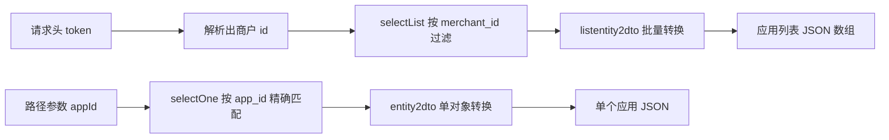

# 应用查询接口：按商户查列表与按应用 id 查详情

创建应用的接口联调通过后，前端手里有了写入能力，还缺读取能力：商户登录进应用管理页，要看到自己名下有哪些应用；进入渠道参数配置前，要能按应用 id 取到应用的详细信息。这一课补齐两个查询接口，依旧遵循先 Dubbo 后 REST 的两层结构，顺带把「业务 id 与数据库主键」这个容易踩坑的辨析讲透。

## 先给结论

- 两个查询接口：`queryAppByMerchant(Long merchantId)` 返回商户名下的应用列表，`getAppById(String appId)` 返回单个应用详情，都定义在商户服务的 `AppService` 里，声明与实现分开。
- 列表查询用 `LambdaQueryWrapper` 按 `merchantId` 过滤 `selectList`，实体列表经 MapStruct 的 `listentity2dto` 批量转成 `AppDTO` 再出服务边界。
- 详情查询不能写 `selectById`：那查的是主键 `ID`，业务 id 是 `APP_ID`，必须 `eq(App::getAppId, appId)` 配 `selectOne`。
- REST 侧两个接口：`GET /my/apps` 无任何参数，商户 id 从 token 解析；`GET /my/apps/{appId}` 用 `@PathVariable` 接收路径参数，Swagger 注解的 `paramType` 写 `path`。
- 测试两条线：Postman 带 token 查列表看 JSON 数组，Swagger 填一个库中的 appId 查详情。

## 两个查询的定位

查询接口对应前端的两类场景。列表查询服务应用管理主页，商户登录后页面要铺开他名下的所有应用，数据范围天然限定为「当前登录商户自己的」，与创建接口一样走 token 解析商户 id，前端不需要也无法传这个条件。详情查询服务后续操作的前置取值，比如配置渠道参数、排查某笔支付归属时，拿着一个 `appId` 换取应用的完整信息，调用方是页面也可能是其他服务。

两条路径的数据流如下：



上图左支是从身份到列表的路径，右支是从业务 id 到详情的路径，两条支路在转换层汇合：实体永远不出商户服务，跨服务与跨边界的只有 DTO。

## 商户服务接口定义与实现

`AppService` 追加两个声明，注释把语义写清楚：

```java
/**
 * 根据商户id查询应用列表
 * @param merchantId 商户id
 * @return
 * @throws BusinessException
 */
List<AppDTO> queryAppByMerchant(Long merchantId) throws BusinessException;

/**
 * 根据应用id查询应用信息
 * @param appId 应用id
 * @return
 * @throws BusinessException
 */
AppDTO getAppById(String appId) throws BusinessException;
```

实现落在 `AppServiceImpl`，两个方法各有一个值得展开的点：

```java
@Override
public List<AppDTO> queryAppByMerchant(Long merchantId) throws BusinessException {
    List<App> apps = appMapper.selectList(
            new LambdaQueryWrapper<App>().eq(App::getMerchantId, merchantId));
    return AppCovert.INSTANCE.listentity2dto(apps);
}

@Override
public AppDTO getAppById(String appId) throws BusinessException {
    App app = appMapper.selectOne(
            new LambdaQueryWrapper<App>().eq(App::getAppId, appId));
    return AppCovert.INSTANCE.entity2dto(app);
}
```

列表方法的点在批量转换。`selectList` 返回的是 `List<App>` 实体集合，直接返回会把表结构暴露给消费方，后续加字段也会牵连接口契约；`AppCovert` 里预置的 `listentity2dto` 一次完成整表映射，DTO 列表才是跨服务边界的合法形态。详情方法的点在条件构造器的选择：手写 SQL 或用 `QueryWrapper` 字符串列名都容易拼错，`LambdaQueryWrapper` 以方法引用 `App::getAppId` 定位列名，编译期就能查出写错的属性。

`getAppById` 最容易写错的地方是下意识写成 `appMapper.selectById(appId)`。`selectById` 按主键匹配，而这里的入参是业务标识 `APP_ID`，两者根本不是同一列，用 UUID 去撞雪花主键，查不到是常态，偶尔撞上了反而是灾难。业务 id 查询必须走 `eq(App::getAppId, appId)` 配 `selectOne`。另外 `selectOne` 查不到时返回 null，当前实现把这个 null 原样转成 null 返回，调用方拿到空对象，稳妥的写法是判空后抛业务异常，让「应用不存在」有明确的错误码，这属于可改进项，不是当前行为的辩护。

## 商户平台应用接口

REST 层两个接口都在 `AppController`，一个不带参数，一个带路径参数：

```java
@ApiOperation("查询商户下的应用列表")
@GetMapping(value = "/my/apps")
public List<AppDTO> queryMyApps() {
    //商户id
    Long merchantId = SecurityUtil.getMerchantId();
    return appService.queryAppByMerchant(merchantId);
}

@ApiOperation("根据应用id查询应用信息")
@ApiImplicitParam(value = "应用id", name = "appId", dataType = "String", paramType = "path")
@GetMapping(value = "/my/apps/{appId}")
public AppDTO getApp(@PathVariable("appId") String appId){
    return appService.getAppById(appId);
}
```

列表接口的签名里没有任何参数，商户 id 在方法体内从 token 解析，与创建接口共用同一套身份约定，前端想多查别人的应用连入口都找不到。详情接口引入了新的传参方式：`appId` 放在 URL 路径里，形参用 `@PathVariable("appId")` 绑定，注解值与路径占位符同名；Swagger 注解的 `paramType` 相应写 `path`。至此 REST 接口的三种传参方式凑齐了对照：`query` 走查询串，`body` 走报文体，`path` 走 URL 路径，`appId` 这类资源标识符放路径最自然，接口读起来就是一个资源定位表达式。

## 接口测试

两个工程启动后先测列表。Postman 里把请求方式换成 GET，URL 与创建应用相同，都是 `/my/apps`，请求头 `authorization` 放入此前生成的 token，发送后返回一个 JSON 数组，之前创建的应用都在里面，几个应用就有几个元素。响应结构如下（示例值取自测试库的占位形式）：

```json
[
  {
    "appId": "example-app-id-1",
    "appName": "某某电商网站",
    "merchantId": 12112208148344425,
    "publicKey": "",
    "notifyUrl": ""
  }
]
```

再测详情，走 Swagger 更省事：展开「商户平台-应用管理」分组，找到根据应用 id 查询的接口，从数据库的 `app` 表里挑一条 `APP_ID` 复制进参数框执行，返回单个应用对象，字段与列表元素一致。两个接口一数组一对象，查询能力就此补全，商户平台的应用管理具备了增与查的完整闭环。

## 常见误区

- **用 selectById 查业务 id。** 错例：`getAppById` 里写 `selectById(appId)`，拿 UUID 去匹配雪花主键。正解：主键与应用标识是两列，业务 id 查询用 `LambdaQueryWrapper.eq(App::getAppId, appId)` 配 `selectOne`。
- **实体列表直接跨服务返回。** 错例：`queryAppByMerchant` 返回 `List<App>`，消费方拿到了表结构。正解：服务边界只出 DTO，批量转换交给 `listentity2dto`，表结构变化被隔离在服务内部。
- **详情接口对查空不设防。** 错例：`selectOne` 返回 null 原样透传，调用方解引用时抛空指针。正解：查不到时抛明确的业务异常，让「应用不存在」有错误码可循，而不是让 null 在调用链上游走。
- **列表接口让前端传商户 id。** 错例：`GET /my/apps?merchantId=xxx`，任何人改参数就能枚举他人应用。正解：数据范围条件一律从 token 解析，请求里只放真正由操作者提供的输入。

## 面试可能被问到的问题

1. 面试官追问：「按商户查应用列表的实现要点是什么？」
   答：MyBatis-Plus 的 selectList 配 LambdaQueryWrapper 按 merchantId 过滤，方法引用指定列名有编译期检查；结果集必须经 MapStruct 批量转成 DTO 再返回，实体不出服务边界。商户 id 来自 token 解析，接口不开放这个查询条件。
2. 面试官追问：「根据应用 id 查详情为什么不能用 selectById？」
   答：selectById 匹配的是数据库主键 ID，雪花算法生成的数字；业务里的应用 id 是 APP_ID 列，存的是 UUID，两者不是同一列。用 selectById 查业务 id 永远匹配不上，业务 id 查询要用条件构造器 eq APP_ID 配 selectOne。
3. 面试官追问：「查询列表接口为什么不设计成接收商户 id 参数？」
   答：商户 id 是登录身份而非操作者输入，从 token 解析能保证数据范围不可篡改；开放成查询参数等于把数据隔离交给前端，改个数字就能枚举别人的应用。身份类条件走凭证，操作类输入走请求，是接口设计的分工原则。
4. 面试官追问：「@PathVariable、@RequestParam、@RequestBody 分别适合什么数据？」
   答：@PathVariable 绑定 URL 路径占位符，适合资源标识符；@RequestParam 绑定查询串参数，适合过滤、分页这类可选条件；@RequestBody 绑定报文体，适合结构化对象。Swagger 注解的 paramType 要与之对应，path、query、body 三种写法让文档与实现一致。
5. 面试官追问：「selectOne 查不到数据时该返回什么？」
   答：不建议原样返回 null，null 会让调用方承担判空责任，漏判就是空指针。查询语义上有明确的不存在情形时，抛出携带错误码的业务异常更安全，调用方从异常里拿到「应用不存在」的确定信息；确实允许缺失的场景才返回 Optional 或 null，并在接口文档里写明。

## 配套资料

- 讲义：`materials/docs/10/闪聚支付-第2章-讲义-支付参数配置v1.0.md`，4.3 应用查询（4.3.1 商户服务应用查询接口的接口定义与实现、4.3.2 商户平台应用查询接口的接口定义与测试）为本课出处。
- 代码：`materials/code/10/shanjupay/`，聚合支付工程，商户服务模块的 `entity/App`、`mapper/AppMapper` 为真实文件；`AppService` 两个查询声明、`AppServiceImpl` 查询实现、`AppController` 两个 GET 接口的完整实现分布在按开发阶段归档的工程副本中（`materials/code/10/` 下的归档目录，内层目录名含项目原始命名，不在此展开，按用途自取）。
- 说明：包名按 `com.study.pay` 系口径改写，正文代码为真实文件改写后的节选；响应 JSON 为测试示例，取值均为占位形式。
