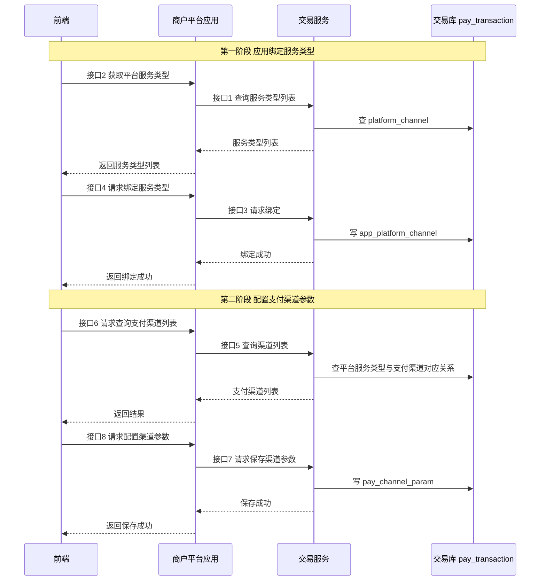

# 支付渠道参数配置需求分析：交易服务登场与两阶段配置流程

商户创建好应用，下一个问题立刻摆在面前：这个应用要用平台的支付通道收款，支付参数从哪儿来、配到哪儿去。支付渠道参数配置模块回答的正是这件事，而它的需求分析里出现了一个此前没登场过的新角色，交易服务。参数为什么配在交易服务里、八个接口怎么协作、为什么要先绑定服务类型再配参数，这一课把交互流程整体盘清。

## 先给结论

- 支付渠道参数配置由商户平台应用与交易服务协作完成，交易服务是本模块新引入的微服务。
- 交易服务的职责是提供支付渠道参数配置、订单、发起支付、转账、退款等功能，配置参数只是它接下的第一件事。
- 整个配置流程分两个阶段：第一阶段给应用绑定服务类型，第二阶段为服务类型配置支付渠道参数。
- 全链路八个接口，编号成对出现：奇数接口在交易服务侧，偶数接口在商户平台应用侧，业务实现全部落在交易服务。
- 绑定服务类型的本质是缩小参数配置范围：应用选了 C 扫B，就只需要配 C 扫B 所对应支付渠道的参数。

## 交易服务：参数为什么要配在新服务里

交易服务顾名思义，是承载交易业务的微服务。将来发起订单、发起支付、转账、退款等与交易相关的功能，都会在交易服务里开发。支付渠道参数配置做的事情，是为将来发起支付准备参数，参数的最终使用者正是交易服务，所以配置功能直接建在交易服务里，配好的参数与用参数的代码同处一个服务，链路最短。

这也解释了架构上的变化。此前的商户注册、资质申请、创建应用都在商户平台应用与商户服务之间完成，交易服务从本模块起加入体系，交易数据库 `pay_transaction` 也随之启用。平台基础数据、应用与服务的绑定关系、渠道参数，都将落在这套交易库里。

## 交互全景：八个接口、两个阶段

交互流程图上共有八个接口，乍看有点多，按前面分析的配置流程拆开，其实就两块。画成时序图如下：

图中每个动作都是「前端请求商户平台应用，商户平台应用请求交易服务」的一对调用，四个偶数接口面向前端，四个奇数接口落在交易服务：

| 阶段 | 商户平台应用接口 | 交易服务接口 |
|---|---|---|
| 绑定服务类型 | 接口② 获取平台服务类型、接口④ 绑定服务类型 | 接口① 查询服务类型列表、接口③ 绑定服务类型 |
| 配置渠道参数 | 接口⑥ 查询支付渠道列表、接口⑧ 配置渠道参数 | 接口⑤ 查询支付渠道列表、接口⑦ 保存渠道参数 |

编号规律值得记一下：奇数接口是交易服务的 Dubbo 接口，偶数接口是商户平台应用对前端的 REST 接口，REST 接口一律转调对应的 Dubbo 接口。这个对照关系贯穿整个模块的后续课程，看到接口编号就能定位实现位置。

## 第一阶段：给应用绑定服务类型

服务类型是平台给商户提供的服务方式，线下支付里有 B 扫C、C 扫B，线上支付有网页支付，各自都是一种服务类型。配置参数前必须先让应用选定要用哪些服务类型，原因很直接：服务类型决定了要配哪些参数。

界面上的操作流程如下。应用创建成功后自动跳转到给应用绑定服务类型的页面，此时页面里已经选定了一个应用；页面列出平台所有的服务类型，每个服务类型旁边有「开启服务」按钮。一家开餐厅的商户创建了餐厅应用，要使用线下支付，就在列表里为它选 B 扫C、C 扫B，点「开启服务」就把当前选定的应用与这个服务类型绑定起来。绑定要素正好两个，应用与服务类型，页面里一个已选定、一个由用户点选。

绑定完成后页面上已选的服务类型按钮置灰，含义是绑定关系已生效，这个应用将来就用所选的服务类型支付。到此第一阶段结束，配置的范围已经被圈定，往下走就是为这个范围内的服务类型配置参数。

## 第二阶段：为服务类型配置支付渠道参数

应用选定了服务类型，平台还要回答一个问题：这种服务类型靠哪些支付渠道实现。C 扫B 服务类型对接的是微信 JSAPI 接口与支付宝手机网站支付接口，绑定关系是平台预先配置好的基础数据。进入参数配置页面时，系统把所选服务类型对应的支付渠道列出来，C 扫B 下就是微信与支付宝两条，每条后面有「配置参数」按钮，点开后展开对应渠道的参数表单。

参数的内容从第三方平台来。商户先要到微信或支付宝注册，成为它们的商户，登录微信商户平台或支付宝开放平台，把渠道要求的参数拿到手，再配到闪聚支付平台上。配好之后，闪聚支付平台在交易时作为中介，把参数信息转发给微信或支付宝，由它们完成实际支付。所以配置表单里填的是微信侧或支付宝侧的凭证信息，渠道不同，表单内容不同，这正是第二阶段要逐渠道完成的工作。

两个阶段串起来，配置的完整逻辑就通了：最终要配的是支付渠道的参数，支付宝、微信各自需要什么就配什么；应用决定用哪些服务类型，服务类型决定对接哪些渠道，三层递进，先绑定、后配置，顺序不能反。

## 常见误区

- **跳过绑定服务类型直接配参数。** 错例：应用一建好就想填微信参数。正解：参数挂在「应用加服务类型」的绑定关系下，应用没绑定服务类型，参数没有落点，必须先完成第一阶段。
- **把八个接口看成八个功能。** 错例：八个接口逐个当独立需求开发。正解：八个接口是四个动作在两层服务上的映射，奇偶成对，商户平台应用接口只做转发，实现全部收在交易服务。
- **认为参数配置在商户服务完成。** 错例：沿用创建应用的思路，把渠道参数存进商户库。正解：渠道参数属于交易域，配置接口与存储都在交易服务与交易库 `pay_transaction`。
- **绑定关系理解成应用加渠道。** 错例：以为应用直接绑定微信或支付宝。正解：应用绑定的是平台服务类型，服务类型再映射到支付渠道，应用与具体渠道之间隔着两层基础数据。

## 面试可能被问到的问题

1. 面试官追问：「支付渠道参数配置为什么引入交易服务，放在商户服务里不行吗？」
   答：渠道参数是交易执行时要用到的数据，发起支付、订单、转账、退款等交易功能都规划在交易服务里，参数与使用者放在同一个服务，调用链最短，职责也清晰。商户服务管的是商户、应用这类主体数据，交易域的数据与逻辑独立成服务，符合微服务按业务域拆分的原则。
2. 面试官追问：「为什么必须先绑定服务类型，再配置支付渠道参数？」
   答：服务类型决定参数配置的范围。平台把可用的支付方式抽象成服务类型，服务类型再关联到具体的支付渠道，应用绑定了服务类型，系统才知道要为它列出哪些渠道、配置哪些参数。不绑定就配参数，参数缺少「应用加服务类型」这层归属，支付时无从取用。
3. 面试官追问：「八个接口的编号有什么规律？」
   答：奇数接口是交易服务侧的 Dubbo 接口，负责业务实现；偶数接口是商户平台应用侧的 REST 接口，面向前端并转调对应的奇数接口。两两成对，一个动作横跨两层服务，前端视角与实现视角各占一个编号。
4. 面试官追问：「商户配置的渠道参数是从哪里来的？」
   答：来自第三方支付平台。商户先在微信或支付宝注册成为其商户，登录对方平台获取渠道要求的参数，再把参数配置到闪聚支付平台。平台在交易时作为中介，携带这些参数调用第三方接口完成支付。
5. 面试官追问：「应用绑定服务类型的动作，在数据上表现为什么？」
   答：在交易库的应用与服务类型绑定表中插入一条记录，记录应用标识与服务类型编码的对应关系。一次绑定一条，一个应用可以绑定多个服务类型，绑定关系是后续渠道参数配置与支付路由的依据。

## 配套资料

- 讲义：`materials/docs/10/闪聚支付-第2章-讲义-支付参数配置v1.0.md`，5.1.1 系统交互流程（交易服务职责、第一阶段应用绑定服务类型、第二阶段支付渠道参数配置的十二步交互）为本课出处。
- 代码：`materials/code/10/代码/`，交易服务与商户平台应用等工程归档于该目录（内层工程目录与包名为课程原始命名，不在此展开，正文按 `com.study.pay` 系口径对应改写）；本课为需求分析篇，暂不涉及业务代码，工程结构在搭建交易服务工程的课程展开。
- 说明：该阶段课程资料归档在 `materials/docs/10/` 与 `materials/code/10/`（不存在 09 编号目录），引用路径截至该层级。
